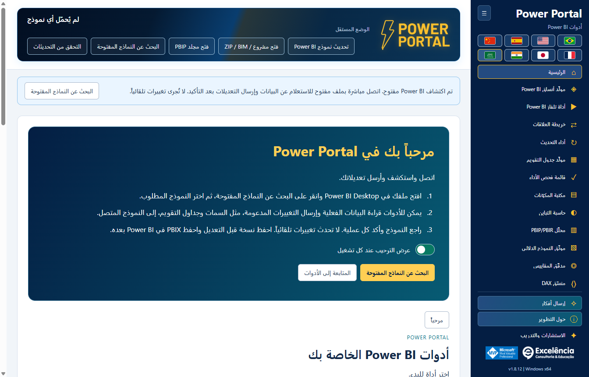
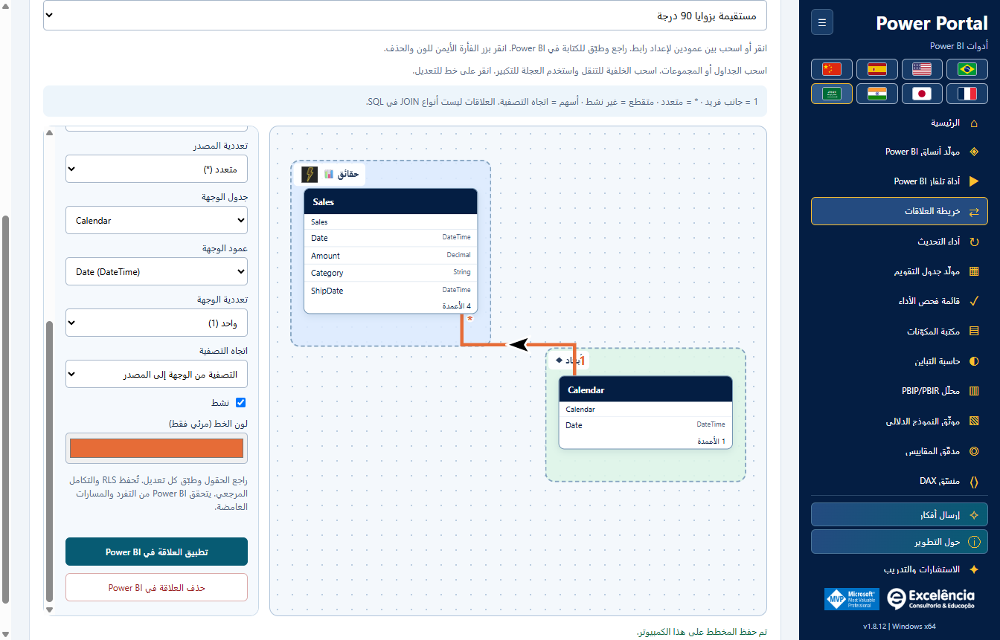
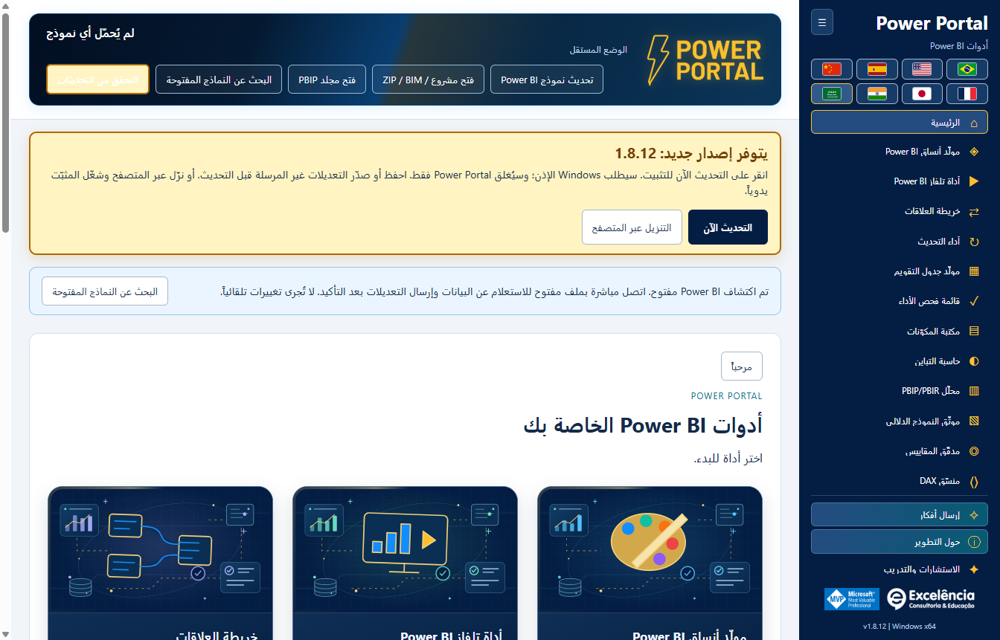
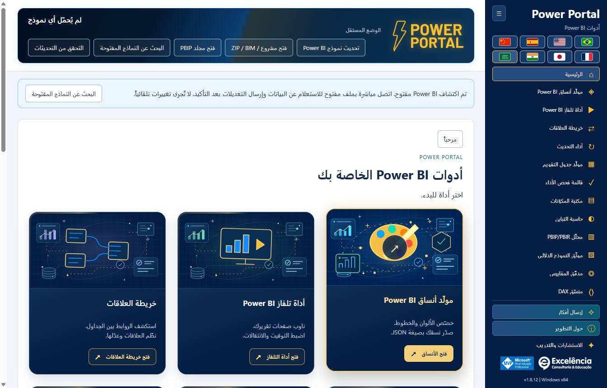

# Power Portal Desktop

<!-- language-selector -->

| Idioma / Language | Link |
| :--- | :--- |
| 🇺🇸 English | [README.md](README.md) |
| 🇧🇷  Brasil  Português | [README.pt-BR.md](README.pt-BR.md) |
| 🇪🇸 Español | [README.es.md](README.es.md) |
| 🇨🇳 简体中文 | [README.zh-CN.md](README.zh-CN.md) |
| 🇫🇷 Français | [README.fr.md](README.fr.md) |
| 🇯🇵 日本語 | [README.ja.md](README.ja.md) |
| 🇮🇳 हिन्दी | [README.hi.md](README.hi.md) |
| 🇸🇦 العربية | [README.ar.md](README.ar.md) |
<!-- /language-selector -->

**1.8.12 — أرسل أفكار التحسين دون ازدحام القائمة**

يظهر إرسال أفكار فوق حول التطوير مباشرة. يقبل النموذج الميسر عنواناً حتى 120 حرفاً ووصفاً حتى 1000. يطلب فتح البريد مع الفكرة تشغيل تطبيق البريد الافتراضي مع المستلم الثابت contato@consultoriaexcelencia.com.br والموضوع والرسالة المعبأة. راجع وأرسل من التطبيق: لا يرسل Power Portal تلقائياً ولا يؤكد التسليم. إذا لم يفتح، اضبط تطبيق البريد الافتراضي أو أرسل يدوياً. لا تُرفق بيانات النموذج أو الملفات أو بيانات الاعتماد ولا تُحفظ المسودات على القرص. لا تدخل معلومات سرية. تُعرض الأخطاء بوضوح ويُحفظ النص لإعادة المحاولة أو النسخ. يعمل النموذج دون اتصال؛ يعتمد الإرسال على حساب البريد والشبكة.

أصبحت أزرار الأدوات والمسافات في النوافذ المنخفضة أكثر إحكاماً دون إخفاء التحكم أو إضافة تمرير للقائمة. تحققت اختبارات الحزمة من القوائم الموسعة/المطوية بارتفاع 680/768/900 بكسل واللغات الثماني وأزرار بارتفاع 24 بكسل على الأقل ولوحة المفاتيح والحقول المطلوبة والمستلم الثابت والترميز وفشل تطبيق البريد والاحتفاظ بالنص. اعترضت الاختبارات فتح البريد ولم تُرسل أي رسالة. تستخدم الصور بيانات اصطناعية.

**1.8.10 — رسوم أمامية متحركة وتأثير تحويم أغنى**

تحرك أغلفة الأدوات الاثني عشر في الصفحة الرئيسية الآن الرسم الأساسي للأداة وليس الخلفية فقط، بطفو ودوران لطيفين وشارة تحقق نابضة في المقدمة. يظهر عند التحويم أو التركيز بلوحة المفاتيح المزيد من لوحات الأعمدة ومؤشر سداسي ومدار متقطع وجسيمات متحركة. تتوقف الحركات الإضافية مؤقتاً خارج التحويم/التركيز. لا تعترض الطبقات الزخرفية النقرات ولا تدخل شجرة إمكانية الوصول. يوقف تفضيل تقليل الحركة في Windows/المتصفح الحركات مع الحفاظ على التفاصيل الثابتة والتباين والتركيز. تبقى الرسوم المحلية الأصلية بلا نص واللغات الثماني والتنقل كما هي. قاست اختبارات الحزمة تغير التحويلات الفعلي للرسوم الأمامية واللوحات وتحققت من تركيز لوحة المفاتيح وتقليل الحركة واثني عشر غلافاً مختلفاً والتخطيط باللغات الثماني. الصور لقطات ثابتة للحالتين العادية والتحويم وليست فيديو؛ البيانات اصطناعية.

**1.8.9 — عينة التقويم واختصار التحديث الأصلي**

في مولد جدول التقويم تظهر العينة الفعلية (حتى 50 صفاً) الآن أسفل زر إنشاء البرنامج النصي. يوجد تحديث في Power BI بجانبه، ويفتح أداء التحديث عند الاتصال لبدء تدفق تحديث بيانات النموذج الأصلي نفسه مع التأكيد. تابع حالات الجداول والمدد وأعداد الصفوف هناك. يحدث هذا النموذج بالكامل ولا يطبق البرنامج النصي ولا ينشئ جدول التقويم أو يستبدله ولا يحفظ PBIX. يبقى إنشاء التقويم في Power BI إجراء منفصلاً. يُعطل الزر دون اتصال ويدعم لوحة المفاتيح واللغات الثماني. يستخدم الإلغاء والأخطاء التدفق الحالي. تبقى العينة آخر قراءة مطلوبة؛ استخدم قراءة التقويم المحدد مجدداً بعد التحديث. تحققت اختبارات التطبيق المعبأ من الموضع والترجمات الثماني والتعطيل دون اتصال والاتصال المحدد والإلغاء والأخطاء الظاهرة وإعادة المحاولة والحفاظ على إنشاء التقويم. لم يبدأ تحديث فعلي للنموذج في هذه الاختبارات؛ تستخدم الصور بيانات اصطناعية.

**1.8.8 — خطوط علاقات ديناميكية وإرسال سمات متحقق منه**

في خريطة العلاقات يتيح نمط الخطوط الاختيار بين المنحنيات والخطوط المستقيمة بزوايا 90 درجة. تتصل النهايات ديناميكياً بالحواف العلوية/السفلية أو اليمنى/اليسرى المتقابلة، مع مراعاة الحجم الفعلي للبطاقات. تحتفظ الوصلات الجانبية بارتفاع العمود المرتبط. تتبع الأسهم السوداء ذات الحدود البيضاء المقاطع المستقيمة ولا تميل قطرياً عند الزوايا. يُحفظ النمط تلقائياً ويُضمّن في JSON المُصدّر؛ وتبقى التخطيطات القديمة منحنية. لا يغير ذلك تخطيط Power BI الأصلي ولا ينفذ تجنباً شاملاً للعوائق.

يعيد إرسال السمة مباشرة إلى Power BI التركيز إلى Power Portal بعد الاستيراد الأصلي وأثناء التحقق بالتصدير، فقط عندما يكون Power BI في المقدمة. بعد التحقق من السمة يُعرض Power BI؛ وتُعرض النافذة المحددة أيضاً عند الخطأ للمراجعة. قد تظهر مربعات الحوار الأصلية لفترة وجيزة ولا يتم إخفاؤها: لا يوفر Desktop واجهة سمات مدعومة بلا حوار. تُعالج تغييرات تبويب الشريط غير المتزامنة قبل تأكيد السمة. تحقق اختبار فعلي مصرح به للتطبيق المعبأ من الاستيراد/التصدير وعودة التركيز إلى Portal وتنشيط Power BI النهائي، ثم أعاد السمة الافتراضية الأصلية دون حفظ PBIX. تستخدم لقطات الوثائق بيانات اصطناعية.

**1.8.7 — اختيار ألوان أوضح وأكثر موثوقية**

تتضمن ألوان النسق الأحد عشر الآن عينة أصلية مرئية وزر اختيار اللون بجانب حقل HEX القابل للتحرير. انقر العينة أو الزر، أو اضغط Enter/Space عند تركيز الزر. لم يعد المنتقي يعتمد على حقل مخفي بلا أبعاد أو النقر المزدوج على HEX. يظل التحرير اليدوي والاستيراد والمعاينة المباشرة وتصدير JSON متاحاً، وتظهر أخطاء الفتح صراحةً. تم التحقق من فتح المنتقي الأصلي مراراً في Windows ومن الأزرار الأحد عشر بالماوس ولوحة المفاتيح واللغات الثماني.

أصبح اسم تحليل التحديث هو أداء التحديث في القائمة والرئيسية والعنوان واللغات الثماني. يتغير الاسم فقط؛ التحديث الأصلي والتقدم والأزمنة والصفوف والسجل المحلي وتوافق JSON/CSV لا تتغير. تبقى التحليلات المحفوظة متاحة دون ترحيل أو تحديث البيانات مجدداً. الصور تستخدم بيانات اصطناعية.

**1.8.6 — تابع التحديث داخل Power Portal**

ابدأ التحديث والتحليل في Power Portal وتابع بطاقات مباشرة تعرض كل جدول والحالة المرصودة ومرحلة المحرك ووقت النشاط وآخر نص تقدم أصلي متاح من Power BI. يستعيد Power Portal التركيز بعد البدء، وإذا عاد Power BI إلى المقدمة يعيده مرة أخرى بعد انتهاء التحديث. لا يسلب التركيز باستمرار من التطبيقات الأخرى. يفتح عرض في Power BI الملف المحدد دون بدء تحديث جديد، ويعطل الرجوع التلقائي للتركيز في هذا الالتقاط.

يبقى Power BI محرك التحديث. قد تظهر نافذته لفترة وجيزة؛ هذه ليست واجهة مدعومة لمعالجة PBIX دون نافذة. تبقى بيانات الاعتماد والأخطاء والإلغاء في Power BI، ولا تُخفى الحوارات أو تُغلق تلقائياً. يحتفظ النص الأصلي بلغة Power BI ويعرض وقت آخر قراءة. يُذكر تعذر القراءة صراحةً ويستمر تتبع المحرك عند فشل قارئ الواجهة. انتهاء المرحلة لا يثبت اكتمال الجدول، ولا تُختلق نسب مئوية، وتُعد الصفوف النهائية بعد الالتقاط. يتضمن السجل وJSON الحالات الأصلية؛ راجع التصدير قبل مشاركته. تم اختبار التطبيق المعبأ بتحديث حقيقي مصرح به: قياس 4/4 جداول وعد 4/4 صفوف الجداول وحالات مباشرة واستعادة التركيز وزر العرض وحفظ السجل بعد إعادة التحميل. لم يُحفظ PBIX تلقائياً؛ الصور تستخدم بيانات اصطناعية.

**1.8.5 — إصلاح قياسات التحديث الأصلي**

يتعرف أداء التحديث الآن على أمر XML Refresh الأصلي في Power BI Desktop، بما فيه Refresh داخل Batch، إضافة إلى XMLA Process وTMSL refresh. سابقاً كان التحديث قد يُنفذ لكن تُستبعد أحداث تقدمه، فتظهر 0 جداول مقاسة وعدد صفوف غير متاح وrefreshCompletionNotProven. يُقبل الآن نجاح المحرك الصريح عند غياب حقل Error الاختياري؛ وتظل رموز الخطأ غير الصفرية وأخطاء XMLA ذات أولوية. ما زال التقدم يتطلب ارتباطاً دقيقاً بالطلب أو النشاط لاستبعاد استعلامات المرئيات غير المرتبطة.

قبل التعرف على أول أمر، توضح الواجهة أنها تنتظر أحداث تحديث Power BI. عند عدم تأكيد الاكتمال تظهر إرشادات مترجمة بدلاً من رمز تقني فقط. حدّث التطبيق واتصل بملف PBIX الصحيح وأعد التحديث والتحليل؛ تُحفظ التقارير القديمة غير المكتملة ولا تُحوّل إلى ناجحة. تم التحقق من التطبيق المعبأ من البداية للنهاية بتحديث حقيقي أذن به المستخدم، مع نشاط الجداول والصفوف والاكتمال التلقائي واستمرار السجل بعد إعادة التحميل. تظل صور التوثيق أمثلة اصطناعية دون بيانات العميل أو أسماء نماذجه.

**1.8.5 — تنزيل التحديثات عبر المتصفح**

عند توفر إصدار أحدث، يعرض إشعار التحديث التنزيل عبر المتصفح بجانب التحديث الآن. يفتح عنوان المثبّت الرسمي المكتشف على GitHub في المتصفح الافتراضي دون إغلاق Power Portal أو بدء التثبيت. شغّل المثبّت الذي تم تنزيله يدوياً عندما تكون مستعداً. يظل الخيار متاحاً بعد خطأ في التحديث التلقائي، وتظهر أخطاء فتح المتصفح بوضوح. يواصل التحديث الآن التنزيل داخل التطبيق والتحقق من SHA-256 والحجم ثم طلب إذن Windows. لا يخضع تنزيل المتصفح للتحقق التلقائي للتطبيق: قارن SHA-256 المنشور قبل تشغيل المثبّت. الزران والتعليمات مترجمة إلى اللغات الثماني.

**1.8.5 — معاينة السمة بخطوط ناعمة**

يستخدم المخطط الخطي في مولّد السمات الآن منحنيات تكعيبية ناعمة بدلاً من المقاطع المستقيمة، سواء مع البيانات التجريبية أو بيانات النموذج المتصل. تمر المنحنيات بالنقاط الأصلية دون إنشاء قمم إضافية بين القيم، مع الحفاظ على الألوان والعلامات والتلميحات. يؤثر التغيير في المعاينة فقط: لا يتغير JSON المصدّر ولا تنسيق خطوط المرئيات الموجودة في Power BI.

<div dir="rtl">

**اثنتا عشرة أداة لـ Power BI Desktop في تطبيق Windows واحد.**

تملك **Excelência Consultoria e Educação** تطبيق Power Portal Desktop. يُثبَّت في شريط **External Tools** في Power BI Desktop ويفتح نافذة تطبيق مستقلة، على غرار أدوات نمذجة خارجية أخرى.

هذا **مستودع للتوزيع فقط**: المثبّتات ومساعدات التثبيت وقيم التحقق والوثائق. **لا يُنشر هنا الشيفرة المصدرية لتطبيق Power Portal.**

تظهر المقدمة عند أول زيارة للمخطط في كل جلسة. أعد فتحها عبر **كيفية التنظيم بالمجموعات**. SAP وExcel أمثلة توضيحية وليسا موصلات جديدة أو شعارات رسمية. تظهر المجموعات الفارغة كمناطق إفلات. الإفلات في مجموعة مبرزة يُسند الجدول إليها؛ والإفلات خارجها يُبقي مجموعته الحالية.

يُحفظ مخططك تلقائياً على هذا الكمبيوتر للنموذج نفسه: المجموعات والصور والألوان والمواضع. صدّر JSON للاحتفاظ بنسخة أو استيرادها لاحقاً. تحقق من رسالة حفظ المخطط.

تتموضع أسهم العلاقات الآن على المنحنى وتدور وفق اتجاهه المحلي، بما في ذلك الروابط المائلة والمعكوسة. أسهم SVG أكبر بحجم 36 × 26 وحدة، سوداء دائماً بحد أبيض بسماكة 3 وحدات، بصرف النظر عن لون خط العلاقة. تظل التصفية أحادية الاتجاه من الوجهة إلى المصدر؛ وتُظهر التصفية ثنائية الاتجاه سهمين متعاكسين. يحتفظ الوضع التلقائي بعلامة الاستفهام. هذا تغيير مرئي فقط.

يتضمن رأس Power Portal المتحرك الآن اسم الملف وحالة الاتصال وأزرار القراءة والاستيراد والبحث والتحديث الخمسة. أُزيل شريط الأدوات المنفصل أسفل اللافتة لتوفير مساحة العمل. يلتف المحتوى داخل الرأس في النوافذ الصغيرة وباللغات الثماني، بما فيها العربية. لم تتغير التأكيدات والإشعارات وآلية التحديث.

أصبحت خريطة العلاقات مباشرة بعد TV Tool في القائمة الجانبية ومعرض البداية. أُزيلت كتلة بيانات النموذج الفعلية العامة من منشئ التقويم ومكتبة المكونات. تبقى عناصر القراءة والإرسال الخاصة بكل أداة؛ ويستخدم زر الفترة الفعلية التقويم المحدد داخل الأداة. أُعيد رسم أغلفة البداية كرسوم متجهة محلية دون نص مضمّن. تبقى العناوين والأوصاف والإجراءات خارج الصور وتتبع اللغة المحددة. اسحب عمود المصدر إلى جدول آخر لفتح حوار العلاقة الفعلية واختيار عمود الوجهة. الإفلات على عمود يحدده مسبقاً. راجع التعددية واتجاه التصفية والحالة النشطة، ثم تحقق وطبّق مع تأكيد أصلي ونسخة BIM احتياطية.

**1.8.5 — إصلاح بدء التحديث**

أصبح أداء التحديث أسفل خريطة العلاقات مباشرةً في القائمة الجانبية ومعرض البداية. يتجاهل البحث عن الزر الأصلي تبويبات Home المكررة في عرض استعلامات DAX وعرض TMDL، لتجنب «Ambiguous Power BI control: home». إذا تعذر العثور على الزر، اختر عرض التقرير أو البيانات أو النموذج في Power BI.

<a name="download-and-install"></a>
## التنزيل والتثبيت

<a name="option-1-install-with-a-few-clicks"></a>
### الخيار 1: التثبيت ببضع نقرات

1. [نزّل Power Portal Desktop 1.8.12 لنظام Windows x64](https://github.com/luisgnserra/powerportaldesktop/releases/download/v1.8.12/PowerPortal-Setup-1.8.12-x64.exe).
2. شغّل المثبّت ووافق على طلب صلاحية مسؤول Windows.
3. اختر مجلد التثبيت واللغة الافتراضية.
4. أكمل التثبيت، ثم أغلق Power BI Desktop وأعد فتحه.
5. افتح ملف PBIX واختر **External Tools > Power Portal**.

**قد يعرض Windows تحذيراً بأن الناشر غير معروف:** الإصدار 1.8.12 غير موقّع رقمياً. لا تتابع إلا إذا كنت تثق بهذا التوزيع. إذا كان مؤسستك يحظر البرامج غير الموقّعة، فاتصل بفريق تقنية المعلومات بدلاً من تجاوز سياسته.

[أحدث إصدار](https://github.com/luisgnserra/powerportaldesktop/releases/latest) · [دليل التثبيت](docs/ar/INSTALLATION.md) · [الإعداد](docs/ar/CONFIGURATION.md) · [استكشاف الأخطاء وإصلاحها](docs/ar/TROUBLESHOOTING.md)

<a name="launch-from-power-bis-external-tools-ribbon"></a>
### التشغيل من شريط External Tools في Power BI

يضيف المثبّت **Power Portal** إلى **External Tools** في Power BI Desktop. انقر الأيقونة مع فتح PBIX لبدء التطبيق المرافق وقراءة النموذج المحلي للملف تلقائياً.


لقطة الشريط المرفقة باللغة البرتغالية: تعني **Ferramentas externas** عبارة **External Tools**. يفتح Power Portal **نافذة مستقلة متصلة بـ Power BI**، وليس مرئياً مضمنًا في تقرير أو لوحة داخلية جديدة في Power BI.



**هل Power BI مفتوح لديك بالفعل؟** عند التشغيل من اختصار، يكتشف Power Portal النماذج المحلية المفتوحة ويعرض إشعار اتصال. اختر **Find open models**، وحدد ملفك، ثم اتصل. يمكنك بعدها الاستعلام عن بياناته وإرسال التغييرات المدعومة إليه بعد التأكيد.

بعد الاتصال، تُلخّص الحالة في الترويسة بدلاً من شغلها شريطاً منفصلاً.

[اطّلع في الدليل المصوّر على الأدوات الإحدى عشرة وشاشات الاتصال والإجراءات المباشرة في Power BI](docs/ar/SCREENSHOTS.md).

<a name="new-relationship-map"></a>
### جديد: خريطة العلاقات (Relationship map)

افهم الروابط الفعلية بين الجداول على لوحة قابلة للسحب بحرية. نظّم مجموعات Facts وDimensions ومجموعات أعمال مخصصة بالألوان والأيقونات والأسماء الواضحة؛ واحفظ التخطيطات تلقائياً وصدّرها/استوردها بصيغة JSON.



أنشئ العلاقات وعدّلها ونشّطها/عطّلها واحذفها في نموذج Power BI المتصل **بعد التأكيد والنسخ الاحتياطي للبيانات الوصفية**. يبقى التنسيق المرئي داخل Power Portal؛ ولا يعيد تسمية الجداول أو يغيّر التخطيط الأصلي في Power BI. [دليل العلاقات الكامل](docs/ar/RELATIONSHIPS.md).

في 1.8.12، انقر الأعمدة الدقيقة أو اسحب بينها لإعداد العلاقة؛ وانقر بزر الفأرة الأيمن على الخط لضبط اللون أو التحرير أو الحذف بعد التأكيد. تدعم المجموعات الصور المحلية وأكثر من 30 أيقونة. تُخفى جداول التاريخ/الوقت التلقائية افتراضياً مع مفتاح لإظهارها. حدّث المخطط بعد التحرير خارج Power BI، أو شغّل الكشف التلقائي الأصلي في Desktop بعد النسخ الاحتياطي المسبق، ثم أكمل المراجعة/الإنهاء المنفصلين.

<a name="built-in-update-checks"></a>
### التحقق المدمج من التحديثات

ابتداءً من **1.6.2**، يتحقق التطبيق المثبّت من أحدث إصدار رسمي على GitHub عند فتحه. إذا توفر إصدار مستقر أحدث، يظهر **Update now**. في 1.6.4 أصبح الشريط بارزاً ومتحركاً ويبقى ظاهراً أثناء التمرير، مع احترام تفضيلات تقليل الحركة. لا يظهر سطر دائم يقول «محدّث». انقر للتنزيل والتحقق من SHA-256 والحجم ثم بدء المثبّت تلقائياً.

يطلب Windows صلاحية المسؤول. يُغلق Power Portal وحده، ويبقى Power BI مفتوحاً. احفظ/صدّر تعديلات الأدوات غير المرسلة أولاً. يؤدي فشل التنزيل أو إلغاء التفويض إلى عرض خطأ صريح وخيار لإعادة المحاولة.



تستخدم لقطة الشاشة **محاكاة إشعار مستقبلي للإصدار 1.8.12** لعرض الواجهة، وليست إعلاناً عن إصدار منشور. **الإصدار 1.8.12 منشور الآن:** يمكن للمستخدمين الذين لديهم 1.6.2 أو أحدث إعادة فتح التطبيق أو النقر على **Check for updates** لتلقي التحديث. [دليل التحديث](docs/ar/UPDATES.md).

**هل تستخدم 1.6.1 أو إصداراً أقدم؟ ثبّت 1.6.2 يدوياً مرة واحدة لتفعيل هذه الميزة.** ويمكنك أيضاً استخدام **Check for updates** لإعادة محاولة التحقق بعد فشل أو انقطاع الاتصال. لا يثبّت المحدّث أي شيء لمجرد فتح التطبيق.

<a name="option-2-install-from-powershell"></a>
### الخيار 2: التثبيت من PowerShell

افتح **Windows PowerShell 5.1 أو PowerShell 7 على Windows**:

<div dir="ltr">

```powershell
$script = Join-Path $env:TEMP 'Install-PowerPortal.ps1'
[Net.ServicePointManager]::SecurityProtocol = [Net.ServicePointManager]::SecurityProtocol -bor [Net.SecurityProtocolType]::Tls12
Invoke-WebRequest -UseBasicParsing 'https://raw.githubusercontent.com/luisgnserra/powerportaldesktop/v1.8.12/install.ps1' -OutFile $script
# Review the downloaded script before running it.
Get-Content -LiteralPath $script
& $script
```

</div>

ينزّل المساعد **الإصدار 1.8.12**، ويتحقق من قيمة SHA-256 المثبتة فيه، ثم يفتح المثبّت نفسه. ولا يثبّت Node.js أو PHP أو .NET SDK، ولا ينشئ أي شيء.

للتثبيت دون تدخل، شغّل المساعد نفسه من **نافذة PowerShell بصلاحية المسؤول**:

<div dir="ltr">

```powershell
& "$env:TEMP\Install-PowerPortal.ps1" -Silent
```

</div>

للتنزيل والتحقق من قيمة SHA-256 فقط دون التثبيت:

<div dir="ltr">

```powershell
& "$env:TEMP\Install-PowerPortal.ps1" -DownloadOnly
```

</div>

إذا حُظر تنفيذ البرنامج النصي، فاتبع سياسة مؤسستك أو استخدم المثبّت التنفيذي. راجع [تعليمات سطر الأوامر الكاملة](docs/ar/INSTALLATION.md#command-line-installation).

<a name="requirements"></a>
## المتطلبات

- Windows 10 أو 11، **x64**.
- Power BI Desktop يدعم External Tools. هذا ليس تثبيتاً لـ Power BI Service أو macOS أو Windows ARM64 أو Power BI Report Server.
- صلاحية مسؤول لتثبيت الأداة الخارجية وتسجيلها.
- اتصال بالإنترنت لتنزيل المثبّت؛ تعمل الأدوات المحلية والمعاينات المضمّنة دون اتصال.
- تتطلب تقارير Power BI المنشورة/الخاصة في TV Tool اتصالاً بالإنترنت وحساب Microsoft والترخيص والأذونات المناسبة.

يتضمن تطبيق سطح المكتب مكونات وقت التشغيل اللازمة. لا تحتاج إلى أدوات المطورين.

<a name="included-tools"></a>
## الأدوات المتضمنة

| الأداة | وظيفتها |
|---|---|
| Theme generator | استيراد JSON بارز، ومعاينة محلية مباشرة، وتصدير JSON، وإرسال مباشر مؤكد في نهاية الصفحة. |
| TV Tool | فتح مثال رسمي يعمل في المتصفح، وعرض صفحات التقارير المنشورة أو الصور المحلية، وضبط التوقيت والانتقالات، وتصدير HTML. |
| Calendar generator | قراءة بيانات وصفية وتواريخ تقويم موجود، وتصدير البرامج النصية أو إنشاء جدول تقويم محسوب بعد التأكيد والنسخ الاحتياطي. |
| Performance checklist | تقييم تقرير باستخدام قائمة التحقق في البوابة وبيانات النموذج الوصفية المتاحة. |
| Component library | إنشاء مكونات HTML/DAX وإنشاء مقياس HTML في نموذج متصل. |
| Contrast calculator | التحقق من تباين الألوان وفق عتبات WCAG. |
| PBIP/PBIR analyzer | فحص بيانات المشروع المحلية الوصفية، مع درجات استرشادية وعدد الصفحات/العناصر المرئية المتاحة. |
| Model documenter | تصدير الجداول والأعمدة والمقاييس والعلاقات إلى Markdown أو JSON. |
| Measure auditor | مراجعة مقاييس النموذج أو DAX المقدم باستخدام فحوص استرشادية. |
| DAX formatter | تنسيق محلي، أو تصدير/نسخ، أو تحديث مقياس متصل محدد بعد التأكيد. |
| Relationship map | سحب مربعات الجداول وتجميع الروابط وتنسيقها وحفظ التخطيطات المرئية وتطبيق تغييرات العلاقات المؤكدة مباشرةً على Power BI. |
| أداء التحديث | قِس التحديث الأصلي. قارن الأزمنة والصفوف. |

يتضمن التطبيق أيضاً معرضاً رئيسياً وشريطاً جانبياً قابلاً للطي تظهر فيه الأدوات الإحدى عشرة كلها دون تمرير في أحجام النوافذ المدعومة، ومعلومات الملكية والتطوير، ومنطقة للاستشارات والتدريب تضم الفيديوهين المميزين. تقع **Consulting and training** أسفل **About the development**.

<a name="changes-that-interact-directly-with-your-open-power-bi-file"></a>
### الإجراءات التي تتفاعل مباشرة مع ملف Power BI المفتوح

| الإجراء | التفاعل المباشر |
|---|---|
| تحديث/قراءة النموذج والاستعلام عن عينات | يقرأ النموذج المحلي المحدد ولا يحرره. |
| إرسال theme مباشرةً إلى Power BI | يستورد JSON للـ theme إلى نافذة Desktop المحددة باستخدام UI Automation مرئي، مع التأكيد والتحقق. |
| إنشاء تقويم في Power BI | ينشئ جدولاً محسوباً جديداً مع نسخة احتياطية للبيانات الوصفية والتأكيد. حدّثه لاحقاً في Desktop. |
| إنشاء مقياس HTML في Power BI | ينشئ مقياساً في الجدول المحدد مع نسخة احتياطية وتأكيد. أضف بنفسك عنصراً مرئياً متوافقاً مع HTML. |
| تحديث مقياس في Power BI | يحدّث DAX للمقياس المحدد مع نسخة احتياطية وتأكيد وفحوص للتغييرات المتزامنة. |
| إنشاء/تحرير/حذف علاقات في Power BI | يغيّر علاقات أعمدة الجداول ودرجة العلاقة واتجاه التصفية وحالتها النشطة، مع نسخة احتياطية وتأكيد وفحوص للحالة القديمة. |
| أداء التحديث | يستعلم التحديث الأصلي من المصادر ويستبدل البيانات المستوردة. احفظ نسخة PBIX. عالج بيانات الاعتماد والأخطاء في Power BI؛ التتبع لا يلغي التحديث ولا يشمل كل استعلامات Power Query المساعدة. |

**الاتصال وحده لا يكتب أي تغييرات. احفظ نسخة من PBIX أولاً، وراجع كل تأكيد، واحفظ PBIX بنفسك بعد ذلك.** [لقطات الشاشة والأمثلة خطوة بخطوة](docs/ar/SCREENSHOTS.md#direct-interactions-with-the-open-power-bi-file).

<a name="eight-languages"></a>
## ثماني لغات

البرتغالية والإنجليزية والإسبانية والصينية المندرينية المبسطة والفرنسية واليابانية والهندية والعربية. لا تتجاوز الأعلام صفين؛ ويستخدم التطبيق تخطيطاً من اليمين إلى اليسار للعربية.

استخدم الأعلام أعلى هذه الصفحة لاختيار لغة الوثائق. تتوفر الأدلة ولقطات التطبيق باللغات الثماني. التُقطت اللقطات من التطبيق الفعلي باللغة المحددة؛ ولا تتغير أسماء عناصر النموذج أو DAX. تبقى صورة شريط Power BI الحقيقية باللغة البرتغالية في جميع الأدلة، مع توضيح ذلك باللغة المختارة.

يقترح المثبّت لغة واجهة Windows. ويُحفظ اختيار المستخدم اللاحق محلياً ويكون له الأولوية على لغة التثبيت الافتراضية. لا تُترجم أسماء النماذج أو البيانات أو DAX.

<a name="important-limits-and-data-safety"></a>
## حدود مهمة وسلامة البيانات

- **احفظ نسخة من PBIX قبل إجراء أي تغيير.** تنشئ الكتابات المؤكدة نسخاً احتياطية محلية للبيانات الوصفية، لكنها لا تحل محل النسخة الكاملة من PBIX.
- يستخدم تطبيق theme **أتمتة واجهة Windows المرئية** ويتطلب التأكيد. لا توجد واجهة عامة مدعومة لكتابة theme في PBIX مفتوح على Desktop؛ ولا تُخفى مربعات الحوار.
- يتصل TOM بالنموذج الدلالي، وليس بمرشحات التقرير النشطة أو صفحاته أو مواضع العناصر المرئية. لا يضيف مقياس HTML عنصراً مرئياً إلى التقرير تلقائياً.
- درجات تحليل التقارير وتدقيق المقاييس استرشادية، وليست قياساً للأداء المرئي الفعلي.
- لا تُرسل بيانات النموذج المحلي إلى موقع Power Portal. يطلب المحدّث بيانات إصدار/مثبّت من GitHub الرسمي فقط، وليس محتوى النموذج. وقد تتطلب الروابط الخارجية والعروض التقديمية عبر الإنترنت ومصادر DirectQuery اتصالاً بالشبكة.
- قد تتضمن صادرات الوثائق والنسخ الاحتياطية للبيانات الوصفية وسجلات التغييرات تفاصيل سرية عن النموذج. احتفظ بها وشاركها بعناية.

اقرأ [دليل الاستخدام والسلامة](docs/ar/USAGE.md) قبل تعديل نموذج.

<a name="consulting-complete-data-solutions-and-training"></a>
## الاستشارات وحلول البيانات المتكاملة والتدريب

تقدم Excelência استشارات Power BI وMicrosoft Fabric وهندسة البيانات وحلول البيانات الشاملة و**التدريب داخل الشركة (In Company)**.

- [رتّب محادثة عبر WhatsApp](https://api.whatsapp.com/send/?phone=5535998532286&text&type=phone_number&app_absent=0)
- البريد الإلكتروني: [contato@consultoriaexcelencia.com.br](mailto:contato@consultoriaexcelencia.com.br)
- [تدريب Power BI داخل الشركة](https://www.consultoriaexcelencia.com.br/educacao/treinamentos-power-bi)
- [الفيديو المميز 1](https://www.youtube.com/watch?v=bIxmIaYmt0c)
- [الفيديو المميز 2](https://www.youtube.com/watch?v=FNo7F7kh6h4)
- [مدونة Excelência](https://consultoriaexcelencia.com.br/blog) · [الدورات عبر الإنترنت](https://ead.consultoriaexcelencia.com.br/)

مسؤول التطوير: **Luis Gustavo Nascimento Serra**.
[LinkedIn](https://www.linkedin.com/in/luisgnserra/) · [YouTube: Mais Que Planilhas](https://www.youtube.com/MaisQuePlanilhas)

Microsoft وPower BI وMicrosoft Fabric علامات تجارية لشركة Microsoft. تعريف MVP شخصي ولا يعني الملكية أو الرعاية أو التأييد من Microsoft.

<a name="support-and-distribution"></a>
## الدعم والتوزيع

[استكشاف الأخطاء وإصلاحها والدعم](docs/ar/TROUBLESHOOTING.md) · [ملاحظات الإصدار](CHANGELOG.ar.md) · [إشعار التوزيع](DISTRIBUTION.ar.md) · [صيانة الإصدارات](docs/ar/RELEASING.md)

استخدم **Release assets** لتنزيل التطبيق. تحتوي أرشيفات ZIP/TAR التلقائية بعنوان "Source code" من GitHub على وثائق هذا المستودع الخاص بالتوزيع ومساعد التثبيت فقط، وليس التطبيق أو شيفرته المصدرية.

<a name="refresh-performance"></a>
## أداء التحديث

قِس التحديث الأصلي. قارن الأزمنة والصفوف. [أداء التحديث](docs/ar/REFRESH-ANALYSIS.md).

اتصل بملف PBIX الصحيح وافتح أداء التحديث واختر تحديث وتحليل ثم أكد اسم الملف. يبدأ التتبع قبل استدعاء زر الصفحة الرئيسية > تحديث الأصلي؛ لا تُحدث الجداول تسلسلياً عبر TOM. أبقِ Power BI مفتوحاً وعالج بيانات الاعتماد والأخطاء والإلغاء فيه. نسخة BIM لا تستعيد البيانات المحدثة.

يتطلب الإنهاء التلقائي رصد انتهاء أوامر التحديث وجاهزية نافذة Power BI. أغلق حوارات النتائج. إنهاء الالتقاط يدوياً يعني دائماً تحليلاً غير مكتمل، ولا يثبت النجاح ولا يلغي التحديث. تظهر أخطاء المحرك والتتبع صراحةً. لا يُعلن اكتمال الالتقاط المنقطع.
<a name="animated-home-cards"></a>
## بطاقات متحركة في الصفحة الرئيسية

تستخدم البطاقات الاثنتا عشرة الأزرق الداكن نفسه في القائمة (#041e43)، مع مشاهد متجهية أصلية بلا نص. تحتفظ كل أداة برسمها المركزي، مع لوحات بيانات ورسوم بيانية وقاعدة بيانات ومدارات وشبكة وعناصر عائمة. تتحرك خطوط الإشارة بهدوء. لا تُحمّل أغلفة البطاقات صوراً أو نصوصاً برمجية أو خدمات خارجية.

مرر المؤشر أو ركز باللوحة لتظهر حافة وهالة ذهبيتان وانعكاس ضوء ومشهد أكثر سطوعاً وسهم فتح دائري وإجراء ذهبي. الضغط يعطي استجابة فورية دون تأخير التنقل. يفتح Enter/Space الأداة نفسها. إعداد تقليل الحركة في Windows/المتصفح يوقف الرسوم المتحركة مع إبقاء التمييز الثابت والتركيز المرئي. تبقى العناوين والإجراءات خارج الرسم وتتبع اللغة المحددة. اللقطات حالات ثابتة عادية وعند التحويم وليست فيديو.




</div>

## شاشة ترحيب مع حفظ تفضيل بدء التشغيل

توضح الرئيسية كيفية فتح الملف في Power BI Desktop والعثور على نموذجه المفتوح وإرسال التغييرات المدعومة بعد التأكيد. يكون عرض الترحيب عند كل تشغيل مفعلاً افتراضياً؛ أوقفه لإخفاء المقدمة في مرات التشغيل التالية. المتابعة إلى الأدوات تغلق المقدمة الحالية فقط. يتيح زر مرحباً في الرئيسية إعادة فتحها وتفعيل المفتاح. يُحفظ الاختيار في الملف الشخصي المحلي بشكل مستقل عن إصدار Store. تتوفر ثماني لغات ودعم لوحة المفاتيح. فتح الشاشة لا يعدّل النماذج. احفظ نسخة أولاً واحفظ PBIX في Power BI بعد التعديل. اختبرت عمليات إعادة تشغيل فعلية وحفظ الإعداد والبحث عن النماذج والتخطيط المترجم. كانت عمليات النموذج محاكاة ولم تتغير بيانات فعلية.
