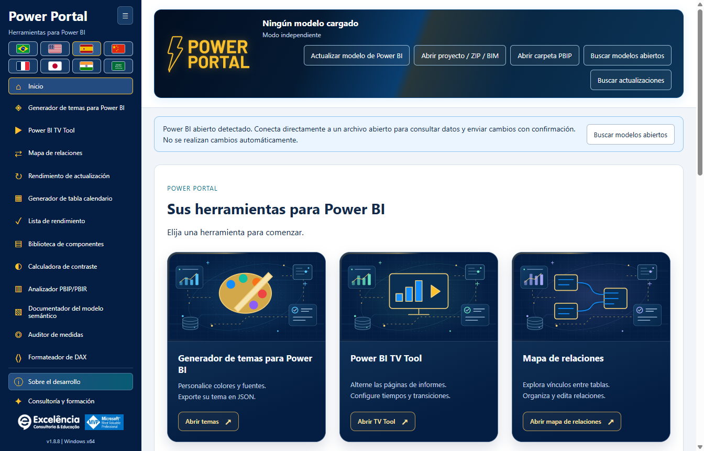
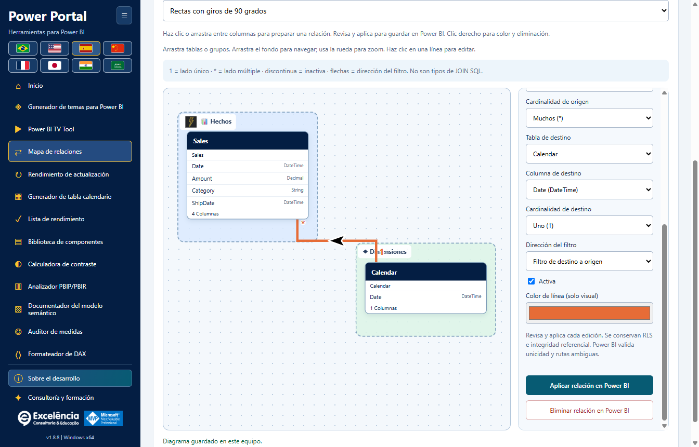
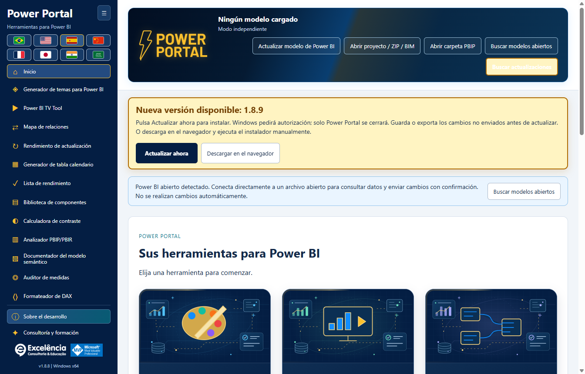
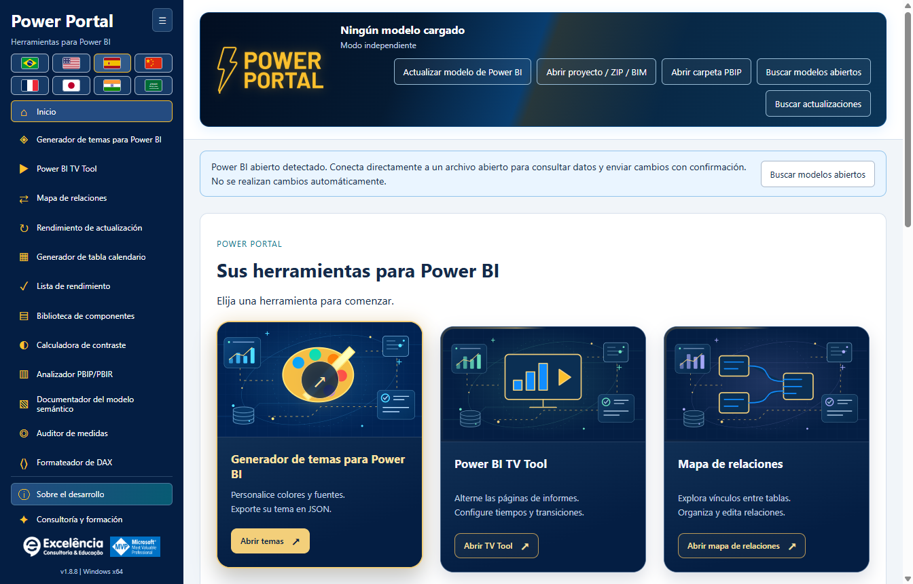

# Power Portal Desktop

<!-- language-selector -->
[🇺🇸 English](README.md) · [🇧🇷 Português](README.pt-BR.md) · [🇪🇸 Español](README.es.md) · [🇨🇳 简体中文](README.zh-CN.md) · [🇫🇷 Français](README.fr.md) · [🇯🇵 日本語](README.ja.md) · [🇮🇳 हिन्दी](README.hi.md) · [🇸🇦 العربية](README.ar.md)
<!-- /language-selector -->

**1.8.8 — Líneas dinámicas y envío de temas verificado**

En Mapa de relaciones, Estilo de líneas alterna entre Curvas y Líneas rectas con ángulos de 90 grados. Los extremos usan dinámicamente los bordes superior/inferior o izquierdo/derecho enfrentados, considerando el tamaño real de las tarjetas. Las conexiones laterales conservan la altura de la columna relacionada. Las flechas negras con borde blanco siguen los tramos rectos sin inclinarse en las esquinas. El estilo se guarda automáticamente y viaja con el JSON exportado; los diseños anteriores conservan las curvas. No cambia el diseño nativo de Power BI ni calcula rutas globales para evitar obstáculos.

Enviar tema directamente a Power BI devuelve el foco a Power Portal tras la importación nativa y durante la verificación por exportación, solo si Power BI está en primer plano. Una vez verificado el tema, muestra Power BI; los errores también muestran la ventana seleccionada. Los diálogos nativos pueden aparecer brevemente y no se ocultan: Desktop no tiene una API de temas compatible sin diálogos. Se gestionan los cambios asíncronos de pestaña antes de confirmar el tema. Una prueba real autorizada de la aplicación empaquetada verificó importación/exportación, retorno al Portal y activación final de Power BI; después restauró el tema Predeterminado original sin guardar el PBIX. Todas las capturas usan datos sintéticos.

**1.8.7 — Selección de colores clara y fiable**

Los once colores del tema tienen ahora una muestra nativa visible y un botón Seleccionar color junto al campo HEX editable. Pulse la muestra o el botón, o use Intro/Espacio con el botón enfocado. El selector ya no depende de un campo invisible sin tamaño ni de un doble clic en HEX. Se conservan la edición manual, importación, vista previa en vivo y exportación JSON. Los errores se muestran explícitamente. Se verificó varias veces la apertura nativa en Windows, además de los once botones por ratón/teclado y los textos en ocho idiomas.

Análisis de actualización se llama ahora Rendimiento de actualización en el menú, inicio, título y ocho idiomas. Solo cambia el nombre: actualización nativa, progreso, tiempos, filas, historial local y compatibilidad JSON/CSV no cambian. Los análisis guardados siguen disponibles sin migración ni nueva actualización de datos. Las imágenes usan datos sintéticos.

**1.8.6 — Siga la actualización dentro de Power Portal**

Inicie Actualizar y analizar en Power Portal y vea tarjetas en vivo con cada tabla, estado observado, fase del motor, tiempo de actividad y el último texto de progreso nativo disponible de Power BI. Power Portal recupera el foco al iniciar y, si Power BI vuelve al primer plano, al finalizar. No roba repetidamente el foco de otras aplicaciones. Ver en Power BI abre el archivo seleccionado sin iniciar otra actualización; esta elección desactiva el retorno automático del foco durante esa captura.

Power BI sigue siendo el motor. Su ventana puede aparecer brevemente: no es una API compatible de procesamiento de PBIX sin ventana. Credenciales, errores y cancelación permanecen en Power BI; los diálogos nunca se ocultan ni cierran automáticamente. El texto nativo conserva el idioma de Power BI e indica la hora de la última lectura. La ausencia de texto se muestra explícitamente; el seguimiento del motor continúa si falla el lector. Una fase terminada no demuestra que la tabla esté completa, no se inventan porcentajes y las filas finales se cuentan después de la captura. El historial y JSON incluyen los estados nativos: revise las exportaciones antes de compartirlas. La aplicación empaquetada se probó con una actualización real autorizada: 4/4 tablas medidas, 4/4 recuentos, estados en vivo, foco recuperado, Ver en Power BI funcional e historial conservado al recargar. No se guardó automáticamente el PBIX; las imágenes usan datos sintéticos.

**1.8.5 — Corrección de las mediciones de actualización nativa**

Rendimiento de actualización ahora reconoce el comando XML Refresh nativo de Power BI Desktop, incluso dentro de Batch, además de XMLA Process y TMSL refresh. Antes, la actualización podía ejecutarse pero su progreso se descartaba, dejando 0 tablas medidas, recuentos no disponibles y refreshCompletionNotProven. Ahora se acepta el éxito explícito del motor cuando falta el campo opcional Error; los códigos de error no nulos y los errores XMLA siguen prevaleciendo. El progreso exige correlación exacta de solicitud/actividad para excluir consultas visuales ajenas.

Antes del primer comando reconocido, la interfaz indica que espera eventos de actualización de Power BI. Una finalización no confirmada muestra instrucciones traducidas en lugar de solo un código técnico. Actualiza la aplicación, conecta al PBIX correcto y ejecuta Actualizar y analizar otra vez; los informes anteriores incompletos se conservan sin marcarlos como correctos. La aplicación empaquetada se validó de principio a fin en una actualización real autorizada, con actividad por tabla, filas, finalización automática e historial conservado tras recargar. Las capturas usan ejemplos sintéticos, sin datos ni nombres de modelos del usuario.

**1.8.5 — Descargar actualizaciones en el navegador**

Cuando hay una versión nueva, el aviso ofrece Descargar en el navegador junto a Actualizar ahora. Abre en el navegador predeterminado la dirección oficial del instalador detectado en GitHub sin cerrar Power Portal ni iniciar la instalación. Ejecuta el instalador descargado manualmente cuando quieras. La opción sigue disponible tras un error de actualización automática. Los errores al abrir el navegador se muestran explícitamente. Actualizar ahora sigue descargando en la aplicación, verificando SHA-256 y tamaño y solicitando autorización de Windows. Las descargas del navegador no pasan por la verificación automática de la aplicación: compara el SHA-256 publicado antes de ejecutar el instalador. Ambos botones y la explicación están traducidos a los ocho idiomas.

**1.8.5 — Vista previa del tema con líneas suaves**

El gráfico de líneas del generador de temas ahora usa curvas cúbicas suaves en lugar de segmentos rectos, tanto con datos de ejemplo como del modelo conectado. Las curvas pasan por los puntos originales sin crear picos entre los valores; se conservan colores, marcadores e información emergente. El cambio afecta solo a la vista previa: no modifica el JSON exportado ni el formato de líneas de los objetos visuales existentes en Power BI.

**Doce herramientas para Power BI Desktop en una sola aplicación de Windows.**

Power Portal Desktop pertenece a **Excelência Consultoria e Educação**. Se instala en la cinta **Herramientas externas** de Power BI Desktop y abre una ventana de aplicación independiente, como otras herramientas externas de modelado.

Este es un **repositorio dedicado exclusivamente a la distribución**: instaladores, asistentes de instalación, sumas de comprobación y documentación. **Aquí no se publica el código fuente de la aplicación Power Portal.**

La introducción aparece en la primera visita al mapa de cada sesión. Ábrela de nuevo con **Cómo organizar con grupos**. SAP y Excel son ejemplos ilustrativos, no nuevos conectores ni logotipos oficiales. Los grupos vacíos son zonas de destino visibles. Soltar en un grupo resaltado asigna la tabla; fuera conserva su grupo actual.

El diagrama se guarda automáticamente en este equipo para el mismo modelo: grupos, imágenes, colores y posiciones. Exporta el JSON para guardar una copia o importarla después. Comprueba el mensaje de guardado.

Las flechas de relaciones ahora se sitúan sobre la curva y giran según su dirección local, incluso en enlaces diagonales o invertidos. Flechas SVG más grandes, de 36 × 26 unidades, siempre negras con un contorno blanco de 3 unidades, independientemente del color de la línea. El filtro unidireccional sigue del destino al origen; el bidireccional muestra dos flechas opuestas. El filtro automático conserva el signo de interrogación. Este cambio es solo visual.

El encabezado animado de Power Portal ahora contiene el nombre del archivo, el estado de conexión y los cinco botones de lectura, importación, búsqueda y actualización. Se eliminó la barra separada debajo para liberar espacio. El contenido se adapta dentro del encabezado en ventanas pequeñas y en los ocho idiomas, incluido árabe. Se mantienen las confirmaciones, los avisos y las actualizaciones.

El Mapa de relaciones aparece ahora inmediatamente después de TV Tool en el menú lateral y la galería inicial. Se eliminó el bloque genérico Datos reales del modelo del Generador de calendario y la Biblioteca de componentes. Se mantienen sus controles propios de lectura y envío; el período real utiliza el calendario seleccionado dentro de la herramienta. Las portadas de inicio se redibujaron como ilustraciones vectoriales locales sin texto incrustado. Los títulos, descripciones y acciones permanecen fuera de las imágenes y siguen el idioma elegido. Arrastra una columna de origen a otra tabla para abrir el diálogo de relación real y elegir la columna de destino. Soltar sobre una columna la preselecciona. Revisa cardinalidad, filtro y estado activo; luego valida y aplica con confirmación nativa y copia BIM.

**1.8.5 — Correcciones al iniciar la actualización**

Rendimiento de actualización aparece inmediatamente debajo de Mapa de relaciones en el menú lateral y la galería. La búsqueda del botón nativo ignora las pestañas Home duplicadas de las vistas de consultas DAX y TMDL, evitando “Ambiguous Power BI control: home”. Si el control no está disponible, selecciona Informe, Datos o Modelo en Power BI.

<a name="download-and-install"></a>
## Descargar e instalar

<a name="option-1-install-with-a-few-clicks"></a>
### Opción 1: instalar con unos pocos clics

1. [Descargue Power Portal Desktop 1.8.8 para Windows x64](https://github.com/luisgnserra/powerportaldesktop/releases/download/v1.8.8/PowerPortal-Setup-1.8.8-x64.exe).
2. Ejecute el instalador y apruebe la solicitud de administrador de Windows.
3. Elija la carpeta de instalación y el idioma predeterminado.
4. Complete la instalación y, después, cierre y vuelva a abrir Power BI Desktop.
5. Abra un PBIX y seleccione **Herramientas externas > Power Portal**.

**Windows puede advertir que el editor es desconocido:** la versión 1.8.8 no está firmada digitalmente. Continúe únicamente si confía en esta distribución. Si su organización bloquea el software sin firma, contacte con TI en lugar de eludir su política.

[Última versión](https://github.com/luisgnserra/powerportaldesktop/releases/latest) · [Guía de instalación](docs/es/INSTALLATION.md) · [Configuración](docs/es/CONFIGURATION.md) · [Solución de problemas](docs/es/TROUBLESHOOTING.md)

<a name="launch-from-power-bis-external-tools-ribbon"></a>
### Iniciar desde la cinta Herramientas externas de Power BI

El instalador añade **Power Portal** a **Herramientas externas** de Power BI Desktop. Haga clic en el icono con su PBIX abierto para iniciar la aplicación complementaria y leer automáticamente el modelo local de ese archivo.


La captura proporcionada de la cinta está en portugués: **Ferramentas externas** significa **Herramientas externas**. Power Portal abre una **ventana independiente conectada a Power BI**, no un objeto visual incrustado en el informe ni un nuevo panel interno de Power BI.



**¿Ya tiene Power BI abierto?** Al iniciarse desde un acceso directo, Power Portal detecta los modelos locales abiertos y muestra un aviso de conexión. Elija **Buscar modelos abiertos**, seleccione su archivo y conéctese. Después podrá consultar sus datos y enviar los cambios compatibles de vuelta con confirmación.

Una vez conectado, el estado se resume en el encabezado en lugar de ocupar un aviso independiente.

[Vea las doce herramientas, las pantallas de conexión y las acciones directas en Power BI en la guía ilustrada](docs/es/SCREENSHOTS.md).

<a name="new-relationship-map"></a>
### Novedad: mapa de relaciones

Comprenda los vínculos reales entre tablas en un lienzo que permite arrastrarlas libremente. Organice hechos, dimensiones y grupos de negocio personalizados con colores, iconos y nombres descriptivos; guarde las disposiciones automáticamente y exporte o importe JSON.



Cree, edite, active/desactive y elimine relaciones en el modelo de Power BI conectado **tras confirmar y realizar una copia de seguridad de los metadatos**. El estilo visual permanece en Power Portal; no cambia los nombres de las tablas ni modifica la disposición nativa de Power BI. [Tutorial completo de relaciones](docs/es/RELATIONSHIPS.md).

En 1.8.8, haga clic o arrastre entre columnas exactas para preparar un vínculo; haga clic con el botón derecho en las líneas para cambiar su color, editarlas y eliminarlas con confirmación. Los grupos admiten imágenes locales y más de 30 iconos. Las tablas automáticas de fecha/hora se ocultan de forma predeterminada con un control de visibilidad. Actualice desde Power BI después de ediciones externas o invoque la detección automática nativa de Desktop con una copia de seguridad previa y un paso independiente de revisión/finalización.

<a name="built-in-update-checks"></a>
### Comprobación de actualizaciones integrada

A partir de **1.6.2**, la aplicación instalada comprueba la última versión oficial de GitHub al abrirse. Si existe una versión estable más reciente, muestra **Actualizar ahora**. En 1.6.4, el aviso es destacado, animado y permanece visible al desplazarse, respetando las preferencias de movimiento reducido. No se muestra una línea permanente de «actualizado». Haga clic para descargar, verificar SHA-256 y el tamaño e iniciar el instalador automáticamente.

Windows solicita autorización de administrador. Solo se cierra Power Portal; Power BI permanece abierto. Primero guarde o exporte las ediciones de las herramientas que aún no haya enviado. Las descargas fallidas o la autorización cancelada dejan un error explícito y una opción para reintentar.



La captura utiliza un **aviso simulado de una futura versión 1.8.8** para ilustrar la interfaz, no para anunciar una versión publicada. **La versión 1.8.8 ya está publicada:** quienes tengan 1.6.2 o posterior pueden volver a abrir la aplicación o hacer clic en **Buscar actualizaciones** para recibirla. [Guía de actualizaciones](docs/es/UPDATES.md).

**¿Tiene 1.6.1 o anterior? Instale 1.6.2 manualmente una vez** para habilitar esta función. También puede usar **Buscar actualizaciones** para reintentar una comprobación fallida o sin conexión. El actualizador nunca instala nada por el mero hecho de abrir la aplicación.

<a name="option-2-install-from-powershell"></a>
### Opción 2: instalar desde PowerShell

Abra **Windows PowerShell 5.1 o PowerShell 7 en Windows**:

```powershell
$script = Join-Path $env:TEMP 'Install-PowerPortal.ps1'
[Net.ServicePointManager]::SecurityProtocol = [Net.ServicePointManager]::SecurityProtocol -bor [Net.SecurityProtocolType]::Tls12
Invoke-WebRequest -UseBasicParsing 'https://raw.githubusercontent.com/luisgnserra/powerportaldesktop/v1.8.8/install.ps1' -OutFile $script
# Review the downloaded script before running it.
Get-Content -LiteralPath $script
& $script
```

El asistente descarga la **versión 1.8.8**, verifica su suma SHA-256 fijada y abre el mismo instalador. No instala Node.js, PHP ni un SDK de .NET, ni compila nada.

Para una instalación desatendida, ejecute el mismo asistente desde una **ventana de PowerShell como administrador**:

```powershell
& "$env:TEMP\Install-PowerPortal.ps1" -Silent
```

Para descargar y verificar la suma de comprobación sin instalar:

```powershell
& "$env:TEMP\Install-PowerPortal.ps1" -DownloadOnly
```

Si la ejecución de scripts está bloqueada, siga la política de su organización o use el instalador ejecutable. Consulte las [instrucciones completas de línea de comandos](docs/es/INSTALLATION.md#command-line-installation).

<a name="requirements"></a>
## Requisitos

- Windows 10 u 11, **x64**.
- Power BI Desktop compatible con Herramientas externas. Esta instalación no es para Power BI Service, macOS, Windows ARM64 ni Power BI Report Server.
- Permiso de administrador para instalar y registrar la herramienta externa.
- Internet para descargar el instalador; las herramientas locales y las vistas previas incluidas funcionan sin conexión.
- Los informes de Power BI publicados o privados en TV Tool requieren internet y la cuenta de Microsoft, licencia y permisos correspondientes.

La aplicación de escritorio incluye los componentes de ejecución necesarios. No necesita herramientas de desarrollo.

<a name="included-tools"></a>
## Herramientas incluidas

| Herramienta | Función |
|---|---|
| Generador de temas | Importación JSON destacada, vista previa local en vivo, exportación JSON y envío directo con confirmación al final de la página. |
| TV Tool | Abrir un ejemplo oficial funcional en el navegador, presentar páginas de informes publicados o imágenes locales, configurar tiempos/transiciones y exportar HTML. |
| Generador de calendarios | Leer metadatos y fechas de calendarios existentes, exportar scripts o crear una tabla de calendario calculada con confirmación y copia de seguridad. |
| Lista de comprobación de rendimiento | Evaluar un informe con la lista del portal y los metadatos disponibles del modelo. |
| Biblioteca de componentes | Crear componentes HTML/DAX y una medida HTML en un modelo conectado. |
| Calculadora de contraste | Comprobar el contraste de colores según los umbrales de WCAG. |
| Analizador PBIP/PBIR | Examinar metadatos de proyectos locales, con puntuaciones heurísticas y los recuentos de páginas/objetos visuales disponibles. |
| Documentador de modelos | Exportar tablas, columnas, medidas y relaciones a Markdown o JSON. |
| Auditor de medidas | Revisar medidas del modelo o DAX proporcionado mediante comprobaciones heurísticas. |
| Formateador DAX | Formatear localmente, exportar/copiar o actualizar una medida seleccionada de un modelo conectado con confirmación. |
| Mapa de relaciones | Arrastrar cuadros de tablas, agrupar/dar estilo a los vínculos, guardar disposiciones visuales y aplicar cambios de relaciones confirmados directamente a Power BI. |
| Rendimiento de actualización | Mide la actualización nativa. Compara tiempos y filas. |

También incluye una galería de inicio, una barra lateral plegable con las doce herramientas visibles sin desplazamiento a los tamaños de ventana compatibles, información sobre la propiedad y el desarrollo, y un área de consultoría y formación con los dos vídeos destacados. **Consultoría y formación** aparece debajo de **Acerca del desarrollo**.

<a name="changes-that-interact-directly-with-your-open-power-bi-file"></a>
### Cambios que interactúan directamente con su archivo abierto de Power BI

| Acción | Interacción directa |
|---|---|
| Actualizar/leer el modelo y consultar muestras | Lee el modelo local seleccionado; no lo edita. |
| Enviar tema directamente a Power BI | Importa el JSON del tema en la ventana de Desktop seleccionada mediante automatización visible de la interfaz, con confirmación y verificación. |
| Crear calendario en Power BI | Crea una tabla calculada nueva, con copia de seguridad de metadatos y confirmación. Actualice después en Desktop. |
| Crear medida HTML en Power BI | Crea una medida en la tabla seleccionada, con copia de seguridad y confirmación. Coloque manualmente un objeto visual HTML compatible. |
| Actualizar medida en Power BI | Actualiza el DAX de la medida seleccionada, con copia de seguridad, confirmación y comprobaciones de cambios simultáneos. |
| Crear/editar/eliminar relaciones en Power BI | Cambia relaciones entre columnas de tablas, cardinalidad, dirección del filtro y estado activo, con copia de seguridad, confirmación y comprobaciones de estado obsoleto. |
| Rendimiento de actualización | La actualización nativa consulta los orígenes y reemplaza los datos importados. Guarda una copia del PBIX. Resuelve credenciales y errores en Power BI; el rastreo no cancela la actualización ni incluye todas las consultas auxiliares de Power Query. |

**Conectarse nunca escribe cambios por sí solo. Guarde primero una copia del PBIX, revise cada confirmación y guarde después el PBIX usted mismo.** [Capturas y ejemplos paso a paso](docs/es/SCREENSHOTS.md#direct-interactions-with-the-open-power-bi-file).

<a name="eight-languages"></a>
## Ocho idiomas

Portugués, inglés, español, chino mandarín simplificado, francés, japonés, hindi y árabe. Las banderas ocupan como máximo dos filas; el árabe utiliza una disposición de derecha a izquierda.

Use las banderas de la parte superior de esta página para seleccionar el idioma de la documentación. Todas las guías y capturas de la aplicación están disponibles en esos ocho idiomas. Las capturas se toman de la aplicación real en el idioma seleccionado; los nombres de los objetos del modelo y el DAX permanecen sin cambios. La imagen auténtica de la cinta de Power BI permanece en portugués en todas las guías, con una explicación en el idioma seleccionado.

El instalador sugiere el idioma de la interfaz de Windows. La selección posterior de idioma de cada usuario se guarda localmente y prevalece sobre el valor predeterminado de la instalación. Los nombres del modelo, los datos y el DAX no se traducen.

<a name="important-limits-and-data-safety"></a>
## Límites importantes y seguridad de los datos

- **Guarde una copia de su PBIX antes de hacer cambios.** Las escrituras confirmadas crean copias locales de los metadatos, pero no sustituyen a una copia de seguridad completa del PBIX.
- La aplicación de temas usa **automatización visible de la interfaz de Windows** y requiere confirmación. No existe una API genérica compatible para escribir temas en un PBIX abierto en Desktop; los cuadros de diálogo no se ocultan.
- TOM se conecta al modelo semántico, no a los filtros, páginas ni ubicación de objetos visuales del informe activo. Una medida HTML no añade automáticamente un objeto visual a un informe.
- Las puntuaciones del análisis de informes y de la auditoría de medidas son heurísticas, no mediciones del rendimiento visual.
- Los datos del modelo local no se envían al sitio web de Power Portal. El actualizador solicita únicamente metadatos e instaladores de versiones oficiales de GitHub, nunca el contenido del modelo. Los enlaces externos abiertos por el usuario, las presentaciones en línea y los orígenes DirectQuery pueden requerir acceso a la red.
- Las exportaciones de documentación, las copias de seguridad de metadatos y los registros de cambios pueden contener detalles confidenciales del modelo. Almacénelos y compártalos adecuadamente.

Lea la [guía de uso y seguridad](docs/es/USAGE.md) antes de modificar un modelo.

<a name="consulting-complete-data-solutions-and-training"></a>
## Consultoría, soluciones de datos completas y formación

Excelência ofrece consultoría de Power BI, Microsoft Fabric, ingeniería de datos, soluciones de datos integrales y **formación In Company**.

- [Concertar una conversación por WhatsApp](https://api.whatsapp.com/send/?phone=5535998532286&text&type=phone_number&app_absent=0)
- Correo electrónico: [contato@consultoriaexcelencia.com.br](mailto:contato@consultoriaexcelencia.com.br)
- [Formación In Company de Power BI](https://www.consultoriaexcelencia.com.br/educacao/treinamentos-power-bi)
- [Vídeo destacado 1](https://www.youtube.com/watch?v=bIxmIaYmt0c)
- [Vídeo destacado 2](https://www.youtube.com/watch?v=FNo7F7kh6h4)
- [Blog de Excelência](https://consultoriaexcelencia.com.br/blog) · [Cursos en línea](https://ead.consultoriaexcelencia.com.br/)

Responsable del desarrollo: **Luis Gustavo Nascimento Serra**.
[LinkedIn](https://www.linkedin.com/in/luisgnserra/) · [YouTube: Mais Que Planilhas](https://www.youtube.com/MaisQuePlanilhas)

Microsoft, Power BI y Microsoft Fabric son marcas comerciales de Microsoft. La identificación MVP es personal y no implica propiedad, patrocinio ni respaldo de Microsoft.

<a name="support-and-distribution"></a>
## Soporte y distribución

[Solución de problemas y soporte](docs/es/TROUBLESHOOTING.md) · [Notas de versión](CHANGELOG.es.md) · [Aviso de distribución](DISTRIBUTION.es.md) · [Mantenimiento de versiones](docs/es/RELEASING.md)

Use los **recursos de la versión (Release assets)** para descargar la aplicación. Los archivos ZIP/TAR automáticos de «Source code» de GitHub contienen únicamente la documentación y el asistente de instalación de este repositorio de distribución, no la aplicación ni su código fuente.

<a name="refresh-performance"></a>
## Rendimiento de actualización

Mide la actualización nativa. Compara tiempos y filas. [Rendimiento de actualización](docs/es/REFRESH-ANALYSIS.md).

Conecta el PBIX correcto, abre Rendimiento de actualización y pulsa Actualizar y analizar. Confirma el nombre del archivo. El rastreo empieza antes de invocar Inicio > Actualizar nativo; no actualiza tablas secuencialmente mediante TOM. Mantén Power BI abierto y resuelve allí credenciales, errores o cancelación. Una copia BIM no restaura los datos actualizados.

La finalización automática requiere observar el fin de los comandos de actualización y una ventana de Power BI lista. Cierra los diálogos de resultado. Finalizar captura manualmente siempre indica análisis incompleto, no demuestra éxito ni cancela la actualización. Los errores del motor/rastreo son explícitos. Una captura interrumpida no se presenta como completada.

<a name="animated-home-cards"></a>
## Tarjetas animadas en el inicio

Las doce tarjetas iniciales usan el mismo azul marino del menú (#041e43), con escenas vectoriales originales sin texto. Cada herramienta conserva su ilustración central, enriquecida con paneles, gráficos, base de datos, órbitas, cuadrícula y satélites flotantes. Las líneas de señal se mueven suavemente. Las portadas no cargan imágenes, scripts ni servicios externos.

Pasa el ratón o enfoca con el teclado para mostrar marco y brillo dorados, reflejo de luz, escena resaltada, flecha circular y acción dorada. Pulsar ofrece respuesta inmediata sin retrasar la navegación. Intro/Espacio siguen abriendo la misma herramienta. La preferencia de movimiento reducido detiene las animaciones conservando el realce estático y el foco visible. Los títulos y acciones quedan fuera de la imagen y siguen el idioma elegido. Las capturas muestran estados estáticos normal/hover, no vídeos.



