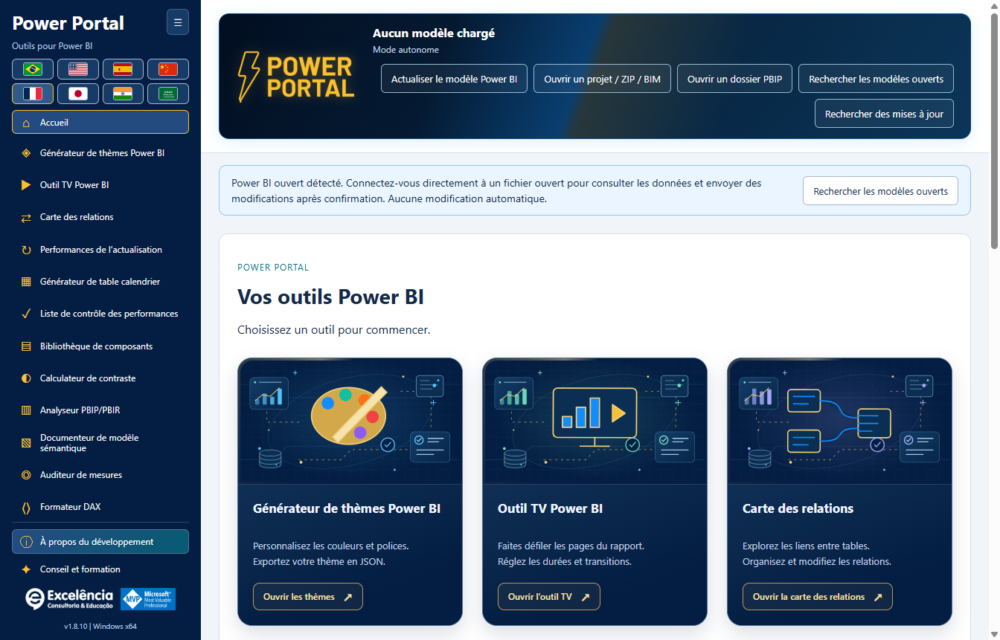
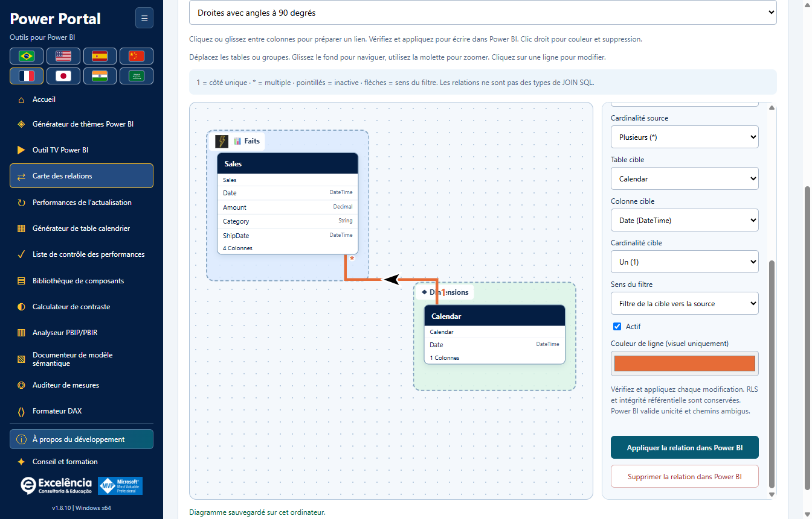
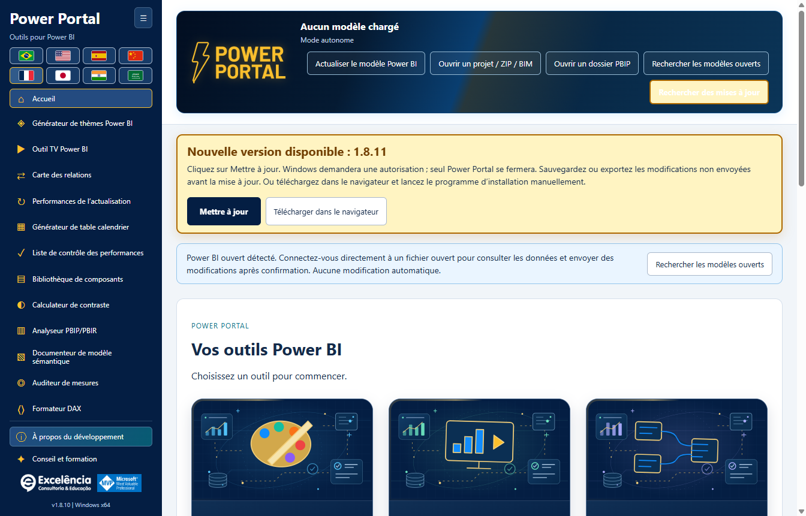
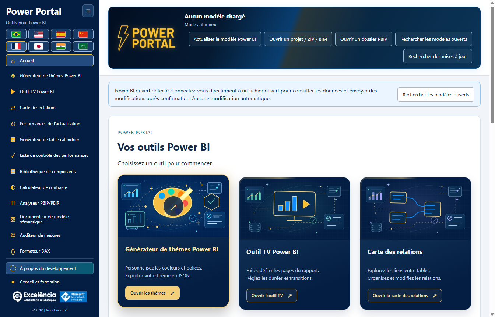

# Power Portal Desktop

<!-- language-selector -->

| Idioma / Language | Link |
| :--- | :--- |
| 🇺🇸 English | [README.md](README.md) |
| 🇧🇷  Brasil  Português | [README.pt-BR.md](README.pt-BR.md) |
| 🇪🇸 Español | [README.es.md](README.es.md) |
| 🇨🇳 简体中文 | [README.zh-CN.md](README.zh-CN.md) |
| 🇫🇷 Français | [README.fr.md](README.fr.md) |
| 🇯🇵 日本語 | [README.ja.md](README.ja.md) |
| 🇮🇳 हिन्दी | [README.hi.md](README.hi.md) |
| 🇸🇦 العربية | [README.ar.md](README.ar.md) |
<!-- /language-selector -->

**1.8.10 — Illustrations de premier plan animées et survol enrichi**

Les douze couvertures d’accueil animent désormais l’illustration principale de chaque outil, et pas seulement le fond : flottement et rotation doux, avec un badge de validation pulsant. Le survol ou le focus clavier révèle des panneaux à barres, un indicateur hexagonal, une orbite pointillée et des particules animées. Les animations supplémentaires sont en pause hors survol/focus. Les couches décoratives n’interceptent pas les clics et restent hors de l’arbre d’accessibilité. La préférence de mouvement réduit arrête ces animations tout en conservant détails statiques, contraste et focus. Les illustrations locales originales sans texte, les huit langues et la navigation sont préservées. Les tests du paquet ont mesuré les transformations réelles du premier plan et des panneaux, le focus clavier, le mouvement réduit, douze couvertures distinctes et la disposition dans huit langues. Les captures sont des images statiques des états normal/survol, pas des vidéos ; les données sont synthétiques.

**1.8.9 — Échantillon du calendrier et raccourci d’actualisation native**

Dans le générateur de calendrier, l’échantillon réel (50 lignes maximum) apparaît désormais sous Générer le script. Actualiser dans Power BI se trouve à côté et, avec une connexion active, ouvre Performances d’actualisation puis démarre le même flux natif confirmé. Suivez les états, durées et nombres de lignes. Cela actualise le modèle entier, sans appliquer le script, créer ou remplacer le calendrier, ni enregistrer le PBIX. Créer le calendrier dans Power BI reste une action distincte. Le bouton est désactivé hors connexion, accessible au clavier et traduit dans les huit langues. Annulation et erreurs utilisent le flux existant. L’échantillon reste la dernière lecture : utilisez Lire le calendrier sélectionné après actualisation. Les tests de l’application empaquetée ont vérifié disposition, huit traductions, blocage hors connexion, connexion exacte, annulation, erreurs visibles, nouvelle tentative et création du calendrier préservée. Aucune actualisation réelle n’a été lancée ; les captures utilisent des données synthétiques.

**1.8.8 — Lignes dynamiques et envoi de thèmes vérifié**

Dans la carte des relations, Style des lignes permet de choisir des courbes ou des lignes droites avec angles à 90 degrés. Les extrémités utilisent dynamiquement les bords haut/bas ou gauche/droite qui se font face, selon la taille réelle des cartes. Les connexions latérales conservent la hauteur de la colonne liée. Les flèches noires à contour blanc suivent les segments droits sans couper les angles en diagonale. Le style est enregistré automatiquement et inclus dans le JSON exporté ; les anciens schémas restent courbes. Cela ne modifie pas la disposition native de Power BI et ne réalise pas un évitement global des obstacles.

Envoyer le thème directement à Power BI rend le focus à Power Portal après l’importation native et pendant la vérification par exportation, uniquement si Power BI est au premier plan. Une fois le thème vérifié, Power BI est affiché ; les erreurs affichent également la fenêtre sélectionnée. Les boîtes de dialogue natives peuvent apparaître brièvement et ne sont pas masquées : Desktop ne dispose pas d’une API de thèmes prise en charge sans dialogue. Les changements asynchrones d’onglet sont gérés avant confirmation. Un test réel autorisé de l’application empaquetée a vérifié importation/exportation, retour au Portal et activation finale de Power BI, puis restauré le thème Par défaut original sans enregistrer le PBIX. Les captures utilisent des données synthétiques.

**1.8.7 — Sélection des couleurs plus claire et fiable**

Les onze couleurs du thème disposent désormais d’un échantillon natif visible et d’un bouton Choisir la couleur à côté du champ HEX modifiable. Cliquez sur l’échantillon ou le bouton, ou appuyez sur Entrée/Espace lorsque le bouton a le focus. Le sélecteur ne dépend plus d’un champ invisible sans dimensions ni d’un double-clic sur HEX. Saisie manuelle, import, aperçu en direct et export JSON sont conservés. Les erreurs sont explicites. L’ouverture native a été vérifiée plusieurs fois sous Windows, ainsi que les onze boutons à la souris/au clavier et les huit langues.

Analyse de l’actualisation devient Performances de l’actualisation dans le menu, l’accueil, le titre et les huit langues. Seul le nom change : actualisation native, progression, durées, lignes, historique local et compatibilité JSON/CSV sont conservés. Les analyses enregistrées restent disponibles sans migration ni nouvelle actualisation. Les images utilisent des données synthétiques.

**1.8.6 — Suivez l’actualisation dans Power Portal**

Lancez Actualiser et analyser dans Power Portal et suivez les cartes en direct : table, état observé, phase du moteur, durée d’activité et dernier texte natif disponible de Power BI. Power Portal reprend le focus après le lancement et, si Power BI revient au premier plan, après la fin native. Il ne reprend pas constamment le focus aux autres applications. Voir dans Power BI ouvre le fichier sélectionné sans relancer l’actualisation ; ce choix désactive le retour automatique pour cette capture.

Power BI reste le moteur. Sa fenêtre peut apparaître brièvement : ce n’est pas une API prise en charge pour traiter un PBIX sans fenêtre. Identifiants, erreurs et annulation restent dans Power BI ; aucun dialogue n’est masqué ou fermé automatiquement. Le texte natif conserve la langue de Power BI et l’heure de dernière lecture. Son absence est explicite et le suivi du moteur continue si le lecteur échoue. Une phase terminée ne prouve pas la fin de la table, aucun pourcentage n’est inventé et les lignes finales sont comptées après la capture. L’historique et JSON contiennent les états natifs : vérifiez les exports avant partage. L’application empaquetée a été testée avec une actualisation réelle autorisée : 4/4 tables mesurées, 4/4 comptages, états natifs en direct, focus restauré, bouton fonctionnel et historique conservé après rechargement. Aucun PBIX n’a été enregistré automatiquement ; les images utilisent des données synthétiques.

**1.8.5 — Correction des mesures de l’actualisation native**

Performances de l’actualisation reconnaît désormais la commande XML Refresh native de Power BI Desktop, y compris dans Batch, ainsi que XMLA Process et TMSL refresh. Auparavant, l’actualisation pouvait s’exécuter mais son progrès était écarté, laissant 0 table mesurée, des comptages indisponibles et refreshCompletionNotProven. Le succès explicite du moteur est accepté en l’absence du champ Error facultatif ; les codes d’erreur non nuls et les erreurs XMLA restent prioritaires. Le progrès exige toujours une corrélation exacte de requête/activité pour exclure les requêtes visuelles sans rapport.

Avant la première commande reconnue, l’interface indique qu’elle attend les événements d’actualisation Power BI. Une fin non confirmée affiche une explication traduite au lieu d’un simple code technique. Mettez à jour l’application, connectez le bon PBIX et relancez Actualiser et analyser ; les anciens rapports incomplets sont conservés sans être déclarés réussis. L’application empaquetée a été validée de bout en bout sur une actualisation réelle autorisée, avec activité par table, lignes, fin automatique et historique conservé après rechargement. Les captures restent des exemples synthétiques sans données ni noms de modèles du client.

**1.8.5 — Télécharger les mises à jour dans le navigateur**

Lorsqu’une nouvelle version est disponible, l’avis propose Télécharger dans le navigateur à côté de Mettre à jour. Le bouton ouvre l’adresse officielle de l’installateur GitHub détecté dans le navigateur par défaut, sans fermer Power Portal ni lancer l’installation. Exécutez manuellement l’installateur téléchargé lorsque vous le souhaitez. Cette option reste disponible après une erreur de mise à jour automatique. Les échecs d’ouverture du navigateur sont affichés. Mettre à jour continue de télécharger dans l’application, de vérifier SHA-256 et taille, puis de demander l’autorisation Windows. Le téléchargement par navigateur ne bénéficie pas de la vérification automatique de l’application : comparez le SHA-256 publié avant d’exécuter l’installateur. Les boutons et l’explication sont traduits dans les huit langues.

**1.8.5 — Aperçu du thème avec courbes lissées**

Le graphique en courbes du générateur de thèmes utilise désormais des courbes cubiques lissées plutôt que des segments droits, avec les données d’exemple et du modèle connecté. Elles passent par les points d’origine sans dépassement entre les valeurs ; couleurs, marqueurs et infobulles sont conservés. Seul l’aperçu change : le JSON exporté et le format des lignes des visuels Power BI existants restent inchangés.

**Douze outils pour Power BI Desktop réunis dans une seule application Windows.**

Power Portal Desktop appartient à **Excelência Consultoria e Educação**. Il s’installe dans le ruban **Outils externes** de Power BI Desktop et ouvre une fenêtre d’application distincte, comme les autres outils externes de modélisation.

Ce **dépôt est exclusivement consacré à la distribution** : programmes d’installation, assistants d’installation, sommes de contrôle et documentation. **Aucun code source de l’application Power Portal n’est publié ici.**

L’introduction apparaît lors de la première visite du diagramme à chaque session. Rouvrez-la avec **Organiser avec des groupes**. SAP et Excel sont des exemples illustratifs, pas de nouveaux connecteurs ni des logos officiels. Les groupes vides sont des zones de dépôt visibles. Déposer dans un groupe surligné affecte la table ; en dehors, son groupe actuel est conservé.

Votre diagramme est enregistré automatiquement sur cet ordinateur pour le même modèle : groupes, images, couleurs et positions. Exportez le JSON pour conserver une copie ou l’importer plus tard. Vérifiez le message de sauvegarde.

Les flèches de relation sont désormais placées sur la courbe et pivotent selon sa direction locale, y compris pour les liens diagonaux ou inversés. Les flèches SVG agrandies à 36 × 26 unités restent noires avec un contour blanc de 3 unités, indépendamment de la couleur du lien. Le filtrage unidirectionnel reste de la destination vers la source ; le bidirectionnel affiche deux flèches opposées. Le filtrage automatique conserve le point d’interrogation. Ce changement est uniquement visuel.

L’en-tête animé de Power Portal intègre désormais le nom du fichier, l’état de connexion et les cinq boutons de lecture, importation, recherche et mise à jour. La barre séparée sous la bannière est supprimée pour libérer de l’espace. Le contenu s’adapte dans l’en-tête sur les petites fenêtres et dans les huit langues, dont l’arabe. Les confirmations, notifications et mises à jour restent inchangées.

La carte des relations se trouve désormais juste après TV Tool dans le menu latéral et la galerie d’accueil. Le bloc générique Données réelles du modèle est retiré du Générateur de calendrier et de la Bibliothèque de composants. Leurs propres commandes restent disponibles ; la période réelle utilise le calendrier sélectionné dans l’outil. Les couvertures d’accueil ont été redessinées comme illustrations vectorielles locales sans texte intégré. Les titres, descriptions et actions restent hors des images et suivent la langue choisie. Glissez une colonne source sur une autre table pour ouvrir le dialogue de relation réelle et choisir la colonne cible. Un dépôt sur une colonne la présélectionne. Vérifiez cardinalité, filtre et état actif, puis validez et appliquez avec confirmation native et sauvegarde BIM.

**1.8.5 — Corrections du lancement de l’actualisation**

Performances de l’actualisation se trouve directement sous Carte des relations dans le menu et la galerie. La recherche du bouton natif ignore les onglets Home en double des vues de requêtes DAX et TMDL, évitant « Ambiguous Power BI control: home ». Si le contrôle est indisponible, sélectionnez la vue Rapport, Données ou Modèle dans Power BI.

<a name="download-and-install"></a>
## Télécharger et installer

<a name="option-1-install-with-a-few-clicks"></a>
### Option 1 : installer en quelques clics

1. [Téléchargez Power Portal Desktop 1.8.10 pour Windows x64](https://github.com/luisgnserra/powerportaldesktop/releases/download/v1.8.10/PowerPortal-Setup-1.8.10-x64.exe).
2. Exécutez le programme d’installation et acceptez la demande d’autorisation administrateur de Windows.
3. Choisissez le dossier d’installation et la langue par défaut.
4. Terminez l’installation, puis fermez et rouvrez Power BI Desktop.
5. Ouvrez un PBIX et sélectionnez **Outils externes > Power Portal**.

**Windows peut signaler un éditeur inconnu :** la version 1.8.10 n’est pas signée numériquement. Ne continuez que si vous faites confiance à cette distribution. Si votre organisation bloque les logiciels non signés, contactez le service informatique au lieu de contourner sa politique.

[Dernière version](https://github.com/luisgnserra/powerportaldesktop/releases/latest) · [Guide d’installation](docs/fr/INSTALLATION.md) · [Configuration](docs/fr/CONFIGURATION.md) · [Dépannage](docs/fr/TROUBLESHOOTING.md)

<a name="launch-from-power-bis-external-tools-ribbon"></a>
### Lancer depuis le ruban Outils externes de Power BI

Le programme d’installation ajoute **Power Portal** aux **Outils externes** de Power BI Desktop. Cliquez sur l’icône lorsque votre PBIX est ouvert pour lancer l’application complémentaire et lire automatiquement le modèle local de ce fichier.


La capture du ruban fournie est en portugais : **Ferramentas externas** signifie **Outils externes**. Power Portal ouvre une **fenêtre distincte connectée à Power BI**, et non un visuel intégré au rapport ou un nouveau volet interne de Power BI.



**Power BI est déjà ouvert ?** Lorsqu’il est lancé depuis un raccourci, Power Portal détecte les modèles locaux ouverts et affiche un avis de connexion. Choisissez **Rechercher les modèles ouverts**, sélectionnez votre fichier et connectez-vous. Vous pourrez ensuite interroger ses données et lui renvoyer les modifications prises en charge, après confirmation.

Une fois connecté, l’état est résumé dans l’en-tête plutôt que dans une bannière distincte.

[Découvrez les douze outils, les écrans de connexion et les actions directes dans Power BI dans le guide illustré](docs/fr/SCREENSHOTS.md).

<a name="new-relationship-map"></a>
### Nouveau : carte des relations

Comprenez les liens réels entre les tables sur un canevas où vous pouvez les déplacer librement. Organisez les faits, les dimensions et vos groupes métier avec des couleurs, des icônes et des noms conviviaux ; enregistrez automatiquement les dispositions et exportez/importez du JSON.



Créez, modifiez, activez/désactivez et supprimez des relations dans le modèle Power BI connecté **après confirmation et sauvegarde des métadonnées**. Le style visuel reste dans Power Portal ; il ne renomme pas les tables et ne modifie pas la disposition native de Power BI. [Tutoriel complet sur les relations](docs/fr/RELATIONSHIPS.md).

Dans la version 1.8.10, cliquez ou faites glisser entre des colonnes exactes pour préparer un lien ; faites un clic droit sur les lignes pour choisir leur couleur, les modifier et les supprimer avec confirmation. Les groupes prennent en charge des images locales et plus de 30 icônes. Les tables de date/heure automatiques sont masquées par défaut avec une option de visibilité. Actualisez depuis Power BI après des modifications externes, ou invoquez la détection automatique native de Desktop avec une sauvegarde préalable et une étape distincte de vérification/finalisation.

<a name="built-in-update-checks"></a>
### Recherche de mises à jour intégrée

À partir de **1.6.2**, l’application installée recherche la dernière version officielle sur GitHub à son ouverture. Si une version stable plus récente existe, elle affiche **Mettre à jour maintenant**. En 1.6.4, la bannière est bien visible, animée et reste affichée pendant le défilement, tout en respectant les préférences de réduction des animations. Aucune ligne « à jour » permanente n’est affichée. Cliquez pour télécharger, vérifier le SHA-256 et la taille, puis lancer automatiquement le programme d’installation.

Windows demande l’autorisation administrateur. Seul Power Portal se ferme ; Power BI reste ouvert. Enregistrez/exportez d’abord les modifications des outils qui n’ont pas encore été envoyées. Un échec de téléchargement ou une autorisation annulée laisse une erreur explicite et une option de nouvelle tentative.



La capture utilise une **notification simulée d’une future version 1.8.10** pour illustrer l’interface, et non pour annoncer une version publiée. **La version 1.8.10 est désormais publiée :** les utilisateurs de 1.6.2 ou d’une version ultérieure peuvent rouvrir l’application ou cliquer sur **Rechercher des mises à jour** pour la recevoir. [Guide des mises à jour](docs/fr/UPDATES.md).

**Vous utilisez 1.6.1 ou une version antérieure ? Installez manuellement 1.6.2 une fois** pour activer cette fonction. Vous pouvez aussi utiliser **Rechercher des mises à jour** pour réessayer après une vérification échouée ou hors ligne. L’outil de mise à jour n’installe jamais quoi que ce soit simplement parce que vous ouvrez l’application.

<a name="option-2-install-from-powershell"></a>
### Option 2 : installer depuis PowerShell

Ouvrez **Windows PowerShell 5.1 ou PowerShell 7 sous Windows** :

```powershell
$script = Join-Path $env:TEMP 'Install-PowerPortal.ps1'
[Net.ServicePointManager]::SecurityProtocol = [Net.ServicePointManager]::SecurityProtocol -bor [Net.SecurityProtocolType]::Tls12
Invoke-WebRequest -UseBasicParsing 'https://raw.githubusercontent.com/luisgnserra/powerportaldesktop/v1.8.10/install.ps1' -OutFile $script
# Review the downloaded script before running it.
Get-Content -LiteralPath $script
& $script
```

L’assistant télécharge la **version 1.8.10**, vérifie sa somme SHA-256 figée et ouvre le même programme d’installation. Il n’installe ni Node.js, ni PHP, ni SDK .NET et ne compile rien.

Pour une installation sans assistance, exécutez le même assistant depuis une **fenêtre PowerShell administrateur** :

```powershell
& "$env:TEMP\Install-PowerPortal.ps1" -Silent
```

Pour télécharger et vérifier la somme de contrôle uniquement, sans installer :

```powershell
& "$env:TEMP\Install-PowerPortal.ps1" -DownloadOnly
```

Si l’exécution des scripts est bloquée, suivez la politique de votre organisation ou utilisez le programme d’installation exécutable. Consultez les [instructions complètes en ligne de commande](docs/fr/INSTALLATION.md#command-line-installation).

<a name="requirements"></a>
## Configuration requise

- Windows 10 ou 11, **x64**.
- Power BI Desktop prenant en charge les outils externes. Cette installation n’est pas destinée à Power BI Service, macOS, Windows ARM64 ou Power BI Report Server.
- Autorisation administrateur pour installer et enregistrer l’outil externe.
- Internet pour télécharger le programme d’installation ; les outils locaux et les aperçus inclus fonctionnent hors ligne.
- Les rapports Power BI publiés/privés dans TV Tool nécessitent internet ainsi que le compte Microsoft, la licence et les autorisations appropriés.

L’application de bureau inclut les composants d’exécution nécessaires. Vous n’avez pas besoin d’outils de développement.

<a name="included-tools"></a>
## Outils inclus

| Outil | Fonction |
|---|---|
| Générateur de thèmes | Import JSON mis en évidence, aperçu local en direct, export JSON et envoi direct confirmé en fin de page. |
| TV Tool | Ouvrir un exemple officiel fonctionnel dans le navigateur, présenter des pages de rapports publiés ou des images locales, configurer les durées/transitions et exporter en HTML. |
| Générateur de calendriers | Lire les métadonnées et dates des calendriers existants, exporter des scripts ou créer une table de calendrier calculée avec confirmation et sauvegarde. |
| Liste de contrôle des performances | Évaluer un rapport à l’aide de la liste du portail et des métadonnées disponibles du modèle. |
| Bibliothèque de composants | Créer des composants HTML/DAX et une mesure HTML dans un modèle connecté. |
| Calculateur de contraste | Vérifier le contraste des couleurs par rapport aux seuils WCAG. |
| Analyseur PBIP/PBIR | Examiner les métadonnées des projets locaux, avec des scores heuristiques et les nombres de pages/visuels disponibles. |
| Documentation du modèle | Exporter les tables, colonnes, mesures et relations en Markdown ou JSON. |
| Audit des mesures | Examiner les mesures du modèle ou le DAX fourni à l’aide de contrôles heuristiques. |
| Formateur DAX | Formater localement, exporter/copier ou mettre à jour une mesure sélectionnée dans un modèle connecté après confirmation. |
| Carte des relations | Déplacer les blocs de tables, grouper/styliser les liens, enregistrer les dispositions visuelles et appliquer les modifications de relations confirmées directement à Power BI. |
| Performances de l’actualisation | Mesurez l’actualisation native. Comparez les durées et les lignes. |

L’application comprend aussi une galerie d’accueil, une barre latérale repliable affichant les douze outils sans défilement aux tailles de fenêtre prises en charge, des informations sur la propriété/le développement et un espace de conseil et de formation avec les deux vidéos mises en avant. **Conseil et formation** se trouve sous **À propos du développement**.

<a name="changes-that-interact-directly-with-your-open-power-bi-file"></a>
### Modifications interagissant directement avec votre fichier Power BI ouvert

| Action | Interaction directe |
|---|---|
| Actualiser/lire le modèle et interroger des échantillons | Lit le modèle local sélectionné ; ne le modifie pas. |
| Envoyer le thème directement à Power BI | Importe le JSON du thème dans la fenêtre Desktop sélectionnée par automatisation visible de l’interface, avec confirmation et vérification. |
| Créer un calendrier dans Power BI | Crée une nouvelle table calculée avec sauvegarde des métadonnées et confirmation. Actualisez ensuite dans Desktop. |
| Créer une mesure HTML dans Power BI | Crée une mesure dans la table sélectionnée, avec sauvegarde et confirmation. Placez manuellement un visuel HTML compatible. |
| Mettre à jour la mesure dans Power BI | Met à jour le DAX de la mesure sélectionnée avec sauvegarde, confirmation et contrôles des modifications concurrentes. |
| Créer/modifier/supprimer des relations dans Power BI | Modifie les relations entre colonnes de tables, la cardinalité, le sens du filtre et l’état actif avec sauvegarde, confirmation et contrôles d’état périmé. |
| Performances de l’actualisation | L’actualisation native interroge les sources et remplace les données importées. Sauvegardez une copie du PBIX. Gérez les identifiants et erreurs dans Power BI ; le suivi n’annule pas l’actualisation et ne couvre pas toutes les requêtes auxiliaires Power Query. |

**La simple connexion n’écrit jamais de modifications. Enregistrez d’abord une copie du PBIX, examinez chaque confirmation, puis enregistrez vous-même le PBIX.** [Captures et exemples pas à pas](docs/fr/SCREENSHOTS.md#direct-interactions-with-the-open-power-bi-file).

<a name="eight-languages"></a>
## Huit langues

Portugais, anglais, espagnol, chinois mandarin simplifié, français, japonais, hindi et arabe. Les drapeaux occupent au maximum deux lignes ; l’arabe utilise une disposition de droite à gauche.

Utilisez les drapeaux en haut de cette page pour choisir la langue de la documentation. Tous les guides et les captures de l’application sont disponibles dans ces huit langues. Les captures sont prises dans l’application réelle avec la langue sélectionnée ; les noms des objets du modèle et le DAX restent inchangés. L’image authentique du ruban Power BI reste en portugais dans chaque guide, avec une explication dans la langue sélectionnée.

Le programme d’installation suggère la langue de l’interface Windows. Le choix ultérieur de langue de l’utilisateur est enregistré localement et prévaut sur la valeur par défaut de l’installation. Les noms du modèle, les données et le DAX ne sont pas traduits.

<a name="important-limits-and-data-safety"></a>
## Limites importantes et sécurité des données

- **Enregistrez une copie de votre PBIX avant toute modification.** Les écritures confirmées créent des sauvegardes locales des métadonnées, mais elles ne remplacent pas une sauvegarde complète du PBIX.
- L’application d’un thème utilise une **automatisation visible de l’interface Windows** et nécessite une confirmation. Il n’existe pas d’API générique prise en charge pour écrire un thème dans un PBIX ouvert dans Desktop ; les boîtes de dialogue ne sont pas masquées.
- TOM se connecte au modèle sémantique, pas aux filtres, aux pages ou au placement des visuels du rapport actif. Une mesure HTML n’ajoute pas automatiquement de visuel à un rapport.
- Les scores d’analyse des rapports et d’audit des mesures sont heuristiques, et non des mesures de performances des visuels.
- Les données du modèle local ne sont pas envoyées au site Power Portal. L’outil de mise à jour demande uniquement les métadonnées et les programmes d’installation des versions officielles sur GitHub, jamais le contenu du modèle. Les liens externes ouverts par l’utilisateur, les présentations en ligne et les sources DirectQuery peuvent nécessiter un accès réseau.
- Les exports de documentation, les sauvegardes de métadonnées et les journaux de modifications peuvent contenir des informations confidentielles sur le modèle. Stockez-les et partagez-les de manière appropriée.

Lisez le [guide d’utilisation et de sécurité](docs/fr/USAGE.md) avant de modifier un modèle.

<a name="consulting-complete-data-solutions-and-training"></a>
## Conseil, solutions de données complètes et formation

Excelência propose du conseil Power BI, Microsoft Fabric, de l’ingénierie des données, des solutions de données de bout en bout et des **formations In Company**.

- [Organiser un échange sur WhatsApp](https://api.whatsapp.com/send/?phone=5535998532286&text&type=phone_number&app_absent=0)
- E-mail : [contato@consultoriaexcelencia.com.br](mailto:contato@consultoriaexcelencia.com.br)
- [Formation Power BI In Company](https://www.consultoriaexcelencia.com.br/educacao/treinamentos-power-bi)
- [Vidéo mise en avant 1](https://www.youtube.com/watch?v=bIxmIaYmt0c)
- [Vidéo mise en avant 2](https://www.youtube.com/watch?v=FNo7F7kh6h4)
- [Blog Excelência](https://consultoriaexcelencia.com.br/blog) · [Cours en ligne](https://ead.consultoriaexcelencia.com.br/)

Responsable du développement : **Luis Gustavo Nascimento Serra**.
[LinkedIn](https://www.linkedin.com/in/luisgnserra/) · [YouTube : Mais Que Planilhas](https://www.youtube.com/MaisQuePlanilhas)

Microsoft, Power BI et Microsoft Fabric sont des marques de Microsoft. L’identification MVP est personnelle et n’implique ni propriété, ni parrainage, ni approbation de Microsoft.

<a name="support-and-distribution"></a>
## Assistance et distribution

[Dépannage et assistance](docs/fr/TROUBLESHOOTING.md) · [Notes de version](CHANGELOG.fr.md) · [Avis de distribution](DISTRIBUTION.fr.md) · [Maintenance des versions](docs/fr/RELEASING.md)

Utilisez les **fichiers de la version (Release assets)** pour télécharger l’application. Les archives ZIP/TAR « Source code » générées automatiquement par GitHub contiennent uniquement la documentation et l’assistant d’installation de ce dépôt de distribution, et non l’application ou son code source.

<a name="refresh-performance"></a>
## Performances de l’actualisation

Mesurez l’actualisation native. Comparez les durées et les lignes. [Performances de l’actualisation](docs/fr/REFRESH-ANALYSIS.md).

Connectez le bon PBIX, ouvrez Performances de l’actualisation et choisissez Actualiser et analyser. Confirmez le nom du fichier. Le suivi démarre avant Accueil > Actualiser natif ; les tables ne sont pas actualisées séquentiellement via TOM. Gardez Power BI ouvert et traitez les identifiants, erreurs ou annulations dedans. Une sauvegarde BIM ne restaure pas les données actualisées.

La fin automatique exige la fin observée des commandes d’actualisation et une fenêtre Power BI prête. Fermez les dialogues de résultat. Terminer manuellement la capture signifie toujours analyse incomplète, ne prouve pas la réussite et n’annule pas l’actualisation. Les erreurs moteur/suivi sont explicites. Une capture interrompue n’est pas déclarée terminée.

<a name="animated-home-cards"></a>
## Cartes animées sur l’accueil

Les douze cartes d’accueil utilisent le même bleu marine que le menu (#041e43), avec des scènes vectorielles originales sans texte. Chaque outil conserve son illustration centrale, enrichie de panneaux de données, graphiques, base de données, orbites, grille et satellites flottants. Les lignes de signal se déplacent doucement. Les couvertures ne chargent aucune image, aucun script ni service externe.

Survolez une carte ou sélectionnez-la au clavier pour afficher cadre et halo dorés, reflet lumineux, scène éclaircie, flèche circulaire et action dorée. La pression donne un retour immédiat sans retarder la navigation. Entrée/Espace ouvrent toujours le même outil. La préférence de mouvement réduit arrête les animations en conservant le surlignage statique et le focus visible. Titres et actions restent hors de l’image et suivent la langue choisie. Les captures montrent des états statiques normal/survol, pas des vidéos.



