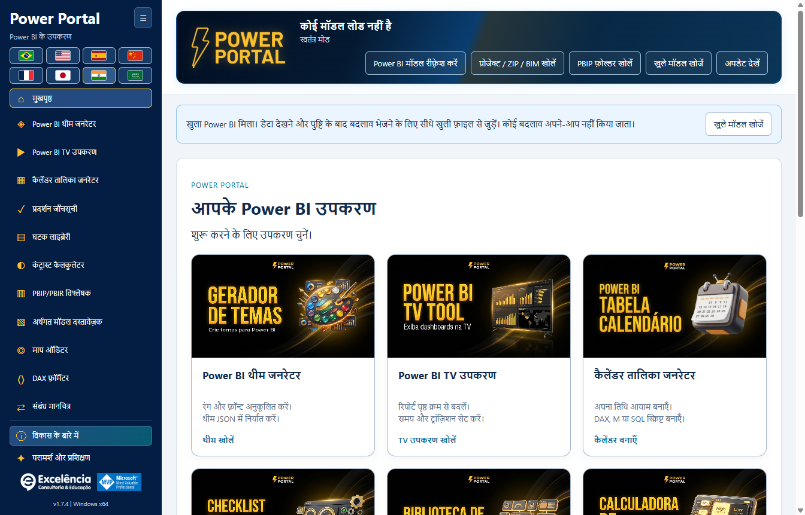
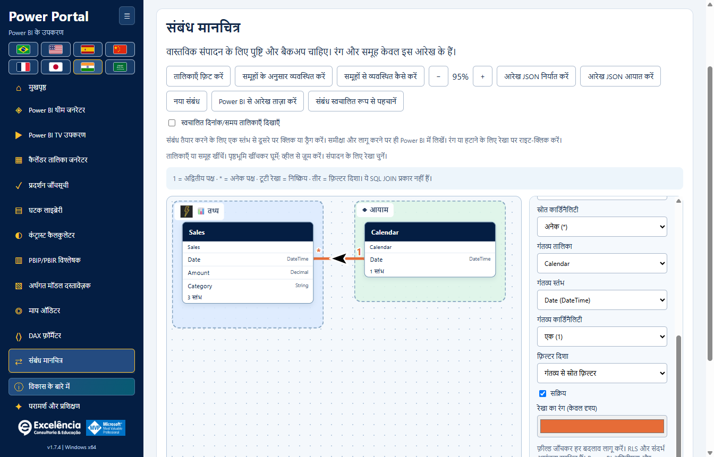
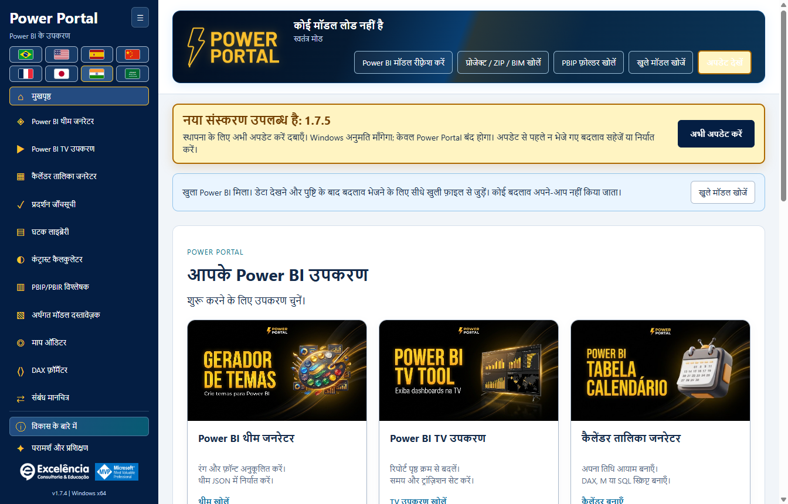

# Power Portal Desktop

<!-- language-selector -->
[🇺🇸 English](README.md) · [🇧🇷 Português](README.pt-BR.md) · [🇪🇸 Español](README.es.md) · [🇨🇳 简体中文](README.zh-CN.md) · [🇫🇷 Français](README.fr.md) · [🇯🇵 日本語](README.ja.md) · [🇮🇳 हिन्दी](README.hi.md) · [🇸🇦 العربية](README.ar.md)
<!-- /language-selector -->

**Power BI Desktop के लिए ग्यारह टूल, एक Windows अनुप्रयोग में।**

Power Portal Desktop का स्वामित्व **Excelência Consultoria e Educação** के पास है। यह Power BI Desktop के **External Tools** रिबन में स्थापित होता है और अन्य बाहरी मॉडलिंग टूल की तरह एक अलग अनुप्रयोग विंडो खोलता है।

यह **केवल वितरण वाला रिपॉज़िटरी** है: इंस्टॉलर, स्थापना सहायक, चेकसम और दस्तावेज़। **यहाँ Power Portal अनुप्रयोग का स्रोत कोड प्रकाशित नहीं किया गया है।**

हर ऐप सत्र में पहली बार आरेख खोलने पर परिचय दिखता है। **समूहों से व्यवस्थित कैसे करें** से इसे फिर खोलें। SAP और Excel केवल उदाहरण हैं, नए कनेक्टर या आधिकारिक लोगो नहीं। खाली समूह भी ड्रॉप क्षेत्र हैं। हाइलाइट समूह में छोड़ने पर तालिका उसे सौंप दी जाती है; बाहर छोड़ने पर मौजूदा समूह बना रहता है।

इसी मॉडल के लिए आरेख इस कंप्यूटर पर स्वतः सहेजा जाता है: समूह, चित्र, रंग और स्थान। प्रति रखने या बाद में आयात करने के लिए JSON निर्यात करें। आरेख सहेजे जाने का संदेश जाँचें।

संबंधों के तीर अब वक्र पर रहते हैं और उसकी स्थानीय दिशा के अनुसार घूमते हैं, तिरछे या उल्टे संबंधों में भी। बड़े 36 × 26 इकाई वाले SVG तीर हमेशा काले होते हैं और उनके चारों ओर 3 इकाई की सफेद सीमा होती है, रेखा के रंग से स्वतंत्र। एकदिशीय फ़िल्टर अभी भी लक्ष्य से स्रोत की ओर जाता है; द्विदिशीय फ़िल्टर दो विपरीत तीर दिखाता है। स्वचालित फ़िल्टर प्रश्नचिह्न रखता है। यह केवल दृश्य बदलाव है।

Power Portal के एनिमेटेड हेडर में अब फ़ाइल का नाम, कनेक्शन स्थिति और पढ़ने, आयात, खोज तथा अपडेट के पाँच बटन शामिल हैं। जगह बचाने के लिए बैनर के नीचे की अलग टूलबार हटाई गई है। छोटी विंडो और अरबी सहित सभी आठ भाषाओं में सामग्री हेडर के अंदर समायोजित होती है। पुष्टिकरण, सूचनाएँ और अपडेट का व्यवहार यथावत है।

<a name="download-and-install"></a>
## डाउनलोड और स्थापना

<a name="option-1-install-with-a-few-clicks"></a>
### विकल्प 1: कुछ क्लिक में इंस्टॉल करें

1. [Windows x64 के लिए Power Portal Desktop 1.7.4 डाउनलोड करें](https://github.com/luisgnserra/powerportaldesktop/releases/download/v1.7.4/PowerPortal-Setup-1.7.4-x64.exe)।
2. इंस्टॉलर चलाएँ और Windows व्यवस्थापक अनुरोध को अनुमति दें।
3. स्थापना फ़ोल्डर और डिफ़ॉल्ट भाषा चुनें।
4. स्थापना पूरी करें, फिर Power BI Desktop बंद करके दोबारा खोलें।
5. PBIX खोलें और **External Tools > Power Portal** चुनें।

**Windows अज्ञात प्रकाशक की चेतावनी दे सकता है:** संस्करण 1.7.4 पर डिजिटल हस्ताक्षर नहीं है। केवल तभी आगे बढ़ें जब आपको इस वितरण पर भरोसा हो। यदि आपका संगठन बिना हस्ताक्षर वाले सॉफ़्टवेयर को रोकता है, तो नीति को दरकिनार करने के बजाय IT से संपर्क करें।

[नवीनतम रिलीज़](https://github.com/luisgnserra/powerportaldesktop/releases/latest) · [स्थापना मार्गदर्शिका](docs/hi/INSTALLATION.md) · [कॉन्फ़िगरेशन](docs/hi/CONFIGURATION.md) · [समस्या निवारण](docs/hi/TROUBLESHOOTING.md)

<a name="launch-from-power-bis-external-tools-ribbon"></a>
### Power BI के External Tools रिबन से खोलें

इंस्टॉलर Power BI Desktop के **External Tools** में **Power Portal** जोड़ता है। PBIX खुला होने पर आइकन पर क्लिक करें; साथी अनुप्रयोग खुले फ़ाइल के स्थानीय मॉडल को अपने-आप पढ़ता है।


दिया गया रिबन स्क्रीनशॉट पुर्तगाली में है: **Ferramentas externas** का अर्थ **External Tools** है। Power Portal, Power BI से जुड़ी **अलग विंडो** खोलता है; यह एम्बेडेड रिपोर्ट विज़ुअल या नया आंतरिक Power BI पैन नहीं है।



**Power BI पहले से खुला है?** शॉर्टकट से शुरू करने पर Power Portal खुले स्थानीय मॉडल पहचानता है और कनेक्शन सूचना दिखाता है। **Find open models** चुनें, अपनी फ़ाइल चुनें और कनेक्ट करें। इसके बाद आप डेटा क्वेरी कर सकते हैं और पुष्टि के बाद समर्थित बदलाव वापस भेज सकते हैं।

कनेक्ट होने के बाद स्थिति अलग बैनर के बजाय हेडर में संक्षेप में दिखाई देती है।

[चित्रों सहित मार्गदर्शिका में सभी ग्यारह टूल, कनेक्शन स्क्रीन और Power BI पर सीधे की जाने वाली कार्रवाइयाँ देखें](docs/hi/SCREENSHOTS.md)।

<a name="new-relationship-map"></a>
### नया: संबंध मानचित्र (Relationship map)

मॉडल के वास्तविक तालिका-संबंधों को स्वतंत्र रूप से खिसकाए जा सकने वाले कैनवास पर देखें। Facts, Dimensions और कस्टम व्यावसायिक समूहों को रंगों, आइकन और सुगम नामों से व्यवस्थित करें; लेआउट अपने-आप सहेजें और JSON निर्यात/आयात करें।



कनेक्टेड Power BI मॉडल में संबंध बनाएँ, संपादित करें, सक्रिय/निष्क्रिय करें और हटाएँ **— पहले पुष्टि और मेटाडेटा बैकअप के बाद**। दृश्य शैली Power Portal में रहती है; यह तालिकाओं के नाम या Power BI का मूल लेआउट नहीं बदलती। [संबंधों की पूरी मार्गदर्शिका](docs/hi/RELATIONSHIPS.md)।

1.7.4 में सटीक कॉलम पर क्लिक या खींचकर संबंध तैयार करें; रेखा पर राइट-क्लिक से रंग, संपादन और पुष्टि के बाद हटाना उपलब्ध है। समूहों में स्थानीय छवियाँ और 30 से अधिक आइकन हैं। स्वचालित तारीख़/समय तालिकाएँ डिफ़ॉल्ट रूप से छिपी रहती हैं और दृश्यता टॉगल उपलब्ध है। Power BI के बाहर संपादन के बाद आरेख रीफ़्रेश करें, या पहले बैकअप लेकर Desktop की मूल स्वचालित पहचान चलाएँ और अलग समीक्षा/समापन प्रक्रिया पूरी करें।

<a name="built-in-update-checks"></a>
### अंतर्निहित अपडेट जाँच

**1.6.2** से, इंस्टॉल किया गया अनुप्रयोग खुलने पर नवीनतम आधिकारिक GitHub Release जाँचता है। नया स्थिर संस्करण उपलब्ध होने पर **Update now** दिखता है। 1.6.4 में बैनर प्रमुख, एनिमेटेड और स्क्रॉल करते समय स्थिर रहता है; कम-गति एनीमेशन प्राथमिकता का सम्मान करता है। लगातार "अप टू डेट" पंक्ति नहीं दिखाई जाती। क्लिक करने पर SHA-256/आकार सत्यापित करके इंस्टॉलर अपने-आप शुरू होता है।

Windows व्यवस्थापक अनुमति माँगता है। केवल Power Portal बंद होता है; Power BI खुला रहता है। पहले न भेजे गए टूल बदलाव सहेजें/निर्यात करें। डाउनलोड विफल होने या अनुमति रद्द करने पर स्पष्ट त्रुटि और पुनः प्रयास विकल्प मिलता है।



स्क्रीनशॉट में UI दिखाने के लिए **भविष्य के 1.7.5 नोटिफिकेशन का सिमुलेशन** है, किसी जारी संस्करण की घोषणा नहीं। **संस्करण 1.7.4 अब जारी है:** 1.6.2 या बाद के संस्करण वाले उपयोगकर्ता ऐप फिर खोलें या **Check for updates** पर क्लिक करें। [अपडेट मार्गदर्शिका](docs/hi/UPDATES.md)।

**1.6.1 या उससे पुराना संस्करण? इस सुविधा को सक्षम करने के लिए 1.6.2 एक बार मैन्युअल रूप से इंस्टॉल करें।** विफल/ऑफ़लाइन जाँच दोहराने के लिए **Check for updates** भी उपयोग कर सकते हैं। केवल ऐप खोलने से अपडेट कभी इंस्टॉल नहीं होता।

<a name="option-2-install-from-powershell"></a>
### विकल्प 2: PowerShell से इंस्टॉल करें

**Windows PowerShell 5.1 या Windows पर PowerShell 7** खोलें:

```powershell
$script = Join-Path $env:TEMP 'Install-PowerPortal.ps1'
[Net.ServicePointManager]::SecurityProtocol = [Net.ServicePointManager]::SecurityProtocol -bor [Net.SecurityProtocolType]::Tls12
Invoke-WebRequest -UseBasicParsing 'https://raw.githubusercontent.com/luisgnserra/powerportaldesktop/v1.7.4/install.ps1' -OutFile $script
# Review the downloaded script before running it.
Get-Content -LiteralPath $script
& $script
```

सहायक **संस्करण 1.7.4** डाउनलोड करता है, उसमें निर्धारित SHA-256 चेकसम सत्यापित करता है और वही इंस्टॉलर खोलता है। यह Node.js, PHP, .NET SDK इंस्टॉल या कोई बिल्ड नहीं करता।

बिना निगरानी वाली स्थापना के लिए वही सहायक **व्यवस्थापक PowerShell विंडो** से चलाएँ:

```powershell
& "$env:TEMP\Install-PowerPortal.ps1" -Silent
```

स्थापित किए बिना केवल डाउनलोड और चेकसम सत्यापन के लिए:

```powershell
& "$env:TEMP\Install-PowerPortal.ps1" -DownloadOnly
```

यदि स्क्रिप्ट चलाना अवरुद्ध हो, तो अपने संगठन की नीति अपनाएँ या निष्पादन योग्य इंस्टॉलर का उपयोग करें। [कमांड-लाइन के पूरे निर्देश](docs/hi/INSTALLATION.md#command-line-installation) देखें।

<a name="requirements"></a>
## आवश्यकताएँ

- Windows 10 या 11, **x64**।
- External Tools समर्थित Power BI Desktop। यह Power BI Service, macOS, Windows ARM64 या Power BI Report Server के लिए स्थापना नहीं है।
- बाहरी टूल स्थापित और पंजीकृत करने के लिए व्यवस्थापक अनुमति।
- इंस्टॉलर डाउनलोड करने के लिए इंटरनेट; स्थानीय टूल और बंडल पूर्वावलोकन ऑफ़लाइन काम करते हैं।
- TV Tool में प्रकाशित/निजी Power BI रिपोर्टों के लिए इंटरनेट तथा संबंधित Microsoft खाता, लाइसेंस और अनुमतियाँ चाहिए।

डेस्कटॉप अनुप्रयोग में आवश्यक रनटाइम घटक शामिल हैं। डेवलपर टूल की आवश्यकता नहीं है।

<a name="included-tools"></a>
## शामिल टूल

| टूल | इसका काम |
|---|---|
| Theme generator | प्रमुख JSON आयात, स्थानीय लाइव पूर्वावलोकन, JSON निर्यात और पृष्ठ के अंत में पुष्टि के साथ सीधे भेजना। |
| TV Tool | ब्राउज़र में आधिकारिक कार्यशील उदाहरण खोलना, प्रकाशित रिपोर्ट पृष्ठ या स्थानीय चित्र दिखाना, समय/ट्रांज़िशन सेट करना और HTML निर्यात करना। |
| Calendar generator | मौजूदा कैलेंडर मेटाडेटा और तारीखें पढ़ना, स्क्रिप्ट निर्यात करना या पुष्टि/बैकअप के साथ गणना की गई कैलेंडर तालिका बनाना। |
| Performance checklist | पोर्टल की चेकलिस्ट और उपलब्ध मॉडल मेटाडेटा से रिपोर्ट का आकलन। |
| Component library | HTML/DAX घटक बनाना और कनेक्टेड मॉडल में HTML माप बनाना। |
| Contrast calculator | WCAG सीमाओं के अनुसार रंग कंट्रास्ट जाँचना। |
| PBIP/PBIR analyzer | स्थानीय प्रोजेक्ट मेटाडेटा की जाँच और उपलब्ध पृष्ठ/विज़ुअल गणना सहित अनुमान-आधारित स्कोर। |
| Model documenter | तालिकाएँ, कॉलम, माप और संबंध Markdown या JSON में निर्यात करना। |
| Measure auditor | मॉडल माप या दिए गए DAX की अनुमान-आधारित जाँच। |
| DAX formatter | स्थानीय रूप से फ़ॉर्मैट करना, निर्यात/कॉपी करना या पुष्टि के साथ चुना हुआ कनेक्टेड माप अपडेट करना। |
| Relationship map | तालिका बॉक्स खिसकाना, लिंक समूह/शैली देना, दृश्य लेआउट सहेजना और पुष्टि के बाद संबंध सीधे Power BI में लागू करना। |

इसमें होम गैलरी, समर्थित विंडो आकारों में बिना साइडबार स्क्रॉल किए दिखने वाले सभी ग्यारह टूल वाला समेटा जा सकने वाला साइडबार, स्वामित्व/विकास जानकारी और दो प्रमुख वीडियो वाला परामर्श तथा प्रशिक्षण क्षेत्र भी शामिल है। **Consulting and training**, **About the development** के नीचे है।

<a name="changes-that-interact-directly-with-your-open-power-bi-file"></a>
### आपके खुले Power BI फ़ाइल से सीधे जुड़ने वाली कार्रवाइयाँ

| कार्रवाई | सीधा संपर्क |
|---|---|
| मॉडल रीफ़्रेश/पढ़ना और नमूने क्वेरी करना | चुना हुआ स्थानीय मॉडल पढ़ता है; संपादन नहीं करता। |
| Theme सीधे Power BI को भेजें | पुष्टि और सत्यापन सहित दृश्य UI Automation द्वारा चुनी Desktop विंडो में theme JSON आयात करता है। |
| Power BI में कैलेंडर बनाएँ | मेटाडेटा बैकअप और पुष्टि के साथ नई गणना की गई तालिका बनाता है। बाद में Desktop में रीफ़्रेश करें। |
| Power BI में HTML माप बनाएँ | बैकअप और पुष्टि के साथ चुनी तालिका में माप बनाता है। संगत HTML विज़ुअल स्वयं जोड़ें। |
| Power BI में माप अपडेट करें | बैकअप, पुष्टि और समवर्ती बदलाव जाँच के साथ चुने माप का DAX अपडेट करता है। |
| Power BI में संबंध बनाएँ/संपादित करें/हटाएँ | बैकअप, पुष्टि और पुरानी स्थिति जाँच के साथ तालिका-कॉलम संबंध, कार्डिनैलिटी, फ़िल्टर दिशा और सक्रिय स्थिति बदलता है। |

**केवल कनेक्ट करने से बदलाव नहीं लिखे जाते। पहले PBIX की प्रति सहेजें, हर पुष्टि की समीक्षा करें और बाद में PBIX स्वयं सहेजें।** [स्क्रीनशॉट और चरण-दर-चरण उदाहरण](docs/hi/SCREENSHOTS.md#direct-interactions-with-the-open-power-bi-file)।

<a name="eight-languages"></a>
## आठ भाषाएँ

पुर्तगाली, अंग्रेज़ी, स्पैनिश, सरलीकृत मंदारिन चीनी, फ़्रेंच, जापानी, हिंदी और अरबी। झंडे अधिकतम दो पंक्तियों में रहते हैं; अरबी में दाएँ-से-बाएँ लेआउट है।

दस्तावेज़ की भाषा चुनने के लिए इस पृष्ठ के ऊपर दिए झंडों का उपयोग करें। सभी आठ भाषाओं में मार्गदर्शिकाएँ और अनुप्रयोग स्क्रीनशॉट उपलब्ध हैं। स्क्रीनशॉट चुनी हुई भाषा वाले वास्तविक अनुप्रयोग से लिए गए हैं; मॉडल ऑब्जेक्ट नाम और DAX अपरिवर्तित रहते हैं। असली Power BI रिबन चित्र सभी मार्गदर्शिकाओं में पुर्तगाली में ही रहता है और चुनी भाषा में इसकी जानकारी दी जाती है।

इंस्टॉलर Windows UI भाषा सुझाता है। बाद में उपयोगकर्ता द्वारा चुनी गई भाषा स्थानीय रूप से सहेजी जाती है और स्थापना के डिफ़ॉल्ट पर प्राथमिकता पाती है। मॉडल नाम, डेटा और DAX का अनुवाद नहीं होता।

<a name="important-limits-and-data-safety"></a>
## महत्वपूर्ण सीमाएँ और डेटा सुरक्षा

- **बदलाव करने से पहले PBIX की प्रति सहेजें।** पुष्टि किए गए लेखन स्थानीय मेटाडेटा बैकअप बनाते हैं, पर वे पूरे PBIX बैकअप का विकल्प नहीं हैं।
- Theme लागू करने में **दृश्य Windows UI Automation** का उपयोग होता है और पुष्टि आवश्यक है। खुले Desktop PBIX के लिए कोई समर्थित सामान्य theme-write API नहीं है; डायलॉग छिपाए नहीं जाते।
- TOM, semantic model से जुड़ता है, सक्रिय रिपोर्ट फ़िल्टर, पृष्ठों या विज़ुअल स्थानों से नहीं। HTML माप अपने-आप रिपोर्ट में विज़ुअल नहीं जोड़ता।
- रिपोर्ट-विश्लेषण और माप-जाँच स्कोर अनुमान हैं, वास्तविक दृश्य प्रदर्शन के माप नहीं।
- स्थानीय मॉडल डेटा Power Portal वेबसाइट को नहीं भेजा जाता। अपडेटर केवल आधिकारिक GitHub रिलीज़ मेटाडेटा/इंस्टॉलर माँगता है, मॉडल सामग्री नहीं। उपयोगकर्ता द्वारा खोले गए बाहरी लिंक, ऑनलाइन प्रस्तुतियाँ और DirectQuery स्रोतों को नेटवर्क चाहिए हो सकता है।
- दस्तावेज़ निर्यात, मेटाडेटा बैकअप और स्थानीय परिवर्तन लॉग में गोपनीय मॉडल विवरण हो सकते हैं। उन्हें उचित रूप से सुरक्षित रखें और साझा करें।

मॉडल बदलने से पहले [उपयोग और सुरक्षा मार्गदर्शिका](docs/hi/USAGE.md) पढ़ें।

<a name="consulting-complete-data-solutions-and-training"></a>
## परामर्श, संपूर्ण डेटा समाधान और प्रशिक्षण

Excelência, Power BI, Microsoft Fabric, डेटा इंजीनियरिंग, शुरू-से-अंत तक डेटा समाधान और **In Company प्रशिक्षण** में परामर्श सेवाएँ देता है।

- [WhatsApp पर बातचीत तय करें](https://api.whatsapp.com/send/?phone=5535998532286&text&type=phone_number&app_absent=0)
- ईमेल: [contato@consultoriaexcelencia.com.br](mailto:contato@consultoriaexcelencia.com.br)
- [Power BI In Company प्रशिक्षण](https://www.consultoriaexcelencia.com.br/educacao/treinamentos-power-bi)
- [विशेष वीडियो 1](https://www.youtube.com/watch?v=bIxmIaYmt0c)
- [विशेष वीडियो 2](https://www.youtube.com/watch?v=FNo7F7kh6h4)
- [Excelência ब्लॉग](https://consultoriaexcelencia.com.br/blog) · [ऑनलाइन पाठ्यक्रम](https://ead.consultoriaexcelencia.com.br/)

विकास के लिए उत्तरदायी: **Luis Gustavo Nascimento Serra**।
[LinkedIn](https://www.linkedin.com/in/luisgnserra/) · [YouTube: Mais Que Planilhas](https://www.youtube.com/MaisQuePlanilhas)

Microsoft, Power BI और Microsoft Fabric, Microsoft के ट्रेडमार्क हैं। MVP पहचान व्यक्तिगत है और इसका अर्थ Microsoft का स्वामित्व, प्रायोजन या समर्थन नहीं है।

<a name="support-and-distribution"></a>
## सहायता और वितरण

[समस्या निवारण और सहायता](docs/hi/TROUBLESHOOTING.md) · [रिलीज़ नोट्स](CHANGELOG.hi.md) · [वितरण सूचना](DISTRIBUTION.hi.md) · [रिलीज़ रखरखाव](docs/hi/RELEASING.md)

अनुप्रयोग डाउनलोड करने के लिए **Release assets** का उपयोग करें। GitHub के स्वचालित "Source code" ZIP/TAR संग्रह में केवल इस वितरण रिपॉज़िटरी के दस्तावेज़ और इंस्टॉलर सहायक होते हैं, अनुप्रयोग या उसका स्रोत कोड नहीं।
