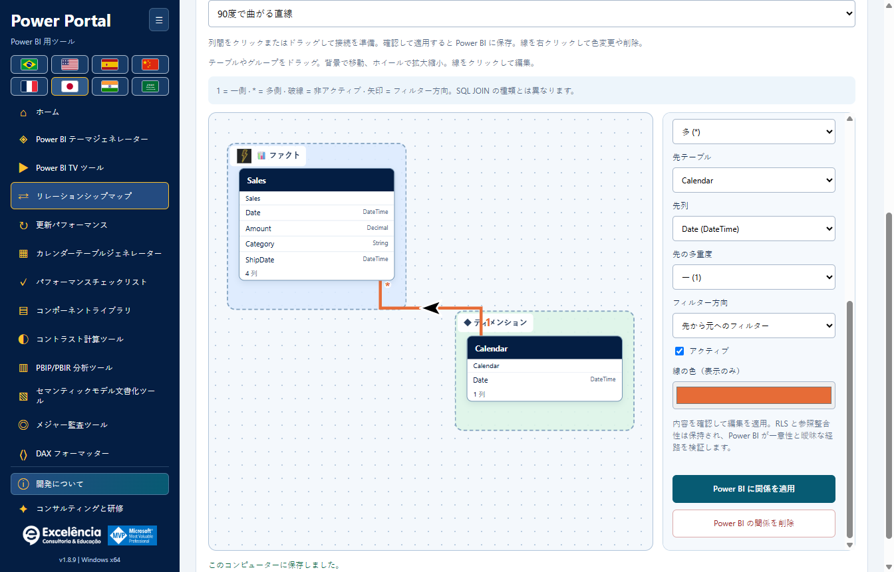
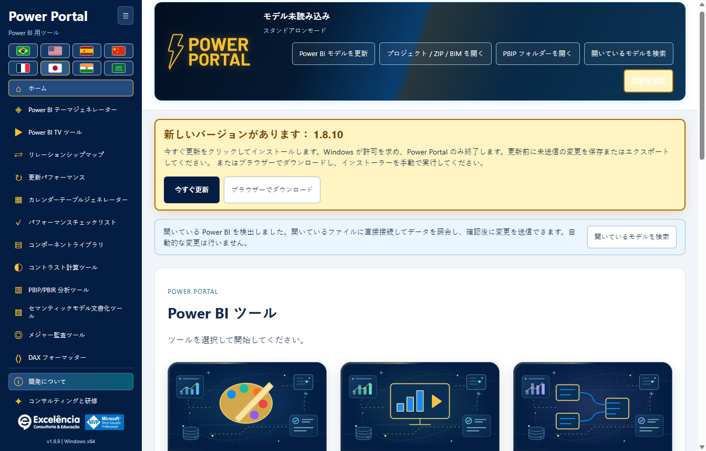

# Power Portal Desktop

<!-- language-selector -->

| Idioma / Language | Link |
| :--- | :--- |
| 🇺🇸 English | [README.md](README.md) |
| 🇧🇷  Brasil  Português | [README.pt-BR.md](README.pt-BR.md) |
| 🇪🇸 Español | [README.es.md](README.es.md) |
| 🇨🇳 简体中文 | [README.zh-CN.md](README.zh-CN.md) |
| 🇫🇷 Français | [README.fr.md](README.fr.md) |
| 🇯🇵 日本語 | [README.ja.md](README.ja.md) |
| 🇮🇳 हिन्दी | [README.hi.md](README.hi.md) |
| 🇸🇦 العربية | [README.ar.md](README.ar.md) |
<!-- /language-selector -->

**1.8.9 — カレンダーサンプルとネイティブ更新のショートカット**

カレンダーテーブル生成では、実データサンプル（最大 50 行）をスクリプト生成ボタンの下に移動しました。隣の「Power BI で更新」は、接続中に更新パフォーマンスを開き、既存の確認付きネイティブ更新フローを開始します。表の状態、所要時間、行数を確認できます。モデル全体のデータを更新する操作であり、生成スクリプトの適用、カレンダーの作成・置換、PBIX の保存は行いません。Power BI にカレンダーを作成する操作は別のままです。オフラインでは無効になり、キーボード操作と全 8 言語に対応しています。キャンセルとエラーは既存フローを使用します。サンプルは最後に読み取った値のままなので、更新後は選択したカレンダーを再度読み取ってください。パッケージ版テストでは配置、8 言語、オフライン制御、対象接続、キャンセル、エラー表示、再試行、既存の作成機能を確認しました。実モデルの更新は開始しておらず、文書の画面には合成データを使用しています。

**1.8.8 — 動的なリレーションシップ線と検証付きテーマ送信**

リレーションシップマップの「線のスタイル」で、曲線と 90 度の角で曲がる直線を切り替えられます。表の位置と実際のカードサイズに応じて、端点は向かい合う上下または左右の辺に動的に接続されます。左右の接続は関連列の高さを維持します。白い縁取りの黒い矢印は直線部分に配置され、角で斜めになりません。スタイルは自動保存され、エクスポートする JSON にも含まれます。既存のレイアウトは曲線のままです。Power BI のネイティブ配置の変更や全体的な障害物回避は行いません。

テーマを Power BI に直接送信すると、ネイティブインポート後とエクスポート検証中に、Power BI が前面にある場合のみ Power Portal にフォーカスが戻ります。テーマ検証後は Power BI を表示し、エラー時も対象ウィンドウを表示します。ネイティブダイアログは一時的に表示される場合があり、非表示にはしません。Desktop にはダイアログなしでテーマを適用するサポート対象 API がありません。インポート後の非同期タブ変更に対応してからテーマを確認します。許可された実機テストでは、パッケージ版でインポート/エクスポート、Portal へのフォーカス復帰、最後の Power BI 表示を確認し、PBIX を保存せず元の既定テーマに戻しました。文書の画面は合成データです。

**1.8.7 — わかりやすく確実なテーマ色の選択**

テーマの全十一色に、表示されるネイティブ色見本と、編集可能な HEX 欄の隣に「色を選択」ボタンを追加しました。色見本やボタンをクリックするか、ボタンにフォーカスして Enter/スペースを押します。非表示でサイズがゼロの入力や HEX のダブルクリックに依存しません。手動編集、インポート、ライブプレビュー、JSON 出力はそのまま利用でき、起動エラーも明示します。Windows でネイティブ選択画面の繰り返し起動、十一ボタンのマウス・キーボード操作、八言語を検証済みです。

メニュー、ホーム、見出し、八言語の「更新分析」を「更新パフォーマンス」に変更しました。名称のみの変更で、更新処理、ライブ進捗、時間、行数、ローカル履歴、JSON/CSV 互換性は変わりません。保存済み分析は移行や再更新なしで利用できます。画像は合成データです。

**1.8.6 — Power Portal 内で更新の進行状況を確認**

Power Portal で更新パフォーマンスを開始すると、各テーブル、観測状態、エンジンのフェーズ、活動時間、最後に取得した Power BI の進行状況をライブカードで確認できます。開始後に Power Portal へフォーカスが戻り、Power BI が再び前面に出た場合は更新完了後にもう一度戻ります。他のアプリから繰り返しフォーカスを奪いません。「Power BI で表示」は再更新せず選択したファイルを開き、このキャプチャの自動フォーカス復帰を無効にします。

更新処理は引き続き Power BI が実行します。ウィンドウが一時的に表示される場合があり、サポートされたヘッドレス PBIX 処理 API ではありません。資格情報、エラー、キャンセルは Power BI 側で扱い、ダイアログを自動的に隠したり閉じたりしません。ネイティブ文字列は Power BI の言語のまま、最終取得時刻付きで表示します。取得不能は明示し、エンジントレースは継続します。フェーズ終了はテーブル完了を証明せず、割合を推測せず、最終行数はキャプチャ後に数えます。履歴と JSON にネイティブ状態が含まれるため共有前に確認してください。許可された実際の更新でパッケージ版を検証済み：4/4 テーブルの時間、4/4 行数、ライブ状態、フォーカス復帰、表示ボタン、再読み込み後の履歴保存。PBIX は自動保存せず、文書画像は合成データを使用しています。

**1.8.5 — ネイティブ更新の計測を修正**

更新パフォーマンスは、Power BI Desktop のネイティブ XML Refresh コマンドと Batch 内の Refresh を認識し、XMLA Process と TMSL refresh にも引き続き対応します。従来は更新が実行されても進行イベントが除外され、計測テーブル数が 0、行数が利用不可、refreshCompletionNotProven となる場合がありました。任意の Error フィールドがなくても明示的な成功結果を受け付けます。非ゼロのエラーコードと XMLA エラーは引き続き優先されます。無関係なビジュアルクエリを除くため、進行イベントは要求またはアクティビティとの厳密な関連付けが必要です。

最初の更新コマンドを認識するまでは、Power BI の更新イベントを待機中と表示します。完了を確認できない場合は技術コードだけでなく翻訳された案内を表示します。アプリを更新し、正しい PBIX に接続して更新と分析を再実行してください。以前の不完全なレポートは成功に書き換えず保持します。ユーザーが許可した実際の更新で、テーブルの活動、行数、自動完了、再読み込み後の履歴を含むパッケージ版の一連の動作を確認しました。文書の画像は引き続き合成例であり、ユーザーのデータやモデル名は含みません。

**1.8.5 — ブラウザーで更新をダウンロード**

新しいバージョンがある場合、更新通知に今すぐ更新とブラウザーでダウンロードが表示されます。検出された公式 GitHub インストーラーのアドレスを既定のブラウザーで開きます。Power Portal を終了せず、インストールも開始しません。準備ができたらダウンロードしたインストーラーを手動で実行してください。自動更新でエラーが発生した後も利用でき、ブラウザーの起動失敗は明示されます。今すぐ更新は引き続きアプリ内でダウンロードし、SHA-256 とサイズを検証して Windows の許可を求めます。ブラウザーダウンロードにはアプリの自動検証がないため、実行前に公開された SHA-256 と比較してください。両方のボタンと説明は八言語に対応しています。

**1.8.5 — 滑らかなテーマプレビュー**

テーマジェネレーターの折れ線グラフは、サンプルデータと接続モデルのデータの両方で、直線の代わりに滑らかな三次曲線を使います。曲線は元の点を通り、値の間に余分なピークを作りません。色、マーカー、ツールチップも維持されます。変更はプレビューのみで、エクスポートされるテーマ JSON と既存の Power BI ビジュアルの線の書式は変わりません。

**Power BI Desktop 向けの 12 個のツールを、1 つの Windows アプリに。**

Power Portal Desktop は **Excelência Consultoria e Educação** が所有しています。Power BI Desktop の**外部ツール**リボンに登録され、ほかの外部モデリングツールと同様に、独立したアプリケーションウィンドウを開きます。

ここは**配布専用リポジトリ**です。インストーラー、インストール補助スクリプト、チェックサム、ドキュメントを提供します。**Power Portal アプリケーションのソースコードは一切公開していません。**

各アプリセッションで最初に図を開くと紹介が表示されます。**グループで整理する方法**で再表示できます。SAP と Excel は説明用のシステム例であり、新しいコネクターや公式ロゴではありません。空のグループも移動先として表示されます。強調表示されたグループにドロップすると所属が変わり、外で離すと元の所属を保ちます。

同じモデルの図は、このコンピューターに自動保存されます。グループ、画像、色、位置も保存されます。JSON をエクスポートして控えを残し、後でインポートできます。保存完了のメッセージを確認してください。

リレーションシップの矢印を曲線上に配置し、斜めや逆向きの接続でも曲線の局所的な方向に合わせて回転します。 SVG 矢印を 36 × 26 単位に拡大しました。線の色に関係なく、常に黒色で 3 単位の白い輪郭を付けています。 単方向のフィルターは引き続き移動先から移動元へ伝播します。双方向は逆向きの矢印を二つ表示し、自動フィルターは疑問符を維持します。表示のみの変更です。

Power Portal のアニメーション付きヘッダーに、ファイル名、接続状態、読み取り・インポート・検索・更新の五つのボタンを統合しました。バナー下の独立したツールバーを削除して作業領域を広げています。小さなウィンドウやアラビア語を含む八言語でヘッダー内の内容が折り返されます。確認、通知、更新の動作は変わりません。

リレーションシップ マップを、サイドバーとホームギャラリーの TV Tool の直後に移動しました。 カレンダー生成とコンポーネントライブラリから汎用の実モデルデータブロックを削除しました。各ツールの読み取りと送信操作は引き続き利用でき、実際の期間ボタンはツール内で選択したカレンダーを使用します。 ホームのカバーを、文字を含まないローカルのベクターイラストとして描き直しました。タイトル、説明、操作は画像外にあり、選択言語に従います。 元の列を別のテーブルへドラッグすると、実際の関係を作成するダイアログで接続先の列を選択できます。列上にドロップするとその列が選択されます。多重度、フィルター、有効状態を確認し、検証して適用してください。保存にはネイティブ確認と BIM バックアップが必要です。

**1.8.5 — 更新開始の修正**

更新パフォーマンスをサイドメニューとホームギャラリーのリレーションシップマップの直下に移動しました。ネイティブボタンの検索では DAX クエリビューと TMDL ビューの重複する Home タブを除外し、「Ambiguous Power BI control: home」を防ぎます。コントロールが見つからない場合は Power BI のレポート、データ、モデルビューを選択してください。

<a name="download-and-install"></a>
## ダウンロードとインストール

<a name="option-1-install-with-a-few-clicks"></a>
### 方法 1：数回のクリックでインストール

1. [Windows x64 用 Power Portal Desktop 1.8.9 をダウンロード](https://github.com/luisgnserra/powerportaldesktop/releases/download/v1.8.9/PowerPortal-Setup-1.8.9-x64.exe)します。
2. インストーラーを実行し、Windows の管理者権限の確認を承認します。
3. インストール先フォルダーと既定の言語を選びます。
4. インストール完了後、Power BI Desktop を閉じて開き直します。
5. PBIX を開き、**外部ツール > Power Portal** を選びます。

**Windows が発行元不明の警告を表示する場合があります：**バージョン 1.8.9 にはデジタル署名がありません。この配布元を信頼できる場合にのみ続行してください。組織が未署名のソフトウェアを禁止している場合は、ポリシーを回避せず IT 部門に連絡してください。

[最新リリース](https://github.com/luisgnserra/powerportaldesktop/releases/latest) · [インストールガイド](docs/ja/INSTALLATION.md) · [設定](docs/ja/CONFIGURATION.md) · [トラブルシューティング](docs/ja/TROUBLESHOOTING.md)

<a name="launch-from-power-bis-external-tools-ribbon"></a>
### Power BI の外部ツールリボンから起動

インストーラーは Power BI Desktop の**外部ツール**に **Power Portal** を追加します。PBIX を開いた状態でアイコンをクリックすると、補助アプリが起動し、そのファイルのローカルモデルを自動的に読み取ります。


提供されたリボンのスクリーンショットはポルトガル語の原版です。**Ferramentas externas** は**外部ツール**を意味します。Power Portal は **Power BI に接続した独立ウィンドウ**を開きます。埋め込みのレポートビジュアルや、Power BI 内部の新しいペインではありません。


**すでに Power BI を開いていますか？**ショートカットから起動すると、Power Portal は開いているローカルモデルを検出し、接続通知を表示します。**開いているモデルを検索**を選び、ファイルを選択して接続してください。その後、データをクエリし、対応する変更を確認付きでモデルに送信できます。

接続後は、状態がヘッダーにまとめて表示され、独立したバナーは使用しません。

[12 個のツール、接続画面、Power BI への直接操作を図解ガイドで確認](docs/ja/SCREENSHOTS.md)できます。

<a name="new-relationship-map"></a>
### 新機能：リレーションシップマップ

自由にドラッグできるキャンバスで、実際のテーブル間のつながりを理解できます。ファクト、ディメンション、独自の業務グループを色、アイコン、わかりやすい名前で整理し、レイアウトを自動保存して JSON でエクスポート/インポートできます。



接続中の Power BI モデルで、**確認とメタデータのバックアップ後に**リレーションシップを作成、編集、有効化/無効化、削除できます。表示スタイルは Power Portal 内にとどまり、テーブル名や Power BI の標準レイアウトは変更しません。[リレーションシップの詳細チュートリアル](docs/ja/RELATIONSHIPS.md)。

1.8.9 では、正確な列をクリックまたはドラッグしてリレーションシップを準備し、線を右クリックして色の設定、編集、確認後の削除を行えます。グループにはローカル画像と 30 種類を超えるアイコンを設定できます。自動日付/時刻テーブルは既定で非表示になり、表示切替が可能です。Power BI 外で編集した後に図を更新するか、事前にバックアップして Desktop のネイティブ自動検出を呼び出し、別途確認して完了します。

<a name="built-in-update-checks"></a>
### 組み込みの更新チェック

**1.6.2** 以降、インストール済みアプリは起動時に最新の公式 GitHub Release を確認します。より新しい安定版があれば、**今すぐ更新**を表示します。1.6.4 ではバナーが目立つようになり、控えめなアニメーションとスクロール中も表示される仕組みを備え、動きを減らす設定に従います。「最新です」という行は常時表示しません。クリックすると、ダウンロード、SHA-256/サイズの検証、インストーラーの自動起動を行います。

Windows が管理者の承認を求めます。閉じるのは Power Portal のみで、Power BI は開いたままです。未送信のツール編集は先に保存/エクスポートしてください。ダウンロード失敗や承認のキャンセルは、明示的なエラーと再試行の選択肢を表示します。



この画像は UI を説明するための**将来の 1.8.9 通知のシミュレーション**であり、公開済みバージョンの発表ではありません。**バージョン 1.8.9 は公開済みです：**1.6.2 以降のユーザーはアプリを開き直すか、**更新を確認**をクリックして更新を受け取れます。[更新ガイド](docs/ja/UPDATES.md)。

**1.6.1 以前を使用していますか？この機能を有効にするには、最初に 1.6.2 を一度手動でインストールしてください。**失敗したチェックやオフライン時のチェックは、**更新を確認**で再試行できます。アプリを開いただけでインストールされることはありません。

<a name="option-2-install-from-powershell"></a>
### 方法 2：PowerShell からインストール

Windows 上で **Windows PowerShell 5.1 または PowerShell 7** を開きます。

```powershell
$script = Join-Path $env:TEMP 'Install-PowerPortal.ps1'
[Net.ServicePointManager]::SecurityProtocol = [Net.ServicePointManager]::SecurityProtocol -bor [Net.SecurityProtocolType]::Tls12
Invoke-WebRequest -UseBasicParsing 'https://raw.githubusercontent.com/luisgnserra/powerportaldesktop/v1.8.9/install.ps1' -OutFile $script
# Review the downloaded script before running it.
Get-Content -LiteralPath $script
& $script
```

補助スクリプトは**バージョン 1.8.9** をダウンロードし、固定された SHA-256 チェックサムを検証して、同じインストーラーを開きます。Node.js、PHP、.NET SDK のインストールやビルドは行いません。

無人インストールでは、**管理者の PowerShell ウィンドウ**から同じ補助スクリプトを実行します。

```powershell
& "$env:TEMP\Install-PowerPortal.ps1" -Silent
```

インストールせず、ダウンロードとチェックサム検証のみを行う場合：

```powershell
& "$env:TEMP\Install-PowerPortal.ps1" -DownloadOnly
```

スクリプトの実行がブロックされた場合は、組織のポリシーに従うか、実行形式のインストーラーを使用してください。[コマンドラインの詳しい手順](docs/ja/INSTALLATION.md#command-line-installation)を参照してください。

<a name="requirements"></a>
## 必要条件

- Windows 10 または 11、**x64**。
- 外部ツールに対応する Power BI Desktop。Power BI Service、macOS、Windows ARM64、Power BI Report Server 向けのインストールではありません。
- 外部ツールのインストールと登録に必要な管理者権限。
- インストーラーのダウンロードにはインターネットが必要です。ローカルツールと同梱のプレビューはオフラインで動作します。
- TV Tool の公開済み/非公開 Power BI レポートには、インターネットと適切な Microsoft アカウント、ライセンス、権限が必要です。

デスクトップアプリには必要なランタイムコンポーネントが含まれています。開発ツールは不要です。

<a name="included-tools"></a>
## 含まれるツール

| ツール | 機能 |
|---|---|
| テーマジェネレーター | 目立つ JSON インポート、ローカルのライブプレビュー、JSON エクスポート、ページ末尾での確認付き直接送信。 |
| TV Tool | 動作する公式サンプルをブラウザーで開き、公開済みレポートページやローカル画像を表示し、時間/切り替えを設定して HTML をエクスポート。 |
| カレンダージェネレーター | 既存カレンダーのメタデータや日付を読み取り、スクリプトをエクスポートするか、確認とバックアップを伴う計算カレンダーテーブルを作成。 |
| パフォーマンスチェックリスト | ポータルのチェックリストと利用可能なモデルメタデータでレポートを評価。 |
| コンポーネントライブラリ | HTML/DAX コンポーネントを作成し、接続モデルに HTML メジャーを作成。 |
| コントラスト計算ツール | WCAG の基準値に対して色のコントラストを確認。 |
| PBIP/PBIR アナライザー | ローカルプロジェクトのメタデータを調べ、ヒューリスティックなスコアと取得できるページ/ビジュアル数を表示。 |
| モデルドキュメント生成ツール | テーブル、列、メジャー、リレーションシップを Markdown または JSON にエクスポート。 |
| メジャー監査ツール | ヒューリスティックな検査でモデルのメジャーや入力された DAX を確認。 |
| DAX フォーマッター | ローカルで整形、エクスポート/コピー、または確認付きで接続先の選択メジャーを更新。 |
| リレーションシップマップ | テーブル枠をドラッグし、つながりをグループ化/装飾し、表示レイアウトを保存して、確認済みのリレーションシップ変更を Power BI に直接適用。 |
| 更新パフォーマンス | ネイティブ更新を測定。 所要時間と行数を比較。 |

ホームギャラリー、対応するウィンドウサイズで 12 個のツールをスクロールなしで表示できる折りたたみ式サイドバー、所有権/開発情報、2 本の注目動画を含むコンサルティングと研修のエリアもあります。**コンサルティングと研修**は**開発について**の下にあります。

<a name="changes-that-interact-directly-with-your-open-power-bi-file"></a>
### 開いている Power BI ファイルと直接やり取りする変更

| 操作 | 直接的なやり取り |
|---|---|
| モデルの更新/読み取りとサンプルのクエリ | 選択されたローカルモデルを読み取ります。編集しません。 |
| テーマを Power BI に直接送信 | 確認と検証を伴う可視の UI Automation で、選択された Desktop ウィンドウにテーマ JSON をインポートします。 |
| Power BI にカレンダーを作成 | メタデータのバックアップと確認を伴う新規計算テーブルを作成します。その後 Desktop で更新してください。 |
| Power BI に HTML メジャーを作成 | バックアップと確認を伴い、選択テーブルにメジャーを作成します。対応する HTML ビジュアルは手動で配置してください。 |
| Power BI のメジャーを更新 | バックアップ、確認、同時変更の検査を伴い、選択メジャーの DAX を更新します。 |
| Power BI のリレーションシップを作成/編集/削除 | バックアップ、確認、古い状態の検査を伴い、テーブル列間のリレーションシップ、カーディナリティ、フィルター方向、有効状態を変更します。 |
| 更新パフォーマンス | ネイティブ更新はソースを照会し、インポートデータを置き換えます。PBIX のコピーを保存してください。資格情報とエラーは Power BI で処理してください。追跡は更新をキャンセルせず、すべての Power Query 補助クエリを含むものではありません。 |

**接続だけでは変更を書き込みません。先に PBIX のコピーを保存し、各確認内容を確認して、最後に自分で PBIX を保存してください。**[スクリーンショットと手順付きの例](docs/ja/SCREENSHOTS.md#direct-interactions-with-the-open-power-bi-file)。

<a name="eight-languages"></a>
## 8 つの言語

ポルトガル語、英語、スペイン語、簡体字中国語、フランス語、日本語、ヒンディー語、アラビア語に対応します。国旗は最大 2 行に配置され、アラビア語は右から左へのレイアウトを使用します。

ページ上部の国旗でドキュメントの言語を選んでください。すべてのガイドとアプリのスクリーンショットをこの 8 言語で提供しています。画像は選択した言語の実際のアプリから撮影されており、モデルオブジェクト名と DAX は変更していません。実際の Power BI リボン画像はすべてのガイドでポルトガル語のまま使用し、選択した言語で説明しています。

インストーラーは Windows の UI 言語を提案します。ユーザーが後で選んだ言語はローカルに保存され、インストール時の既定値より優先されます。モデル名、データ、DAX は翻訳しません。

<a name="important-limits-and-data-safety"></a>
## 重要な制限とデータの安全性

- **変更前に PBIX のコピーを保存してください。**確認された書き込みはローカルのメタデータバックアップを作成しますが、完全な PBIX バックアップの代わりにはなりません。
- テーマの適用は**可視の Windows UI Automation** を使い、確認が必要です。開いている Desktop PBIX にテーマを書き込む汎用のサポートされた API はなく、ダイアログを隠しません。
- TOM の接続先はセマンティックモデルであり、アクティブなレポートのフィルター、ページ、ビジュアル配置ではありません。HTML メジャーを作成してもビジュアルは自動追加されません。
- レポート分析とメジャー監査のスコアはヒューリスティックであり、ビジュアルの実測性能ではありません。
- ローカルモデルのデータは Power Portal の Web サイトに送信しません。更新プログラムが要求するのは公式 GitHub リリースのメタデータ/インストーラーのみで、モデル内容は送信しません。ユーザーが開く外部リンク、オンラインプレゼンテーション、DirectQuery のソースにはネットワークアクセスが必要な場合があります。
- ドキュメントのエクスポート、メタデータバックアップ、変更ログには機密のモデル情報が含まれる場合があります。適切に保存、共有してください。

モデルを変更する前に[使用方法と安全性のガイド](docs/ja/USAGE.md)を読んでください。

<a name="consulting-complete-data-solutions-and-training"></a>
## コンサルティング、包括的なデータソリューション、研修

Excelência は Power BI コンサルティング、Microsoft Fabric、データエンジニアリング、エンドツーエンドのデータソリューション、**企業内研修（In Company）**を提供します。

- [WhatsApp で相談を予約](https://api.whatsapp.com/send/?phone=5535998532286&text&type=phone_number&app_absent=0)
- メール：[contato@consultoriaexcelencia.com.br](mailto:contato@consultoriaexcelencia.com.br)
- [Power BI 企業内研修](https://www.consultoriaexcelencia.com.br/educacao/treinamentos-power-bi)
- [注目動画 1](https://www.youtube.com/watch?v=bIxmIaYmt0c)
- [注目動画 2](https://www.youtube.com/watch?v=FNo7F7kh6h4)
- [Excelência ブログ](https://consultoriaexcelencia.com.br/blog) · [オンライン講座](https://ead.consultoriaexcelencia.com.br/)

開発責任者：**Luis Gustavo Nascimento Serra**。
[LinkedIn](https://www.linkedin.com/in/luisgnserra/) · [YouTube：Mais Que Planilhas](https://www.youtube.com/MaisQuePlanilhas)

Microsoft、Power BI、Microsoft Fabric は Microsoft の商標です。MVP の表記は個人の資格であり、Microsoft による所有、スポンサーシップ、推奨を意味しません。

<a name="support-and-distribution"></a>
## サポートと配布

[トラブルシューティングとサポート](docs/ja/TROUBLESHOOTING.md) · [リリースノート](CHANGELOG.ja.md) · [配布に関する告知](DISTRIBUTION.ja.md) · [リリース管理](docs/ja/RELEASING.md)

アプリは **Release の Assets（添付ファイル）**からダウンロードしてください。GitHub が自動生成する「Source code」の ZIP/TAR アーカイブには、この配布リポジトリのドキュメントとインストール補助スクリプトしか含まれず、アプリやそのソースコードは含まれません。

<a name="refresh-performance"></a>
## 更新パフォーマンス

ネイティブ更新を測定。 所要時間と行数を比較。 [更新パフォーマンス](docs/ja/REFRESH-ANALYSIS.md).

正しい PBIX に接続し、更新パフォーマンスで更新して分析を選び、ファイル名を確認します。ネイティブのホーム > 更新を呼び出す前に追跡を開始し、TOM でテーブルを順番に更新しません。Power BI を開いたままにし、資格情報、エラー、キャンセルはそこで処理してください。BIM バックアップでは更新データを復元できません。

自動終了には更新コマンドの終了検出と Power BI ウィンドウの準備完了が必要です。結果ダイアログを閉じてください。手動でキャプチャを終了した場合は常に不完全で、成功の証明でも更新のキャンセルでもありません。エンジンや追跡のエラーを明示し、中断した計測を完了とは表示しません。

<a name="animated-home-cards"></a>
## アニメーション付きホームカード

12 枚のホームカードはメニューと同じ濃紺（#041e43）を基調にした、文字を含まないオリジナルのベクターイラストです。各ツール固有の中央イラストに、データパネル、グラフ、データベース、軌道、グリッド、浮遊パネルを追加しました。信号線が穏やかに流れます。外部画像、スクリプト、サービスは読み込みません。

マウスを重ねるかキーボードでフォーカスすると、金色の枠と光彩、光の反射、明るいイラスト、円形の起動矢印、金色の操作表示が現れます。押した瞬間に反応し、画面遷移は遅延しません。Enter/スペースでも同じツールを開けます。OS/ブラウザーの視差効果を減らす設定では動きを止め、静的な強調とフォーカスは維持します。タイトルと操作文字は画像の外にあり、選択言語に従います。スクリーンショットは通常とホバーの静止状態で、動画ではありません。


