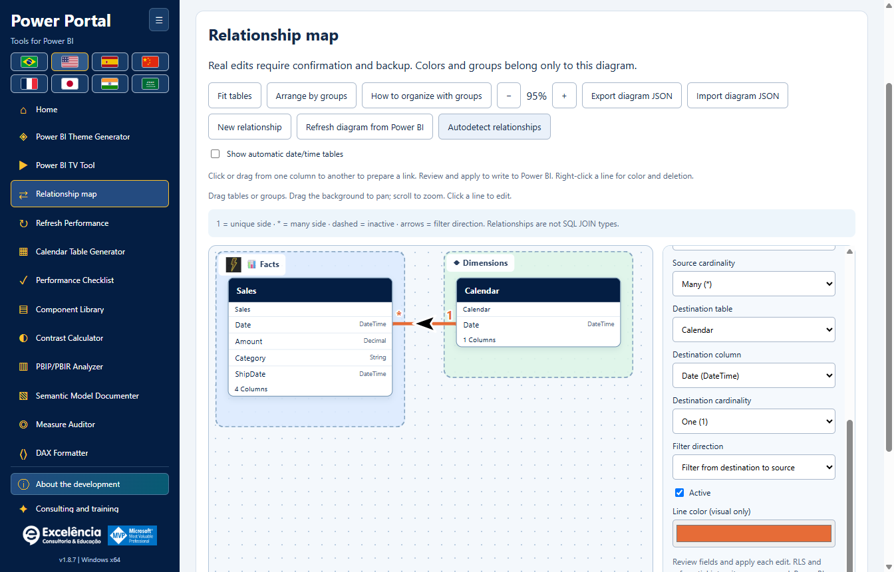
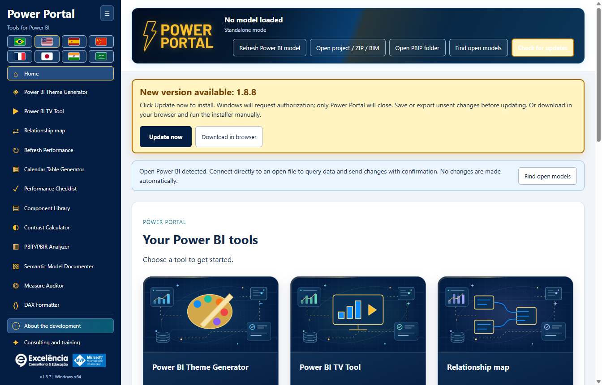
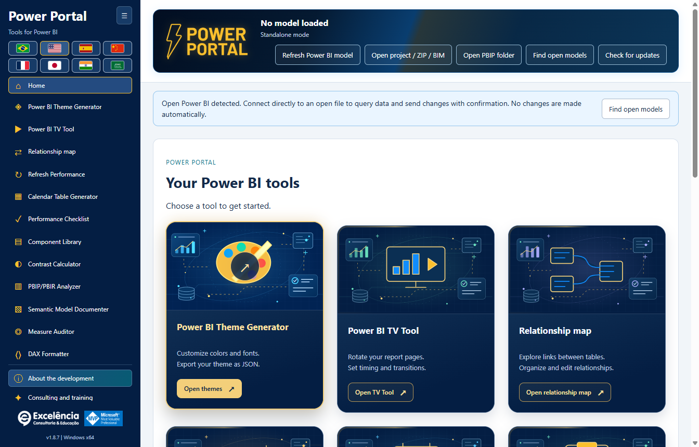

# Power Portal Desktop

<!-- language-selector -->
[🇺🇸 English](README.md) · [🇧🇷 Português](README.pt-BR.md) · [🇪🇸 Español](README.es.md) · [🇨🇳 简体中文](README.zh-CN.md) · [🇫🇷 Français](README.fr.md) · [🇯🇵 日本語](README.ja.md) · [🇮🇳 हिन्दी](README.hi.md) · [🇸🇦 العربية](README.ar.md)
<!-- /language-selector -->

**1.8.7 — Reliable theme color selection**

All eleven theme colors now have a visible native swatch and a Choose color button beside the editable HEX field. Click the swatch or button, or focus the button and press Enter/Space. The native picker no longer depends on an invisible zero-size input or double-clicking the HEX field. Manual HEX editing, imported themes, live preview and JSON export remain available. Picker failures are shown explicitly. Native opening was verified repeatedly in the Windows application, alongside mouse/keyboard activation of all eleven buttons and eight-language labels.

Refresh Analysis is now named Refresh Performance in the sidebar, home gallery, page heading and all eight interface languages. This is a label change only: native refresh, live progress, timings, row counts, local history and JSON/CSV compatibility are unchanged. Existing saved analyses remain available; no migration or refresh is required. Screenshots use synthetic data.

**1.8.6 — Follow native refresh inside Power Portal**

Start Refresh and analyze in Power Portal and follow live cards with each table, observed status, engine phase, activity time and the latest available native Power BI progress text. Power Portal regains focus after launch and, if Power BI brings itself forward again, after native completion. It does not repeatedly take focus from other applications. View in Power BI opens the selected file without starting another refresh; choosing it disables automatic focus return for that capture.

Power BI remains the refresh engine. Its window may appear briefly; this is not a supported headless PBIX processing API. Credentials, errors and cancellation remain in Power BI, and native dialogs are never hidden or dismissed automatically. Native text keeps the Power BI language and shows its last-read time. Missing native text is explicit; engine tracing continues if the UI reader fails. Ended phases do not prove table completion, percentages are not invented, and final row counts are calculated only after capture. History and JSON include the observed native statuses; review exports before sharing. The packaged application was tested with an authorized real refresh: 4/4 tables measured, 4/4 row counts, live native statuses, restored Portal focus, working View in Power BI and history surviving reload. No PBIX was automatically saved; all documentation images use synthetic data.

**1.8.5 — Native refresh measurements fixed**

Refresh Performance now recognizes the native XML Refresh command used by Power BI Desktop, including Refresh inside Batch, as well as XMLA Process and TMSL refresh. Previously the native refresh could execute while its progress was discarded as unrelated, leaving 0 measured tables, unavailable row counts and refreshCompletionNotProven. An explicit successful engine result is now accepted when the optional Error field is absent; nonzero error codes and XMLA errors still override success. Progress still requires exact request/activity correlation, excluding unrelated visual queries.

Before the first recognized refresh command, the UI says it is waiting for Power BI refresh events. Unconfirmed completion now has translated guidance rather than only a technical code. Update the app, connect to the intended PBIX and run Refresh and analyze again; old incomplete reports are preserved and are not rewritten as successful. The packaged application was validated end to end on a user-authorized real refresh, with table activity, row counts, automatic completion and history surviving reload. No customer data or model names are included in these screenshots; documentation examples remain synthetic.

**1.8.5 — Download updates in your browser**

When a newer version is available, the update notice now offers Download in browser alongside Update now. It opens the detected official GitHub installer URL in your default browser without closing Power Portal or starting installation. Run the downloaded installer manually when ready. The option remains available after an automatic update error. Browser launch failures are shown explicitly. Update now still downloads in the app, verifies SHA-256 and size, then requests Windows authorization. Browser downloads do not receive the app’s automatic checksum verification: compare the published SHA-256 before running the installer. Both buttons and the hint are translated into all eight languages.

**1.8.5 — Smooth theme preview**

The theme generator line chart now uses smooth cubic curves instead of straight segments, with both sample and connected-model data. Curves pass through the original points without overshooting between values; colors, markers and tooltips are preserved. This change affects the preview only: exported theme JSON and the line formatting of existing Power BI visuals are unchanged.

**Twelve tools for Power BI Desktop, in one Windows application.**

Power Portal Desktop is owned by **Excelência Consultoria e Educação**. It installs into Power BI Desktop's **External Tools** ribbon and opens a separate application window, similar to other external modeling tools.

This is a **distribution-only repository**: installers, installation helpers, checksums and documentation. **No Power Portal application source code is published here.**

The group introduction opens on the first diagram visit of each app session. Reopen it with **How to organize with groups**. SAP and Excel are illustrative system examples, not new connectors or official logos. Empty groups are visible drop zones. Dropping on a highlighted group assigns the table; dropping outside keeps its current group.

Your diagram is automatically saved on this computer for the same model: groups, images, colors and positions. Export JSON to keep a copy or import it later. Check the diagram-saved message.

Relationship arrows now sit directly on the curve and rotate along its local direction, including diagonal and reversed links. Larger 36 × 26 SVG arrowheads are always black with a 3-unit white outline, independently of the relationship line color. Single-direction filtering remains destination to source; bidirectional filtering shows two opposite arrows. Automatic filtering retains its question-mark indicator. This is a visual-only change.

The animated Power Portal header now contains the file name, connection status and all five read/import/discovery/update buttons. The separate toolbar below the banner has been removed to free workspace. Content wraps inside the header on smaller windows and in all eight languages, including Arabic. Connection confirmations, notices and update behavior are unchanged.

Relationship map is now immediately after TV Tool in the sidebar and home gallery. The generic Real model data block is removed from Calendar generator and Component library. Their own read/write controls remain; the real-period button uses the calendar selected inside the tool. Home covers are redrawn as local vector illustrations without embedded text. Titles, descriptions and actions remain outside the artwork and follow the selected language. Drag a source column onto another table to open a real-relationship dialog and choose its destination column. Dropping on a column preselects it. Review cardinality, filter direction and active state, then Validate and Apply with native confirmation and BIM backup.

**1.8.5 — Refresh launch fixes**

Refresh Performance is now immediately below Relationship map in the sidebar and home gallery. Native button discovery ignores the duplicate Home tabs belonging to DAX Query View and TMDL View, avoiding “Ambiguous Power BI control: home”. Select Report, Data or Model view in Power BI if native controls are unavailable.

## Download and install

### Option 1: Install with a few clicks

1. [Download Power Portal Desktop 1.8.7 for Windows x64](https://github.com/luisgnserra/powerportaldesktop/releases/download/v1.8.7/PowerPortal-Setup-1.8.7-x64.exe).
2. Run the installer and approve the Windows administrator prompt.
3. Choose the installation folder and default language.
4. Finish installation, then close and reopen Power BI Desktop.
5. Open a PBIX and select **External Tools > Power Portal**.

**Windows may warn that the publisher is unknown:** version 1.8.7 is not digitally signed. Only proceed if you trust this distribution. If your organization blocks unsigned software, contact IT rather than bypassing its policy.

[Latest release](https://github.com/luisgnserra/powerportaldesktop/releases/latest) · [Installation guide](docs/INSTALLATION.md) · [Configuration](docs/CONFIGURATION.md) · [Troubleshooting](docs/TROUBLESHOOTING.md)

### Launch from Power BI's External Tools ribbon

The installer adds **Power Portal** to **External Tools** in Power BI Desktop. Click the icon with your PBIX open to launch the companion application and read that file's local model automatically.


The supplied ribbon screenshot uses Portuguese: **Ferramentas externas** means **External Tools**. Power Portal opens a **separate window connected to Power BI**, not an embedded report visual or a new internal Power BI pane.


**Already have Power BI open?** When launched from a shortcut, Power Portal detects open local models and displays a connection notice. Choose **Find open models**, select your file, and connect. You can then query its data and send supported changes back with confirmation.

Once connected, the status is summarized in the header rather than occupying a separate banner.

[See all twelve tools, connection screens and direct Power BI actions in the illustrated guide](docs/SCREENSHOTS.md).

### New: Relationship map

Understand real table links in a freely draggable canvas. Organize Facts, Dimensions and custom business groups with colors, icons and friendly names; save layouts automatically and export/import JSON.



Create, edit, activate/deactivate and delete relationships in the connected Power BI model **after confirmation and a metadata backup**. Visual styling stays in Power Portal; it does not rename tables or modify Power BI's native layout. [Full relationship tutorial](docs/RELATIONSHIPS.md).

In 1.8.7, click or drag between exact columns to prepare a link; right-click lines for color, editing and confirmed deletion. Groups support local images and more than 30 icons. Automatic date/time tables are hidden by default with a visibility toggle. Refresh from Power BI after external edits, or invoke native Desktop autodetection with prior backup and a separate review/finish step.

### Built-in update checks

Starting in **1.6.2**, the installed application checks the latest official GitHub Release when opened. If a newer stable version exists, it shows **Update now**. In 1.6.4 the banner is prominent, animated and stays visible while scrolling, respecting reduced-motion preferences. No persistent "up to date" line is shown. Click to download, verify SHA-256/size, and start the installer automatically.

Windows asks for administrator authorization. Only Power Portal closes; Power BI remains open. Save/export unsent tool edits first. Failed downloads or canceled authorization leave an explicit error and a retry option.



The screenshot uses a **simulated future 1.8.7 notification** to illustrate the UI, not an announcement of a published version. **Version 1.8.7 is now published:** users on 1.6.2 or newer can reopen the app or click **Check for updates** to receive the update. [Update guide](docs/UPDATES.md).

**On 1.6.1 or older? Install 1.6.2 manually once** to enable this feature. You can also use **Check for updates** to retry a failed/offline check. The updater never installs merely because you opened the application.

### Option 2: Install from PowerShell

Open **Windows PowerShell 5.1 or PowerShell 7 on Windows**:

```powershell
$script = Join-Path $env:TEMP 'Install-PowerPortal.ps1'
[Net.ServicePointManager]::SecurityProtocol = [Net.ServicePointManager]::SecurityProtocol -bor [Net.SecurityProtocolType]::Tls12
Invoke-WebRequest -UseBasicParsing 'https://raw.githubusercontent.com/luisgnserra/powerportaldesktop/v1.8.7/install.ps1' -OutFile $script
# Review the downloaded script before running it.
Get-Content -LiteralPath $script
& $script
```

The helper downloads **version 1.8.7**, verifies its pinned SHA-256 checksum, and opens the same installer. It does not install Node.js, PHP, a .NET SDK, or build anything.

For unattended installation, run the same helper from an **administrator PowerShell window**:

```powershell
& "$env:TEMP\Install-PowerPortal.ps1" -Silent
```

For download and checksum verification only, without installing:

```powershell
& "$env:TEMP\Install-PowerPortal.ps1" -DownloadOnly
```

If script execution is blocked, follow your organization's policy or use the executable installer. See the [full command-line instructions](docs/INSTALLATION.md#command-line-installation).

## Requirements

- Windows 10 or 11, **x64**.
- Power BI Desktop supporting External Tools. This is not an installation for Power BI Service, macOS, Windows ARM64, or Power BI Report Server.
- Administrator permission to install and register the external tool.
- Internet to download the installer; local tools and bundled previews work offline.
- Published/private Power BI reports in TV Tool require internet and the relevant Microsoft account, license and permissions.

The desktop application includes its required runtime components. You do not need developer tools.

## Included tools

| Tool | What it does |
|---|---|
| Theme generator | Highlighted JSON import, live local preview, JSON export, and confirmed direct sending at the end of the page. |
| TV Tool | Open a working official example in the browser, present published report pages or local images, configure timing/transitions, and export HTML. |
| Calendar generator | Read existing calendar metadata and dates, export scripts, or create a calculated calendar table with confirmation and backup. |
| Performance checklist | Assess a report using the portal's checklist and available model metadata. |
| Component library | Build HTML/DAX components and create an HTML measure in a connected model. |
| Contrast calculator | Check color contrast against WCAG thresholds. |
| PBIP/PBIR analyzer | Inspect local project metadata, with heuristic scores and available page/visual counts. |
| Model documenter | Export tables, columns, measures and relationships to Markdown or JSON. |
| Measure auditor | Review model measures or supplied DAX using heuristic checks. |
| DAX formatter | Format locally, export/copy, or update a selected connected measure with confirmation. |
| Relationship map | Drag table boxes, group/style links, save visual layouts, and apply confirmed relationship changes directly to Power BI. |
| Refresh Performance | Measure native refresh. Compare timings and rows. |

Also includes a home gallery, a collapsible sidebar with all twelve tools visible without sidebar scrolling at supported window sizes, ownership/development information, and a consulting and training area with the two featured videos. **Consulting and training** is below **About the development**.

### Changes that interact directly with your open Power BI file

| Action | Direct interaction |
|---|---|
| Refresh/read model and query samples | Reads the selected local model; does not edit it. |
| Send theme directly to Power BI | Imports theme JSON into the selected Desktop window through visible UI Automation, with confirmation and verification. |
| Create calendar in Power BI | Creates a new calculated table, with metadata backup and confirmation. Refresh in Desktop afterward. |
| Create HTML measure in Power BI | Creates a measure in the selected table, with backup and confirmation. Place a compatible HTML visual manually. |
| Update measure in Power BI | Updates the selected measure's DAX, with backup, confirmation and concurrent-change checks. |
| Create/edit/delete relationships in Power BI | Changes table-column relationships, cardinality, filter direction and active state, with backup, confirmation and stale-state checks. |
| Refresh Performance | Native refresh queries sources and replaces imported data. Save a PBIX copy. Resolve credentials and errors in Power BI; tracing does not cancel refresh or include every Power Query helper query. |

**Connecting alone never writes changes. Save a PBIX copy first, review each confirmation, and save the PBIX yourself afterward.** [Screenshots and step-by-step examples](docs/SCREENSHOTS.md#direct-interactions-with-the-open-power-bi-file).

## Eight languages

Portuguese, English, Spanish, Simplified Mandarin Chinese, French, Japanese, Hindi and Arabic. Flags occupy no more than two rows; Arabic uses a right-to-left layout.

Use the flags at the top of this page to select the documentation language. All guides and application screenshots are available in those eight languages. Screenshots are captured from the actual application in the selected language; model object names and DAX remain unchanged. The genuine Power BI ribbon image remains in Portuguese in every guide, with an explanation in the selected language.

The installer suggests the Windows UI language. A user's later language selection is saved locally and takes precedence over the installation default. Model names, data and DAX are not translated.

## Important limits and data safety

- **Save a copy of your PBIX before making changes.** Confirmed writes create local metadata backups, but these do not replace a full PBIX backup.
- Theme application uses **visible Windows UI Automation** and requires confirmation. There is no supported generic theme-write API for an open Desktop PBIX; dialogs are not hidden.
- TOM connects to the semantic model, not the active report's filters, pages or visual placement. An HTML measure does not automatically add a visual to a report.
- Report-analysis and measure-audit scores are heuristics, not measured visual performance.
- Local model data is not sent to the Power Portal website. The updater requests only official GitHub release metadata/installers, never model contents. User-opened external links, online presentations and DirectQuery sources can require network access.
- Documentation exports, metadata backups and change logs can contain confidential model details. Store and share them appropriately.

Read the [usage and safety guide](docs/USAGE.md) before modifying a model.

## Consulting, complete data solutions and training

Excelência provides Power BI consulting, Microsoft Fabric, data engineering, end-to-end data solutions and **In Company training**.

- [Arrange a conversation on WhatsApp](https://api.whatsapp.com/send/?phone=5535998532286&text&type=phone_number&app_absent=0)
- Email: [contato@consultoriaexcelencia.com.br](mailto:contato@consultoriaexcelencia.com.br)
- [Power BI In Company training](https://www.consultoriaexcelencia.com.br/educacao/treinamentos-power-bi)
- [Featured video 1](https://www.youtube.com/watch?v=bIxmIaYmt0c)
- [Featured video 2](https://www.youtube.com/watch?v=FNo7F7kh6h4)
- [Excelência blog](https://consultoriaexcelencia.com.br/blog) · [Online courses](https://ead.consultoriaexcelencia.com.br/)

Development responsibility: **Luis Gustavo Nascimento Serra**.
[LinkedIn](https://www.linkedin.com/in/luisgnserra/) · [YouTube: Mais Que Planilhas](https://www.youtube.com/MaisQuePlanilhas)

Microsoft, Power BI and Microsoft Fabric are trademarks of Microsoft. MVP identification is personal and does not imply Microsoft ownership, sponsorship or endorsement.

## Support and distribution

[Troubleshooting and support](docs/TROUBLESHOOTING.md) · [Release notes](CHANGELOG.md) · [Distribution notice](DISTRIBUTION.md) · [Release maintenance](docs/RELEASING.md)

Use **Release assets** to download the application. GitHub's automatic "Source code" ZIP/TAR archives contain only this distribution repository's documentation and installer helper, not the application or its source code.

## Refresh Performance

Measure native refresh. Compare timings and rows. [Refresh Performance](docs/REFRESH-ANALYSIS.md).

Connect to the intended open PBIX, open Refresh Performance and select Refresh and analyze. Confirm the file name. The trace starts before the native Home > Refresh button is invoked; tables are not refreshed sequentially through TOM. Keep Power BI open and resolve source credentials, errors or cancellation there. A BIM backup cannot restore refreshed data.

Automatic completion requires observed refresh-command completion and a ready Power BI window. Close native result dialogs. Manual Finish capture is always incomplete, not evidence of success and not a cancellation of refresh. Engine/trace errors are explicit. If capture is interrupted, no completed analysis is claimed.

## Animated home cards

The twelve home cards now use the same navy-blue base as the sidebar (#041e43), with original text-free vector scenes. Each tool retains its own central illustration, enriched with data panels, charts, a database, orbital paths, a grid and floating satellites. Signal lines move gently. No external images, scripts or services are loaded for these covers.

Hover or focus a card with the keyboard to reveal a golden frame and glow, a light sweep, a brighter scene, a circular launch arrow and a gold action. Pressing gives immediate visual feedback without delaying navigation. Enter/Space still activate the same tool. Windows/browser reduced-motion preferences stop movement while keeping static highlights and visible focus. Titles and actions remain outside the artwork and follow the selected language. These screenshots show static normal/hover states, not video.



