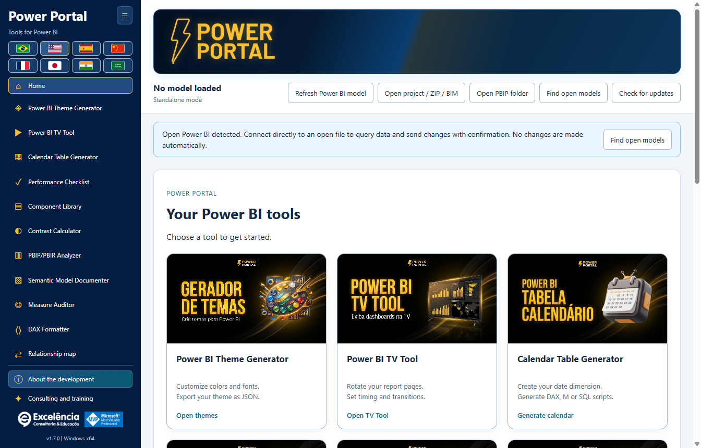

# Power Portal Desktop

**Eleven tools for Power BI Desktop, in one Windows application.**

Power Portal Desktop is owned by **Excelência Consultoria e Educação**. It installs into Power BI Desktop's **External Tools** ribbon and opens a separate application window, similar to other external modeling tools.

This is a **distribution-only repository**: installers, installation helpers, checksums and documentation. **No Power Portal application source code is published here.**

## Download and install

### Option 1: Install with a few clicks

1. [Download Power Portal Desktop 1.7.0 for Windows x64](https://github.com/luisgnserra/powerportaldesktop/releases/download/v1.7.0/PowerPortal-Setup-1.7.0-x64.exe).
2. Run the installer and approve the Windows administrator prompt.
3. Choose the installation folder and default language.
4. Finish installation, then close and reopen Power BI Desktop.
5. Open a PBIX and select **External Tools > Power Portal**.

**Windows may warn that the publisher is unknown:** version 1.7.0 is not digitally signed. Only proceed if you trust this distribution. If your organization blocks unsigned software, contact IT rather than bypassing its policy.

[Latest release](https://github.com/luisgnserra/powerportaldesktop/releases/latest) · [Installation guide](docs/INSTALLATION.md) · [Configuration](docs/CONFIGURATION.md) · [Troubleshooting](docs/TROUBLESHOOTING.md)

### Launch from Power BI's External Tools ribbon

The installer adds **Power Portal** to **External Tools** in Power BI Desktop. Click the icon with your PBIX open to launch the companion application and read that file's local model automatically.


The supplied ribbon screenshot uses Portuguese: **Ferramentas externas** means **External Tools**. Power Portal opens a **separate window connected to Power BI**, not an embedded report visual or a new internal Power BI pane.



**Already have Power BI open?** When launched from a shortcut, Power Portal detects open local models and displays a connection notice. Choose **Find open models**, select your file, and connect. You can then query its data and send supported changes back with confirmation.

Once connected, the status is summarized in the header rather than occupying a separate banner.

[See all eleven tools, connection screens and direct Power BI actions in the illustrated guide](docs/SCREENSHOTS.md).

### New: Relationship map

Understand real table links in a freely draggable canvas. Organize Facts, Dimensions and custom business groups with colors, icons and friendly names; save layouts automatically and export/import JSON.


Create, edit, activate/deactivate and delete relationships in the connected Power BI model **after confirmation and a metadata backup**. Visual styling stays in Power Portal; it does not rename tables or modify Power BI's native layout. [Full relationship tutorial](docs/RELATIONSHIPS.md).

### Built-in update checks

Starting in **1.6.2**, the installed application checks the latest official GitHub Release when opened. If a newer stable version exists, it shows **Update now**. In 1.6.4 the banner is prominent, animated and stays visible while scrolling, respecting reduced-motion preferences. No persistent "up to date" line is shown. Click to download, verify SHA-256/size, and start the installer automatically.

Windows asks for administrator authorization. Only Power Portal closes; Power BI remains open. Save/export unsent tool edits first. Failed downloads or canceled authorization leave an explicit error and a retry option.


The screenshot uses a **simulated future 1.7.1 notification** to illustrate the UI, not an announcement of a published version. **Version 1.7.0 is now published:** users on 1.6.2 or newer can reopen the app or click **Check for updates** to receive the update. [Update guide](docs/UPDATES.md).

**On 1.6.1 or older? Install 1.6.2 manually once** to enable this feature. You can also use **Check for updates** to retry a failed/offline check. The updater never installs merely because you opened the application.

### Option 2: Install from PowerShell

Open **Windows PowerShell 5.1 or PowerShell 7 on Windows**:

```powershell
$script = Join-Path $env:TEMP 'Install-PowerPortal.ps1'
[Net.ServicePointManager]::SecurityProtocol = [Net.ServicePointManager]::SecurityProtocol -bor [Net.SecurityProtocolType]::Tls12
Invoke-WebRequest -UseBasicParsing 'https://raw.githubusercontent.com/luisgnserra/powerportaldesktop/v1.7.0/install.ps1' -OutFile $script
# Review the downloaded script before running it.
Get-Content -LiteralPath $script
& $script
```

The helper downloads **version 1.7.0**, verifies its pinned SHA-256 checksum, and opens the same installer. It does not install Node.js, PHP, a .NET SDK, or build anything.

For unattended installation, run the same helper from an **administrator PowerShell window**:

```powershell
& "$env:TEMP\Install-PowerPortal.ps1" -Silent
```

For download and checksum verification only, without installing:

```powershell
& "$env:TEMP\Install-PowerPortal.ps1" -DownloadOnly
```

If script execution is blocked, follow your organization's policy or use the executable installer. See the [full command-line instructions](docs/INSTALLATION.md#command-line-installation).

## Requirements

- Windows 10 or 11, **x64**.
- Power BI Desktop supporting External Tools. This is not an installation for Power BI Service, macOS, Windows ARM64, or Power BI Report Server.
- Administrator permission to install and register the external tool.
- Internet to download the installer; local tools and bundled previews work offline.
- Published/private Power BI reports in TV Tool require internet and the relevant Microsoft account, license and permissions.

The desktop application includes its required runtime components. You do not need developer tools.

## Included tools

| Tool | What it does |
|---|---|
| Theme generator | Highlighted JSON import, live local preview, JSON export, and confirmed direct sending at the end of the page. |
| TV Tool | Open a working official example in the browser, present published report pages or local images, configure timing/transitions, and export HTML. |
| Calendar generator | Read existing calendar metadata and dates, export scripts, or create a calculated calendar table with confirmation and backup. |
| Performance checklist | Assess a report using the portal's checklist and available model metadata. |
| Component library | Build HTML/DAX components and create an HTML measure in a connected model. |
| Contrast calculator | Check color contrast against WCAG thresholds. |
| PBIP/PBIR analyzer | Inspect local project metadata, with heuristic scores and available page/visual counts. |
| Model documenter | Export tables, columns, measures and relationships to Markdown or JSON. |
| Measure auditor | Review model measures or supplied DAX using heuristic checks. |
| DAX formatter | Format locally, export/copy, or update a selected connected measure with confirmation. |
| Relationship map | Drag table boxes, group/style links, save visual layouts, and apply confirmed relationship changes directly to Power BI. |

Also includes a home gallery, a collapsible sidebar with all eleven tools visible without sidebar scrolling at supported window sizes, ownership/development information, and a consulting and training area with the two featured videos. **Consulting and training** is below **About the development**.

### Changes that interact directly with your open Power BI file

| Action | Direct interaction |
|---|---|
| Refresh/read model and query samples | Reads the selected local model; does not edit it. |
| Send theme directly to Power BI | Imports theme JSON into the selected Desktop window through visible UI Automation, with confirmation and verification. |
| Create calendar in Power BI | Creates a new calculated table, with metadata backup and confirmation. Refresh in Desktop afterward. |
| Create HTML measure in Power BI | Creates a measure in the selected table, with backup and confirmation. Place a compatible HTML visual manually. |
| Update measure in Power BI | Updates the selected measure's DAX, with backup, confirmation and concurrent-change checks. |
| Create/edit/delete relationships in Power BI | Changes table-column relationships, cardinality, filter direction and active state, with backup, confirmation and stale-state checks. |

**Connecting alone never writes changes. Save a PBIX copy first, review each confirmation, and save the PBIX yourself afterward.** [Screenshots and step-by-step examples](docs/SCREENSHOTS.md#direct-interactions-with-the-open-power-bi-file).

## Eight languages

Portuguese, English, Spanish, Simplified Mandarin Chinese, French, Japanese, Hindi and Arabic. Flags occupy no more than two rows; Arabic uses a right-to-left layout.

The installer suggests the Windows UI language. A user's later language selection is saved locally and takes precedence over the installation default. Model names, data and DAX are not translated.

## Important limits and data safety

- **Save a copy of your PBIX before making changes.** Confirmed writes create local metadata backups, but these do not replace a full PBIX backup.
- Theme application uses **visible Windows UI Automation** and requires confirmation. There is no supported generic theme-write API for an open Desktop PBIX; dialogs are not hidden.
- TOM connects to the semantic model, not the active report's filters, pages or visual placement. An HTML measure does not automatically add a visual to a report.
- Report-analysis and measure-audit scores are heuristics, not measured visual performance.
- Local model data is not sent to the Power Portal website. The updater requests only official GitHub release metadata/installers, never model contents. User-opened external links, online presentations and DirectQuery sources can require network access.
- Documentation exports, metadata backups and change logs can contain confidential model details. Store and share them appropriately.

Read the [usage and safety guide](docs/USAGE.md) before modifying a model.

## Consulting, complete data solutions and training

Excelência provides Power BI consulting, Microsoft Fabric, data engineering, end-to-end data solutions and **In Company training**.

- [Arrange a conversation on WhatsApp](https://api.whatsapp.com/send/?phone=5535998532286&text&type=phone_number&app_absent=0)
- Email: [contato@consultoriaexcelencia.com.br](mailto:contato@consultoriaexcelencia.com.br)
- [Power BI In Company training](https://www.consultoriaexcelencia.com.br/educacao/treinamentos-power-bi)
- [Featured video 1](https://www.youtube.com/watch?v=bIxmIaYmt0c)
- [Featured video 2](https://www.youtube.com/watch?v=FNo7F7kh6h4)
- [Excelência blog](https://consultoriaexcelencia.com.br/blog) · [Online courses](https://ead.consultoriaexcelencia.com.br/)

Development responsibility: **Luis Gustavo Nascimento Serra**.
[LinkedIn](https://www.linkedin.com/in/luisgnserra/) · [YouTube: Mais Que Planilhas](https://www.youtube.com/MaisQuePlanilhas)

Microsoft, Power BI and Microsoft Fabric are trademarks of Microsoft. MVP identification is personal and does not imply Microsoft ownership, sponsorship or endorsement.

## Support and distribution

[Troubleshooting and support](docs/TROUBLESHOOTING.md) · [Release notes](CHANGELOG.md) · [Distribution notice](DISTRIBUTION.md) · [Release maintenance](docs/RELEASING.md)

Use **Release assets** to download the application. GitHub's automatic "Source code" ZIP/TAR archives contain only this distribution repository's documentation and installer helper, not the application or its source code.
