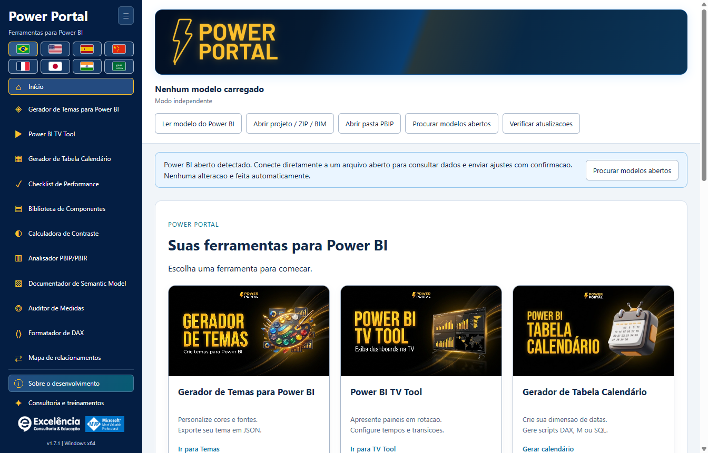
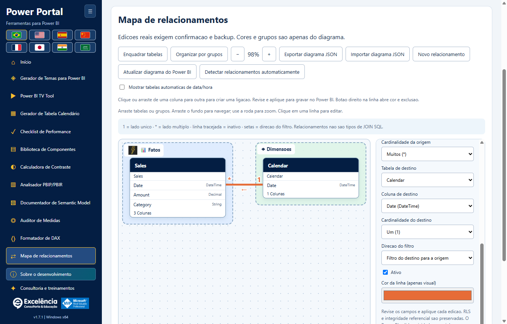
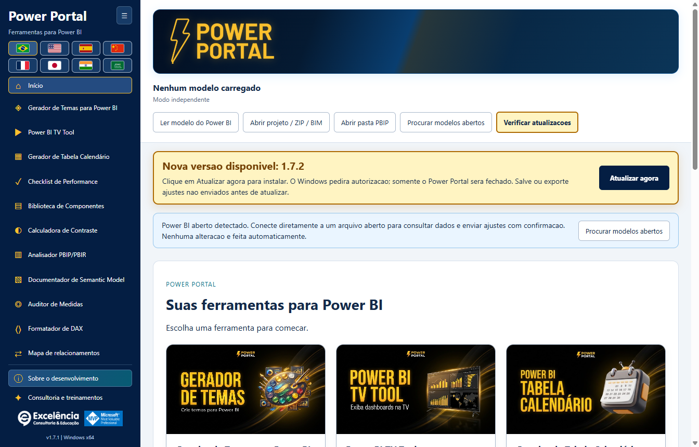

# Power Portal Desktop

<!-- language-selector -->
[🇺🇸 English](README.md) · [🇧🇷 Português](README.pt-BR.md) · [🇪🇸 Español](README.es.md) · [🇨🇳 简体中文](README.zh-CN.md) · [🇫🇷 Français](README.fr.md) · [🇯🇵 日本語](README.ja.md) · [🇮🇳 हिन्दी](README.hi.md) · [🇸🇦 العربية](README.ar.md)
<!-- /language-selector -->

**Onze ferramentas para o Power BI Desktop em um único aplicativo Windows.**

O Power Portal Desktop pertence à **Excelência Consultoria e Educação**. O instalador o adiciona à guia **Ferramentas externas** do Power BI Desktop e ele abre em uma janela separada, assim como outras ferramentas externas de modelagem.

Este repositório é **exclusivo para distribuição**: instaladores, auxiliares de instalação, checksums e documentação. **Nenhum código-fonte do aplicativo Power Portal é publicado aqui.**

<a name="download-and-install"></a>
## Download e instalação

<a name="option-1-install-with-a-few-clicks"></a>
### Opção 1: instalar com poucos cliques

1. [Baixe o Power Portal Desktop 1.7.1 para Windows x64](https://github.com/luisgnserra/powerportaldesktop/releases/download/v1.7.1/PowerPortal-Setup-1.7.1-x64.exe).
2. Execute o instalador e aprove a solicitação de administrador do Windows.
3. Escolha a pasta de instalação e o idioma padrão.
4. Conclua a instalação, feche e abra novamente o Power BI Desktop.
5. Abra um PBIX e selecione **Ferramentas externas > Power Portal**.

**O Windows pode avisar que o editor é desconhecido:** a versão 1.7.1 não possui assinatura digital. Prossiga somente se confiar nesta distribuição. Se sua organização bloquear programas sem assinatura, procure a TI em vez de contornar a política.

[Versão mais recente](https://github.com/luisgnserra/powerportaldesktop/releases/latest) · [Guia de instalação](docs/pt-BR/INSTALLATION.md) · [Configuração](docs/pt-BR/CONFIGURATION.md) · [Solução de problemas](docs/pt-BR/TROUBLESHOOTING.md)

<a name="launch-from-power-bis-external-tools-ribbon"></a>
### Abrir pela guia Ferramentas externas do Power BI

O instalador adiciona **Power Portal** à guia **Ferramentas externas** do Power BI Desktop. Clique no ícone com o PBIX aberto para iniciar o aplicativo complementar e ler automaticamente o modelo local desse arquivo.


O print original da guia está em português: **Ferramentas externas** corresponde a **External Tools** em inglês. O Power Portal abre em uma **janela separada conectada ao Power BI**, não como um visual do relatório ou um novo painel interno do Power BI.



**Já está com o Power BI aberto?** Ao iniciar por um atalho, o Power Portal detecta modelos locais abertos e mostra um aviso de conexão. Escolha **Localizar modelos abertos**, selecione seu arquivo e conecte. Assim você poderá consultar os dados e enviar as alterações compatíveis, com confirmação.

Depois de conectado, o status fica resumido no cabeçalho em vez de ocupar uma faixa separada.

[Veja as onze ferramentas, telas de conexão e ações diretas no Power BI no guia ilustrado](docs/pt-BR/SCREENSHOTS.md).

<a name="new-relationship-map"></a>
### Novo: mapa de relacionamentos

Entenda as ligações reais entre tabelas em um canvas com movimentação livre. Organize Fatos, Dimensões e grupos de negócio personalizados com cores, ícones e nomes amigáveis; salve os layouts automaticamente e exporte/importe JSON.



Crie, edite, ative/desative e exclua relacionamentos no modelo conectado do Power BI **após confirmação e backup dos metadados**. A personalização visual fica no Power Portal; ela não renomeia tabelas nem modifica o layout nativo do Power BI. [Tutorial completo de relacionamentos](docs/pt-BR/RELATIONSHIPS.md).

Na 1.7.1, clique ou arraste entre colunas exatas para preparar uma ligação; use botão direito nas linhas para cor, edição e exclusão confirmada. Grupos aceitam imagens locais e mais de 30 ícones. Tabelas automáticas de data/hora ficam ocultas por padrão com opção de exibição. Atualize a partir do Power BI após edições externas ou acione a detecção nativa com backup prévio e etapa separada de revisão/conclusão.

<a name="built-in-update-checks"></a>
### Verificação de atualizações integrada

A partir da **1.6.2**, o aplicativo instalado verifica a Release oficial mais recente no GitHub ao abrir. Se houver uma versão estável mais nova, mostra **Atualizar agora**. Na 1.6.4, o aviso ganhou destaque, animação e permanece visível durante a rolagem, respeitando a preferência por movimento reduzido. Não fica uma linha permanente de “aplicativo atualizado”. Clique para baixar, verificar SHA-256/tamanho e iniciar o instalador automaticamente.

O Windows solicita autorização de administrador. Somente o Power Portal fecha; o Power BI permanece aberto. Salve/exporte primeiro as edições das ferramentas ainda não enviadas. Falhas de download ou autorização cancelada deixam um erro explícito e uma opção de tentar novamente.



O print usa um **aviso futuro simulado da 1.7.2** para ilustrar a interface, não para anunciar uma versão publicada. **A versão 1.7.1 já está publicada:** usuários da 1.6.2 ou superior podem reabrir o aplicativo ou clicar em **Verificar atualizações** para recebê-la. [Guia de atualização](docs/pt-BR/UPDATES.md).

**Está na 1.6.1 ou anterior? Instale a 1.6.2 manualmente uma vez** para habilitar o recurso. Você também pode usar **Verificar atualizações** para repetir uma verificação que falhou ou foi feita sem internet. O atualizador nunca instala apenas porque você abriu o aplicativo.

<a name="option-2-install-from-powershell"></a>
### Opção 2: instalar pelo PowerShell

Abra o **Windows PowerShell 5.1 ou PowerShell 7 no Windows**:

```powershell
$script = Join-Path $env:TEMP 'Install-PowerPortal.ps1'
[Net.ServicePointManager]::SecurityProtocol = [Net.ServicePointManager]::SecurityProtocol -bor [Net.SecurityProtocolType]::Tls12
Invoke-WebRequest -UseBasicParsing 'https://raw.githubusercontent.com/luisgnserra/powerportaldesktop/v1.7.1/install.ps1' -OutFile $script
# Review the downloaded script before running it.
Get-Content -LiteralPath $script
& $script
```

O auxiliar baixa a **versão 1.7.1**, verifica o SHA-256 fixado e abre o mesmo instalador. Não instala Node.js, PHP, SDK do .NET nem compila nada.

Para instalação sem interação, execute o mesmo auxiliar em uma **janela do PowerShell como administrador**:

```powershell
& "$env:TEMP\Install-PowerPortal.ps1" -Silent
```

Para somente baixar e verificar o checksum, sem instalar:

```powershell
& "$env:TEMP\Install-PowerPortal.ps1" -DownloadOnly
```

Se a execução de scripts estiver bloqueada, siga a política da sua organização ou use o instalador executável. Consulte as [instruções completas de linha de comando](docs/pt-BR/INSTALLATION.md#command-line-installation).

<a name="requirements"></a>
## Requisitos

- Windows 10 ou 11, **x64**.
- Power BI Desktop com suporte a Ferramentas externas. Esta instalação não é para Power BI Service, macOS, Windows ARM64 ou Power BI Report Server.
- Permissão de administrador para instalar e registrar a ferramenta externa.
- Internet para baixar o instalador; ferramentas locais e prévias incluídas funcionam sem internet.
- Relatórios publicados/privados no TV Tool exigem internet e a conta Microsoft, licença e permissões correspondentes.

O aplicativo inclui os componentes de execução necessários. Você não precisa de ferramentas de desenvolvimento.

<a name="included-tools"></a>
## Ferramentas incluídas

| Ferramenta | O que faz |
|---|---|
| Gerador de temas | Importação de JSON destacada, prévia local em tempo real, exportação JSON e envio direto com confirmação no final da página. |
| TV Tool | Abre um exemplo oficial funcional no navegador, apresenta páginas de relatórios publicados ou imagens locais, configura tempos/transições e exporta HTML. |
| Gerador de calendário | Lê metadados e datas de calendários existentes, exporta scripts ou cria uma tabela calendário calculada com confirmação e backup. |
| Checklist de performance | Avalia um relatório com o checklist do portal e os metadados disponíveis do modelo. |
| Biblioteca de componentes | Monta componentes HTML/DAX e cria uma medida HTML no modelo conectado. |
| Calculadora de contraste | Verifica o contraste de cores segundo os limites WCAG. |
| Analisador PBIP/PBIR | Inspeciona metadados de projetos locais, com pontuações heurísticas e contagens disponíveis de páginas/visuais. |
| Documentador de modelo | Exporta tabelas, colunas, medidas e relacionamentos para Markdown ou JSON. |
| Auditor de medidas | Revisa medidas do modelo ou DAX fornecido com verificações heurísticas. |
| Formatador DAX | Formata localmente, exporta/copia ou atualiza uma medida selecionada no modelo conectado, com confirmação. |
| Mapa de relacionamentos | Arrasta caixas de tabelas, agrupa/personaliza ligações, salva layouts visuais e aplica alterações confirmadas de relacionamentos diretamente no Power BI. |

Também inclui uma galeria inicial, menu lateral retrátil com as onze ferramentas visíveis sem rolagem nos tamanhos suportados, informações de propriedade/desenvolvimento e uma área de consultoria e treinamentos com os dois vídeos em destaque. **Consultoria e Treinamentos** fica abaixo de **Sobre o desenvolvimento**.

<a name="changes-that-interact-directly-with-your-open-power-bi-file"></a>
### Alterações que interagem diretamente com seu arquivo aberto no Power BI

| Ação | Interação direta |
|---|---|
| Atualizar/ler modelo e consultar amostras | Lê o modelo local selecionado; não o modifica. |
| Enviar tema diretamente | Aplica o JSON na janela selecionada do relatório, com confirmação, importação visível e verificação. |
| Criar calendário no Power BI | Cria uma nova tabela calculada, com backup dos metadados e confirmação. Atualize no Desktop depois. |
| Criar medida HTML no Power BI | Cria uma medida na tabela selecionada, com backup e confirmação. Adicione manualmente um visual HTML compatível. |
| Atualizar medida no Power BI | Atualiza o DAX da medida selecionada, com backup, confirmação e verificação de alterações concorrentes. |
| Criar/editar/excluir relacionamentos no Power BI | Altera ligações entre colunas de tabelas, cardinalidade, direção dos filtros e estado ativo, com backup, confirmação e verificação de estado desatualizado. |

**Conectar não grava alterações. Salve uma cópia do PBIX primeiro, revise cada confirmação e depois salve o PBIX você mesmo.** [Prints e exemplos passo a passo](docs/pt-BR/SCREENSHOTS.md#direct-interactions-with-the-open-power-bi-file).

<a name="eight-languages"></a>
## Oito idiomas

Português, inglês, espanhol, mandarim em chinês simplificado, francês, japonês, hindi e árabe. As bandeiras ocupam no máximo duas linhas; o árabe usa layout da direita para a esquerda.

Use as bandeiras no topo desta página para selecionar o idioma da documentação. Todos os guias e prints do aplicativo estão disponíveis nesses oito idiomas. Os prints são capturados no aplicativo real no idioma selecionado; nomes de objetos do modelo e DAX permanecem inalterados. A imagem verdadeira da guia do Power BI permanece em português em todos os guias, com explicação no idioma selecionado.

O instalador sugere o idioma da interface do Windows. A seleção posterior do usuário é salva localmente e tem prioridade sobre o padrão da instalação. Nomes do modelo, dados e DAX não são traduzidos.

<a name="important-limits-and-data-safety"></a>
## Limites importantes e segurança dos dados

- **Salve uma cópia do PBIX antes de fazer alterações.** Gravações confirmadas criam backups locais dos metadados, mas eles não substituem um backup completo do PBIX.
- A aplicação de temas usa **Automação de Interface do Windows visível** e exige confirmação. Não há uma API genérica suportada para gravar temas em um PBIX aberto no Desktop; os diálogos não são ocultados.
- O TOM conecta ao modelo semântico, não aos filtros da página ativa, páginas ou posicionamento de visuais. Uma medida HTML não adiciona automaticamente um visual ao relatório.
- Pontuações da análise de relatórios e auditoria de medidas são heurísticas, não medições do desempenho dos visuais.
- Dados do modelo local não são enviados ao site do Power Portal. O atualizador solicita apenas metadados/instaladores oficiais de Releases do GitHub, nunca o conteúdo do modelo. Links externos abertos pelo usuário, apresentações online e fontes DirectQuery podem exigir rede.
- Exportações da documentação, backups dos metadados e registros de alterações podem conter detalhes confidenciais do modelo. Armazene e compartilhe de forma adequada.

Leia o [guia de uso e segurança](docs/pt-BR/USAGE.md) antes de modificar um modelo.

<a name="consulting-complete-data-solutions-and-training"></a>
## Consultoria, soluções completas de dados e treinamentos

A Excelência oferece consultoria em Power BI, Microsoft Fabric, engenharia de dados, soluções de dados de ponta a ponta e **treinamentos In Company**.

- [Agende uma conversa pelo WhatsApp](https://api.whatsapp.com/send/?phone=5535998532286&text&type=phone_number&app_absent=0)
- E-mail: [contato@consultoriaexcelencia.com.br](mailto:contato@consultoriaexcelencia.com.br)
- [Treinamentos Power BI In Company](https://www.consultoriaexcelencia.com.br/educacao/treinamentos-power-bi)
- [Vídeo em destaque 1](https://www.youtube.com/watch?v=bIxmIaYmt0c)
- [Vídeo em destaque 2](https://www.youtube.com/watch?v=FNo7F7kh6h4)
- [Blog da Excelência](https://consultoriaexcelencia.com.br/blog) · [Cursos online](https://ead.consultoriaexcelencia.com.br/)

Responsável pelo desenvolvimento: **Luis Gustavo Nascimento Serra**.
[LinkedIn](https://www.linkedin.com/in/luisgnserra/) · [YouTube: Mais Que Planilhas](https://www.youtube.com/MaisQuePlanilhas)

Microsoft, Power BI e Microsoft Fabric são marcas da Microsoft. A identificação MVP é pessoal e não implica propriedade, patrocínio ou endosso da Microsoft.

<a name="support-and-distribution"></a>
## Suporte e distribuição

[Solução de problemas e suporte](docs/pt-BR/TROUBLESHOOTING.md) · [Notas de versão](CHANGELOG.pt-BR.md) · [Aviso de distribuição](DISTRIBUTION.pt-BR.md) · [Manutenção das Releases](docs/pt-BR/RELEASING.md)

Use os **Assets das Releases** para baixar o aplicativo. Os arquivos ZIP/TAR automáticos “Source code” do GitHub contêm apenas a documentação e o auxiliar de instalação deste repositório de distribuição, não o aplicativo nem seu código-fonte.
