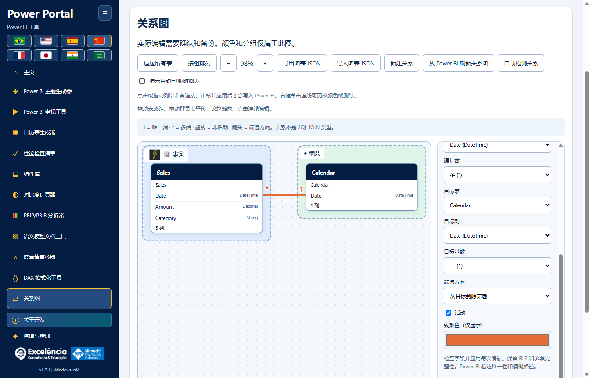

# Power Portal Desktop

<!-- language-selector -->
[🇺🇸 English](README.md) · [🇧🇷 Português](README.pt-BR.md) · [🇪🇸 Español](README.es.md) · [🇨🇳 简体中文](README.zh-CN.md) · [🇫🇷 Français](README.fr.md) · [🇯🇵 日本語](README.ja.md) · [🇮🇳 हिन्दी](README.hi.md) · [🇸🇦 العربية](README.ar.md)
<!-- /language-selector -->

**一个 Windows 应用，集成十一款 Power BI Desktop 工具。**

Power Portal Desktop 归 **Excelência Consultoria e Educação** 所有。安装后，它会出现在 Power BI Desktop 的**外部工具**功能区中，并像其他外部建模工具一样打开独立的应用窗口。

这是一个**仅用于分发的仓库**，提供安装程序、安装辅助脚本、校验和及文档。**此处不发布 Power Portal 应用的任何源代码。**

<a name="download-and-install"></a>
## 下载与安装

<a name="option-1-install-with-a-few-clicks"></a>
### 方式一：点击几次即可安装

1. [下载适用于 Windows x64 的 Power Portal Desktop 1.7.1](https://github.com/luisgnserra/powerportaldesktop/releases/download/v1.7.1/PowerPortal-Setup-1.7.1-x64.exe)。
2. 运行安装程序，并批准 Windows 管理员权限提示。
3. 选择安装文件夹和默认语言。
4. 完成安装后，关闭并重新打开 Power BI Desktop。
5. 打开一个 PBIX，选择**外部工具 > Power Portal**。

**Windows 可能提示发布者未知：**1.7.1 版本尚未进行数字签名。只有在信任此分发来源时才继续。如果组织禁止未签名的软件，请联系 IT 部门，不要绕过其政策。

[最新版本](https://github.com/luisgnserra/powerportaldesktop/releases/latest) · [安装指南](docs/zh-CN/INSTALLATION.md) · [配置](docs/zh-CN/CONFIGURATION.md) · [故障排除](docs/zh-CN/TROUBLESHOOTING.md)

<a name="launch-from-power-bis-external-tools-ribbon"></a>
### 从 Power BI 的外部工具功能区启动

安装程序会将 **Power Portal** 添加到 Power BI Desktop 的**外部工具**中。打开 PBIX 后点击该图标，即可启动配套应用，并自动读取该文件的本地模型。


此功能区截图的原始界面为葡萄牙语：**Ferramentas externas** 表示**外部工具**。Power Portal 打开的是**连接到 Power BI 的独立窗口**，不是嵌入式报表视觉对象，也不是 Power BI 内部的新窗格。


**Power BI 已经打开？**从快捷方式启动时，Power Portal 会检测已打开的本地模型并显示连接提示。选择**查找已打开的模型**，选中您的文件并连接。之后即可查询数据，并在确认后将支持的更改发送回模型。

连接后，状态会汇总显示在页眉中，不再占用独立的横幅。

[在图解指南中查看全部十一款工具、连接界面及直接操作 Power BI 的功能](docs/zh-CN/SCREENSHOTS.md)。

<a name="new-relationship-map"></a>
### 新功能：关系图

在可自由拖动的画布中理解真实的表关系。使用颜色、图标和友好名称来组织事实表、维度表以及自定义业务分组；布局自动保存，并支持导出和导入 JSON。



在**确认并备份元数据后**，可在连接的 Power BI 模型中创建、编辑、激活/停用及删除关系。视觉样式仅保存在 Power Portal 中，不会重命名表，也不会修改 Power BI 的原生布局。[完整关系教程](docs/zh-CN/RELATIONSHIPS.md)。

在 1.7.1 中，可点击或拖动准确的列来准备关系；右键单击关系线可设置颜色、编辑或在确认后删除。分组支持本地图片和 30 多种图标。自动日期/时间表默认隐藏，并可切换可见性。在 Power BI 外部编辑后刷新关系图，或在事先备份后调用 Desktop 原生自动检测，并通过单独的复查/完成步骤结束。

<a name="built-in-update-checks"></a>
### 内置更新检查

从 **1.6.2** 起，已安装的应用会在打开时检查最新的官方 GitHub Release。如果存在较新的稳定版本，就会显示**立即更新**。1.6.4 中的横幅更加醒目，具有动画效果，滚动时始终可见，并遵循减少动态效果的偏好。不再持续显示“已是最新版本”一行。点击后会下载安装程序、验证 SHA-256 和大小，并自动启动安装程序。

Windows 会请求管理员授权。只有 Power Portal 会关闭，Power BI 仍保持打开。请先保存或导出尚未发送的工具编辑内容。下载失败或授权被取消时，会明确显示错误并提供重试选项。


截图使用**模拟的未来 1.7.2 通知**来展示界面，并非宣布该版本已发布。**1.7.1 现已发布：**使用 1.6.2 或更新版本的用户可以重新打开应用，或点击**检查更新**来获取更新。[更新指南](docs/zh-CN/UPDATES.md)。

**仍在使用 1.6.1 或更早版本？请先手动安装一次 1.6.2**，以启用此功能。检查失败或离线后，也可使用**检查更新**重试。更新程序绝不会仅因您打开应用就执行安装。

<a name="option-2-install-from-powershell"></a>
### 方式二：通过 PowerShell 安装

在 Windows 上打开 **Windows PowerShell 5.1 或 PowerShell 7**：

```powershell
$script = Join-Path $env:TEMP 'Install-PowerPortal.ps1'
[Net.ServicePointManager]::SecurityProtocol = [Net.ServicePointManager]::SecurityProtocol -bor [Net.SecurityProtocolType]::Tls12
Invoke-WebRequest -UseBasicParsing 'https://raw.githubusercontent.com/luisgnserra/powerportaldesktop/v1.7.1/install.ps1' -OutFile $script
# Review the downloaded script before running it.
Get-Content -LiteralPath $script
& $script
```

此辅助脚本下载 **1.7.1 版本**，验证其固定的 SHA-256 校验和，然后打开同一个安装程序。它不会安装 Node.js、PHP 或 .NET SDK，也不会进行任何构建。

如需无人值守安装，请在**管理员 PowerShell 窗口**中运行同一个辅助脚本：

```powershell
& "$env:TEMP\Install-PowerPortal.ps1" -Silent
```

如需仅下载并验证校验和，而不安装：

```powershell
& "$env:TEMP\Install-PowerPortal.ps1" -DownloadOnly
```

如果脚本执行被阻止，请遵循组织政策，或使用可执行安装程序。参阅[完整命令行说明](docs/zh-CN/INSTALLATION.md#command-line-installation)。

<a name="requirements"></a>
## 系统要求

- Windows 10 或 11，**x64**。
- 支持外部工具的 Power BI Desktop。此安装包不适用于 Power BI Service、macOS、Windows ARM64 或 Power BI Report Server。
- 具有安装并注册外部工具的管理员权限。
- 下载安装程序需要互联网；本地工具和内置预览可离线使用。
- TV Tool 中已发布/私有的 Power BI 报表需要互联网，以及相应的 Microsoft 帐户、许可证和权限。

桌面应用已包含所需的运行时组件，无需开发工具。

<a name="included-tools"></a>
## 内含工具

| 工具 | 功能 |
|---|---|
| 主题生成器 | 醒目的 JSON 导入入口、本地实时预览、JSON 导出，以及页面底部需确认的直接发送功能。 |
| TV Tool | 在浏览器中打开可用的官方示例，展示已发布的报表页面或本地图片，配置时长/切换效果，并导出 HTML。 |
| 日历生成器 | 读取现有日历的元数据和日期，导出脚本，或在确认并备份后创建计算日历表。 |
| 性能检查清单 | 使用门户的检查清单和可用的模型元数据评估报表。 |
| 组件库 | 构建 HTML/DAX 组件，并在连接的模型中创建 HTML 度量值。 |
| 对比度计算器 | 根据 WCAG 阈值检查颜色对比度。 |
| PBIP/PBIR 分析器 | 检查本地项目元数据，提供启发式评分及可用的页面/视觉对象数量。 |
| 模型文档生成器 | 将表、列、度量值和关系导出为 Markdown 或 JSON。 |
| 度量值审计器 | 使用启发式检查审查模型度量值或提供的 DAX。 |
| DAX 格式化器 | 在本地格式化、导出/复制，或在确认后更新连接模型中选中的度量值。 |
| 关系图 | 拖动表框、分组并设置关系线样式、保存视觉布局，并将已确认的关系更改直接应用到 Power BI。 |

此外还包括主页工具图库、可折叠侧栏（在支持的窗口尺寸下，无需滚动即可看到全部十一款工具）、所有权/开发信息，以及包含两个精选视频的咨询与培训区域。**咨询与培训**位于**关于开发**下方。

<a name="changes-that-interact-directly-with-your-open-power-bi-file"></a>
### 与已打开的 Power BI 文件直接交互的更改

| 操作 | 直接交互 |
|---|---|
| 刷新/读取模型并查询样本 | 读取选中的本地模型，不编辑模型。 |
| 将主题直接发送到 Power BI | 通过可见的 UI 自动化将主题 JSON 导入选中的 Desktop 窗口，需要确认并验证。 |
| 在 Power BI 中创建日历 | 创建新的计算表，需要元数据备份和确认。之后请在 Desktop 中刷新。 |
| 在 Power BI 中创建 HTML 度量值 | 在选中的表中创建度量值，需要备份和确认。请手动放置兼容的 HTML 视觉对象。 |
| 在 Power BI 中更新度量值 | 更新选中度量值的 DAX，需要备份、确认及并发更改检查。 |
| 在 Power BI 中创建/编辑/删除关系 | 更改表列关系、基数、筛选方向和活动状态，需要备份、确认及过期状态检查。 |

**仅连接绝不会写入更改。请先保存 PBIX 副本，审查每次确认内容，并在操作后自行保存 PBIX。**[截图与分步示例](docs/zh-CN/SCREENSHOTS.md#direct-interactions-with-the-open-power-bi-file)。

<a name="eight-languages"></a>
## 八种语言

葡萄牙语、英语、西班牙语、简体中文、法语、日语、印地语和阿拉伯语。语言旗帜最多占两行；阿拉伯语采用从右到左的布局。

使用本页顶部的旗帜选择文档语言。所有指南和应用截图均提供这八种语言版本。截图来自实际应用中所选择的界面语言；模型对象名称及 DAX 保持不变。真实的 Power BI 功能区图片在所有指南中均保留葡萄牙语原图，并以所选语言说明。

安装程序会建议使用 Windows 界面语言。用户之后选择的语言会保存在本地，且优先于安装默认值。模型名称、数据及 DAX 不会被翻译。

<a name="important-limits-and-data-safety"></a>
## 重要限制与数据安全

- **更改前请保存 PBIX 副本。**已确认的写入会创建本地元数据备份，但不能替代完整的 PBIX 备份。
- 应用主题使用**可见的 Windows UI 自动化**，且需要确认。目前没有受支持的通用 API 可以向已打开的 Desktop PBIX 写入主题；对话框不会被隐藏。
- TOM 连接到语义模型，而不是当前报表的筛选器、页面或视觉对象布局。HTML 度量值不会自动向报表添加视觉对象。
- 报表分析和度量值审计评分是启发式结果，并非测得的视觉对象性能。
- 本地模型数据不会发送到 Power Portal 网站。更新程序仅请求官方 GitHub 版本元数据/安装程序，绝不请求模型内容。用户主动打开的外部链接、在线演示和 DirectQuery 数据源可能需要网络。
- 文档导出、元数据备份和更改日志可能包含机密模型细节。请妥善存储和共享。

修改模型前，请阅读[使用与安全指南](docs/zh-CN/USAGE.md)。

<a name="consulting-complete-data-solutions-and-training"></a>
## 咨询、完整数据解决方案与培训

Excelência 提供 Power BI 咨询、Microsoft Fabric、数据工程、端到端数据解决方案及**企业内训（In Company）**。

- [通过 WhatsApp 预约沟通](https://api.whatsapp.com/send/?phone=5535998532286&text&type=phone_number&app_absent=0)
- 电子邮件：[contato@consultoriaexcelencia.com.br](mailto:contato@consultoriaexcelencia.com.br)
- [Power BI 企业内训](https://www.consultoriaexcelencia.com.br/educacao/treinamentos-power-bi)
- [精选视频 1](https://www.youtube.com/watch?v=bIxmIaYmt0c)
- [精选视频 2](https://www.youtube.com/watch?v=FNo7F7kh6h4)
- [Excelência 博客](https://consultoriaexcelencia.com.br/blog) · [在线课程](https://ead.consultoriaexcelencia.com.br/)

开发负责人：**Luis Gustavo Nascimento Serra**。
[LinkedIn](https://www.linkedin.com/in/luisgnserra/) · [YouTube：Mais Que Planilhas](https://www.youtube.com/MaisQuePlanilhas)

Microsoft、Power BI 和 Microsoft Fabric 是 Microsoft 的商标。MVP 身份属于个人，不代表 Microsoft 拥有、赞助或认可本应用。

<a name="support-and-distribution"></a>
## 支持与分发

[故障排除与支持](docs/zh-CN/TROUBLESHOOTING.md) · [版本说明](CHANGELOG.zh-CN.md) · [分发声明](DISTRIBUTION.zh-CN.md) · [版本维护](docs/zh-CN/RELEASING.md)

请从 **Release 的 Assets（发布附件）**下载应用。GitHub 自动生成的“Source code” ZIP/TAR 归档仅包含此分发仓库的文档及安装辅助脚本，不包含应用或其源代码。
