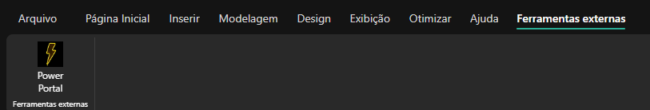
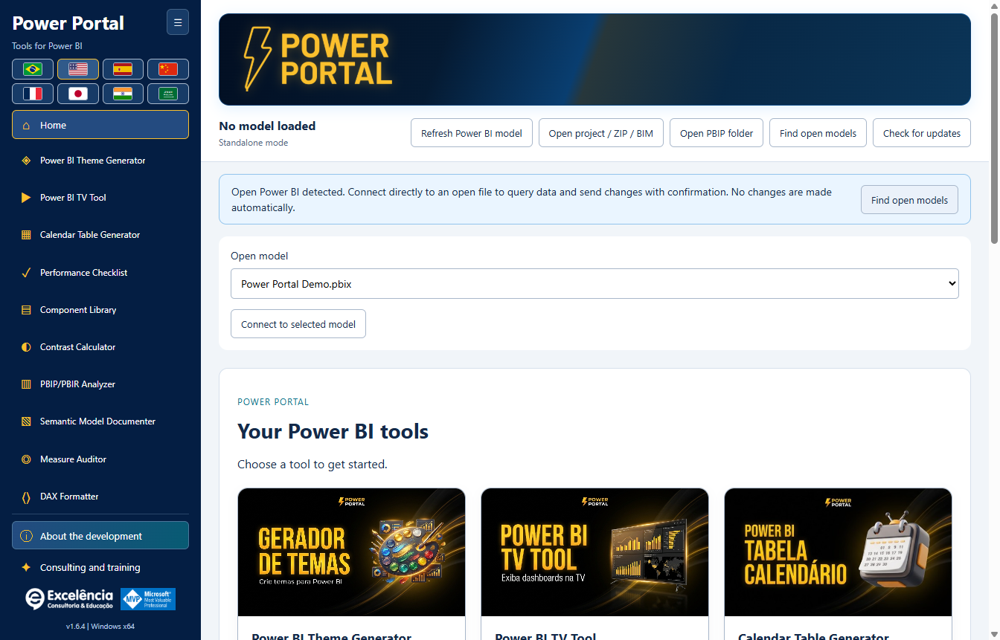

# Installation guide

[Back to home](../README.md)

## Requirements

Windows 10/11 x64, administrator installation permission, and a Power BI Desktop edition that supports External Tools. The application is distributed as a self-contained Windows installer. No PHP, Node.js, .NET SDK, Git or GitHub account is required for end users.

Allow approximately 1 GB of free disk space for the download and installed runtime files, plus additional space for your own exports and backups.

## Simple installation

1. Open the [latest Release](https://github.com/luisgnserra/powerportaldesktop/releases/latest).
2. Under **Assets**, download `PowerPortal-Setup-1.6.4-x64.exe` for this release. Do not download the automatically generated source archives as an installer.
3. Optionally [verify SHA-256](#verify-the-installer).
4. Run the executable and approve User Account Control.
5. Accept the displayed dependency terms, choose a folder, and select a default language using the flags. Windows UI language is suggested; unsupported languages default to English.
6. Complete the wizard.
7. Close and reopen Power BI Desktop. Open a PBIX and select **External Tools > Power Portal**.

The installation is machine-wide and includes desktop/Start menu shortcuts and the external-tool registration. The application itself does not require elevation during normal use.



Click **External Tools > Power Portal** with your PBIX open. The screenshot's **Ferramentas externas** is the Portuguese ribbon label. The icon launches a **separate companion window** and passes the open file's local model connection; it is not an embedded visual or internal report pane.



Launching the Windows shortcut instead displays a notice when open models are detected. Select **Find open models**, verify the file name and connect. No change is made simply by detecting or connecting. [See the illustrated walkthrough](SCREENSHOTS.md).

**Unsigned release:** Windows may display SmartScreen or an unknown-publisher warning. SHA-256 verifies that you have the published file; it is not a digital publisher signature. Do not bypass enterprise restrictions. Ask IT if approval is needed.

## Command-line installation

### Download the helper and review it

```powershell
$script = Join-Path $env:TEMP 'Install-PowerPortal.ps1'
[Net.ServicePointManager]::SecurityProtocol = [Net.ServicePointManager]::SecurityProtocol -bor [Net.SecurityProtocolType]::Tls12
Invoke-WebRequest -UseBasicParsing 'https://raw.githubusercontent.com/luisgnserra/powerportaldesktop/v1.6.4/install.ps1' -OutFile $script
Get-Content -LiteralPath $script
& $script
```

This versioned URL pins the helper to the 1.6.4 release. It does not silently track future releases. The helper also pins the installer filename and SHA-256 checksum, downloads over HTTPS, verifies the executable before running it, and checks installation registration after a successful installer exit.

The TLS line enables HTTPS TLS 1.2 in this PowerShell process for older Windows PowerShell defaults. It does not change Windows security or execution policies.

### Unattended installation

Open PowerShell **as Administrator**, then run:

```powershell
& "$env:TEMP\Install-PowerPortal.ps1" -Silent
```

The helper downloads and verifies the same installer, then invokes its NSIS `/S` switch. No wizard language page appears in silent mode: the installer uses the Windows UI language, falling back to English. A saved user preference still takes precedence. No PBIX is opened or edited by the helper.

Silent mode requires an already elevated PowerShell session. It does not bypass UAC, Windows security controls, script execution policies or application restrictions. Close Power Portal before deployment; see [updates](#updates-and-downgrades).

### Download only or choose a download folder

```powershell
& "$env:TEMP\Install-PowerPortal.ps1" -DownloadOnly -DownloadDirectory "$env:USERPROFILE\Downloads\PowerPortal"
```

`-DownloadOnly` verifies the checksum but never executes the installer and requires no administrator privileges. A previously downloaded file is reused only if its checksum matches. An invalid existing file causes an explicit error rather than being executed or silently overwritten.

Helper parameters:

| Parameter | Default | Purpose |
|---|---|---|
| `-Silent` | Off | Use the NSIS unattended installation switch; requires administrator PowerShell unless download-only. |
| `-DownloadOnly` | Off | Download/cache and verify the executable without installation. |
| `-DownloadDirectory` | `%TEMP%\PowerPortalDownloads` | Folder for the verified installer. This is not the application installation directory. |

Do not paste an unreviewed script into `Invoke-Expression`. If a downloaded script is blocked by your execution policy, consult IT or use the executable wizard. The helper deliberately does not change execution policies.

### Use the verified executable directly

After checksum verification, an administrator can run:

```powershell
$setup = "$env:USERPROFILE\Downloads\PowerPortal-Setup-1.6.4-x64.exe"
$process = Start-Process -FilePath $setup -ArgumentList '/S' -Wait -PassThru
if ($process.ExitCode -ne 0) { throw "Installer failed: $($process.ExitCode)" }
```

The PowerShell helper is recommended because it checks both the download and the resulting external-tool registration.

## Verify the installer

Expected SHA-256 for **1.6.4 x64**:

```text
1DDE8204C950879DCA6F634FAAA2882C7A03E14474FEC786074A04F7216C184F
```

```powershell
$file = "$env:USERPROFILE\Downloads\PowerPortal-Setup-1.6.4-x64.exe"
$expected = '1DDE8204C950879DCA6F634FAAA2882C7A03E14474FEC786074A04F7216C184F'
if ((Get-FileHash -LiteralPath $file -Algorithm SHA256).Hash -ne $expected) {
    throw 'Checksum mismatch. Do not run this installer.'
}
```

The checksum is also published in [SHA256SUMS.txt](../SHA256SUMS.txt) and attached to the Release. A checksum is an integrity check, not a substitute for trusting the publisher.

## Updates and downgrades

Download a newer official installer and run it over the existing installation. The installer attempts to close Power Portal only from its exact target executable path before replacing files. It does not close Power BI Desktop or other external tools. If closure fails, installation aborts.

Close Power Portal yourself before an unattended update. Restart Power BI Desktop after installation so it reloads the External Tools registration. Existing per-user language/sidebar preferences and local backups are retained.

Starting with **1.6.2**, startup checks and **Check for updates** notify you about newer official releases. **Update now** downloads/verifies the installer and starts an elevated silent update in the current installation folder, only after your click. Power BI is not closed. Reopen Power Portal after installation completes. [Update details](UPDATES.md).

Versions **1.6.1 and older require a one-time manual upgrade to 1.6.2**. Downgrades are not certified; save your work and contact support before using an older installer.

## Uninstall

Use **Windows Settings > Apps > Installed apps > Power Portal > Uninstall** (on Windows 10, use **Apps & features**).

Uninstall removes the application and its own `PowerPortal.pbitool.json` registration. Other tools are left alone. Per-user settings, themes, backups and change logs are retained intentionally. See [data locations](CONFIGURATION.md#data-locations) before manually removing retained data.

## Offline and enterprise deployment

IT can download and verify the Release installer once, distribute that exact file through its approved software system, and run `/S` with administrator rights. Public GitHub downloads require internet; installing from an already downloaded executable does not require GitHub authentication.

This repository does not provide a Microsoft Store package, MSI, winget catalog entry or Chocolatey package. The supported distribution is the NSIS EXE and its PowerShell helper.

[Configuration](CONFIGURATION.md) · [Troubleshooting](TROUBLESHOOTING.md)
