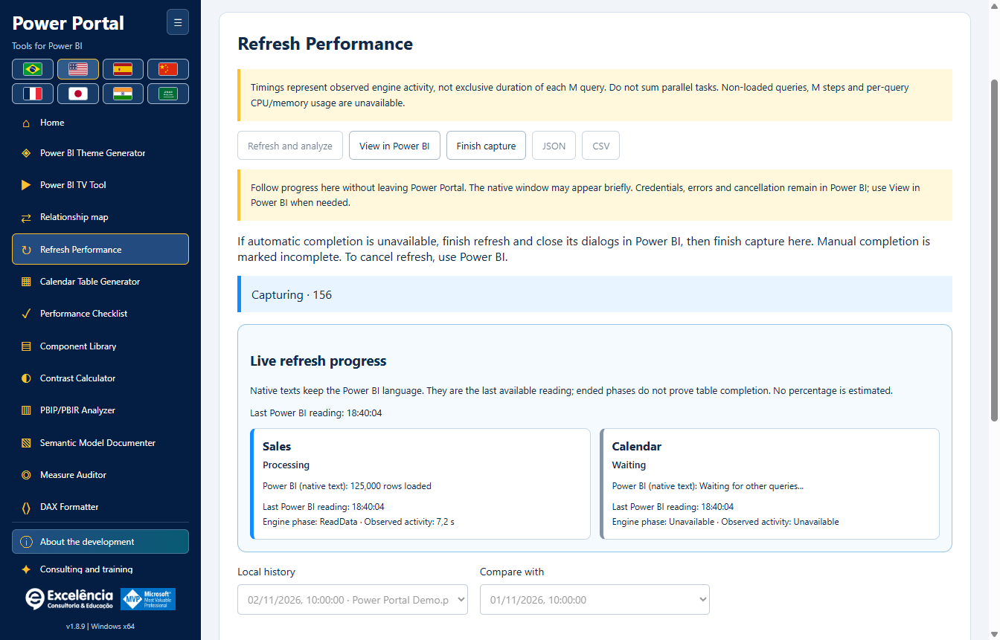
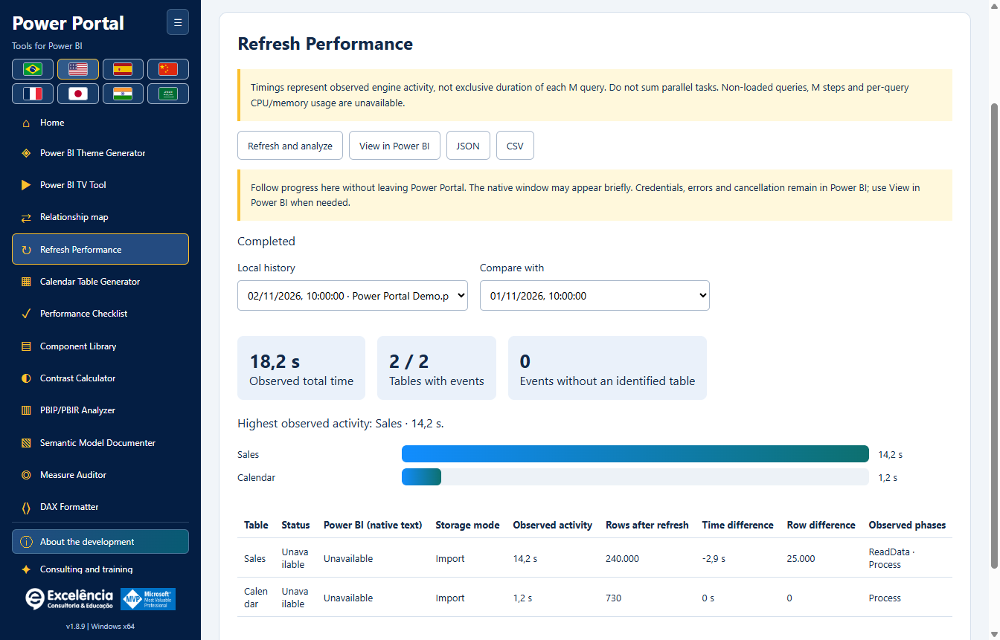

# Refresh Performance

<!-- language-selector -->
[🇺🇸 English](REFRESH-ANALYSIS.md) · [🇧🇷 Português](pt-BR/REFRESH-ANALYSIS.md) · [🇪🇸 Español](es/REFRESH-ANALYSIS.md) · [🇨🇳 简体中文](zh-CN/REFRESH-ANALYSIS.md) · [🇫🇷 Français](fr/REFRESH-ANALYSIS.md) · [🇯🇵 日本語](ja/REFRESH-ANALYSIS.md) · [🇮🇳 हिन्दी](hi/REFRESH-ANALYSIS.md) · [🇸🇦 العربية](ar/REFRESH-ANALYSIS.md)
<!-- /language-selector -->

**1.8.9 — Calendar sample and native refresh shortcut**

In Calendar generator, the real sample (up to 50 rows) now appears below Generate script. Refresh in Power BI sits beside that button and, with a live connection, opens Refresh Performance and starts the same confirmed native model-data refresh. Follow table statuses, timings and row counts there. This refreshes the entire model; it does not apply the generated script, create or replace a calendar table, or save the PBIX. Create calendar in Power BI remains a separate action. The button is disabled offline, supports keyboard activation and is translated into all eight languages. Cancellation and errors use the existing refresh flow. The sample remains the last requested read: use Read selected calendar to read it again after refreshing. Packaged-app tests verified layout, all eight labels, offline gating, exact selected connection, cancellation, visible errors, retry and unchanged calendar creation. No real model refresh was started for these tests; documentation images use synthetic data.

**1.8.7 — Reliable theme color selection**

All eleven theme colors now have a visible native swatch and a Choose color button beside the editable HEX field. Click the swatch or button, or focus the button and press Enter/Space. The native picker no longer depends on an invisible zero-size input or double-clicking the HEX field. Manual HEX editing, imported themes, live preview and JSON export remain available. Picker failures are shown explicitly. Native opening was verified repeatedly in the Windows application, alongside mouse/keyboard activation of all eleven buttons and eight-language labels.

Refresh Analysis is now named Refresh Performance in the sidebar, home gallery, page heading and all eight interface languages. This is a label change only: native refresh, live progress, timings, row counts, local history and JSON/CSV compatibility are unchanged. Existing saved analyses remain available; no migration or refresh is required. Screenshots use synthetic data.

**1.8.6 — Follow native refresh inside Power Portal**

Start Refresh and analyze in Power Portal and follow live cards with each table, observed status, engine phase, activity time and the latest available native Power BI progress text. Power Portal regains focus after launch and, if Power BI brings itself forward again, after native completion. It does not repeatedly take focus from other applications. View in Power BI opens the selected file without starting another refresh; choosing it disables automatic focus return for that capture.

Power BI remains the refresh engine. Its window may appear briefly; this is not a supported headless PBIX processing API. Credentials, errors and cancellation remain in Power BI, and native dialogs are never hidden or dismissed automatically. Native text keeps the Power BI language and shows its last-read time. Missing native text is explicit; engine tracing continues if the UI reader fails. Ended phases do not prove table completion, percentages are not invented, and final row counts are calculated only after capture. History and JSON include the observed native statuses; review exports before sharing. The packaged application was tested with an authorized real refresh: 4/4 tables measured, 4/4 row counts, live native statuses, restored Portal focus, working View in Power BI and history surviving reload. No PBIX was automatically saved; all documentation images use synthetic data.

**1.8.5 — Native refresh measurements fixed**

Refresh Performance now recognizes the native XML Refresh command used by Power BI Desktop, including Refresh inside Batch, as well as XMLA Process and TMSL refresh. Previously the native refresh could execute while its progress was discarded as unrelated, leaving 0 measured tables, unavailable row counts and refreshCompletionNotProven. An explicit successful engine result is now accepted when the optional Error field is absent; nonzero error codes and XMLA errors still override success. Progress still requires exact request/activity correlation, excluding unrelated visual queries.

Before the first recognized refresh command, the UI says it is waiting for Power BI refresh events. Unconfirmed completion now has translated guidance rather than only a technical code. Update the app, connect to the intended PBIX and run Refresh and analyze again; old incomplete reports are preserved and are not rewritten as successful. The packaged application was validated end to end on a user-authorized real refresh, with table activity, row counts, automatic completion and history surviving reload. No customer data or model names are included in these screenshots; documentation examples remain synthetic.

## Start and safety

Connect to the intended open PBIX, open Refresh Performance and select Refresh and analyze. Confirm the file name. The trace starts before the native Home > Refresh button is invoked; tables are not refreshed sequentially through TOM. Keep Power BI open and resolve source credentials, errors or cancellation there. A BIM backup cannot restore refreshed data.

Native refresh queries sources and replaces imported data. Save a PBIX copy. Resolve credentials and errors in Power BI; tracing does not cancel refresh or include every Power Query helper query.

## Interpret the measurements

Observed activity is the union of engine intervals mapped exactly to each table, avoiding double counting of nested phases. It is not pure source-query time or a proven critical path. The observed total runs from launch until completion is detected, includes UI/polling overhead, and excludes the later row counts. Missing table mappings are reported separately.

Timings represent observed engine activity, not exclusive duration of each M query. Do not sum parallel tasks. Non-loaded queries, M steps and per-query CPU/memory usage are unavailable.

Automatic completion requires observed refresh-command completion and a ready Power BI window. Close native result dialogs. Manual Finish capture is always incomplete, not evidence of success and not a cancellation of refresh. Engine/trace errors are explicit. If capture is interrupted, no completed analysis is claimed.

## History and export

Rows are counted after capture, outside the timer. DirectQuery/DirectLake are not queried. Missing events do not mean zero time. Up to 30 analyses per model are kept on this computer; none are sent to the portal.

Select a saved execution and a comparison execution to see timing and row-count differences for matching table names. Cache, source load, data volume and parallelism affect comparisons; differences do not prove a cause. JSON preserves unavailable values as null; CSV leaves them empty and protects spreadsheet formulas. History is local, scoped by the same model identity as the diagram, not stored in PBIX. Diagrams/history cannot distinguish files with identical exposed identities; verify the model name. Exports contain model/table names and counts: review them before sharing.

<!-- refresh-correlation -->
Only engine progress tied to an active refresh command through exact RequestID/ActivityID correlation is measured. Unrelated visual-query work is excluded. Some Power BI versions may omit these identifiers: a table timing can remain unavailable even when refresh executes.

## Native launch and recovery

Refresh Performance is now immediately below Relationship map in the sidebar and home gallery. Native button discovery ignores the duplicate Home tabs belonging to DAX Query View and TMDL View, avoiding “Ambiguous Power BI control: home”. Select Report, Data or Model view in Power BI if native controls are unavailable.

Start stays disabled while confirmation, validation and trace startup are pending; Finish capture is hidden until capture is ready. This prevents a second launch from incorrectly reporting “Finish the active Power BI operation before refreshing”. A failure proven to occur before native invocation stops the trace, checks cleanup and permits retry. If invocation might already have occurred, the error remains visible and the capture stays pending: review Power BI, finish its refresh and close dialogs before Finish capture. Repeated requests resume the existing capture instead of starting another refresh. Legitimate active Power BI operations still need to finish first.
