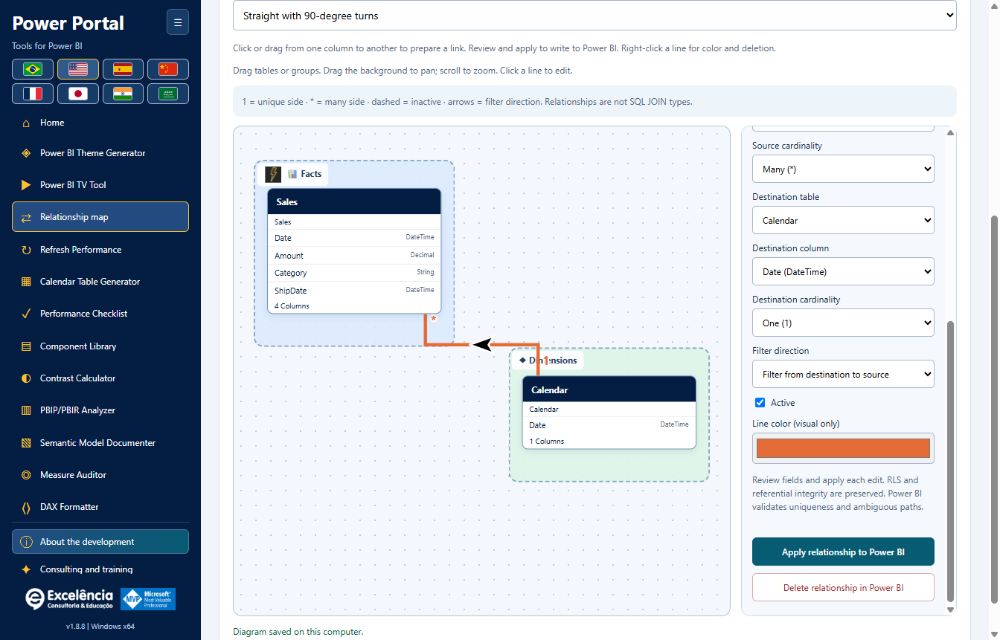
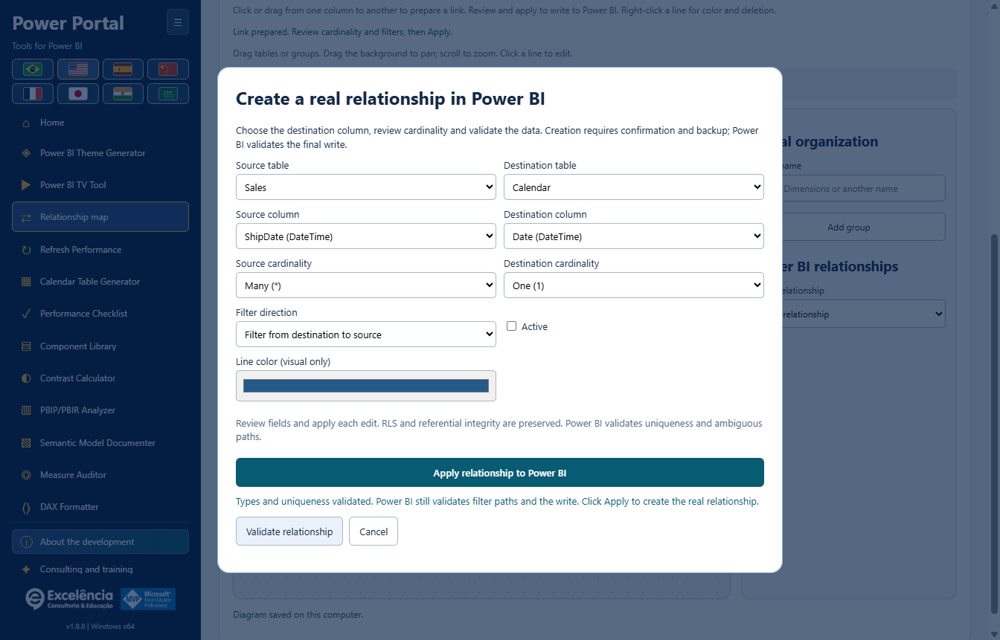
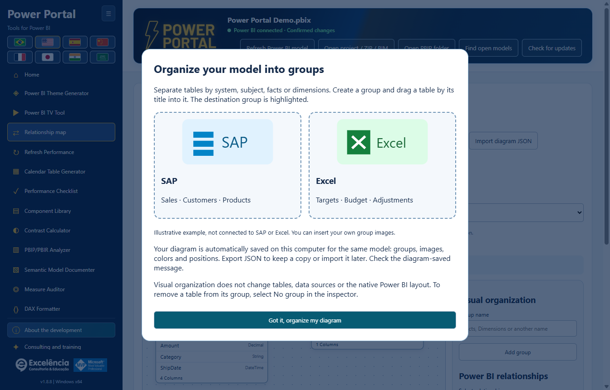
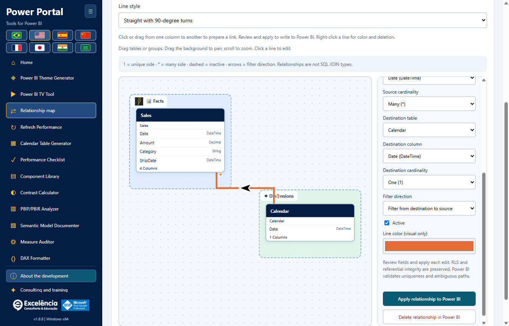

# Relationship map

<!-- language-selector -->
[🇺🇸 English](RELATIONSHIPS.md) · [🇧🇷 Português](pt-BR/RELATIONSHIPS.md) · [🇪🇸 Español](es/RELATIONSHIPS.md) · [🇨🇳 简体中文](zh-CN/RELATIONSHIPS.md) · [🇫🇷 Français](fr/RELATIONSHIPS.md) · [🇯🇵 日本語](ja/RELATIONSHIPS.md) · [🇮🇳 हिन्दी](hi/RELATIONSHIPS.md) · [🇸🇦 العربية](ar/RELATIONSHIPS.md)
<!-- /language-selector -->

**1.8.8 — Dynamic relationship lines and verified theme delivery**

In Relationship map, Line style switches between Curves and Straight lines with 90-degree angles. Endpoints dynamically use facing top/bottom or left/right table borders, taking the rendered card size into account. Side connections retain the linked column height. Black arrows with white outlines follow straight segments rather than bisecting corners. The style saves automatically and travels with exported diagram JSON; older layouts remain curved. This does not change the native Power BI layout or perform global obstacle avoidance.

Send theme directly to Power BI returns focus to Power Portal after native import and during export verification, only when Power BI is foreground. Once the applied theme is verified, Power BI is shown; errors also bring the selected window forward for review. Native dialogs may appear briefly and are not hidden: Desktop has no supported dialog-free theme API. Delayed ribbon tab changes after import are handled before checking the applied theme. An authorized real test in the packaged app verified import/export, Portal focus return and final Power BI activation, then restored the original Default theme without saving the PBIX. All documentation screenshots use synthetic data.

[Back to home](../README.md) · [Screenshots](SCREENSHOTS.md) · [Model safety](USAGE.md)

Available in **Power Portal Desktop 1.8.8**. This is a new Desktop-only tool, separate from Power BI's own Model view. It reads real table/column relationships and can apply confirmed changes to the connected local semantic model.



Relationship arrows now sit directly on the curve and rotate along its local direction, including diagonal and reversed links. Larger 36 × 26 SVG arrowheads are always black with a 3-unit white outline, independently of the relationship line color. Single-direction filtering remains destination to source; bidirectional filtering shows two opposite arrows. Automatic filtering retains its question-mark indicator. This is a visual-only change.

## Create a real relationship in Power BI



Relationship map is now immediately after TV Tool in the sidebar and home gallery. The generic Real model data block is removed from Calendar generator and Component library. Their own read/write controls remain; the real-period button uses the calendar selected inside the tool. Home covers are redrawn as local vector illustrations without embedded text. Titles, descriptions and actions remain outside the artwork and follow the selected language. Drag a source column onto another table to open a real-relationship dialog and choose its destination column. Dropping on a column preselects it. Review cardinality, filter direction and active state, then Validate and Apply with native confirmation and BIM backup.

Validation checks metadata types, duplicate pairs, active direct links and actual row/distinct counts on both columns, not a sample. Duplicate values on a One side are rejected. Queries have a 20-second timeout and failures are explicit. Validate never writes. Apply repeats validation, then the native engine checks keys and filter-path ambiguity at commit. A dashed draft is not a saved relationship; only a successful confirmed write creates it. Save the PBIX afterward. Tests and screenshots use synthetic data, not a modified customer PBIX.

## How to organize with groups



The group introduction opens on the first diagram visit of each app session. Reopen it with **How to organize with groups**. SAP and Excel are illustrative system examples, not new connectors or official logos. Empty groups are visible drop zones. Dropping on a highlighted group assigns the table; dropping outside keeps its current group.

Separate tables by system, subject, facts or dimensions. Create a group and drag a table by its title into it. The destination group is highlighted.

Your diagram is automatically saved on this computer for the same model: groups, images, colors and positions. Export JSON to keep a copy or import it later. Check the diagram-saved message.

Visual organization does not change tables, data sources or the native Power BI layout. To remove a table from its group, select No group in the inspector.

## Open your model

1. Save a separate copy of the PBIX.
2. Launch **External Tools > Power Portal** from Power BI Desktop, or explicitly find and select the open file.
3. Open **Relationship map** in the sidebar or home gallery.

Imported BIM/PBIP/TMDL projects support the diagram and visual customization, but **relationship writes require a live local Power BI connection**. Re-read the model after changes made elsewhere.

## Understand the links

- Each box represents an actual table. The original table name remains visible below its friendly heading.
- Columns involved in relationships are prioritized in the box. Eight columns are shown initially; **Show all columns** expands a scrollable list. All columns also remain available in the editor.
- **1** identifies the unique side; **\*** identifies the many side.
- Solid lines are active relationships; dashed lines are inactive.
- Arrows indicate filter propagation: a single TOM direction filters **from the destination table to the source table**, not the order in which you selected columns. Bidirectional links display both directions. **?** denotes Automatic, where the engine decides.
- Click a line, or use the relationship dropdown, to inspect its exact endpoints, cardinality and filter settings.
- Unsupported non-single-column relationships are explicitly counted in model metadata and warned about in the interface. They are not fabricated or edited.

**These are semantic-model relationships, not SQL INNER/LEFT/RIGHT JOIN selections.** Cardinality and filter direction influence report calculations and filter propagation.

## Arrange a teaching-friendly diagram

- Drag table headings freely in both directions.
- Drag a group's heading to move its member tables together.
- Drag the background to pan. Scroll or use **+ / -** to zoom.
- **Fit tables** frames the current model; a new diagram is initially fitted automatically.
- **Arrange by groups** lays out tables according to their assigned groups. This rearranges only the diagram, not the model.
- Focus a table heading and use arrow keys to move it by 10 units; Shift + arrow moves 50 units.
- Select a table to choose its friendly name, icon, background color and group.
- **Facts** and **Dimensions** are optional starting groups, not automatic classification of table roles.
- Create custom groups, then edit their name, icon and background color. Removing a group does not delete its tables.
- Select an existing relationship to choose its line color.

**Colors, positions, groups, icons and friendly names do not rename Power BI objects or change its native Model view layout.** They belong to this companion diagram.

## Save and share the organization

Visual changes save automatically in the current Windows user's profile:

```text
%APPDATA%\powerportal-desktop\relationship-diagrams\<model-key>.json
```

Writes use an intermediate file and atomic replacement. A failure is shown explicitly with **Retry saving**; the application does not pretend the layout was saved.

**Export diagram JSON** creates a portable visual-layout file. **Import diagram JSON** validates that format and checks that its table names exist in the currently loaded model. It restores the organization only: **importing a diagram never creates, changes or deletes model relationships**.

The JSON includes table names, friendly names, group settings, line colors and the viewport. It does not contain data rows, DAX or source connection credentials. Table/group names can still reveal business context: share only sanitized files.

Live-model profiles are identified using the Power BI window/file name and table lineage tags, falling back to table names. Imported-project profiles also use the selected local path. Power BI discovery does not reliably expose the full PBIX path. Renaming a file or replacing table identities may create a new profile; copies with the same name and lineage tags can share a profile. Use exported JSON to maintain separate layouts when necessary.

Stale table/line entries are removed when metadata is refreshed. A deleted table's old position is not kept as a fictional table. Layouts are retained at uninstall along with other user settings.

## Apply each relationship edit to Power BI



### Create

1. Choose **New relationship**.
2. Select source/destination tables and columns.
3. Set cardinality, filter direction and active/inactive state.
4. Choose **Apply relationship to Power BI**.

### Edit, activate or deactivate

1. Click an existing line or choose it in the dropdown.
2. Change endpoints, cardinalities, filter direction or **Active**.
3. Choose **Apply relationship to Power BI** for this edit.

### Delete

Select the existing relationship and choose **Delete relationship in Power BI**.

Every real edit uses the same safe sequence:

1. A native confirmation identifies the selected Power BI file and displays the previous/new relationship states. **Cancel is the default**.
2. After approval, a full metadata BIM backup and local attempt record must be written before the model change.
3. The connector opens the model again and verifies the existing relationship still matches the snapshot read by the editor. Stale/deleted/renamed relationships are rejected instead of overwritten.
4. Columns must have matching data types and belong to different tables. Duplicate column pairs and a second active link directly between the same table pair are rejected. Deactivate the existing active link first.
5. TOM commits through `SaveChanges`; the engine remains responsible for uniqueness, valid cardinality and ambiguous filter-path validation. Engine errors are shown, not bypassed.
6. The application reloads model metadata after a successful commit. A reload failure is reported as an already-written change, not a cancellation.
7. **Save the PBIX in Power BI Desktop** to persist the changed model in the file.

Row-level-security filter behavior, **Assume Referential Integrity**, and other unexposed settings of existing relationships are preserved. This editor does not expose a way to change RLS or enable Assume Referential Integrity. New links use default security/integrity settings.

Preserving those properties does not mean activation, deletion or endpoint changes cannot affect security-filter propagation. Review relationships used by RLS with your model administrator before confirming a change.

Updates/themes/model writes cannot run concurrently with a relationship write. Switching the connected model during a write is blocked; requests from a different selected connection are rejected.

## Backup and limits

- The BIM backup contains model metadata, not a complete PBIX, report canvas or all data rows. Its path is reported after successful writes or connector failures.
- **There is no automatic relationship rollback/full-model restore button.** Keep the separate PBIX copy and review the reported backup with your model administrator if needed.
- Diagram JSON is limited to 5 MB on import, 2,000 table entries, 200 groups and 10,000 line-style entries. Zoom ranges from 15% to 200%.
- The tool does not calculate SQL joins, merge queries, classify facts/dimensions automatically or execute arbitrary scripts.
- Live Desktop writes can be restricted by model mode, Desktop version, permissions or enterprise policy. Do not bypass those restrictions.

[Configuration and retained data](CONFIGURATION.md#data-locations) · [Troubleshooting](TROUBLESHOOTING.md)

## Column-to-column editing and line menu

Click a source column and then a column in another table, or drag between the column rows. Both must have the same data type. The editor selects the exact endpoints and shows an orange dashed draft; review cardinality, filter direction and active state, then **Apply relationship to Power BI**. Drawing alone never writes to the model. Press Esc to cancel. Selecting an already-related column pair opens that relationship instead of duplicating it.

Right-click a relationship line for **Edit relationship**, its visual color and **Delete relationship in Power BI**. Deletion still requires native confirmation and a successful metadata backup; canceling or an error leaves the relationship unchanged. Colors save locally, not to Power BI's native diagram.

## Group images and more icons

Select a table assigned to a group, then use **Insert group image** in the group settings. Choose a local PNG/JPEG up to 10 MB and 8192 pixels per dimension. It is decoded and normalized to a PNG thumbnail up to 384 pixels and 256 KB. **Remove group image** clears it without deleting the group. More than 30 icon choices are available for tables and groups.

Images are embedded in the saved/exported visual layout, not linked to a remote website. SVG and remote URLs are not accepted. The total embedded base64 image allowance is 2.8 million characters per diagram; the existing 5 MB import limit remains. Share only non-confidential images. Drag the group heading or its unobstructed background to move its member tables together.

## Automatic date tables and refreshing

**Show automatic date/time tables** is unchecked by default and saved per model. Power BI-generated `LocalDateTable_` and `DateTableTemplate_` tables are identified using Power BI annotations, with an internal-name/hidden/calculated-table fallback. Their links are hidden too. Ordinary business tables remain visible even if marked hidden in the model, as in Desktop's model diagram.

**Refresh diagram from Power BI** re-reads the selected model's tables, columns and relationships, removes deleted objects, adds new ones and fits the canvas. Use it after editing in Power BI. It preserves your surviving custom groups/colors/positions. It does not copy Desktop's native coordinates, custom model-view tabs or layout: TOM does not provide those report-side layouts. Unsupported relationship types remain explicitly excluded.

## Native automatic relationship detection

**Autodetect relationships** invokes Power BI Desktop's own detection, not Power Portal name-matching suggestions. Save a PBIX copy first: native detection may create multiple links and affect filters or RLS.

1. Connect to the intended local model and click the detection button.
2. Review the native Power Portal confirmation. Cancel is the default.
3. A BIM metadata backup and attempt log must be saved before automation.
4. Power Portal opens Desktop's relationship manager and invokes its native autodetect button using verified UI Automation IDs.
5. Review results and any additional confirmations directly in Power BI; Power Portal does not dismiss them automatically.
6. Close the Power BI relationship dialogs and click **Finish detection and refresh diagram** in Power Portal.
7. Inspect the refreshed diagram and save the PBIX in Desktop.

The initial result means **detection was launched**, not that it succeeded or created relationships. Model writes, project/model switching and installer updates stay blocked until you finish; an open native dialog prevents completion. Unsupported Desktop versions/states produce explicit errors with the backup path. Close dialogs and use the finish action to recover after an automation failure. If Power BI was closed, finish its work before restarting Power Portal and reconnecting. There is no automatic full-model rollback.

The native control IDs were inspected in a real Desktop window without invoking autodetection or modifying the owner's PBIX. Automated tests used synthetic models and simulated detection outcomes.
