# Screenshots and Power BI interactions

<!-- language-selector -->
[🇺🇸 English](SCREENSHOTS.md) · [🇧🇷 Português](pt-BR/SCREENSHOTS.md) · [🇪🇸 Español](es/SCREENSHOTS.md) · [🇨🇳 简体中文](zh-CN/SCREENSHOTS.md) · [🇫🇷 Français](fr/SCREENSHOTS.md) · [🇯🇵 日本語](ja/SCREENSHOTS.md) · [🇮🇳 हिन्दी](hi/SCREENSHOTS.md) · [🇸🇦 العربية](ar/SCREENSHOTS.md)
<!-- /language-selector -->

**1.8.5 — Native refresh measurements fixed**

Refresh Analysis now recognizes the native XML Refresh command used by Power BI Desktop, including Refresh inside Batch, as well as XMLA Process and TMSL refresh. Previously the native refresh could execute while its progress was discarded as unrelated, leaving 0 measured tables, unavailable row counts and refreshCompletionNotProven. An explicit successful engine result is now accepted when the optional Error field is absent; nonzero error codes and XMLA errors still override success. Progress still requires exact request/activity correlation, excluding unrelated visual queries.

Before the first recognized refresh command, the UI says it is waiting for Power BI refresh events. Unconfirmed completion now has translated guidance rather than only a technical code. Update the app, connect to the intended PBIX and run Refresh and analyze again; old incomplete reports are preserved and are not rewritten as successful. The packaged application was validated end to end on a user-authorized real refresh, with table activity, row counts, automatic completion and history surviving reload. No customer data or model names are included in these screenshots; documentation examples remain synthetic.

**1.8.5 — Download updates in your browser**

When a newer version is available, the update notice now offers Download in browser alongside Update now. It opens the detected official GitHub installer URL in your default browser without closing Power Portal or starting installation. Run the downloaded installer manually when ready. The option remains available after an automatic update error. Browser launch failures are shown explicitly. Update now still downloads in the app, verifies SHA-256 and size, then requests Windows authorization. Browser downloads do not receive the app’s automatic checksum verification: compare the published SHA-256 before running the installer. Both buttons and the hint are translated into all eight languages.

**1.8.5 — Smooth theme preview**

The theme generator line chart now uses smooth cubic curves instead of straight segments, with both sample and connected-model data. Curves pass through the original points without overshooting between values; colors, markers and tooltips are preserved. This change affects the preview only: exported theme JSON and the line formatting of existing Power BI visuals are unchanged.

**1.8.5 — Refresh launch fixes**

Refresh Analysis is now immediately below Relationship map in the sidebar and home gallery. Native button discovery ignores the duplicate Home tabs belonging to DAX Query View and TMDL View, avoiding “Ambiguous Power BI control: home”. Select Report, Data or Model view in Power BI if native controls are unavailable.

[Back to home](../README.md) · [Install](INSTALLATION.md) · [Safety guide](USAGE.md)

**Application screenshots: Power Portal Desktop 1.8.5, English interface.**
The screenshots use **synthetic demonstration metadata and query values**, not a customer PBIX. Connected states illustrate supported UI actions; no customer model was changed to make these images. Native file-picker labels can follow the Windows language. The actual Power BI ribbon screenshot was supplied by the owner and cropped to remove the private file title.

Relationship arrows now sit directly on the curve and rotate along its local direction, including diagonal and reversed links. Larger 36 × 26 SVG arrowheads are always black with a 3-unit white outline, independently of the relationship line color. Single-direction filtering remains destination to source; bidirectional filtering shows two opposite arrows. Automatic filtering retains its question-mark indicator. This is a visual-only change.

The animated Power Portal header now contains the file name, connection status and all five read/import/discovery/update buttons. The separate toolbar below the banner has been removed to free workspace. Content wraps inside the header on smaller windows and in all eight languages, including Arabic. Connection confirmations, notices and update behavior are unchanged.

## Create a real relationship in Power BI

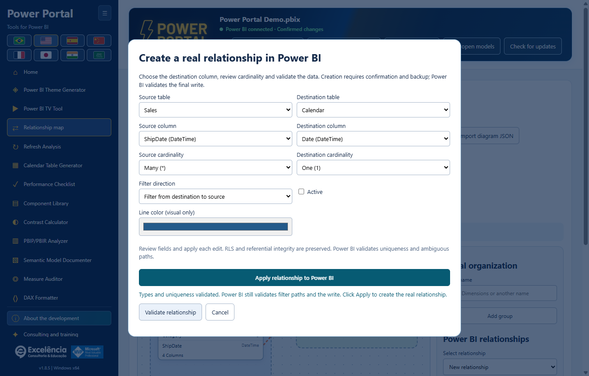

Relationship map is now immediately after TV Tool in the sidebar and home gallery. The generic Real model data block is removed from Calendar generator and Component library. Their own read/write controls remain; the real-period button uses the calendar selected inside the tool. Home covers are redrawn as local vector illustrations without embedded text. Titles, descriptions and actions remain outside the artwork and follow the selected language. Drag a source column onto another table to open a real-relationship dialog and choose its destination column. Dropping on a column preselects it. Review cardinality, filter direction and active state, then Validate and Apply with native confirmation and BIM backup.

Validation checks metadata types, duplicate pairs, active direct links and actual row/distinct counts on both columns, not a sample. Duplicate values on a One side are rejected. Queries have a 20-second timeout and failures are explicit. Validate never writes. Apply repeats validation, then the native engine checks keys and filter-path ambiguity at commit. A dashed draft is not a saved relationship; only a successful confirmed write creates it. Save the PBIX afterward. Tests and screenshots use synthetic data, not a modified customer PBIX.

## How to organize with groups

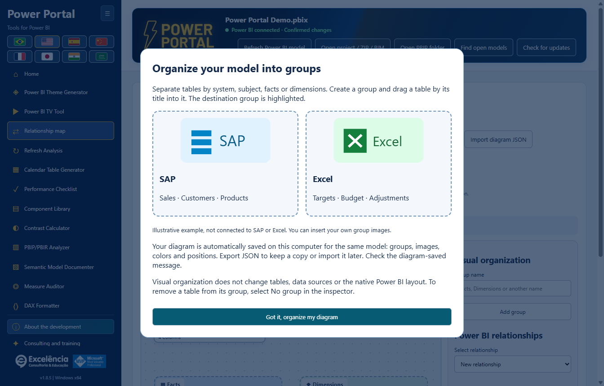

The group introduction opens on the first diagram visit of each app session. Reopen it with **How to organize with groups**. SAP and Excel are illustrative system examples, not new connectors or official logos. Empty groups are visible drop zones. Dropping on a highlighted group assigns the table; dropping outside keeps its current group.

Separate tables by system, subject, facts or dimensions. Create a group and drag a table by its title into it. The destination group is highlighted.

Your diagram is automatically saved on this computer for the same model: groups, images, colors and positions. Export JSON to keep a copy or import it later. Check the diagram-saved message.

Visual organization does not change tables, data sources or the native Power BI layout. To remove a table from its group, select No group in the inspector.

## Open Power Portal from External Tools

After installation, restart Power BI Desktop, open a PBIX, and click **External Tools > Power Portal**.

The Portuguese tab **Ferramentas externas** corresponds to **External Tools** in English. The installer registers the icon in this ribbon. Clicking it launches **a separate Power Portal window connected to the model of the open file**. It is an external companion application, not a report visual, embedded pane, or internal Microsoft extension.

## Home and navigation

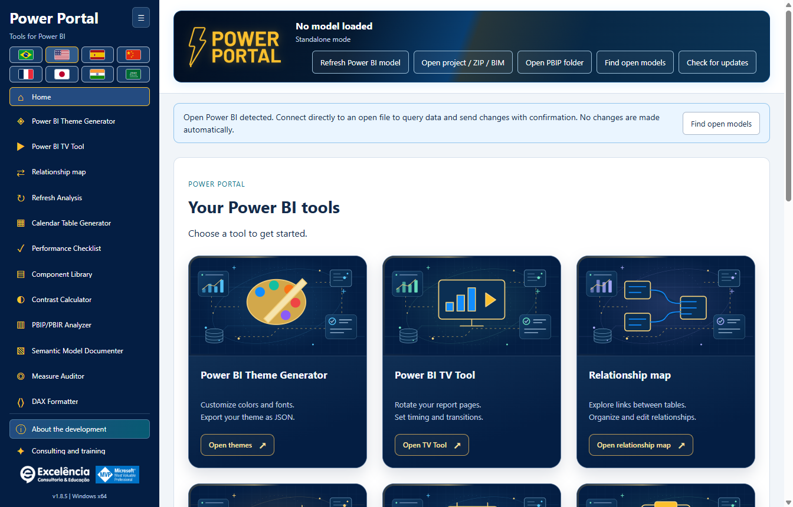

Relationship map is now immediately after TV Tool in the sidebar and home gallery. Home covers are redrawn as local vector illustrations without embedded text. Titles, descriptions and actions remain outside the artwork and follow the selected language.

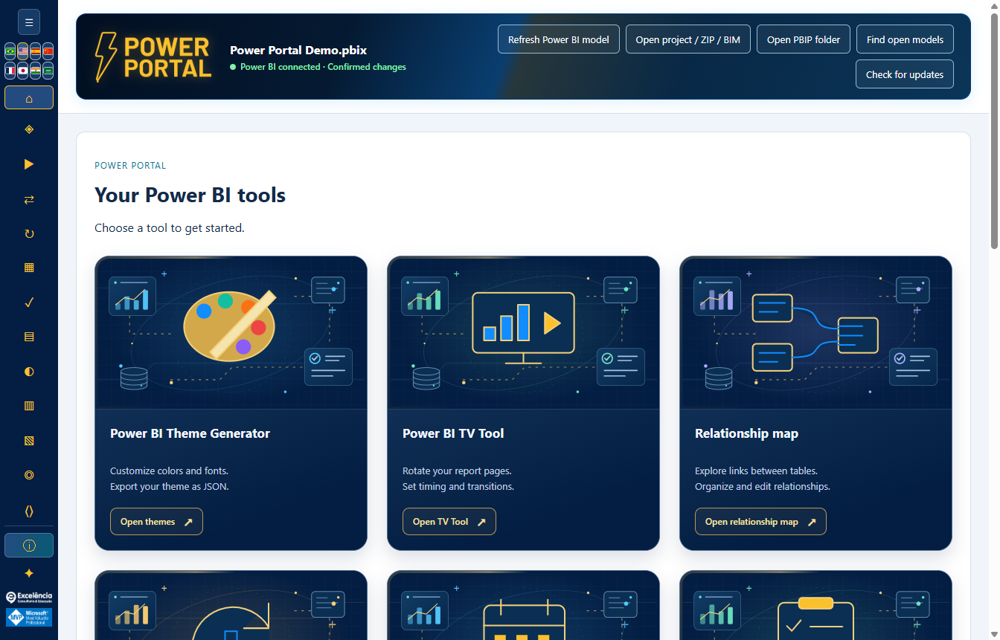

Collapse the sidebar for more working space; the preference persists. Icons retain accessible names and tooltips. The main work area and individual tool forms can still scroll; the no-scroll change applies to the sidebar catalog.

## Connect to a file already open in Power BI

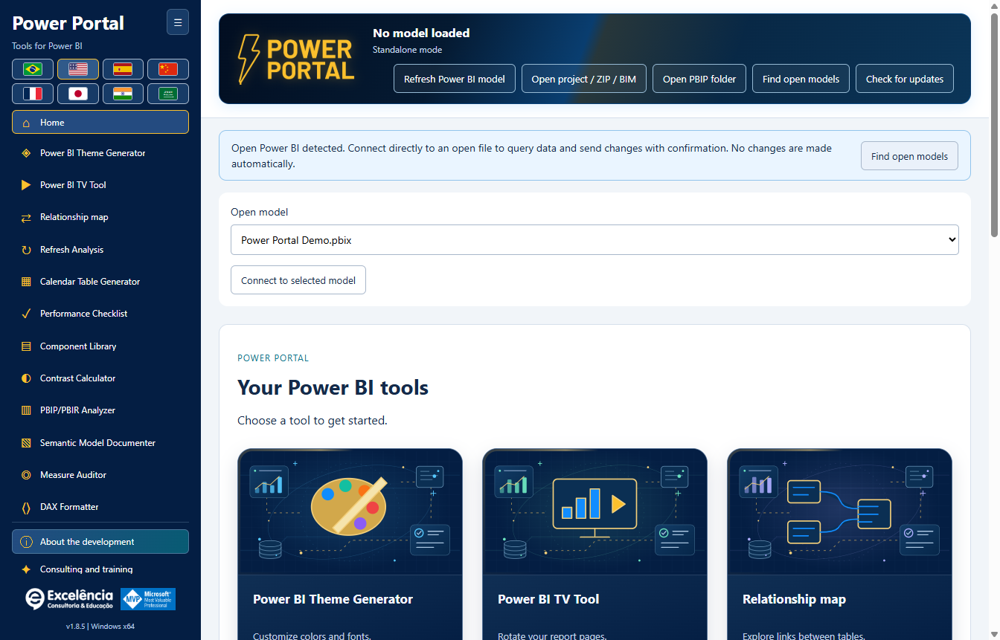

When started from a Windows shortcut, the app detects available local Power BI models and explains that you can connect directly to an open file. Choose **Find open models**, verify the file name and click **Connect to selected model**. With multiple files open, choose the intended one explicitly.

Launching from the External Tools ribbon instead passes that Desktop instance's connection automatically and reads its metadata. **Connecting does not write changes.**

## New-version notification

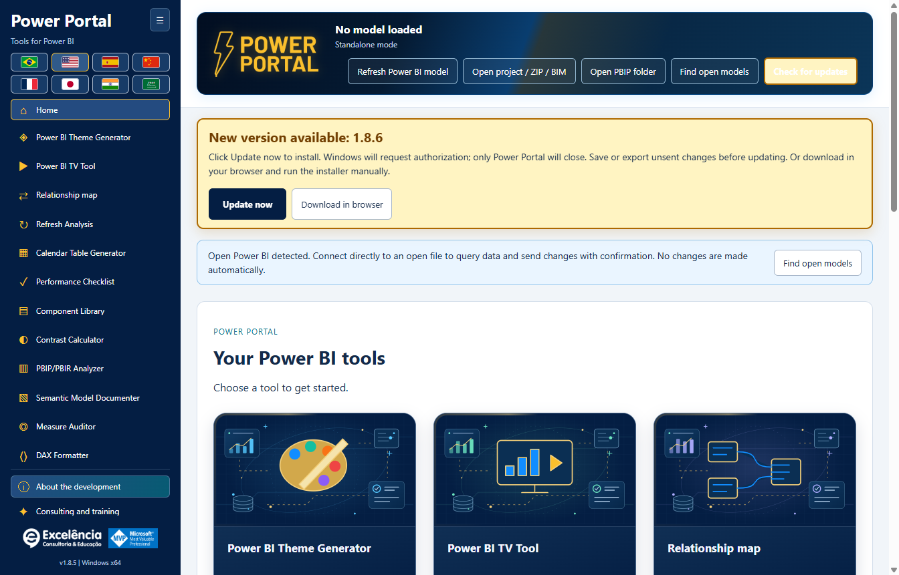

The screenshot uses a **synthetic future 1.8.5 result** to show the notification in version 1.8.5. It is not a claim that 1.8.5 has been published. Users on 1.6.2 or newer can receive the real 1.8.5 notification now.

In 1.6.4, the amber banner stays visible while scrolling and gently animates unless reduced motion is enabled. No persistent "up to date" banner occupies space.

The installed application checks the latest stable official Release at startup. Click **Update now** to download and verify the installer, then approve the Windows administrator request. It updates the existing installation folder and closes only Power Portal. **Connecting or checking alone never installs anything.** Save/export unsent tool edits first and reopen the app when installation finishes.

**Check for updates** retries a check at any time. Offline/rate-limit/checksum/UAC failures are shown explicitly without disabling local tools. [Full update guide](UPDATES.md).

## Direct interactions with the open Power BI file

These are not limited to downloading text or JSON:

| Screen/action | Reads from or changes Power BI? | Safeguard |
|---|---|---|
| Refresh Power BI model | Reads tables, columns, measures and relationships from the selected file's semantic model. | No model write. |
| Query live data/date ranges/samples | Reads actual model values through the local engine. | Structured, bounded queries; not active-page filters. |
| Send theme directly to Power BI | Applies the generated JSON to the selected report window. | Confirmation, visible UI import and exported-theme verification. |
| Create calendar in Power BI | Creates a new calculated date table in the semantic model. | Confirmation and metadata backup; refresh afterward in Desktop. |
| Create HTML measure in Power BI | Creates a new measure in the chosen model table. | Confirmation and metadata backup; add the HTML visual manually. |
| Update measure in Power BI | Writes the formatted DAX to the selected existing measure. | Confirmation, metadata backup and concurrent-change protection. |
| Apply/delete relationship in Power BI | Creates, edits, activates/deactivates or deletes the selected column relationship. | Native confirmation, metadata backup, stale-state checks and engine validation; RLS/integrity settings preserved. |

**Save a separate PBIX copy before applying changes.** Confirm the target file and expression, then save the PBIX in Desktop afterward. The app never silently saves the PBIX.

### Live model data

Samples remain limited to 50 rows and queries to 20 seconds. Calendar data is read through its own calendar selector and preview; the generic data block is no longer shown in Calendar generator or Component library. Connection status stays in the header.

### Theme generator

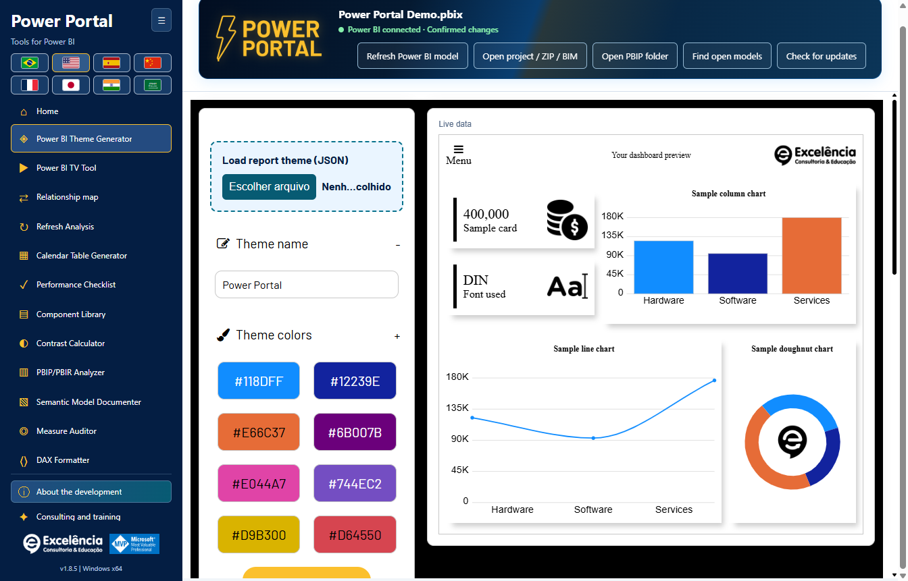

Use the highlighted **Load report theme (JSON)** area, edit colors/fonts and watch the live preview. Export JSON, or scroll to the end of the page, below the form and preview, to use **Send theme directly to Power BI**.

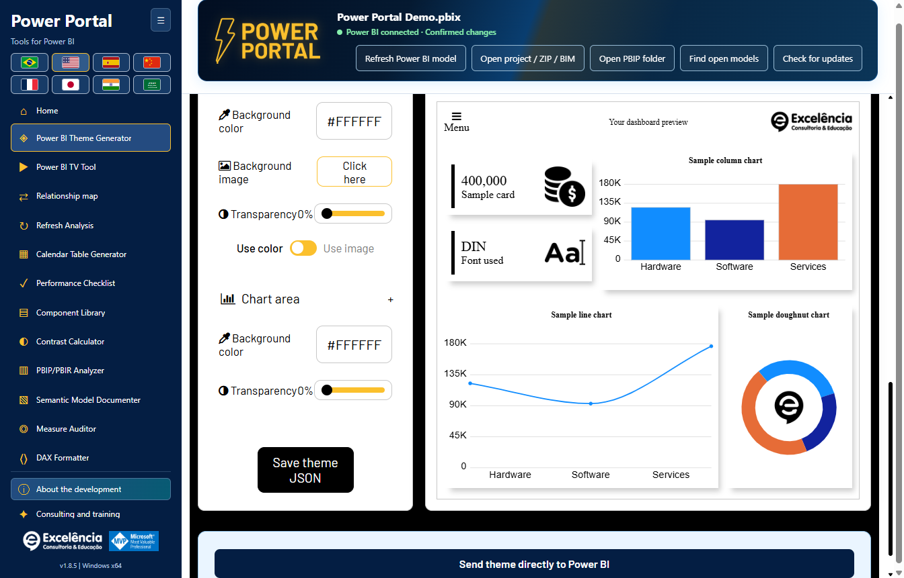

To start from the existing report theme, save its JSON in Desktop and load it here. A semantic-model connection does not read report themes. Direct sending still uses the **visible import dialog**: no supported generic Desktop theme API eliminates it. Do not interact with Power BI while automation runs.

### Calendar generator

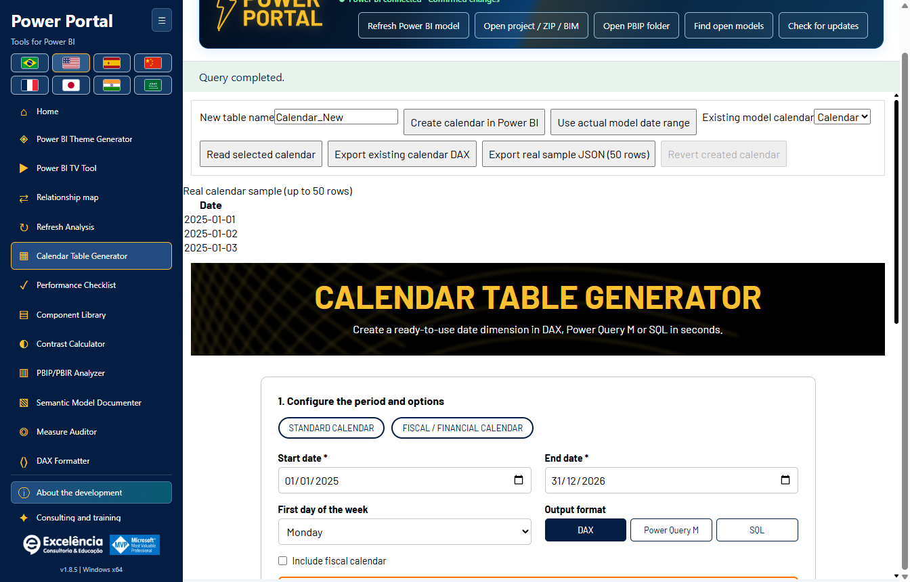

Read an existing calendar's expression/date range/sample, export DAX or sampled JSON, and generate a new calendar. **Create calendar in Power BI** creates a new calculated table with backup and confirmation, rather than replacing the selected existing calendar.

Refresh in Desktop after creation. Guarded calendar reversal is available only when the created table still matches and has no dependencies.

### Component library

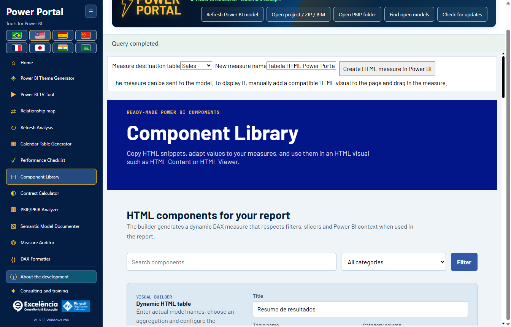

Choose the destination table and a new measure name. The builder uses model field/measure names and supports **Create HTML measure in Power BI**. The measure is written to the model after confirmation.

A compatible HTML visual must be added to the report manually and assigned that measure; this button does not place a visual on the page.

### DAX formatter

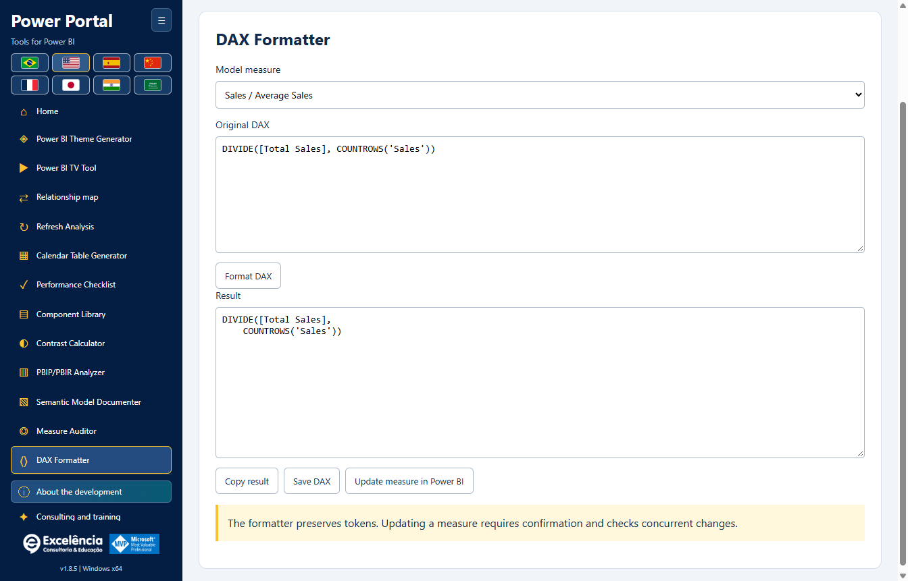

Select the existing model measure, format its expression, then choose **Update measure in Power BI** to submit the DAX back to that measure. Copy/export actions are separate. The update refuses concurrent expression changes and requires confirmation.

## Remaining tools

### Relationship map

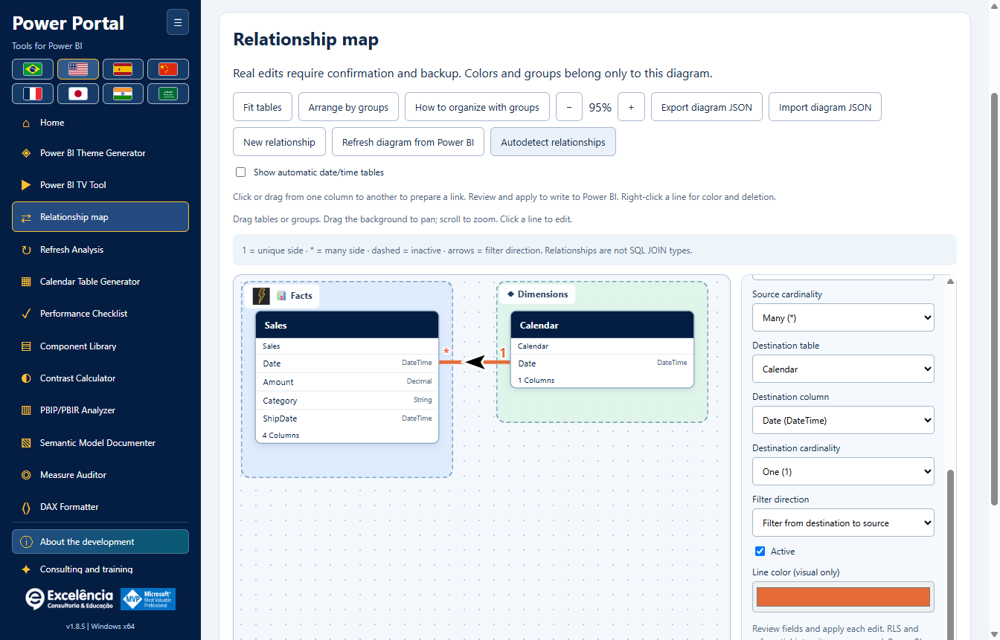

The new Desktop-only tool shows real table links, cardinalities, filter arrows and inactive dashed lines. Drag boxes/groups freely, zoom/pan, assign friendly names/icons, and customize group and line colors. Visual layouts save automatically per model and can be exported/imported as JSON without submitting model writes.

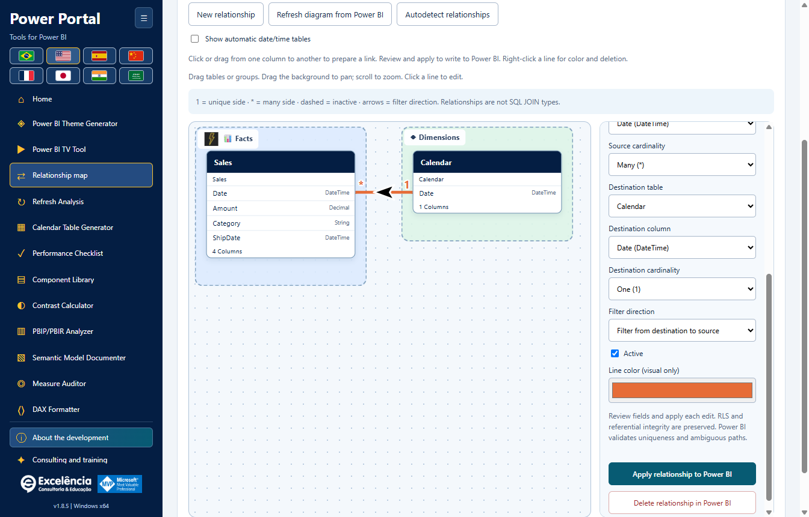

Select a line to inspect its exact columns, cardinality, filter direction and active state. **Apply relationship to Power BI** or **Delete relationship in Power BI** commits each edit after native confirmation and backup. Imported projects remain read-only. Styling does not rename tables or change Power BI's native diagram. [Complete walkthrough and safety limits](RELATIONSHIPS.md).

In 1.8.5, click or drag between columns to prepare a dashed draft, then review/apply. Right-click a line for color/edit/delete. Group settings offer local PNG/JPEG images and more icons; drag the group background or heading. Automatic date/time tables are hidden by default. **Refresh diagram from Power BI** re-reads external changes without copying native layout coordinates. **Autodetect relationships** starts Desktop's native detection after confirmation/backup; review and close its dialogs before **Finish detection and refresh diagram**.

### Power BI TV Tool

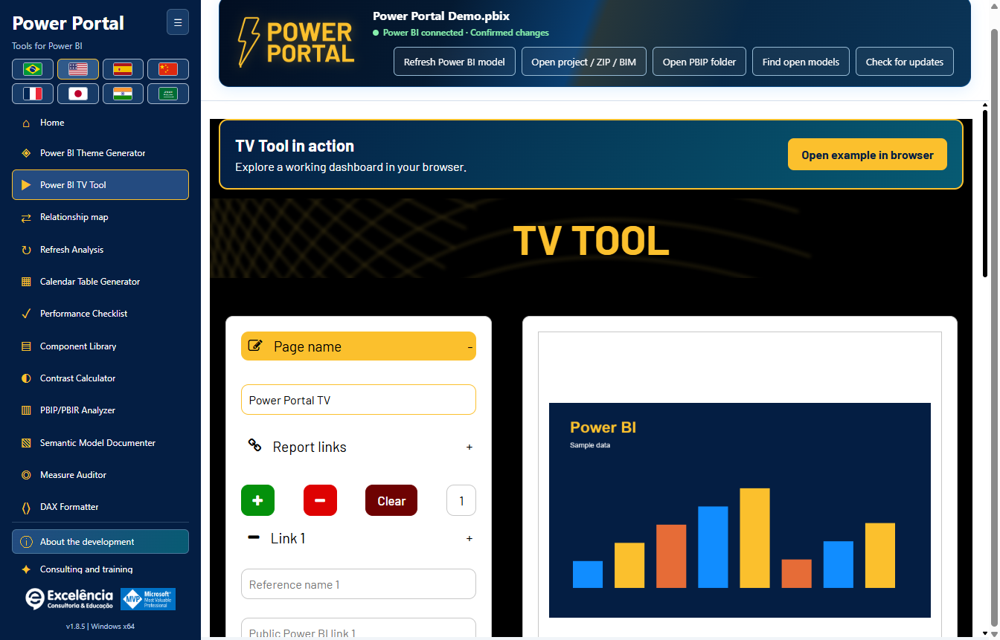

The top **TV Tool in action** banner opens a [working official example](https://www.powerportal.com.br/tv_tool/painel_exemplo_power_bi_tv_tool.html) in your default browser, requiring internet but sending no local model data. The form's local illustrative presentation remains available.

Rotate published report pages or local images, set durations/transitions, preview and export HTML. TV does **not** rotate pages of the open local PBIX. Private published reports require appropriate Microsoft sign-in/licensing/permissions.

### Performance checklist

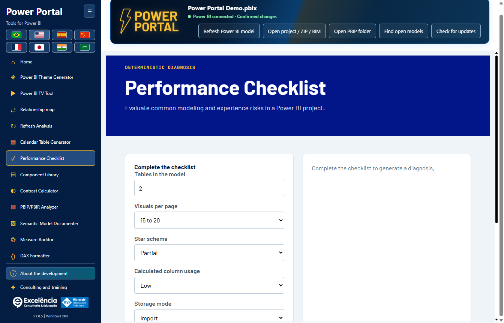

Review model-informed checklist items and manual report characteristics. Scores are heuristic guidance, not measured visual timings.

### Contrast calculator

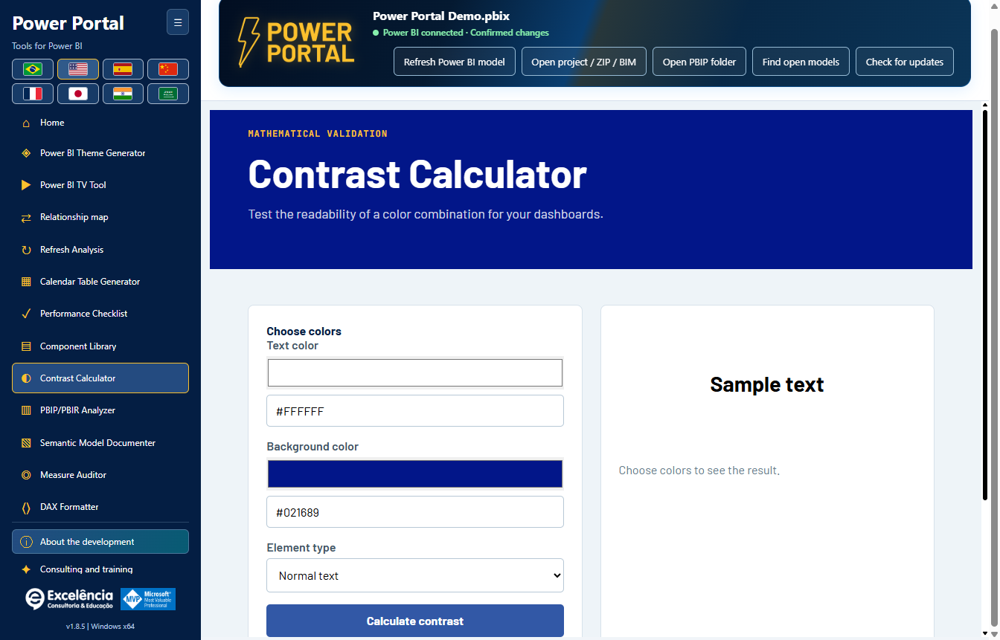

Check readability/contrast against WCAG thresholds. This is a local analysis tool and does not alter report formatting automatically.

### PBIP/PBIR analyzer

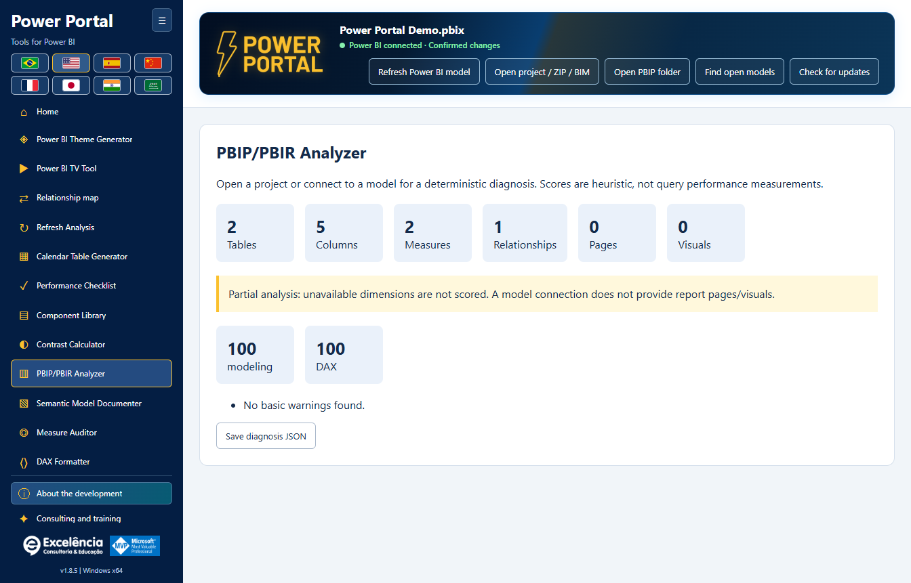

Analyze the loaded project's available structure. A live semantic-model connection does not provide report page/visual metadata, so unavailable dimensions are reported as partial. Imported PBIR project metadata can provide additional counts.

### Semantic model documenter

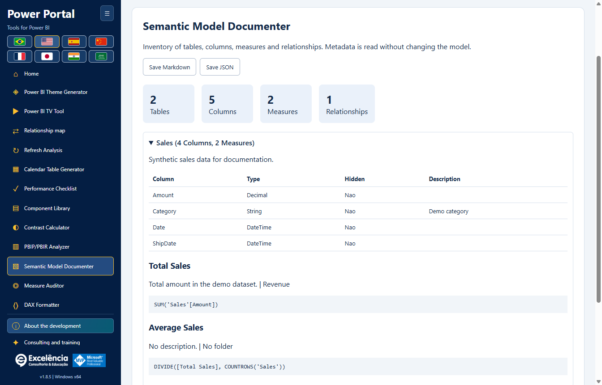

Read and export table/column/measure/relationship documentation in Markdown or JSON. This tool does not modify the model. Exports may contain confidential names and DAX; store them appropriately.

### Measure auditor

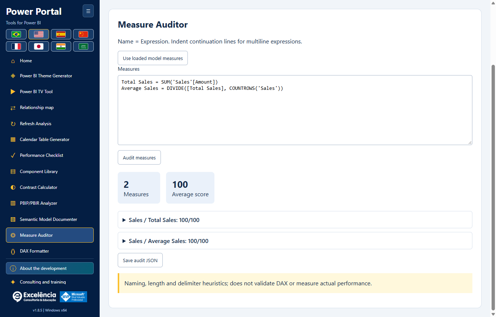

Audit model measures or supplied DAX with heuristic naming/size/delimiter checks. It does not validate DAX semantics or measure actual report performance.

## Consulting and training

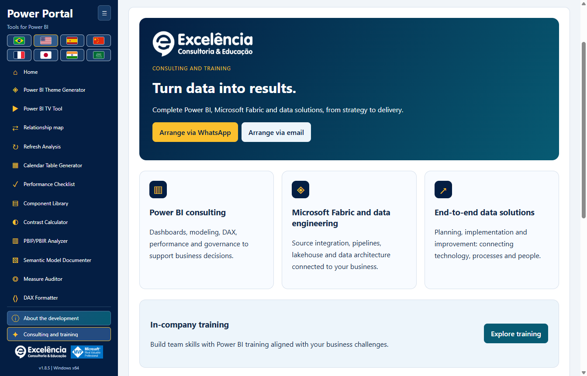

Discover Power BI consulting, Microsoft Fabric, data engineering and complete solutions. In Company training, featured videos and contact actions are included. WhatsApp/email open a draft or browser page; no message or appointment is sent automatically.

[Release notes](../CHANGELOG.md) · [Troubleshooting](TROUBLESHOOTING.md)

## Refresh Analysis

Measure native refresh. Compare timings and rows. [Refresh Analysis](REFRESH-ANALYSIS.md).

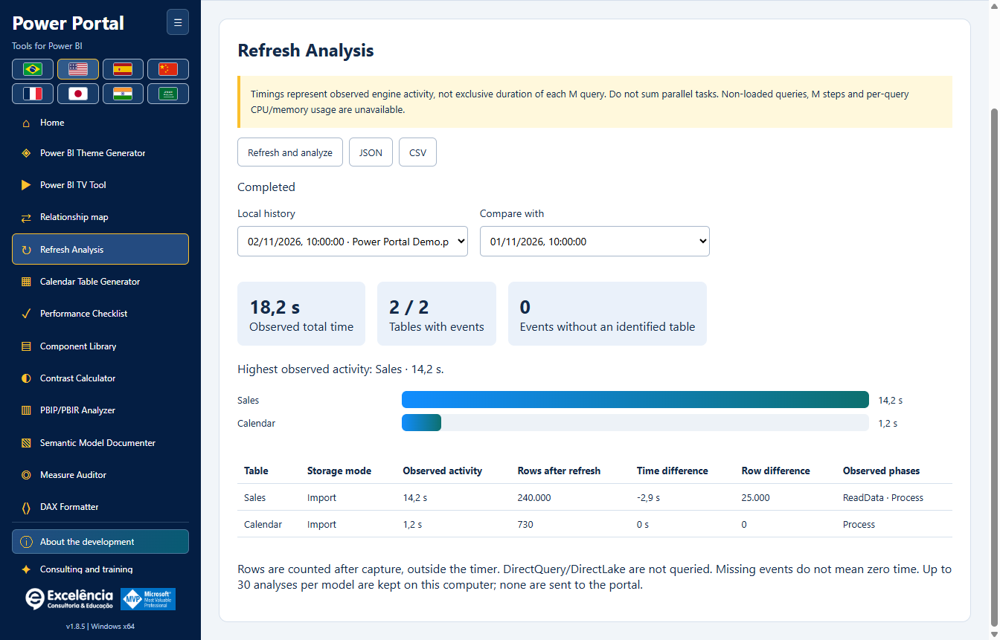

Observed activity is the union of engine intervals mapped exactly to each table, avoiding double counting of nested phases. It is not pure source-query time or a proven critical path. The observed total runs from launch until completion is detected, includes UI/polling overhead, and excludes the later row counts. Missing table mappings are reported separately.

Automatic completion requires observed refresh-command completion and a ready Power BI window. Close native result dialogs. Manual Finish capture is always incomplete, not evidence of success and not a cancellation of refresh. Engine/trace errors are explicit. If capture is interrupted, no completed analysis is claimed.

## Animated home cards

The twelve home cards now use the same navy-blue base as the sidebar (#041e43), with original text-free vector scenes. Each tool retains its own central illustration, enriched with data panels, charts, a database, orbital paths, a grid and floating satellites. Signal lines move gently. No external images, scripts or services are loaded for these covers.

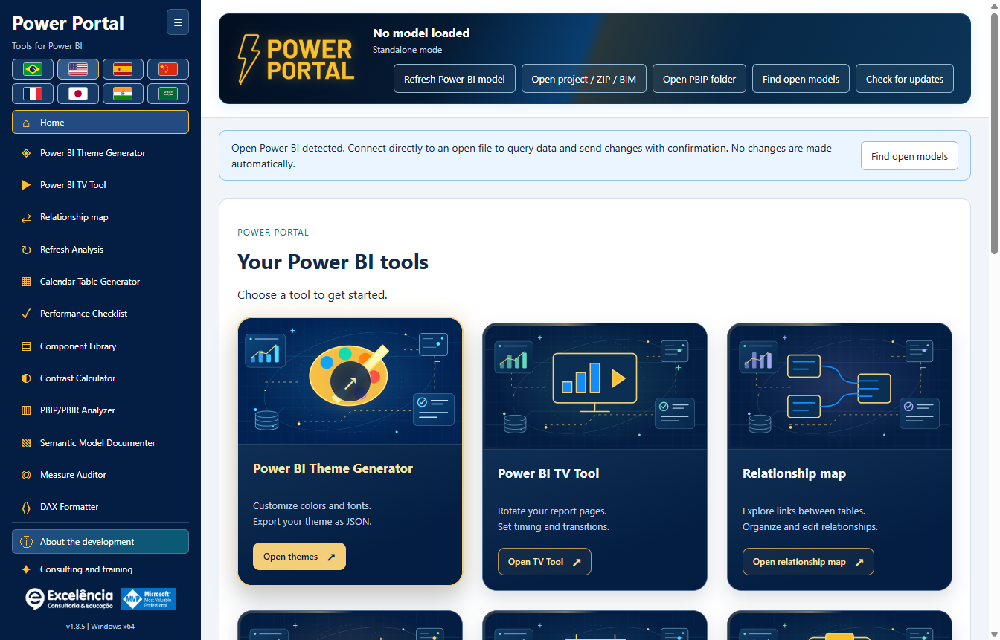

Hover or focus a card with the keyboard to reveal a golden frame and glow, a light sweep, a brighter scene, a circular launch arrow and a gold action. Pressing gives immediate visual feedback without delaying navigation. Enter/Space still activate the same tool. Windows/browser reduced-motion preferences stop movement while keeping static highlights and visible focus. Titles and actions remain outside the artwork and follow the selected language. These screenshots show static normal/hover states, not video.

