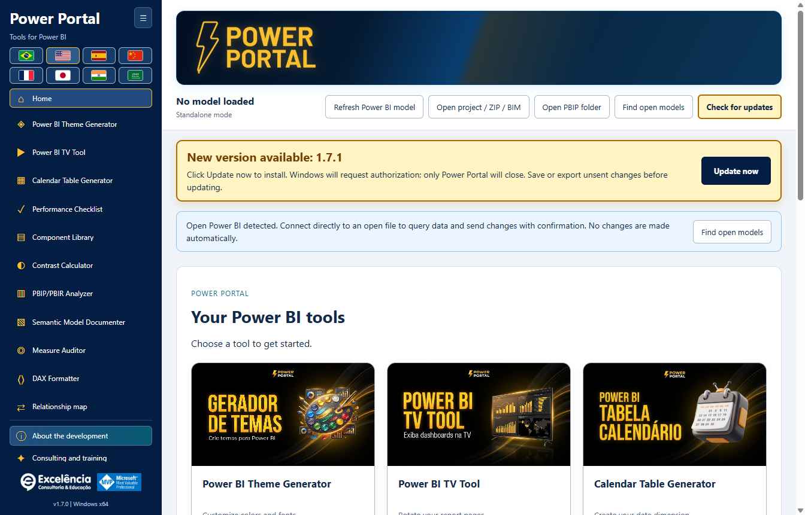

# Update checks and automatic installation

[Back to home](../README.md) · [Installation](INSTALLATION.md)

## Available from version 1.6.2

Install **1.6.2 manually once** if you have 1.6.1 or an older version. Older applications cannot gain a new updater without first installing the release that contains it.

The **installed** application checks the latest public stable Release in `luisgnserra/powerportaldesktop` when opened. It compares numeric three-part versions, ignores downgrades/current versions, and does not offer draft or prerelease builds.

The development/source run does not download or install updates.

## Update flow

1. Open Power Portal. With internet available, it checks for a newer release.
2. If available, a prominent amber notification displays the version and **Update now**. It stays visible while scrolling, with a gentle glow animation; reduced-motion preferences disable the animation. The check button is also highlighted.
3. **Save/export unsent tool edits** before proceeding. Model writes/themes already in progress block updating.
4. Click **Update now**. There is no installation merely from opening the app or checking for updates.
5. The main process downloads the official x64 installer over HTTPS and checks its exact size and SHA-256 against the published GitHub Release asset metadata.
6. Windows requests administrator authorization. Approve only if you trust this distribution.
7. After authorization/installer launch, Power Portal closes and the installer runs silently in the **existing installation folder**. **Power BI Desktop is not closed.**
8. Reopen Power Portal after installation completes. Restart Desktop if its ribbon/registration needs reloading.



The screenshot is a **simulated future 1.7.1 notification** inside 1.7.0, demonstrating the UI only. It is not an announcement of 1.7.1.

### Receive version 1.7.0 from an earlier updater-enabled version

With **1.6.2, 1.6.3 or 1.6.4** installed, reopen the app or click **Check for updates**. The published stable **1.7.0** should appear with **Update now**. Do not install 1.7.0 manually first if you want to observe this notification. Versions before 1.6.4 use their original banner; the prominent visual styling is retained in 1.7.0. Click the update button when ready and approve Windows authorization.

The app reports installer launch, not a verified completed installation: installation completes after the old app closes. Check the displayed application version after reopening. Windows can still block the unsigned installer or require IT approval.

## Checks, retries and failures

**Check for updates** in the top actions retries the check manually. There is no background polling loop or forced installation.

In 1.6.4, a successful check finding no newer version does not leave an "up to date" banner occupying a line. Errors and available updates still remain visible.

- Offline, firewall/proxy or GitHub API rate-limit errors are displayed in the update notice; local tools remain usable.
- Invalid release metadata, missing asset digest, checksum mismatch, unexpected redirect hosts, excessive download size or timeouts prevent execution.
- Canceling Windows authorization leaves the app available and shows an error. Retry when ready.
- A failed check clears the old available-update offer so stale data is not used silently.
- The updater blocks new model writes while downloading/installing and refuses to start during an active write/theme operation.
- Tool-form edits that have not been sent/exported are not automatically preserved across application replacement. Export/save first.

## Privacy, network and integrity

Update requests contain only standard HTTPS request metadata to GitHub, not local model names, DAX, data, PBIX contents or credentials. No GitHub login/token is required for public releases.

Release metadata comes from:

```text
https://api.github.com/repos/luisgnserra/powerportaldesktop/releases/latest
```

Installer URLs must match the release's exact versioned asset in this repository. HTTPS redirects are restricted to GitHub and its official release-asset hosts. The app retains the metadata's hash/size for that download.

Checks have a 30-second total timeout and a 1 MB metadata limit. Downloads have a 20-minute total limit, 30-second socket inactivity timeout and a 1 GB maximum accepted installer size. These are bounds, not the normal package size.

Downloads are held in `%APPDATA%\powerportal-desktop\updates`. Partial files are removed on handled failures; a verified EXE can remain after installation. No application source is downloaded or built.

**SHA-256 is an integrity check, not a digital publisher signature.** The current release is unsigned. The updater does not bypass UAC, SmartScreen or enterprise policies. If your network requires a proxy the updater cannot use, ask IT or install the verified Release EXE manually.

## Manual fallback

Use the [latest Release](https://github.com/luisgnserra/powerportaldesktop/releases/latest) or the [versioned PowerShell helper](INSTALLATION.md#command-line-installation). Existing version-pinned helper commands intentionally install their pinned version, not whichever future release is latest.
