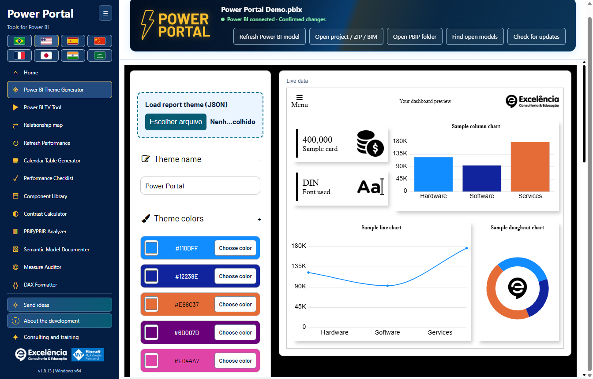
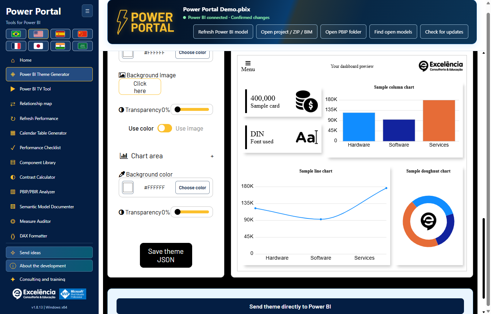
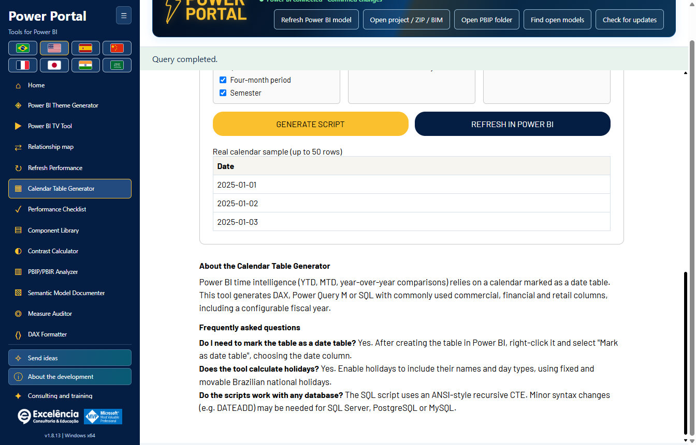
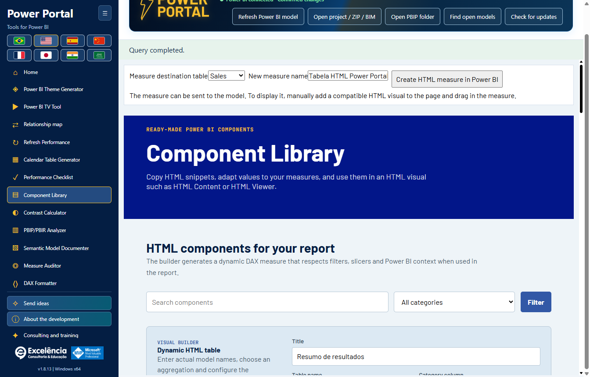
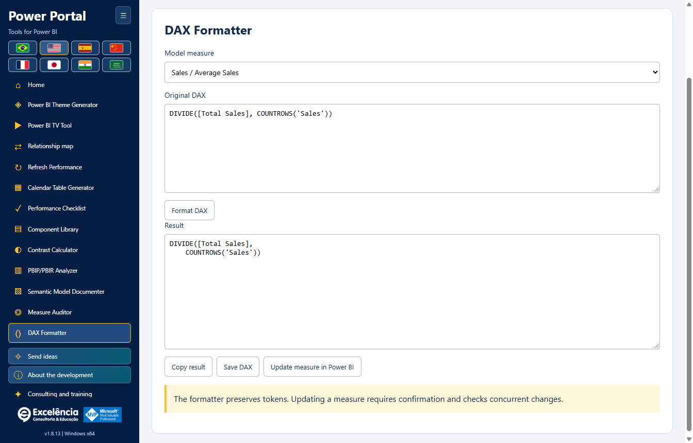
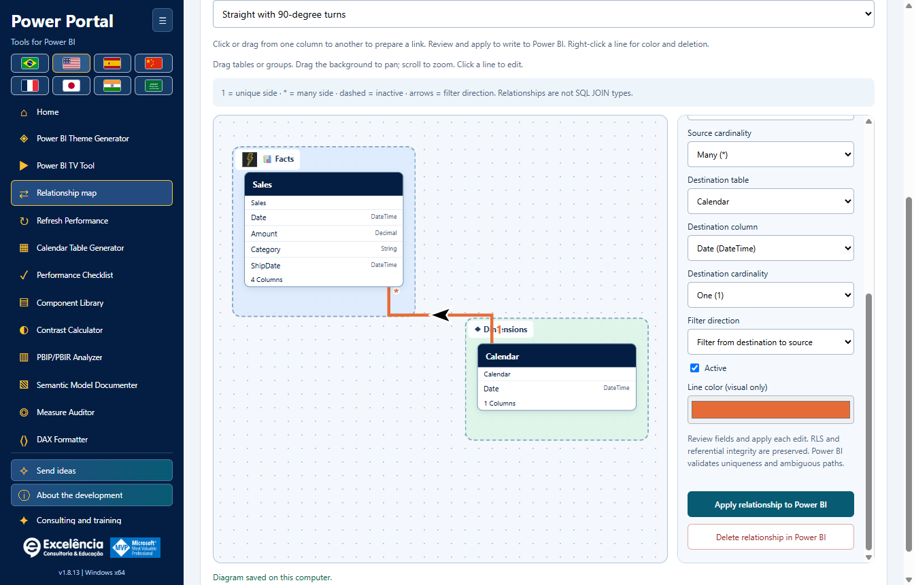
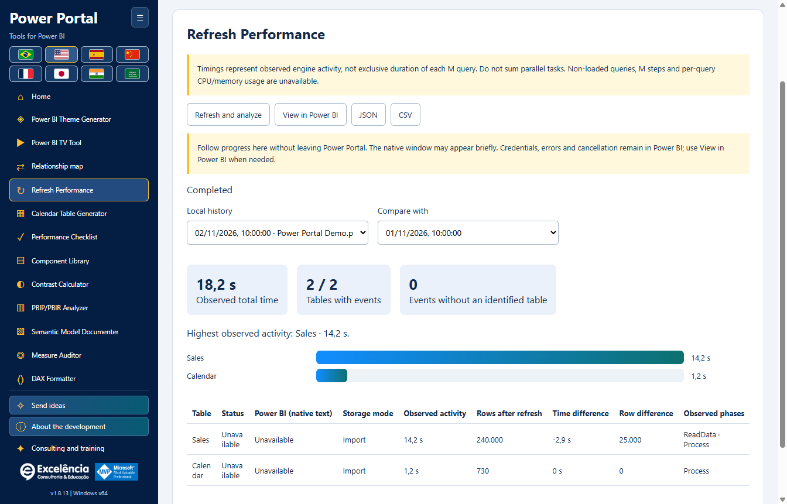

# Usage and model safety

<!-- language-selector -->
[🇺🇸 English](USAGE.md) · [🇧🇷 Português](pt-BR/USAGE.md) · [🇪🇸 Español](es/USAGE.md) · [🇨🇳 简体中文](zh-CN/USAGE.md) · [🇫🇷 Français](fr/USAGE.md) · [🇯🇵 日本語](ja/USAGE.md) · [🇮🇳 हिन्दी](hi/USAGE.md) · [🇸🇦 العربية](ar/USAGE.md)
<!-- /language-selector -->

**1.8.13 — Send improvement ideas without crowding the menu**

Send ideas now appears immediately above About development. The accessible dialog accepts an idea title (up to 120 characters) and description (up to 1000). Open email with idea requests your default email app with the fixed recipient contato@consultoriaexcelencia.com.br, subject and message filled in. Review and send in that app: Power Portal does not send automatically or confirm delivery. If no app opens, configure a default email client or send manually. No model data, files or credentials are attached, and the form does not save drafts to disk. Do not enter confidential information. Errors are explicit and preserve your text for retrying or copying. The form works offline up to handing off to the email app; actual delivery depends on your mail account/network.

Tool buttons and low-height sidebar spacing are more compact, without hiding controls or adding menu scrolling. Packaged-app tests verify expanded/collapsed menus at supported 680/768/900-pixel window heights in all eight languages, minimum 24-pixel button heights, keyboard focus, required fields, fixed recipient/encoded text, email-app failure and preserved form content. Tests intercepted the mail handoff: no email was sent. Documentation screenshots use synthetic data.

**1.8.10 — Animated foreground illustrations and richer hover**

All twelve home covers now animate their main tool illustration, not just the background: a gentle float/rotation and a pulsing foreground verification badge. Hover or keyboard focus reveals additional animated bar panels, a hexagonal status indicator, a dashed orbit and particles. Extra animations pause outside hover/focus. Decorative layers do not intercept clicks or enter the accessibility tree. Windows/browser reduced-motion preferences stop foreground and extra animations while retaining static details, contrast and focus. Original local text-free artwork, eight-language labels and tool navigation are preserved. Packaged-app tests measured changing foreground and hover-panel transforms, keyboard focus, reduced motion, twelve distinct covers and layout in all eight languages. Screenshots are static captures of normal/hover states, not video; all model data is synthetic.

**1.8.9 — Calendar sample and native refresh shortcut**

In Calendar generator, the real sample (up to 50 rows) now appears below Generate script. Refresh in Power BI sits beside that button and, with a live connection, opens Refresh Performance and starts the same confirmed native model-data refresh. Follow table statuses, timings and row counts there. This refreshes the entire model; it does not apply the generated script, create or replace a calendar table, or save the PBIX. Create calendar in Power BI remains a separate action. The button is disabled offline, supports keyboard activation and is translated into all eight languages. Cancellation and errors use the existing refresh flow. The sample remains the last requested read: use Read selected calendar to read it again after refreshing. Packaged-app tests verified layout, all eight labels, offline gating, exact selected connection, cancellation, visible errors, retry and unchanged calendar creation. No real model refresh was started for these tests; documentation images use synthetic data.

**1.8.8 — Dynamic relationship lines and verified theme delivery**

In Relationship map, Line style switches between Curves and Straight lines with 90-degree angles. Endpoints dynamically use facing top/bottom or left/right table borders, taking the rendered card size into account. Side connections retain the linked column height. Black arrows with white outlines follow straight segments rather than bisecting corners. The style saves automatically and travels with exported diagram JSON; older layouts remain curved. This does not change the native Power BI layout or perform global obstacle avoidance.

Send theme directly to Power BI returns focus to Power Portal after native import and during export verification, only when Power BI is foreground. Once the applied theme is verified, Power BI is shown; errors also bring the selected window forward for review. Native dialogs may appear briefly and are not hidden: Desktop has no supported dialog-free theme API. Delayed ribbon tab changes after import are handled before checking the applied theme. An authorized real test in the packaged app verified import/export, Portal focus return and final Power BI activation, then restored the original Default theme without saving the PBIX. All documentation screenshots use synthetic data.

**1.8.7 — Reliable theme color selection**

All eleven theme colors now have a visible native swatch and a Choose color button beside the editable HEX field. Click the swatch or button, or focus the button and press Enter/Space. The native picker no longer depends on an invisible zero-size input or double-clicking the HEX field. Manual HEX editing, imported themes, live preview and JSON export remain available. Picker failures are shown explicitly. Native opening was verified repeatedly in the Windows application, alongside mouse/keyboard activation of all eleven buttons and eight-language labels.

Refresh Analysis is now named Refresh Performance in the sidebar, home gallery, page heading and all eight interface languages. This is a label change only: native refresh, live progress, timings, row counts, local history and JSON/CSV compatibility are unchanged. Existing saved analyses remain available; no migration or refresh is required. Screenshots use synthetic data.

**1.8.6 — Follow native refresh inside Power Portal**

Start Refresh and analyze in Power Portal and follow live cards with each table, observed status, engine phase, activity time and the latest available native Power BI progress text. Power Portal regains focus after launch and, if Power BI brings itself forward again, after native completion. It does not repeatedly take focus from other applications. View in Power BI opens the selected file without starting another refresh; choosing it disables automatic focus return for that capture.

Power BI remains the refresh engine. Its window may appear briefly; this is not a supported headless PBIX processing API. Credentials, errors and cancellation remain in Power BI, and native dialogs are never hidden or dismissed automatically. Native text keeps the Power BI language and shows its last-read time. Missing native text is explicit; engine tracing continues if the UI reader fails. Ended phases do not prove table completion, percentages are not invented, and final row counts are calculated only after capture. History and JSON include the observed native statuses; review exports before sharing. The packaged application was tested with an authorized real refresh: 4/4 tables measured, 4/4 row counts, live native statuses, restored Portal focus, working View in Power BI and history surviving reload. No PBIX was automatically saved; all documentation images use synthetic data.

**1.8.5 — Smooth theme preview**

The theme generator line chart now uses smooth cubic curves instead of straight segments, with both sample and connected-model data. Curves pass through the original points without overshooting between values; colors, markers and tooltips are preserved. This change affects the preview only: exported theme JSON and the line formatting of existing Power BI visuals are unchanged.

[Back to home](../README.md)

The animated Power Portal header now contains the file name, connection status and all five read/import/discovery/update buttons. The separate toolbar below the banner has been removed to free workspace. Content wraps inside the header on smaller windows and in all eight languages, including Arabic. Connection confirmations, notices and update behavior are unchanged.

Relationship map is now immediately after TV Tool in the sidebar and home gallery. The generic Real model data block is removed from Calendar generator and Component library. Their own read/write controls remain; the real-period button uses the calendar selected inside the tool. Home covers are redrawn as local vector illustrations without embedded text. Titles, descriptions and actions remain outside the artwork and follow the selected language. Drag a source column onto another table to open a real-relationship dialog and choose its destination column. Dropping on a column preselects it. Review cardinality, filter direction and active state, then Validate and Apply with native confirmation and BIM backup.

Validation checks metadata types, duplicate pairs, active direct links and actual row/distinct counts on both columns, not a sample. Duplicate values on a One side are rejected. Queries have a 20-second timeout and failures are explicit. Validate never writes. Apply repeats validation, then the native engine checks keys and filter-path ambiguity at commit. A dashed draft is not a saved relationship; only a successful confirmed write creates it. Save the PBIX afterward. Tests and screenshots use synthetic data, not a modified customer PBIX.

## First run

Start from Power BI's External Tools ribbon for an automatic local model connection, or open the Windows shortcut to use offline tools/import a project. The home page displays all twelve tools. **Home** returns to the gallery without discarding the loaded model.

Use the sidebar collapse button and flags as needed. The connection header shows the file name when available, rather than the internal database GUID.

After connecting, a compact green status in the header replaces the larger connected banner. Its tooltip reminds you to save a separate PBIX copy. Supported changes still require confirmation.

[Illustrated walkthrough of all screens and Power BI interactions](SCREENSHOTS.md).

## Read-only work

Read model metadata, query small data samples, audit measures, check contrast, format DAX or export documentation without submitting writes. Model data represents the semantic model **without the active page's report filters or slicers**.

Samples remain limited to 50 rows and queries to 20 seconds. Calendar data is read through its own calendar selector and preview; the generic data block is no longer shown in Calendar generator or Component library. Connection status stays in the header.

Local project imports accept BIM, supported TMDL/PBIP/PBIR folders and ZIPs. They are read-only. A raw PBIX cannot be parsed by the importer: open it in Power BI Desktop and connect locally instead.

ZIP limits are 50 MB compressed, 500 MB extracted, 10,000 files and 64 MB per entry. Symlinks and folders such as `.git`, `.pbi` and `node_modules` are not traversed. Import one semantic model at a time.

## Themes

1. In Power BI Desktop, save the current theme JSON from the Themes menu if you want to edit it.
2. In Power Portal's theme generator, use the highlighted **Load report theme (JSON)** area. A TOM model connection cannot retrieve the report theme.
3. Edit colors/fonts/backgrounds while watching the local live preview.
4. Export JSON, or scroll to the end of the page, below the settings and preview, and choose **Send theme directly to Power BI**.
5. Verify the file name in the confirmation, approve, and do not interact with Power BI during import.
6. Save the PBIX in Power BI when satisfied.

Direct sending uses **visible UI Automation**, including Desktop's file dialog. The app verifies the resulting theme by exporting it and comparing the submitted properties. Generated JSON remains available if automation fails. Different Desktop versions, localization or UI changes can prevent automation.

There is no supported generic Desktop API for applying a theme to any open PBIX without dialogs. Embedded-report `applyTheme` is a different API and is not used as a Desktop workaround.

The live preview is a local implementation of the site's theme screen, not a pixel-identical representation of every Power BI visual.

## Write operations

Supported semantic-model writes are creating a measure, updating the selected measure's DAX, creating a new calculated calendar table, and creating/editing/deleting relationships.

Before any write:

1. **Save a separate PBIX copy.**
2. Verify the selected file/model and proposed DAX.
3. Accept the native confirmation (Cancel is the default).
4. Retain the displayed backup path and check the outcome in Power BI.
5. Save the PBIX yourself; the app does not save it automatically.

A metadata BIM backup must succeed before the write commits. Duplicate names are rejected. Updates check the previous expression to avoid overwriting concurrent changes. A failure after commit is reported as an already-written change, not a cancellation.

### Calendar tables

Read an existing calendar's calculated expression, date range and sample. Export the existing content or generate a new DAX/M/SQL script. Direct sending creates a **new** calculated table; it does not overwrite an existing calendar.

After creation, refresh in Power BI Desktop; Power Portal does not process the Desktop model. The session's **Revert created calendar** action is guarded and refuses to remove a table if its structure/expression changed or it acquired measures, relationships or DAX dependencies.

The BIM backup protects model metadata, **not report pages, visuals, all data rows or the full PBIX**. Automatic full-model restore is not provided.

### HTML components

Sending a component creates an HTML measure. Add a compatible HTML visual manually to the report and assign the measure. TOM cannot automatically place visuals on a report canvas.

### Update measure DAX

Select a model measure in the DAX formatter, format its expression, then use **Update measure in Power BI**. This action updates that selected measure with confirmation and checks that its previous expression has not changed concurrently. It is not merely a local text export.

## TV Tool

The highlighted **TV Tool in action** area at the top opens a [working official dashboard example](https://www.powerportal.com.br/tv_tool/painel_exemplo_power_bi_tv_tool.html) in your default browser. It requires internet and does not send the local model. The form's illustrative example still loads local sample slides.

Use published report links or local images, adjust durations/transitions and export HTML. Service links preserve supported page identifiers. The tool does **not** rotate pages of the locally open PBIX.

Private reports require appropriate Power BI licensing, Microsoft authentication, permissions and embedding policy. Report reload is not a semantic-model data refresh. Local image slides are the offline presentation option.

## Relationship map

Open the new tool to understand the model's table links in a draggable canvas, with cardinalities, filter arrows, inactive dashed lines, custom groups, colors and friendly names/icons.

Visual organization saves automatically per model and can be exported/imported as JSON. It does not rename model objects, change Power BI's native layout or submit relationship edits.

For a live connection, **Apply relationship to Power BI** and **Delete relationship in Power BI** submit each edit after native confirmation and a metadata backup. Endpoints, cardinalities, filter direction and active state can be changed; existing security/integrity settings are preserved. Stale metadata, duplicate links, inconsistent column types and engine validation errors are rejected explicitly.

**Relationships affect report results and filters. Save a PBIX copy first, then save the PBIX in Desktop afterward.** There is no automatic full-model rollback. [Complete relationship tutorial, persistence and limits](RELATIONSHIPS.md).

## Diagnostics and privacy

Audit/analyzer scores are heuristics. An active model connection does not supply report pages and visual placement; unavailable dimensions are not fabricated. PBIR project metadata can provide page/visual counts when present.

The app does not send model files, metadata, rows or source credentials to the portal. Exports, backups and local logs can nevertheless contain confidential information. Only share sanitized error information with support.

[Configuration](CONFIGURATION.md) · [Troubleshooting](TROUBLESHOOTING.md)

In 1.8.13, relationship drawing only prepares a draft: click/drag exact column pairs and review before applying. Right-click deletion uses the same confirmation and backup. Native autodetection is separate and may create multiple links: review in Power BI, close its dialogs, then finish in Power Portal before other writes or updates. Local group images and visibility preferences are saved only in the diagram. [New relationship workflow](RELATIONSHIPS.md#native-automatic-relationship-detection).

## Refresh Performance

Measure native refresh. Compare timings and rows. [Refresh Performance](REFRESH-ANALYSIS.md).

Observed activity is the union of engine intervals mapped exactly to each table, avoiding double counting of nested phases. It is not pure source-query time or a proven critical path. The observed total runs from launch until completion is detected, includes UI/polling overhead, and excludes the later row counts. Missing table mappings are reported separately.

Automatic completion requires observed refresh-command completion and a ready Power BI window. Close native result dialogs. Manual Finish capture is always incomplete, not evidence of success and not a cancellation of refresh. Engine/trace errors are explicit. If capture is interrupted, no completed analysis is claimed.

## Welcome screen and saved startup preference

Home now explains how to open a file in Power BI Desktop, find its open model and send supported changes with confirmation. Show welcome every time I open the app is enabled by default; switch it off to hide the presentation on future launches. Continue to tools closes it only for the current session. Welcome on Home reopens it and lets you re-enable the switch. The setting is saved in the local user profile, independently of the Store edition. All eight languages and keyboard access are supported. Opening this screen does not modify models. Make a backup before changes and save the PBIX in Power BI afterwards. Tests verified real process restarts, saved on/off states, discovery routing and localized layout. Model operations were mocked; no real data was changed.

## Welcome popup and illustrated installer

Welcome now opens in a centered modal popup, not inside the Home content. The background is blocked and keyboard focus stays in the popup. Escape or Continue to tools closes it for this session only. The saved show-on-startup switch and Welcome button on Home keep their existing behavior. The installer finish page explains External Tools > Power Portal in Power BI Desktop and shows the supplied ribbon reference image. Close and reopen Power BI if it was already running. All eight languages are supported; the reference picture shows the Portuguese ribbon. The existing option to launch Power Portal after installation is preserved; it does not automatically click Power BI. No model is changed by onboarding.
