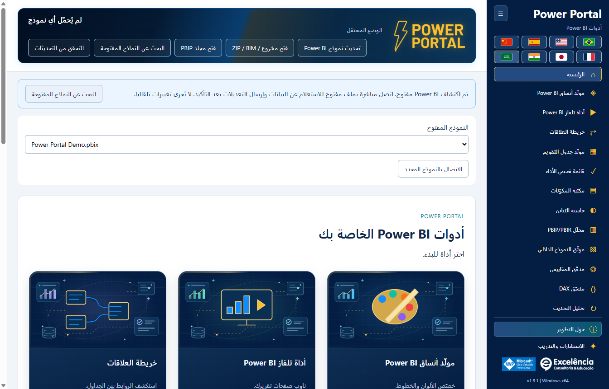

# دليل التثبيت

<!-- language-selector -->
[🇺🇸 English](../INSTALLATION.md) · [🇧🇷 Português](../pt-BR/INSTALLATION.md) · [🇪🇸 Español](../es/INSTALLATION.md) · [🇨🇳 简体中文](../zh-CN/INSTALLATION.md) · [🇫🇷 Français](../fr/INSTALLATION.md) · [🇯🇵 日本語](../ja/INSTALLATION.md) · [🇮🇳 हिन्दी](../hi/INSTALLATION.md) · [🇸🇦 العربية](INSTALLATION.md)
<!-- /language-selector -->

<div dir="rtl">

[العودة إلى الصفحة الرئيسية](../../README.ar.md)

<a name="requirements"></a>
## المتطلبات

يلزم Windows 10/11 x64 وصلاحية التثبيت كمسؤول وإصدار Power BI Desktop يدعم External Tools. يُوزع التطبيق كمثبّت Windows مستقل ذاتياً. لا يحتاج المستخدم النهائي إلى PHP أو Node.js أو .NET SDK أو Git أو حساب GitHub.

اترك نحو 1 GB من المساحة الخالية لتنزيل مكونات وقت التشغيل وتثبيتها، إضافةً إلى مساحة إضافية لصادراتك ونسخك الاحتياطية.

<a name="simple-installation"></a>
## التثبيت البسيط

1. افتح [أحدث Release](https://github.com/luisgnserra/powerportaldesktop/releases/latest).
2. من قسم **Assets**، نزّل `PowerPortal-Setup-1.8.1-x64.exe` لهذا الإصدار. لا تنزّل أرشيفات المصدر التي أُنشئت تلقائياً على أنها مثبّت.
3. يمكنك اختيارياً [التحقق من SHA-256](#verify-the-installer).
4. شغّل الملف التنفيذي ووافق على User Account Control.
5. اقبل شروط التبعيات المعروضة، واختر مجلداً ولغة افتراضية باستخدام الأعلام. تُقترح لغة واجهة Windows؛ وتُستخدم الإنجليزية للغات غير المدعومة.
6. أكمل المعالج.
7. أغلق Power BI Desktop وأعد فتحه. افتح PBIX واختر **External Tools > Power Portal**.

التثبيت على مستوى الجهاز ويتضمن اختصارات سطح المكتب/قائمة Start وتسجيل الأداة الخارجية. ولا يحتاج التطبيق إلى صلاحيات مرتفعة أثناء الاستخدام العادي.


انقر **External Tools > Power Portal** مع فتح PBIX. تسمية **Ferramentas externas** الظاهرة في لقطة الشاشة هي تسمية الشريط باللغة البرتغالية. تفتح الأيقونة **نافذة رفيقة مستقلة** وتمرّر اتصال النموذج المحلي للملف المفتوح؛ وليست مرئياً مضمنًا أو لوحة تقرير داخلية.



عند تشغيل اختصار Windows، يظهر إشعار إذا اكتُشفت نماذج مفتوحة. اختر **Find open models**، وتحقق من اسم الملف، ثم اتصل. لا يؤدي الاكتشاف أو الاتصال وحده إلى أي تغيير. [راجع الجولة المصورة](SCREENSHOTS.md).

**الإصدار غير الموقّع:** قد يعرض Windows تحذير SmartScreen أو تحذير الناشر غير المعروف. تتحقق SHA-256 من مطابقة الملف المنشور، وليست توقيعاً رقمياً للناشر. لا تتجاوز قيود المؤسسة. اسأل فريق تقنية المعلومات عند الحاجة للموافقة.

<a name="command-line-installation"></a>
## التثبيت من سطر الأوامر

<a name="download-the-helper-and-review-it"></a>
### تنزيل المساعد ومراجعته

<div dir="ltr">

```powershell
$script = Join-Path $env:TEMP 'Install-PowerPortal.ps1'
[Net.ServicePointManager]::SecurityProtocol = [Net.ServicePointManager]::SecurityProtocol -bor [Net.SecurityProtocolType]::Tls12
Invoke-WebRequest -UseBasicParsing 'https://raw.githubusercontent.com/luisgnserra/powerportaldesktop/v1.8.1/install.ps1' -OutFile $script
Get-Content -LiteralPath $script
& $script
```

</div>

يثبت هذا الرابط ذي الإصدار المحدد المساعد على إصدار 1.8.1؛ ولا يتتبع الإصدارات المستقبلية بصمت. كما يثبت المساعد اسم المثبّت وقيمة SHA-256، وينزّل عبر HTTPS، ويتحقق من الملف التنفيذي قبل تشغيله، ويفحص تسجيل الأداة الخارجية بعد خروج المثبّت بنجاح.

يمكّن سطر TLS الإصدار TLS 1.2 لـ HTTPS في عملية PowerShell هذه عند استخدام الإعدادات الافتراضية القديمة لـ Windows PowerShell. ولا يغيّر أمان Windows أو سياسات التنفيذ.

<a name="unattended-installation"></a>
### التثبيت دون تدخل

افتح PowerShell **بصفة مسؤول**، ثم شغّل:

<div dir="ltr">

```powershell
& "$env:TEMP\Install-PowerPortal.ps1" -Silent
```

</div>

ينزّل المساعد المثبّت نفسه ويتحقق منه، ثم يستدعي مفتاح NSIS `/S`. لا تظهر صفحة لغة المعالج في الوضع الصامت؛ ويستخدم المثبّت لغة واجهة Windows، مع الرجوع إلى الإنجليزية. يظل لتفضيل المستخدم المحفوظ الأولوية. لا يفتح المساعد ملف PBIX ولا يحرره.

يتطلب الوضع الصامت جلسة PowerShell مرتفعة الصلاحية مسبقاً. ولا يتجاوز UAC أو عناصر أمان Windows أو سياسات تنفيذ البرامج النصية أو قيود التطبيق. أغلق Power Portal قبل النشر؛ راجع [التحديثات والرجوع لإصدار أقدم](#updates-and-downgrades).

<a name="download-only-or-choose-a-download-folder"></a>
### التنزيل فقط أو اختيار مجلد التنزيل

<div dir="ltr">

```powershell
& "$env:TEMP\Install-PowerPortal.ps1" -DownloadOnly -DownloadDirectory "$env:USERPROFILE\Downloads\PowerPortal"
```

</div>

يتحقق `-DownloadOnly` من قيمة SHA-256 لكنه لا يشغّل المثبّت مطلقاً ولا يتطلب صلاحيات المسؤول. لا يُعاد استخدام ملف تم تنزيله سابقاً إلا إذا طابقت قيمة التحقق. يؤدي وجود ملف غير صالح إلى خطأ صريح بدلاً من تشغيله أو استبداله بصمت.

معاملات المساعد:

| المعامل | الافتراضي | الغرض |
|---|---|---|
| `-Silent` | إيقاف | استخدام مفتاح تثبيت NSIS دون تدخل؛ يلزم PowerShell بصلاحية المسؤول، باستثناء التنزيل فقط. |
| `-DownloadOnly` | إيقاف | تنزيل الملف التنفيذي/تخزينه مؤقتاً والتحقق منه دون تثبيت. |
| `-DownloadDirectory` | `%TEMP%\PowerPortalDownloads` | مجلد المثبّت الذي تم التحقق منه. هذا ليس مجلد تثبيت التطبيق. |

لا تلصق برنامجاً نصياً لم تراجعه في `Invoke-Expression`. إذا حظرت سياسة التنفيذ البرنامج النصي المنزّل، فاستشر فريق تقنية المعلومات أو استخدم معالج الملف التنفيذي. لا يغيّر المساعد سياسات التنفيذ عمداً.

<a name="use-the-verified-executable-directly"></a>
### تشغيل الملف التنفيذي الذي تم التحقق منه مباشرةً

بعد التحقق من قيمة SHA-256، يمكن للمسؤول تشغيل:

<div dir="ltr">

```powershell
$setup = "$env:USERPROFILE\Downloads\PowerPortal-Setup-1.8.1-x64.exe"
$process = Start-Process -FilePath $setup -ArgumentList '/S' -Wait -PassThru
if ($process.ExitCode -ne 0) { throw "Installer failed: $($process.ExitCode)" }
```

</div>

يوصى بمساعد PowerShell لأنه يتحقق من التنزيل ومن تسجيل الأداة الخارجية الناتج معاً.

<a name="verify-the-installer"></a>
## التحقق من المثبّت

قيمة SHA-256 المتوقعة لـ **1.8.1 x64**:

<div dir="ltr">

```text
863B4F22738C8A8BDEA1D4DBAB9EDB86A5A4BBF0C678E723252B287FAA45D256
```

```powershell
$file = "$env:USERPROFILE\Downloads\PowerPortal-Setup-1.8.1-x64.exe"
$expected = '863B4F22738C8A8BDEA1D4DBAB9EDB86A5A4BBF0C678E723252B287FAA45D256'
if ((Get-FileHash -LiteralPath $file -Algorithm SHA256).Hash -ne $expected) {
    throw 'Checksum mismatch. Do not run this installer.'
}
```

</div>

تُنشر قيمة التحقق أيضاً في [SHA256SUMS.txt](../../SHA256SUMS.txt) وتُرفق بـ Release. وقيمة التحقق فحص للسلامة، وليست بديلاً عن الثقة بالناشر.

<a name="updates-and-downgrades"></a>
## التحديثات والرجوع لإصدار أقدم

نزّل مثبّتاً رسمياً أحدث وشغّله فوق التثبيت الحالي. يحاول المثبّت إغلاق Power Portal من مسار الملف التنفيذي المستهدف المحدد فقط قبل استبدال الملفات. ولا يغلق Power BI Desktop أو الأدوات الخارجية الأخرى. إذا تعذر الإغلاق، يُلغى التثبيت.

أغلق Power Portal بنفسك قبل التحديث دون تدخل. أعد تشغيل Power BI Desktop بعد التثبيت لإعادة تحميل تسجيل External Tools. وتُحتفظ بتفضيلات اللغة/الشريط الجانبي لكل مستخدم والنسخ الاحتياطية المحلية.

ابتداءً من **1.6.2**، تُعلمك فحوص بدء التشغيل وخيار **Check for updates** بالإصدارات الرسمية الأحدث. ينزّل **Update now** المثبّت ويتحقق منه ويبدأ تحديثاً صامتاً مرتفع الصلاحية في مجلد التثبيت الحالي، بعد نقرتك فقط. ولا يُغلق Power BI. أعد فتح Power Portal بعد اكتمال التثبيت. [تفاصيل التحديث](UPDATES.md).

تتطلب **الإصدارات 1.6.1 والأقدم ترقية يدوية لمرة واحدة إلى 1.6.2**. لم تُعتمد العودة لإصدار أقدم؛ احفظ عملك واتصل بالدعم قبل استخدام مثبّت أقدم.

<a name="uninstall"></a>
## إلغاء التثبيت

استخدم **Windows Settings > Apps > Installed apps > Power Portal > Uninstall** (في Windows 10، استخدم **Apps & features**).

يزيل إلغاء التثبيت التطبيق وتسجيله الخاص `PowerPortal.pbitool.json`. وتُترك الأدوات الأخرى كما هي. ويُحتفظ عمداً بالإعدادات لكل مستخدم والـ themes والنسخ الاحتياطية وسجلات التغييرات. راجع [مواقع البيانات](CONFIGURATION.md#data-locations) قبل إزالة البيانات المحتفظ بها يدوياً.

<a name="offline-and-enterprise-deployment"></a>
## النشر دون اتصال والنشر المؤسسي

يمكن لفريق تقنية المعلومات تنزيل مثبّت Release والتحقق منه مرة واحدة، وتوزيع الملف نفسه عبر نظام البرامج المعتمد، وتشغيل `/S` بصلاحيات المسؤول. تتطلب التنزيلات العامة من GitHub اتصالاً بالإنترنت؛ أما تثبيت ملف تنفيذي تم تنزيله مسبقاً فلا يحتاج مصادقة GitHub.

لا يوفر هذا المستودع حزمة Microsoft Store أو MSI أو إدراجاً في فهرس winget أو حزمة Chocolatey. التوزيع المدعوم هو NSIS EXE ومساعد PowerShell الخاص به.

[الإعداد](CONFIGURATION.md) · [استكشاف الأخطاء وإصلاحها](TROUBLESHOOTING.md)

</div>
