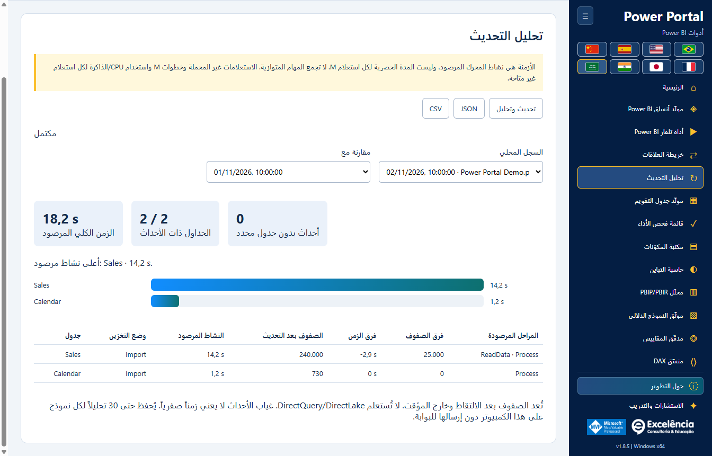

# تحليل التحديث

<!-- language-selector -->
[🇺🇸 English](../REFRESH-ANALYSIS.md) · [🇧🇷 Português](../pt-BR/REFRESH-ANALYSIS.md) · [🇪🇸 Español](../es/REFRESH-ANALYSIS.md) · [🇨🇳 简体中文](../zh-CN/REFRESH-ANALYSIS.md) · [🇫🇷 Français](../fr/REFRESH-ANALYSIS.md) · [🇯🇵 日本語](../ja/REFRESH-ANALYSIS.md) · [🇮🇳 हिन्दी](../hi/REFRESH-ANALYSIS.md) · [🇸🇦 العربية](REFRESH-ANALYSIS.md)
<!-- /language-selector -->

**1.8.5 — إصلاح قياسات التحديث الأصلي**

يتعرف تحليل التحديث الآن على أمر XML Refresh الأصلي في Power BI Desktop، بما فيه Refresh داخل Batch، إضافة إلى XMLA Process وTMSL refresh. سابقاً كان التحديث قد يُنفذ لكن تُستبعد أحداث تقدمه، فتظهر 0 جداول مقاسة وعدد صفوف غير متاح وrefreshCompletionNotProven. يُقبل الآن نجاح المحرك الصريح عند غياب حقل Error الاختياري؛ وتظل رموز الخطأ غير الصفرية وأخطاء XMLA ذات أولوية. ما زال التقدم يتطلب ارتباطاً دقيقاً بالطلب أو النشاط لاستبعاد استعلامات المرئيات غير المرتبطة.

قبل التعرف على أول أمر، توضح الواجهة أنها تنتظر أحداث تحديث Power BI. عند عدم تأكيد الاكتمال تظهر إرشادات مترجمة بدلاً من رمز تقني فقط. حدّث التطبيق واتصل بملف PBIX الصحيح وأعد التحديث والتحليل؛ تُحفظ التقارير القديمة غير المكتملة ولا تُحوّل إلى ناجحة. تم التحقق من التطبيق المعبأ من البداية للنهاية بتحديث حقيقي أذن به المستخدم، مع نشاط الجداول والصفوف والاكتمال التلقائي واستمرار السجل بعد إعادة التحميل. تظل صور التوثيق أمثلة اصطناعية دون بيانات العميل أو أسماء نماذجه.

## البدء والسلامة

اتصل بملف PBIX الصحيح وافتح تحليل التحديث واختر تحديث وتحليل ثم أكد اسم الملف. يبدأ التتبع قبل استدعاء زر الصفحة الرئيسية > تحديث الأصلي؛ لا تُحدث الجداول تسلسلياً عبر TOM. أبقِ Power BI مفتوحاً وعالج بيانات الاعتماد والأخطاء والإلغاء فيه. نسخة BIM لا تستعيد البيانات المحدثة.

يستعلم التحديث الأصلي من المصادر ويستبدل البيانات المستوردة. احفظ نسخة PBIX. عالج بيانات الاعتماد والأخطاء في Power BI؛ التتبع لا يلغي التحديث ولا يشمل كل استعلامات Power Query المساعدة.

## تفسير القياسات

النشاط المرصود هو اتحاد فترات المحرك المنسوبة بدقة لكل جدول دون تكرار المراحل المتداخلة. ليس وقت استعلام المصدر وحده ولا مساراً حرجاً مثبتاً. يبدأ الزمن الكلي من التشغيل حتى اكتشاف الانتهاء، ويشمل عبء الواجهة والفحص ويستثني عد الصفوف اللاحق. تُعرض الأحداث بلا جدول محدد منفصلة.

الأزمنة هي نشاط المحرك المرصود، وليست المدة الحصرية لكل استعلام M. لا تجمع المهام المتوازية. الاستعلامات غير المحملة وخطوات M واستخدام CPU/الذاكرة لكل استعلام غير متاحة.

يتطلب الإنهاء التلقائي رصد انتهاء أوامر التحديث وجاهزية نافذة Power BI. أغلق حوارات النتائج. إنهاء الالتقاط يدوياً يعني دائماً تحليلاً غير مكتمل، ولا يثبت النجاح ولا يلغي التحديث. تظهر أخطاء المحرك والتتبع صراحةً. لا يُعلن اكتمال الالتقاط المنقطع.

## السجل والتصدير

تُعد الصفوف بعد الالتقاط وخارج المؤقت. لا تُستعلم DirectQuery/DirectLake. غياب الأحداث لا يعني زمناً صفرياً. يُحفظ حتى 30 تحليلاً لكل نموذج على هذا الكمبيوتر دون إرسالها للبوابة.

اختر تشغيلين محفوظين لمقارنة الزمن والصفوف بأسماء الجداول المتطابقة. تؤثر الذاكرة المؤقتة وحمل المصدر وحجم البيانات والتوازي؛ الفروق لا تثبت السبب. يحفظ JSON القيم غير المتاحة بصيغة null ويتركها CSV فارغة ويحمي من الصيغ. السجل محلي يستخدم هوية نموذج المخطط ولا يُحفظ في PBIX. الملفات ذات الهوية المعروضة نفسها قد تشترك بالسجل؛ تحقق من النموذج. تحتوي الصادرات على أسماء وأعداد: راجعها قبل المشاركة.

<!-- refresh-correlation -->
تُقاس فقط أحداث المحرك المرتبطة بدقة عبر RequestID/ActivityID بأمر تحديث نشط، وتُستبعد استعلامات المرئيات غير المرتبطة. قد تحذف بعض إصدارات Power BI هذه المعرفات؛ لذا قد يبقى زمن الجدول غير متاح رغم تنفيذ التحديث.

## التشغيل الأصلي والاسترداد

أصبح تحليل التحديث أسفل خريطة العلاقات مباشرةً في القائمة الجانبية ومعرض البداية. يتجاهل البحث عن الزر الأصلي تبويبات Home المكررة في عرض استعلامات DAX وعرض TMDL، لتجنب «Ambiguous Power BI control: home». إذا تعذر العثور على الزر، اختر عرض التقرير أو البيانات أو النموذج في Power BI.

يبقى زر التحديث معطلاً أثناء التأكيد والتحقق وبدء التتبع، ويُخفى إنهاء الالتقاط حتى يصبح الالتقاط جاهزاً. يمنع ذلك بدءاً مكرراً يعرض خطأ «Finish the active Power BI operation before refreshing» دون سبب. عند ثبوت الفشل قبل الاستدعاء الأصلي، يتوقف التتبع ويُتحقق من التنظيف وتُتاح إعادة المحاولة. إذا كان الاستدعاء قد حدث بالفعل، يبقى الخطأ ظاهراً والالتقاط معلقاً: راجع Power BI وأكمل التحديث وأغلق الحوارات قبل إنهاء الالتقاط. تستأنف الطلبات المكررة الالتقاط الحالي دون تحديث جديد. يجب أولاً إنهاء العمليات الجارية فعلاً.

