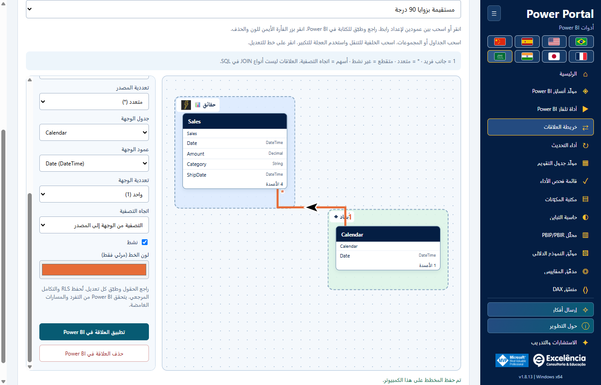
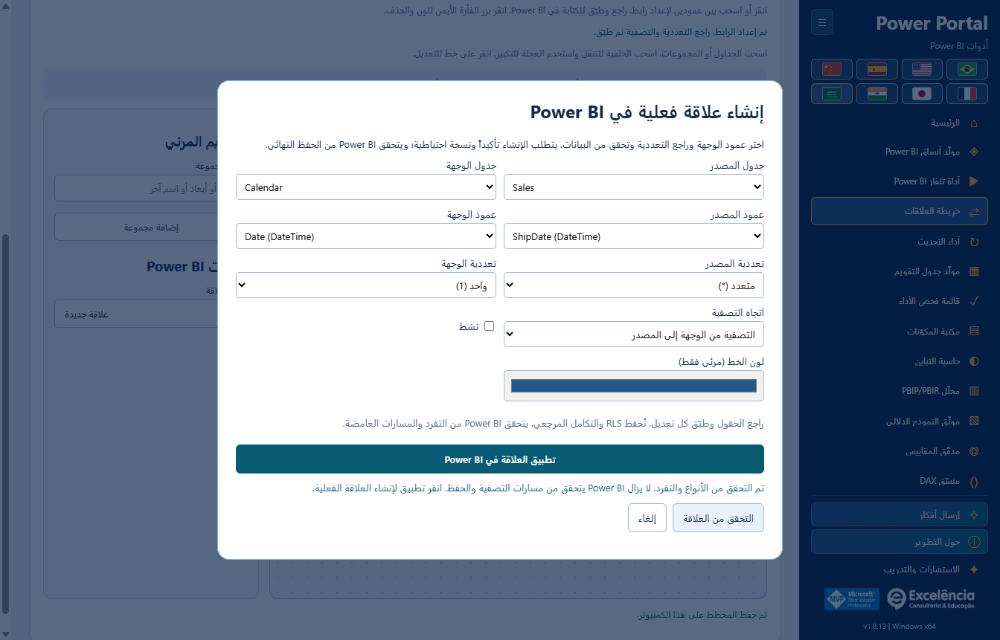
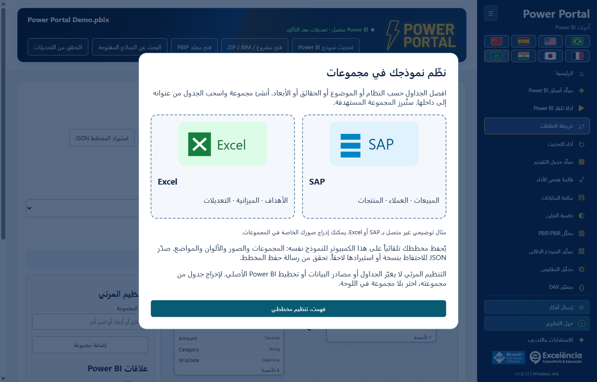
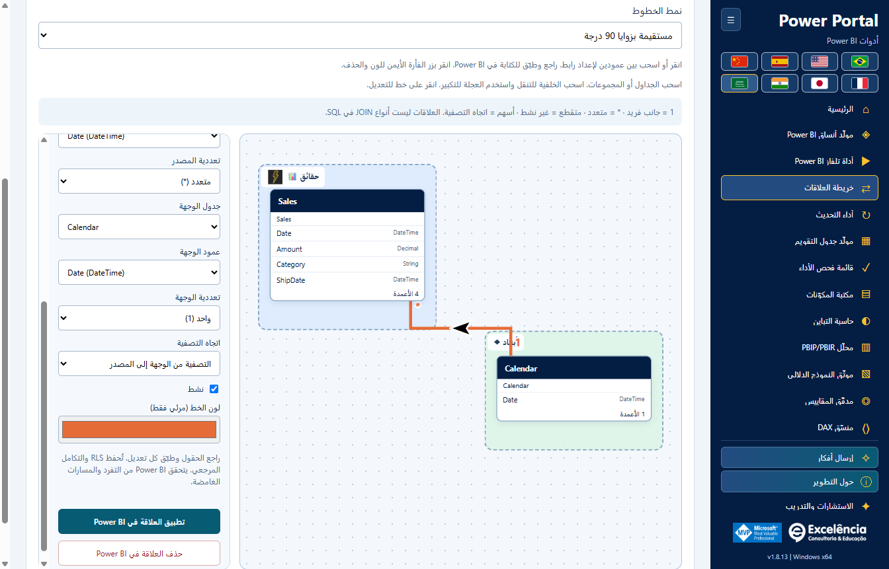

# خريطة العلاقات (Relationship map)

<!-- language-selector -->
[🇺🇸 English](../RELATIONSHIPS.md) · [🇧🇷 Português](../pt-BR/RELATIONSHIPS.md) · [🇪🇸 Español](../es/RELATIONSHIPS.md) · [🇨🇳 简体中文](../zh-CN/RELATIONSHIPS.md) · [🇫🇷 Français](../fr/RELATIONSHIPS.md) · [🇯🇵 日本語](../ja/RELATIONSHIPS.md) · [🇮🇳 हिन्दी](../hi/RELATIONSHIPS.md) · [🇸🇦 العربية](RELATIONSHIPS.md)
<!-- /language-selector -->

**1.8.8 — خطوط علاقات ديناميكية وإرسال سمات متحقق منه**

في خريطة العلاقات يتيح نمط الخطوط الاختيار بين المنحنيات والخطوط المستقيمة بزوايا 90 درجة. تتصل النهايات ديناميكياً بالحواف العلوية/السفلية أو اليمنى/اليسرى المتقابلة، مع مراعاة الحجم الفعلي للبطاقات. تحتفظ الوصلات الجانبية بارتفاع العمود المرتبط. تتبع الأسهم السوداء ذات الحدود البيضاء المقاطع المستقيمة ولا تميل قطرياً عند الزوايا. يُحفظ النمط تلقائياً ويُضمّن في JSON المُصدّر؛ وتبقى التخطيطات القديمة منحنية. لا يغير ذلك تخطيط Power BI الأصلي ولا ينفذ تجنباً شاملاً للعوائق.

يعيد إرسال السمة مباشرة إلى Power BI التركيز إلى Power Portal بعد الاستيراد الأصلي وأثناء التحقق بالتصدير، فقط عندما يكون Power BI في المقدمة. بعد التحقق من السمة يُعرض Power BI؛ وتُعرض النافذة المحددة أيضاً عند الخطأ للمراجعة. قد تظهر مربعات الحوار الأصلية لفترة وجيزة ولا يتم إخفاؤها: لا يوفر Desktop واجهة سمات مدعومة بلا حوار. تُعالج تغييرات تبويب الشريط غير المتزامنة قبل تأكيد السمة. تحقق اختبار فعلي مصرح به للتطبيق المعبأ من الاستيراد/التصدير وعودة التركيز إلى Portal وتنشيط Power BI النهائي، ثم أعاد السمة الافتراضية الأصلية دون حفظ PBIX. تستخدم لقطات الوثائق بيانات اصطناعية.

<div dir="rtl">

[العودة إلى الصفحة الرئيسية](../../README.ar.md) · [لقطات الشاشة](SCREENSHOTS.md) · [سلامة النموذج](USAGE.md)

متاحة في **Power Portal Desktop 1.8.13**. هذه أداة جديدة لسطح المكتب فقط، ومنفصلة عن Model view الخاص بـ Power BI. تقرأ العلاقات الفعلية بين الجداول/الأعمدة، ويمكنها تطبيق التغييرات المؤكدة على النموذج الدلالي المحلي المتصل.



تتموضع أسهم العلاقات الآن على المنحنى وتدور وفق اتجاهه المحلي، بما في ذلك الروابط المائلة والمعكوسة. أسهم SVG أكبر بحجم 36 × 26 وحدة، سوداء دائماً بحد أبيض بسماكة 3 وحدات، بصرف النظر عن لون خط العلاقة. تظل التصفية أحادية الاتجاه من الوجهة إلى المصدر؛ وتُظهر التصفية ثنائية الاتجاه سهمين متعاكسين. يحتفظ الوضع التلقائي بعلامة الاستفهام. هذا تغيير مرئي فقط.

<a name="create-a-real-relationship-in-power-bi"></a>
## إنشاء علاقة فعلية في Power BI



أصبحت خريطة العلاقات مباشرة بعد TV Tool في القائمة الجانبية ومعرض البداية. أُزيلت كتلة بيانات النموذج الفعلية العامة من منشئ التقويم ومكتبة المكونات. تبقى عناصر القراءة والإرسال الخاصة بكل أداة؛ ويستخدم زر الفترة الفعلية التقويم المحدد داخل الأداة. أُعيد رسم أغلفة البداية كرسوم متجهة محلية دون نص مضمّن. تبقى العناوين والأوصاف والإجراءات خارج الصور وتتبع اللغة المحددة. اسحب عمود المصدر إلى جدول آخر لفتح حوار العلاقة الفعلية واختيار عمود الوجهة. الإفلات على عمود يحدده مسبقاً. راجع التعددية واتجاه التصفية والحالة النشطة، ثم تحقق وطبّق مع تأكيد أصلي ونسخة BIM احتياطية.

يتحقق الفحص من الأنواع وأزواج الأعمدة المكررة والروابط المباشرة النشطة والأعداد الفعلية للصفوف والقيم المميزة في العمودين، دون أخذ عينة. تُرفض القيم المكررة في جانب الواحد. مهلة الاستعلامات 20 ثانية والأخطاء واضحة. التحقق لا يكتب أبداً. يعيد التطبيق التحقق، ثم يفحص المحرك المفاتيح ومسارات التصفية الملتبسة عند الحفظ. المسودة المتقطعة ليست علاقة محفوظة؛ لا تُنشأ إلا بعد نجاح الحفظ المؤكد. احفظ PBIX بعدها. تستخدم الاختبارات والصور بيانات اصطناعية دون تعديل PBIX لعميل.

<a name="how-to-organize-with-groups"></a>
## كيفية التنظيم بالمجموعات



تظهر المقدمة عند أول زيارة للمخطط في كل جلسة. أعد فتحها عبر **كيفية التنظيم بالمجموعات**. SAP وExcel أمثلة توضيحية وليسا موصلات جديدة أو شعارات رسمية. تظهر المجموعات الفارغة كمناطق إفلات. الإفلات في مجموعة مبرزة يُسند الجدول إليها؛ والإفلات خارجها يُبقي مجموعته الحالية.

افصل الجداول حسب النظام أو الموضوع أو الحقائق أو الأبعاد. أنشئ مجموعة واسحب الجدول من عنوانه إلى داخلها. ستُبرز المجموعة المستهدفة.

يُحفظ مخططك تلقائياً على هذا الكمبيوتر للنموذج نفسه: المجموعات والصور والألوان والمواضع. صدّر JSON للاحتفاظ بنسخة أو استيرادها لاحقاً. تحقق من رسالة حفظ المخطط.

التنظيم المرئي لا يغيّر الجداول أو مصادر البيانات أو تخطيط Power BI الأصلي. لإخراج جدول من مجموعته، اختر بلا مجموعة في اللوحة.

<a name="open-your-model"></a>
## فتح النموذج

1. احفظ نسخة منفصلة من PBIX.
2. شغّل **External Tools > Power Portal** من Power BI Desktop، أو ابحث عن الملف المفتوح وحدده صراحةً.
3. افتح **Relationship map** من الشريط الجانبي أو المعرض الرئيسي.

تدعم مشاريع BIM/PBIP/TMDL المستوردة المخطط والتخصيص المرئي، لكن **كتابة العلاقات تتطلب اتصال Power BI محلياً مباشراً**. أعد قراءة النموذج بعد التغييرات التي تُجرى من موضع آخر.

<a name="understand-the-links"></a>
## فهم الروابط

- يمثّل كل مربع جدولاً فعلياً. ويبقى اسم الجدول الأصلي ظاهراً أسفل عنوانه الواضح.
- تُعطى الأعمدة المستخدمة في العلاقات أولوية داخل المربع. يُعرض ثمانية أعمدة مبدئياً؛ ويوسّع **Show all columns** قائمة قابلة للتمرير. وتظل كل الأعمدة متاحة أيضاً في المحرر.
- يشير **1** إلى الجانب الفريد؛ ويشير **\*** إلى الجانب المتعدد.
- تمثل الخطوط المتصلة العلاقات النشطة؛ والمتقطعة العلاقات غير النشطة.
- تشير الأسهم إلى تدفق التصفية: يصفّي اتجاه TOM الواحد **من جدول الوجهة إلى جدول المصدر**، وليس بترتيب اختيارك للأعمدة. وتعرض الروابط ثنائية الاتجاه الاتجاهين. يشير **?** إلى Automatic، عندما يحدد المحرك الاتجاه.
- انقر خطاً أو استخدم قائمة العلاقات المنسدلة لفحص نقاط النهاية ودرجة العلاقة وإعدادات التصفية بدقة.
- تُحصى العلاقات غير المدعومة التي لا تتكون من عمود واحد صراحةً في بيانات النموذج الوصفية، مع تحذير في الواجهة. لا تُختلق هذه العلاقات ولا تُحرر.

**هذه علاقات نموذج دلالي، وليست اختيارات SQL INNER/LEFT/RIGHT JOIN.** تؤثر درجة العلاقة واتجاه التصفية في حسابات التقرير وانتقال المرشحات.

<a name="arrange-a-teaching-friendly-diagram"></a>
## ترتيب مخطط سهل الشرح

- اسحب عناوين الجداول بحرية في الاتجاهين.
- اسحب عنوان المجموعة لتحريك جداولها الأعضاء معاً.
- اسحب الخلفية لتحريك اللوحة. مرّر أو استخدم **+ / -** للتكبير والتصغير.
- يؤطر **Fit tables** النموذج الحالي؛ ويُضبط المخطط الجديد على الإطار تلقائياً في البداية.
- يرتب **Arrange by groups** الجداول وفق مجموعاتها المحددة. يعيد ترتيب المخطط فقط ولا يغير النموذج.
- ركّز على عنوان جدول واستخدم مفاتيح الأسهم لتحريكه 10 وحدات؛ استخدم Shift + سهم للتحريك 50 وحدة.
- حدد جدولاً لاختيار اسمه الواضح وأيقونته ولون خلفيته ومجموعته.
- تعد **Facts** و**Dimensions** مجموعتين اختياريتين للبدء وليستا تصنيفاً تلقائياً لأدوار الجداول.
- أنشئ مجموعات مخصصة ثم عدّل اسمها وأيقونتها ولون خلفيتها. لا يؤدي حذف مجموعة إلى حذف جداولها.
- حدد علاقة موجودة لاختيار لون خطها.

**لا تغيّر الألوان والمواضع والمجموعات والأيقونات والأسماء الواضحة أسماء عناصر Power BI أو تخطيط Model view الأصلي.** إنها تخص هذا المخطط المرافق.

<a name="save-and-share-the-organization"></a>
## حفظ التنظيم ومشاركته

تُحفظ التغييرات المرئية تلقائياً في ملف تعريف مستخدم Windows الحالي:

<div dir="ltr">

```text
%APPDATA%\powerportal-desktop\relationship-diagrams\<model-key>.json
```

</div>

تُنفّذ الكتابات باستخدام ملف وسيط واستبدال ذري. ويظهر الإخفاق بوضوح مع خيار **Retry saving**؛ فلا يتظاهر التطبيق بحفظ التخطيط.

ينشئ **Export diagram JSON** ملف تخطيط مرئي قابلاً للنقل. ويتحقق **Import diagram JSON** من تنسيقه ومن وجود أسماء الجداول في النموذج المحمّل حالياً. ويستعيد التنظيم فقط: **لا ينشئ استيراد المخطط علاقات النموذج أو يغيرها أو يحذفها أبداً**.

يتضمن JSON أسماء الجداول والأسماء الواضحة وإعدادات المجموعة وألوان الخطوط وإطار العرض. ولا يتضمن صفوف بيانات أو DAX أو بيانات اعتماد اتصال المصدر. ومع ذلك، قد تكشف أسماء الجداول/المجموعات سياق العمل؛ لذا لا تشارك إلا الملفات المنقحة.

تُعرّف ملفات نماذج الاتصال المباشر باستخدام اسم نافذة/ملف Power BI وعلامات lineage للجداول، مع الرجوع إلى أسماء الجداول عند غيابها. كما تستخدم ملفات المشاريع المستوردة المسار المحلي المحدد. ولا يكشف اكتشاف Power BI عن مسار PBIX الكامل بشكل موثوق. وقد يؤدي تغيير اسم ملف أو استبدال هويات الجداول إلى إنشاء ملف تعريف جديد؛ وقد تتشارك النسخ ذات الاسم وعلامات lineage نفسيهما ملفاً تعريفياً. استخدم JSON المُصدّر للاحتفاظ بتخطيطات منفصلة عند الحاجة.

تُزال إدخالات الجداول/الخطوط القديمة عند تحديث البيانات الوصفية. ولا يُحتفظ بموضع جدول محذوف على أنه جدول وهمي. وتبقى التخطيطات بعد إلغاء التثبيت مع إعدادات المستخدم الأخرى.

<a name="apply-each-relationship-edit-to-power-bi"></a>
## تطبيق كل تعديل علاقة على Power BI



<a name="create"></a>
### الإنشاء

1. اختر **New relationship**.
2. حدد جداول وأعمدة المصدر/الوجهة.
3. اضبط درجة العلاقة واتجاه التصفية والحالة النشطة/غير النشطة.
4. اختر **Apply relationship to Power BI**.

<a name="edit-activate-or-deactivate"></a>
### التحرير أو التنشيط أو التعطيل

1. انقر خطاً موجوداً أو اختره من القائمة المنسدلة.
2. غيّر نقاط النهاية أو درجات العلاقة أو اتجاه التصفية أو **Active**.
3. اختر **Apply relationship to Power BI** لهذا التعديل.

<a name="delete"></a>
### الحذف

حدد العلاقة الموجودة واختر **Delete relationship in Power BI**.

تستخدم كل عملية تعديل فعلية التسلسل الآمن نفسه:

1. يحدد التأكيد الأصلي ملف Power BI المحدد ويعرض حالات العلاقة السابقة/الجديدة. الخيار الافتراضي هو **Cancel**.
2. بعد الموافقة، يجب كتابة نسخة BIM احتياطية كاملة للبيانات الوصفية وسجل المحاولة المحلي قبل تغيير النموذج.
3. يعيد الموصل فتح النموذج ويتحقق من أن العلاقة الحالية تطابق اللقطة التي قرأها المحرر. وتُرفض العلاقات القديمة/المحذوفة/المعاد تسميتها بدلاً من الكتابة فوقها.
4. يجب أن تتطابق أنواع بيانات الأعمدة وأن تنتمي إلى جدولين مختلفين. وتُرفض أزواج الأعمدة المكررة ورابط نشط ثانٍ مباشرةً بين زوج الجداول نفسه. عطّل الرابط النشط الموجود أولاً.
5. يعتمد TOM التغييرات باستخدام `SaveChanges`؛ ويظل المحرك مسؤولاً عن التحقق من التفرد ودرجة العلاقة الصحيحة ومسارات التصفية الملتبسة. تظهر أخطاء المحرك ولا يتم تجاوزها.
6. يعيد التطبيق تحميل بيانات النموذج الوصفية بعد نجاح الاعتماد. ويُبلّغ عن فشل إعادة التحميل بوصفه تغييراً كُتب بالفعل، وليس إلغاءً.
7. **احفظ PBIX في Power BI Desktop** لحفظ النموذج المعدل في الملف.

يُحفظ سلوك تصفية أمان مستوى الصف و**Assume Referential Integrity** والإعدادات الأخرى غير المعروضة للعلاقات الحالية. لا يتيح المحرر تغيير RLS أو تمكين Assume Referential Integrity. وتستخدم الروابط الجديدة إعدادات الأمان/التكامل الافتراضية.

لا يعني الحفاظ على هذه الخصائص أن التنشيط أو الحذف أو تغيير نقاط النهاية لا يمكن أن يؤثر في تدفق مرشحات الأمان. راجع العلاقات المستخدمة في RLS مع مسؤول النموذج قبل تأكيد التغيير.

لا يمكن تشغيل التحديثات/themes/كتابات النموذج بالتزامن مع كتابة علاقة. ويُحظر تبديل النموذج المتصل أثناء الكتابة؛ كما تُرفض الطلبات الواردة من اتصال محدد آخر.

<a name="backup-and-limits"></a>
## النسخ الاحتياطي والحدود

- تحتوي نسخة BIM الاحتياطية على بيانات النموذج الوصفية، وليس PBIX كاملاً أو لوحة التقرير أو جميع صفوف البيانات. ويُبلّغ عن مسارها بعد عمليات الكتابة الناجحة أو إخفاقات الموصل.
- **لا يوجد زر تلقائي للتراجع عن العلاقة/استعادة النموذج كاملاً.** احتفظ بنسخة PBIX المنفصلة وراجع النسخة الاحتياطية المذكور مسارها مع مسؤول النموذج عند الحاجة.
- يقتصر JSON للمخطط على 5 MB عند الاستيراد و2,000 إدخال جدول و200 مجموعة و10,000 إدخال لأسلوب الخط. ويتراوح التكبير من 15% إلى 200%.
- لا تحسب الأداة عمليات SQL join ولا تدمج الاستعلامات ولا تصنف facts/dimensions تلقائياً ولا تنفذ برامج نصية عشوائية.
- قد يقيّد وضع النموذج أو إصدار Desktop أو الأذونات أو سياسة المؤسسة الكتابة الحية إلى Desktop. لا تتجاوز تلك القيود.

[الإعداد والبيانات المحتفظ بها](CONFIGURATION.md#data-locations) · [استكشاف الأخطاء وإصلاحها](TROUBLESHOOTING.md)

<a name="column-to-column-editing-and-line-menu"></a>
## التحرير بين الأعمدة وقائمة الخط

انقر عمود المصدر ثم عموداً في جدول آخر، أو اسحب بين صفوف الأعمدة. يجب أن يكون نوع البيانات لكليهما متطابقاً. يحدد المحرر نقطتي النهاية بدقة ويعرض مسودة بخط برتقالي متقطع؛ راجع درجة العلاقة واتجاه التصفية وحالة النشاط، ثم اختر **Apply relationship to Power BI**. لا يؤدي الرسم وحده إلى كتابة أي شيء في النموذج. اضغط Esc للإلغاء. يؤدي تحديد زوج أعمدة مرتبط بالفعل إلى فتح تلك العلاقة بدلاً من تكرارها.

انقر بزر الفأرة الأيمن على خط العلاقة لفتح قائمة **Edit relationship** أو اختيار لونه المرئي أو **Delete relationship in Power BI**. يتطلب الحذف التأكيد الأصلي ونجاح النسخ الاحتياطي للبيانات الوصفية؛ ويظل الخط دون تغيير عند الإلغاء أو حدوث خطأ. تُحفظ الألوان محلياً، لا في مخطط Power BI الأصلي.

<a name="group-images-and-more-icons"></a>
## صور المجموعات والمزيد من الأيقونات

حدد جدولاً مُعيّناً إلى مجموعة، ثم استخدم **Insert group image** في إعدادات المجموعة. اختر ملف PNG/JPEG محلياً لا يتجاوز 10 MB ولا يتجاوز 8192 بكسلاً في أي بُعد. تُفكّ الصورة وتُوحّد إلى صورة مصغرة PNG بحد أقصى 384 بكسلاً و256 KB. يمسح **Remove group image** الصورة دون حذف المجموعة. تتوفر أكثر من 30 أيقونة للجداول والمجموعات.

تُضمّن الصور في التخطيط المرئي المحفوظ/المُصدّر ولا ترتبط بموقع بعيد. لا تُقبل SVG وعناوين URL البعيدة. الحد الإجمالي للصور المضمّنة بترميز base64 هو 2.8 مليون حرف لكل مخطط؛ ويظل حد الاستيراد الحالي البالغ 5 MB سارياً. لا تشارك إلا صوراً غير سرية. اسحب عنوان المجموعة أو خلفيتها غير المحجوبة لتحريك جداولها الأعضاء معاً.

<a name="automatic-date-tables-and-refreshing"></a>
## جداول التاريخ التلقائية والتحديث

يكون **Show automatic date/time tables** غير محدد افتراضياً ويُحفظ لكل نموذج. تُعرّف جداول Power BI المنشأة `LocalDateTable_` و`DateTableTemplate_` باستخدام تعليقات Power BI التوضيحية، مع بديل يستند إلى الاسم الداخلي/الإخفاء/كون الجدول محسوباً. وتُخفى روابطها أيضاً. وتظل جداول الأعمال العادية مرئية حتى إذا عُلّمت كمخفية في النموذج، كما في مخطط النموذج في Desktop.

يعيد **Refresh diagram from Power BI** قراءة جداول النموذج المحدد وأعمدته وعلاقاته، ويزيل العناصر المحذوفة ويضيف الجديدة ويوائم اللوحة. استخدمه بعد التحرير في Power BI. ويحافظ على المجموعات/الألوان/المواضع المخصصة التي لا تزال موجودة. ولا ينسخ إحداثيات Desktop الأصلية أو علامات تبويب طرق عرض النموذج المخصصة أو تخطيطها؛ إذ لا يوفّر TOM تلك التخطيطات الخاصة بالتقرير. وتظل أنواع العلاقات غير المدعومة مستبعدة صراحةً.

<a name="native-automatic-relationship-detection"></a>
## الكشف الأصلي التلقائي عن العلاقات

يشغّل **Autodetect relationships** آلية الكشف الخاصة بـ Power BI Desktop، وليس اقتراحات مطابقة الأسماء من Power Portal. احفظ نسخة PBIX أولاً: فقد تنشئ الآلية الأصلية روابط متعددة وتؤثر في المرشحات أو RLS.

1. اتصل بالنموذج المحلي المقصود وانقر زر الكشف.
2. راجع تأكيد Power Portal الأصلي. الخيار الافتراضي هو الإلغاء.
3. يجب حفظ نسخة BIM احتياطية للبيانات الوصفية وسجل المحاولة قبل بدء التشغيل الآلي.
4. يفتح Power Portal مدير العلاقات في Desktop ويستدعي زر الكشف التلقائي الأصلي باستخدام معرّفات UI Automation التي تم التحقق منها.
5. راجع النتائج وأي تأكيدات إضافية مباشرةً في Power BI؛ لا يغلقها Power Portal تلقائياً.
6. أغلق مربعات حوار العلاقات في Power BI وانقر **Finish detection and refresh diagram** في Power Portal.
7. افحص المخطط المحدّث واحفظ PBIX في Desktop.

تعني النتيجة الأولية أن **الكشف قد بدأ**، لا أنه نجح أو أنشأ علاقات. ويظل كل من كتابة النموذج وتبديل المشروع/النموذج وتحديث المثبّت محظوراً حتى الإنهاء؛ كما يمنع مربع الحوار الأصلي المفتوح إكمال العملية. تؤدي إصدارات/حالات Desktop غير المدعومة إلى أخطاء صريحة تتضمن مسار النسخة الاحتياطية. أغلق مربعات الحوار واستخدم إجراء الإنهاء للتعافي من فشل التشغيل الآلي. إذا أُغلق Power BI، فأكمل العمل فيه قبل إعادة تشغيل Power Portal والاتصال من جديد. لا يوجد تراجع تلقائي عن النموذج بالكامل.

فُحصت معرّفات عناصر التحكم الأصلية في نافذة Desktop فعلية دون تشغيل الكشف التلقائي أو تعديل PBIX الخاص بالمالك. واستخدمت الاختبارات الآلية نماذج اصطناعية ونتائج كشف محاكاة.

</div>
