# لقطات الشاشة وتفاعلات Power BI

<!-- language-selector -->
[🇺🇸 English](../SCREENSHOTS.md) · [🇧🇷 Português](../pt-BR/SCREENSHOTS.md) · [🇪🇸 Español](../es/SCREENSHOTS.md) · [🇨🇳 简体中文](../zh-CN/SCREENSHOTS.md) · [🇫🇷 Français](../fr/SCREENSHOTS.md) · [🇯🇵 日本語](../ja/SCREENSHOTS.md) · [🇮🇳 हिन्दी](../hi/SCREENSHOTS.md) · [🇸🇦 العربية](SCREENSHOTS.md)
<!-- /language-selector -->

[العودة إلى الصفحة الرئيسية](../../README.ar.md) · [التثبيت](INSTALLATION.md) · [دليل السلامة](USAGE.md)

**لقطات التطبيق: Power Portal Desktop 1.7.5، بلغة الواجهة المحددة.**
تستخدم لقطات الشاشة **بيانات وصفية وقِيماً للاستعلام اصطناعية توضيحية**، وليست مأخوذة من PBIX لعميل. تعرض حالات الاتصال إجراءات الواجهة المدعومة؛ ولم يُغيّر أي نموذج عميل لإنشاء هذه الصور. وقد تتبع تسميات منتقي الملفات الأصلي لغة Windows. قدّم مالك التطبيق لقطة شريط Power BI الحقيقية، وقُصّت لإزالة عنوان الملف الخاص.

تتموضع أسهم العلاقات الآن على المنحنى وتدور وفق اتجاهه المحلي، بما في ذلك الروابط المائلة والمعكوسة. أسهم SVG أكبر بحجم 36 × 26 وحدة، سوداء دائماً بحد أبيض بسماكة 3 وحدات، بصرف النظر عن لون خط العلاقة. تظل التصفية أحادية الاتجاه من الوجهة إلى المصدر؛ وتُظهر التصفية ثنائية الاتجاه سهمين متعاكسين. يحتفظ الوضع التلقائي بعلامة الاستفهام. هذا تغيير مرئي فقط.

يتضمن رأس Power Portal المتحرك الآن اسم الملف وحالة الاتصال وأزرار القراءة والاستيراد والبحث والتحديث الخمسة. أُزيل شريط الأدوات المنفصل أسفل اللافتة لتوفير مساحة العمل. يلتف المحتوى داخل الرأس في النوافذ الصغيرة وباللغات الثماني، بما فيها العربية. لم تتغير التأكيدات والإشعارات وآلية التحديث.

## إنشاء علاقة فعلية في Power BI

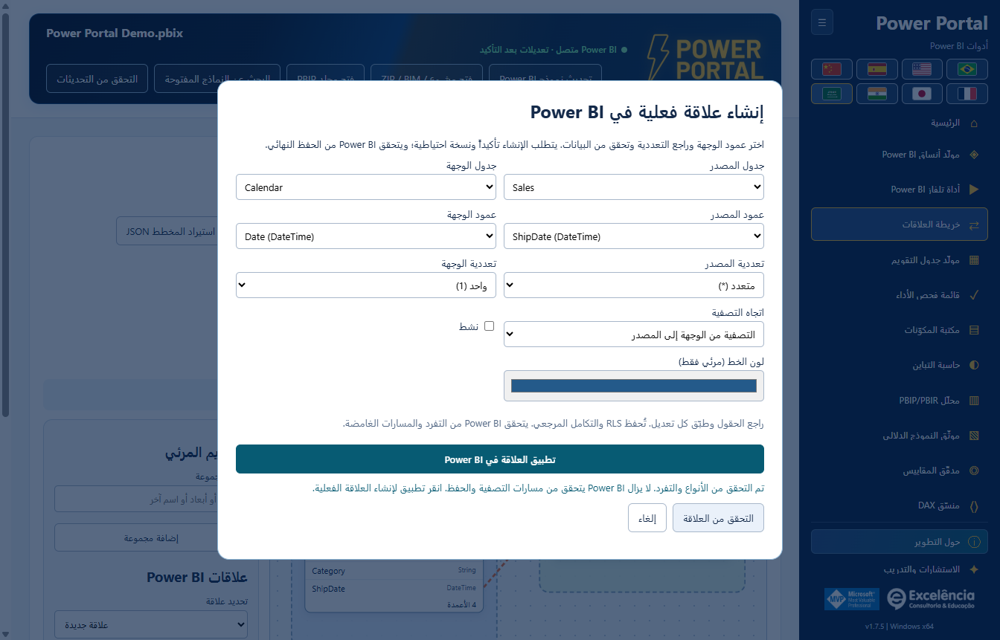

أصبحت خريطة العلاقات مباشرة بعد TV Tool في القائمة الجانبية ومعرض البداية. أُزيلت كتلة بيانات النموذج الفعلية العامة من منشئ التقويم ومكتبة المكونات. تبقى عناصر القراءة والإرسال الخاصة بكل أداة؛ ويستخدم زر الفترة الفعلية التقويم المحدد داخل الأداة. أُعيد رسم أغلفة البداية كرسوم متجهة محلية دون نص مضمّن. تبقى العناوين والأوصاف والإجراءات خارج الصور وتتبع اللغة المحددة. اسحب عمود المصدر إلى جدول آخر لفتح حوار العلاقة الفعلية واختيار عمود الوجهة. الإفلات على عمود يحدده مسبقاً. راجع التعددية واتجاه التصفية والحالة النشطة، ثم تحقق وطبّق مع تأكيد أصلي ونسخة BIM احتياطية.

يتحقق الفحص من الأنواع وأزواج الأعمدة المكررة والروابط المباشرة النشطة والأعداد الفعلية للصفوف والقيم المميزة في العمودين، دون أخذ عينة. تُرفض القيم المكررة في جانب الواحد. مهلة الاستعلامات 20 ثانية والأخطاء واضحة. التحقق لا يكتب أبداً. يعيد التطبيق التحقق، ثم يفحص المحرك المفاتيح ومسارات التصفية الملتبسة عند الحفظ. المسودة المتقطعة ليست علاقة محفوظة؛ لا تُنشأ إلا بعد نجاح الحفظ المؤكد. احفظ PBIX بعدها. تستخدم الاختبارات والصور بيانات اصطناعية دون تعديل PBIX لعميل.

## كيفية التنظيم بالمجموعات

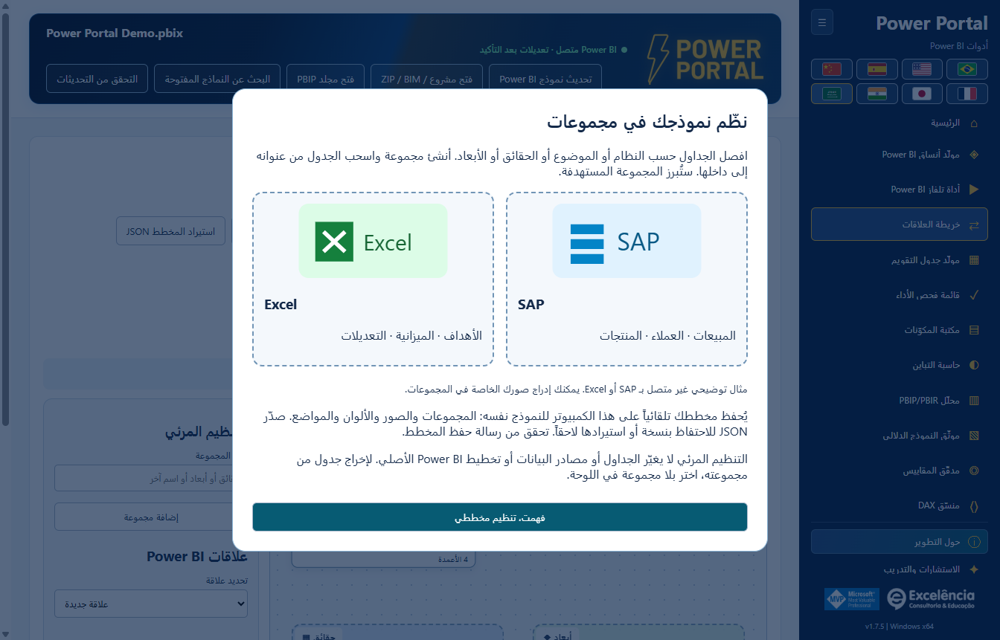

تظهر المقدمة عند أول زيارة للمخطط في كل جلسة. أعد فتحها عبر **كيفية التنظيم بالمجموعات**. SAP وExcel أمثلة توضيحية وليسا موصلات جديدة أو شعارات رسمية. تظهر المجموعات الفارغة كمناطق إفلات. الإفلات في مجموعة مبرزة يُسند الجدول إليها؛ والإفلات خارجها يُبقي مجموعته الحالية.

افصل الجداول حسب النظام أو الموضوع أو الحقائق أو الأبعاد. أنشئ مجموعة واسحب الجدول من عنوانه إلى داخلها. ستُبرز المجموعة المستهدفة.

يُحفظ مخططك تلقائياً على هذا الكمبيوتر للنموذج نفسه: المجموعات والصور والألوان والمواضع. صدّر JSON للاحتفاظ بنسخة أو استيرادها لاحقاً. تحقق من رسالة حفظ المخطط.

التنظيم المرئي لا يغيّر الجداول أو مصادر البيانات أو تخطيط Power BI الأصلي. لإخراج جدول من مجموعته، اختر بلا مجموعة في اللوحة.

## فتح Power Portal من External Tools

بعد التثبيت، أعد تشغيل Power BI Desktop وافتح PBIX وانقر **External Tools > Power Portal**.

تعني علامة التبويب البرتغالية **Ferramentas externas** عبارة **External Tools**. ويسجل المثبّت الأيقونة في هذا الشريط. ويؤدي النقر عليها إلى تشغيل **نافذة Power Portal مستقلة متصلة بنموذج الملف المفتوح**. وهو تطبيق مرافق خارجي، وليس عنصراً مرئياً في التقرير أو لوحة مضمنة أو ملحقاً داخلياً من Microsoft.

## الصفحة الرئيسية والتنقل

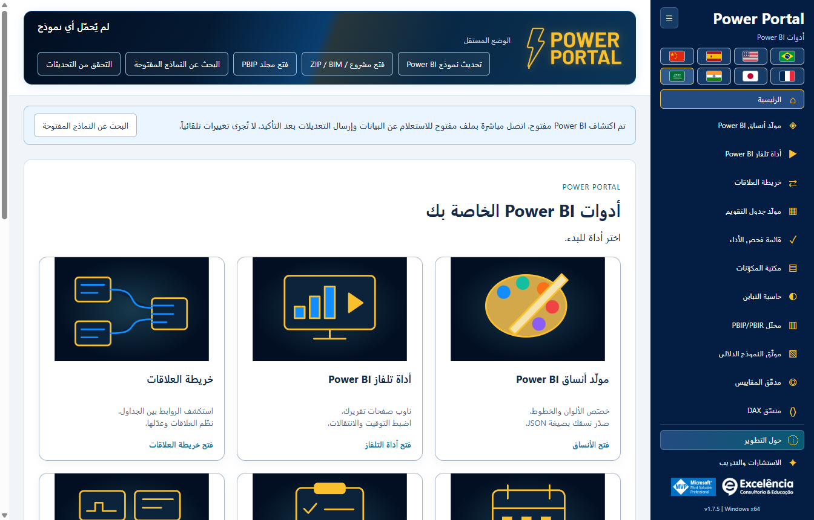

أصبحت خريطة العلاقات مباشرة بعد TV Tool في القائمة الجانبية ومعرض البداية. أُعيد رسم أغلفة البداية كرسوم متجهة محلية دون نص مضمّن. تبقى العناوين والأوصاف والإجراءات خارج الصور وتتبع اللغة المحددة.

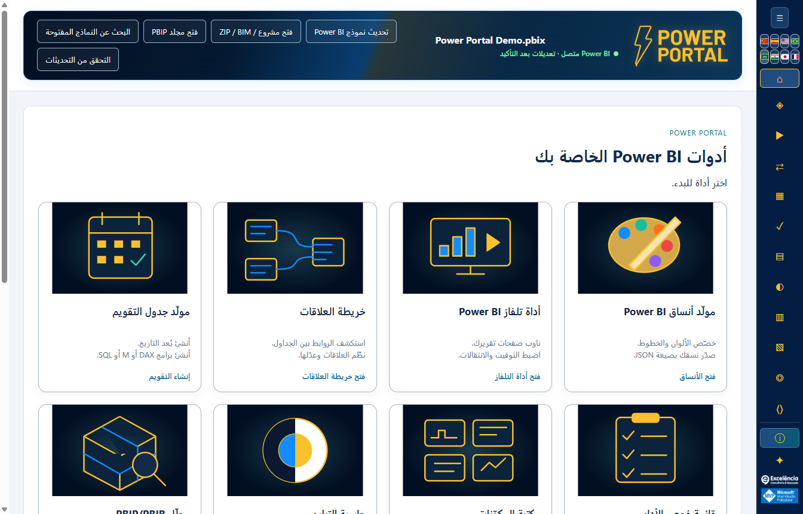

اطوِ الشريط الجانبي لتوفير مساحة عمل أكبر؛ فيُحفظ هذا التفضيل. وتحتفظ الأيقونات بأسماء الوصول والتلميحات. ولا يزال من الممكن تمرير منطقة العمل الرئيسية ونماذج الأدوات الفردية؛ فالتغيير الذي يلغي التمرير ينطبق على فهرس الشريط الجانبي فقط.

## الاتصال بملف مفتوح مسبقاً في Power BI

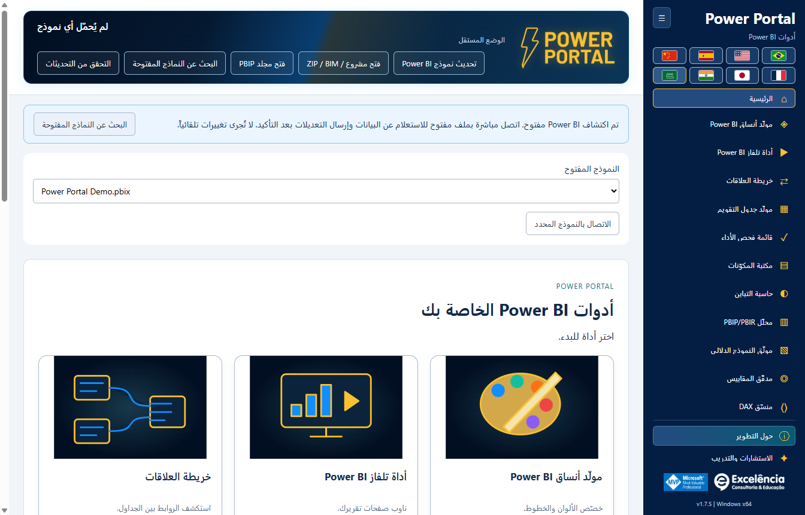

عند بدء التطبيق من اختصار Windows، يكتشف نماذج Power BI المحلية المتاحة ويوضح إمكانية الاتصال مباشرةً بملف مفتوح. اختر **Find open models**، وتحقق من اسم الملف، ثم انقر **Connect to selected model**. وإذا كانت عدة ملفات مفتوحة، فاختر الملف المقصود.

أما التشغيل من شريط External Tools فيمرر تلقائياً اتصال مثيل Desktop المحدد ويقرأ بياناته الوصفية. **الاتصال لا يكتب أي تغييرات.**

## إشعار الإصدار الجديد

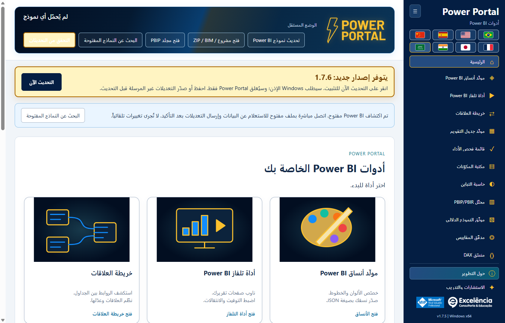

تستخدم لقطة الشاشة **محاكاة نتيجة مستقبلية افتراضية 1.7.6** لعرض الإشعار في الإصدار 1.7.5. وهي لا تدّعي نشر 1.7.6. يمكن للمستخدمين الذين لديهم 1.6.2 أو أحدث تلقي إشعار 1.7.5 الفعلي الآن.

في 1.6.4، يبقى الشريط الكهرماني ظاهراً أثناء التمرير ويتحرك بلطف ما لم يُفعّل تفضيل تقليل الحركة. ولا يشغل شريط «محدّث» دائم مساحة.

يتحقق التطبيق المثبّت من أحدث Release رسمي مستقر عند بدء التشغيل. انقر **Update now** لتنزيل المثبّت والتحقق منه، ثم وافق على طلب مسؤول Windows. يحدّث التطبيق مجلد التثبيت الحالي ويغلق Power Portal وحده. **لا يؤدي الاتصال أو التحقق وحده إلى تثبيت أي شيء.** احفظ/صدّر تعديلات الأدوات غير المرسلة أولاً وأعد فتح التطبيق بعد اكتمال التثبيت.

يعيد **Check for updates** المحاولة في أي وقت. وتظهر حالات انقطاع الاتصال/حدود المعدل/قيمة التحقق/UAC بوضوح دون تعطيل الأدوات المحلية. [دليل التحديث الكامل](UPDATES.md).

## التفاعلات المباشرة مع ملف Power BI المفتوح

لا تقتصر هذه الإجراءات على تنزيل النص أو JSON:

| الشاشة/الإجراء | هل يقرأ من Power BI أو يغيّره؟ | وسيلة الحماية |
|---|---|---|
| تحديث نموذج Power BI | يقرأ الجداول والأعمدة والمقاييس والعلاقات من النموذج الدلالي للملف المحدد. | لا كتابة إلى النموذج. |
| استعلام البيانات الحية/نطاقات التاريخ/العينات | يقرأ قيماً فعلية للنموذج عبر المحرك المحلي. | استعلامات منظمة ومحدودة؛ لا تستخدم مرشحات الصفحة النشطة. |
| إرسال theme مباشرةً إلى Power BI | يطبّق JSON المنشأ على نافذة التقرير المحددة. | تأكيد واستيراد بواجهة مرئية والتحقق من theme المصدّرة. |
| إنشاء تقويم في Power BI | ينشئ جدول تواريخ محسوباً جديداً في النموذج الدلالي. | تأكيد ونسخة احتياطية للبيانات الوصفية؛ ثم التحديث في Desktop. |
| إنشاء مقياس HTML في Power BI | ينشئ مقياساً جديداً في جدول النموذج المختار. | تأكيد ونسخة احتياطية للبيانات الوصفية؛ أضف العنصر المرئي HTML يدوياً. |
| تحديث مقياس في Power BI | يكتب DAX المنسق إلى المقياس الحالي المحدد. | تأكيد ونسخة احتياطية للبيانات الوصفية وحماية من التغييرات المتزامنة. |
| تطبيق/حذف علاقة في Power BI | ينشئ علاقة الأعمدة المحددة أو يعدلها أو ينشطها/يعطلها أو يحذفها. | تأكيد أصلي ونسخة احتياطية للبيانات الوصفية وفحوص الحالة القديمة والتحقق من المحرك؛ مع الحفاظ على إعدادات RLS/التكامل. |

**احفظ نسخة منفصلة من PBIX قبل تطبيق التغييرات.** تحقق من الملف والتعبير المستهدفين، ثم احفظ PBIX في Desktop بعد ذلك. لا يحفظ التطبيق PBIX بصمت أبداً.

### بيانات النموذج المباشرة

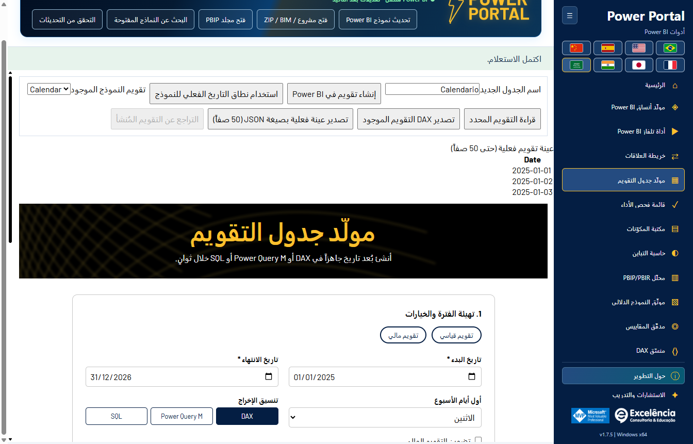

تظل العينات محدودة بـ 50 صفاً والاستعلامات بـ 20 ثانية. تُقرأ بيانات التقويم عبر محدده ومعاينته الخاصة؛ ولم تعد الكتلة العامة تظهر في منشئ التقويم أو مكتبة المكونات. تبقى حالة الاتصال في الرأس.

### مُنشئ theme

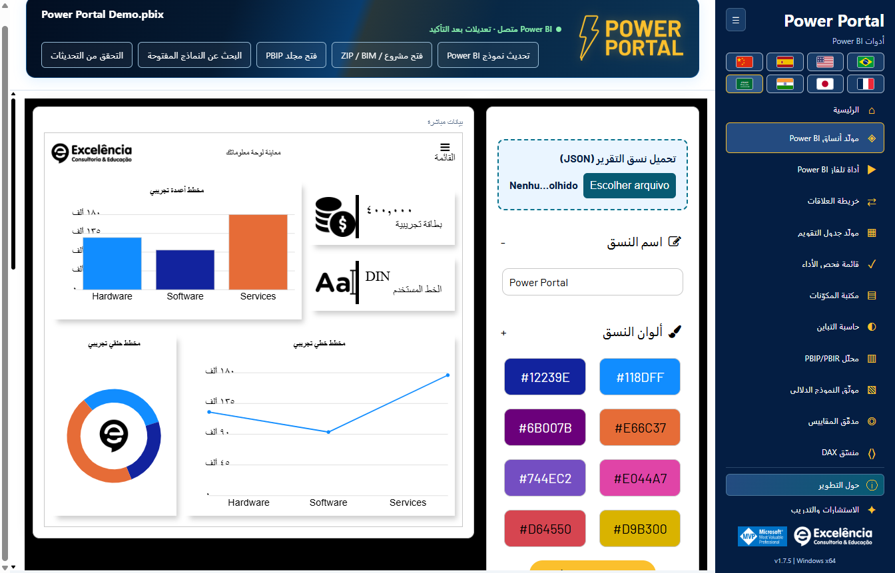

استخدم منطقة **Load report theme (JSON)** البارزة، وعدّل الألوان والخطوط وشاهد المعاينة المباشرة. صدّر JSON، أو انتقل إلى نهاية الصفحة أسفل النموذج والمعاينة لاستخدام **Send theme directly to Power BI**.

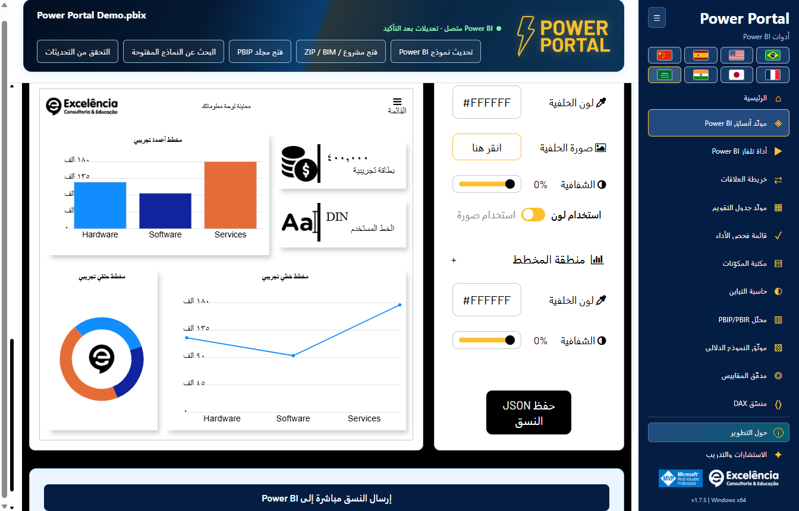

للبدء من theme التقرير الحالية، احفظ JSON في Desktop وحمّله هنا. لا يقرأ اتصال النموذج الدلالي themes التقارير. لا يزال الإرسال المباشر يستخدم **مربع حوار الاستيراد المرئي**؛ ولا توجد واجهة Desktop عامة مدعومة تلغيه. لا تتفاعل مع Power BI أثناء تشغيل الأتمتة.

### Calendar generator

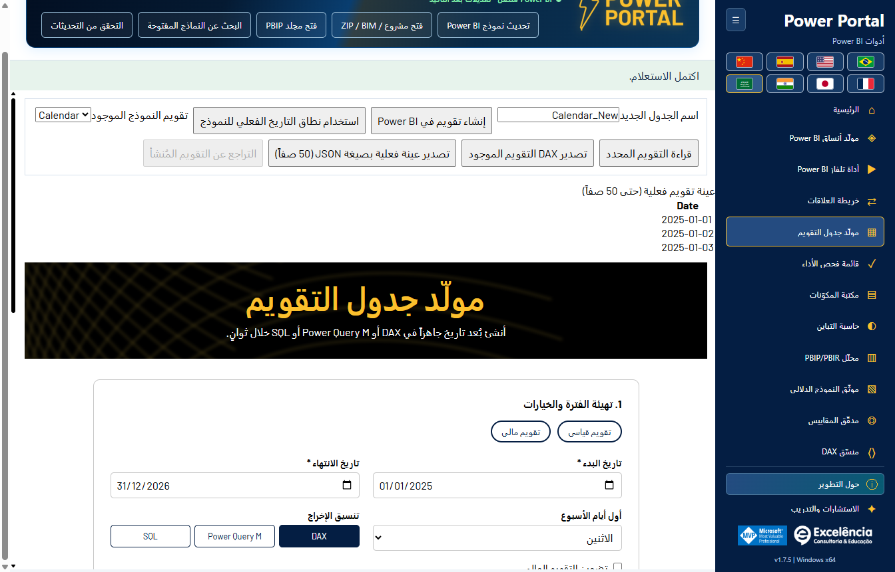

اقرأ تعبير التقويم الموجود ونطاق التاريخ والعينة، وصدّر DAX أو JSON للعينة، وأنشئ تقويماً جديداً. ينشئ **Create calendar in Power BI** جدولاً محسوباً جديداً مع نسخة احتياطية وتأكيد، بدلاً من استبدال التقويم الموجود المحدد.

حدّث في Desktop بعد الإنشاء. ولا يتوفر التراجع الآمن عن التقويم إلا إذا ظل الجدول المنشأ مطابقاً ولم تكن له تبعيات.

### Component library

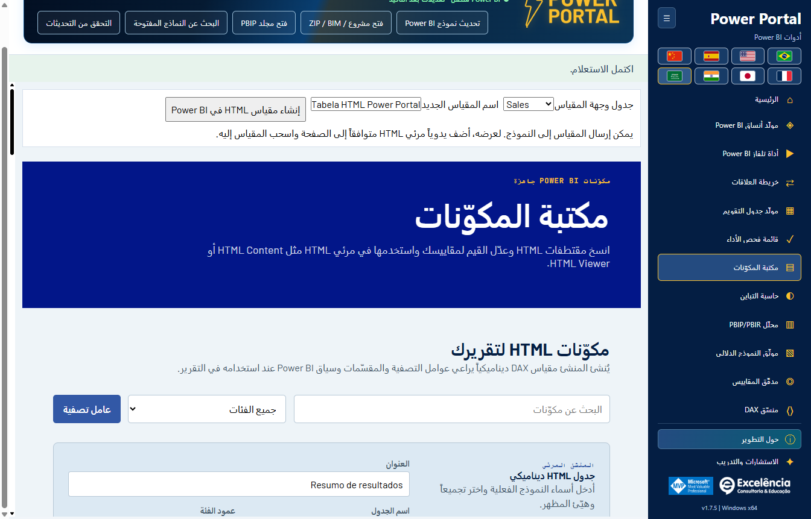

اختر جدول الوجهة واسماً جديداً للمقياس. يستخدم المنشئ أسماء حقول/مقاييس النموذج ويدعم **Create HTML measure in Power BI**. ويُكتب المقياس إلى النموذج بعد التأكيد.

يجب إضافة عنصر مرئي متوافق مع HTML إلى التقرير يدوياً وإسناد ذلك المقياس إليه؛ فهذا الزر لا يضع عنصراً مرئياً على الصفحة.

### DAX formatter

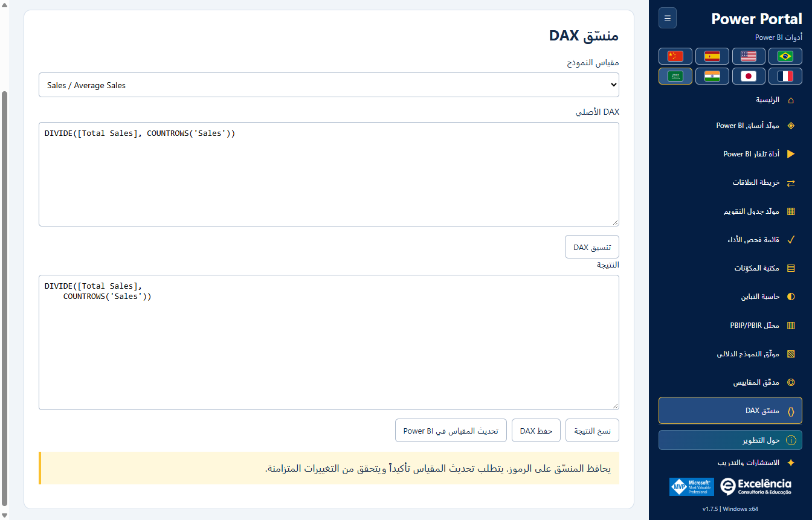

حدد مقياس النموذج الحالي، ونسّق تعبيره، ثم اختر **Update measure in Power BI** لإرسال DAX إلى ذلك المقياس. إجراءات النسخ/التصدير منفصلة. ويرفض التحديث تغييرات التعبير المتزامنة ويتطلب التأكيد.

## الأدوات الأخرى

### Relationship map

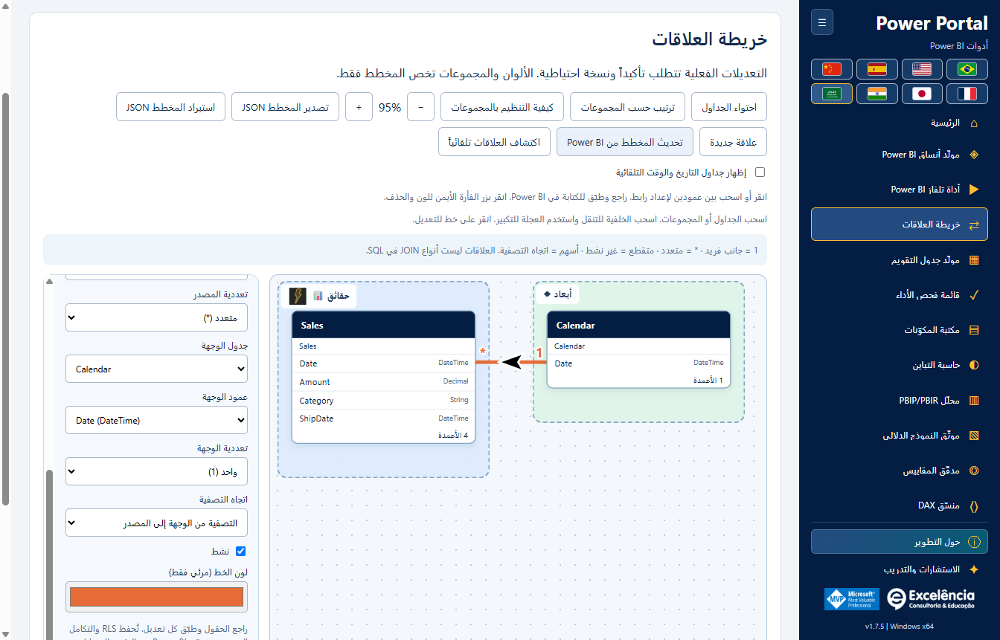

تعرض الأداة الجديدة الخاصة بسطح المكتب روابط الجداول الحقيقية ودرجات العلاقات وأسهم التصفية والخطوط المتقطعة غير النشطة. اسحب المربعات/المجموعات بحرية، وكبّر/صغّر/حرّك اللوحة، وأضف أسماء واضحة وأيقونات وخصص ألوان المجموعات والخطوط. تُحفظ التخطيطات المرئية تلقائياً لكل نموذج ويمكن تصديرها/استيرادها بصيغة JSON دون إرسال كتابات للنموذج.

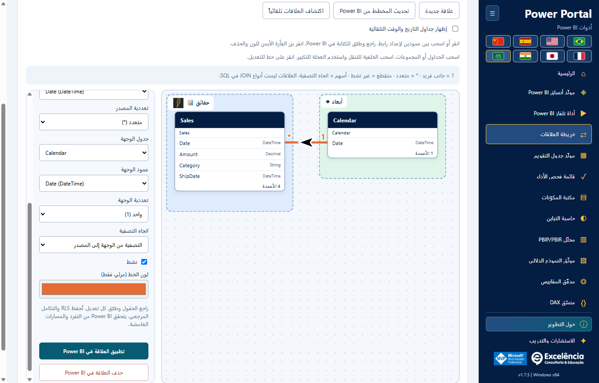

حدد خطاً لفحص أعمدته الدقيقة ودرجة العلاقة واتجاه التصفية وحالته النشطة. ينفذ **Apply relationship to Power BI** أو **Delete relationship in Power BI** كل تعديل بعد التأكيد الأصلي والنسخ الاحتياطي. تظل المشاريع المستوردة للقراءة فقط. ولا يغيّر التنسيق أسماء الجداول أو مخطط Power BI الأصلي. [الجولة الكاملة وحدود السلامة](RELATIONSHIPS.md).

في 1.7.5، انقر الأعمدة أو اسحب بينها لإعداد مسودة متقطعة، ثم راجعها وطبّقها. انقر بزر الفأرة الأيمن على الخط لضبط اللون أو التحرير أو الحذف. تتيح إعدادات المجموعة صور PNG/JPEG محلية وأيقونات إضافية؛ واسحب خلفية المجموعة أو عنوانها. تُخفى جداول التاريخ/الوقت التلقائية افتراضياً. يعيد **Refresh diagram from Power BI** قراءة التغييرات الخارجية دون نسخ إحداثيات التخطيط الأصلي. ويبدأ **Autodetect relationships** الكشف الأصلي في Desktop بعد التأكيد/النسخ الاحتياطي؛ راجع النتائج وأغلق مربعات الحوار قبل اختيار **Finish detection and refresh diagram**.

### Power BI TV Tool

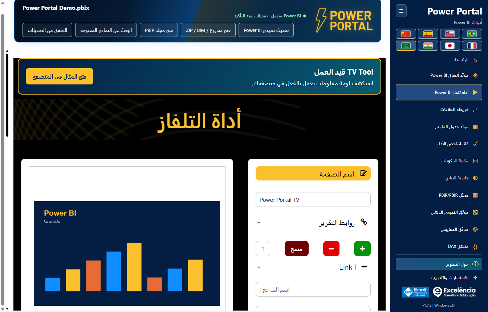

يفتح شريط **TV Tool in action** أعلى الصفحة [مثالاً رسمياً يعمل](https://www.powerportal.com.br/tv_tool/painel_exemplo_power_bi_tv_tool.html) في المتصفح الافتراضي؛ ويتطلب الإنترنت ولا يرسل بيانات النموذج المحلي. ويظل العرض التوضيحي المحلي في النموذج متاحاً.

دوّر صفحات التقارير المنشورة أو الصور المحلية، واضبط المدد/الانتقالات، واعرض معاينة، وصدّر HTML. لا يدوّر TV صفحات PBIX المحلي المفتوح. وتتطلب التقارير المنشورة الخاصة تسجيل دخول Microsoft والترخيص والأذونات المناسبة.

### Performance checklist

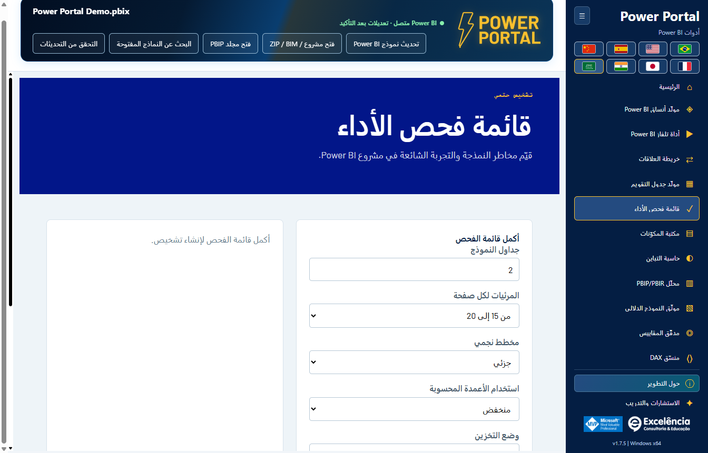

راجع عناصر قائمة التحقق المستندة إلى النموذج وخصائص التقرير اليدوية. الدرجات إرشادات استرشادية وليست أزمنة مرئية مقاسة.

### Contrast calculator

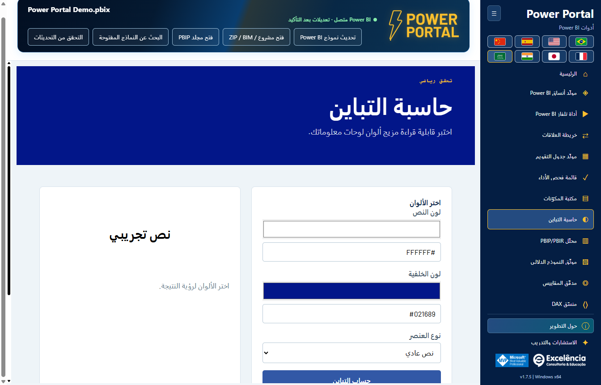

تحقق من سهولة القراءة/التباين وفق عتبات WCAG. هذه أداة تحليل محلية ولا تعدل تنسيق التقرير تلقائياً.

### PBIP/PBIR analyzer

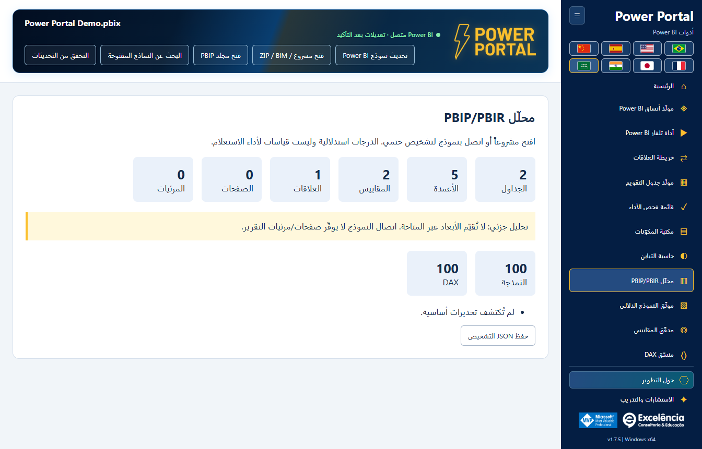

حلل البنية المتاحة للمشروع المحمّل. لا يوفر اتصال النموذج الدلالي المباشر بيانات الصفحات/العناصر المرئية للتقرير، لذا تُعرض الأبعاد غير المتاحة على أنها جزئية. وقد توفر بيانات مشروع PBIR المستوردة أعداداً إضافية.

### Semantic model documenter

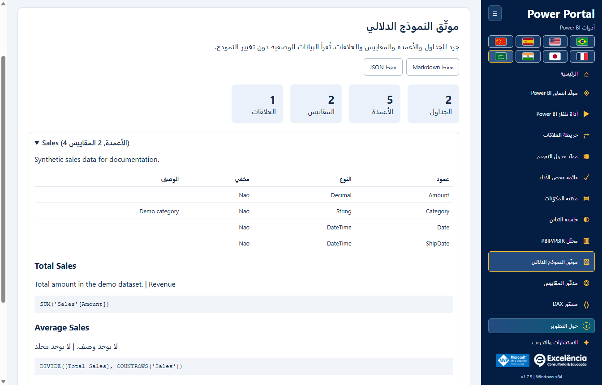

اقرأ وثائق الجداول/الأعمدة/المقاييس/العلاقات وصدّرها بصيغة Markdown أو JSON. لا تعدّل هذه الأداة النموذج. وقد تتضمن الصادرات أسماءً وDAX سريين؛ احتفظ بها بأمان.

### Measure auditor

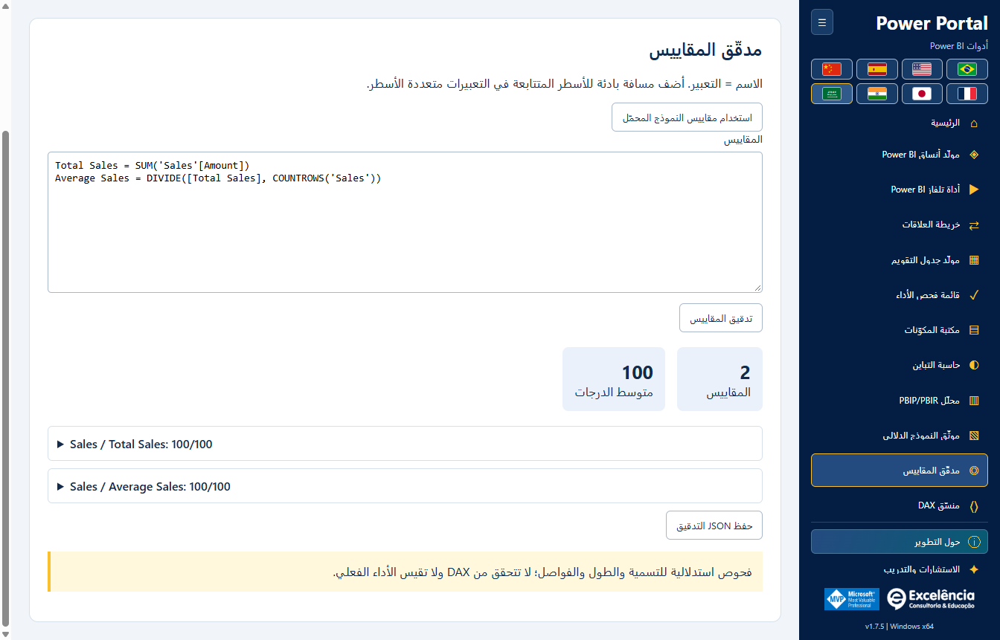

دقّق مقاييس النموذج أو DAX المقدم باستخدام فحوص استرشادية للأسماء والحجم والفواصل. ولا تتحقق الأداة من دلالات DAX ولا تقيس أداء التقرير الفعلي.

## الاستشارات والتدريب

اكتشف استشارات Power BI وMicrosoft Fabric وهندسة البيانات والحلول المتكاملة. ويشمل ذلك تدريب In Company والفيديوهات المميزة وإجراءات الاتصال. تفتح WhatsApp/البريد الإلكتروني مسودة أو صفحة متصفح؛ ولا تُرسل رسالة أو يُحدد موعد تلقائياً.

[ملاحظات الإصدار](../../CHANGELOG.ar.md) · [استكشاف الأخطاء وإصلاحها](TROUBLESHOOTING.md)

