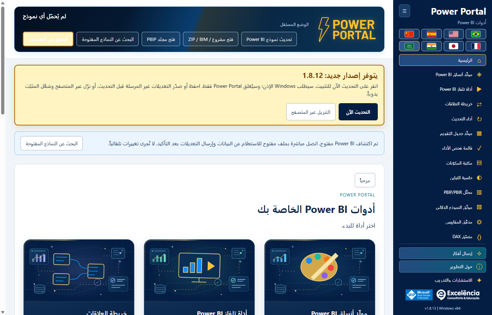

# التحقق من التحديثات والتثبيت التلقائي

<!-- language-selector -->
[🇺🇸 English](../UPDATES.md) · [🇧🇷 Português](../pt-BR/UPDATES.md) · [🇪🇸 Español](../es/UPDATES.md) · [🇨🇳 简体中文](../zh-CN/UPDATES.md) · [🇫🇷 Français](../fr/UPDATES.md) · [🇯🇵 日本語](../ja/UPDATES.md) · [🇮🇳 हिन्दी](../hi/UPDATES.md) · [🇸🇦 العربية](UPDATES.md)
<!-- /language-selector -->

**1.8.13 — أرسل أفكار التحسين دون ازدحام القائمة**

يظهر إرسال أفكار فوق حول التطوير مباشرة. يقبل النموذج الميسر عنواناً حتى 120 حرفاً ووصفاً حتى 1000. يطلب فتح البريد مع الفكرة تشغيل تطبيق البريد الافتراضي مع المستلم الثابت contato@consultoriaexcelencia.com.br والموضوع والرسالة المعبأة. راجع وأرسل من التطبيق: لا يرسل Power Portal تلقائياً ولا يؤكد التسليم. إذا لم يفتح، اضبط تطبيق البريد الافتراضي أو أرسل يدوياً. لا تُرفق بيانات النموذج أو الملفات أو بيانات الاعتماد ولا تُحفظ المسودات على القرص. لا تدخل معلومات سرية. تُعرض الأخطاء بوضوح ويُحفظ النص لإعادة المحاولة أو النسخ. يعمل النموذج دون اتصال؛ يعتمد الإرسال على حساب البريد والشبكة.

أصبحت أزرار الأدوات والمسافات في النوافذ المنخفضة أكثر إحكاماً دون إخفاء التحكم أو إضافة تمرير للقائمة. تحققت اختبارات الحزمة من القوائم الموسعة/المطوية بارتفاع 680/768/900 بكسل واللغات الثماني وأزرار بارتفاع 24 بكسل على الأقل ولوحة المفاتيح والحقول المطلوبة والمستلم الثابت والترميز وفشل تطبيق البريد والاحتفاظ بالنص. اعترضت الاختبارات فتح البريد ولم تُرسل أي رسالة. تستخدم الصور بيانات اصطناعية.

**1.8.10 — رسوم أمامية متحركة وتأثير تحويم أغنى**

تحرك أغلفة الأدوات الاثني عشر في الصفحة الرئيسية الآن الرسم الأساسي للأداة وليس الخلفية فقط، بطفو ودوران لطيفين وشارة تحقق نابضة في المقدمة. يظهر عند التحويم أو التركيز بلوحة المفاتيح المزيد من لوحات الأعمدة ومؤشر سداسي ومدار متقطع وجسيمات متحركة. تتوقف الحركات الإضافية مؤقتاً خارج التحويم/التركيز. لا تعترض الطبقات الزخرفية النقرات ولا تدخل شجرة إمكانية الوصول. يوقف تفضيل تقليل الحركة في Windows/المتصفح الحركات مع الحفاظ على التفاصيل الثابتة والتباين والتركيز. تبقى الرسوم المحلية الأصلية بلا نص واللغات الثماني والتنقل كما هي. قاست اختبارات الحزمة تغير التحويلات الفعلي للرسوم الأمامية واللوحات وتحققت من تركيز لوحة المفاتيح وتقليل الحركة واثني عشر غلافاً مختلفاً والتخطيط باللغات الثماني. الصور لقطات ثابتة للحالتين العادية والتحويم وليست فيديو؛ البيانات اصطناعية.

**1.8.9 — عينة التقويم واختصار التحديث الأصلي**

في مولد جدول التقويم تظهر العينة الفعلية (حتى 50 صفاً) الآن أسفل زر إنشاء البرنامج النصي. يوجد تحديث في Power BI بجانبه، ويفتح أداء التحديث عند الاتصال لبدء تدفق تحديث بيانات النموذج الأصلي نفسه مع التأكيد. تابع حالات الجداول والمدد وأعداد الصفوف هناك. يحدث هذا النموذج بالكامل ولا يطبق البرنامج النصي ولا ينشئ جدول التقويم أو يستبدله ولا يحفظ PBIX. يبقى إنشاء التقويم في Power BI إجراء منفصلاً. يُعطل الزر دون اتصال ويدعم لوحة المفاتيح واللغات الثماني. يستخدم الإلغاء والأخطاء التدفق الحالي. تبقى العينة آخر قراءة مطلوبة؛ استخدم قراءة التقويم المحدد مجدداً بعد التحديث. تحققت اختبارات التطبيق المعبأ من الموضع والترجمات الثماني والتعطيل دون اتصال والاتصال المحدد والإلغاء والأخطاء الظاهرة وإعادة المحاولة والحفاظ على إنشاء التقويم. لم يبدأ تحديث فعلي للنموذج في هذه الاختبارات؛ تستخدم الصور بيانات اصطناعية.

**1.8.8 — خطوط علاقات ديناميكية وإرسال سمات متحقق منه**

في خريطة العلاقات يتيح نمط الخطوط الاختيار بين المنحنيات والخطوط المستقيمة بزوايا 90 درجة. تتصل النهايات ديناميكياً بالحواف العلوية/السفلية أو اليمنى/اليسرى المتقابلة، مع مراعاة الحجم الفعلي للبطاقات. تحتفظ الوصلات الجانبية بارتفاع العمود المرتبط. تتبع الأسهم السوداء ذات الحدود البيضاء المقاطع المستقيمة ولا تميل قطرياً عند الزوايا. يُحفظ النمط تلقائياً ويُضمّن في JSON المُصدّر؛ وتبقى التخطيطات القديمة منحنية. لا يغير ذلك تخطيط Power BI الأصلي ولا ينفذ تجنباً شاملاً للعوائق.

يعيد إرسال السمة مباشرة إلى Power BI التركيز إلى Power Portal بعد الاستيراد الأصلي وأثناء التحقق بالتصدير، فقط عندما يكون Power BI في المقدمة. بعد التحقق من السمة يُعرض Power BI؛ وتُعرض النافذة المحددة أيضاً عند الخطأ للمراجعة. قد تظهر مربعات الحوار الأصلية لفترة وجيزة ولا يتم إخفاؤها: لا يوفر Desktop واجهة سمات مدعومة بلا حوار. تُعالج تغييرات تبويب الشريط غير المتزامنة قبل تأكيد السمة. تحقق اختبار فعلي مصرح به للتطبيق المعبأ من الاستيراد/التصدير وعودة التركيز إلى Portal وتنشيط Power BI النهائي، ثم أعاد السمة الافتراضية الأصلية دون حفظ PBIX. تستخدم لقطات الوثائق بيانات اصطناعية.

**1.8.6 — تابع التحديث داخل Power Portal**

ابدأ التحديث والتحليل في Power Portal وتابع بطاقات مباشرة تعرض كل جدول والحالة المرصودة ومرحلة المحرك ووقت النشاط وآخر نص تقدم أصلي متاح من Power BI. يستعيد Power Portal التركيز بعد البدء، وإذا عاد Power BI إلى المقدمة يعيده مرة أخرى بعد انتهاء التحديث. لا يسلب التركيز باستمرار من التطبيقات الأخرى. يفتح عرض في Power BI الملف المحدد دون بدء تحديث جديد، ويعطل الرجوع التلقائي للتركيز في هذا الالتقاط.

يبقى Power BI محرك التحديث. قد تظهر نافذته لفترة وجيزة؛ هذه ليست واجهة مدعومة لمعالجة PBIX دون نافذة. تبقى بيانات الاعتماد والأخطاء والإلغاء في Power BI، ولا تُخفى الحوارات أو تُغلق تلقائياً. يحتفظ النص الأصلي بلغة Power BI ويعرض وقت آخر قراءة. يُذكر تعذر القراءة صراحةً ويستمر تتبع المحرك عند فشل قارئ الواجهة. انتهاء المرحلة لا يثبت اكتمال الجدول، ولا تُختلق نسب مئوية، وتُعد الصفوف النهائية بعد الالتقاط. يتضمن السجل وJSON الحالات الأصلية؛ راجع التصدير قبل مشاركته. تم اختبار التطبيق المعبأ بتحديث حقيقي مصرح به: قياس 4/4 جداول وعد 4/4 صفوف الجداول وحالات مباشرة واستعادة التركيز وزر العرض وحفظ السجل بعد إعادة التحميل. لم يُحفظ PBIX تلقائياً؛ الصور تستخدم بيانات اصطناعية.

**1.8.5 — تنزيل التحديثات عبر المتصفح**

عند توفر إصدار أحدث، يعرض إشعار التحديث التنزيل عبر المتصفح بجانب التحديث الآن. يفتح عنوان المثبّت الرسمي المكتشف على GitHub في المتصفح الافتراضي دون إغلاق Power Portal أو بدء التثبيت. شغّل المثبّت الذي تم تنزيله يدوياً عندما تكون مستعداً. يظل الخيار متاحاً بعد خطأ في التحديث التلقائي، وتظهر أخطاء فتح المتصفح بوضوح. يواصل التحديث الآن التنزيل داخل التطبيق والتحقق من SHA-256 والحجم ثم طلب إذن Windows. لا يخضع تنزيل المتصفح للتحقق التلقائي للتطبيق: قارن SHA-256 المنشور قبل تشغيل المثبّت. الزران والتعليمات مترجمة إلى اللغات الثماني.

<div dir="rtl">

[العودة إلى الصفحة الرئيسية](../../README.ar.md) · [التثبيت](INSTALLATION.md)

<a name="available-from-version-162"></a>
## متاح ابتداءً من الإصدار 1.6.2

ثبّت **1.6.2 يدوياً مرة واحدة** إذا كان لديك 1.6.1 أو إصدار أقدم. لا تستطيع التطبيقات الأقدم الحصول على محدّث جديد قبل تثبيت الإصدار الذي يتضمنه.

يتحقق التطبيق **المثبّت** عند فتحه من أحدث إصدار Release عام مستقر في `luisgnserra/powerportaldesktop`. ويقارن إصدارات رقمية من ثلاثة أجزاء، ويتجاهل الرجوع إلى إصدار أقدم/الإصدار الحالي، ولا يعرض الإصدارات المسودة أو ما قبل الإصدار.

لا ينزّل تشغيل التطوير/المصدر التحديثات ولا يثبّتها.

<a name="update-flow"></a>
## تدفق التحديث

1. افتح Power Portal. ويتحقق من إصدار أحدث عند توفر الإنترنت.
2. إذا توفر إصدار، يعرض إشعار كهرماني بارز رقمه وخيار **Update now**. يظل مرئياً أثناء التمرير مع وهج متحرك خفيف؛ وتُوقف الحركة تفضيلات تقليل الحركة. ويُبرز زر التحقق أيضاً.
3. **احفظ/صدّر تعديلات الأدوات غير المرسلة** قبل المتابعة. وتمنع كتابات النموذج/theme الجارية التحديث.
4. انقر **Update now**. لا يحدث التثبيت بمجرد فتح التطبيق أو التحقق من التحديثات.
5. تنزّل العملية الرئيسية المثبّت الرسمي x64 عبر HTTPS وتتحقق من حجمه الدقيق وقيمة SHA-256 بمقارنتها ببيانات أصل GitHub Release المنشورة.
6. يطلب Windows تفويض المسؤول. وافق فقط إذا كنت تثق بهذا التوزيع.
7. بعد التفويض/بدء المثبّت، يُغلق Power Portal ويعمل المثبّت بصمت في **مجلد التثبيت الحالي**. **لا يُغلق Power BI Desktop.**
8. أعد فتح Power Portal بعد انتهاء التثبيت. أعد تشغيل Desktop إذا لزم إعادة تحميل الشريط/التسجيل.



لقطة الشاشة **محاكاة إشعار مستقبلي افتراضي 1.8.13** داخل 1.8.13 لتوضيح الواجهة فقط. وليست إعلاناً عن 1.8.13.

<a name="receive-version-1811-from-an-earlier-updater-enabled-version"></a>
### تلقي الإصدار 1.8.13 من إصدار أقدم يدعم المحدّث

إذا كان **1.6.2 أو 1.6.3 أو 1.6.4** مثبتاً، فأعد فتح التطبيق أو انقر **Check for updates**. ينبغي أن يظهر **1.8.13** المستقر المنشور مع **Update now**. لا تثبّت 1.8.13 يدوياً أولاً إذا أردت مشاهدة هذا الإشعار. تستخدم الإصدارات الأقدم من 1.6.4 شريطها الأصلي؛ ويظل النمط المرئي البارز في 1.8.13. انقر زر التحديث عندما تكون مستعداً ووافق على تفويض Windows.

يبلّغ التطبيق عن بدء المثبّت، وليس عن اكتمال التثبيت والتحقق منه؛ إذ يكتمل التثبيت بعد إغلاق التطبيق القديم. تحقق من إصدار التطبيق المعروض بعد إعادة فتحه. وقد يظل Windows يحظر المثبّت غير الموقّع أو يتطلب موافقة تقنية المعلومات.

<a name="checks-retries-and-failures"></a>
## عمليات التحقق وإعادة المحاولة والإخفاقات

يعيد **Check for updates** ضمن الإجراءات العليا المحاولة يدوياً. ولا توجد حلقة تحقق خلفية أو تثبيت إجباري.

في 1.6.4، لا يترك التحقق الناجح الذي لا يعثر على إصدار أحدث شريط «محدّث» يشغل سطراً. وتظل الأخطاء والتحديثات المتاحة ظاهرة.

- تظهر أخطاء انقطاع الاتصال أو جدار الحماية/الوكيل أو حدود معدل GitHub API في إشعار التحديث؛ وتظل الأدوات المحلية قابلة للاستخدام.
- يمنع التنفيذ وجود بيانات إصدار غير صالحة أو بصمة أصل مفقودة أو عدم تطابق قيمة التحقق أو مضيف إعادة توجيه غير متوقع أو تنزيل مفرط الحجم أو انتهاء المهلة.
- يؤدي إلغاء تفويض Windows إلى إبقاء التطبيق متاحاً مع عرض خطأ. أعد المحاولة عندما تكون مستعداً.
- يمسح التحقق الفاشل عرض التحديث القديم المتاح كي لا تُستخدم بيانات قديمة بصمت.
- يمنع المحدّث كتابات النموذج الجديدة أثناء التنزيل/التثبيت ويرفض البدء أثناء عملية كتابة/theme نشطة.
- لا تُحفظ تعديلات نماذج الأدوات التي لم تُرسل/تُصدّر تلقائياً عند استبدال التطبيق. صدّرها/احفظها أولاً.

<a name="privacy-network-and-integrity"></a>
## الخصوصية والشبكة والسلامة

تتضمن طلبات التحديث بيانات HTTPS القياسية إلى GitHub فقط، وليس أسماء النماذج المحلية أو DAX أو البيانات أو محتويات PBIX أو بيانات الاعتماد. لا يلزم تسجيل الدخول إلى GitHub أو استخدام رمز وصول للإصدارات العامة.

تأتي بيانات الإصدار من:

<div dir="ltr">

```text
https://api.github.com/repos/luisgnserra/powerportaldesktop/releases/latest
```

</div>

يجب أن تطابق عناوين URL للمثبّت الأصل ذا الإصدار المحدد في هذا المستودع. وتقتصر إعادة توجيه HTTPS على GitHub ومضيفي أصول Release الرسميين. يحتفظ التطبيق بتجزئة/حجم البيانات الوصفية لهذا التنزيل.

مهلة التحقق الكلية 30 ثانية وحد بيانات الإصدار الوصفية 1 MB. والحد الكلي للتنزيل 20 دقيقة، ومهلة خمول المقبس 30 ثانية، وأقصى حجم مقبول للمثبّت 1 GB. هذه حدود وليست حجم الحزمة المعتاد.

تُحفظ التنزيلات في `%APPDATA%\powerportal-desktop\updates`. وتُحذف الملفات الجزئية عند معالجة حالات الفشل؛ وقد يبقى EXE متحقق منه بعد التثبيت. لا يُنزّل مصدر التطبيق ولا يُبنى.

**SHA-256 فحص للسلامة، وليست توقيعاً رقمياً للناشر.** الإصدار الحالي غير موقّع. ولا يتجاوز المحدّث UAC أو SmartScreen أو سياسات المؤسسة. إذا كانت شبكتك تتطلب وكيلاً لا يستطيع المحدّث استخدامه، فاطلب المساعدة من تقنية المعلومات أو ثبّت EXE Release الذي تم التحقق منه يدوياً.

<a name="manual-fallback"></a>
## البديل اليدوي

استخدم [أحدث Release](https://github.com/luisgnserra/powerportaldesktop/releases/latest) أو [مساعد PowerShell محدداً بإصدار](INSTALLATION.md#command-line-installation). وتثبّت أوامر المساعد الحالية ذات الإصدار المحدد إصدارها المثبت عمداً، لا أحدث إصدار مستقبلي.

</div>
