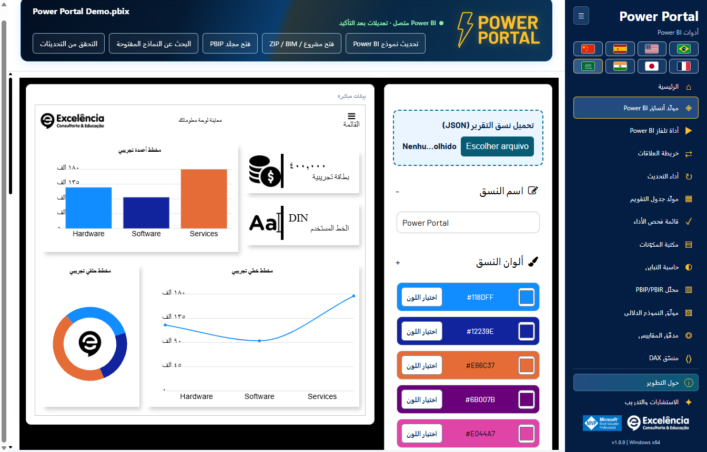
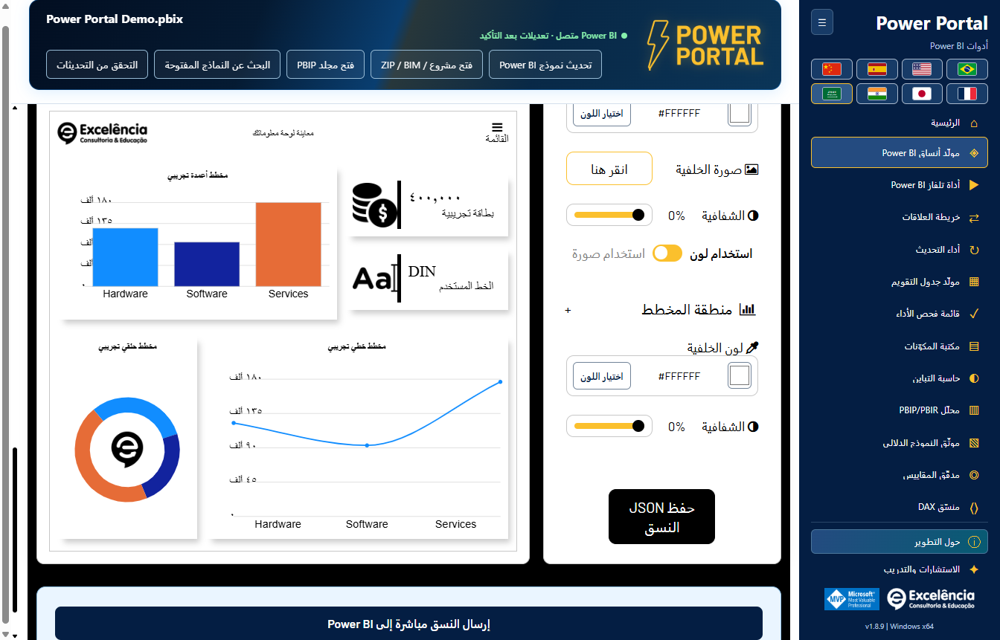
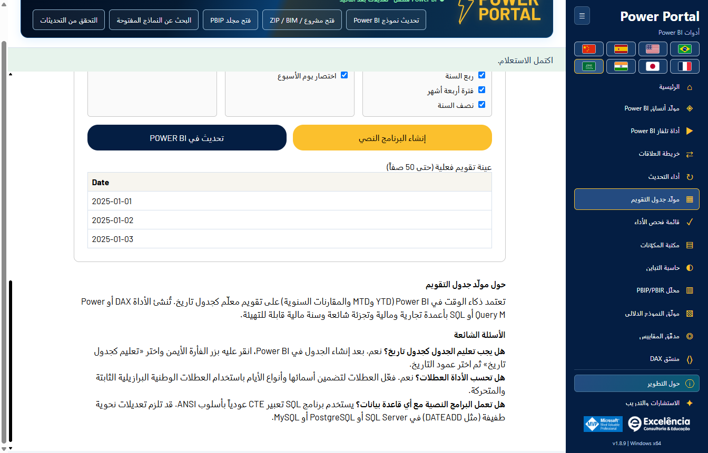
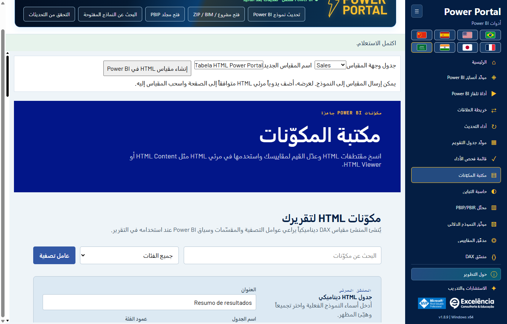
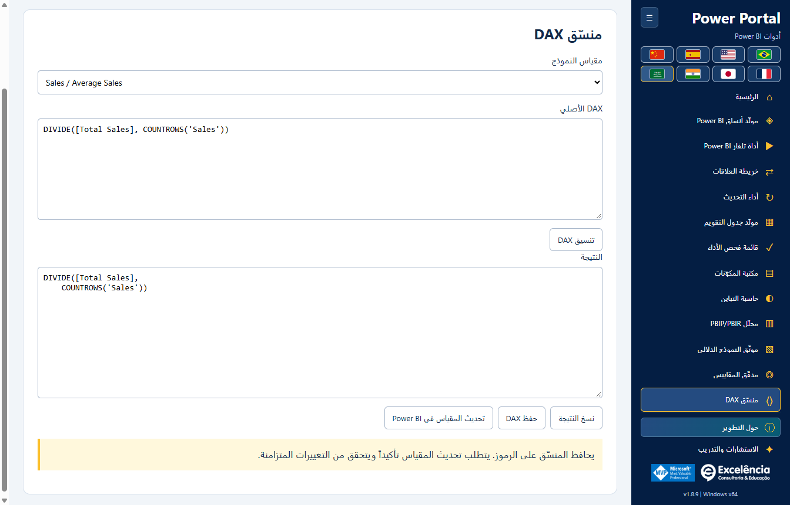
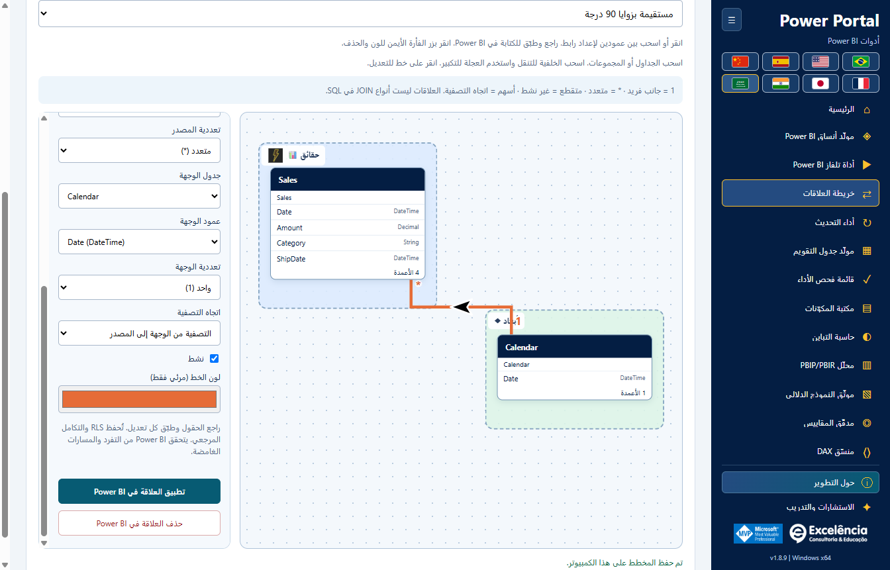
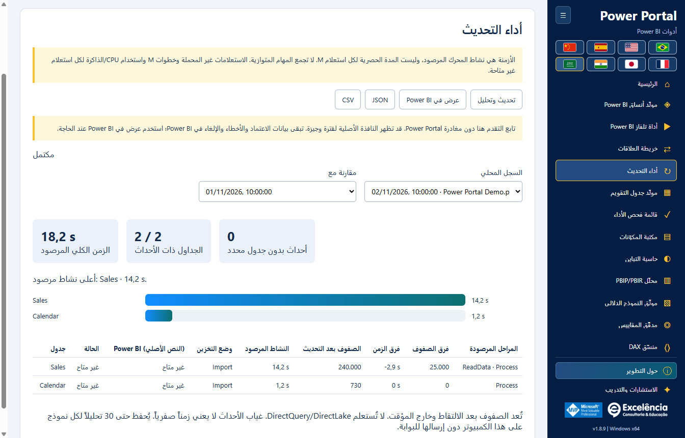

# الاستخدام وسلامة النموذج

<!-- language-selector -->
[🇺🇸 English](../USAGE.md) · [🇧🇷 Português](../pt-BR/USAGE.md) · [🇪🇸 Español](../es/USAGE.md) · [🇨🇳 简体中文](../zh-CN/USAGE.md) · [🇫🇷 Français](../fr/USAGE.md) · [🇯🇵 日本語](../ja/USAGE.md) · [🇮🇳 हिन्दी](../hi/USAGE.md) · [🇸🇦 العربية](USAGE.md)
<!-- /language-selector -->

**1.8.9 — عينة التقويم واختصار التحديث الأصلي**

في مولد جدول التقويم تظهر العينة الفعلية (حتى 50 صفاً) الآن أسفل زر إنشاء البرنامج النصي. يوجد تحديث في Power BI بجانبه، ويفتح أداء التحديث عند الاتصال لبدء تدفق تحديث بيانات النموذج الأصلي نفسه مع التأكيد. تابع حالات الجداول والمدد وأعداد الصفوف هناك. يحدث هذا النموذج بالكامل ولا يطبق البرنامج النصي ولا ينشئ جدول التقويم أو يستبدله ولا يحفظ PBIX. يبقى إنشاء التقويم في Power BI إجراء منفصلاً. يُعطل الزر دون اتصال ويدعم لوحة المفاتيح واللغات الثماني. يستخدم الإلغاء والأخطاء التدفق الحالي. تبقى العينة آخر قراءة مطلوبة؛ استخدم قراءة التقويم المحدد مجدداً بعد التحديث. تحققت اختبارات التطبيق المعبأ من الموضع والترجمات الثماني والتعطيل دون اتصال والاتصال المحدد والإلغاء والأخطاء الظاهرة وإعادة المحاولة والحفاظ على إنشاء التقويم. لم يبدأ تحديث فعلي للنموذج في هذه الاختبارات؛ تستخدم الصور بيانات اصطناعية.

**1.8.8 — خطوط علاقات ديناميكية وإرسال سمات متحقق منه**

في خريطة العلاقات يتيح نمط الخطوط الاختيار بين المنحنيات والخطوط المستقيمة بزوايا 90 درجة. تتصل النهايات ديناميكياً بالحواف العلوية/السفلية أو اليمنى/اليسرى المتقابلة، مع مراعاة الحجم الفعلي للبطاقات. تحتفظ الوصلات الجانبية بارتفاع العمود المرتبط. تتبع الأسهم السوداء ذات الحدود البيضاء المقاطع المستقيمة ولا تميل قطرياً عند الزوايا. يُحفظ النمط تلقائياً ويُضمّن في JSON المُصدّر؛ وتبقى التخطيطات القديمة منحنية. لا يغير ذلك تخطيط Power BI الأصلي ولا ينفذ تجنباً شاملاً للعوائق.

يعيد إرسال السمة مباشرة إلى Power BI التركيز إلى Power Portal بعد الاستيراد الأصلي وأثناء التحقق بالتصدير، فقط عندما يكون Power BI في المقدمة. بعد التحقق من السمة يُعرض Power BI؛ وتُعرض النافذة المحددة أيضاً عند الخطأ للمراجعة. قد تظهر مربعات الحوار الأصلية لفترة وجيزة ولا يتم إخفاؤها: لا يوفر Desktop واجهة سمات مدعومة بلا حوار. تُعالج تغييرات تبويب الشريط غير المتزامنة قبل تأكيد السمة. تحقق اختبار فعلي مصرح به للتطبيق المعبأ من الاستيراد/التصدير وعودة التركيز إلى Portal وتنشيط Power BI النهائي، ثم أعاد السمة الافتراضية الأصلية دون حفظ PBIX. تستخدم لقطات الوثائق بيانات اصطناعية.

**1.8.7 — اختيار ألوان أوضح وأكثر موثوقية**

تتضمن ألوان النسق الأحد عشر الآن عينة أصلية مرئية وزر اختيار اللون بجانب حقل HEX القابل للتحرير. انقر العينة أو الزر، أو اضغط Enter/Space عند تركيز الزر. لم يعد المنتقي يعتمد على حقل مخفي بلا أبعاد أو النقر المزدوج على HEX. يظل التحرير اليدوي والاستيراد والمعاينة المباشرة وتصدير JSON متاحاً، وتظهر أخطاء الفتح صراحةً. تم التحقق من فتح المنتقي الأصلي مراراً في Windows ومن الأزرار الأحد عشر بالماوس ولوحة المفاتيح واللغات الثماني.

أصبح اسم تحليل التحديث هو أداء التحديث في القائمة والرئيسية والعنوان واللغات الثماني. يتغير الاسم فقط؛ التحديث الأصلي والتقدم والأزمنة والصفوف والسجل المحلي وتوافق JSON/CSV لا تتغير. تبقى التحليلات المحفوظة متاحة دون ترحيل أو تحديث البيانات مجدداً. الصور تستخدم بيانات اصطناعية.

**1.8.6 — تابع التحديث داخل Power Portal**

ابدأ التحديث والتحليل في Power Portal وتابع بطاقات مباشرة تعرض كل جدول والحالة المرصودة ومرحلة المحرك ووقت النشاط وآخر نص تقدم أصلي متاح من Power BI. يستعيد Power Portal التركيز بعد البدء، وإذا عاد Power BI إلى المقدمة يعيده مرة أخرى بعد انتهاء التحديث. لا يسلب التركيز باستمرار من التطبيقات الأخرى. يفتح عرض في Power BI الملف المحدد دون بدء تحديث جديد، ويعطل الرجوع التلقائي للتركيز في هذا الالتقاط.

يبقى Power BI محرك التحديث. قد تظهر نافذته لفترة وجيزة؛ هذه ليست واجهة مدعومة لمعالجة PBIX دون نافذة. تبقى بيانات الاعتماد والأخطاء والإلغاء في Power BI، ولا تُخفى الحوارات أو تُغلق تلقائياً. يحتفظ النص الأصلي بلغة Power BI ويعرض وقت آخر قراءة. يُذكر تعذر القراءة صراحةً ويستمر تتبع المحرك عند فشل قارئ الواجهة. انتهاء المرحلة لا يثبت اكتمال الجدول، ولا تُختلق نسب مئوية، وتُعد الصفوف النهائية بعد الالتقاط. يتضمن السجل وJSON الحالات الأصلية؛ راجع التصدير قبل مشاركته. تم اختبار التطبيق المعبأ بتحديث حقيقي مصرح به: قياس 4/4 جداول وعد 4/4 صفوف الجداول وحالات مباشرة واستعادة التركيز وزر العرض وحفظ السجل بعد إعادة التحميل. لم يُحفظ PBIX تلقائياً؛ الصور تستخدم بيانات اصطناعية.

**1.8.5 — معاينة السمة بخطوط ناعمة**

يستخدم المخطط الخطي في مولّد السمات الآن منحنيات تكعيبية ناعمة بدلاً من المقاطع المستقيمة، سواء مع البيانات التجريبية أو بيانات النموذج المتصل. تمر المنحنيات بالنقاط الأصلية دون إنشاء قمم إضافية بين القيم، مع الحفاظ على الألوان والعلامات والتلميحات. يؤثر التغيير في المعاينة فقط: لا يتغير JSON المصدّر ولا تنسيق خطوط المرئيات الموجودة في Power BI.

[العودة إلى الصفحة الرئيسية](../../README.ar.md)

يتضمن رأس Power Portal المتحرك الآن اسم الملف وحالة الاتصال وأزرار القراءة والاستيراد والبحث والتحديث الخمسة. أُزيل شريط الأدوات المنفصل أسفل اللافتة لتوفير مساحة العمل. يلتف المحتوى داخل الرأس في النوافذ الصغيرة وباللغات الثماني، بما فيها العربية. لم تتغير التأكيدات والإشعارات وآلية التحديث.

أصبحت خريطة العلاقات مباشرة بعد TV Tool في القائمة الجانبية ومعرض البداية. أُزيلت كتلة بيانات النموذج الفعلية العامة من منشئ التقويم ومكتبة المكونات. تبقى عناصر القراءة والإرسال الخاصة بكل أداة؛ ويستخدم زر الفترة الفعلية التقويم المحدد داخل الأداة. أُعيد رسم أغلفة البداية كرسوم متجهة محلية دون نص مضمّن. تبقى العناوين والأوصاف والإجراءات خارج الصور وتتبع اللغة المحددة. اسحب عمود المصدر إلى جدول آخر لفتح حوار العلاقة الفعلية واختيار عمود الوجهة. الإفلات على عمود يحدده مسبقاً. راجع التعددية واتجاه التصفية والحالة النشطة، ثم تحقق وطبّق مع تأكيد أصلي ونسخة BIM احتياطية.

يتحقق الفحص من الأنواع وأزواج الأعمدة المكررة والروابط المباشرة النشطة والأعداد الفعلية للصفوف والقيم المميزة في العمودين، دون أخذ عينة. تُرفض القيم المكررة في جانب الواحد. مهلة الاستعلامات 20 ثانية والأخطاء واضحة. التحقق لا يكتب أبداً. يعيد التطبيق التحقق، ثم يفحص المحرك المفاتيح ومسارات التصفية الملتبسة عند الحفظ. المسودة المتقطعة ليست علاقة محفوظة؛ لا تُنشأ إلا بعد نجاح الحفظ المؤكد. احفظ PBIX بعدها. تستخدم الاختبارات والصور بيانات اصطناعية دون تعديل PBIX لعميل.

## التشغيل الأول

ابدأ من شريط External Tools في Power BI للاتصال التلقائي بالنموذج المحلي، أو افتح اختصار Windows لاستخدام الأدوات دون اتصال/استيراد مشروع. تعرض الصفحة الرئيسية الأدوات الإحدى عشرة كلها. يعيد **Home** إلى المعرض دون إسقاط النموذج المحمّل.

استخدم زر طي الشريط الجانبي والأعلام حسب الحاجة. تعرض ترويسة الاتصال اسم الملف عند توفره بدلاً من GUID قاعدة البيانات الداخلي.

بعد الاتصال، تحل حالة خضراء مختصرة في الترويسة محل شريط الاتصال الكبير. ويذكّرك تلميحها بحفظ نسخة منفصلة من PBIX. ولا تزال التغييرات المدعومة تتطلب التأكيد.

[جولة مصورة لجميع الشاشات وتفاعلات Power BI](SCREENSHOTS.md).

## العمل للقراءة فقط

اقرأ البيانات الوصفية للنموذج، واستعلم عن عينات بيانات صغيرة، ودقّق المقاييس، وتحقق من التباين، ونسّق DAX أو صدّر الوثائق دون إرسال عمليات كتابة. تمثل بيانات النموذج النموذج الدلالي **من دون مرشحات التقرير أو مقسمات الشرائح للصفحة النشطة**.

تظل العينات محدودة بـ 50 صفاً والاستعلامات بـ 20 ثانية. تُقرأ بيانات التقويم عبر محدده ومعاينته الخاصة؛ ولم تعد الكتلة العامة تظهر في منشئ التقويم أو مكتبة المكونات. تبقى حالة الاتصال في الرأس.

تقبل عمليات استيراد المشاريع المحلية ملفات BIM ومجلدات/ملفات ZIP المدعومة من TMDL/PBIP/PBIR. وتكون للقراءة فقط. لا يستطيع المستورد تحليل PBIX خام: افتحه في Power BI Desktop واتصل محلياً بدلاً من ذلك.

حدود ZIP: حجم مضغوط 50 MB، ومستخرج 500 MB، و10,000 ملف، و64 MB لكل إدخال. لا تُتبع الروابط الرمزية أو المجلدات مثل `.git` و`.pbi` و`node_modules`. استورد نموذجاً دلالياً واحداً في كل مرة.

## Themes

1. إذا أردت تعديل theme الحالية، فاحفظ JSON الخاص بها من قائمة Themes في Power BI Desktop.
2. في مُنشئ theme في Power Portal، استخدم منطقة **Load report theme (JSON)** البارزة. لا يستطيع اتصال نموذج TOM استرداد theme التقرير.
3. عدّل الألوان والخطوط والخلفيات مع مراقبة المعاينة المحلية المباشرة.
4. صدّر JSON، أو مرّر إلى نهاية الصفحة أسفل الإعدادات والمعاينة واختر **Send theme directly to Power BI**.
5. تحقق من اسم الملف في التأكيد ووافق عليه ولا تتفاعل مع Power BI أثناء الاستيراد.
6. احفظ PBIX في Power BI عند الرضا عن النتيجة.

يستخدم الإرسال المباشر **أتمتة واجهة مرئية**، بما في ذلك مربع حوار الملفات في Desktop. ويتحقق التطبيق من theme الناتجة بتصديرها ومقارنة الخصائص المرسلة. يظل JSON المنشأ متاحاً إذا فشلت الأتمتة. قد تمنع إصدارات Desktop المختلفة أو التعريب أو تغييرات الواجهة الأتمتة.

لا توجد واجهة Desktop عامة مدعومة لتطبيق theme على أي PBIX مفتوح دون مربعات حوار. واجهة `applyTheme` للتقارير المضمّنة مختلفة ولا تُستخدم كحل بديل لـ Desktop.

المعاينة المباشرة تنفيذ محلي لشاشة theme على الموقع، وليست تمثيلاً مطابقاً بكسلياً لكل عنصر مرئي في Power BI.

## عمليات الكتابة

عمليات الكتابة المدعومة للنموذج الدلالي: إنشاء مقياس، وتحديث DAX للمقياس المحدد، وإنشاء جدول تقويم محسوب جديد، وإنشاء العلاقات/تحريرها/حذفها.

قبل أي كتابة:

1. **احفظ نسخة منفصلة من PBIX.**
2. تحقق من الملف/النموذج المحدد وDAX المقترح.
3. اقبل التأكيد الأصلي (يكون **Cancel** هو الخيار الافتراضي).
4. احتفظ بمسار النسخة الاحتياطية المعروض وتحقق من النتيجة في Power BI.
5. احفظ PBIX بنفسك؛ فالتطبيق لا يحفظه تلقائياً.

يجب نجاح نسخة BIM الاحتياطية للبيانات الوصفية قبل اعتماد الكتابة. تُرفض الأسماء المكررة. تتحقق التحديثات من التعبير السابق لتجنب الكتابة فوق تغييرات متزامنة. ويُبلّغ عن الفشل بعد الاعتماد بوصفه تغييراً تمت كتابته بالفعل، لا إلغاءً.

### جداول التقويم

اقرأ تعبير التقويم الموجود المحسوب ونطاق التاريخ والعينة. صدّر المحتوى الموجود أو أنشئ برنامج DAX/M/SQL نصياً جديداً. ينشئ الإرسال المباشر جدولاً محسوباً **جديداً**؛ ولا يستبدل تقويماً موجوداً.

بعد الإنشاء، حدّث في Power BI Desktop؛ لا يعالج Power Portal نموذج Desktop. ويُرفض إجراء الجلسة **Revert created calendar** إزالة الجدول إذا تغيرت بنيته/تعبيره أو اكتسب مقاييس أو علاقات أو تبعيات DAX.

تحمي نسخة BIM الاحتياطية البيانات الوصفية للنموذج، **لا صفحات التقرير أو العناصر المرئية أو كل صفوف البيانات أو ملف PBIX كاملاً**. ولا تتوفر استعادة تلقائية للنموذج بالكامل.

### مكونات HTML

ينشئ إرسال مكوّن مقياس HTML. أضف بنفسك عنصراً مرئياً متوافقاً مع HTML إلى التقرير وعيّن إليه المقياس. لا يستطيع TOM وضع العناصر المرئية تلقائياً على لوحة التقرير.

### تحديث DAX للمقياس

حدد مقياساً للنموذج في منسّق DAX، ونسّق تعبيره، ثم استخدم **Update measure in Power BI**. يحدّث هذا الإجراء المقياس المحدد نفسه بعد التأكيد ويتحقق من عدم تغيير تعبيره السابق بالتزامن. وليس مجرد تصدير نص محلي.

## أداة TV (TV Tool)

تفتح منطقة **TV Tool in action** البارزة في الأعلى [مثال لوحة معلومات رسمي يعمل](https://www.powerportal.com.br/tv_tool/painel_exemplo_power_bi_tv_tool.html) في المتصفح الافتراضي. وتتطلب الإنترنت ولا ترسل النموذج المحلي. ويظل المثال التوضيحي في النموذج يحمل شرائح محلية.

استخدم روابط التقارير المنشورة أو الصور المحلية، واضبط المدد والانتقالات وصدّر HTML. وتحافظ روابط Service على معرّفات الصفحات المدعومة. ولا تدوّر الأداة صفحات PBIX المحلي المفتوح.

تتطلب التقارير الخاصة الترخيص المناسب لـ Power BI ومصادقة Microsoft والأذونات وسياسة التضمين. ولا تعني إعادة تحميل التقرير تحديث بيانات النموذج الدلالي. وتُعد شرائح الصور المحلية خيار العرض دون اتصال.

## خريطة العلاقات (Relationship map)

افهم روابط جداول النموذج على لوحة قابلة للسحب بحرية، مع درجات العلاقات وأسهم التصفية والخطوط المتقطعة غير النشطة والمجموعات المخصصة والألوان والأسماء الواضحة والأيقونات.

يُحفظ التنظيم المرئي تلقائياً لكل نموذج ويمكن تصديره/استيراده بصيغة JSON. ولا يعيد تسمية عناصر النموذج أو يغيّر التخطيط الأصلي لـ Power BI أو يرسل تعديلات للعلاقات.

في الاتصال المباشر، يرسل **Apply relationship to Power BI** و**Delete relationship in Power BI** كل تعديل بعد التأكيد الأصلي والنسخ الاحتياطي للبيانات الوصفية. يمكن تغيير نقاط النهاية ودرجة العلاقة واتجاه التصفية والحالة النشطة؛ وتُحفظ إعدادات الأمان/التكامل الحالية. تُرفض البيانات الوصفية القديمة والروابط المكررة وأنواع الأعمدة غير المتوافقة وأخطاء التحقق في المحرك بوضوح.

**تؤثر العلاقات في نتائج التقرير ومرشحاته. احفظ نسخة PBIX أولاً، ثم احفظ PBIX في Desktop بعد ذلك.** لا يوجد تراجع تلقائي للنموذج بالكامل. [البرنامج التعليمي الكامل للعلاقات والاستمرارية والحدود](RELATIONSHIPS.md).

## التشخيص والخصوصية

درجات التدقيق/التحليل استرشادية. لا يوفر اتصال النموذج النشط صفحات التقرير أو مواضع العناصر المرئية؛ ولا تُختلق الأبعاد غير المتوفرة. يمكن لبيانات مشروع PBIR الوصفية توفير عدد الصفحات/العناصر المرئية عند وجودها.

لا يرسل التطبيق ملفات النموذج أو بياناته الوصفية أو صفوفه أو بيانات اعتماد المصدر إلى البوابة. ومع ذلك، قد تتضمن الصادرات والنسخ الاحتياطية والسجلات المحلية معلومات سرية. لا تشارك مع الدعم إلا معلومات خطأ منقحة.

[الإعداد](CONFIGURATION.md) · [استكشاف الأخطاء وإصلاحها](TROUBLESHOOTING.md)

في 1.8.9، لا يؤدي رسم العلاقة إلا إلى إعداد مسودة: انقر زوج الأعمدة الدقيق أو اسحب بينهما وراجعه قبل التطبيق. ويتطلب الحذف بالنقر بزر الفأرة الأيمن التأكيد والنسخ الاحتياطي نفسيهما. الكشف التلقائي الأصلي منفصل وقد ينشئ روابط متعددة: راجعها في Power BI وأغلق مربعات الحوار، ثم أنهِ العملية في Power Portal قبل أي كتابات أو تحديثات أخرى. لا تُحفظ صور المجموعات وتفضيلات الظهور إلا في المخطط. [سير عمل العلاقات الجديد](RELATIONSHIPS.md#native-automatic-relationship-detection).

## أداء التحديث

قِس التحديث الأصلي. قارن الأزمنة والصفوف. [أداء التحديث](REFRESH-ANALYSIS.md).

النشاط المرصود هو اتحاد فترات المحرك المنسوبة بدقة لكل جدول دون تكرار المراحل المتداخلة. ليس وقت استعلام المصدر وحده ولا مساراً حرجاً مثبتاً. يبدأ الزمن الكلي من التشغيل حتى اكتشاف الانتهاء، ويشمل عبء الواجهة والفحص ويستثني عد الصفوف اللاحق. تُعرض الأحداث بلا جدول محدد منفصلة.

يتطلب الإنهاء التلقائي رصد انتهاء أوامر التحديث وجاهزية نافذة Power BI. أغلق حوارات النتائج. إنهاء الالتقاط يدوياً يعني دائماً تحليلاً غير مكتمل، ولا يثبت النجاح ولا يلغي التحديث. تظهر أخطاء المحرك والتتبع صراحةً. لا يُعلن اكتمال الالتقاط المنقطع.

