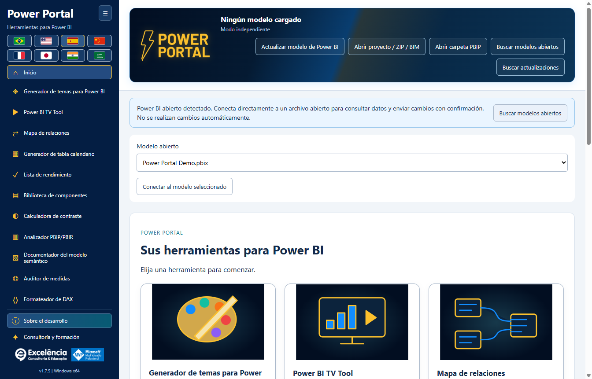

# Guía de instalación

<!-- language-selector -->
[🇺🇸 English](../INSTALLATION.md) · [🇧🇷 Português](../pt-BR/INSTALLATION.md) · [🇪🇸 Español](INSTALLATION.md) · [🇨🇳 简体中文](../zh-CN/INSTALLATION.md) · [🇫🇷 Français](../fr/INSTALLATION.md) · [🇯🇵 日本語](../ja/INSTALLATION.md) · [🇮🇳 हिन्दी](../hi/INSTALLATION.md) · [🇸🇦 العربية](../ar/INSTALLATION.md)
<!-- /language-selector -->

[Volver al inicio](../../README.es.md)

<a name="requirements"></a>
## Requisitos

Windows 10/11 x64, permiso de administrador para instalar y una edición de Power BI Desktop compatible con Herramientas externas. La aplicación se distribuye como un instalador autónomo para Windows. Los usuarios finales no necesitan PHP, Node.js, SDK de .NET, Git ni una cuenta de GitHub.

Reserve aproximadamente 1 GB de espacio libre en disco para la descarga y los componentes de ejecución instalados, además de espacio adicional para sus propias exportaciones y copias de seguridad.

<a name="simple-installation"></a>
## Instalación sencilla

1. Abra la [última versión](https://github.com/luisgnserra/powerportaldesktop/releases/latest).
2. En **Assets**, descargue `PowerPortal-Setup-1.7.5-x64.exe` para esta versión. No descargue los archivos de código fuente generados automáticamente como si fueran un instalador.
3. Opcionalmente, [verifique SHA-256](#verify-the-installer).
4. Ejecute el archivo y apruebe el Control de cuentas de usuario.
5. Acepte las condiciones de dependencias mostradas, elija una carpeta y seleccione un idioma predeterminado mediante las banderas. Se sugiere el idioma de la interfaz de Windows; para los idiomas no compatibles se usa inglés.
6. Complete el asistente.
7. Cierre y vuelva a abrir Power BI Desktop. Abra un PBIX y seleccione **Herramientas externas > Power Portal**.

La instalación se realiza para todo el equipo e incluye accesos directos en el escritorio/menú Inicio y el registro de la herramienta externa. La aplicación no requiere elevación durante su uso normal.


Haga clic en **Herramientas externas > Power Portal** con su PBIX abierto. **Ferramentas externas** en la captura es la etiqueta portuguesa de la cinta. El icono inicia una **ventana complementaria independiente** y le pasa la conexión al modelo local del archivo abierto; no es un objeto visual incrustado ni un panel interno del informe.



Si usa el acceso directo de Windows, se muestra un aviso cuando se detectan modelos abiertos. Seleccione **Buscar modelos abiertos**, verifique el nombre del archivo y conéctese. Detectar o conectarse no realiza ningún cambio por sí solo. [Vea el recorrido ilustrado](SCREENSHOTS.md).

**Versión sin firma:** Windows puede mostrar SmartScreen o una advertencia de editor desconocido. SHA-256 verifica que tiene el archivo publicado; no es una firma digital del editor. No eluda restricciones empresariales. Consulte a TI si necesita aprobación.

<a name="command-line-installation"></a>
## Instalación por línea de comandos

<a name="download-the-helper-and-review-it"></a>
### Descargar el asistente y revisarlo

```powershell
$script = Join-Path $env:TEMP 'Install-PowerPortal.ps1'
[Net.ServicePointManager]::SecurityProtocol = [Net.ServicePointManager]::SecurityProtocol -bor [Net.SecurityProtocolType]::Tls12
Invoke-WebRequest -UseBasicParsing 'https://raw.githubusercontent.com/luisgnserra/powerportaldesktop/v1.7.5/install.ps1' -OutFile $script
Get-Content -LiteralPath $script
& $script
```

Esta URL versionada fija el asistente a la versión 1.7.5. No sigue silenciosamente versiones futuras. El asistente también fija el nombre del instalador y la suma SHA-256, descarga por HTTPS, verifica el ejecutable antes de iniciarlo y comprueba el registro de instalación tras una salida correcta del instalador.

La línea TLS habilita HTTPS TLS 1.2 en este proceso de PowerShell para los valores predeterminados antiguos de Windows PowerShell. No cambia la seguridad de Windows ni las políticas de ejecución.

<a name="unattended-installation"></a>
### Instalación desatendida

Abra PowerShell **como administrador** y ejecute:

```powershell
& "$env:TEMP\Install-PowerPortal.ps1" -Silent
```

El asistente descarga y verifica el mismo instalador y, después, invoca su modificador NSIS `/S`. No aparece una página de selección de idioma en modo silencioso: el instalador usa el idioma de la interfaz de Windows o, si no es compatible, inglés. Una preferencia guardada del usuario sigue teniendo prioridad. El asistente no abre ni edita ningún PBIX.

El modo silencioso requiere una sesión de PowerShell ya elevada. No elude UAC, los controles de seguridad de Windows, las políticas de ejecución de scripts ni las restricciones de aplicaciones. Cierre Power Portal antes del despliegue; consulte [actualizaciones](#updates-and-downgrades).

<a name="download-only-or-choose-a-download-folder"></a>
### Descargar solamente o elegir una carpeta de descarga

```powershell
& "$env:TEMP\Install-PowerPortal.ps1" -DownloadOnly -DownloadDirectory "$env:USERPROFILE\Downloads\PowerPortal"
```

`-DownloadOnly` verifica la suma de comprobación, pero nunca ejecuta el instalador y no requiere privilegios de administrador. Un archivo previamente descargado solo se reutiliza si coincide su suma de comprobación. Un archivo existente no válido provoca un error explícito en lugar de ejecutarse o sobrescribirse silenciosamente.

Parámetros del asistente:

| Parámetro | Valor predeterminado | Finalidad |
|---|---|---|
| `-Silent` | Desactivado | Usar el modificador de instalación desatendida de NSIS; requiere PowerShell como administrador salvo en modo de solo descarga. |
| `-DownloadOnly` | Desactivado | Descargar/almacenar en caché y verificar el ejecutable sin instalar. |
| `-DownloadDirectory` | `%TEMP%\PowerPortalDownloads` | Carpeta para el instalador verificado. No es el directorio de instalación de la aplicación. |

No pegue un script sin revisar en `Invoke-Expression`. Si un script descargado está bloqueado por su política de ejecución, consulte a TI o use el asistente ejecutable. El asistente deliberadamente no modifica las políticas de ejecución.

<a name="use-the-verified-executable-directly"></a>
### Usar directamente el ejecutable verificado

Después de verificar la suma de comprobación, un administrador puede ejecutar:

```powershell
$setup = "$env:USERPROFILE\Downloads\PowerPortal-Setup-1.7.5-x64.exe"
$process = Start-Process -FilePath $setup -ArgumentList '/S' -Wait -PassThru
if ($process.ExitCode -ne 0) { throw "Installer failed: $($process.ExitCode)" }
```

Se recomienda el asistente PowerShell porque comprueba tanto la descarga como el registro resultante de la herramienta externa.

<a name="verify-the-installer"></a>
## Verificar el instalador

SHA-256 esperado para **1.7.5 x64**:

```text
0AD5CFA882611A8B24BAD6A093F3FBF6C68EF0C18232B5EC2BCACA110F81EBD7
```

```powershell
$file = "$env:USERPROFILE\Downloads\PowerPortal-Setup-1.7.5-x64.exe"
$expected = '0AD5CFA882611A8B24BAD6A093F3FBF6C68EF0C18232B5EC2BCACA110F81EBD7'
if ((Get-FileHash -LiteralPath $file -Algorithm SHA256).Hash -ne $expected) {
    throw 'Checksum mismatch. Do not run this installer.'
}
```

La suma de comprobación también se publica en [SHA256SUMS.txt](../../SHA256SUMS.txt) y se adjunta a la versión. Una suma de comprobación verifica la integridad; no sustituye la confianza en el editor.

<a name="updates-and-downgrades"></a>
## Actualizaciones y regreso a versiones anteriores

Descargue un instalador oficial más reciente y ejecútelo sobre la instalación existente. El instalador intenta cerrar Power Portal únicamente desde la ruta exacta del ejecutable de destino antes de reemplazar archivos. No cierra Power BI Desktop ni otras herramientas externas. Si no logra cerrarlo, la instalación se cancela.

Cierre Power Portal usted mismo antes de una actualización desatendida. Reinicie Power BI Desktop después de instalar para que vuelva a cargar el registro de Herramientas externas. Se conservan las preferencias existentes de idioma/barra lateral por usuario y las copias de seguridad locales.

A partir de **1.6.2**, las comprobaciones al inicio y **Buscar actualizaciones** avisan de nuevas versiones oficiales. **Actualizar ahora** descarga/verifica el instalador e inicia una actualización silenciosa con elevación en la carpeta de instalación actual, solo después de su clic. Power BI no se cierra. Vuelva a abrir Power Portal cuando termine la instalación. [Detalles de actualización](UPDATES.md).

Las versiones **1.6.1 y anteriores requieren una actualización manual única a 1.6.2**. No se certifica el regreso a versiones anteriores; guarde su trabajo y contacte con soporte antes de usar un instalador antiguo.

<a name="uninstall"></a>
## Desinstalar

Use **Configuración de Windows > Aplicaciones > Aplicaciones instaladas > Power Portal > Desinstalar** (en Windows 10, use **Aplicaciones y características**).

La desinstalación elimina la aplicación y su propio registro `PowerPortal.pbitool.json`. No se modifican otras herramientas. Se conservan intencionadamente los ajustes por usuario, temas, copias de seguridad y registros de cambios. Consulte las [ubicaciones de datos](CONFIGURATION.md#data-locations) antes de eliminar manualmente los datos conservados.

<a name="offline-and-enterprise-deployment"></a>
## Despliegue sin conexión y empresarial

TI puede descargar y verificar el instalador de la versión una vez, distribuir ese archivo exacto mediante su sistema de software aprobado y ejecutar `/S` con derechos de administrador. Las descargas públicas de GitHub requieren internet; instalar desde un ejecutable ya descargado no requiere autenticación de GitHub.

Este repositorio no proporciona un paquete de Microsoft Store, MSI, una entrada de catálogo winget ni un paquete Chocolatey. La distribución compatible es el EXE NSIS y su asistente PowerShell.

[Configuración](CONFIGURATION.md) · [Solución de problemas](TROUBLESHOOTING.md)
