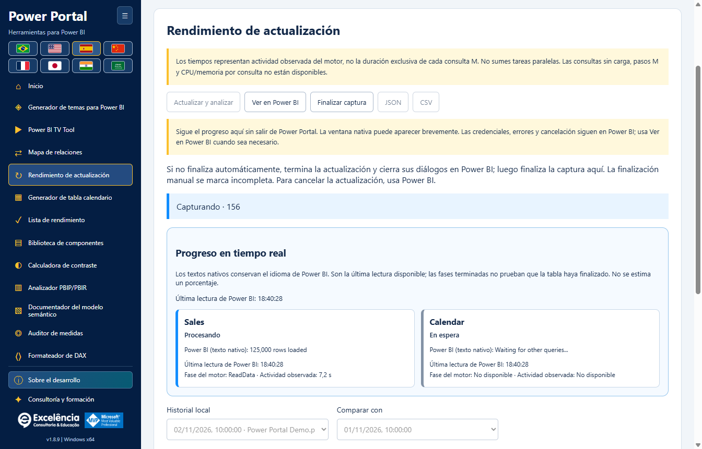
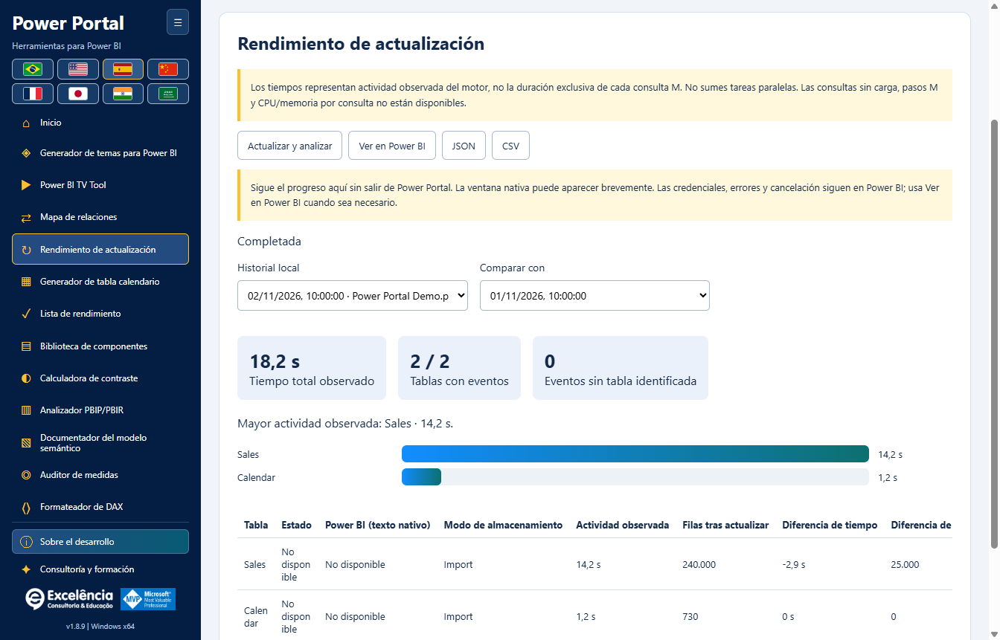

# Rendimiento de actualización

<!-- language-selector -->
[🇺🇸 English](../REFRESH-ANALYSIS.md) · [🇧🇷 Português](../pt-BR/REFRESH-ANALYSIS.md) · [🇪🇸 Español](REFRESH-ANALYSIS.md) · [🇨🇳 简体中文](../zh-CN/REFRESH-ANALYSIS.md) · [🇫🇷 Français](../fr/REFRESH-ANALYSIS.md) · [🇯🇵 日本語](../ja/REFRESH-ANALYSIS.md) · [🇮🇳 हिन्दी](../hi/REFRESH-ANALYSIS.md) · [🇸🇦 العربية](../ar/REFRESH-ANALYSIS.md)
<!-- /language-selector -->

**1.8.9 — Muestra del calendario y acceso a la actualización nativa**

En Generador de tabla calendario, la muestra real (hasta 50 filas) aparece debajo de Generar script. Actualizar en Power BI está al lado y, con conexión activa, abre Rendimiento de actualización e inicia el mismo flujo nativo de actualización de datos con confirmación. Allí se muestran estados, tiempos y recuentos de filas. Actualiza todo el modelo: no aplica el script generado, no crea ni sustituye una tabla calendario y no guarda el PBIX. Crear calendario en Power BI sigue siendo una acción separada. El botón se deshabilita sin conexión, admite teclado y está traducido a los ocho idiomas. Cancelación y errores usan el flujo existente. La muestra conserva la última lectura: usa Leer calendario seleccionado para consultarla de nuevo tras actualizar. Las pruebas de la aplicación empaquetada verificaron posición, ocho traducciones, bloqueo sin conexión, conexión exacta, cancelación, errores visibles, reintento y creación de calendario intacta. No se inició ninguna actualización real; las capturas usan datos sintéticos.

**1.8.7 — Selección de colores clara y fiable**

Los once colores del tema tienen ahora una muestra nativa visible y un botón Seleccionar color junto al campo HEX editable. Pulse la muestra o el botón, o use Intro/Espacio con el botón enfocado. El selector ya no depende de un campo invisible sin tamaño ni de un doble clic en HEX. Se conservan la edición manual, importación, vista previa en vivo y exportación JSON. Los errores se muestran explícitamente. Se verificó varias veces la apertura nativa en Windows, además de los once botones por ratón/teclado y los textos en ocho idiomas.

Análisis de actualización se llama ahora Rendimiento de actualización en el menú, inicio, título y ocho idiomas. Solo cambia el nombre: actualización nativa, progreso, tiempos, filas, historial local y compatibilidad JSON/CSV no cambian. Los análisis guardados siguen disponibles sin migración ni nueva actualización de datos. Las imágenes usan datos sintéticos.

**1.8.6 — Siga la actualización dentro de Power Portal**

Inicie Actualizar y analizar en Power Portal y vea tarjetas en vivo con cada tabla, estado observado, fase del motor, tiempo de actividad y el último texto de progreso nativo disponible de Power BI. Power Portal recupera el foco al iniciar y, si Power BI vuelve al primer plano, al finalizar. No roba repetidamente el foco de otras aplicaciones. Ver en Power BI abre el archivo seleccionado sin iniciar otra actualización; esta elección desactiva el retorno automático del foco durante esa captura.

Power BI sigue siendo el motor. Su ventana puede aparecer brevemente: no es una API compatible de procesamiento de PBIX sin ventana. Credenciales, errores y cancelación permanecen en Power BI; los diálogos nunca se ocultan ni cierran automáticamente. El texto nativo conserva el idioma de Power BI e indica la hora de la última lectura. La ausencia de texto se muestra explícitamente; el seguimiento del motor continúa si falla el lector. Una fase terminada no demuestra que la tabla esté completa, no se inventan porcentajes y las filas finales se cuentan después de la captura. El historial y JSON incluyen los estados nativos: revise las exportaciones antes de compartirlas. La aplicación empaquetada se probó con una actualización real autorizada: 4/4 tablas medidas, 4/4 recuentos, estados en vivo, foco recuperado, Ver en Power BI funcional e historial conservado al recargar. No se guardó automáticamente el PBIX; las imágenes usan datos sintéticos.

**1.8.5 — Corrección de las mediciones de actualización nativa**

Rendimiento de actualización ahora reconoce el comando XML Refresh nativo de Power BI Desktop, incluso dentro de Batch, además de XMLA Process y TMSL refresh. Antes, la actualización podía ejecutarse pero su progreso se descartaba, dejando 0 tablas medidas, recuentos no disponibles y refreshCompletionNotProven. Ahora se acepta el éxito explícito del motor cuando falta el campo opcional Error; los códigos de error no nulos y los errores XMLA siguen prevaleciendo. El progreso exige correlación exacta de solicitud/actividad para excluir consultas visuales ajenas.

Antes del primer comando reconocido, la interfaz indica que espera eventos de actualización de Power BI. Una finalización no confirmada muestra instrucciones traducidas en lugar de solo un código técnico. Actualiza la aplicación, conecta al PBIX correcto y ejecuta Actualizar y analizar otra vez; los informes anteriores incompletos se conservan sin marcarlos como correctos. La aplicación empaquetada se validó de principio a fin en una actualización real autorizada, con actividad por tabla, filas, finalización automática e historial conservado tras recargar. Las capturas usan ejemplos sintéticos, sin datos ni nombres de modelos del usuario.

## Inicio y seguridad

Conecta el PBIX correcto, abre Rendimiento de actualización y pulsa Actualizar y analizar. Confirma el nombre del archivo. El rastreo empieza antes de invocar Inicio > Actualizar nativo; no actualiza tablas secuencialmente mediante TOM. Mantén Power BI abierto y resuelve allí credenciales, errores o cancelación. Una copia BIM no restaura los datos actualizados.

La actualización nativa consulta los orígenes y reemplaza los datos importados. Guarda una copia del PBIX. Resuelve credenciales y errores en Power BI; el rastreo no cancela la actualización ni incluye todas las consultas auxiliares de Power Query.

## Interpretar las medidas

La actividad observada es la unión de intervalos del motor identificados exactamente por tabla, sin duplicar fases anidadas. No es solo el tiempo de consulta del origen ni una ruta crítica demostrada. El total observado va desde el inicio hasta detectar la finalización, incluye la sobrecarga de interfaz/verificación y excluye el recuento posterior de filas. Los eventos sin tabla se indican aparte.

Los tiempos representan actividad observada del motor, no la duración exclusiva de cada consulta M. No sumes tareas paralelas. Las consultas sin carga, pasos M y CPU/memoria por consulta no están disponibles.

La finalización automática requiere observar el fin de los comandos de actualización y una ventana de Power BI lista. Cierra los diálogos de resultado. Finalizar captura manualmente siempre indica análisis incompleto, no demuestra éxito ni cancela la actualización. Los errores del motor/rastreo son explícitos. Una captura interrumpida no se presenta como completada.

## Historial y exportación

Las filas se cuentan después de la captura, fuera del cronómetro. DirectQuery/DirectLake no se consultan. La falta de eventos no significa tiempo cero. Se guardan hasta 30 análisis por modelo en este equipo; no se envían al portal.

Selecciona una ejecución guardada y otra para comparar tiempos y filas por nombres de tabla coincidentes. Caché, carga del origen, volumen y paralelismo afectan la comparación; las diferencias no demuestran una causa. JSON conserva valores no disponibles como null; CSV los deja vacíos y protege fórmulas. El historial es local y usa la identidad del diagrama, no se guarda en PBIX. Archivos con identidades expuestas idénticas pueden compartir historial: verifica el modelo. Las exportaciones contienen nombres y recuentos: revísalas antes de compartir.

<!-- refresh-correlation -->
Solo se mide el progreso del motor correlacionado exactamente por RequestID/ActivityID con un comando de actualización activo. Se excluyen consultas visuales ajenas. Algunas versiones de Power BI omiten estos identificadores: el tiempo de una tabla puede no estar disponible aunque se ejecute la actualización.

## Inicio nativo y recuperación

Rendimiento de actualización aparece inmediatamente debajo de Mapa de relaciones en el menú lateral y la galería. La búsqueda del botón nativo ignora las pestañas Home duplicadas de las vistas de consultas DAX y TMDL, evitando “Ambiguous Power BI control: home”. Si el control no está disponible, selecciona Informe, Datos o Modelo en Power BI.

Actualizar permanece deshabilitado durante la confirmación, validación e inicio del seguimiento; Finalizar captura se oculta hasta que la captura esté lista. Esto evita un segundo inicio con el error incorrecto “Finish the active Power BI operation before refreshing”. Un fallo demostrado antes de la invocación nativa detiene el seguimiento, comprueba la limpieza y permite reintentar. Si la invocación ya pudo ocurrir, el error permanece visible y la captura sigue pendiente: revisa Power BI, termina la actualización y cierra los diálogos antes de Finalizar captura. Las solicitudes repetidas reanudan la captura existente sin iniciar otra actualización. Las operaciones realmente activas deben terminar primero.
