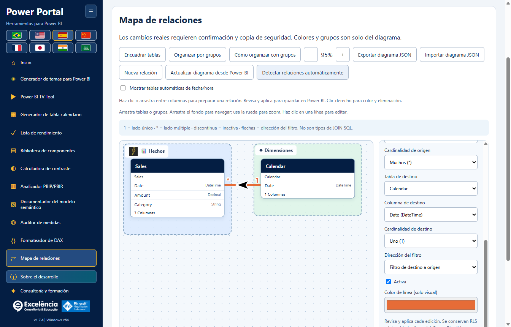
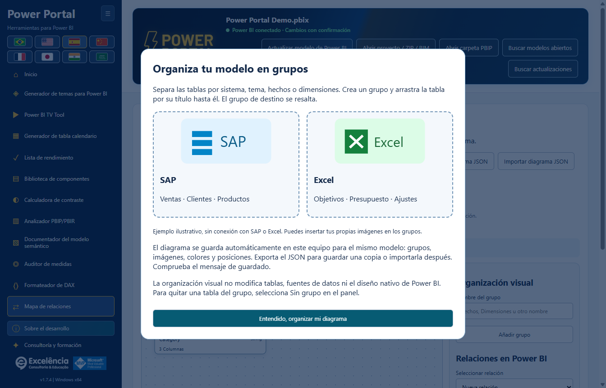
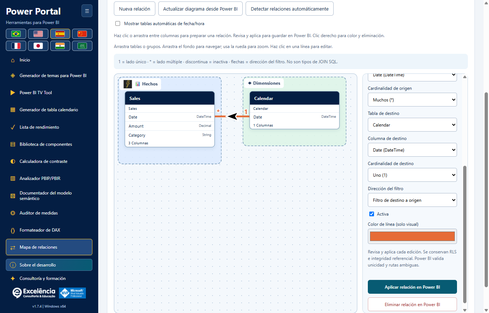

# Mapa de relaciones

<!-- language-selector -->
[🇺🇸 English](../RELATIONSHIPS.md) · [🇧🇷 Português](../pt-BR/RELATIONSHIPS.md) · [🇪🇸 Español](RELATIONSHIPS.md) · [🇨🇳 简体中文](../zh-CN/RELATIONSHIPS.md) · [🇫🇷 Français](../fr/RELATIONSHIPS.md) · [🇯🇵 日本語](../ja/RELATIONSHIPS.md) · [🇮🇳 हिन्दी](../hi/RELATIONSHIPS.md) · [🇸🇦 العربية](../ar/RELATIONSHIPS.md)
<!-- /language-selector -->

[Volver al inicio](../../README.es.md) · [Capturas](SCREENSHOTS.md) · [Seguridad del modelo](USAGE.md)

Disponible en **Power Portal Desktop 1.7.4**. Es una nueva herramienta exclusiva de Desktop, independiente de la vista Modelo de Power BI. Lee las relaciones reales entre tablas/columnas y puede aplicar cambios confirmados al modelo semántico local conectado.



Las flechas de relaciones ahora se sitúan sobre la curva y giran según su dirección local, incluso en enlaces diagonales o invertidos. Flechas SVG más grandes, de 36 × 26 unidades, siempre negras con un contorno blanco de 3 unidades, independientemente del color de la línea. El filtro unidireccional sigue del destino al origen; el bidireccional muestra dos flechas opuestas. El filtro automático conserva el signo de interrogación. Este cambio es solo visual.

<a name="how-to-organize-with-groups"></a>
## Cómo organizar con grupos



La introducción aparece en la primera visita al mapa de cada sesión. Ábrela de nuevo con **Cómo organizar con grupos**. SAP y Excel son ejemplos ilustrativos, no nuevos conectores ni logotipos oficiales. Los grupos vacíos son zonas de destino visibles. Soltar en un grupo resaltado asigna la tabla; fuera conserva su grupo actual.

Separa las tablas por sistema, tema, hechos o dimensiones. Crea un grupo y arrastra la tabla por su título hasta él. El grupo de destino se resalta.

El diagrama se guarda automáticamente en este equipo para el mismo modelo: grupos, imágenes, colores y posiciones. Exporta el JSON para guardar una copia o importarla después. Comprueba el mensaje de guardado.

La organización visual no modifica tablas, fuentes de datos ni el diseño nativo de Power BI. Para quitar una tabla del grupo, selecciona Sin grupo en el panel.

<a name="open-your-model"></a>
## Abrir su modelo

1. Guarde una copia independiente del PBIX.
2. Inicie **Herramientas externas > Power Portal** desde Power BI Desktop, o busque y seleccione explícitamente el archivo abierto.
3. Abra **Mapa de relaciones** en la barra lateral o la galería de inicio.

Los proyectos BIM/PBIP/TMDL importados permiten el diagrama y la personalización visual, pero **las escrituras de relaciones requieren una conexión local de Power BI en vivo**. Vuelva a leer el modelo después de cambios realizados en otro lugar.

<a name="understand-the-links"></a>
## Comprender los vínculos

- Cada cuadro representa una tabla real. El nombre original de la tabla sigue visible debajo de su encabezado descriptivo.
- Las columnas que participan en relaciones tienen prioridad en el cuadro. Inicialmente se muestran ocho columnas; **Mostrar todas las columnas** despliega una lista con desplazamiento. Todas las columnas también siguen disponibles en el editor.
- **1** identifica el lado único; **\*** identifica el lado múltiple.
- Las líneas continuas son relaciones activas; las discontinuas son inactivas.
- Las flechas indican la propagación de filtros: una dirección única de TOM filtra **desde la tabla de destino hacia la tabla de origen**, no según el orden en que seleccionó las columnas. Los vínculos bidireccionales muestran ambas direcciones. **?** representa Automatic, donde el motor decide.
- Haga clic en una línea o use el desplegable de relaciones para inspeccionar sus extremos exactos, cardinalidad y ajustes de filtro.
- Las relaciones no compatibles que no son de una sola columna se cuentan explícitamente en los metadatos del modelo y se advierten en la interfaz. No se inventan ni editan.

**Son relaciones del modelo semántico, no selecciones SQL INNER/LEFT/RIGHT JOIN.** La cardinalidad y la dirección del filtro influyen en los cálculos del informe y la propagación de filtros.

<a name="arrange-a-teaching-friendly-diagram"></a>
## Organizar un diagrama adecuado para la enseñanza

- Arrastre los encabezados de tablas libremente en ambas direcciones.
- Arrastre el encabezado de un grupo para mover juntas las tablas que lo componen.
- Arrastre el fondo para desplazarse. Use la rueda o **+ / -** para cambiar el zoom.
- **Ajustar tablas** encuadra el modelo actual; un diagrama nuevo se ajusta automáticamente al principio.
- **Organizar por grupos** distribuye las tablas según los grupos asignados. Solo reorganiza el diagrama, no el modelo.
- Enfoque un encabezado de tabla y use las teclas de flecha para moverlo 10 unidades; Mayús + flecha mueve 50 unidades.
- Seleccione una tabla para elegir su nombre descriptivo, icono, color de fondo y grupo.
- **Hechos** y **Dimensiones** son grupos iniciales opcionales, no una clasificación automática de los roles de las tablas.
- Cree grupos personalizados y edite su nombre, icono y color de fondo. Eliminar un grupo no elimina sus tablas.
- Seleccione una relación existente para elegir el color de su línea.

**Los colores, posiciones, grupos, iconos y nombres descriptivos no cambian los nombres de los objetos de Power BI ni la disposición de su vista Modelo nativa.** Pertenecen a este diagrama complementario.

<a name="save-and-share-the-organization"></a>
## Guardar y compartir la organización

Los cambios visuales se guardan automáticamente en el perfil del usuario actual de Windows:

```text
%APPDATA%\powerportal-desktop\relationship-diagrams\<model-key>.json
```

Las escrituras usan un archivo intermedio y sustitución atómica. Un fallo se muestra explícitamente con **Reintentar guardado**; la aplicación no finge que se ha guardado la disposición.

**Exportar JSON del diagrama** crea un archivo portátil de disposición visual. **Importar JSON del diagrama** valida ese formato y comprueba que sus nombres de tabla existan en el modelo cargado actualmente. Solo restaura la organización: **importar un diagrama nunca crea, cambia ni elimina relaciones del modelo**.

El JSON incluye nombres de tablas, nombres descriptivos, ajustes de grupos, colores de líneas y área de visualización. No contiene filas de datos, DAX ni credenciales de conexión a los orígenes. Los nombres de tablas/grupos aún pueden revelar el contexto del negocio: comparta solo archivos depurados.

Los perfiles de modelos en vivo se identifican mediante el nombre de ventana/archivo de Power BI y las etiquetas de linaje de las tablas, recurriendo a los nombres de tabla si es necesario. Los perfiles de proyectos importados usan también la ruta local seleccionada. La detección de Power BI no expone de forma fiable la ruta completa del PBIX. Renombrar un archivo o sustituir identidades de tablas puede crear un perfil nuevo; las copias con el mismo nombre y etiquetas de linaje pueden compartir un perfil. Use JSON exportado para mantener disposiciones independientes cuando sea necesario.

Las entradas obsoletas de tablas/líneas se eliminan al actualizar los metadatos. La antigua posición de una tabla eliminada no se conserva como una tabla ficticia. Las disposiciones se conservan al desinstalar, junto con los demás ajustes de usuario.

<a name="apply-each-relationship-edit-to-power-bi"></a>
## Aplicar cada edición de relación a Power BI



<a name="create"></a>
### Crear

1. Elija **Nueva relación**.
2. Seleccione tablas y columnas de origen/destino.
3. Establezca cardinalidad, dirección del filtro y estado activo/inactivo.
4. Elija **Aplicar relación a Power BI**.

<a name="edit-activate-or-deactivate"></a>
### Editar, activar o desactivar

1. Haga clic en una línea existente o selecciónela en el desplegable.
2. Cambie los extremos, cardinalidades, dirección del filtro o **Activa**.
3. Elija **Aplicar relación a Power BI** para esta edición.

<a name="delete"></a>
### Eliminar

Seleccione la relación existente y elija **Eliminar relación en Power BI**.

Cada edición real sigue la misma secuencia segura:

1. Una confirmación nativa identifica el archivo de Power BI seleccionado y muestra los estados anterior/nuevo de la relación. **Cancelar es la opción predeterminada**.
2. Tras aprobar, deben escribirse una copia BIM completa de los metadatos y un registro local del intento antes del cambio del modelo.
3. El conector abre de nuevo el modelo y verifica que la relación existente todavía coincide con la instantánea leída por el editor. Las relaciones obsoletas/eliminadas/renombradas se rechazan en lugar de sobrescribirse.
4. Las columnas deben tener tipos de datos coincidentes y pertenecer a tablas distintas. Se rechazan los pares de columnas duplicados y un segundo vínculo activo directo entre el mismo par de tablas. Desactive primero el vínculo activo existente.
5. TOM confirma mediante `SaveChanges`; el motor sigue siendo responsable de validar la unicidad, la cardinalidad válida y las rutas de filtro ambiguas. Los errores del motor se muestran, no se eluden.
6. La aplicación recarga los metadatos del modelo tras una confirmación correcta. Un fallo de recarga se comunica como un cambio ya escrito, no como una cancelación.
7. **Guarde el PBIX en Power BI Desktop** para conservar el modelo modificado en el archivo.

Se conservan el comportamiento de filtro de seguridad de nivel de fila, **Asumir integridad referencial** y los demás ajustes no expuestos de las relaciones existentes. Este editor no ofrece una forma de cambiar RLS ni de habilitar Asumir integridad referencial. Los vínculos nuevos usan los ajustes predeterminados de seguridad/integridad.

Conservar esas propiedades no significa que la activación, eliminación o los cambios de extremos no puedan afectar a la propagación de filtros de seguridad. Revise con el administrador de su modelo las relaciones usadas por RLS antes de confirmar un cambio.

Las actualizaciones/temas/escrituras del modelo no pueden ejecutarse simultáneamente con una escritura de relación. Cambiar el modelo conectado durante una escritura está bloqueado; se rechazan las solicitudes de una conexión seleccionada diferente.

<a name="backup-and-limits"></a>
## Copias de seguridad y límites

- La copia BIM contiene metadatos del modelo, no un PBIX completo, el lienzo del informe ni todas las filas de datos. Su ruta se comunica después de escrituras correctas o fallos del conector.
- **No hay botón de reversión automática de relaciones/restauración del modelo completo.** Conserve la copia independiente del PBIX y revise la copia de seguridad indicada con el administrador de su modelo si es necesario.
- El JSON del diagrama está limitado, al importar, a 5 MB, 2.000 entradas de tablas, 200 grupos y 10.000 entradas de estilo de línea. El zoom va del 15 % al 200 %.
- La herramienta no calcula uniones SQL, combina consultas, clasifica automáticamente hechos/dimensiones ni ejecuta scripts arbitrarios.
- Las escrituras en vivo de Desktop pueden estar restringidas por el modo del modelo, la versión de Desktop, los permisos o la política empresarial. No eluda esas restricciones.

[Configuración y datos conservados](CONFIGURATION.md#data-locations) · [Solución de problemas](TROUBLESHOOTING.md)

<a name="column-to-column-editing-and-line-menu"></a>
## Edición de columna a columna y menú de línea

Haga clic en una columna de origen y después en una columna de otra tabla, o arrastre entre las filas de columnas. Ambas deben tener el mismo tipo de datos. El editor selecciona los extremos exactos y muestra un borrador naranja discontinuo; revise la cardinalidad, la dirección del filtro y el estado activo, y después elija **Aplicar relación a Power BI**. Dibujar por sí solo nunca escribe en el modelo. Pulse Esc para cancelar. Seleccionar un par de columnas ya relacionado abre esa relación en lugar de duplicarla.

Haga clic con el botón derecho en una línea de relación para acceder a **Editar relación**, su color visual y **Eliminar relación en Power BI**. La eliminación sigue requiriendo confirmación nativa y una copia de seguridad de metadatos correcta; cancelar o un error deja la relación sin cambios. Los colores se guardan localmente, no en el diagrama nativo de Power BI.

<a name="group-images-and-more-icons"></a>
## Imágenes de grupo y más iconos

Seleccione una tabla asignada a un grupo y use **Insertar imagen de grupo** en los ajustes del grupo. Elija un PNG/JPEG local de hasta 10 MB y 8192 píxeles por dimensión. Se decodifica y normaliza como una miniatura PNG de hasta 384 píxeles y 256 KB. **Eliminar imagen de grupo** la quita sin eliminar el grupo. Hay más de 30 opciones de iconos para tablas y grupos.

Las imágenes se incrustan en la disposición visual guardada/exportada, no se vinculan a un sitio web remoto. No se aceptan SVG ni URL remotas. El límite total de imágenes incrustadas en base64 es de 2,8 millones de caracteres por diagrama; se mantiene el límite de importación existente de 5 MB. Comparta solo imágenes no confidenciales. Arrastre el encabezado del grupo o su fondo libre de obstáculos para mover juntas las tablas que lo componen.

<a name="automatic-date-tables-and-refreshing"></a>
## Tablas de fecha automáticas y actualización

**Mostrar tablas automáticas de fecha/hora** está desmarcado de forma predeterminada y se guarda por modelo. Las tablas `LocalDateTable_` y `DateTableTemplate_` generadas por Power BI se identifican mediante anotaciones de Power BI, con un mecanismo alternativo basado en el nombre interno, el estado oculto y el tipo de tabla calculada. Sus vínculos también se ocultan. Las tablas de negocio normales siguen visibles aunque estén marcadas como ocultas en el modelo, como en el diagrama de modelo de Desktop.

**Actualizar diagrama desde Power BI** vuelve a leer las tablas, columnas y relaciones del modelo seleccionado, elimina los objetos borrados, añade los nuevos y ajusta el lienzo. Úselo después de editar en Power BI. Conserva los grupos, colores y posiciones personalizados que siguen existiendo. No copia las coordenadas nativas de Desktop, las pestañas personalizadas de la vista Modelo ni la disposición: TOM no proporciona esas disposiciones del lado del informe. Los tipos de relación no compatibles siguen excluidos explícitamente.

<a name="native-automatic-relationship-detection"></a>
## Detección automática nativa de relaciones

**Detectar relaciones automáticamente** invoca la detección propia de Power BI Desktop, no sugerencias de Power Portal basadas en coincidencias de nombres. Guarde primero una copia del PBIX: la detección nativa puede crear varios vínculos y afectar a los filtros o a RLS.

1. Conéctese al modelo local deseado y haga clic en el botón de detección.
2. Revise la confirmación nativa de Power Portal. Cancelar es la opción predeterminada.
3. Deben guardarse una copia de seguridad BIM de los metadatos y un registro del intento antes de la automatización.
4. Power Portal abre el administrador de relaciones de Desktop e invoca su botón nativo de detección automática mediante identificadores verificados de UI Automation.
5. Revise los resultados y las confirmaciones adicionales directamente en Power BI; Power Portal no las cierra automáticamente.
6. Cierre los diálogos de relaciones de Power BI y haga clic en **Finalizar detección y actualizar diagrama** en Power Portal.
7. Inspeccione el diagrama actualizado y guarde el PBIX en Desktop.

El resultado inicial significa que **se inició la detección**, no que haya tenido éxito ni creado relaciones. Las escrituras del modelo, el cambio de proyecto/modelo y las actualizaciones del instalador siguen bloqueados hasta que finalice; un diálogo nativo abierto impide la finalización. Las versiones o estados de Desktop no compatibles producen errores explícitos con la ruta de la copia de seguridad. Cierre los diálogos y use la acción de finalización para recuperarse después de un fallo de automatización. Si Power BI se cerró, termine su trabajo antes de reiniciar Power Portal y volver a conectarse. No hay reversión automática del modelo completo.

Los identificadores de los controles nativos se inspeccionaron en una ventana real de Desktop sin invocar la detección automática ni modificar el PBIX de su propietario. Las pruebas automatizadas usaron modelos sintéticos y resultados de detección simulados.
