# Capturas e interacciones con Power BI

<!-- language-selector -->
[🇺🇸 English](../SCREENSHOTS.md) · [🇧🇷 Português](../pt-BR/SCREENSHOTS.md) · [🇪🇸 Español](SCREENSHOTS.md) · [🇨🇳 简体中文](../zh-CN/SCREENSHOTS.md) · [🇫🇷 Français](../fr/SCREENSHOTS.md) · [🇯🇵 日本語](../ja/SCREENSHOTS.md) · [🇮🇳 हिन्दी](../hi/SCREENSHOTS.md) · [🇸🇦 العربية](../ar/SCREENSHOTS.md)
<!-- /language-selector -->

**1.8.12 — Envía ideas de mejora sin saturar el menú**

Enviar ideas aparece justo encima de Acerca del desarrollo. El formulario accesible acepta un título (hasta 120 caracteres) y una descripción (hasta 1000). Abrir correo con la idea solicita abrir el cliente predeterminado con destinatario fijo contato@consultoriaexcelencia.com.br, asunto y mensaje preparados. Revisa y envía desde allí: Power Portal no envía automáticamente ni confirma la entrega. Si no abre, configura un cliente predeterminado o envía manualmente. No adjunta datos del modelo, archivos ni credenciales y no guarda borradores en disco. No incluyas información confidencial. Los errores son explícitos y conservan el texto para reintentar o copiar. El formulario funciona sin conexión hasta abrir el correo; la entrega depende de tu cuenta y red.

Los botones y espacios del menú son más compactos en ventanas bajas, sin ocultar controles ni añadir desplazamiento. Las pruebas del paquete verifican menú expandido/contraído a 680/768/900 píxeles en ocho idiomas, botones de al menos 24 píxeles, teclado, campos obligatorios, destinatario fijo/texto codificado, errores del cliente y contenido conservado. Las pruebas interceptaron la apertura: no se envió ningún correo. Las capturas usan datos sintéticos.

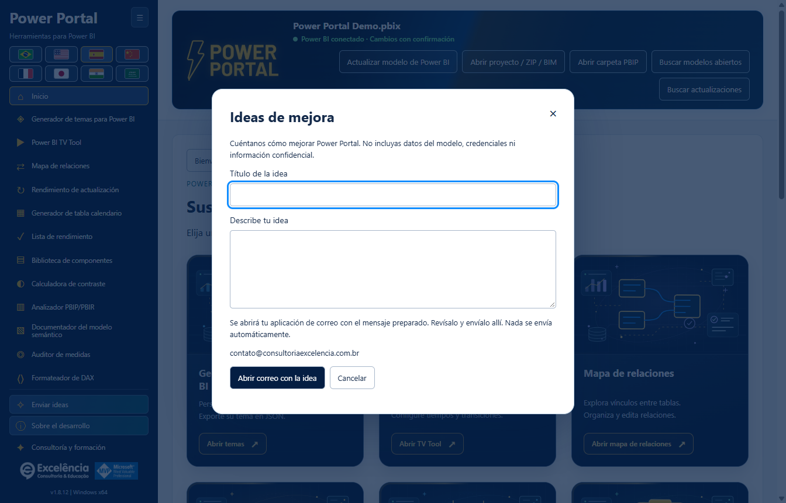

**1.8.10 — Ilustraciones de primer plano animadas y hover más rico**

Las doce portadas de inicio ahora animan la ilustración principal de cada herramienta, no solo el fondo: flotación y rotación suaves con un indicador de verificación pulsante. Al pasar el ratón o enfocar con el teclado aparecen paneles de barras, un indicador hexagonal, una órbita discontinua y partículas animadas. Las animaciones adicionales se pausan fuera del hover/foco. Las capas decorativas no interceptan clics ni entran en el árbol de accesibilidad. La preferencia de movimiento reducido detiene las animaciones conservando detalles estáticos, contraste y foco. Se mantienen las ilustraciones locales originales sin texto, los ocho idiomas y la navegación. Las pruebas del paquete midieron cambios reales en las transformaciones del primer plano y los paneles, foco por teclado, movimiento reducido, doce portadas distintas y diseño en ocho idiomas. Las capturas son imágenes estáticas de los estados normal/hover, no vídeos; los datos son sintéticos.

**1.8.9 — Muestra del calendario y acceso a la actualización nativa**

En Generador de tabla calendario, la muestra real (hasta 50 filas) aparece debajo de Generar script. Actualizar en Power BI está al lado y, con conexión activa, abre Rendimiento de actualización e inicia el mismo flujo nativo de actualización de datos con confirmación. Allí se muestran estados, tiempos y recuentos de filas. Actualiza todo el modelo: no aplica el script generado, no crea ni sustituye una tabla calendario y no guarda el PBIX. Crear calendario en Power BI sigue siendo una acción separada. El botón se deshabilita sin conexión, admite teclado y está traducido a los ocho idiomas. Cancelación y errores usan el flujo existente. La muestra conserva la última lectura: usa Leer calendario seleccionado para consultarla de nuevo tras actualizar. Las pruebas de la aplicación empaquetada verificaron posición, ocho traducciones, bloqueo sin conexión, conexión exacta, cancelación, errores visibles, reintento y creación de calendario intacta. No se inició ninguna actualización real; las capturas usan datos sintéticos.

**1.8.8 — Líneas dinámicas y envío de temas verificado**

En Mapa de relaciones, Estilo de líneas alterna entre Curvas y Líneas rectas con ángulos de 90 grados. Los extremos usan dinámicamente los bordes superior/inferior o izquierdo/derecho enfrentados, considerando el tamaño real de las tarjetas. Las conexiones laterales conservan la altura de la columna relacionada. Las flechas negras con borde blanco siguen los tramos rectos sin inclinarse en las esquinas. El estilo se guarda automáticamente y viaja con el JSON exportado; los diseños anteriores conservan las curvas. No cambia el diseño nativo de Power BI ni calcula rutas globales para evitar obstáculos.

Enviar tema directamente a Power BI devuelve el foco a Power Portal tras la importación nativa y durante la verificación por exportación, solo si Power BI está en primer plano. Una vez verificado el tema, muestra Power BI; los errores también muestran la ventana seleccionada. Los diálogos nativos pueden aparecer brevemente y no se ocultan: Desktop no tiene una API de temas compatible sin diálogos. Se gestionan los cambios asíncronos de pestaña antes de confirmar el tema. Una prueba real autorizada de la aplicación empaquetada verificó importación/exportación, retorno al Portal y activación final de Power BI; después restauró el tema Predeterminado original sin guardar el PBIX. Todas las capturas usan datos sintéticos.

**1.8.7 — Selección de colores clara y fiable**

Los once colores del tema tienen ahora una muestra nativa visible y un botón Seleccionar color junto al campo HEX editable. Pulse la muestra o el botón, o use Intro/Espacio con el botón enfocado. El selector ya no depende de un campo invisible sin tamaño ni de un doble clic en HEX. Se conservan la edición manual, importación, vista previa en vivo y exportación JSON. Los errores se muestran explícitamente. Se verificó varias veces la apertura nativa en Windows, además de los once botones por ratón/teclado y los textos en ocho idiomas.

Análisis de actualización se llama ahora Rendimiento de actualización en el menú, inicio, título y ocho idiomas. Solo cambia el nombre: actualización nativa, progreso, tiempos, filas, historial local y compatibilidad JSON/CSV no cambian. Los análisis guardados siguen disponibles sin migración ni nueva actualización de datos. Las imágenes usan datos sintéticos.

**1.8.6 — Siga la actualización dentro de Power Portal**

Inicie Actualizar y analizar en Power Portal y vea tarjetas en vivo con cada tabla, estado observado, fase del motor, tiempo de actividad y el último texto de progreso nativo disponible de Power BI. Power Portal recupera el foco al iniciar y, si Power BI vuelve al primer plano, al finalizar. No roba repetidamente el foco de otras aplicaciones. Ver en Power BI abre el archivo seleccionado sin iniciar otra actualización; esta elección desactiva el retorno automático del foco durante esa captura.

Power BI sigue siendo el motor. Su ventana puede aparecer brevemente: no es una API compatible de procesamiento de PBIX sin ventana. Credenciales, errores y cancelación permanecen en Power BI; los diálogos nunca se ocultan ni cierran automáticamente. El texto nativo conserva el idioma de Power BI e indica la hora de la última lectura. La ausencia de texto se muestra explícitamente; el seguimiento del motor continúa si falla el lector. Una fase terminada no demuestra que la tabla esté completa, no se inventan porcentajes y las filas finales se cuentan después de la captura. El historial y JSON incluyen los estados nativos: revise las exportaciones antes de compartirlas. La aplicación empaquetada se probó con una actualización real autorizada: 4/4 tablas medidas, 4/4 recuentos, estados en vivo, foco recuperado, Ver en Power BI funcional e historial conservado al recargar. No se guardó automáticamente el PBIX; las imágenes usan datos sintéticos.

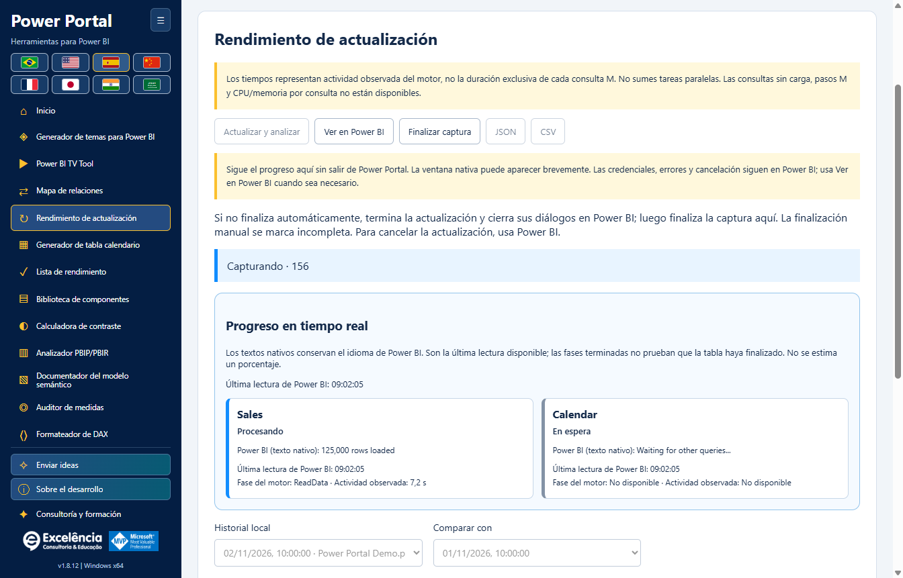

**1.8.5 — Corrección de las mediciones de actualización nativa**

Rendimiento de actualización ahora reconoce el comando XML Refresh nativo de Power BI Desktop, incluso dentro de Batch, además de XMLA Process y TMSL refresh. Antes, la actualización podía ejecutarse pero su progreso se descartaba, dejando 0 tablas medidas, recuentos no disponibles y refreshCompletionNotProven. Ahora se acepta el éxito explícito del motor cuando falta el campo opcional Error; los códigos de error no nulos y los errores XMLA siguen prevaleciendo. El progreso exige correlación exacta de solicitud/actividad para excluir consultas visuales ajenas.

Antes del primer comando reconocido, la interfaz indica que espera eventos de actualización de Power BI. Una finalización no confirmada muestra instrucciones traducidas en lugar de solo un código técnico. Actualiza la aplicación, conecta al PBIX correcto y ejecuta Actualizar y analizar otra vez; los informes anteriores incompletos se conservan sin marcarlos como correctos. La aplicación empaquetada se validó de principio a fin en una actualización real autorizada, con actividad por tabla, filas, finalización automática e historial conservado tras recargar. Las capturas usan ejemplos sintéticos, sin datos ni nombres de modelos del usuario.

**1.8.5 — Descargar actualizaciones en el navegador**

Cuando hay una versión nueva, el aviso ofrece Descargar en el navegador junto a Actualizar ahora. Abre en el navegador predeterminado la dirección oficial del instalador detectado en GitHub sin cerrar Power Portal ni iniciar la instalación. Ejecuta el instalador descargado manualmente cuando quieras. La opción sigue disponible tras un error de actualización automática. Los errores al abrir el navegador se muestran explícitamente. Actualizar ahora sigue descargando en la aplicación, verificando SHA-256 y tamaño y solicitando autorización de Windows. Las descargas del navegador no pasan por la verificación automática de la aplicación: compara el SHA-256 publicado antes de ejecutar el instalador. Ambos botones y la explicación están traducidos a los ocho idiomas.

**1.8.5 — Vista previa del tema con líneas suaves**

El gráfico de líneas del generador de temas ahora usa curvas cúbicas suaves en lugar de segmentos rectos, tanto con datos de ejemplo como del modelo conectado. Las curvas pasan por los puntos originales sin crear picos entre los valores; se conservan colores, marcadores e información emergente. El cambio afecta solo a la vista previa: no modifica el JSON exportado ni el formato de líneas de los objetos visuales existentes en Power BI.

**1.8.5 — Correcciones al iniciar la actualización**

Rendimiento de actualización aparece inmediatamente debajo de Mapa de relaciones en el menú lateral y la galería. La búsqueda del botón nativo ignora las pestañas Home duplicadas de las vistas de consultas DAX y TMDL, evitando “Ambiguous Power BI control: home”. Si el control no está disponible, selecciona Informe, Datos o Modelo en Power BI.

[Volver al inicio](../../README.es.md) · [Instalar](INSTALLATION.md) · [Guía de seguridad](USAGE.md)

**Capturas de la aplicación: Power Portal Desktop 1.8.12, interfaz en el idioma seleccionado (español).**
Las capturas usan **metadatos y valores de consulta sintéticos de demostración**, no un PBIX de cliente. Los estados conectados ilustran las acciones compatibles de la interfaz; no se cambió ningún modelo de cliente para crear estas imágenes. Las etiquetas del selector de archivos nativo pueden seguir el idioma de Windows. La captura real de la cinta de Power BI fue proporcionada por el propietario y recortada para eliminar el título privado del archivo; conserva su portugués original.

Las flechas de relaciones ahora se sitúan sobre la curva y giran según su dirección local, incluso en enlaces diagonales o invertidos. Flechas SVG más grandes, de 36 × 26 unidades, siempre negras con un contorno blanco de 3 unidades, independientemente del color de la línea. El filtro unidireccional sigue del destino al origen; el bidireccional muestra dos flechas opuestas. El filtro automático conserva el signo de interrogación. Este cambio es solo visual.

El encabezado animado de Power Portal ahora contiene el nombre del archivo, el estado de conexión y los cinco botones de lectura, importación, búsqueda y actualización. Se eliminó la barra separada debajo para liberar espacio. El contenido se adapta dentro del encabezado en ventanas pequeñas y en los ocho idiomas, incluido árabe. Se mantienen las confirmaciones, los avisos y las actualizaciones.

## Crear una relación real en Power BI

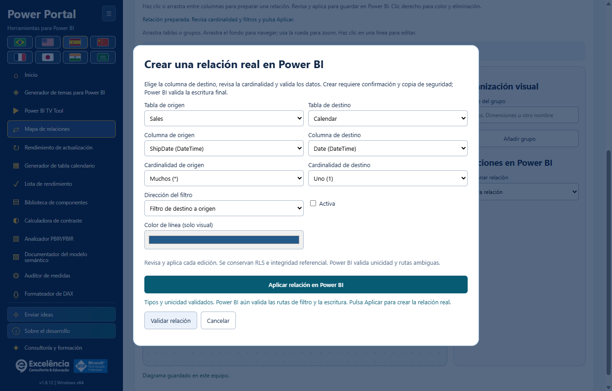

El Mapa de relaciones aparece ahora inmediatamente después de TV Tool en el menú lateral y la galería inicial. Se eliminó el bloque genérico Datos reales del modelo del Generador de calendario y la Biblioteca de componentes. Se mantienen sus controles propios de lectura y envío; el período real utiliza el calendario seleccionado dentro de la herramienta. Las portadas de inicio se redibujaron como ilustraciones vectoriales locales sin texto incrustado. Los títulos, descripciones y acciones permanecen fuera de las imágenes y siguen el idioma elegido. Arrastra una columna de origen a otra tabla para abrir el diálogo de relación real y elegir la columna de destino. Soltar sobre una columna la preselecciona. Revisa cardinalidad, filtro y estado activo; luego valida y aplica con confirmación nativa y copia BIM.

La validación comprueba tipos, pares duplicados, enlaces directos activos y recuentos reales de filas y valores distintos en ambas columnas, sin muestreo. Rechaza duplicados en el lado Uno. Las consultas tienen un límite de 20 segundos y errores explícitos. Validar nunca escribe. Aplicar repite la validación y el motor comprueba claves y rutas ambiguas al guardar. Un borrador discontinuo no es una relación guardada: solo una escritura confirmada correcta la crea. Guarda el PBIX después. Las pruebas e imágenes usan datos sintéticos, sin modificar archivos de clientes.

## Cómo organizar con grupos

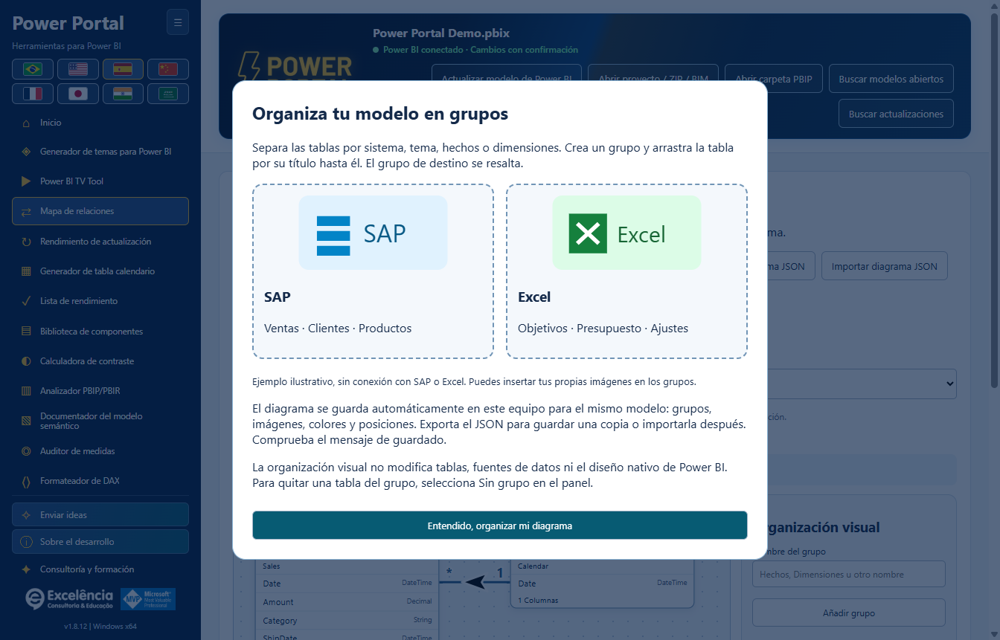

La introducción aparece en la primera visita al mapa de cada sesión. Ábrela de nuevo con **Cómo organizar con grupos**. SAP y Excel son ejemplos ilustrativos, no nuevos conectores ni logotipos oficiales. Los grupos vacíos son zonas de destino visibles. Soltar en un grupo resaltado asigna la tabla; fuera conserva su grupo actual.

Separa las tablas por sistema, tema, hechos o dimensiones. Crea un grupo y arrastra la tabla por su título hasta él. El grupo de destino se resalta.

El diagrama se guarda automáticamente en este equipo para el mismo modelo: grupos, imágenes, colores y posiciones. Exporta el JSON para guardar una copia o importarla después. Comprueba el mensaje de guardado.

La organización visual no modifica tablas, fuentes de datos ni el diseño nativo de Power BI. Para quitar una tabla del grupo, selecciona Sin grupo en el panel.

## Abrir Power Portal desde Herramientas externas

Después de instalar, reinicie Power BI Desktop, abra un PBIX y haga clic en **Herramientas externas > Power Portal**.

La pestaña portuguesa **Ferramentas externas** corresponde a **Herramientas externas** en español (**External Tools** en inglés). El instalador registra el icono en esta cinta. Al hacer clic, se inicia **una ventana independiente de Power Portal conectada al modelo del archivo abierto**. Es una aplicación complementaria externa, no un objeto visual del informe, un panel incrustado ni una extensión interna de Microsoft.

## Inicio y navegación

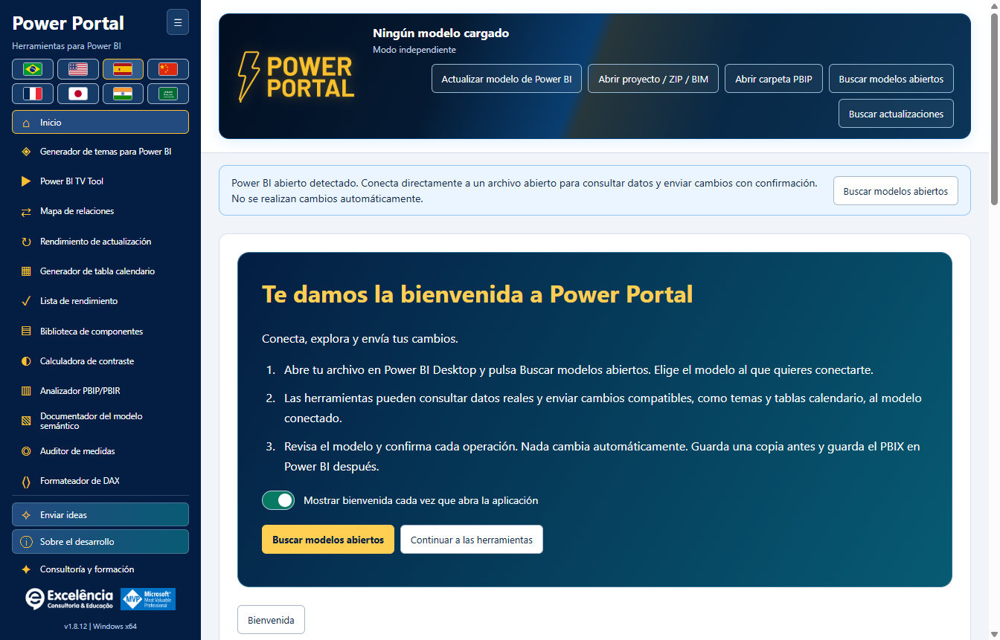

El Mapa de relaciones aparece ahora inmediatamente después de TV Tool en el menú lateral y la galería inicial. Las portadas de inicio se redibujaron como ilustraciones vectoriales locales sin texto incrustado. Los títulos, descripciones y acciones permanecen fuera de las imágenes y siguen el idioma elegido.

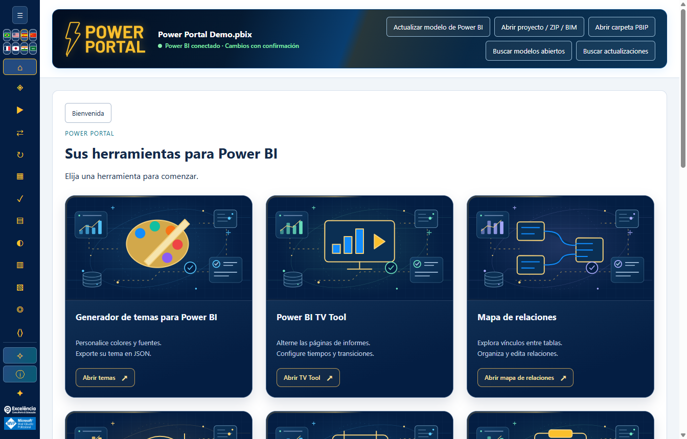

Contraiga la barra lateral para disponer de más espacio de trabajo; la preferencia se conserva. Los iconos mantienen sus nombres accesibles e información sobre herramientas. El área de trabajo principal y los formularios individuales de las herramientas aún pueden desplazarse; el cambio sin desplazamiento se aplica al catálogo de la barra lateral.

## Conectarse a un archivo ya abierto en Power BI

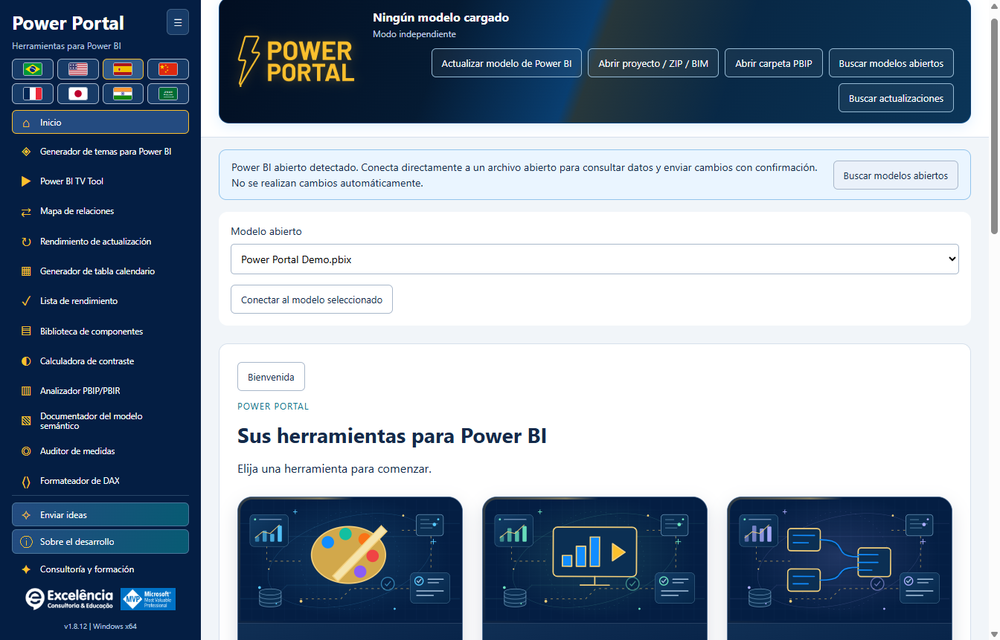

Al iniciarse desde un acceso directo de Windows, la aplicación detecta los modelos locales de Power BI disponibles y explica que puede conectarse directamente a un archivo abierto. Elija **Buscar modelos abiertos**, verifique el nombre del archivo y haga clic en **Conectar al modelo seleccionado**. Con varios archivos abiertos, elija explícitamente el deseado.

El inicio desde la cinta Herramientas externas pasa automáticamente la conexión de esa instancia de Desktop y lee sus metadatos. **Conectarse no escribe cambios.**

## Aviso de nueva versión

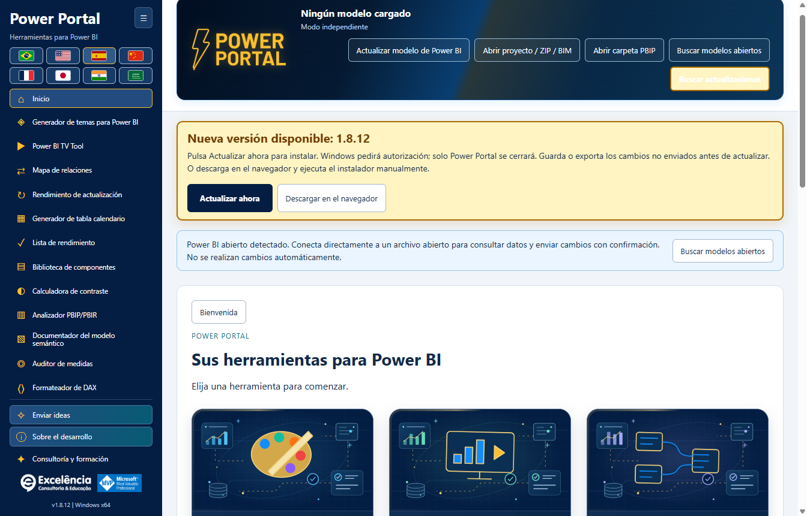

La captura usa un **resultado sintético de una futura versión 1.8.12** para mostrar el aviso en la versión 1.8.12. No afirma que 1.8.12 se haya publicado. Los usuarios de 1.6.2 o posterior ya pueden recibir el aviso real de 1.8.12.

En 1.6.4, el aviso ámbar permanece visible al desplazarse y se anima suavemente salvo que esté activado el movimiento reducido. No hay un aviso permanente de «actualizado» ocupando espacio.

La aplicación instalada comprueba la última versión estable oficial al inicio. Haga clic en **Actualizar ahora** para descargar y verificar el instalador y, después, apruebe la solicitud de administrador de Windows. Se actualiza la carpeta de instalación existente y solo se cierra Power Portal. **Conectarse o comprobar por sí solo nunca instala nada.** Guarde/exporte primero las ediciones de herramientas no enviadas y vuelva a abrir la aplicación cuando termine la instalación.

**Buscar actualizaciones** reintenta la comprobación en cualquier momento. Los fallos de conexión/límites de solicitudes/suma de comprobación/UAC se muestran explícitamente sin desactivar las herramientas locales. [Guía completa de actualizaciones](UPDATES.md).

## Interacciones directas con el archivo abierto de Power BI

Estas acciones no se limitan a descargar texto o JSON:

| Pantalla/acción | ¿Lee o cambia Power BI? | Protección |
|---|---|---|
| Actualizar modelo de Power BI | Lee tablas, columnas, medidas y relaciones del modelo semántico del archivo seleccionado. | Sin escritura en el modelo. |
| Consultar datos en vivo/intervalos de fechas/muestras | Lee valores reales del modelo mediante el motor local. | Consultas estructuradas y acotadas; no son los filtros de la página activa. |
| Enviar tema directamente a Power BI | Aplica el JSON generado a la ventana del informe seleccionada. | Confirmación, importación visible en la interfaz y verificación del tema exportado. |
| Crear calendario en Power BI | Crea una tabla de fechas calculada nueva en el modelo semántico. | Confirmación y copia de seguridad de metadatos; actualice después en Desktop. |
| Crear medida HTML en Power BI | Crea una medida nueva en la tabla del modelo elegida. | Confirmación y copia de seguridad de metadatos; añada el objeto visual HTML manualmente. |
| Actualizar medida en Power BI | Escribe el DAX formateado en la medida existente seleccionada. | Confirmación, copia de seguridad de metadatos y protección frente a cambios simultáneos. |
| Aplicar/eliminar relación en Power BI | Crea, edita, activa/desactiva o elimina la relación entre columnas seleccionada. | Confirmación nativa, copia de seguridad de metadatos, comprobaciones de estado obsoleto y validación del motor; ajustes RLS/integridad conservados. |

**Guarde una copia independiente del PBIX antes de aplicar cambios.** Confirme el archivo y la expresión de destino y guarde después el PBIX en Desktop. La aplicación nunca guarda el PBIX silenciosamente.

### Datos del modelo en vivo

Las muestras siguen limitadas a 50 filas y las consultas a 20 segundos. El calendario se lee mediante su propio selector y vista previa; el bloque genérico ya no aparece en el Generador de calendario ni en la Biblioteca de componentes. El estado de conexión permanece en el encabezado.

### Generador de temas

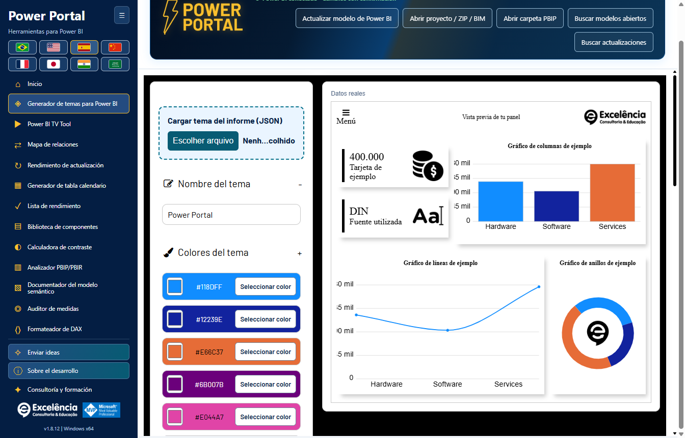

Use el área destacada **Cargar tema del informe (JSON)**, edite colores/fuentes y observe la vista previa en vivo. Exporte JSON o desplácese hasta el final de la página, debajo del formulario y la vista previa, para usar **Enviar tema directamente a Power BI**.

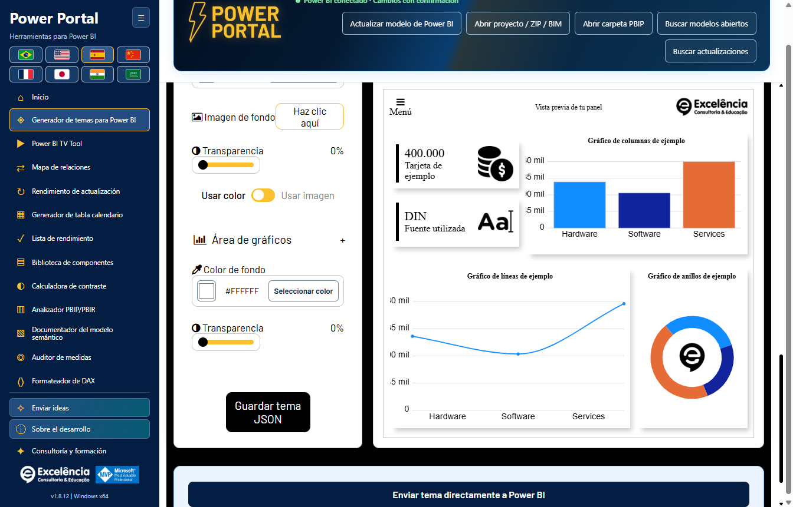

Para partir del tema existente del informe, guarde su JSON en Desktop y cárguelo aquí. Una conexión al modelo semántico no lee los temas de informes. El envío directo sigue usando el **cuadro de importación visible**: ninguna API genérica compatible de temas de Desktop lo elimina. No interactúe con Power BI mientras se ejecuta la automatización.

### Generador de calendarios

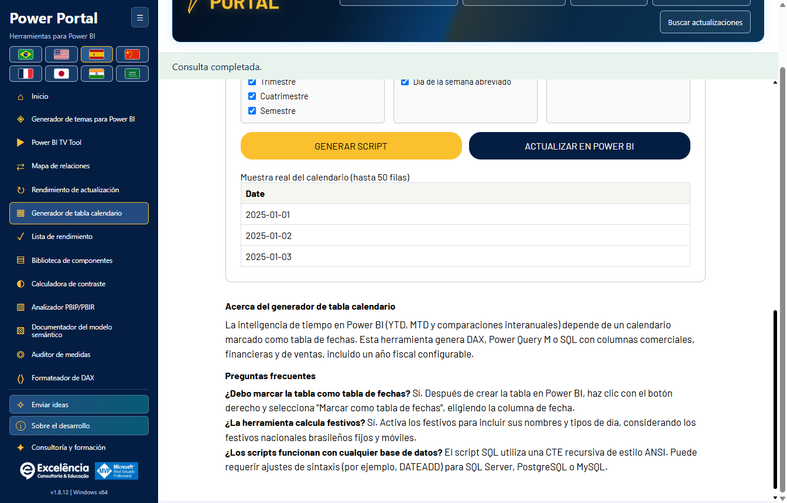

Lea la expresión/intervalo de fechas/muestra de un calendario existente, exporte DAX o JSON de la muestra y genere un calendario nuevo. **Crear calendario en Power BI** crea una tabla calculada nueva con copia de seguridad y confirmación, en lugar de sustituir el calendario existente seleccionado.

Actualice en Desktop después de crearla. La reversión protegida del calendario solo está disponible si la tabla creada sigue coincidiendo y no tiene dependencias.

### Biblioteca de componentes

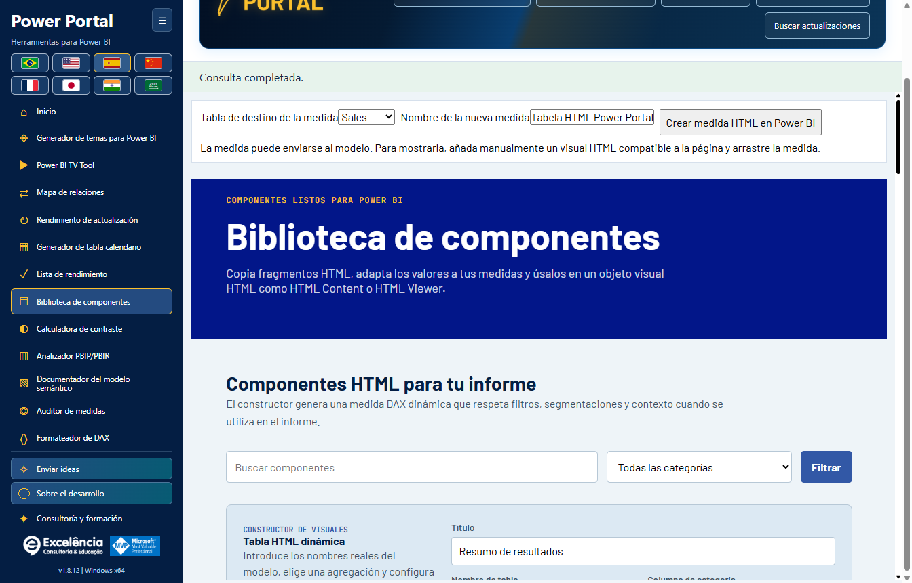

Elija la tabla de destino y un nombre nuevo para la medida. El constructor usa los nombres de campos/medidas del modelo y permite **Crear medida HTML en Power BI**. La medida se escribe en el modelo después de la confirmación.

Debe añadir manualmente un objeto visual HTML compatible al informe y asignarle esa medida; este botón no coloca un objeto visual en la página.

### Formateador DAX

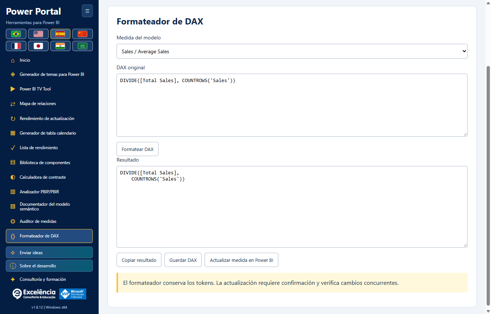

Seleccione la medida existente del modelo, formatee su expresión y elija **Actualizar medida en Power BI** para devolver el DAX a esa medida. Las acciones de copiar/exportar son independientes. La actualización rechaza cambios simultáneos en la expresión y requiere confirmación.

## Otras herramientas

### Mapa de relaciones

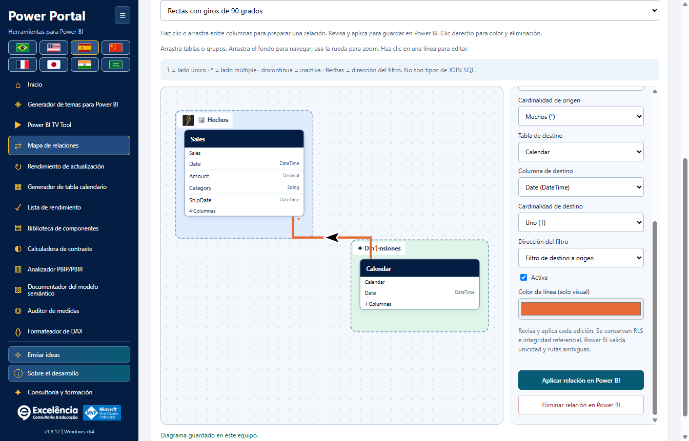

La nueva herramienta exclusiva de Desktop muestra vínculos reales entre tablas, cardinalidades, flechas de filtro y líneas inactivas discontinuas. Arrastre cuadros/grupos libremente, cambie el zoom/desplazamiento, asigne nombres/iconos descriptivos y personalice los colores de grupos y líneas. Las disposiciones visuales se guardan automáticamente por modelo y pueden exportarse/importarse como JSON sin enviar escrituras al modelo.

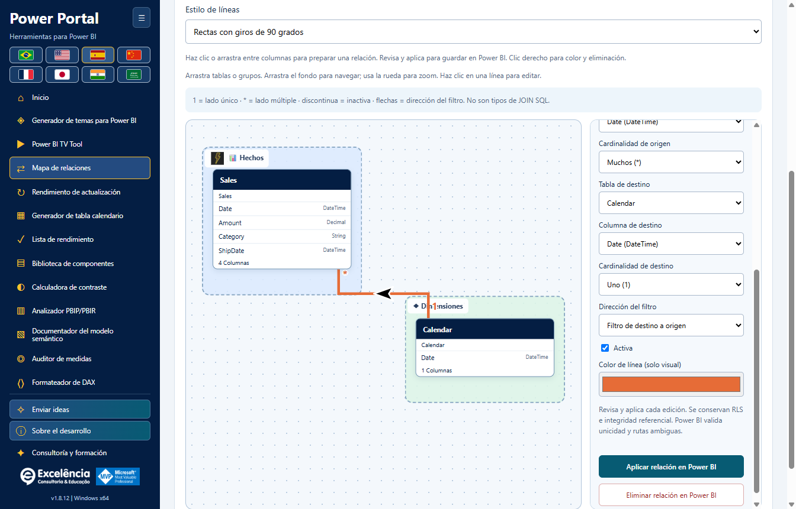

Seleccione una línea para inspeccionar sus columnas exactas, cardinalidad, dirección del filtro y estado activo. **Aplicar relación a Power BI** o **Eliminar relación en Power BI** confirma cada edición después de la confirmación nativa y la copia de seguridad. Los proyectos importados siguen siendo de solo lectura. El estilo no cambia los nombres de las tablas ni el diagrama nativo de Power BI. [Recorrido completo y límites de seguridad](RELATIONSHIPS.md).

En 1.8.12, haga clic o arrastre entre columnas para preparar un borrador discontinuo y después revíselo/aplíquelo. Haga clic con el botón derecho en una línea para cambiar su color, editarla o eliminarla. Los ajustes de grupo ofrecen imágenes PNG/JPEG locales y más iconos; arrastre el fondo o el encabezado del grupo. Las tablas automáticas de fecha/hora se ocultan de forma predeterminada. **Actualizar diagrama desde Power BI** vuelve a leer los cambios externos sin copiar las coordenadas de la disposición nativa. **Detectar relaciones automáticamente** inicia la detección nativa de Desktop después de la confirmación y la copia de seguridad; revise y cierre sus diálogos antes de **Finalizar detección y actualizar diagrama**.

### Power BI TV Tool

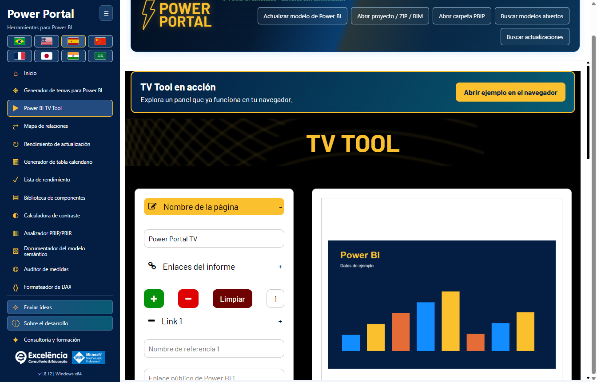

El aviso superior **TV Tool en acción** abre un [ejemplo oficial funcional](https://www.powerportal.com.br/tv_tool/painel_exemplo_power_bi_tv_tool.html) en el navegador predeterminado; requiere internet, pero no envía datos del modelo local. La presentación ilustrativa local del formulario sigue disponible.

Rote páginas de informes publicados o imágenes locales, establezca duraciones/transiciones, previsualice y exporte HTML. TV **no** rota las páginas del PBIX local abierto. Los informes privados publicados requieren inicio de sesión/licencia/permisos de Microsoft adecuados.

### Lista de comprobación de rendimiento

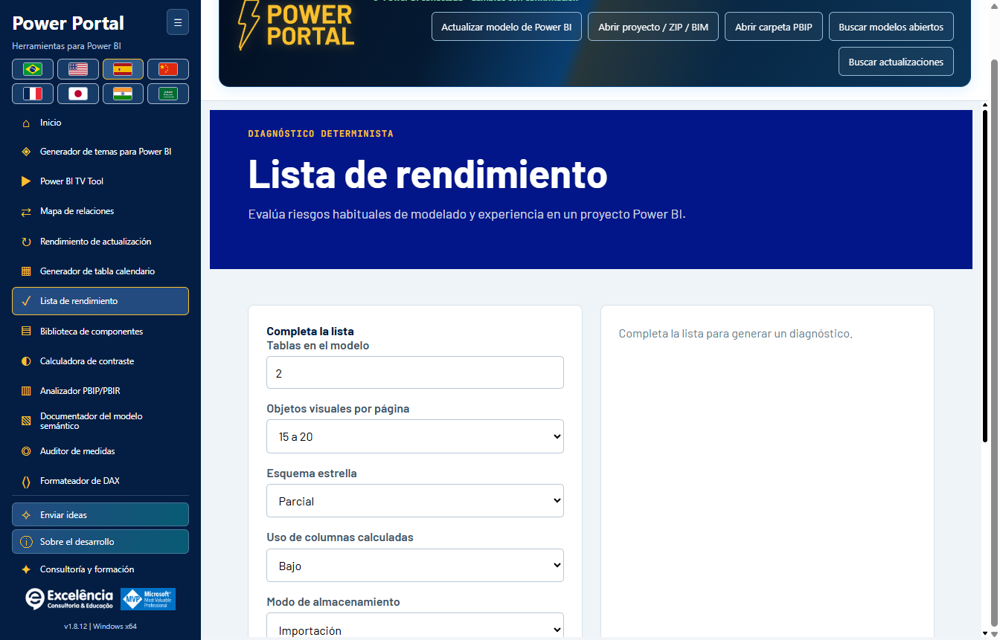

Revise los elementos de la lista basados en el modelo y las características manuales del informe. Las puntuaciones son orientación heurística, no mediciones del tiempo de los objetos visuales.

### Calculadora de contraste

Compruebe la legibilidad/contraste según los umbrales WCAG. Es una herramienta de análisis local y no cambia automáticamente el formato del informe.

### Analizador PBIP/PBIR

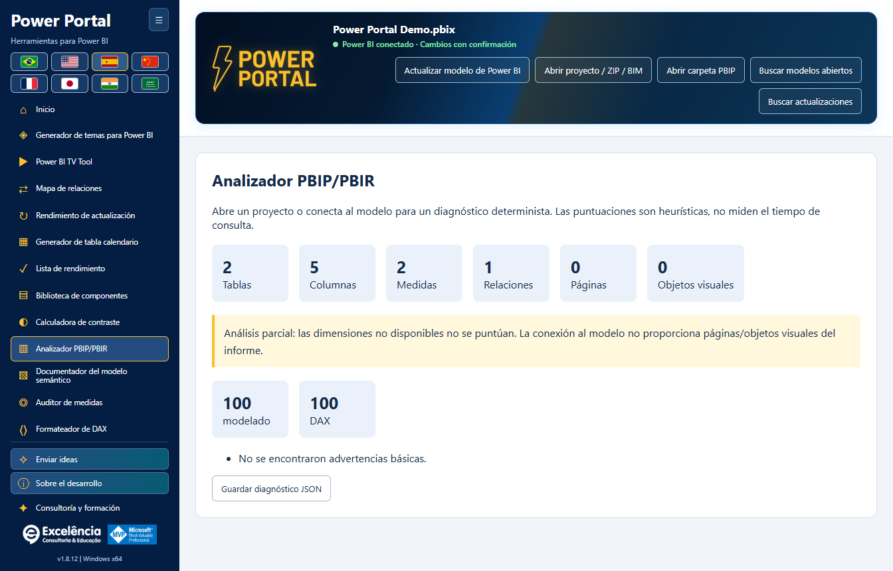

Analice la estructura disponible del proyecto cargado. Una conexión en vivo al modelo semántico no proporciona metadatos de páginas/objetos visuales del informe, por lo que las dimensiones no disponibles se indican como parciales. Los metadatos de proyectos PBIR importados pueden proporcionar recuentos adicionales.

### Documentador del modelo semántico

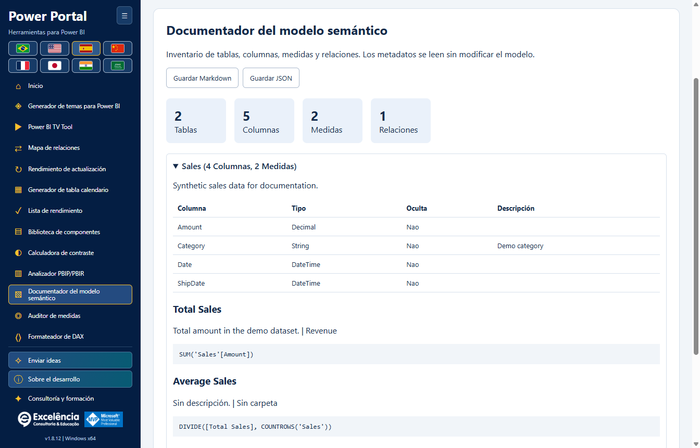

Lea y exporte documentación de tablas/columnas/medidas/relaciones en Markdown o JSON. Esta herramienta no modifica el modelo. Las exportaciones pueden contener nombres confidenciales y DAX; almacénelas adecuadamente.

### Auditor de medidas

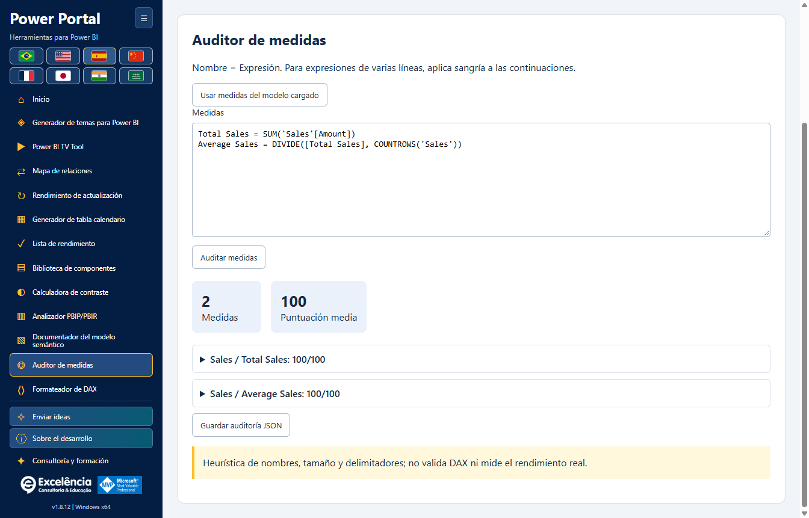

Audite medidas del modelo o DAX proporcionado mediante comprobaciones heurísticas de nombres/tamaño/delimitadores. No valida la semántica DAX ni mide el rendimiento real del informe.

## Consultoría y formación

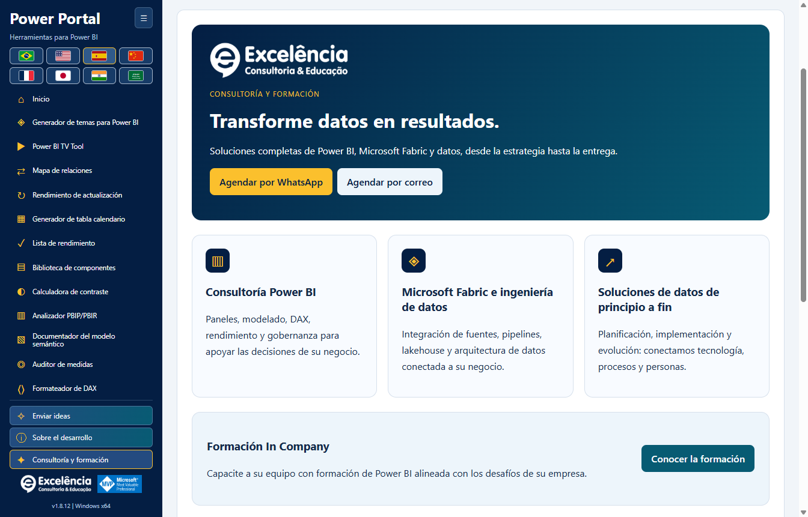

Descubra consultoría de Power BI, Microsoft Fabric, ingeniería de datos y soluciones completas. Incluye formación In Company, vídeos destacados y acciones de contacto. WhatsApp/correo electrónico abren un borrador o página del navegador; no se envía automáticamente ningún mensaje ni solicitud de cita.

[Notas de versión](../../CHANGELOG.es.md) · [Solución de problemas](TROUBLESHOOTING.md)

## Rendimiento de actualización

Mide la actualización nativa. Compara tiempos y filas. [Rendimiento de actualización](REFRESH-ANALYSIS.md).

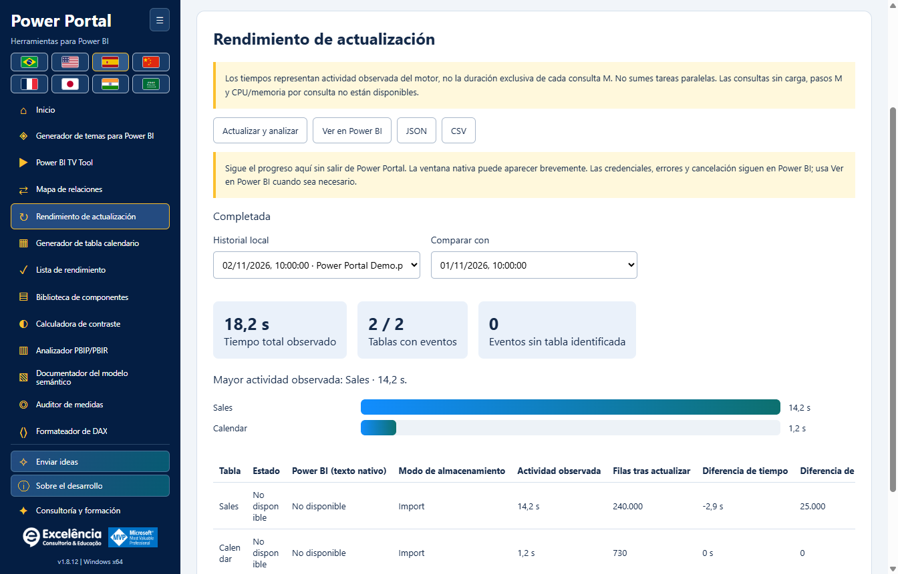

La actividad observada es la unión de intervalos del motor identificados exactamente por tabla, sin duplicar fases anidadas. No es solo el tiempo de consulta del origen ni una ruta crítica demostrada. El total observado va desde el inicio hasta detectar la finalización, incluye la sobrecarga de interfaz/verificación y excluye el recuento posterior de filas. Los eventos sin tabla se indican aparte.

La finalización automática requiere observar el fin de los comandos de actualización y una ventana de Power BI lista. Cierra los diálogos de resultado. Finalizar captura manualmente siempre indica análisis incompleto, no demuestra éxito ni cancela la actualización. Los errores del motor/rastreo son explícitos. Una captura interrumpida no se presenta como completada.

## Tarjetas animadas en el inicio

Las doce tarjetas iniciales usan el mismo azul marino del menú (#041e43), con escenas vectoriales originales sin texto. Cada herramienta conserva su ilustración central, enriquecida con paneles, gráficos, base de datos, órbitas, cuadrícula y satélites flotantes. Las líneas de señal se mueven suavemente. Las portadas no cargan imágenes, scripts ni servicios externos.

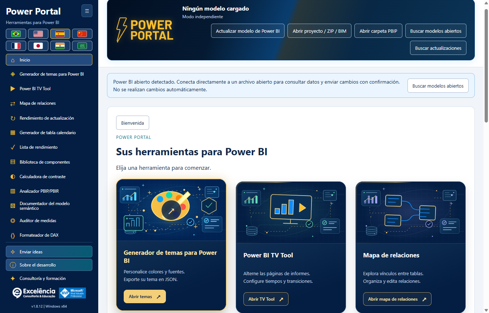

Pasa el ratón o enfoca con el teclado para mostrar marco y brillo dorados, reflejo de luz, escena resaltada, flecha circular y acción dorada. Pulsar ofrece respuesta inmediata sin retrasar la navegación. Intro/Espacio siguen abriendo la misma herramienta. La preferencia de movimiento reducido detiene las animaciones conservando el realce estático y el foco visible. Los títulos y acciones quedan fuera de la imagen y siguen el idioma elegido. Las capturas muestran estados estáticos normal/hover, no vídeos.

## Bienvenida y preferencia de inicio guardada

La página inicial explica cómo abrir un archivo en Power BI Desktop, buscar su modelo abierto y enviar cambios compatibles con confirmación. Mostrar bienvenida cada vez que abra la aplicación viene activado; desactívalo para ocultarla en futuros inicios. Continuar a las herramientas solo cierra la presentación actual. Bienvenida en Inicio permite reabrirla y reactivar el interruptor. La opción se guarda en el perfil local, separado de la edición Store. Admite ocho idiomas y teclado. Abrir esta pantalla no modifica modelos. Guarda una copia antes y guarda el PBIX en Power BI después. Las pruebas verificaron reinicios reales, persistencia, búsqueda de modelos y diseño traducido. Las operaciones fueron simuladas; no se modificaron datos reales.
