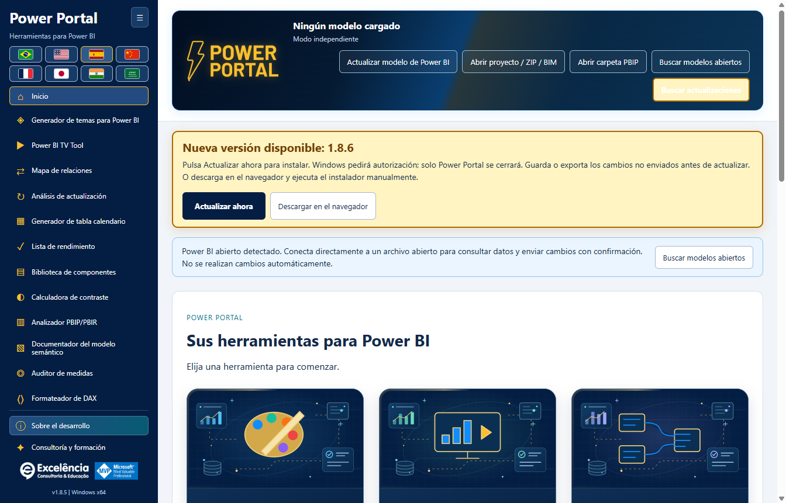

# Comprobación de actualizaciones e instalación automática

<!-- language-selector -->
[🇺🇸 English](../UPDATES.md) · [🇧🇷 Português](../pt-BR/UPDATES.md) · [🇪🇸 Español](UPDATES.md) · [🇨🇳 简体中文](../zh-CN/UPDATES.md) · [🇫🇷 Français](../fr/UPDATES.md) · [🇯🇵 日本語](../ja/UPDATES.md) · [🇮🇳 हिन्दी](../hi/UPDATES.md) · [🇸🇦 العربية](../ar/UPDATES.md)
<!-- /language-selector -->

**1.8.5 — Descargar actualizaciones en el navegador**

Cuando hay una versión nueva, el aviso ofrece Descargar en el navegador junto a Actualizar ahora. Abre en el navegador predeterminado la dirección oficial del instalador detectado en GitHub sin cerrar Power Portal ni iniciar la instalación. Ejecuta el instalador descargado manualmente cuando quieras. La opción sigue disponible tras un error de actualización automática. Los errores al abrir el navegador se muestran explícitamente. Actualizar ahora sigue descargando en la aplicación, verificando SHA-256 y tamaño y solicitando autorización de Windows. Las descargas del navegador no pasan por la verificación automática de la aplicación: compara el SHA-256 publicado antes de ejecutar el instalador. Ambos botones y la explicación están traducidos a los ocho idiomas.

[Volver al inicio](../../README.es.md) · [Instalación](INSTALLATION.md)

<a name="available-from-version-162"></a>
## Disponible desde la versión 1.6.2

Instale **1.6.2 manualmente una vez** si tiene 1.6.1 o una versión anterior. Las aplicaciones antiguas no pueden adquirir un nuevo actualizador sin instalar primero la versión que lo contiene.

La aplicación **instalada** comprueba la última versión pública estable de `luisgnserra/powerportaldesktop` al abrirse. Compara versiones numéricas de tres partes, ignora las versiones anteriores/actuales y no ofrece compilaciones en borrador ni preliminares.

La ejecución de desarrollo/desde el código fuente no descarga ni instala actualizaciones.

<a name="update-flow"></a>
## Flujo de actualización

1. Abra Power Portal. Con internet disponible, comprueba si existe una versión más reciente.
2. Si existe, un aviso ámbar destacado muestra la versión y **Actualizar ahora**. Permanece visible al desplazarse, con una suave animación de resplandor; las preferencias de movimiento reducido desactivan la animación. El botón de comprobación también se destaca.
3. **Guarde/exporte las ediciones de las herramientas no enviadas** antes de continuar. Las escrituras/temas del modelo ya en curso bloquean la actualización.
4. Haga clic en **Actualizar ahora**. No se instala nada por el mero hecho de abrir la aplicación o buscar actualizaciones.
5. El proceso principal descarga el instalador x64 oficial por HTTPS y comprueba su tamaño exacto y SHA-256 con los metadatos publicados del recurso de la versión de GitHub.
6. Windows solicita autorización de administrador. Apruebe únicamente si confía en esta distribución.
7. Tras la autorización/el inicio del instalador, Power Portal se cierra y el instalador se ejecuta silenciosamente en la **carpeta de instalación existente**. **Power BI Desktop no se cierra.**
8. Vuelva a abrir Power Portal cuando termine la instalación. Reinicie Desktop si necesita volver a cargar su cinta/registro.



La captura es un **aviso simulado de una futura versión 1.8.5** dentro de 1.8.5, únicamente para mostrar la interfaz. No es un anuncio de 1.8.5.

<a name="receive-version-185-from-an-earlier-updater-enabled-version"></a>
### Recibir la versión 1.8.5 desde una versión anterior con actualizador

Con **1.6.2, 1.6.3 o 1.6.4** instalado, vuelva a abrir la aplicación o haga clic en **Buscar actualizaciones**. La versión estable publicada **1.8.5** debería aparecer con **Actualizar ahora**. No instale 1.8.5 manualmente primero si desea observar este aviso. Las versiones anteriores a 1.6.4 usan su aviso original; el estilo visual destacado se conserva en 1.8.5. Haga clic en el botón de actualización cuando esté listo y apruebe la autorización de Windows.

La aplicación informa del inicio del instalador, no de una instalación completada y verificada: la instalación termina después de que se cierre la aplicación antigua. Compruebe la versión mostrada de la aplicación al volver a abrirla. Windows aún puede bloquear el instalador sin firma o requerir aprobación de TI.

<a name="checks-retries-and-failures"></a>
## Comprobaciones, reintentos y fallos

**Buscar actualizaciones**, en las acciones superiores, reintenta la comprobación manualmente. No hay un bucle de sondeo en segundo plano ni instalación forzada.

En 1.6.4, una comprobación correcta que no encuentra una versión más reciente no deja un aviso de «actualizado» ocupando una línea. Los errores y las actualizaciones disponibles siguen visibles.

- Los errores sin conexión, de firewall/proxy o de límites de solicitudes de la API de GitHub se muestran en el aviso de actualización; las herramientas locales siguen funcionando.
- Los metadatos de versión no válidos, la ausencia del resumen del recurso, las sumas de comprobación que no coinciden, los hosts de redirección inesperados, un tamaño excesivo de descarga o los tiempos de espera agotados impiden la ejecución.
- Cancelar la autorización de Windows deja la aplicación disponible y muestra un error. Reintente cuando esté listo.
- Una comprobación fallida borra la oferta anterior de actualización disponible para no usar silenciosamente datos obsoletos.
- El actualizador bloquea nuevas escrituras en el modelo durante la descarga/instalación y se niega a iniciarse durante una operación activa de escritura/tema.
- Las ediciones en formularios de herramientas no enviadas/exportadas no se conservan automáticamente al reemplazar la aplicación. Exporte/guarde primero.

<a name="privacy-network-and-integrity"></a>
## Privacidad, red e integridad

Las solicitudes de actualización contienen únicamente metadatos estándar de solicitud HTTPS a GitHub, no nombres del modelo local, DAX, datos, contenido PBIX ni credenciales. Las versiones públicas no requieren inicio de sesión/token de GitHub.

Los metadatos de versión provienen de:

```text
https://api.github.com/repos/luisgnserra/powerportaldesktop/releases/latest
```

Las URL del instalador deben coincidir con el recurso exacto versionado de la publicación en este repositorio. Las redirecciones HTTPS están restringidas a GitHub y sus hosts oficiales de recursos de versiones. La aplicación conserva el hash/tamaño de los metadatos para esa descarga.

Las comprobaciones tienen un tiempo de espera total de 30 segundos y un límite de metadatos de 1 MB. Las descargas tienen un límite total de 20 minutos, tiempo de espera por inactividad del socket de 30 segundos y tamaño máximo aceptado del instalador de 1 GB. Son límites, no el tamaño habitual del paquete.

Las descargas se almacenan en `%APPDATA%\powerportal-desktop\updates`. Los archivos parciales se eliminan ante fallos gestionados; un EXE verificado puede permanecer después de instalar. No se descarga ni compila código fuente de la aplicación.

**SHA-256 es una comprobación de integridad, no una firma digital del editor.** La versión actual no está firmada. El actualizador no elude UAC, SmartScreen ni las políticas empresariales. Si su red requiere un proxy que el actualizador no puede usar, consulte a TI o instale manualmente el EXE verificado de la versión.

<a name="manual-fallback"></a>
## Alternativa manual

Use la [última versión](https://github.com/luisgnserra/powerportaldesktop/releases/latest) o el [asistente PowerShell versionado](INSTALLATION.md#command-line-installation). Los comandos existentes de asistentes fijados a una versión instalan intencionadamente esa versión, no la que sea más reciente en el futuro.
