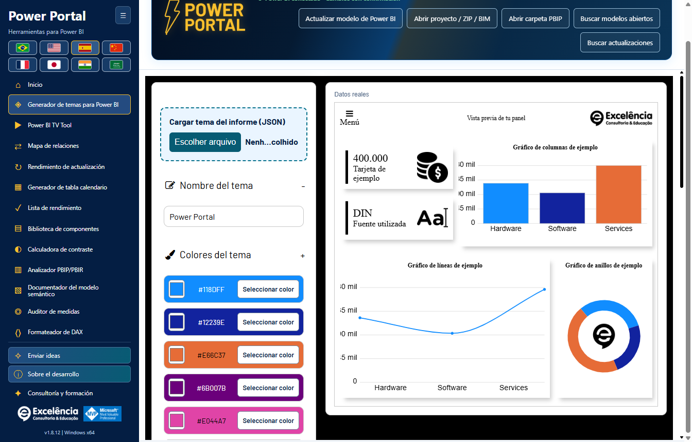
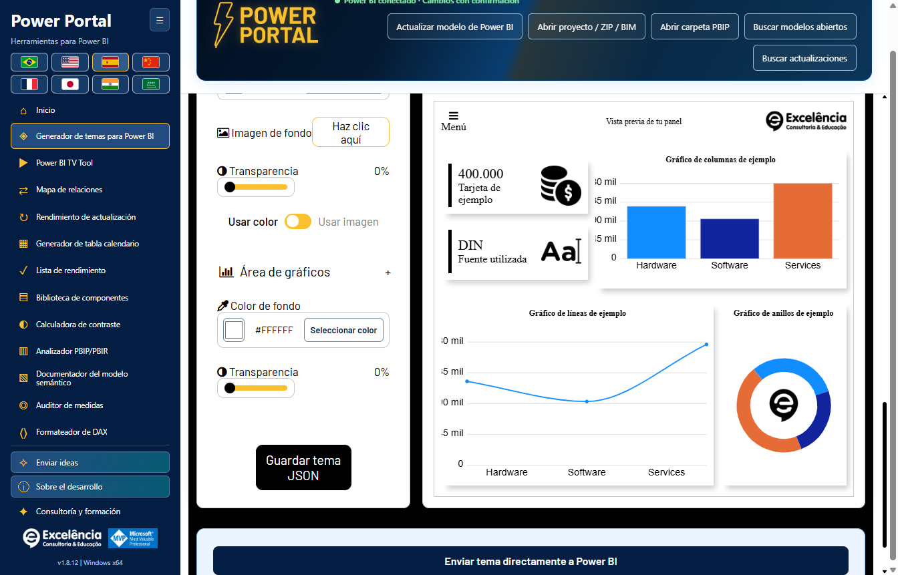
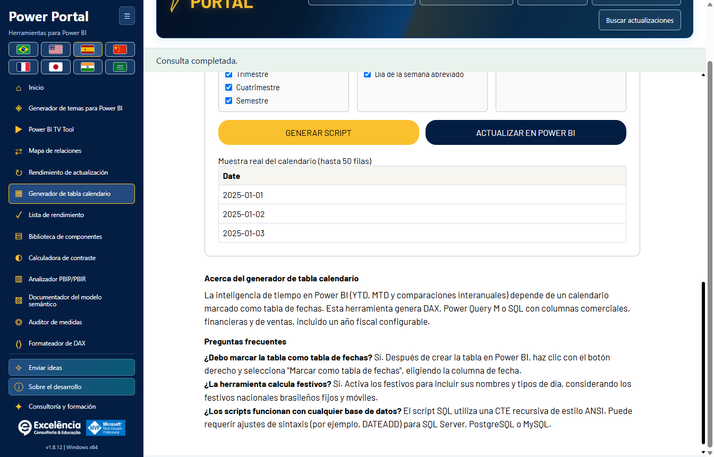
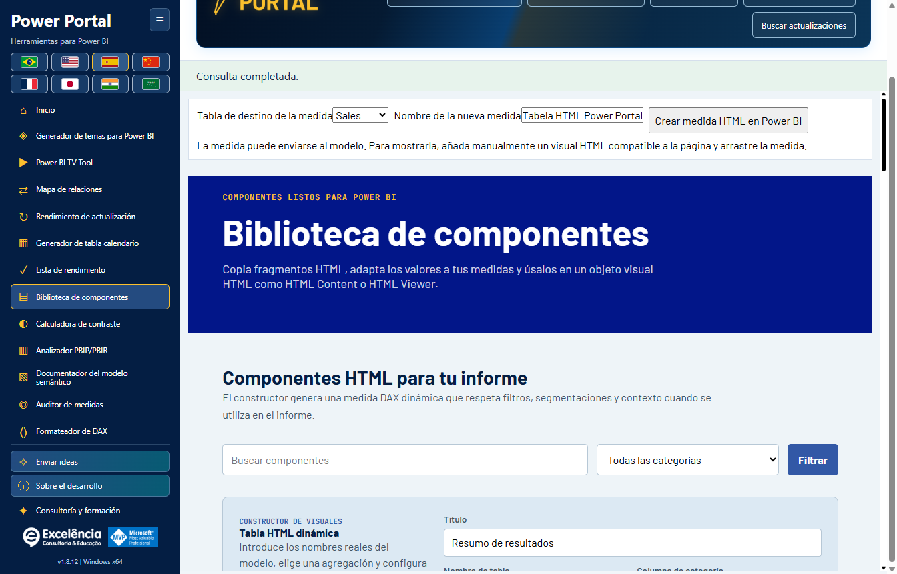
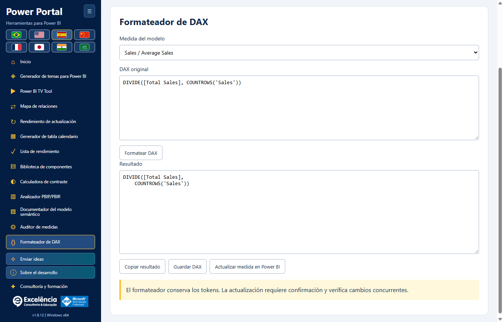
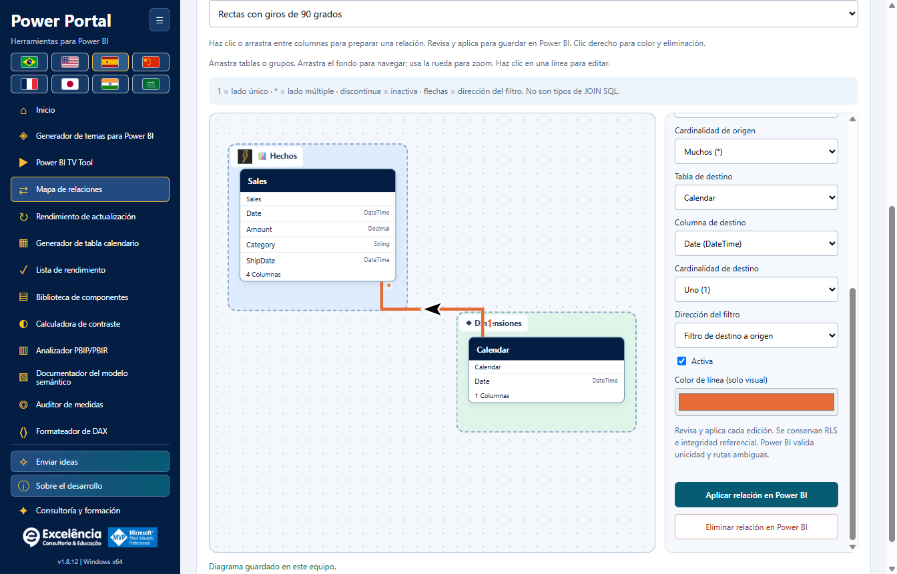
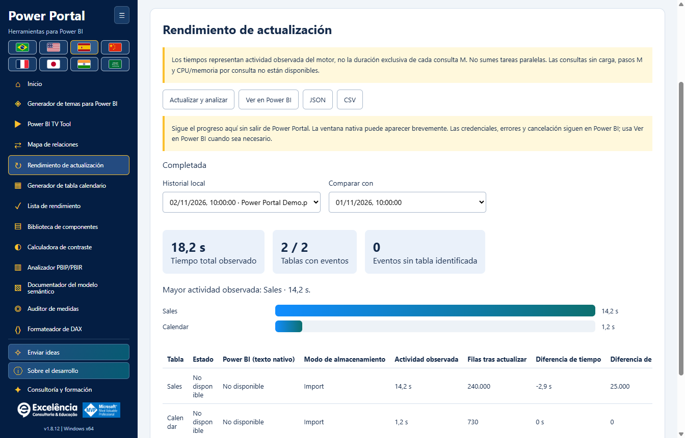

# Uso y seguridad del modelo

<!-- language-selector -->
[🇺🇸 English](../USAGE.md) · [🇧🇷 Português](../pt-BR/USAGE.md) · [🇪🇸 Español](USAGE.md) · [🇨🇳 简体中文](../zh-CN/USAGE.md) · [🇫🇷 Français](../fr/USAGE.md) · [🇯🇵 日本語](../ja/USAGE.md) · [🇮🇳 हिन्दी](../hi/USAGE.md) · [🇸🇦 العربية](../ar/USAGE.md)
<!-- /language-selector -->

**1.8.12 — Envía ideas de mejora sin saturar el menú**

Enviar ideas aparece justo encima de Acerca del desarrollo. El formulario accesible acepta un título (hasta 120 caracteres) y una descripción (hasta 1000). Abrir correo con la idea solicita abrir el cliente predeterminado con destinatario fijo contato@consultoriaexcelencia.com.br, asunto y mensaje preparados. Revisa y envía desde allí: Power Portal no envía automáticamente ni confirma la entrega. Si no abre, configura un cliente predeterminado o envía manualmente. No adjunta datos del modelo, archivos ni credenciales y no guarda borradores en disco. No incluyas información confidencial. Los errores son explícitos y conservan el texto para reintentar o copiar. El formulario funciona sin conexión hasta abrir el correo; la entrega depende de tu cuenta y red.

Los botones y espacios del menú son más compactos en ventanas bajas, sin ocultar controles ni añadir desplazamiento. Las pruebas del paquete verifican menú expandido/contraído a 680/768/900 píxeles en ocho idiomas, botones de al menos 24 píxeles, teclado, campos obligatorios, destinatario fijo/texto codificado, errores del cliente y contenido conservado. Las pruebas interceptaron la apertura: no se envió ningún correo. Las capturas usan datos sintéticos.

**1.8.10 — Ilustraciones de primer plano animadas y hover más rico**

Las doce portadas de inicio ahora animan la ilustración principal de cada herramienta, no solo el fondo: flotación y rotación suaves con un indicador de verificación pulsante. Al pasar el ratón o enfocar con el teclado aparecen paneles de barras, un indicador hexagonal, una órbita discontinua y partículas animadas. Las animaciones adicionales se pausan fuera del hover/foco. Las capas decorativas no interceptan clics ni entran en el árbol de accesibilidad. La preferencia de movimiento reducido detiene las animaciones conservando detalles estáticos, contraste y foco. Se mantienen las ilustraciones locales originales sin texto, los ocho idiomas y la navegación. Las pruebas del paquete midieron cambios reales en las transformaciones del primer plano y los paneles, foco por teclado, movimiento reducido, doce portadas distintas y diseño en ocho idiomas. Las capturas son imágenes estáticas de los estados normal/hover, no vídeos; los datos son sintéticos.

**1.8.9 — Muestra del calendario y acceso a la actualización nativa**

En Generador de tabla calendario, la muestra real (hasta 50 filas) aparece debajo de Generar script. Actualizar en Power BI está al lado y, con conexión activa, abre Rendimiento de actualización e inicia el mismo flujo nativo de actualización de datos con confirmación. Allí se muestran estados, tiempos y recuentos de filas. Actualiza todo el modelo: no aplica el script generado, no crea ni sustituye una tabla calendario y no guarda el PBIX. Crear calendario en Power BI sigue siendo una acción separada. El botón se deshabilita sin conexión, admite teclado y está traducido a los ocho idiomas. Cancelación y errores usan el flujo existente. La muestra conserva la última lectura: usa Leer calendario seleccionado para consultarla de nuevo tras actualizar. Las pruebas de la aplicación empaquetada verificaron posición, ocho traducciones, bloqueo sin conexión, conexión exacta, cancelación, errores visibles, reintento y creación de calendario intacta. No se inició ninguna actualización real; las capturas usan datos sintéticos.

**1.8.8 — Líneas dinámicas y envío de temas verificado**

En Mapa de relaciones, Estilo de líneas alterna entre Curvas y Líneas rectas con ángulos de 90 grados. Los extremos usan dinámicamente los bordes superior/inferior o izquierdo/derecho enfrentados, considerando el tamaño real de las tarjetas. Las conexiones laterales conservan la altura de la columna relacionada. Las flechas negras con borde blanco siguen los tramos rectos sin inclinarse en las esquinas. El estilo se guarda automáticamente y viaja con el JSON exportado; los diseños anteriores conservan las curvas. No cambia el diseño nativo de Power BI ni calcula rutas globales para evitar obstáculos.

Enviar tema directamente a Power BI devuelve el foco a Power Portal tras la importación nativa y durante la verificación por exportación, solo si Power BI está en primer plano. Una vez verificado el tema, muestra Power BI; los errores también muestran la ventana seleccionada. Los diálogos nativos pueden aparecer brevemente y no se ocultan: Desktop no tiene una API de temas compatible sin diálogos. Se gestionan los cambios asíncronos de pestaña antes de confirmar el tema. Una prueba real autorizada de la aplicación empaquetada verificó importación/exportación, retorno al Portal y activación final de Power BI; después restauró el tema Predeterminado original sin guardar el PBIX. Todas las capturas usan datos sintéticos.

**1.8.7 — Selección de colores clara y fiable**

Los once colores del tema tienen ahora una muestra nativa visible y un botón Seleccionar color junto al campo HEX editable. Pulse la muestra o el botón, o use Intro/Espacio con el botón enfocado. El selector ya no depende de un campo invisible sin tamaño ni de un doble clic en HEX. Se conservan la edición manual, importación, vista previa en vivo y exportación JSON. Los errores se muestran explícitamente. Se verificó varias veces la apertura nativa en Windows, además de los once botones por ratón/teclado y los textos en ocho idiomas.

Análisis de actualización se llama ahora Rendimiento de actualización en el menú, inicio, título y ocho idiomas. Solo cambia el nombre: actualización nativa, progreso, tiempos, filas, historial local y compatibilidad JSON/CSV no cambian. Los análisis guardados siguen disponibles sin migración ni nueva actualización de datos. Las imágenes usan datos sintéticos.

**1.8.6 — Siga la actualización dentro de Power Portal**

Inicie Actualizar y analizar en Power Portal y vea tarjetas en vivo con cada tabla, estado observado, fase del motor, tiempo de actividad y el último texto de progreso nativo disponible de Power BI. Power Portal recupera el foco al iniciar y, si Power BI vuelve al primer plano, al finalizar. No roba repetidamente el foco de otras aplicaciones. Ver en Power BI abre el archivo seleccionado sin iniciar otra actualización; esta elección desactiva el retorno automático del foco durante esa captura.

Power BI sigue siendo el motor. Su ventana puede aparecer brevemente: no es una API compatible de procesamiento de PBIX sin ventana. Credenciales, errores y cancelación permanecen en Power BI; los diálogos nunca se ocultan ni cierran automáticamente. El texto nativo conserva el idioma de Power BI e indica la hora de la última lectura. La ausencia de texto se muestra explícitamente; el seguimiento del motor continúa si falla el lector. Una fase terminada no demuestra que la tabla esté completa, no se inventan porcentajes y las filas finales se cuentan después de la captura. El historial y JSON incluyen los estados nativos: revise las exportaciones antes de compartirlas. La aplicación empaquetada se probó con una actualización real autorizada: 4/4 tablas medidas, 4/4 recuentos, estados en vivo, foco recuperado, Ver en Power BI funcional e historial conservado al recargar. No se guardó automáticamente el PBIX; las imágenes usan datos sintéticos.

**1.8.5 — Vista previa del tema con líneas suaves**

El gráfico de líneas del generador de temas ahora usa curvas cúbicas suaves en lugar de segmentos rectos, tanto con datos de ejemplo como del modelo conectado. Las curvas pasan por los puntos originales sin crear picos entre los valores; se conservan colores, marcadores e información emergente. El cambio afecta solo a la vista previa: no modifica el JSON exportado ni el formato de líneas de los objetos visuales existentes en Power BI.

[Volver al inicio](../../README.es.md)

El encabezado animado de Power Portal ahora contiene el nombre del archivo, el estado de conexión y los cinco botones de lectura, importación, búsqueda y actualización. Se eliminó la barra separada debajo para liberar espacio. El contenido se adapta dentro del encabezado en ventanas pequeñas y en los ocho idiomas, incluido árabe. Se mantienen las confirmaciones, los avisos y las actualizaciones.

El Mapa de relaciones aparece ahora inmediatamente después de TV Tool en el menú lateral y la galería inicial. Se eliminó el bloque genérico Datos reales del modelo del Generador de calendario y la Biblioteca de componentes. Se mantienen sus controles propios de lectura y envío; el período real utiliza el calendario seleccionado dentro de la herramienta. Las portadas de inicio se redibujaron como ilustraciones vectoriales locales sin texto incrustado. Los títulos, descripciones y acciones permanecen fuera de las imágenes y siguen el idioma elegido. Arrastra una columna de origen a otra tabla para abrir el diálogo de relación real y elegir la columna de destino. Soltar sobre una columna la preselecciona. Revisa cardinalidad, filtro y estado activo; luego valida y aplica con confirmación nativa y copia BIM.

La validación comprueba tipos, pares duplicados, enlaces directos activos y recuentos reales de filas y valores distintos en ambas columnas, sin muestreo. Rechaza duplicados en el lado Uno. Las consultas tienen un límite de 20 segundos y errores explícitos. Validar nunca escribe. Aplicar repite la validación y el motor comprueba claves y rutas ambiguas al guardar. Un borrador discontinuo no es una relación guardada: solo una escritura confirmada correcta la crea. Guarda el PBIX después. Las pruebas e imágenes usan datos sintéticos, sin modificar archivos de clientes.

## Primer inicio

Inicie desde la cinta Herramientas externas de Power BI para conectarse automáticamente al modelo local, o abra el acceso directo de Windows para usar herramientas sin conexión/importar un proyecto. La página de inicio muestra las doce herramientas. **Inicio** vuelve a la galería sin descartar el modelo cargado.

Use el botón para contraer la barra lateral y las banderas según necesite. El encabezado de conexión muestra el nombre del archivo cuando está disponible, en lugar del GUID interno de la base de datos.

Después de conectarse, un estado verde compacto en el encabezado sustituye al aviso de conexión más grande. Su información sobre herramientas recuerda que debe guardar una copia independiente del PBIX. Los cambios compatibles siguen requiriendo confirmación.

[Recorrido ilustrado de todas las pantallas e interacciones con Power BI](SCREENSHOTS.md).

## Trabajo de solo lectura

Lea metadatos del modelo, consulte pequeñas muestras de datos, audite medidas, compruebe el contraste, formatee DAX o exporte documentación sin enviar escrituras. Los datos del modelo representan el modelo semántico **sin los filtros o segmentaciones del informe de la página activa**.

Las muestras siguen limitadas a 50 filas y las consultas a 20 segundos. El calendario se lee mediante su propio selector y vista previa; el bloque genérico ya no aparece en el Generador de calendario ni en la Biblioteca de componentes. El estado de conexión permanece en el encabezado.

Las importaciones de proyectos locales admiten BIM, carpetas TMDL/PBIP/PBIR compatibles y ZIP. Son de solo lectura. El importador no puede analizar un PBIX sin procesar: ábralo en Power BI Desktop y conéctese localmente.

Los límites ZIP son 50 MB comprimidos, 500 MB extraídos, 10.000 archivos y 64 MB por entrada. No se recorren enlaces simbólicos ni carpetas como `.git`, `.pbi` y `node_modules`. Importe un modelo semántico a la vez.

## Temas

1. En Power BI Desktop, guarde el JSON del tema actual desde el menú Temas si desea editarlo.
2. En el generador de temas de Power Portal, use el área destacada **Cargar tema del informe (JSON)**. Una conexión TOM al modelo no puede recuperar el tema del informe.
3. Edite colores/fuentes/fondos mientras observa la vista previa local en vivo.
4. Exporte JSON o desplácese hasta el final de la página, debajo de los ajustes y la vista previa, y elija **Enviar tema directamente a Power BI**.
5. Verifique el nombre del archivo en la confirmación, apruebe y no interactúe con Power BI durante la importación.
6. Guarde el PBIX en Power BI cuando esté satisfecho.

El envío directo usa **automatización visible de la interfaz**, incluido el cuadro de diálogo de archivos de Desktop. La aplicación verifica el tema resultante exportándolo y comparando las propiedades enviadas. El JSON generado sigue disponible si falla la automatización. Las distintas versiones de Desktop, la localización o los cambios de interfaz pueden impedir la automatización.

No existe una API genérica compatible de Desktop para aplicar un tema a cualquier PBIX abierto sin cuadros de diálogo. `applyTheme` para informes incrustados es una API distinta y no se usa como alternativa para Desktop.

La vista previa en vivo es una implementación local de la pantalla de temas del sitio, no una representación idéntica píxel a píxel de todos los objetos visuales de Power BI.

## Operaciones de escritura

Las escrituras compatibles en el modelo semántico son crear una medida, actualizar el DAX de la medida seleccionada, crear una tabla de calendario calculada nueva y crear/editar/eliminar relaciones.

Antes de cualquier escritura:

1. **Guarde una copia independiente del PBIX.**
2. Verifique el archivo/modelo seleccionado y el DAX propuesto.
3. Acepte la confirmación nativa (Cancelar es la opción predeterminada).
4. Conserve la ruta de la copia de seguridad mostrada y compruebe el resultado en Power BI.
5. Guarde el PBIX usted mismo; la aplicación no lo guarda automáticamente.

La copia de seguridad de metadatos BIM debe completarse antes de confirmar la escritura. Se rechazan nombres duplicados. Las actualizaciones comprueban la expresión anterior para no sobrescribir cambios simultáneos. Un fallo después de confirmar la escritura se comunica como un cambio ya escrito, no como una cancelación.

### Tablas de calendario

Lea la expresión calculada, el intervalo de fechas y la muestra de un calendario existente. Exporte el contenido existente o genere un nuevo script DAX/M/SQL. El envío directo crea una tabla calculada **nueva**; no sobrescribe un calendario existente.

Después de crearla, actualice en Power BI Desktop; Power Portal no procesa el modelo de Desktop. La acción **Revertir calendario creado** de la sesión está protegida y se niega a eliminar una tabla si su estructura/expresión cambió o adquirió medidas, relaciones o dependencias DAX.

La copia BIM protege los metadatos del modelo, **no las páginas del informe, los objetos visuales, todas las filas de datos ni el PBIX completo**. No se ofrece restauración automática del modelo completo.

### Componentes HTML

Enviar un componente crea una medida HTML. Añada manualmente un objeto visual HTML compatible al informe y asígnele la medida. TOM no puede colocar automáticamente objetos visuales en un lienzo de informe.

### Actualizar el DAX de una medida

Seleccione una medida del modelo en el formateador DAX, formatee su expresión y use **Actualizar medida en Power BI**. Esta acción actualiza esa medida seleccionada con confirmación y comprueba que su expresión anterior no haya cambiado simultáneamente. No es una simple exportación de texto local.

## TV Tool

El área destacada **TV Tool en acción**, en la parte superior, abre un [ejemplo oficial funcional de panel](https://www.powerportal.com.br/tv_tool/painel_exemplo_power_bi_tv_tool.html) en su navegador predeterminado. Requiere internet y no envía el modelo local. El ejemplo ilustrativo del formulario sigue cargando diapositivas de muestra locales.

Use enlaces de informes publicados o imágenes locales, ajuste duraciones/transiciones y exporte HTML. Los enlaces del servicio conservan los identificadores de página compatibles. La herramienta **no** rota las páginas del PBIX abierto localmente.

Los informes privados requieren la licencia de Power BI, autenticación de Microsoft, permisos y política de inserción adecuados. Recargar un informe no actualiza los datos del modelo semántico. Las diapositivas de imágenes locales son la opción de presentación sin conexión.

## Mapa de relaciones

Abra la nueva herramienta para comprender los vínculos entre tablas del modelo en un lienzo arrastrable, con cardinalidades, flechas de filtro, líneas inactivas discontinuas, grupos personalizados, colores y nombres/iconos descriptivos.

La organización visual se guarda automáticamente por modelo y puede exportarse/importarse como JSON. No cambia los nombres de los objetos del modelo, no modifica la disposición nativa de Power BI ni envía ediciones de relaciones.

Con una conexión en vivo, **Aplicar relación a Power BI** y **Eliminar relación en Power BI** envían cada edición tras una confirmación nativa y una copia de seguridad de metadatos. Se pueden cambiar los extremos, las cardinalidades, la dirección del filtro y el estado activo; los ajustes existentes de seguridad/integridad se conservan. Se rechazan explícitamente los metadatos obsoletos, vínculos duplicados, tipos de columna inconsistentes y errores de validación del motor.

**Las relaciones afectan los resultados y filtros del informe. Guarde primero una copia del PBIX y, después, guarde el PBIX en Desktop.** No existe reversión automática del modelo completo. [Tutorial completo de relaciones, persistencia y límites](RELATIONSHIPS.md).

## Diagnóstico y privacidad

Las puntuaciones de auditoría/análisis son heurísticas. Una conexión activa al modelo no proporciona páginas del informe ni la ubicación de los objetos visuales; las dimensiones no disponibles no se inventan. Los metadatos de proyectos PBIR pueden proporcionar recuentos de páginas/objetos visuales cuando existen.

La aplicación no envía al portal archivos del modelo, metadatos, filas ni credenciales del origen. Sin embargo, las exportaciones, copias de seguridad y registros locales pueden contener información confidencial. Comparta con soporte únicamente información de errores depurada de datos sensibles.

[Configuración](CONFIGURATION.md) · [Solución de problemas](TROUBLESHOOTING.md)

En 1.8.12, dibujar relaciones solo prepara un borrador: haga clic o arrastre entre pares de columnas exactos y revíselo antes de aplicarlo. La eliminación con el botón derecho usa la misma confirmación y copia de seguridad. La detección automática nativa es independiente y puede crear varios vínculos: revíselos en Power BI, cierre sus diálogos y después finalice en Power Portal antes de otras escrituras o actualizaciones. Las imágenes locales de grupo y las preferencias de visibilidad se guardan solo en el diagrama. [Nuevo flujo de relaciones](RELATIONSHIPS.md#native-automatic-relationship-detection).

## Rendimiento de actualización

Mide la actualización nativa. Compara tiempos y filas. [Rendimiento de actualización](REFRESH-ANALYSIS.md).

La actividad observada es la unión de intervalos del motor identificados exactamente por tabla, sin duplicar fases anidadas. No es solo el tiempo de consulta del origen ni una ruta crítica demostrada. El total observado va desde el inicio hasta detectar la finalización, incluye la sobrecarga de interfaz/verificación y excluye el recuento posterior de filas. Los eventos sin tabla se indican aparte.

La finalización automática requiere observar el fin de los comandos de actualización y una ventana de Power BI lista. Cierra los diálogos de resultado. Finalizar captura manualmente siempre indica análisis incompleto, no demuestra éxito ni cancela la actualización. Los errores del motor/rastreo son explícitos. Una captura interrumpida no se presenta como completada.

## Bienvenida y preferencia de inicio guardada

La página inicial explica cómo abrir un archivo en Power BI Desktop, buscar su modelo abierto y enviar cambios compatibles con confirmación. Mostrar bienvenida cada vez que abra la aplicación viene activado; desactívalo para ocultarla en futuros inicios. Continuar a las herramientas solo cierra la presentación actual. Bienvenida en Inicio permite reabrirla y reactivar el interruptor. La opción se guarda en el perfil local, separado de la edición Store. Admite ocho idiomas y teclado. Abrir esta pantalla no modifica modelos. Guarda una copia antes y guarda el PBIX en Power BI después. Las pruebas verificaron reinicios reales, persistencia, búsqueda de modelos y diseño traducido. Las operaciones fueron simuladas; no se modificaron datos reales.
