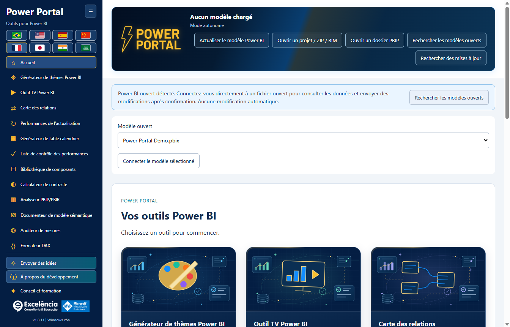

# Guide d’installation

<!-- language-selector -->
[🇺🇸 English](../INSTALLATION.md) · [🇧🇷 Português](../pt-BR/INSTALLATION.md) · [🇪🇸 Español](../es/INSTALLATION.md) · [🇨🇳 简体中文](../zh-CN/INSTALLATION.md) · [🇫🇷 Français](INSTALLATION.md) · [🇯🇵 日本語](../ja/INSTALLATION.md) · [🇮🇳 हिन्दी](../hi/INSTALLATION.md) · [🇸🇦 العربية](../ar/INSTALLATION.md)
<!-- /language-selector -->

[Retour à l’accueil](../../README.fr.md)

<a name="requirements"></a>
## Configuration requise

Windows 10/11 x64, autorisation administrateur pour l’installation et une édition de Power BI Desktop prenant en charge les outils externes. L’application est distribuée sous forme d’un programme d’installation Windows autonome. Les utilisateurs finaux n’ont besoin ni de PHP, ni de Node.js, ni de SDK .NET, ni de Git, ni d’un compte GitHub.

Prévoyez environ 1 Go d’espace disque libre pour le téléchargement et les composants d’exécution installés, plus de l’espace supplémentaire pour vos propres exports et sauvegardes.

<a name="simple-installation"></a>
## Installation simple

1. Ouvrez la [dernière version](https://github.com/luisgnserra/powerportaldesktop/releases/latest).
2. Sous **Assets**, téléchargez `PowerPortal-Setup-1.8.11-x64.exe` pour cette version. Ne téléchargez pas les archives source générées automatiquement comme programme d’installation.
3. Vous pouvez [vérifier le SHA-256](#verify-the-installer).
4. Exécutez le fichier et acceptez le contrôle de compte d’utilisateur.
5. Acceptez les conditions des dépendances affichées, choisissez un dossier et sélectionnez la langue par défaut avec les drapeaux. La langue de l’interface Windows est suggérée ; les langues non prises en charge utilisent l’anglais.
6. Terminez l’assistant.
7. Fermez et rouvrez Power BI Desktop. Ouvrez un PBIX et sélectionnez **Outils externes > Power Portal**.

L’installation s’applique à toute la machine et comprend les raccourcis du bureau/du menu Démarrer et l’enregistrement de l’outil externe. L’application elle-même ne nécessite pas d’élévation lors de son utilisation normale.


Cliquez sur **Outils externes > Power Portal** avec votre PBIX ouvert. **Ferramentas externas** dans la capture est le libellé portugais du ruban. L’icône lance une **fenêtre complémentaire distincte** et lui transmet la connexion au modèle local du fichier ouvert ; il ne s’agit ni d’un visuel intégré ni d’un volet interne du rapport.



Un lancement depuis le raccourci Windows affiche plutôt un avis lorsque des modèles ouverts sont détectés. Sélectionnez **Rechercher les modèles ouverts**, vérifiez le nom du fichier et connectez-vous. La simple détection ou connexion n’effectue aucune modification. [Consultez le parcours illustré](SCREENSHOTS.md).

**Version non signée :** Windows peut afficher SmartScreen ou un avertissement d’éditeur inconnu. Le SHA-256 vérifie que vous possédez le fichier publié ; ce n’est pas une signature numérique de l’éditeur. Ne contournez pas les restrictions de l’entreprise. Demandez au service informatique si une approbation est nécessaire.

<a name="command-line-installation"></a>
## Installation en ligne de commande

<a name="download-the-helper-and-review-it"></a>
### Télécharger l’assistant et l’examiner

```powershell
$script = Join-Path $env:TEMP 'Install-PowerPortal.ps1'
[Net.ServicePointManager]::SecurityProtocol = [Net.ServicePointManager]::SecurityProtocol -bor [Net.SecurityProtocolType]::Tls12
Invoke-WebRequest -UseBasicParsing 'https://raw.githubusercontent.com/luisgnserra/powerportaldesktop/v1.8.11/install.ps1' -OutFile $script
Get-Content -LiteralPath $script
& $script
```

Cette URL versionnée fixe l’assistant à la version 1.8.11. Il ne suit pas silencieusement les versions futures. L’assistant fixe aussi le nom du programme d’installation et sa somme SHA-256, télécharge en HTTPS, vérifie l’exécutable avant de le lancer et contrôle l’enregistrement de l’installation après une sortie réussie du programme d’installation.

La ligne TLS active HTTPS TLS 1.2 dans ce processus PowerShell pour les anciens paramètres par défaut de Windows PowerShell. Elle ne modifie ni la sécurité de Windows ni les stratégies d’exécution.

<a name="unattended-installation"></a>
### Installation sans assistance

Ouvrez PowerShell **en tant qu’administrateur**, puis exécutez :

```powershell
& "$env:TEMP\Install-PowerPortal.ps1" -Silent
```

L’assistant télécharge et vérifie le même programme d’installation, puis utilise son commutateur NSIS `/S`. Aucune page de choix de langue n’apparaît en mode silencieux : le programme d’installation utilise la langue de l’interface Windows, avec repli sur l’anglais. Une préférence utilisateur enregistrée conserve la priorité. L’assistant n’ouvre et ne modifie aucun PBIX.

Le mode silencieux exige une session PowerShell déjà élevée. Il ne contourne ni l’UAC, ni les contrôles de sécurité Windows, ni les stratégies d’exécution des scripts, ni les restrictions d’applications. Fermez Power Portal avant le déploiement ; consultez les [mises à jour](#updates-and-downgrades).

<a name="download-only-or-choose-a-download-folder"></a>
### Télécharger uniquement ou choisir un dossier de téléchargement

```powershell
& "$env:TEMP\Install-PowerPortal.ps1" -DownloadOnly -DownloadDirectory "$env:USERPROFILE\Downloads\PowerPortal"
```

`-DownloadOnly` vérifie la somme de contrôle, mais n’exécute jamais le programme d’installation et ne nécessite aucun privilège administrateur. Un fichier déjà téléchargé n’est réutilisé que si sa somme de contrôle correspond. Un fichier existant invalide provoque une erreur explicite au lieu d’être exécuté ou écrasé silencieusement.

Paramètres de l’assistant :

| Paramètre | Valeur par défaut | Fonction |
|---|---|---|
| `-Silent` | Désactivé | Utiliser le commutateur d’installation sans assistance de NSIS ; nécessite PowerShell administrateur, sauf en mode téléchargement seul. |
| `-DownloadOnly` | Désactivé | Télécharger/mettre en cache et vérifier l’exécutable sans installation. |
| `-DownloadDirectory` | `%TEMP%\PowerPortalDownloads` | Dossier du programme d’installation vérifié. Ce n’est pas le dossier d’installation de l’application. |

Ne collez pas un script non examiné dans `Invoke-Expression`. Si un script téléchargé est bloqué par votre stratégie d’exécution, consultez le service informatique ou utilisez l’assistant exécutable. L’assistant ne modifie délibérément pas les stratégies d’exécution.

<a name="use-the-verified-executable-directly"></a>
### Utiliser directement l’exécutable vérifié

Après vérification de la somme de contrôle, un administrateur peut exécuter :

```powershell
$setup = "$env:USERPROFILE\Downloads\PowerPortal-Setup-1.8.11-x64.exe"
$process = Start-Process -FilePath $setup -ArgumentList '/S' -Wait -PassThru
if ($process.ExitCode -ne 0) { throw "Installer failed: $($process.ExitCode)" }
```

L’assistant PowerShell est recommandé, car il vérifie à la fois le téléchargement et l’enregistrement de l’outil externe qui en résulte.

<a name="verify-the-installer"></a>
## Vérifier le programme d’installation

SHA-256 attendu pour **1.8.11 x64** :

```text
EB00B51CDD1E358A5838931AB40C0EB5DBAC9CB52D403679C5A72F456C9701C0
```

```powershell
$file = "$env:USERPROFILE\Downloads\PowerPortal-Setup-1.8.11-x64.exe"
$expected = 'EB00B51CDD1E358A5838931AB40C0EB5DBAC9CB52D403679C5A72F456C9701C0'
if ((Get-FileHash -LiteralPath $file -Algorithm SHA256).Hash -ne $expected) {
    throw 'Checksum mismatch. Do not run this installer.'
}
```

La somme de contrôle est aussi publiée dans [SHA256SUMS.txt](../../SHA256SUMS.txt) et jointe à la version. Une somme de contrôle vérifie l’intégrité ; elle ne remplace pas la confiance dans l’éditeur.

<a name="updates-and-downgrades"></a>
## Mises à jour et retours à une version antérieure

Téléchargez un programme d’installation officiel plus récent et exécutez-le sur l’installation existante. Le programme d’installation tente de fermer Power Portal uniquement depuis le chemin exact de son exécutable cible avant de remplacer les fichiers. Il ne ferme ni Power BI Desktop ni les autres outils externes. Si la fermeture échoue, l’installation s’interrompt.

Fermez vous-même Power Portal avant une mise à jour sans assistance. Redémarrez Power BI Desktop après l’installation pour recharger l’enregistrement des outils externes. Les préférences existantes de langue/barre latérale par utilisateur et les sauvegardes locales sont conservées.

À partir de **1.6.2**, les vérifications au démarrage et **Rechercher des mises à jour** vous informent des nouvelles versions officielles. **Mettre à jour maintenant** télécharge/vérifie le programme d’installation et lance une mise à jour silencieuse avec élévation dans le dossier d’installation actuel, uniquement après votre clic. Power BI n’est pas fermé. Rouvrez Power Portal une fois l’installation terminée. [Détails des mises à jour](UPDATES.md).

Les versions **1.6.1 et antérieures nécessitent une mise à niveau manuelle unique vers 1.6.2**. Les retours à une version antérieure ne sont pas certifiés ; enregistrez votre travail et contactez l’assistance avant d’utiliser un ancien programme d’installation.

<a name="uninstall"></a>
## Désinstaller

Utilisez **Paramètres Windows > Applications > Applications installées > Power Portal > Désinstaller** (sous Windows 10, utilisez **Applications et fonctionnalités**).

La désinstallation supprime l’application et son propre enregistrement `PowerPortal.pbitool.json`. Les autres outils ne sont pas touchés. Les paramètres par utilisateur, thèmes, sauvegardes et journaux de modifications sont intentionnellement conservés. Consultez les [emplacements des données](CONFIGURATION.md#data-locations) avant de supprimer manuellement les données conservées.

<a name="offline-and-enterprise-deployment"></a>
## Déploiement hors ligne et en entreprise

Le service informatique peut télécharger et vérifier une fois le programme d’installation de la version, distribuer ce fichier exact via son système logiciel approuvé et exécuter `/S` avec les droits administrateur. Les téléchargements publics GitHub nécessitent internet ; l’installation depuis un exécutable déjà téléchargé ne nécessite pas d’authentification GitHub.

Ce dépôt ne fournit ni paquet Microsoft Store, ni MSI, ni entrée de catalogue winget, ni paquet Chocolatey. La distribution prise en charge est l’EXE NSIS et son assistant PowerShell.

[Configuration](CONFIGURATION.md) · [Dépannage](TROUBLESHOOTING.md)
