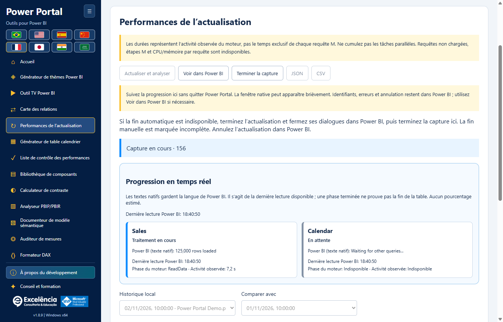
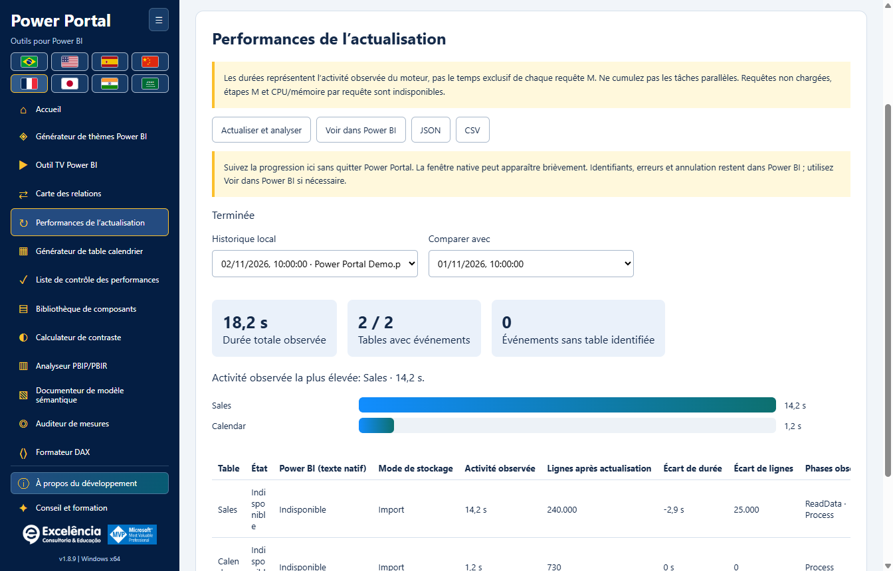

# Performances de l’actualisation

<!-- language-selector -->
[🇺🇸 English](../REFRESH-ANALYSIS.md) · [🇧🇷 Português](../pt-BR/REFRESH-ANALYSIS.md) · [🇪🇸 Español](../es/REFRESH-ANALYSIS.md) · [🇨🇳 简体中文](../zh-CN/REFRESH-ANALYSIS.md) · [🇫🇷 Français](REFRESH-ANALYSIS.md) · [🇯🇵 日本語](../ja/REFRESH-ANALYSIS.md) · [🇮🇳 हिन्दी](../hi/REFRESH-ANALYSIS.md) · [🇸🇦 العربية](../ar/REFRESH-ANALYSIS.md)
<!-- /language-selector -->

**1.8.9 — Échantillon du calendrier et raccourci d’actualisation native**

Dans le générateur de calendrier, l’échantillon réel (50 lignes maximum) apparaît désormais sous Générer le script. Actualiser dans Power BI se trouve à côté et, avec une connexion active, ouvre Performances d’actualisation puis démarre le même flux natif confirmé. Suivez les états, durées et nombres de lignes. Cela actualise le modèle entier, sans appliquer le script, créer ou remplacer le calendrier, ni enregistrer le PBIX. Créer le calendrier dans Power BI reste une action distincte. Le bouton est désactivé hors connexion, accessible au clavier et traduit dans les huit langues. Annulation et erreurs utilisent le flux existant. L’échantillon reste la dernière lecture : utilisez Lire le calendrier sélectionné après actualisation. Les tests de l’application empaquetée ont vérifié disposition, huit traductions, blocage hors connexion, connexion exacte, annulation, erreurs visibles, nouvelle tentative et création du calendrier préservée. Aucune actualisation réelle n’a été lancée ; les captures utilisent des données synthétiques.

**1.8.7 — Sélection des couleurs plus claire et fiable**

Les onze couleurs du thème disposent désormais d’un échantillon natif visible et d’un bouton Choisir la couleur à côté du champ HEX modifiable. Cliquez sur l’échantillon ou le bouton, ou appuyez sur Entrée/Espace lorsque le bouton a le focus. Le sélecteur ne dépend plus d’un champ invisible sans dimensions ni d’un double-clic sur HEX. Saisie manuelle, import, aperçu en direct et export JSON sont conservés. Les erreurs sont explicites. L’ouverture native a été vérifiée plusieurs fois sous Windows, ainsi que les onze boutons à la souris/au clavier et les huit langues.

Analyse de l’actualisation devient Performances de l’actualisation dans le menu, l’accueil, le titre et les huit langues. Seul le nom change : actualisation native, progression, durées, lignes, historique local et compatibilité JSON/CSV sont conservés. Les analyses enregistrées restent disponibles sans migration ni nouvelle actualisation. Les images utilisent des données synthétiques.

**1.8.6 — Suivez l’actualisation dans Power Portal**

Lancez Actualiser et analyser dans Power Portal et suivez les cartes en direct : table, état observé, phase du moteur, durée d’activité et dernier texte natif disponible de Power BI. Power Portal reprend le focus après le lancement et, si Power BI revient au premier plan, après la fin native. Il ne reprend pas constamment le focus aux autres applications. Voir dans Power BI ouvre le fichier sélectionné sans relancer l’actualisation ; ce choix désactive le retour automatique pour cette capture.

Power BI reste le moteur. Sa fenêtre peut apparaître brièvement : ce n’est pas une API prise en charge pour traiter un PBIX sans fenêtre. Identifiants, erreurs et annulation restent dans Power BI ; aucun dialogue n’est masqué ou fermé automatiquement. Le texte natif conserve la langue de Power BI et l’heure de dernière lecture. Son absence est explicite et le suivi du moteur continue si le lecteur échoue. Une phase terminée ne prouve pas la fin de la table, aucun pourcentage n’est inventé et les lignes finales sont comptées après la capture. L’historique et JSON contiennent les états natifs : vérifiez les exports avant partage. L’application empaquetée a été testée avec une actualisation réelle autorisée : 4/4 tables mesurées, 4/4 comptages, états natifs en direct, focus restauré, bouton fonctionnel et historique conservé après rechargement. Aucun PBIX n’a été enregistré automatiquement ; les images utilisent des données synthétiques.

**1.8.5 — Correction des mesures de l’actualisation native**

Performances de l’actualisation reconnaît désormais la commande XML Refresh native de Power BI Desktop, y compris dans Batch, ainsi que XMLA Process et TMSL refresh. Auparavant, l’actualisation pouvait s’exécuter mais son progrès était écarté, laissant 0 table mesurée, des comptages indisponibles et refreshCompletionNotProven. Le succès explicite du moteur est accepté en l’absence du champ Error facultatif ; les codes d’erreur non nuls et les erreurs XMLA restent prioritaires. Le progrès exige toujours une corrélation exacte de requête/activité pour exclure les requêtes visuelles sans rapport.

Avant la première commande reconnue, l’interface indique qu’elle attend les événements d’actualisation Power BI. Une fin non confirmée affiche une explication traduite au lieu d’un simple code technique. Mettez à jour l’application, connectez le bon PBIX et relancez Actualiser et analyser ; les anciens rapports incomplets sont conservés sans être déclarés réussis. L’application empaquetée a été validée de bout en bout sur une actualisation réelle autorisée, avec activité par table, lignes, fin automatique et historique conservé après rechargement. Les captures restent des exemples synthétiques sans données ni noms de modèles du client.

## Démarrage et sécurité

Connectez le bon PBIX, ouvrez Performances de l’actualisation et choisissez Actualiser et analyser. Confirmez le nom du fichier. Le suivi démarre avant Accueil > Actualiser natif ; les tables ne sont pas actualisées séquentiellement via TOM. Gardez Power BI ouvert et traitez les identifiants, erreurs ou annulations dedans. Une sauvegarde BIM ne restaure pas les données actualisées.

L’actualisation native interroge les sources et remplace les données importées. Sauvegardez une copie du PBIX. Gérez les identifiants et erreurs dans Power BI ; le suivi n’annule pas l’actualisation et ne couvre pas toutes les requêtes auxiliaires Power Query.

## Interpréter les mesures

L’activité observée est l’union des intervalles du moteur attribués exactement à chaque table, sans compter deux fois les phases imbriquées. Ce n’est ni le seul temps de requête source ni un chemin critique prouvé. Le total observé va du lancement à la détection de fin, inclut l’interface et la vérification, mais exclut le comptage ultérieur des lignes. Les événements sans table sont signalés séparément.

Les durées représentent l’activité observée du moteur, pas le temps exclusif de chaque requête M. Ne cumulez pas les tâches parallèles. Requêtes non chargées, étapes M et CPU/mémoire par requête sont indisponibles.

La fin automatique exige la fin observée des commandes d’actualisation et une fenêtre Power BI prête. Fermez les dialogues de résultat. Terminer manuellement la capture signifie toujours analyse incomplète, ne prouve pas la réussite et n’annule pas l’actualisation. Les erreurs moteur/suivi sont explicites. Une capture interrompue n’est pas déclarée terminée.

## Historique et export

Les lignes sont comptées après la capture, hors chronomètre. DirectQuery/DirectLake ne sont pas interrogés. L’absence d’événement ne signifie pas zéro seconde. Jusqu’à 30 analyses par modèle restent sur cet ordinateur ; aucun envoi au portail.

Choisissez deux exécutions enregistrées pour comparer les durées et lignes par noms de table identiques. Cache, charge source, volume et parallélisme influencent les écarts ; ils ne prouvent pas une cause. JSON garde null pour les valeurs indisponibles ; CSV laisse vide et protège les formules. L’historique est local, utilise l’identité du diagramme et ne réside pas dans le PBIX. Des fichiers aux identités exposées identiques peuvent le partager : vérifiez le modèle. Les exports contiennent des noms et comptages : vérifiez-les avant partage.

<!-- refresh-correlation -->
Seul le progrès du moteur corrélé exactement par RequestID/ActivityID à une commande d’actualisation active est mesuré. Les requêtes visuelles sans rapport sont exclues. Certaines versions de Power BI omettent ces identifiants : la durée d’une table peut rester indisponible malgré une actualisation exécutée.

## Lancement natif et récupération

Performances de l’actualisation se trouve directement sous Carte des relations dans le menu et la galerie. La recherche du bouton natif ignore les onglets Home en double des vues de requêtes DAX et TMDL, évitant « Ambiguous Power BI control: home ». Si le contrôle est indisponible, sélectionnez la vue Rapport, Données ou Modèle dans Power BI.

Actualiser reste désactivé pendant la confirmation, la validation et le démarrage du suivi ; Terminer la capture reste masqué jusqu’à ce que la capture soit prête. Cela empêche un second lancement de signaler à tort « Finish the active Power BI operation before refreshing ». Un échec avéré avant l’appel natif arrête le suivi, vérifie le nettoyage et permet de réessayer. Si l’appel a pu avoir lieu, l’erreur reste visible et la capture en attente : vérifiez Power BI, terminez l’actualisation et fermez les dialogues avant de terminer la capture. Les requêtes répétées reprennent la capture existante sans relancer l’actualisation. Les opérations réellement actives doivent d’abord se terminer.
