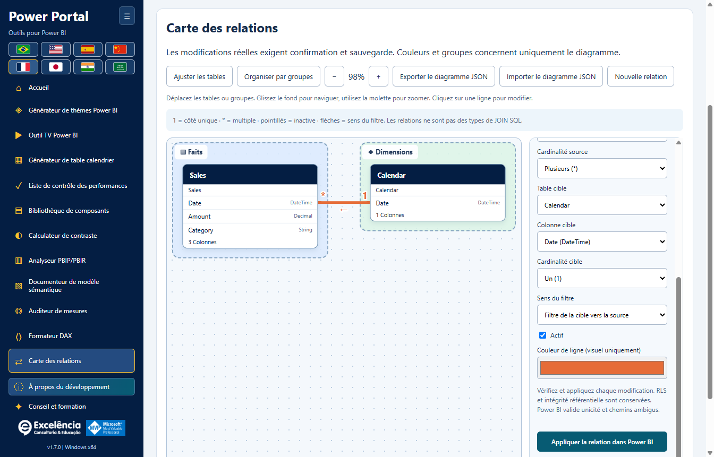
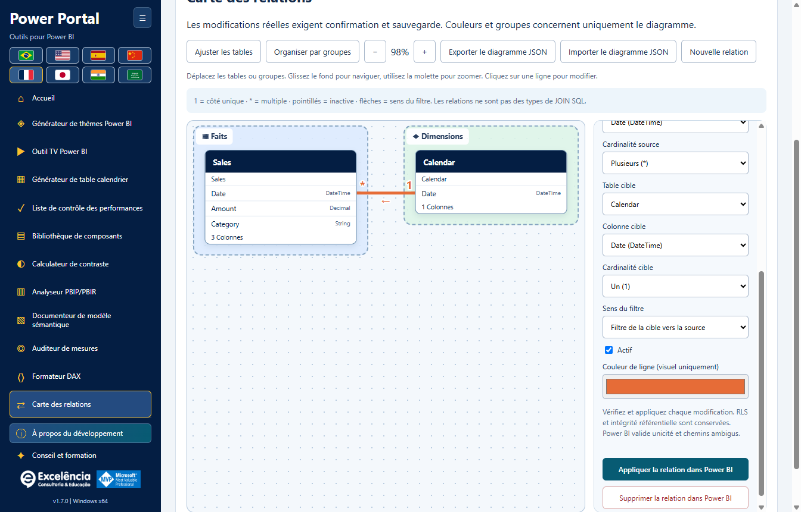

# Carte des relations

<!-- language-selector -->
[🇺🇸 English](../RELATIONSHIPS.md) · [🇧🇷 Português](../pt-BR/RELATIONSHIPS.md) · [🇪🇸 Español](../es/RELATIONSHIPS.md) · [🇨🇳 简体中文](../zh-CN/RELATIONSHIPS.md) · [🇫🇷 Français](RELATIONSHIPS.md) · [🇯🇵 日本語](../ja/RELATIONSHIPS.md) · [🇮🇳 हिन्दी](../hi/RELATIONSHIPS.md) · [🇸🇦 العربية](../ar/RELATIONSHIPS.md)
<!-- /language-selector -->

[Retour à l’accueil](../../README.fr.md) · [Captures](SCREENSHOTS.md) · [Sécurité du modèle](USAGE.md)

Disponible dans **Power Portal Desktop 1.7.0**. Ce nouvel outil est réservé à Desktop et distinct de la vue Modèle de Power BI. Il lit les relations réelles entre tables/colonnes et peut appliquer des modifications confirmées au modèle sémantique local connecté.



<a name="open-your-model"></a>
## Ouvrir votre modèle

1. Enregistrez une copie distincte du PBIX.
2. Lancez **Outils externes > Power Portal** depuis Power BI Desktop, ou recherchez et sélectionnez explicitement le fichier ouvert.
3. Ouvrez **Carte des relations** dans la barre latérale ou la galerie d’accueil.

Les projets BIM/PBIP/TMDL importés prennent en charge le diagramme et la personnalisation visuelle, mais **les écritures de relations nécessitent une connexion Power BI locale en direct**. Relisez le modèle après des modifications effectuées ailleurs.

<a name="understand-the-links"></a>
## Comprendre les liens

- Chaque bloc représente une table réelle. Le nom d’origine de la table reste visible sous son en-tête convivial.
- Les colonnes participant à des relations sont prioritaires dans le bloc. Jusqu’à huit colonnes sont affichées avec leur type de données ; toutes restent disponibles dans l’éditeur de relations.
- **1** identifie le côté unique ; **\*** identifie le côté multiple.
- Les lignes continues sont les relations actives ; les lignes en pointillés sont inactives.
- Les flèches indiquent la propagation des filtres : un sens unique TOM filtre **de la table de destination vers la table source**, et non dans l’ordre de sélection des colonnes. Les liens bidirectionnels affichent les deux sens. **?** désigne Automatic, où le moteur décide.
- Cliquez sur une ligne ou utilisez la liste déroulante des relations pour examiner ses extrémités exactes, sa cardinalité et ses paramètres de filtre.
- Les relations non prises en charge qui ne portent pas sur une seule colonne sont explicitement comptées dans les métadonnées du modèle et signalées dans l’interface. Elles ne sont ni inventées ni modifiées.

**Ce sont des relations de modèle sémantique, et non des sélections SQL INNER/LEFT/RIGHT JOIN.** La cardinalité et le sens du filtre influencent les calculs des rapports et la propagation des filtres.

<a name="arrange-a-teaching-friendly-diagram"></a>
## Organiser un diagramme pédagogique

- Déplacez librement les en-têtes de tables dans les deux directions.
- Faites glisser l’en-tête d’un groupe pour déplacer ses tables ensemble.
- Faites glisser l’arrière-plan pour déplacer la vue. Utilisez la molette ou **+ / -** pour zoomer.
- **Ajuster les tables** cadre le modèle actuel ; un nouveau diagramme est initialement ajusté automatiquement.
- **Organiser par groupes** dispose les tables selon leurs groupes affectés. Cela réorganise uniquement le diagramme, pas le modèle.
- Donnez le focus à un en-tête de table et utilisez les touches fléchées pour le déplacer de 10 unités ; Maj + flèche le déplace de 50 unités.
- Sélectionnez une table pour choisir son nom convivial, son icône, sa couleur de fond et son groupe.
- **Faits** et **Dimensions** sont des groupes de départ facultatifs, et non une classification automatique des rôles des tables.
- Créez des groupes personnalisés, puis modifiez leur nom, leur icône et leur couleur de fond. Supprimer un groupe ne supprime pas ses tables.
- Sélectionnez une relation existante pour choisir la couleur de sa ligne.

**Les couleurs, positions, groupes, icônes et noms conviviaux ne renomment pas les objets Power BI et ne changent pas la disposition de sa vue Modèle native.** Ils appartiennent à ce diagramme complémentaire.

<a name="save-and-share-the-organization"></a>
## Enregistrer et partager l’organisation

Les modifications visuelles sont enregistrées automatiquement dans le profil de l’utilisateur Windows actuel :

```text
%APPDATA%\powerportal-desktop\relationship-diagrams\<model-key>.json
```

Les écritures utilisent un fichier intermédiaire et un remplacement atomique. Un échec est affiché explicitement avec **Réessayer l’enregistrement** ; l’application ne prétend pas que la disposition a été enregistrée.

**Exporter le JSON du diagramme** crée un fichier portable de disposition visuelle. **Importer le JSON du diagramme** valide ce format et vérifie que ses noms de tables existent dans le modèle actuellement chargé. Seule l’organisation est restaurée : **l’import d’un diagramme ne crée, ne modifie et ne supprime jamais de relations du modèle**.

Le JSON inclut les noms de tables, les noms conviviaux, les paramètres des groupes, les couleurs des lignes et la zone de vue. Il ne contient ni lignes de données, ni DAX, ni identifiants de connexion aux sources. Les noms de tables/groupes peuvent toutefois révéler le contexte métier : ne partagez que des fichiers expurgés.

Les profils de modèles en direct sont identifiés à l’aide du nom de fenêtre/fichier Power BI et des balises de lignage des tables, avec repli sur les noms de tables. Les profils de projets importés utilisent aussi le chemin local sélectionné. La détection Power BI n’expose pas de façon fiable le chemin PBIX complet. Renommer un fichier ou remplacer les identités des tables peut créer un nouveau profil ; des copies ayant le même nom et les mêmes balises de lignage peuvent partager un profil. Utilisez le JSON exporté pour conserver des dispositions distinctes si nécessaire.

Les entrées de tables/lignes périmées sont supprimées lors de l’actualisation des métadonnées. L’ancienne position d’une table supprimée n’est pas conservée sous forme de table fictive. Les dispositions sont conservées à la désinstallation avec les autres paramètres utilisateur.

<a name="apply-each-relationship-edit-to-power-bi"></a>
## Appliquer chaque modification de relation à Power BI



<a name="create"></a>
### Créer

1. Choisissez **Nouvelle relation**.
2. Sélectionnez les tables et colonnes source/destination.
3. Définissez la cardinalité, le sens du filtre et l’état actif/inactif.
4. Choisissez **Appliquer la relation à Power BI**.

<a name="edit-activate-or-deactivate"></a>
### Modifier, activer ou désactiver

1. Cliquez sur une ligne existante ou choisissez-la dans la liste déroulante.
2. Modifiez les extrémités, les cardinalités, le sens du filtre ou **Active**.
3. Choisissez **Appliquer la relation à Power BI** pour cette modification.

<a name="delete"></a>
### Supprimer

Sélectionnez la relation existante et choisissez **Supprimer la relation dans Power BI**.

Chaque modification réelle utilise la même séquence sécurisée :

1. Une confirmation native identifie le fichier Power BI sélectionné et affiche les états précédent/nouveau de la relation. **Annuler est le choix par défaut**.
2. Après approbation, une sauvegarde BIM complète des métadonnées et un enregistrement local de la tentative doivent être écrits avant la modification du modèle.
3. Le connecteur rouvre le modèle et vérifie que la relation existante correspond toujours à l’instantané lu par l’éditeur. Les relations périmées/supprimées/renommées sont rejetées au lieu d’être écrasées.
4. Les colonnes doivent avoir des types de données identiques et appartenir à des tables différentes. Les paires de colonnes en double et un deuxième lien actif direct entre la même paire de tables sont rejetés. Désactivez d’abord le lien actif existant.
5. TOM valide via `SaveChanges` ; le moteur reste responsable de la validation de l’unicité, de la cardinalité et des chemins de filtre ambigus. Les erreurs du moteur sont affichées, pas contournées.
6. L’application recharge les métadonnées du modèle après une validation réussie. Un échec de rechargement est signalé comme une modification déjà écrite, et non comme une annulation.
7. **Enregistrez le PBIX dans Power BI Desktop** pour conserver le modèle modifié dans le fichier.

Le comportement des filtres de sécurité au niveau des lignes, **Supposer l’intégrité référentielle** et les autres paramètres non exposés des relations existantes sont préservés. Cet éditeur ne permet pas de modifier la RLS ou d’activer Supposer l’intégrité référentielle. Les nouveaux liens utilisent les paramètres de sécurité/d’intégrité par défaut.

Préserver ces propriétés ne signifie pas que l’activation, la suppression ou les changements d’extrémités ne peuvent pas affecter la propagation des filtres de sécurité. Examinez les relations utilisées par la RLS avec l’administrateur de votre modèle avant de confirmer une modification.

Les mises à jour/thèmes/écritures du modèle ne peuvent pas s’exécuter simultanément avec une écriture de relation. Le changement de modèle connecté pendant une écriture est bloqué ; les requêtes provenant d’une autre connexion sélectionnée sont rejetées.

<a name="backup-and-limits"></a>
## Sauvegarde et limites

- La sauvegarde BIM contient les métadonnées du modèle, pas un PBIX complet, le canevas du rapport ou toutes les lignes de données. Son chemin est indiqué après les écritures réussies ou les échecs du connecteur.
- **Il n’existe aucun bouton d’annulation automatique des relations/de restauration du modèle complet.** Conservez la copie PBIX distincte et examinez la sauvegarde indiquée avec l’administrateur de votre modèle si nécessaire.
- Le JSON du diagramme est limité à l’import à 5 Mo, 2 000 entrées de tables, 200 groupes et 10 000 entrées de style de ligne. Le zoom va de 15 % à 200 %.
- L’outil ne calcule pas de jointures SQL, ne fusionne pas de requêtes, ne classe pas automatiquement les faits/dimensions et n’exécute pas de scripts arbitraires.
- Les écritures Desktop en direct peuvent être limitées par le mode du modèle, la version de Desktop, les autorisations ou la politique de l’entreprise. Ne contournez pas ces restrictions.

[Configuration et données conservées](CONFIGURATION.md#data-locations) · [Dépannage](TROUBLESHOOTING.md)
