# Captures et interactions avec Power BI

<!-- language-selector -->
[🇺🇸 English](../SCREENSHOTS.md) · [🇧🇷 Português](../pt-BR/SCREENSHOTS.md) · [🇪🇸 Español](../es/SCREENSHOTS.md) · [🇨🇳 简体中文](../zh-CN/SCREENSHOTS.md) · [🇫🇷 Français](SCREENSHOTS.md) · [🇯🇵 日本語](../ja/SCREENSHOTS.md) · [🇮🇳 हिन्दी](../hi/SCREENSHOTS.md) · [🇸🇦 العربية](../ar/SCREENSHOTS.md)
<!-- /language-selector -->

**1.8.5 — Correction des mesures de l’actualisation native**

Analyse de l’actualisation reconnaît désormais la commande XML Refresh native de Power BI Desktop, y compris dans Batch, ainsi que XMLA Process et TMSL refresh. Auparavant, l’actualisation pouvait s’exécuter mais son progrès était écarté, laissant 0 table mesurée, des comptages indisponibles et refreshCompletionNotProven. Le succès explicite du moteur est accepté en l’absence du champ Error facultatif ; les codes d’erreur non nuls et les erreurs XMLA restent prioritaires. Le progrès exige toujours une corrélation exacte de requête/activité pour exclure les requêtes visuelles sans rapport.

Avant la première commande reconnue, l’interface indique qu’elle attend les événements d’actualisation Power BI. Une fin non confirmée affiche une explication traduite au lieu d’un simple code technique. Mettez à jour l’application, connectez le bon PBIX et relancez Actualiser et analyser ; les anciens rapports incomplets sont conservés sans être déclarés réussis. L’application empaquetée a été validée de bout en bout sur une actualisation réelle autorisée, avec activité par table, lignes, fin automatique et historique conservé après rechargement. Les captures restent des exemples synthétiques sans données ni noms de modèles du client.

**1.8.5 — Télécharger les mises à jour dans le navigateur**

Lorsqu’une nouvelle version est disponible, l’avis propose Télécharger dans le navigateur à côté de Mettre à jour. Le bouton ouvre l’adresse officielle de l’installateur GitHub détecté dans le navigateur par défaut, sans fermer Power Portal ni lancer l’installation. Exécutez manuellement l’installateur téléchargé lorsque vous le souhaitez. Cette option reste disponible après une erreur de mise à jour automatique. Les échecs d’ouverture du navigateur sont affichés. Mettre à jour continue de télécharger dans l’application, de vérifier SHA-256 et taille, puis de demander l’autorisation Windows. Le téléchargement par navigateur ne bénéficie pas de la vérification automatique de l’application : comparez le SHA-256 publié avant d’exécuter l’installateur. Les boutons et l’explication sont traduits dans les huit langues.

**1.8.5 — Aperçu du thème avec courbes lissées**

Le graphique en courbes du générateur de thèmes utilise désormais des courbes cubiques lissées plutôt que des segments droits, avec les données d’exemple et du modèle connecté. Elles passent par les points d’origine sans dépassement entre les valeurs ; couleurs, marqueurs et infobulles sont conservés. Seul l’aperçu change : le JSON exporté et le format des lignes des visuels Power BI existants restent inchangés.

**1.8.5 — Corrections du lancement de l’actualisation**

Analyse de l’actualisation se trouve directement sous Carte des relations dans le menu et la galerie. La recherche du bouton natif ignore les onglets Home en double des vues de requêtes DAX et TMDL, évitant « Ambiguous Power BI control: home ». Si le contrôle est indisponible, sélectionnez la vue Rapport, Données ou Modèle dans Power BI.

[Retour à l’accueil](../../README.fr.md) · [Installer](INSTALLATION.md) · [Guide de sécurité](USAGE.md)

**Captures de l’application : Power Portal Desktop 1.8.5, interface dans la langue sélectionnée (français).**
Les captures utilisent des **métadonnées et valeurs de requêtes synthétiques de démonstration**, et non un PBIX client. Les états connectés illustrent les actions prises en charge par l’interface ; aucun modèle client n’a été modifié pour créer ces images. Les libellés du sélecteur de fichiers natif peuvent suivre la langue de Windows. La capture réelle du ruban Power BI a été fournie par le propriétaire et recadrée pour supprimer le titre privé du fichier ; elle conserve son portugais d’origine.

Les flèches de relation sont désormais placées sur la courbe et pivotent selon sa direction locale, y compris pour les liens diagonaux ou inversés. Les flèches SVG agrandies à 36 × 26 unités restent noires avec un contour blanc de 3 unités, indépendamment de la couleur du lien. Le filtrage unidirectionnel reste de la destination vers la source ; le bidirectionnel affiche deux flèches opposées. Le filtrage automatique conserve le point d’interrogation. Ce changement est uniquement visuel.

L’en-tête animé de Power Portal intègre désormais le nom du fichier, l’état de connexion et les cinq boutons de lecture, importation, recherche et mise à jour. La barre séparée sous la bannière est supprimée pour libérer de l’espace. Le contenu s’adapte dans l’en-tête sur les petites fenêtres et dans les huit langues, dont l’arabe. Les confirmations, notifications et mises à jour restent inchangées.

## Créer une relation réelle dans Power BI

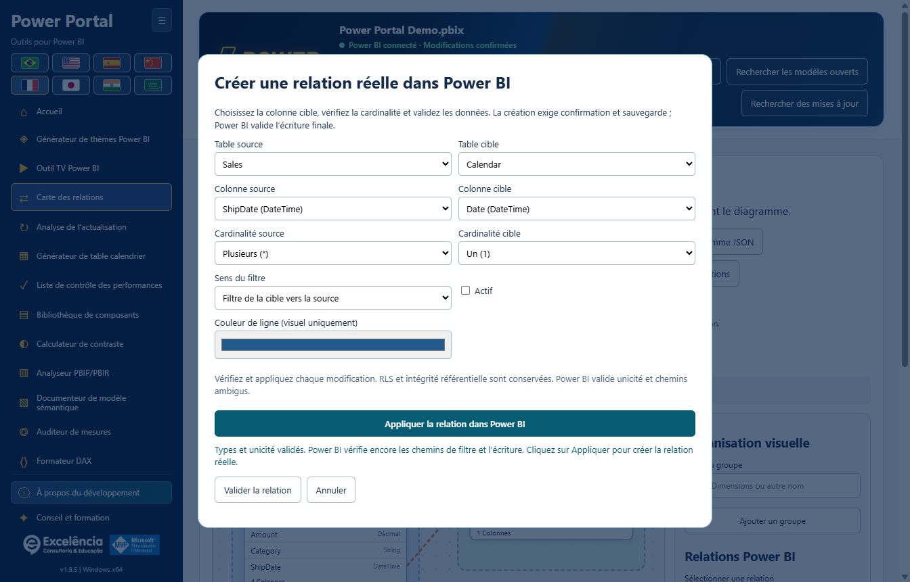

La carte des relations se trouve désormais juste après TV Tool dans le menu latéral et la galerie d’accueil. Le bloc générique Données réelles du modèle est retiré du Générateur de calendrier et de la Bibliothèque de composants. Leurs propres commandes restent disponibles ; la période réelle utilise le calendrier sélectionné dans l’outil. Les couvertures d’accueil ont été redessinées comme illustrations vectorielles locales sans texte intégré. Les titres, descriptions et actions restent hors des images et suivent la langue choisie. Glissez une colonne source sur une autre table pour ouvrir le dialogue de relation réelle et choisir la colonne cible. Un dépôt sur une colonne la présélectionne. Vérifiez cardinalité, filtre et état actif, puis validez et appliquez avec confirmation native et sauvegarde BIM.

La validation vérifie types, paires en double, liens directs actifs et nombres réels de lignes et de valeurs distinctes des deux colonnes, sans échantillonnage. Les doublons du côté Un sont rejetés. Les requêtes sont limitées à 20 secondes et les erreurs sont explicites. Valider n’écrit jamais. Appliquer recommence la validation, puis le moteur vérifie clés et chemins ambigus à l’enregistrement. Le brouillon pointillé n’est pas une relation sauvegardée : seule une écriture confirmée réussie la crée. Enregistrez ensuite le PBIX. Tests et captures utilisent des données synthétiques, sans modifier de PBIX client.

## Organiser avec des groupes

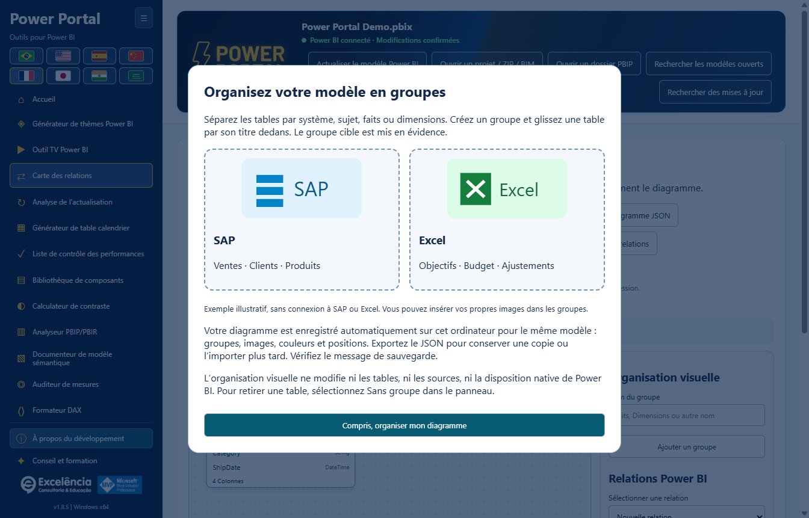

L’introduction apparaît lors de la première visite du diagramme à chaque session. Rouvrez-la avec **Organiser avec des groupes**. SAP et Excel sont des exemples illustratifs, pas de nouveaux connecteurs ni des logos officiels. Les groupes vides sont des zones de dépôt visibles. Déposer dans un groupe surligné affecte la table ; en dehors, son groupe actuel est conservé.

Séparez les tables par système, sujet, faits ou dimensions. Créez un groupe et glissez une table par son titre dedans. Le groupe cible est mis en évidence.

Votre diagramme est enregistré automatiquement sur cet ordinateur pour le même modèle : groupes, images, couleurs et positions. Exportez le JSON pour conserver une copie ou l’importer plus tard. Vérifiez le message de sauvegarde.

L’organisation visuelle ne modifie ni les tables, ni les sources, ni la disposition native de Power BI. Pour retirer une table, sélectionnez Sans groupe dans le panneau.

## Ouvrir Power Portal depuis les outils externes

Après l’installation, redémarrez Power BI Desktop, ouvrez un PBIX et cliquez sur **Outils externes > Power Portal**.

L’onglet portugais **Ferramentas externas** correspond à **Outils externes** en français (**External Tools** en anglais). Le programme d’installation enregistre l’icône dans ce ruban. Cliquer dessus lance **une fenêtre Power Portal distincte connectée au modèle du fichier ouvert**. C’est une application complémentaire externe, et non un visuel de rapport, un volet intégré ou une extension interne Microsoft.

## Accueil et navigation

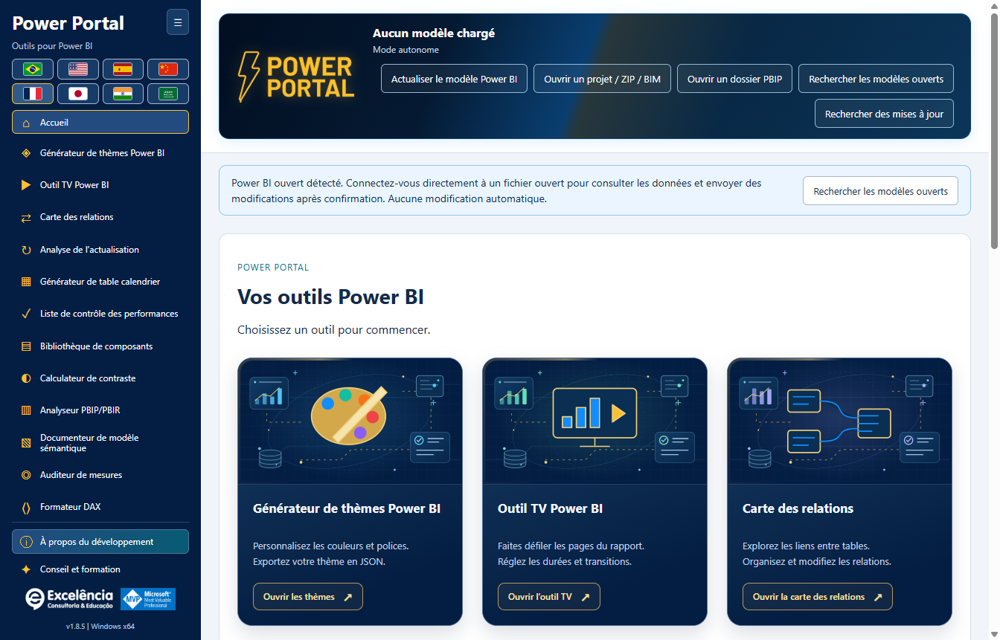

La carte des relations se trouve désormais juste après TV Tool dans le menu latéral et la galerie d’accueil. Les couvertures d’accueil ont été redessinées comme illustrations vectorielles locales sans texte intégré. Les titres, descriptions et actions restent hors des images et suivent la langue choisie.

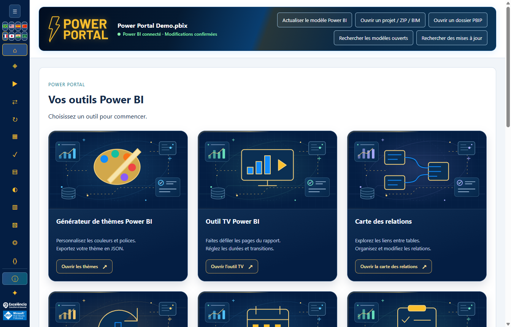

Repliez la barre latérale pour disposer de plus d’espace de travail ; la préférence persiste. Les icônes conservent leurs noms accessibles et leurs infobulles. La zone de travail principale et les formulaires de chaque outil peuvent toujours défiler ; le changement sans défilement concerne le catalogue de la barre latérale.

## Se connecter à un fichier déjà ouvert dans Power BI

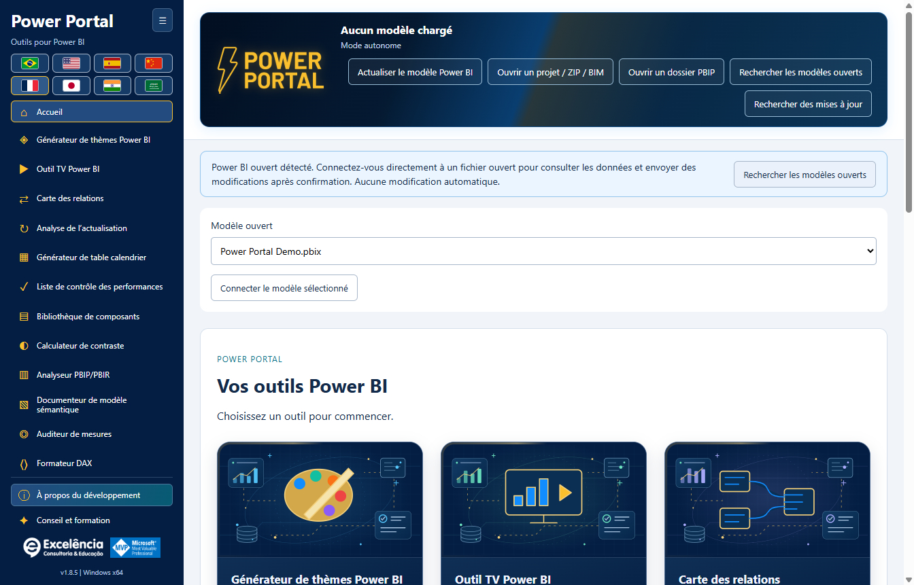

Au lancement depuis un raccourci Windows, l’application détecte les modèles Power BI locaux disponibles et explique que vous pouvez vous connecter directement à un fichier ouvert. Choisissez **Rechercher les modèles ouverts**, vérifiez le nom du fichier et cliquez sur **Se connecter au modèle sélectionné**. Si plusieurs fichiers sont ouverts, choisissez explicitement celui voulu.

Un lancement depuis le ruban Outils externes transmet automatiquement la connexion de cette instance Desktop et lit ses métadonnées. **La connexion n’écrit aucune modification.**

## Notification d’une nouvelle version

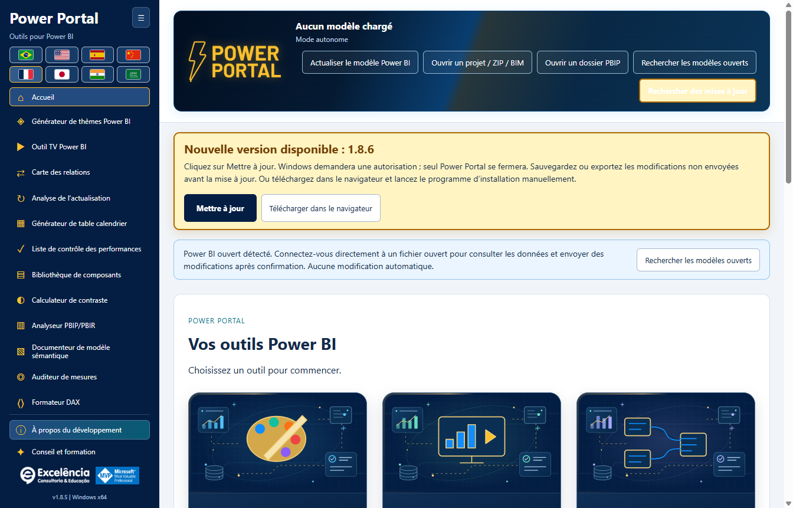

La capture utilise un **résultat synthétique d’une future version 1.8.5** pour montrer la notification dans la version 1.8.5. Elle ne prétend pas que 1.8.5 a été publié. Les utilisateurs de 1.6.2 ou d’une version ultérieure peuvent désormais recevoir la véritable notification de 1.8.5.

En 1.6.4, la bannière ambrée reste visible pendant le défilement et s’anime doucement, sauf si la réduction des animations est activée. Aucune bannière « à jour » permanente n’occupe de l’espace.

L’application installée recherche la dernière version stable officielle au démarrage. Cliquez sur **Mettre à jour maintenant** pour télécharger et vérifier le programme d’installation, puis acceptez la demande administrateur de Windows. Il met à jour le dossier d’installation existant et ferme uniquement Power Portal. **La simple connexion ou vérification n’installe jamais rien.** Enregistrez/exportez d’abord les modifications d’outils non envoyées et rouvrez l’application une fois l’installation terminée.

**Rechercher des mises à jour** relance la vérification à tout moment. Les échecs hors ligne/limite de requêtes/somme de contrôle/UAC sont affichés explicitement sans désactiver les outils locaux. [Guide complet des mises à jour](UPDATES.md).

## Interactions directes avec le fichier Power BI ouvert

Ces actions ne se limitent pas au téléchargement de texte ou de JSON :

| Écran/action | Lit ou modifie Power BI ? | Protection |
|---|---|---|
| Actualiser le modèle Power BI | Lit les tables, colonnes, mesures et relations du modèle sémantique du fichier sélectionné. | Aucune écriture dans le modèle. |
| Interroger les données en direct/plages de dates/échantillons | Lit les valeurs réelles du modèle via le moteur local. | Requêtes structurées et bornées ; pas les filtres de la page active. |
| Envoyer le thème directement à Power BI | Applique le JSON généré à la fenêtre de rapport sélectionnée. | Confirmation, import visible dans l’interface et vérification du thème exporté. |
| Créer un calendrier dans Power BI | Crée une nouvelle table de dates calculée dans le modèle sémantique. | Confirmation et sauvegarde des métadonnées ; actualisez ensuite dans Desktop. |
| Créer une mesure HTML dans Power BI | Crée une nouvelle mesure dans la table du modèle choisie. | Confirmation et sauvegarde des métadonnées ; ajoutez le visuel HTML manuellement. |
| Mettre à jour la mesure dans Power BI | Écrit le DAX formaté dans la mesure existante sélectionnée. | Confirmation, sauvegarde des métadonnées et protection contre les modifications concurrentes. |
| Appliquer/supprimer une relation dans Power BI | Crée, modifie, active/désactive ou supprime la relation entre colonnes sélectionnée. | Confirmation native, sauvegarde des métadonnées, contrôles d’état périmé et validation du moteur ; paramètres RLS/d’intégrité préservés. |

**Enregistrez une copie distincte du PBIX avant d’appliquer des modifications.** Confirmez le fichier et l’expression cibles, puis enregistrez le PBIX dans Desktop. L’application n’enregistre jamais le PBIX silencieusement.

### Données du modèle en direct

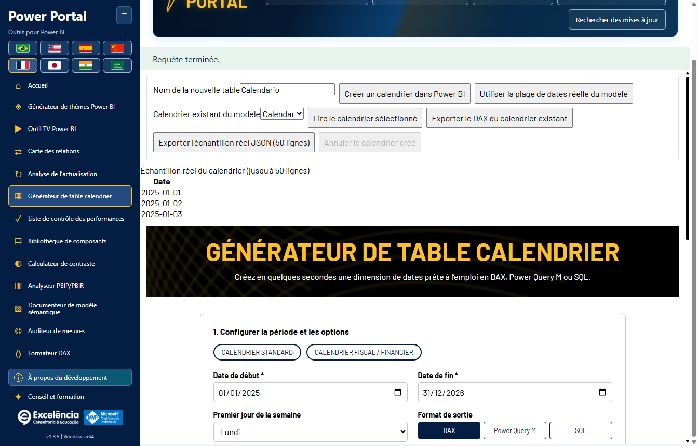

Les échantillons restent limités à 50 lignes et les requêtes à 20 secondes. Le calendrier se lit via son propre sélecteur et aperçu ; le bloc générique n’apparaît plus dans le Générateur de calendrier ni la Bibliothèque de composants. L’état de connexion reste dans l’en-tête.

### Générateur de thèmes

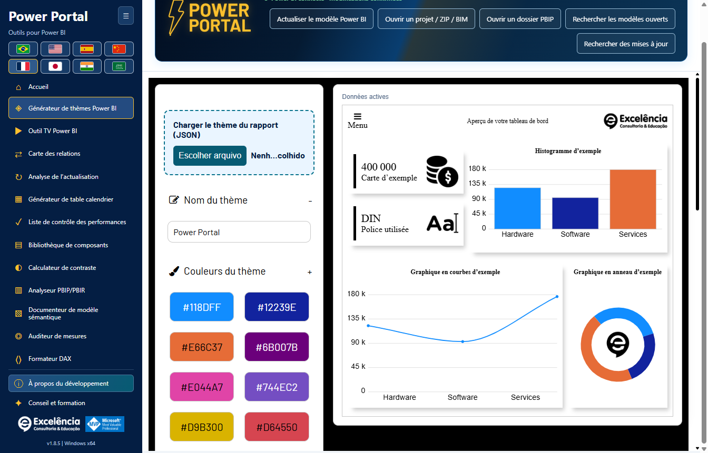

Utilisez la zone mise en évidence **Charger le thème du rapport (JSON)**, modifiez les couleurs/polices et observez l’aperçu en direct. Exportez le JSON, ou faites défiler jusqu’en fin de page, sous le formulaire et l’aperçu, pour utiliser **Envoyer le thème directement à Power BI**.

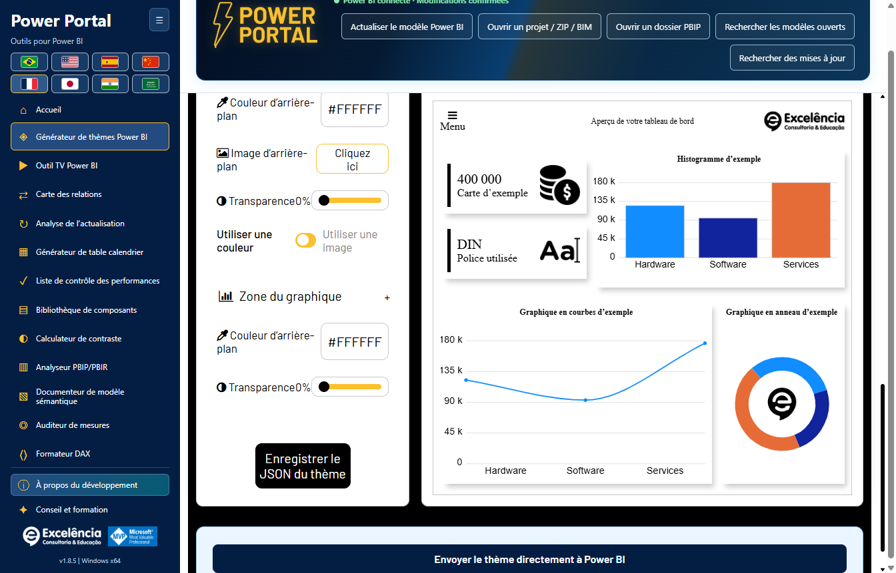

Pour partir du thème de rapport existant, enregistrez son JSON dans Desktop et chargez-le ici. Une connexion au modèle sémantique ne lit pas les thèmes de rapport. L’envoi direct utilise toujours la **boîte de dialogue d’import visible** : aucune API Desktop générique de thème prise en charge ne la supprime. N’interagissez pas avec Power BI pendant l’automatisation.

### Générateur de calendriers

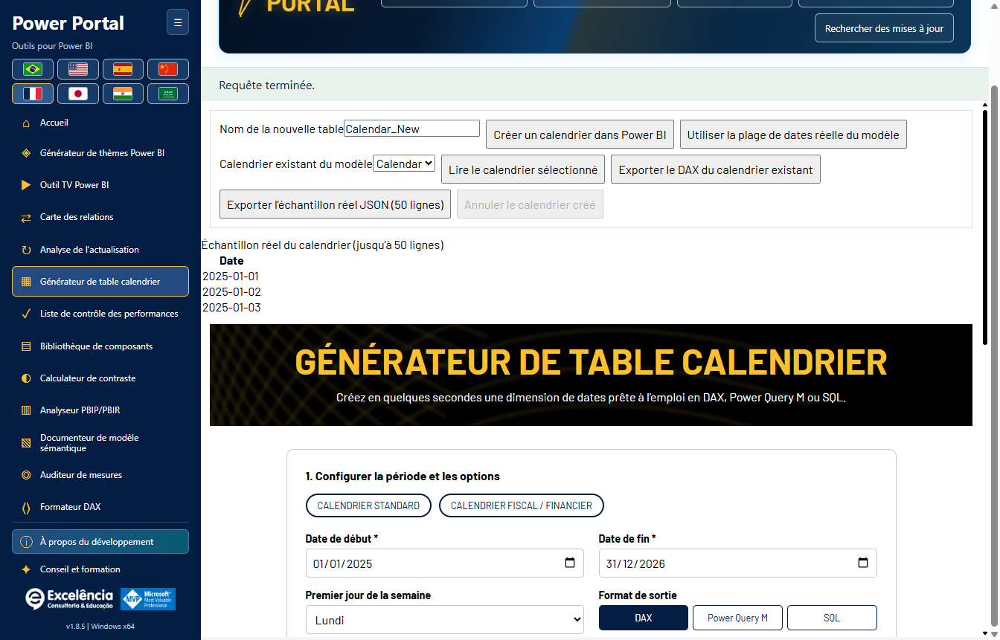

Lisez l’expression/la plage de dates/l’échantillon d’un calendrier existant, exportez le DAX ou le JSON échantillonné et générez un nouveau calendrier. **Créer un calendrier dans Power BI** crée une nouvelle table calculée avec sauvegarde et confirmation, au lieu de remplacer le calendrier existant sélectionné.

Actualisez dans Desktop après la création. L’annulation protégée du calendrier est disponible uniquement si la table créée correspond toujours et ne possède aucune dépendance.

### Bibliothèque de composants

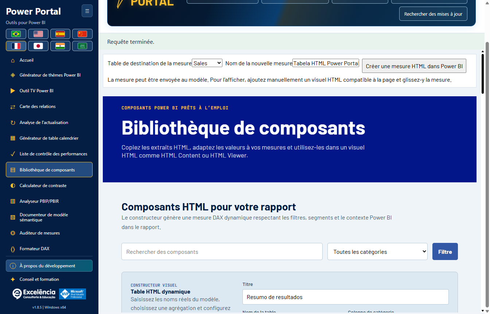

Choisissez la table de destination et un nouveau nom de mesure. Le générateur utilise les noms des champs/mesures du modèle et prend en charge **Créer une mesure HTML dans Power BI**. La mesure est écrite dans le modèle après confirmation.

Un visuel HTML compatible doit être ajouté au rapport manuellement et recevoir cette mesure ; ce bouton ne place pas de visuel sur la page.

### Formateur DAX

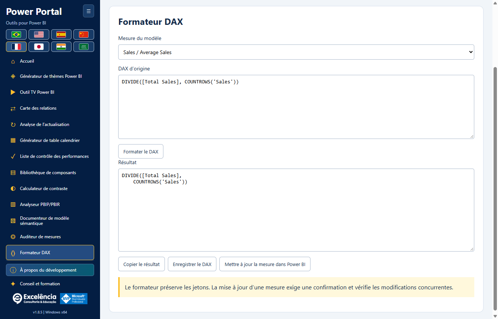

Sélectionnez la mesure existante du modèle, formatez son expression, puis choisissez **Mettre à jour la mesure dans Power BI** pour renvoyer le DAX à cette mesure. Les actions de copie/export sont distinctes. La mise à jour refuse les modifications concurrentes de l’expression et nécessite une confirmation.

## Autres outils

### Carte des relations

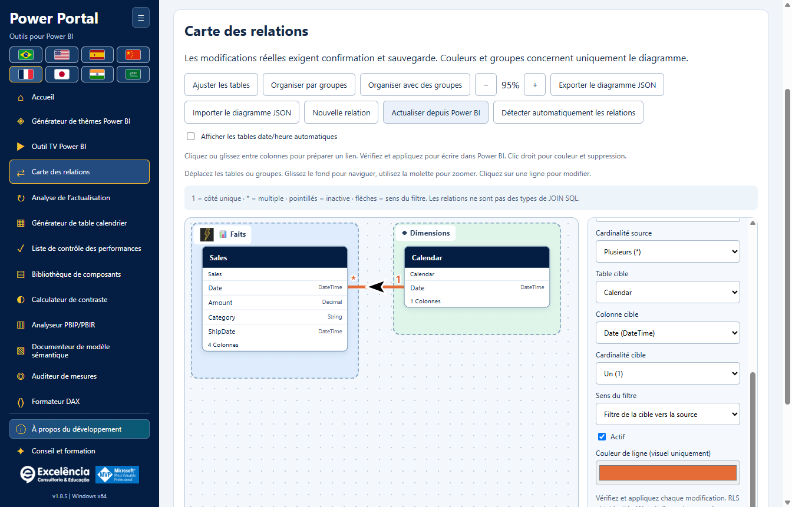

Le nouvel outil réservé à Desktop affiche les liens réels entre les tables, les cardinalités, les flèches de filtre et les lignes inactives en pointillés. Déplacez librement les blocs/groupes, zoomez/déplacez la vue, affectez des noms/icônes conviviaux et personnalisez les couleurs des groupes et des lignes. Les dispositions visuelles sont enregistrées automatiquement par modèle et peuvent être exportées/importées en JSON sans envoyer d’écritures au modèle.

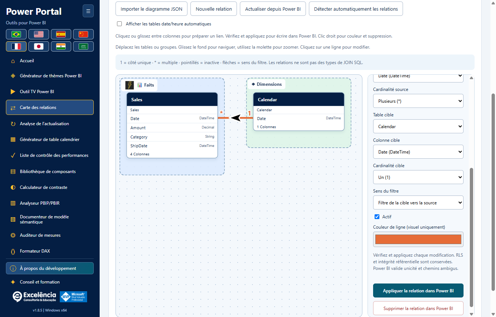

Sélectionnez une ligne pour examiner ses colonnes exactes, sa cardinalité, le sens du filtre et l’état actif. **Appliquer la relation à Power BI** ou **Supprimer la relation dans Power BI** valide chaque modification après confirmation native et sauvegarde. Les projets importés restent en lecture seule. Le style ne renomme pas les tables et ne change pas le diagramme natif de Power BI. [Parcours complet et limites de sécurité](RELATIONSHIPS.md).

Dans la version 1.8.5, cliquez ou faites glisser entre des colonnes pour préparer un brouillon en pointillés, puis vérifiez-le/appliquez-le. Faites un clic droit sur une ligne pour choisir sa couleur, la modifier ou la supprimer. Les paramètres de groupe proposent des images PNG/JPEG locales et davantage d’icônes ; faites glisser l’arrière-plan ou l’en-tête du groupe. Les tables de date/heure automatiques sont masquées par défaut. **Actualiser le diagramme depuis Power BI** relit les modifications externes sans copier les coordonnées de la disposition native. **Détecter automatiquement les relations** lance la détection native de Desktop après confirmation et sauvegarde ; examinez et fermez ses dialogues avant de choisir **Terminer la détection et actualiser le diagramme**.

### Power BI TV Tool

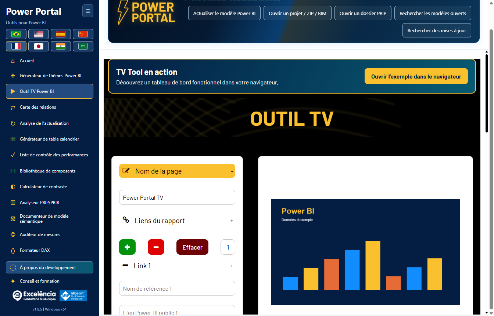

La bannière supérieure **TV Tool en action** ouvre un [exemple officiel fonctionnel](https://www.powerportal.com.br/tv_tool/painel_exemplo_power_bi_tv_tool.html) dans votre navigateur par défaut, nécessitant internet mais n’envoyant aucune donnée du modèle local. La présentation illustrative locale du formulaire reste disponible.

Faites défiler des pages de rapports publiés ou des images locales, définissez les durées/transitions, prévisualisez et exportez en HTML. TV ne fait **pas** défiler les pages du PBIX local ouvert. Les rapports privés publiés nécessitent une connexion/licence/des autorisations Microsoft appropriées.

### Liste de contrôle des performances

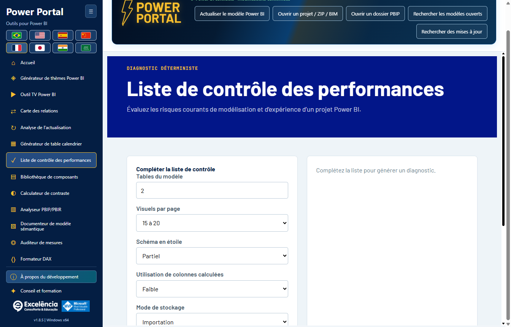

Examinez les éléments de la liste renseignés par le modèle et les caractéristiques manuelles du rapport. Les scores sont des indications heuristiques, et non des mesures de durée des visuels.

### Calculateur de contraste

Vérifiez la lisibilité/le contraste par rapport aux seuils WCAG. Cet outil d’analyse locale ne modifie pas automatiquement la mise en forme du rapport.

### Analyseur PBIP/PBIR

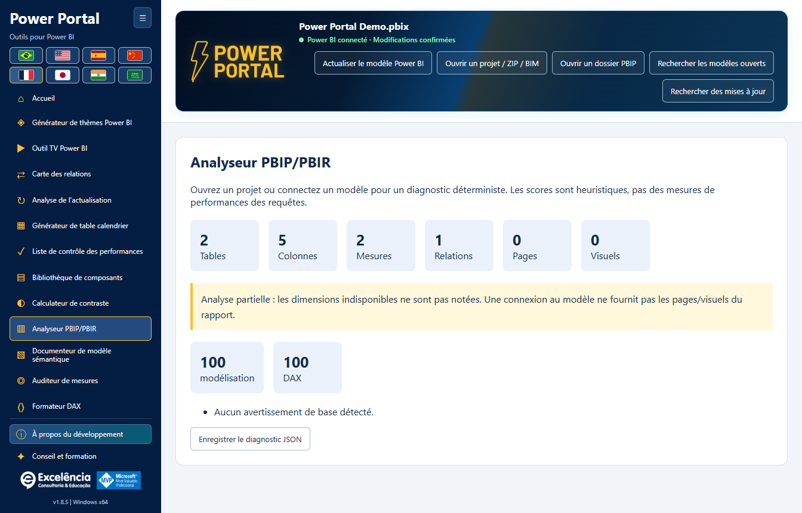

Analysez la structure disponible du projet chargé. Une connexion au modèle sémantique en direct ne fournit pas les métadonnées de pages/visuels du rapport ; les dimensions indisponibles sont donc signalées comme partielles. Les métadonnées de projets PBIR importés peuvent fournir des nombres supplémentaires.

### Documentation du modèle sémantique

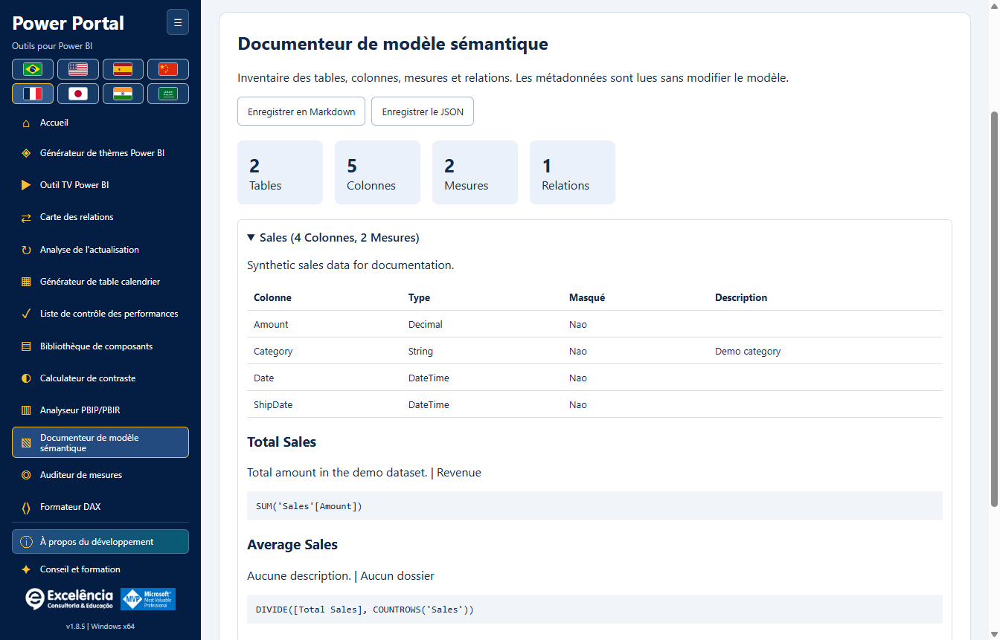

Lisez et exportez la documentation des tables/colonnes/mesures/relations en Markdown ou JSON. Cet outil ne modifie pas le modèle. Les exports peuvent contenir des noms confidentiels et du DAX ; stockez-les de manière appropriée.

### Audit des mesures

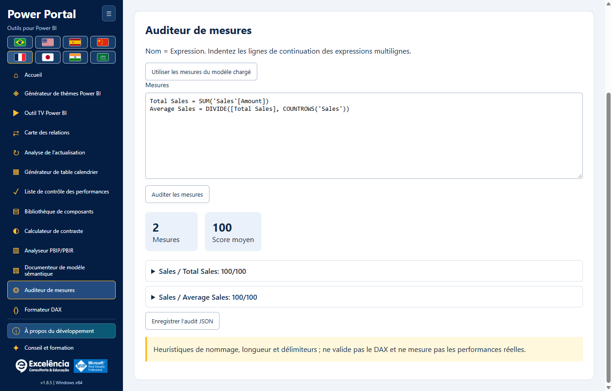

Auditez les mesures du modèle ou le DAX fourni avec des contrôles heuristiques de nommage/taille/délimiteurs. L’outil ne valide pas la sémantique DAX et ne mesure pas les performances réelles du rapport.

## Conseil et formation

Découvrez le conseil Power BI, Microsoft Fabric, l’ingénierie des données et les solutions complètes. Les formations In Company, vidéos mises en avant et actions de contact sont incluses. WhatsApp/e-mail ouvrent un brouillon ou une page du navigateur ; aucun message ni demande de rendez-vous n’est envoyé automatiquement.

[Notes de version](../../CHANGELOG.fr.md) · [Dépannage](TROUBLESHOOTING.md)

## Analyse de l’actualisation

Mesurez l’actualisation native. Comparez les durées et les lignes. [Analyse de l’actualisation](REFRESH-ANALYSIS.md).

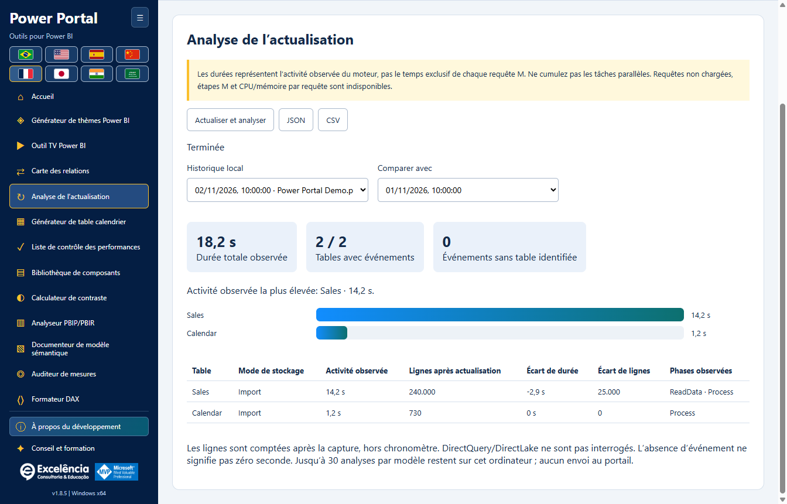

L’activité observée est l’union des intervalles du moteur attribués exactement à chaque table, sans compter deux fois les phases imbriquées. Ce n’est ni le seul temps de requête source ni un chemin critique prouvé. Le total observé va du lancement à la détection de fin, inclut l’interface et la vérification, mais exclut le comptage ultérieur des lignes. Les événements sans table sont signalés séparément.

La fin automatique exige la fin observée des commandes d’actualisation et une fenêtre Power BI prête. Fermez les dialogues de résultat. Terminer manuellement la capture signifie toujours analyse incomplète, ne prouve pas la réussite et n’annule pas l’actualisation. Les erreurs moteur/suivi sont explicites. Une capture interrompue n’est pas déclarée terminée.

## Cartes animées sur l’accueil

Les douze cartes d’accueil utilisent le même bleu marine que le menu (#041e43), avec des scènes vectorielles originales sans texte. Chaque outil conserve son illustration centrale, enrichie de panneaux de données, graphiques, base de données, orbites, grille et satellites flottants. Les lignes de signal se déplacent doucement. Les couvertures ne chargent aucune image, aucun script ni service externe.

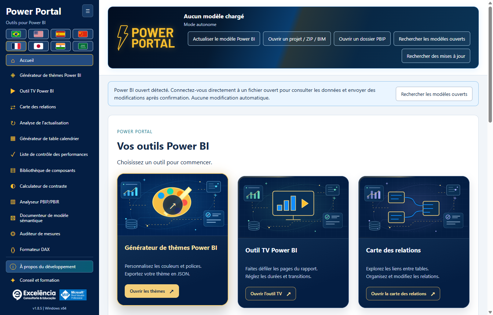

Survolez une carte ou sélectionnez-la au clavier pour afficher cadre et halo dorés, reflet lumineux, scène éclaircie, flèche circulaire et action dorée. La pression donne un retour immédiat sans retarder la navigation. Entrée/Espace ouvrent toujours le même outil. La préférence de mouvement réduit arrête les animations en conservant le surlignage statique et le focus visible. Titres et actions restent hors de l’image et suivent la langue choisie. Les captures montrent des états statiques normal/survol, pas des vidéos.

