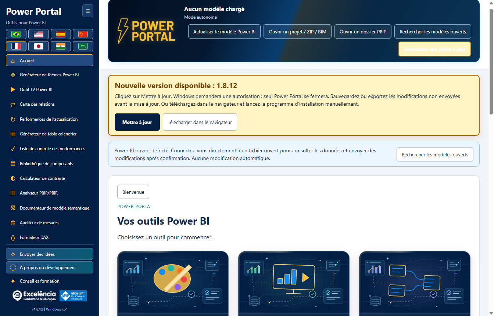

# Recherche de mises à jour et installation automatique

<!-- language-selector -->
[🇺🇸 English](../UPDATES.md) · [🇧🇷 Português](../pt-BR/UPDATES.md) · [🇪🇸 Español](../es/UPDATES.md) · [🇨🇳 简体中文](../zh-CN/UPDATES.md) · [🇫🇷 Français](UPDATES.md) · [🇯🇵 日本語](../ja/UPDATES.md) · [🇮🇳 हिन्दी](../hi/UPDATES.md) · [🇸🇦 العربية](../ar/UPDATES.md)
<!-- /language-selector -->

**1.8.12 — Envoyez des idées sans encombrer le menu**

Envoyer des idées apparaît juste au-dessus de À propos du développement. Le formulaire accessible accepte un titre (120 caractères maximum) et une description (1000). Ouvrir l’e-mail avec l’idée demande l’ouverture de la messagerie par défaut avec le destinataire fixe contato@consultoriaexcelencia.com.br, l’objet et le message remplis. Vérifiez et envoyez depuis cette application : Power Portal n’envoie rien automatiquement et ne confirme pas la livraison. Configurez un client par défaut si nécessaire ou envoyez manuellement. Aucune donnée du modèle, aucun fichier ni identifiant n’est joint ; aucun brouillon n’est enregistré sur disque. Ne saisissez pas d’informations confidentielles. Les erreurs sont explicites et conservent le texte pour réessayer ou copier. Le formulaire fonctionne hors ligne ; l’envoi dépend du compte et du réseau.

Les boutons et espacements sont plus compacts dans les fenêtres basses, sans masquer les commandes ni ajouter de défilement au menu. Les tests du paquet vérifient les menus déployés/repliés à 680/768/900 pixels dans huit langues, des boutons d’au moins 24 pixels, le clavier, les champs requis, le destinataire fixe et l’encodage, les erreurs de messagerie et le contenu préservé. Les tests ont intercepté l’ouverture : aucun e-mail n’a été envoyé. Les captures utilisent des données synthétiques.

**1.8.10 — Illustrations de premier plan animées et survol enrichi**

Les douze couvertures d’accueil animent désormais l’illustration principale de chaque outil, et pas seulement le fond : flottement et rotation doux, avec un badge de validation pulsant. Le survol ou le focus clavier révèle des panneaux à barres, un indicateur hexagonal, une orbite pointillée et des particules animées. Les animations supplémentaires sont en pause hors survol/focus. Les couches décoratives n’interceptent pas les clics et restent hors de l’arbre d’accessibilité. La préférence de mouvement réduit arrête ces animations tout en conservant détails statiques, contraste et focus. Les illustrations locales originales sans texte, les huit langues et la navigation sont préservées. Les tests du paquet ont mesuré les transformations réelles du premier plan et des panneaux, le focus clavier, le mouvement réduit, douze couvertures distinctes et la disposition dans huit langues. Les captures sont des images statiques des états normal/survol, pas des vidéos ; les données sont synthétiques.

**1.8.9 — Échantillon du calendrier et raccourci d’actualisation native**

Dans le générateur de calendrier, l’échantillon réel (50 lignes maximum) apparaît désormais sous Générer le script. Actualiser dans Power BI se trouve à côté et, avec une connexion active, ouvre Performances d’actualisation puis démarre le même flux natif confirmé. Suivez les états, durées et nombres de lignes. Cela actualise le modèle entier, sans appliquer le script, créer ou remplacer le calendrier, ni enregistrer le PBIX. Créer le calendrier dans Power BI reste une action distincte. Le bouton est désactivé hors connexion, accessible au clavier et traduit dans les huit langues. Annulation et erreurs utilisent le flux existant. L’échantillon reste la dernière lecture : utilisez Lire le calendrier sélectionné après actualisation. Les tests de l’application empaquetée ont vérifié disposition, huit traductions, blocage hors connexion, connexion exacte, annulation, erreurs visibles, nouvelle tentative et création du calendrier préservée. Aucune actualisation réelle n’a été lancée ; les captures utilisent des données synthétiques.

**1.8.8 — Lignes dynamiques et envoi de thèmes vérifié**

Dans la carte des relations, Style des lignes permet de choisir des courbes ou des lignes droites avec angles à 90 degrés. Les extrémités utilisent dynamiquement les bords haut/bas ou gauche/droite qui se font face, selon la taille réelle des cartes. Les connexions latérales conservent la hauteur de la colonne liée. Les flèches noires à contour blanc suivent les segments droits sans couper les angles en diagonale. Le style est enregistré automatiquement et inclus dans le JSON exporté ; les anciens schémas restent courbes. Cela ne modifie pas la disposition native de Power BI et ne réalise pas un évitement global des obstacles.

Envoyer le thème directement à Power BI rend le focus à Power Portal après l’importation native et pendant la vérification par exportation, uniquement si Power BI est au premier plan. Une fois le thème vérifié, Power BI est affiché ; les erreurs affichent également la fenêtre sélectionnée. Les boîtes de dialogue natives peuvent apparaître brièvement et ne sont pas masquées : Desktop ne dispose pas d’une API de thèmes prise en charge sans dialogue. Les changements asynchrones d’onglet sont gérés avant confirmation. Un test réel autorisé de l’application empaquetée a vérifié importation/exportation, retour au Portal et activation finale de Power BI, puis restauré le thème Par défaut original sans enregistrer le PBIX. Les captures utilisent des données synthétiques.

**1.8.6 — Suivez l’actualisation dans Power Portal**

Lancez Actualiser et analyser dans Power Portal et suivez les cartes en direct : table, état observé, phase du moteur, durée d’activité et dernier texte natif disponible de Power BI. Power Portal reprend le focus après le lancement et, si Power BI revient au premier plan, après la fin native. Il ne reprend pas constamment le focus aux autres applications. Voir dans Power BI ouvre le fichier sélectionné sans relancer l’actualisation ; ce choix désactive le retour automatique pour cette capture.

Power BI reste le moteur. Sa fenêtre peut apparaître brièvement : ce n’est pas une API prise en charge pour traiter un PBIX sans fenêtre. Identifiants, erreurs et annulation restent dans Power BI ; aucun dialogue n’est masqué ou fermé automatiquement. Le texte natif conserve la langue de Power BI et l’heure de dernière lecture. Son absence est explicite et le suivi du moteur continue si le lecteur échoue. Une phase terminée ne prouve pas la fin de la table, aucun pourcentage n’est inventé et les lignes finales sont comptées après la capture. L’historique et JSON contiennent les états natifs : vérifiez les exports avant partage. L’application empaquetée a été testée avec une actualisation réelle autorisée : 4/4 tables mesurées, 4/4 comptages, états natifs en direct, focus restauré, bouton fonctionnel et historique conservé après rechargement. Aucun PBIX n’a été enregistré automatiquement ; les images utilisent des données synthétiques.

**1.8.5 — Télécharger les mises à jour dans le navigateur**

Lorsqu’une nouvelle version est disponible, l’avis propose Télécharger dans le navigateur à côté de Mettre à jour. Le bouton ouvre l’adresse officielle de l’installateur GitHub détecté dans le navigateur par défaut, sans fermer Power Portal ni lancer l’installation. Exécutez manuellement l’installateur téléchargé lorsque vous le souhaitez. Cette option reste disponible après une erreur de mise à jour automatique. Les échecs d’ouverture du navigateur sont affichés. Mettre à jour continue de télécharger dans l’application, de vérifier SHA-256 et taille, puis de demander l’autorisation Windows. Le téléchargement par navigateur ne bénéficie pas de la vérification automatique de l’application : comparez le SHA-256 publié avant d’exécuter l’installateur. Les boutons et l’explication sont traduits dans les huit langues.

[Retour à l’accueil](../../README.fr.md) · [Installation](INSTALLATION.md)

<a name="available-from-version-162"></a>
## Disponible à partir de la version 1.6.2

Installez **manuellement 1.6.2 une fois** si vous utilisez 1.6.1 ou une version antérieure. Les anciennes applications ne peuvent pas acquérir un nouvel outil de mise à jour sans installer d’abord la version qui le contient.

L’application **installée** recherche la dernière version publique stable dans `luisgnserra/powerportaldesktop` à son ouverture. Elle compare les versions numériques à trois parties, ignore les versions antérieures/actuelles et ne propose pas de builds en brouillon ou de préversions.

L’exécution de développement/depuis les sources ne télécharge et n’installe pas de mises à jour.

<a name="update-flow"></a>
## Déroulement de la mise à jour

1. Ouvrez Power Portal. Si internet est disponible, l’application recherche une version plus récente.
2. Si elle existe, une notification ambrée bien visible affiche la version et **Mettre à jour maintenant**. Elle reste visible pendant le défilement, avec une douce animation lumineuse ; les préférences de réduction des animations la désactivent. Le bouton de recherche est également mis en évidence.
3. **Enregistrez/exportez les modifications des outils non envoyées** avant de continuer. Les écritures/thèmes du modèle déjà en cours bloquent la mise à jour.
4. Cliquez sur **Mettre à jour maintenant**. La simple ouverture de l’application ou recherche de mises à jour ne déclenche aucune installation.
5. Le processus principal télécharge le programme d’installation x64 officiel en HTTPS et vérifie sa taille exacte et son SHA-256 par rapport aux métadonnées publiées du fichier de la version GitHub.
6. Windows demande l’autorisation administrateur. N’acceptez que si vous faites confiance à cette distribution.
7. Après l’autorisation/le lancement du programme d’installation, Power Portal se ferme et l’installation s’exécute silencieusement dans le **dossier d’installation existant**. **Power BI Desktop n’est pas fermé.**
8. Rouvrez Power Portal une fois l’installation terminée. Redémarrez Desktop si son ruban/enregistrement doit être rechargé.



La capture est une **notification simulée d’une future version 1.8.12** dans 1.8.12, montrant uniquement l’interface. Ce n’est pas une annonce de 1.8.12.

<a name="receive-version-1811-from-an-earlier-updater-enabled-version"></a>
### Recevoir la version 1.8.12 depuis une version antérieure disposant de l’outil de mise à jour

Avec **1.6.2, 1.6.3 ou 1.6.4** installé, rouvrez l’application ou cliquez sur **Rechercher des mises à jour**. La version stable publiée **1.8.12** devrait apparaître avec **Mettre à jour maintenant**. N’installez pas d’abord 1.8.12 manuellement si vous souhaitez observer cette notification. Les versions antérieures à 1.6.4 utilisent leur bannière d’origine ; le style visuel bien visible est conservé en 1.8.12. Cliquez sur le bouton de mise à jour lorsque vous êtes prêt et acceptez l’autorisation Windows.

L’application signale le lancement du programme d’installation, pas une installation terminée et vérifiée : l’installation se termine après la fermeture de l’ancienne application. Vérifiez la version affichée après réouverture. Windows peut encore bloquer le programme d’installation non signé ou exiger une approbation du service informatique.

<a name="checks-retries-and-failures"></a>
## Vérifications, nouvelles tentatives et échecs

**Rechercher des mises à jour**, dans les actions du haut, relance manuellement la vérification. Il n’existe ni boucle d’interrogation en arrière-plan ni installation forcée.

En 1.6.4, une vérification réussie ne trouvant aucune version plus récente ne laisse pas une bannière « à jour » occuper une ligne. Les erreurs et les mises à jour disponibles restent visibles.

- Les erreurs hors ligne, de pare-feu/proxy ou de limite de requêtes de l’API GitHub apparaissent dans l’avis de mise à jour ; les outils locaux restent utilisables.
- Les métadonnées de version invalides, l’absence d’empreinte du fichier, une somme de contrôle incorrecte, des hôtes de redirection inattendus, une taille de téléchargement excessive ou des délais expirés empêchent l’exécution.
- L’annulation de l’autorisation Windows laisse l’application disponible et affiche une erreur. Réessayez lorsque vous êtes prêt.
- Une vérification échouée efface l’ancienne proposition de mise à jour disponible pour éviter l’utilisation silencieuse de données périmées.
- L’outil de mise à jour bloque les nouvelles écritures dans le modèle pendant le téléchargement/l’installation et refuse de démarrer pendant une opération active d’écriture/de thème.
- Les modifications de formulaires d’outils qui n’ont pas été envoyées/exportées ne sont pas automatiquement conservées lors du remplacement de l’application. Exportez/enregistrez d’abord.

<a name="privacy-network-and-integrity"></a>
## Confidentialité, réseau et intégrité

Les requêtes de mise à jour ne contiennent que les métadonnées standard de requête HTTPS vers GitHub, pas les noms du modèle local, le DAX, les données, le contenu PBIX ni les identifiants. Aucun compte/jeton GitHub n’est requis pour les versions publiques.

Les métadonnées de version proviennent de :

```text
https://api.github.com/repos/luisgnserra/powerportaldesktop/releases/latest
```

Les URL d’installation doivent correspondre au fichier versionné exact de la version dans ce dépôt. Les redirections HTTPS sont limitées à GitHub et à ses hôtes officiels de fichiers de versions. L’application conserve l’empreinte/la taille des métadonnées pour ce téléchargement.

Les vérifications ont un délai total de 30 secondes et une limite de métadonnées de 1 Mo. Les téléchargements ont une limite totale de 20 minutes, un délai d’inactivité du socket de 30 secondes et une taille maximale acceptée de 1 Go pour le programme d’installation. Ce sont des bornes, pas la taille normale du paquet.

Les téléchargements sont stockés dans `%APPDATA%\powerportal-desktop\updates`. Les fichiers partiels sont supprimés lors des échecs gérés ; un EXE vérifié peut rester après l’installation. Aucun code source de l’application n’est téléchargé ou compilé.

**Le SHA-256 est un contrôle d’intégrité, pas une signature numérique de l’éditeur.** La version actuelle n’est pas signée. L’outil de mise à jour ne contourne ni l’UAC, ni SmartScreen, ni les politiques de l’entreprise. Si votre réseau exige un proxy que l’outil ne peut pas utiliser, consultez le service informatique ou installez manuellement l’EXE vérifié de la version.

<a name="manual-fallback"></a>
## Solution manuelle de secours

Utilisez la [dernière version](https://github.com/luisgnserra/powerportaldesktop/releases/latest) ou l’[assistant PowerShell versionné](INSTALLATION.md#command-line-installation). Les commandes d’assistant existantes figées à une version installent intentionnellement leur version fixée, et non la dernière version future.
