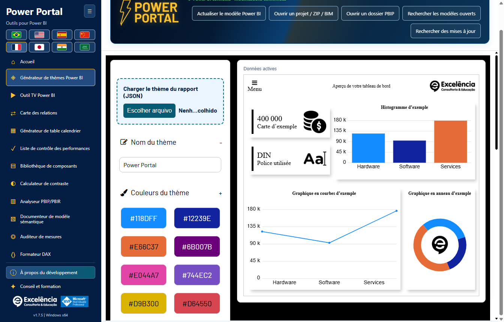
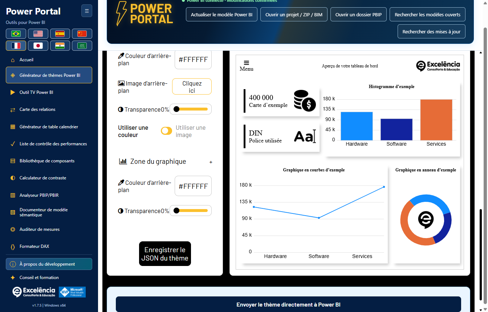
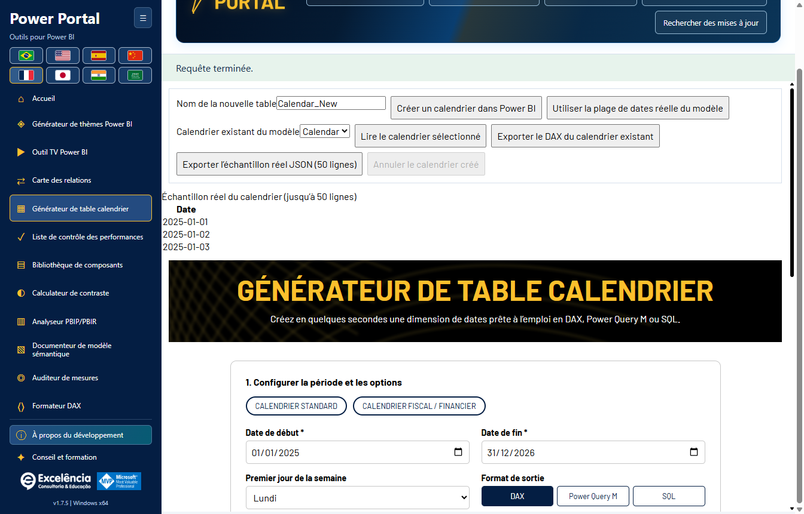
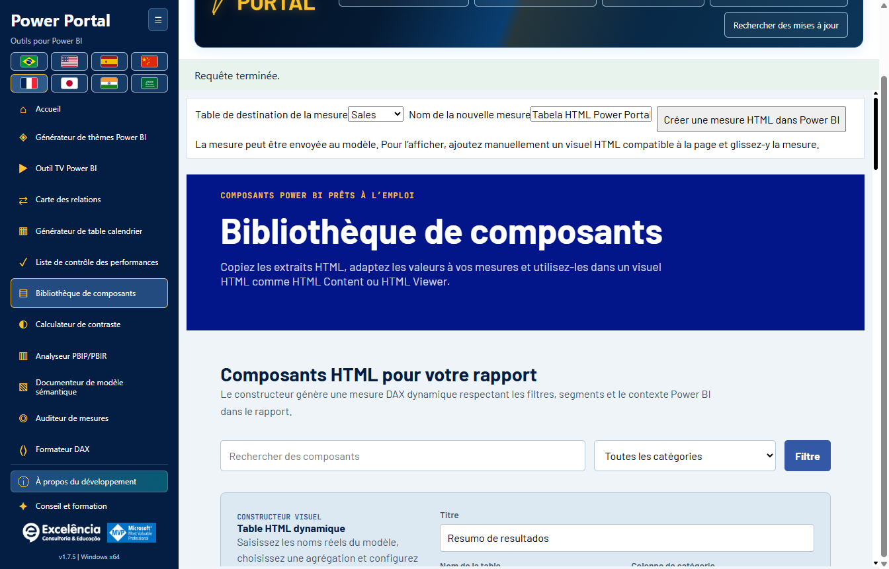
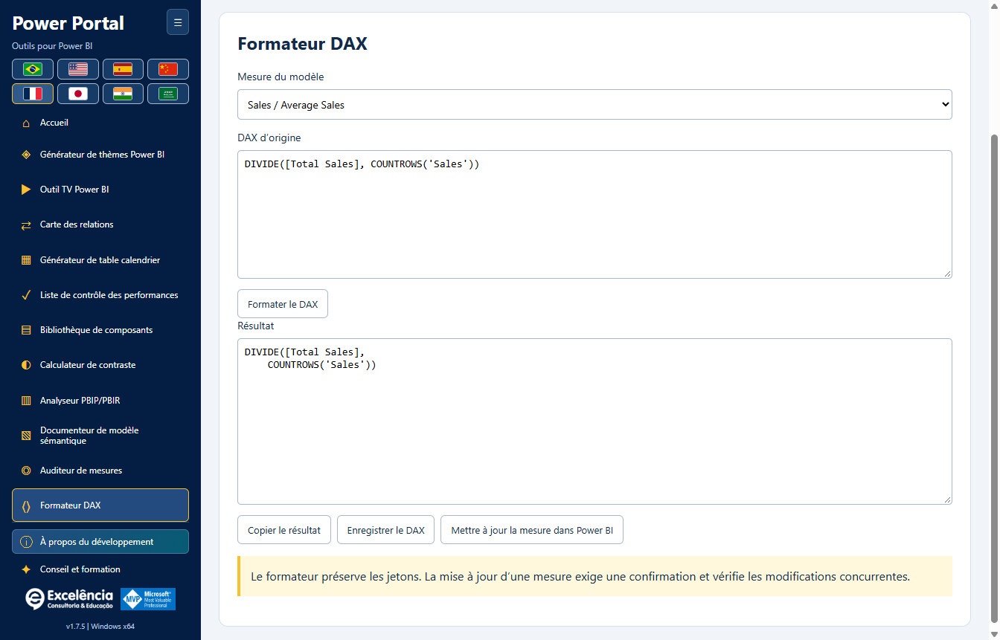
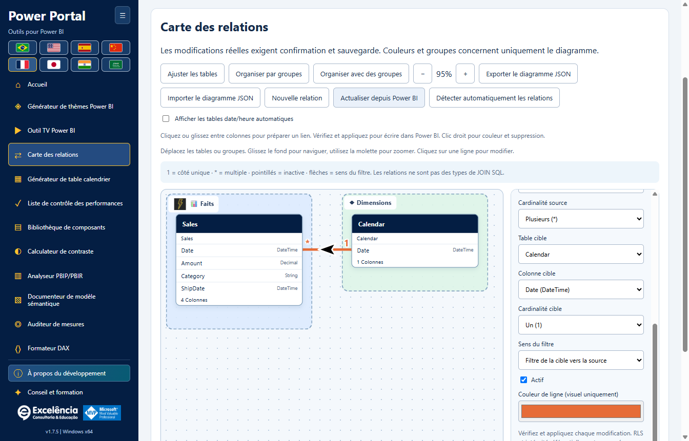

# Utilisation et sécurité du modèle

<!-- language-selector -->
[🇺🇸 English](../USAGE.md) · [🇧🇷 Português](../pt-BR/USAGE.md) · [🇪🇸 Español](../es/USAGE.md) · [🇨🇳 简体中文](../zh-CN/USAGE.md) · [🇫🇷 Français](USAGE.md) · [🇯🇵 日本語](../ja/USAGE.md) · [🇮🇳 हिन्दी](../hi/USAGE.md) · [🇸🇦 العربية](../ar/USAGE.md)
<!-- /language-selector -->

[Retour à l’accueil](../../README.fr.md)

L’en-tête animé de Power Portal intègre désormais le nom du fichier, l’état de connexion et les cinq boutons de lecture, importation, recherche et mise à jour. La barre séparée sous la bannière est supprimée pour libérer de l’espace. Le contenu s’adapte dans l’en-tête sur les petites fenêtres et dans les huit langues, dont l’arabe. Les confirmations, notifications et mises à jour restent inchangées.

La carte des relations se trouve désormais juste après TV Tool dans le menu latéral et la galerie d’accueil. Le bloc générique Données réelles du modèle est retiré du Générateur de calendrier et de la Bibliothèque de composants. Leurs propres commandes restent disponibles ; la période réelle utilise le calendrier sélectionné dans l’outil. Les couvertures d’accueil ont été redessinées comme illustrations vectorielles locales sans texte intégré. Les titres, descriptions et actions restent hors des images et suivent la langue choisie. Glissez une colonne source sur une autre table pour ouvrir le dialogue de relation réelle et choisir la colonne cible. Un dépôt sur une colonne la présélectionne. Vérifiez cardinalité, filtre et état actif, puis validez et appliquez avec confirmation native et sauvegarde BIM.

La validation vérifie types, paires en double, liens directs actifs et nombres réels de lignes et de valeurs distinctes des deux colonnes, sans échantillonnage. Les doublons du côté Un sont rejetés. Les requêtes sont limitées à 20 secondes et les erreurs sont explicites. Valider n’écrit jamais. Appliquer recommence la validation, puis le moteur vérifie clés et chemins ambigus à l’enregistrement. Le brouillon pointillé n’est pas une relation sauvegardée : seule une écriture confirmée réussie la crée. Enregistrez ensuite le PBIX. Tests et captures utilisent des données synthétiques, sans modifier de PBIX client.

## Premier démarrage

Lancez l’application depuis le ruban Outils externes de Power BI pour une connexion automatique au modèle local, ou ouvrez le raccourci Windows pour utiliser les outils hors ligne/importer un projet. La page d’accueil affiche les onze outils. **Accueil** revient à la galerie sans décharger le modèle chargé.

Utilisez le bouton de repli de la barre latérale et les drapeaux selon vos besoins. L’en-tête de connexion affiche le nom du fichier lorsqu’il est disponible, plutôt que le GUID interne de la base de données.

Après la connexion, un état vert compact dans l’en-tête remplace la grande bannière de connexion. Son infobulle rappelle d’enregistrer une copie distincte du PBIX. Les modifications prises en charge nécessitent toujours une confirmation.

[Parcours illustré de tous les écrans et des interactions avec Power BI](SCREENSHOTS.md).

## Travail en lecture seule

Lisez les métadonnées du modèle, interrogez de petits échantillons de données, auditez les mesures, vérifiez le contraste, formatez le DAX ou exportez la documentation sans envoyer d’écritures. Les données du modèle représentent le modèle sémantique **sans les filtres ni les segments du rapport de la page active**.

Les échantillons restent limités à 50 lignes et les requêtes à 20 secondes. Le calendrier se lit via son propre sélecteur et aperçu ; le bloc générique n’apparaît plus dans le Générateur de calendrier ni la Bibliothèque de composants. L’état de connexion reste dans l’en-tête.

Les imports de projets locaux acceptent les BIM, les dossiers TMDL/PBIP/PBIR pris en charge et les ZIP. Ils sont en lecture seule. L’importateur ne peut pas analyser un PBIX brut : ouvrez-le dans Power BI Desktop et connectez-vous localement.

Les limites ZIP sont de 50 Mo compressés, 500 Mo extraits, 10 000 fichiers et 64 Mo par entrée. Les liens symboliques et les dossiers tels que `.git`, `.pbi` et `node_modules` ne sont pas parcourus. Importez un modèle sémantique à la fois.

## Thèmes

1. Dans Power BI Desktop, enregistrez le JSON du thème actuel depuis le menu Thèmes si vous souhaitez le modifier.
2. Dans le générateur de thèmes de Power Portal, utilisez la zone mise en évidence **Charger le thème du rapport (JSON)**. Une connexion TOM au modèle ne peut pas récupérer le thème du rapport.
3. Modifiez les couleurs/polices/arrière-plans en observant l’aperçu local en direct.
4. Exportez le JSON, ou faites défiler jusqu’en fin de page, sous les paramètres et l’aperçu, puis choisissez **Envoyer le thème directement à Power BI**.
5. Vérifiez le nom du fichier dans la confirmation, acceptez et n’interagissez pas avec Power BI pendant l’import.
6. Enregistrez le PBIX dans Power BI lorsque vous êtes satisfait.

L’envoi direct utilise une **automatisation visible de l’interface**, y compris la boîte de dialogue de fichiers de Desktop. L’application vérifie le thème obtenu en l’exportant et en comparant les propriétés envoyées. Le JSON généré reste disponible en cas d’échec de l’automatisation. Les différentes versions de Desktop, la localisation ou les changements d’interface peuvent empêcher l’automatisation.

Il n’existe pas d’API Desktop générique prise en charge permettant d’appliquer un thème à n’importe quel PBIX ouvert sans boîte de dialogue. `applyTheme` pour les rapports intégrés est une API différente, et n’est pas utilisée pour contourner cette limite de Desktop.

L’aperçu en direct est une implémentation locale de l’écran de thèmes du site, et non une représentation identique au pixel près de tous les visuels Power BI.

## Opérations d’écriture

Les écritures prises en charge dans le modèle sémantique sont la création d’une mesure, la mise à jour du DAX de la mesure sélectionnée, la création d’une nouvelle table de calendrier calculée et la création/modification/suppression de relations.

Avant toute écriture :

1. **Enregistrez une copie distincte du PBIX.**
2. Vérifiez le fichier/modèle sélectionné et le DAX proposé.
3. Acceptez la confirmation native (Annuler est le choix par défaut).
4. Conservez le chemin de sauvegarde affiché et vérifiez le résultat dans Power BI.
5. Enregistrez vous-même le PBIX ; l’application ne l’enregistre pas automatiquement.

Une sauvegarde BIM des métadonnées doit réussir avant la validation de l’écriture. Les noms en double sont rejetés. Les mises à jour vérifient l’expression précédente pour éviter d’écraser des modifications concurrentes. Un échec après validation est signalé comme une modification déjà écrite, et non comme une annulation.

### Tables de calendrier

Lisez l’expression calculée, la plage de dates et l’échantillon d’un calendrier existant. Exportez le contenu existant ou générez un nouveau script DAX/M/SQL. L’envoi direct crée une **nouvelle** table calculée ; il ne remplace pas un calendrier existant.

Après la création, actualisez dans Power BI Desktop ; Power Portal ne traite pas le modèle Desktop. L’action de session **Annuler le calendrier créé** est protégée et refuse de supprimer une table si sa structure/expression a changé ou si elle a acquis des mesures, des relations ou des dépendances DAX.

La sauvegarde BIM protège les métadonnées du modèle, **pas les pages du rapport, les visuels, toutes les lignes de données ni le PBIX complet**. Aucune restauration automatique du modèle complet n’est fournie.

### Composants HTML

L’envoi d’un composant crée une mesure HTML. Ajoutez manuellement un visuel HTML compatible au rapport et affectez-lui la mesure. TOM ne peut pas placer automatiquement des visuels sur le canevas d’un rapport.

### Mettre à jour le DAX d’une mesure

Sélectionnez une mesure du modèle dans le formateur DAX, formatez son expression, puis utilisez **Mettre à jour la mesure dans Power BI**. Cette action met à jour la mesure sélectionnée après confirmation et vérifie que son expression précédente n’a pas changé simultanément. Ce n’est pas un simple export local de texte.

## TV Tool

La zone mise en évidence **TV Tool en action**, en haut, ouvre un [exemple officiel fonctionnel de tableau de bord](https://www.powerportal.com.br/tv_tool/painel_exemplo_power_bi_tv_tool.html) dans votre navigateur par défaut. Elle nécessite internet et n’envoie pas le modèle local. L’exemple illustratif du formulaire charge toujours des diapositives locales d’exemple.

Utilisez des liens de rapports publiés ou des images locales, ajustez les durées/transitions et exportez en HTML. Les liens du Service conservent les identifiants de page pris en charge. L’outil ne fait **pas** défiler les pages du PBIX ouvert localement.

Les rapports privés nécessitent une licence Power BI adaptée, une authentification Microsoft, des autorisations et une politique d’intégration appropriées. Recharger le rapport n’actualise pas les données du modèle sémantique. Les diapositives d’images locales constituent l’option de présentation hors ligne.

## Carte des relations

Ouvrez le nouvel outil pour comprendre les liens entre les tables du modèle dans un canevas déplaçable, avec cardinalités, flèches de filtre, lignes inactives en pointillés, groupes personnalisés, couleurs et noms/icônes conviviaux.

L’organisation visuelle est enregistrée automatiquement par modèle et peut être exportée/importée en JSON. Elle ne renomme pas les objets du modèle, ne modifie pas la disposition native de Power BI et n’envoie pas de modifications de relations.

Pour une connexion en direct, **Appliquer la relation à Power BI** et **Supprimer la relation dans Power BI** envoient chaque modification après confirmation native et sauvegarde des métadonnées. Les extrémités, les cardinalités, le sens du filtre et l’état actif peuvent être modifiés ; les paramètres existants de sécurité/d’intégrité sont conservés. Les métadonnées périmées, liens en double, types de colonnes incohérents et erreurs de validation du moteur sont rejetés explicitement.

**Les relations influencent les résultats et les filtres des rapports. Enregistrez d’abord une copie du PBIX, puis enregistrez le PBIX dans Desktop après la modification.** Il n’existe pas de restauration automatique du modèle complet. [Tutoriel complet sur les relations, la persistance et les limites](RELATIONSHIPS.md).

## Diagnostic et confidentialité

Les scores d’audit/d’analyse sont heuristiques. Une connexion active au modèle ne fournit pas les pages du rapport ni le placement des visuels ; les dimensions indisponibles ne sont pas inventées. Les métadonnées des projets PBIR peuvent fournir le nombre de pages/visuels lorsqu’elles sont présentes.

L’application n’envoie pas au portail les fichiers du modèle, métadonnées, lignes ou identifiants des sources. Les exports, sauvegardes et journaux locaux peuvent néanmoins contenir des informations confidentielles. Ne partagez avec l’assistance que des informations d’erreur expurgées des données sensibles.

[Configuration](CONFIGURATION.md) · [Dépannage](TROUBLESHOOTING.md)

Dans la version 1.7.5, le dessin de relations ne fait que préparer un brouillon : cliquez ou faites glisser entre des paires de colonnes exactes et vérifiez-le avant de l’appliquer. La suppression par clic droit utilise la même confirmation et la même sauvegarde. La détection automatique native est distincte et peut créer plusieurs liens : examinez-les dans Power BI, fermez ses dialogues, puis terminez dans Power Portal avant toute autre écriture ou mise à jour. Les images locales de groupe et les préférences de visibilité sont enregistrées uniquement dans le diagramme. [Nouveau parcours des relations](RELATIONSHIPS.md#native-automatic-relationship-detection).
