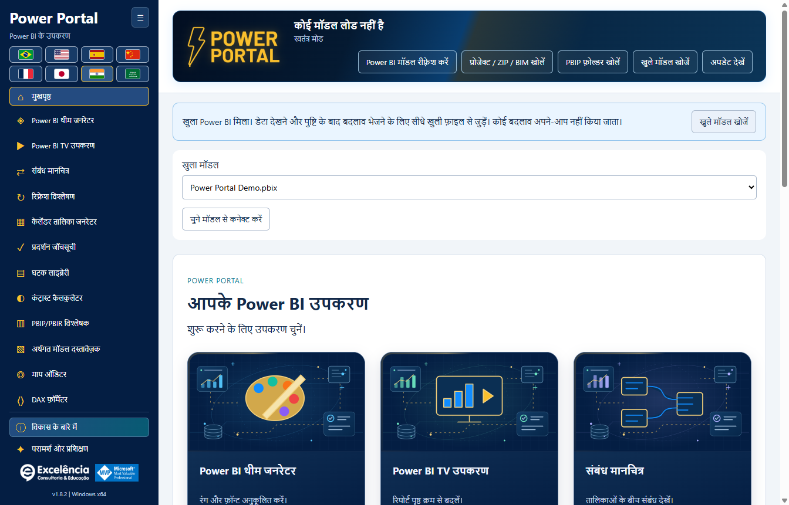

# स्थापना मार्गदर्शिका

<!-- language-selector -->
[🇺🇸 English](../INSTALLATION.md) · [🇧🇷 Português](../pt-BR/INSTALLATION.md) · [🇪🇸 Español](../es/INSTALLATION.md) · [🇨🇳 简体中文](../zh-CN/INSTALLATION.md) · [🇫🇷 Français](../fr/INSTALLATION.md) · [🇯🇵 日本語](../ja/INSTALLATION.md) · [🇮🇳 हिन्दी](INSTALLATION.md) · [🇸🇦 العربية](../ar/INSTALLATION.md)
<!-- /language-selector -->

[होम पर लौटें](../../README.hi.md)

<a name="requirements"></a>
## आवश्यकताएँ

Windows 10/11 x64, व्यवस्थापक स्थापना अनुमति और External Tools समर्थित Power BI Desktop संस्करण आवश्यक है। अनुप्रयोग स्वयं-समाहित Windows इंस्टॉलर के रूप में वितरित है। अंतिम उपयोगकर्ताओं को PHP, Node.js, .NET SDK, Git या GitHub खाते की आवश्यकता नहीं है।

डाउनलोड और स्थापित रनटाइम फ़ाइलों के लिए लगभग 1 GB खाली डिस्क स्थान रखें; अपने निर्यात और बैकअप के लिए अतिरिक्त स्थान भी रखें।

<a name="simple-installation"></a>
## सरल स्थापना

1. [नवीनतम Release](https://github.com/luisgnserra/powerportaldesktop/releases/latest) खोलें।
2. **Assets** में इस रिलीज़ का `PowerPortal-Setup-1.8.2-x64.exe` डाउनलोड करें। अपने-आप बने source archive को इंस्टॉलर के रूप में डाउनलोड न करें।
3. वैकल्पिक रूप से [SHA-256 सत्यापित करें](#verify-the-installer)।
4. निष्पादन योग्य चलाएँ और User Account Control की अनुमति दें।
5. दिखाई गई निर्भरता शर्तें स्वीकार करें, फ़ोल्डर चुनें और झंडों से डिफ़ॉल्ट भाषा चुनें। Windows UI भाषा सुझाई जाती है; असमर्थित भाषा पर अंग्रेज़ी चुनी जाती है।
6. विज़ार्ड पूरा करें।
7. Power BI Desktop बंद करके दोबारा खोलें। PBIX खोलें और **External Tools > Power Portal** चुनें।

स्थापना मशीन-व्यापी है और Desktop/Start मेनू शॉर्टकट तथा बाहरी-टूल पंजीकरण जोड़ती है। सामान्य उपयोग में अनुप्रयोग को उन्नत अनुमति नहीं चाहिए।


PBIX खुला होने पर **External Tools > Power Portal** क्लिक करें। स्क्रीनशॉट में **Ferramentas externas** पुर्तगाली रिबन लेबल है। आइकन **अलग साथी विंडो** खोलता है और खुले फ़ाइल का स्थानीय मॉडल कनेक्शन देता है; यह एम्बेडेड विज़ुअल या आंतरिक रिपोर्ट पैन नहीं है।



Windows शॉर्टकट लॉन्च करने पर खुले मॉडल मिलने की सूचना दिखाई देती है। **Find open models** चुनें, फ़ाइल नाम जाँचें और कनेक्ट करें। केवल पहचानने या कनेक्ट करने से कोई बदलाव नहीं होता। [चित्रित चरण-दर-चरण मार्गदर्शिका](SCREENSHOTS.md) देखें।

**बिना हस्ताक्षर वाली रिलीज़:** Windows SmartScreen या अज्ञात प्रकाशक चेतावनी दिखा सकता है। SHA-256 सत्यापित करता है कि आपके पास प्रकाशित फ़ाइल है; यह डिजिटल प्रकाशक हस्ताक्षर नहीं है। उद्यम प्रतिबंधों को दरकिनार न करें। अनुमति चाहिए तो IT से पूछें।

<a name="command-line-installation"></a>
## कमांड-लाइन स्थापना

<a name="download-the-helper-and-review-it"></a>
### सहायक डाउनलोड करके उसकी समीक्षा करें

```powershell
$script = Join-Path $env:TEMP 'Install-PowerPortal.ps1'
[Net.ServicePointManager]::SecurityProtocol = [Net.ServicePointManager]::SecurityProtocol -bor [Net.SecurityProtocolType]::Tls12
Invoke-WebRequest -UseBasicParsing 'https://raw.githubusercontent.com/luisgnserra/powerportaldesktop/v1.8.2/install.ps1' -OutFile $script
Get-Content -LiteralPath $script
& $script
```

यह संस्करणयुक्त URL सहायक को 1.8.2 रिलीज़ पर पिन करता है; यह भविष्य की रिलीज़ों को चुपचाप नहीं अपनाता। सहायक इंस्टॉलर फ़ाइल नाम और SHA-256 चेकसम भी पिन करता है, HTTPS से डाउनलोड करता है, चलाने से पहले निष्पादन योग्य सत्यापित करता है और इंस्टॉलर सफलतापूर्वक पूरा होने पर पंजीकरण जाँचता है।

TLS पंक्ति पुराने Windows PowerShell डिफ़ॉल्ट के लिए इस PowerShell प्रक्रिया में HTTPS TLS 1.2 सक्षम करती है। इससे Windows सुरक्षा या निष्पादन नीतियाँ नहीं बदलतीं।

<a name="unattended-installation"></a>
### बिना निगरानी स्थापना

PowerShell को **Administrator के रूप में** खोलें, फिर चलाएँ:

```powershell
& "$env:TEMP\Install-PowerPortal.ps1" -Silent
```

सहायक वही इंस्टॉलर डाउनलोड और सत्यापित करके उसका NSIS `/S` switch चलाता है। साइलेंट मोड में विज़ार्ड भाषा पृष्ठ नहीं आता: इंस्टॉलर Windows UI भाषा उपयोग करता है और अनुपलब्ध होने पर अंग्रेज़ी चुनता है। सहेजी हुई उपयोगकर्ता पसंद प्राथमिकता पाती है। सहायक कोई PBIX नहीं खोलता या संपादित करता।

साइलेंट मोड के लिए पहले से उन्नत PowerShell सत्र आवश्यक है। यह UAC, Windows सुरक्षा नियंत्रण, स्क्रिप्ट निष्पादन नीतियाँ या अनुप्रयोग प्रतिबंध दरकिनार नहीं करता। तैनाती से पहले Power Portal बंद करें; [अपडेट और डाउनग्रेड](#updates-and-downgrades) देखें।

<a name="download-only-or-choose-a-download-folder"></a>
### केवल डाउनलोड करें या डाउनलोड फ़ोल्डर चुनें

```powershell
& "$env:TEMP\Install-PowerPortal.ps1" -DownloadOnly -DownloadDirectory "$env:USERPROFILE\Downloads\PowerPortal"
```

`-DownloadOnly` चेकसम सत्यापित करता है, पर इंस्टॉलर कभी नहीं चलाता और व्यवस्थापक अनुमति की आवश्यकता नहीं है। पहले डाउनलोड की गई फ़ाइल केवल चेकसम मेल खाने पर फिर उपयोग की जाती है। मौजूदा अमान्य फ़ाइल पर स्पष्ट त्रुटि आती है; उसे चलाया या चुपचाप अधिलेखित नहीं किया जाता।

सहायक पैरामीटर:

| पैरामीटर | डिफ़ॉल्ट | प्रयोजन |
|---|---|---|
| `-Silent` | बंद | NSIS बिना निगरानी स्थापना switch उपयोग करें; केवल डाउनलोड मोड को छोड़कर व्यवस्थापक PowerShell आवश्यक। |
| `-DownloadOnly` | बंद | स्थापना के बिना निष्पादन योग्य डाउनलोड/कैश और सत्यापित करें। |
| `-DownloadDirectory` | `%TEMP%\PowerPortalDownloads` | सत्यापित इंस्टॉलर का फ़ोल्डर। यह अनुप्रयोग स्थापना निर्देशिका नहीं है। |

बिना समीक्षा स्क्रिप्ट को `Invoke-Expression` में न चिपकाएँ। डाउनलोड की गई स्क्रिप्ट आपकी निष्पादन नीति से अवरुद्ध हो तो IT से परामर्श करें या निष्पादन योग्य विज़ार्ड उपयोग करें। सहायक जानबूझकर निष्पादन नीतियाँ नहीं बदलता।

<a name="use-the-verified-executable-directly"></a>
### सत्यापित निष्पादन योग्य सीधे चलाएँ

चेकसम सत्यापन के बाद व्यवस्थापक यह चला सकता है:

```powershell
$setup = "$env:USERPROFILE\Downloads\PowerPortal-Setup-1.8.2-x64.exe"
$process = Start-Process -FilePath $setup -ArgumentList '/S' -Wait -PassThru
if ($process.ExitCode -ne 0) { throw "Installer failed: $($process.ExitCode)" }
```

PowerShell सहायक अनुशंसित है क्योंकि यह डाउनलोड और बनने वाले बाहरी-टूल पंजीकरण—दोनों जाँचता है।

<a name="verify-the-installer"></a>
## इंस्टॉलर सत्यापित करें

**1.8.2 x64** का अपेक्षित SHA-256:

```text
AB1B038F2500F354E9C7D32D52F34BAC6F560DDB9AC94341C6D3902D4FFDBEF3
```

```powershell
$file = "$env:USERPROFILE\Downloads\PowerPortal-Setup-1.8.2-x64.exe"
$expected = 'AB1B038F2500F354E9C7D32D52F34BAC6F560DDB9AC94341C6D3902D4FFDBEF3'
if ((Get-FileHash -LiteralPath $file -Algorithm SHA256).Hash -ne $expected) {
    throw 'Checksum mismatch. Do not run this installer.'
}
```

चेकसम [SHA256SUMS.txt](../../SHA256SUMS.txt) और Release के साथ भी प्रकाशित है। चेकसम अखंडता जाँच है, प्रकाशक पर भरोसे का विकल्प नहीं।

<a name="updates-and-downgrades"></a>
## अपडेट और डाउनग्रेड

नया आधिकारिक इंस्टॉलर डाउनलोड करके मौजूदा स्थापना पर चलाएँ। फ़ाइलें बदलने से पहले इंस्टॉलर Power Portal को केवल उसी सटीक लक्षित निष्पादन योग्य पथ से बंद करने की कोशिश करता है। यह Power BI Desktop या अन्य बाहरी टूल बंद नहीं करता। बंद न कर पाने पर स्थापना रुक जाती है।

बिना निगरानी अपडेट से पहले Power Portal स्वयं बंद करें। स्थापना के बाद Power BI Desktop फिर शुरू करें ताकि External Tools पंजीकरण पुनः लोड हो। प्रति-उपयोगकर्ता भाषा/साइडबार प्राथमिकताएँ और स्थानीय बैकअप बने रहते हैं।

**1.6.2** से स्टार्टअप जाँच और **Check for updates** नई आधिकारिक रिलीज़ की सूचना देते हैं। **Update now** क्लिक के बाद ही इंस्टॉलर डाउनलोड/सत्यापित होता है और मौजूदा स्थापना फ़ोल्डर में उन्नत साइलेंट अपडेट शुरू करता है। Power BI बंद नहीं होता। स्थापना पूरी होने पर Power Portal फिर खोलें। [अपडेट विवरण](UPDATES.md)।

**1.6.1 और पुराने संस्करणों के लिए 1.6.2 पर एक बार मैन्युअल अपडेट आवश्यक है।** डाउनग्रेड प्रमाणित नहीं हैं; काम सहेजें और पुराना इंस्टॉलर उपयोग करने से पहले सहायता से संपर्क करें।

<a name="uninstall"></a>
## अनइंस्टॉल

**Windows Settings > Apps > Installed apps > Power Portal > Uninstall** उपयोग करें (Windows 10 पर **Apps & features**)।

अनइंस्टॉल अनुप्रयोग और उसका अपना `PowerPortal.pbitool.json` पंजीकरण हटाता है। दूसरे टूल जस के तस रहते हैं। प्रति-उपयोगकर्ता सेटिंग, themes, बैकअप और परिवर्तन लॉग जानबूझकर रखे जाते हैं। सहेजा हुआ डेटा स्वयं हटाने से पहले [डेटा स्थान](CONFIGURATION.md#data-locations) देखें।

<a name="offline-and-enterprise-deployment"></a>
## ऑफ़लाइन और उद्यम तैनाती

IT Release इंस्टॉलर एक बार डाउनलोड और सत्यापित करके अनुमोदित सॉफ़्टवेयर प्रणाली के माध्यम से वही फ़ाइल वितरित कर सकता है और व्यवस्थापक अधिकारों के साथ `/S` चला सकता है। सार्वजनिक GitHub डाउनलोड के लिए इंटरनेट चाहिए; पहले से डाउनलोड निष्पादन योग्य इंस्टॉल करने के लिए GitHub प्रमाणीकरण नहीं चाहिए।

यह रिपॉज़िटरी Microsoft Store पैकेज, MSI, winget कैटलॉग प्रविष्टि या Chocolatey पैकेज नहीं देती। समर्थित वितरण NSIS EXE और उसका PowerShell सहायक है।

[कॉन्फ़िगरेशन](CONFIGURATION.md) · [समस्या निवारण](TROUBLESHOOTING.md)
