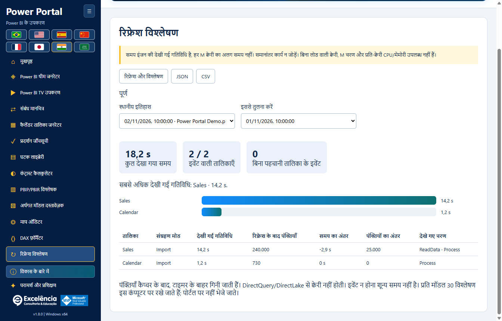

# रिफ्रेश विश्लेषण

<!-- language-selector -->
[🇺🇸 English](../REFRESH-ANALYSIS.md) · [🇧🇷 Português](../pt-BR/REFRESH-ANALYSIS.md) · [🇪🇸 Español](../es/REFRESH-ANALYSIS.md) · [🇨🇳 简体中文](../zh-CN/REFRESH-ANALYSIS.md) · [🇫🇷 Français](../fr/REFRESH-ANALYSIS.md) · [🇯🇵 日本語](../ja/REFRESH-ANALYSIS.md) · [🇮🇳 हिन्दी](REFRESH-ANALYSIS.md) · [🇸🇦 العربية](../ar/REFRESH-ANALYSIS.md)
<!-- /language-selector -->

## शुरुआत और सुरक्षा

सही PBIX से जुड़ें, रिफ्रेश विश्लेषण खोलें और रिफ्रेश और विश्लेषण चुनें। फ़ाइल नाम की पुष्टि करें। मूल होम > रिफ्रेश बटन से पहले ट्रेस शुरू होता है; TOM से तालिकाएँ क्रमशः रिफ्रेश नहीं होतीं। Power BI खुला रखें और क्रेडेंशियल, त्रुटियाँ या रद्द करना वहीं सँभालें। BIM बैकअप रिफ्रेश डेटा वापस नहीं लाता।

मूल रिफ्रेश स्रोतों से डेटा लेता है और आयातित डेटा बदलता है। PBIX की प्रति सहेजें। क्रेडेंशियल और त्रुटियाँ Power BI में सुलझाएँ; ट्रेसिंग रिफ्रेश रद्द नहीं करती और सभी Power Query सहायक क्वेरी शामिल नहीं करती।

## माप समझें

देखी गई गतिविधि हर तालिका से ठीक जुड़े इंजन अंतरालों का संघ है, जिससे नेस्टेड चरण दो बार नहीं गिने जाते। यह केवल स्रोत क्वेरी समय या सिद्ध क्रिटिकल पाथ नहीं है। कुल समय शुरू होने से समापन पता लगने तक है, जिसमें UI/जाँच का अतिरिक्त समय है लेकिन बाद की पंक्ति गणना नहीं। बिना पहचानी तालिका के इवेंट अलग दिखते हैं।

समय इंजन की देखी गई गतिविधि है, हर M क्वेरी का अलग समय नहीं। समानांतर कार्य न जोड़ें। बिना लोड वाली क्वेरी, M चरण और प्रति-क्वेरी CPU/मेमोरी उपलब्ध नहीं हैं।

स्वतः समापन के लिए रिफ्रेश कमांड का अंत दिखना और Power BI विंडो तैयार होना ज़रूरी है। परिणाम डायलॉग बंद करें। मैनुअल कैप्चर समापन हमेशा अधूरा है, सफलता का प्रमाण नहीं और रिफ्रेश रद्द नहीं करता। इंजन/ट्रेस त्रुटियाँ साफ दिखाई जाती हैं। बाधित कैप्चर पूर्ण नहीं बताया जाता।

## इतिहास और निर्यात

पंक्तियाँ कैप्चर के बाद, टाइमर के बाहर गिनी जाती हैं। DirectQuery/DirectLake से क्वेरी नहीं होती। इवेंट न होना शून्य समय नहीं है। प्रति मॉडल 30 विश्लेषण इस कंप्यूटर पर रखे जाते हैं; पोर्टल पर नहीं भेजे जाते।

सहेजे गए निष्पादन और तुलना निष्पादन चुनकर समान तालिका नामों के समय और पंक्तियों का अंतर देखें। कैश, स्रोत भार, डेटा मात्रा और समानांतरता असर डालते हैं; अंतर कारण सिद्ध नहीं करते। JSON अनुपलब्ध मान null रखता है; CSV खाली रखकर फ़ॉर्मूला निष्पादन रोकता है। इतिहास स्थानीय है और आरेख की मॉडल पहचान उपयोग करता है, PBIX में नहीं रहता। समान दिखाई गई पहचान वाली फ़ाइलें इतिहास साझा कर सकती हैं: मॉडल जाँचें। निर्यात में नाम और गणनाएँ हैं: साझा करने से पहले समीक्षा करें।

<!-- refresh-correlation -->
केवल सक्रिय रिफ्रेश कमांड से सटीक RequestID/ActivityID द्वारा जुड़ी इंजन प्रगति मापी जाती है। असंबंधित विज़ुअल क्वेरी बाहर रहती हैं। कुछ Power BI संस्करण ये पहचान नहीं देते: रिफ्रेश चलने पर भी तालिका का समय अनुपलब्ध रह सकता है।
