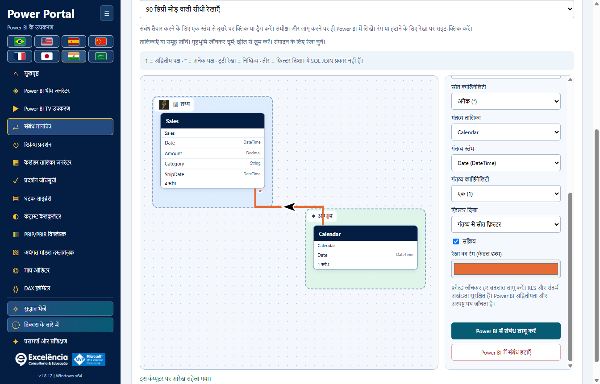
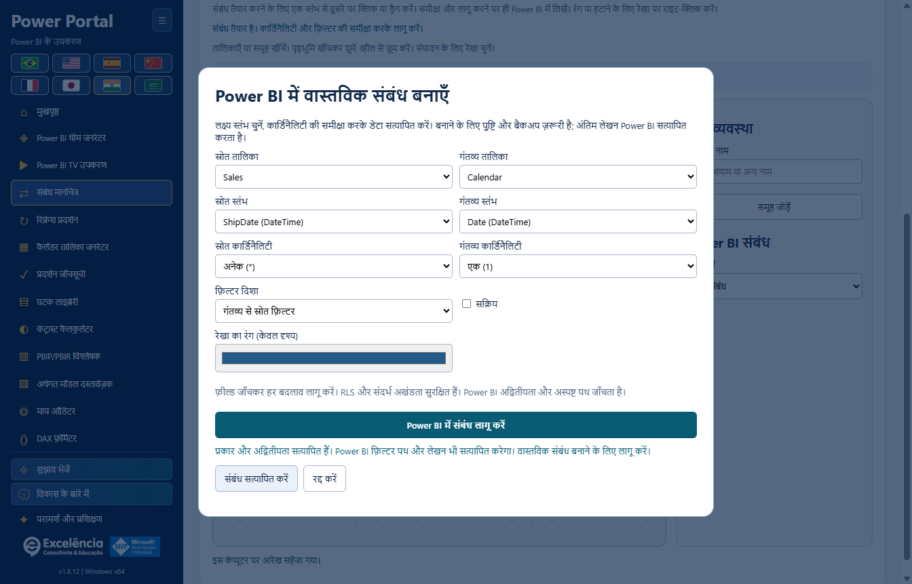
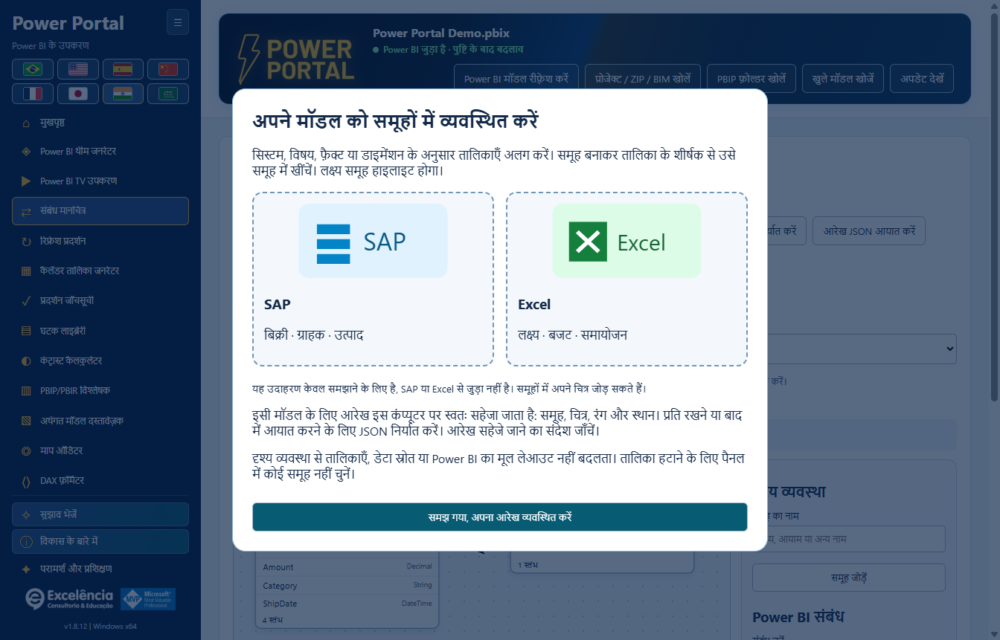
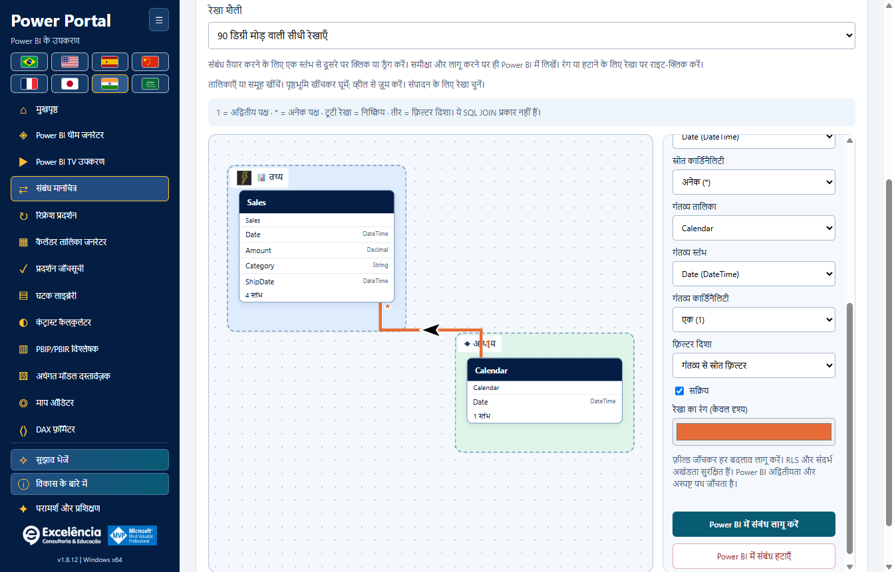

# संबंध मानचित्र (Relationship map)

<!-- language-selector -->
[🇺🇸 English](../RELATIONSHIPS.md) · [🇧🇷 Português](../pt-BR/RELATIONSHIPS.md) · [🇪🇸 Español](../es/RELATIONSHIPS.md) · [🇨🇳 简体中文](../zh-CN/RELATIONSHIPS.md) · [🇫🇷 Français](../fr/RELATIONSHIPS.md) · [🇯🇵 日本語](../ja/RELATIONSHIPS.md) · [🇮🇳 हिन्दी](RELATIONSHIPS.md) · [🇸🇦 العربية](../ar/RELATIONSHIPS.md)
<!-- /language-selector -->

**1.8.8 — डायनेमिक संबंध रेखाएँ और सत्यापित थीम भेजना**

संबंध मानचित्र में रेखा शैली से वक्र या केवल 90 डिग्री के मोड़ वाली सीधी रेखाएँ चुनें। तालिकाओं की स्थिति और कार्ड के वास्तविक आकार के अनुसार सिरे आमने-सामने के ऊपर/नीचे या बाएँ/दाएँ किनारों से जुड़ते हैं। पार्श्व कनेक्शन संबंधित कॉलम की ऊँचाई बनाए रखते हैं। सफेद किनारे वाले काले तीर सीधे खंड पर रहते हैं और कोनों पर तिरछे नहीं होते। शैली अपने आप सहेजी जाती है और निर्यात किए गए JSON में शामिल होती है; पुराने लेआउट वक्र ही रहते हैं। इससे Power BI का मूल लेआउट नहीं बदलता और वैश्विक बाधा-परिहार नहीं होता।

सीधे Power BI में थीम भेजने पर मूल आयात के बाद और निर्यात सत्यापन के दौरान केवल Power BI के सामने होने पर फोकस Power Portal को लौटता है। लागू थीम सत्यापित होने पर Power BI दिखता है; त्रुटि होने पर भी चयनित विंडो समीक्षा के लिए दिखाई जाती है। मूल संवाद थोड़ी देर दिख सकते हैं और छिपाए नहीं जाते: Desktop में संवाद-रहित थीम के लिए समर्थित API नहीं है। पुष्टि से पहले आयात के बाद असिंक्रोनस टैब परिवर्तन संभाले जाते हैं। पैकेज किए गए ऐप के अधिकृत वास्तविक परीक्षण ने आयात/निर्यात, Portal पर फोकस वापसी और अंत में Power BI सक्रियण सत्यापित किया, फिर PBIX सहेजे बिना मूल डिफ़ॉल्ट थीम बहाल की। दस्तावेज़ के स्क्रीनशॉट कृत्रिम डेटा का उपयोग करते हैं।

[होम पर लौटें](../../README.hi.md) · [स्क्रीनशॉट](SCREENSHOTS.md) · [मॉडल सुरक्षा](USAGE.md)

**Power Portal Desktop 1.8.12** में उपलब्ध। यह नया केवल-Desktop टूल है, Power BI के अपने Model view से अलग। यह तालिका/कॉलम संबंध पढ़ता है और कनेक्टेड स्थानीय semantic model में पुष्टि किए गए बदलाव लागू कर सकता है।



संबंधों के तीर अब वक्र पर रहते हैं और उसकी स्थानीय दिशा के अनुसार घूमते हैं, तिरछे या उल्टे संबंधों में भी। बड़े 36 × 26 इकाई वाले SVG तीर हमेशा काले होते हैं और उनके चारों ओर 3 इकाई की सफेद सीमा होती है, रेखा के रंग से स्वतंत्र। एकदिशीय फ़िल्टर अभी भी लक्ष्य से स्रोत की ओर जाता है; द्विदिशीय फ़िल्टर दो विपरीत तीर दिखाता है। स्वचालित फ़िल्टर प्रश्नचिह्न रखता है। यह केवल दृश्य बदलाव है।

<a name="create-a-real-relationship-in-power-bi"></a>
## Power BI में वास्तविक संबंध बनाएँ



संबंध मानचित्र अब साइडबार और होम गैलरी में TV Tool के ठीक बाद है। कैलेंडर जनरेटर और घटक लाइब्रेरी से सामान्य वास्तविक मॉडल डेटा ब्लॉक हटा दिया गया है। उनके अपने पढ़ने और भेजने के नियंत्रण बने हैं; वास्तविक अवधि बटन टूल के अंदर चुने कैलेंडर का उपयोग करता है। होम कवर स्थानीय वेक्टर चित्रों के रूप में फिर बनाए गए हैं, जिनमें कोई पाठ नहीं है। शीर्षक, विवरण और क्रियाएँ चित्रों के बाहर हैं और चुनी गई भाषा में दिखती हैं। स्रोत स्तंभ को दूसरी तालिका पर खींचने से वास्तविक संबंध का संवाद खुलता है, जहाँ लक्ष्य स्तंभ चुन सकते हैं। स्तंभ पर छोड़ने से वह पहले चुना होता है। कार्डिनैलिटी, फ़िल्टर और सक्रिय स्थिति की समीक्षा करें, फिर सत्यापित करके लागू करें। लेखन के लिए मूल पुष्टि और BIM बैकअप ज़रूरी है।

सत्यापन प्रकार, दोहराए गए जोड़े, सक्रिय सीधे संबंध और दोनों स्तंभों की वास्तविक पंक्ति तथा अलग मानों की गिनती जाँचता है, नमूना नहीं। एक वाले पक्ष के डुप्लिकेट अस्वीकार होते हैं। क्वेरी की सीमा 20 सेकंड है और त्रुटियाँ स्पष्ट दिखती हैं। सत्यापन कभी नहीं लिखता। लागू करने पर दोबारा सत्यापन होता है, फिर इंजन सहेजते समय कुंजी और अस्पष्ट फ़िल्टर पथ जाँचता है। टूटी रेखा वाला मसौदा सहेजा संबंध नहीं है; सफल पुष्ट लेखन ही उसे बनाता है। बाद में PBIX सहेजें। परीक्षण और चित्र कृत्रिम डेटा का उपयोग करते हैं; ग्राहक का PBIX नहीं बदला गया।

<a name="how-to-organize-with-groups"></a>
## समूहों से व्यवस्थित कैसे करें



हर ऐप सत्र में पहली बार आरेख खोलने पर परिचय दिखता है। **समूहों से व्यवस्थित कैसे करें** से इसे फिर खोलें। SAP और Excel केवल उदाहरण हैं, नए कनेक्टर या आधिकारिक लोगो नहीं। खाली समूह भी ड्रॉप क्षेत्र हैं। हाइलाइट समूह में छोड़ने पर तालिका उसे सौंप दी जाती है; बाहर छोड़ने पर मौजूदा समूह बना रहता है।

सिस्टम, विषय, फ़ैक्ट या डाइमेंशन के अनुसार तालिकाएँ अलग करें। समूह बनाकर तालिका के शीर्षक से उसे समूह में खींचें। लक्ष्य समूह हाइलाइट होगा।

इसी मॉडल के लिए आरेख इस कंप्यूटर पर स्वतः सहेजा जाता है: समूह, चित्र, रंग और स्थान। प्रति रखने या बाद में आयात करने के लिए JSON निर्यात करें। आरेख सहेजे जाने का संदेश जाँचें।

दृश्य व्यवस्था से तालिकाएँ, डेटा स्रोत या Power BI का मूल लेआउट नहीं बदलता। तालिका हटाने के लिए पैनल में कोई समूह नहीं चुनें।

<a name="open-your-model"></a>
## अपना मॉडल खोलें

1. PBIX की अलग प्रति सहेजें।
2. Power BI Desktop से **External Tools > Power Portal** लॉन्च करें या खुले फ़ाइल को स्पष्ट रूप से ढूँढकर चुनें।
3. साइडबार या होम गैलरी में **Relationship map** खोलें।

आयातित BIM/PBIP/TMDL प्रोजेक्ट आरेख और दृश्य अनुकूलन समर्थित करते हैं, लेकिन **संबंध लिखने के लिए लाइव स्थानीय Power BI कनेक्शन चाहिए**। अन्यत्र किए बदलावों के बाद मॉडल दोबारा पढ़ें।

<a name="understand-the-links"></a>
## लिंक समझें

- प्रत्येक बॉक्स वास्तविक तालिका दर्शाता है। उपयोगकर्ता-अनुकूल शीर्षक के नीचे मूल तालिका नाम बना रहता है।
- संबंधों में प्रयुक्त कॉलम बॉक्स में प्राथमिकता से दिखते हैं। शुरुआत में आठ कॉलम दिखते हैं; **सभी कॉलम दिखाएँ** चुनने पर स्क्रॉल-सूची खुलती है। संपादक में भी सभी कॉलम उपलब्ध हैं।
- **1** विशिष्ट पक्ष और **\*** अनेक पक्ष दर्शाता है।
- ठोस रेखाएँ सक्रिय संबंध हैं; टूटी रेखाएँ निष्क्रिय हैं।
- तीर फ़िल्टर प्रवाह दिखाते हैं: एकल TOM दिशा में फ़िल्टर **गंतव्य तालिका से स्रोत तालिका की ओर** जाता है, न कि कॉलम चुनने के क्रम में। द्विदिश लिंक दोनों दिशाएँ दिखाते हैं। **?** Automatic दर्शाता है, जहाँ इंजन निर्णय करता है।
- सटीक एंडपॉइंट, कार्डिनैलिटी और फ़िल्टर सेटिंग देखने के लिए रेखा क्लिक करें या संबंध ड्रॉपडाउन उपयोग करें।
- असमर्थित एकल-कॉलम-से-अधिक संबंध मॉडल मेटाडेटा में स्पष्ट रूप से गिने जाते हैं और इंटरफ़ेस में चेतावनी मिलती है। उन्हें गढ़ा या संपादित नहीं किया जाता।

**ये semantic-model संबंध हैं, SQL INNER/LEFT/RIGHT JOIN चयन नहीं।** कार्डिनैलिटी और फ़िल्टर दिशा रिपोर्ट गणना तथा फ़िल्टर प्रवाह को प्रभावित करते हैं।

<a name="arrange-a-teaching-friendly-diagram"></a>
## समझाने योग्य आरेख व्यवस्थित करें

- तालिका शीर्षकों को दोनों दिशाओं में स्वतंत्र रूप से खिसकाएँ।
- समूह शीर्षक खिसकाकर उसकी सदस्य तालिकाएँ साथ ले जाएँ।
- पृष्ठभूमि खिसकाकर पैन करें। स्क्रॉल या **+ / -** से ज़ूम करें।
- **Fit tables** मौजूदा मॉडल को फ़्रेम करता है; नए आरेख में यह अपने-आप होता है।
- **Arrange by groups** तालिकाओं को उनके समूह के अनुसार रखता है। यह केवल आरेख बदलता है, मॉडल नहीं।
- तालिका शीर्षक पर फ़ोकस करके arrow key से 10 unit और Shift + arrow से 50 unit खिसकाएँ।
- तालिका चुनकर उसका उपयोगकर्ता-अनुकूल नाम, आइकन, पृष्ठभूमि रंग और समूह चुनें।
- **Facts** और **Dimensions** वैकल्पिक शुरुआती समूह हैं, तालिका भूमिका का स्वचालित वर्गीकरण नहीं।
- कस्टम समूह बनाएँ और उसका नाम, आइकन तथा पृष्ठभूमि रंग संपादित करें। समूह हटाने से तालिकाएँ नहीं हटतीं।
- मौजूदा संबंध चुनकर उसकी रेखा का रंग बदलें।

**रंग, स्थान, समूह, आइकन और सुगम नाम Power BI ऑब्जेक्ट का नाम या उसका मूल Model view लेआउट नहीं बदलते।** वे केवल इस साथी आरेख का हिस्सा हैं।

<a name="save-and-share-the-organization"></a>
## व्यवस्था सहेजें और साझा करें

दृश्य बदलाव वर्तमान Windows उपयोगकर्ता की प्रोफ़ाइल में अपने-आप सहेजे जाते हैं:

```text
%APPDATA%\powerportal-desktop\relationship-diagrams\<model-key>.json
```

लेखन बीच की फ़ाइल और atomic replacement से होता है। विफलता स्पष्ट दिखती है और **Retry saving** उपलब्ध रहता है; ऐप झूठा दावा नहीं करता कि लेआउट सहेजा गया।

**Export diagram JSON** पोर्टेबल दृश्य-लेआउट फ़ाइल बनाता है। **Import diagram JSON** फ़ॉर्मैट सत्यापित करता है और जाँचता है कि उसकी तालिका नाम मौजूदा लोडेड मॉडल में हैं। इससे केवल व्यवस्था बहाल होती है: **आरेख आयात करने से मॉडल संबंध कभी नहीं बनते, बदलते या हटते।**

JSON में तालिका नाम, उपयोगकर्ता-अनुकूल नाम, समूह सेटिंग, रेखा रंग और व्यूपोर्ट होते हैं। इसमें डेटा पंक्तियाँ, DAX या स्रोत कनेक्शन क्रेडेंशियल नहीं होते। फिर भी तालिका/समूह नाम से व्यावसायिक संदर्भ पता चल सकता है; केवल साफ़ की हुई फ़ाइलें साझा करें।

लाइव मॉडल प्रोफ़ाइल Power BI विंडो/फ़ाइल नाम और तालिका lineage tag उपयोग करती हैं, अनुपलब्ध होने पर तालिका नाम। आयातित प्रोजेक्ट प्रोफ़ाइल चयनित स्थानीय पथ भी उपयोग करती हैं। Power BI पहचान से पूरा PBIX पथ विश्वसनीय रूप से नहीं मिलता। फ़ाइल का नाम बदलने या तालिका पहचान बदलने से नई प्रोफ़ाइल बन सकती है; समान नाम और lineage tag वाली प्रतियाँ प्रोफ़ाइल साझा कर सकती हैं। ज़रूरत पर अलग लेआउट बनाए रखने के लिए JSON निर्यात उपयोग करें।

मेटाडेटा रीफ़्रेश होने पर पुरानी तालिका/रेखा प्रविष्टियाँ हटाई जाती हैं। हटाई गई तालिका का पुराना स्थान काल्पनिक तालिका के रूप में नहीं रखा जाता। लेआउट अन्य उपयोगकर्ता सेटिंग के साथ अनइंस्टॉल के बाद भी रहते हैं।

<a name="apply-each-relationship-edit-to-power-bi"></a>
## हर संबंध बदलाव Power BI में लागू करें



<a name="create"></a>
### बनाएँ

1. **New relationship** चुनें।
2. स्रोत/गंतव्य तालिकाएँ और कॉलम चुनें।
3. कार्डिनैलिटी, फ़िल्टर दिशा और सक्रिय/निष्क्रिय स्थिति सेट करें।
4. **Apply relationship to Power BI** चुनें।

<a name="edit-activate-or-deactivate"></a>
### संपादित, सक्रिय या निष्क्रिय करें

1. मौजूदा रेखा क्लिक करें या ड्रॉपडाउन में चुनें।
2. एंडपॉइंट, कार्डिनैलिटी, फ़िल्टर दिशा या **Active** बदलें।
3. इस बदलाव के लिए **Apply relationship to Power BI** चुनें।

<a name="delete"></a>
### हटाएँ

मौजूदा संबंध चुनें और **Delete relationship in Power BI** चुनें।

हर वास्तविक बदलाव इसी सुरक्षित क्रम से होता है:

1. मूल पुष्टि में चुनी Power BI फ़ाइल और पिछली/नई संबंध स्थितियाँ दिखाई जाती हैं। डिफ़ॉल्ट **Cancel** है।
2. स्वीकृति के बाद मॉडल बदलने से पहले पूरा मेटाडेटा BIM बैकअप और स्थानीय प्रयास रिकॉर्ड लिखना आवश्यक है।
3. Connector मॉडल फिर खोलकर सत्यापित करता है कि मौजूदा संबंध संपादक द्वारा पढ़े गए snapshot से मेल खाता है। पुराना/हटाया/नाम बदला संबंध अधिलेखित करने के बजाय अस्वीकार होता है।
4. कॉलम प्रकार समान और तालिकाएँ अलग होनी चाहिए। दोहराए कॉलम-जोड़े और एक ही तालिका-जोड़ी के बीच दूसरा सक्रिय लिंक अस्वीकार होता है। पहले मौजूदा सक्रिय लिंक निष्क्रिय करें।
5. TOM `SaveChanges` से commit करता है; विशिष्टता, मान्य कार्डिनैलिटी और अस्पष्ट फ़िल्टर पथ का सत्यापन इंजन करता है। इंजन त्रुटियाँ दिखती हैं, दरकिनार नहीं होतीं।
6. सफल commit के बाद अनुप्रयोग मॉडल मेटाडेटा फिर लोड करता है। Reload विफलता को रद्दीकरण नहीं, पहले से लिखा बदलाव बताया जाता है।
7. बदले मॉडल को फ़ाइल में स्थायी करने के लिए **Power BI Desktop में PBIX सहेजें**।

मौजूदा संबंधों का पंक्ति-स्तरीय सुरक्षा फ़िल्टर व्यवहार, **Assume Referential Integrity** और अन्य न दिखाए गए गुण सुरक्षित रहते हैं। यह संपादक RLS बदलने या Assume Referential Integrity चालू करने का विकल्प नहीं देता। नए लिंक डिफ़ॉल्ट सुरक्षा/इंटेग्रिटी सेटिंग उपयोग करते हैं।

इन गुणों का संरक्षण यह नहीं दर्शाता कि सक्रिय करना, हटाना या एंडपॉइंट बदलना सुरक्षा फ़िल्टर प्रवाह को प्रभावित नहीं कर सकता। RLS उपयोग करने वाले संबंध बदलने से पहले मॉडल व्यवस्थापक से समीक्षा कराएँ।

अपडेट/theme/मॉडल लेखन संबंध लेखन के साथ एक साथ नहीं चल सकते। लेखन के दौरान कनेक्टेड मॉडल बदलना रोका जाता है; अलग चयनित कनेक्शन के अनुरोध अस्वीकार होते हैं।

<a name="backup-and-limits"></a>
## बैकअप और सीमाएँ

- BIM बैकअप में मॉडल मेटाडेटा होता है, पूरा PBIX, रिपोर्ट कैनवास या सभी डेटा पंक्तियाँ नहीं। सफल लेखन या connector त्रुटि के बाद उसका पथ दिखाया जाता है।
- **संबंध वापस लेने/पूरा मॉडल पुनर्स्थापित करने का स्वचालित बटन नहीं है।** अलग PBIX प्रति रखें और ज़रूरत हो तो दिखाए बैकअप की मॉडल व्यवस्थापक से समीक्षा कराएँ।
- आरेख JSON आयात सीमा 5 MB, 2,000 तालिका प्रविष्टियाँ, 200 समूह और 10,000 रेखा-शैली प्रविष्टियाँ है। ज़ूम 15% से 200% तक है।
- यह टूल SQL join की गणना, क्वेरी मर्ज, facts/dimensions का स्वचालित वर्गीकरण या मनमानी स्क्रिप्ट चलाना नहीं करता।
- मॉडल मोड, Desktop संस्करण, अनुमतियाँ या उद्यम नीति लाइव Desktop लेखन रोक सकती हैं। इन प्रतिबंधों को दरकिनार न करें।

[कॉन्फ़िगरेशन और सुरक्षित रखा डेटा](CONFIGURATION.md#data-locations) · [समस्या निवारण](TROUBLESHOOTING.md)

<a name="column-to-column-editing-and-line-menu"></a>
## कॉलम-से-कॉलम संपादन और रेखा मेनू

स्रोत कॉलम पर क्लिक करें, फिर किसी दूसरी तालिका के कॉलम पर क्लिक करें; या कॉलम पंक्तियों के बीच खींचें। दोनों का डेटा प्रकार समान होना चाहिए। संपादक सटीक एंडपॉइंट चुनता है और नारंगी टूटी रेखा वाला ड्राफ़्ट दिखाता है; कार्डिनैलिटी, फ़िल्टर दिशा और सक्रिय स्थिति जाँचें, फिर **Apply relationship to Power BI** चुनें। केवल रेखा खींचने से मॉडल में कुछ नहीं लिखा जाता। रद्द करने के लिए Esc दबाएँ। पहले से जुड़े कॉलम जोड़े को चुनने पर डुप्लिकेट बनाने के बजाय वही संबंध खुलता है।

संबंध रेखा पर राइट-क्लिक करके **Edit relationship**, उसका दृश्य रंग या **Delete relationship in Power BI** चुनें। हटाने के लिए मूल पुष्टि और मेटाडेटा बैकअप सफल होना अब भी आवश्यक है; रद्द करने या त्रुटि से संबंध अपरिवर्तित रहता है। रंग स्थानीय रूप से सहेजे जाते हैं, Power BI के मूल आरेख में नहीं।

<a name="group-images-and-more-icons"></a>
## समूह छवियाँ और अधिक आइकन

किसी समूह को असाइन की गई तालिका चुनें, फिर समूह सेटिंग में **Insert group image** उपयोग करें। अधिकतम 10 MB और प्रत्येक आयाम में अधिकतम 8192 पिक्सेल वाली स्थानीय PNG/JPEG चुनें। छवि को decode करके अधिकतम 384 पिक्सेल और 256 KB के PNG थंबनेल में सामान्यीकृत किया जाता है। **Remove group image** समूह हटाए बिना छवि साफ़ करता है। तालिकाओं और समूहों के लिए 30 से अधिक आइकन विकल्प हैं।

छवियाँ सहेजे/निर्यात किए गए दृश्य लेआउट में embed होती हैं, किसी दूरस्थ वेबसाइट से लिंक नहीं। SVG और दूरस्थ URL स्वीकार नहीं हैं। प्रति आरेख कुल embedded base64 छवियों की सीमा 2.8 मिलियन वर्ण है; मौजूदा 5 MB आयात सीमा बनी रहती है। केवल गैर-गोपनीय छवियाँ साझा करें। समूह शीर्षक या उसके बिना-अवरोधित पृष्ठभूमि को खींचने से उसकी सदस्य तालिकाएँ साथ चलती हैं।

<a name="automatic-date-tables-and-refreshing"></a>
## स्वचालित तारीख़ तालिकाएँ और रीफ़्रेश

**Show automatic date/time tables** डिफ़ॉल्ट रूप से अनचेक है और प्रति मॉडल सहेजा जाता है। Power BI द्वारा बनाई `LocalDateTable_` और `DateTableTemplate_` तालिकाएँ Power BI annotations से पहचानी जाती हैं; इनके न होने पर आंतरिक नाम/छिपी/गणना की गई तालिका वाला fallback उपयोग होता है। इनके संबंध भी छिपे रहते हैं। Desktop के Model diagram की तरह, सामान्य व्यावसायिक तालिकाएँ मॉडल में hidden चिह्नित होने पर भी दिखाई देती हैं।

**Refresh diagram from Power BI** चुने मॉडल की तालिकाएँ, कॉलम और संबंध फिर पढ़ता है, हटाए गए ऑब्जेक्ट हटाता है, नए जोड़ता है और कैनवास को फ़िट करता है। Power BI में संपादन के बाद इसका उपयोग करें। यह बची हुई कस्टम समूहों/रंगों/स्थितियों को बनाए रखता है। Desktop के मूल coordinates, कस्टम Model-view tabs या layout कॉपी नहीं होते: TOM ये report-side layouts उपलब्ध नहीं कराता। असमर्थित संबंध प्रकार स्पष्ट रूप से बाहर ही रहते हैं।

<a name="native-automatic-relationship-detection"></a>
## मूल स्वचालित संबंध पहचान

**Autodetect relationships** Power BI Desktop की अपनी पहचान चलाता है, Power Portal के नाम-मिलान सुझाव नहीं। पहले PBIX की प्रति सहेजें: मूल पहचान कई लिंक बना सकती है और फ़िल्टर या RLS को प्रभावित कर सकती है।

1. इच्छित स्थानीय मॉडल से कनेक्ट करें और पहचान बटन क्लिक करें।
2. Power Portal की मूल पुष्टि देखें। डिफ़ॉल्ट Cancel है।
3. स्वचालन से पहले BIM मेटाडेटा बैकअप और प्रयास लॉग सहेजना आवश्यक है।
4. Power Portal Desktop का relationship manager खोलता है और सत्यापित UI Automation IDs से उसका मूल autodetect बटन चलाता है।
5. परिणाम और अतिरिक्त पुष्टियाँ सीधे Power BI में देखें; Power Portal उन्हें अपने-आप बंद नहीं करता।
6. Power BI के relationship dialogs बंद करें और Power Portal में **Finish detection and refresh diagram** क्लिक करें।
7. रीफ़्रेश किया आरेख जाँचें और Desktop में PBIX सहेजें।

प्रारंभिक परिणाम का अर्थ केवल **पहचान शुरू की गई** है, यह नहीं कि वह सफल हुई या संबंध बनाए गए। पूरा होने तक मॉडल लेखन, प्रोजेक्ट/मॉडल बदलना और इंस्टॉलर अपडेट अवरुद्ध रहते हैं; मूल संवाद खुला होने पर प्रक्रिया पूरी नहीं हो सकती। असमर्थित Desktop संस्करण/स्थितियों में बैकअप पथ सहित स्पष्ट त्रुटि मिलती है। स्वचालन विफल हो तो संवाद बंद करके पूरा करने की कार्रवाई से पुनःस्थापित करें। Power BI बंद हो गया हो तो Power Portal फिर शुरू कर दोबारा कनेक्ट करने से पहले वहाँ का काम पूरा करें। पूरे मॉडल को स्वतः वापस करने की सुविधा नहीं है।

मूल नियंत्रण IDs को वास्तविक Desktop विंडो में देखा गया था; autodetection नहीं चलाया गया और मालिक का PBIX नहीं बदला गया। स्वचालित परीक्षणों में synthetic models और simulated detection परिणाम उपयोग किए गए।
