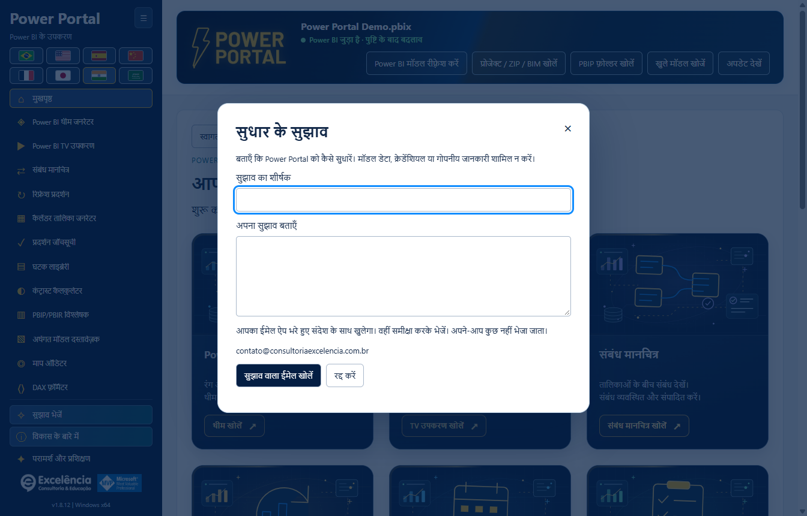
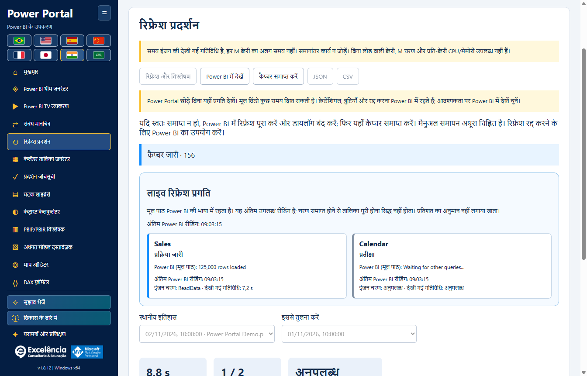
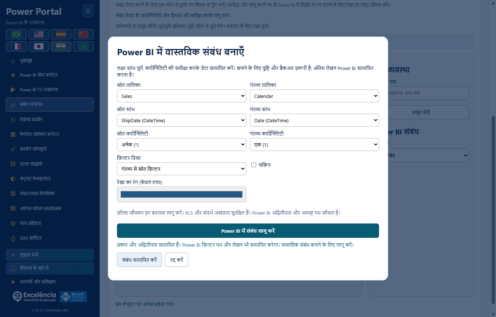
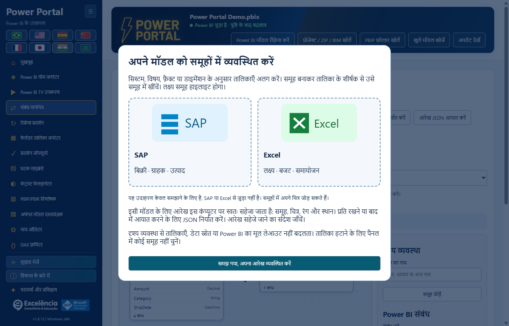
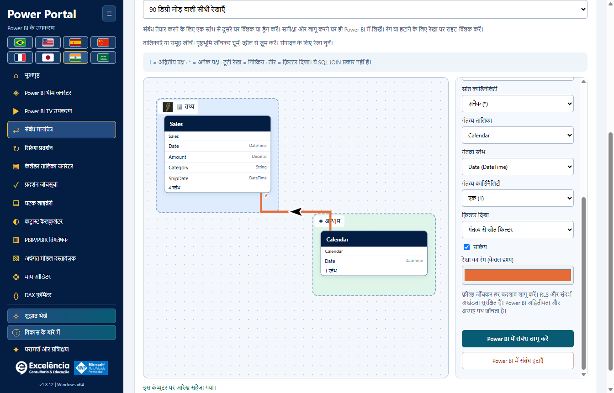
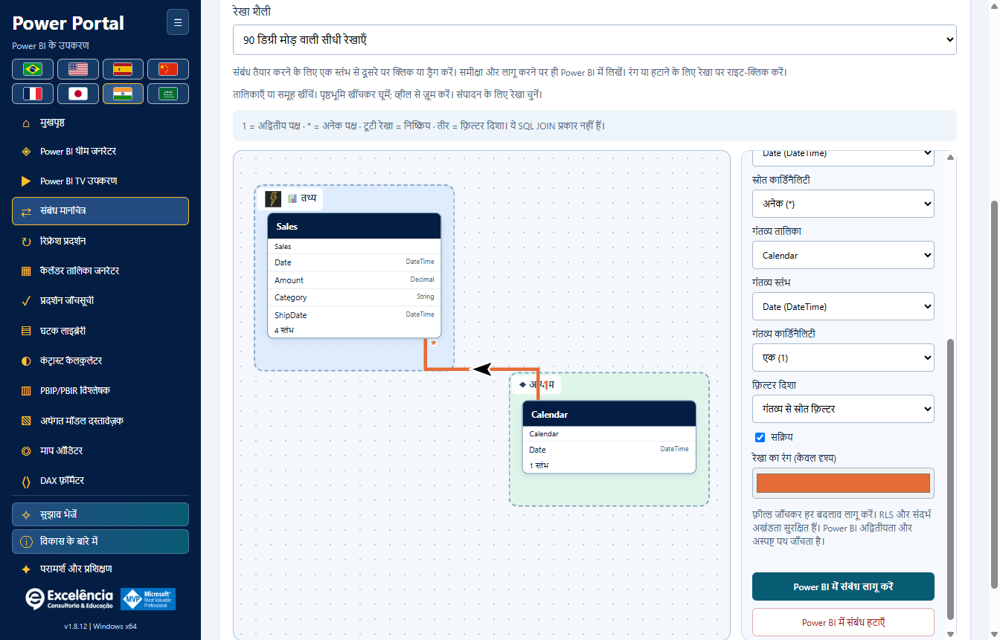
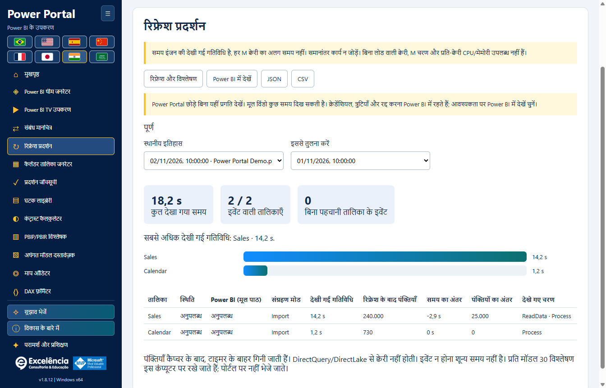
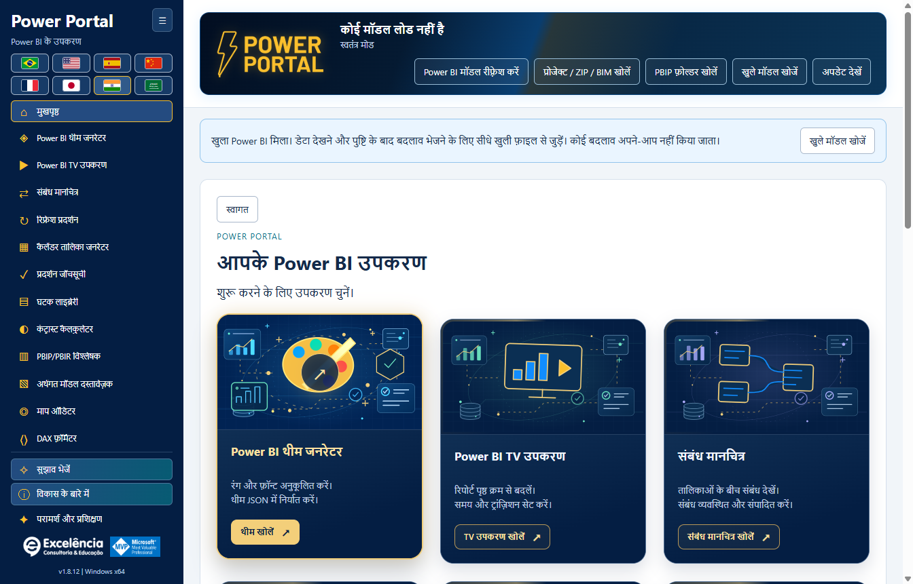

# स्क्रीनशॉट और Power BI इंटरैक्शन

<!-- language-selector -->
[🇺🇸 English](../SCREENSHOTS.md) · [🇧🇷 Português](../pt-BR/SCREENSHOTS.md) · [🇪🇸 Español](../es/SCREENSHOTS.md) · [🇨🇳 简体中文](../zh-CN/SCREENSHOTS.md) · [🇫🇷 Français](../fr/SCREENSHOTS.md) · [🇯🇵 日本語](../ja/SCREENSHOTS.md) · [🇮🇳 हिन्दी](SCREENSHOTS.md) · [🇸🇦 العربية](../ar/SCREENSHOTS.md)
<!-- /language-selector -->

**1.8.12 — मेनू में भीड़ बढ़ाए बिना सुधार के सुझाव भेजें**

सुझाव भेजें बटन अब विकास के बारे में के ठीक ऊपर है। सुलभ फ़ॉर्म में शीर्षक (अधिकतम 120 अक्षर) और विवरण (अधिकतम 1000) भरें। सुझाव वाला ईमेल खोलें डिफ़ॉल्ट ईमेल ऐप में निश्चित प्राप्तकर्ता contato@consultoriaexcelencia.com.br, विषय और संदेश भरकर खोलने का अनुरोध करता है। वहीं समीक्षा करके भेजें: Power Portal अपने-आप नहीं भेजता या डिलीवरी की पुष्टि नहीं करता। ऐप न खुले तो डिफ़ॉल्ट क्लाइंट सेट करें या स्वयं भेजें। मॉडल डेटा, फ़ाइलें या क्रेडेंशियल संलग्न नहीं होते और ड्राफ़्ट डिस्क पर सहेजे नहीं जाते। गोपनीय जानकारी न भरें। त्रुटियाँ स्पष्ट हैं और पुनः प्रयास या कॉपी के लिए पाठ बचा रहता है। फ़ॉर्म ऑफलाइन चलता है; भेजना खाते और नेटवर्क पर निर्भर है।

छोटी ऊँचाई वाली विंडो में बटन और अंतर अधिक कॉम्पैक्ट हैं, बिना नियंत्रण छिपाए या मेनू स्क्रॉल जोड़े। पैकेज परीक्षणों ने आठ भाषाओं में 680/768/900 पिक्सेल ऊँचाई पर खुले/संकुचित मेनू, कम से कम 24 पिक्सेल बटन, कीबोर्ड, आवश्यक फ़ील्ड, निश्चित प्राप्तकर्ता और एन्कोडिंग, ईमेल ऐप त्रुटि और सुरक्षित सामग्री जाँची। परीक्षणों ने ईमेल खोलना इंटरसेप्ट किया: कोई ईमेल नहीं भेजा गया। स्क्रीनशॉट कृत्रिम डेटा का उपयोग करते हैं।

**1.8.10 — एनिमेटेड अग्रभूमि चित्र और समृद्ध होवर**

होम के सभी बारह कवर अब केवल पृष्ठभूमि नहीं, मुख्य टूल चित्र को भी हल्के तैरने और घूमने के साथ चलाते हैं; सामने सत्यापन बैज स्पंदित होता है। माउस होवर या कीबोर्ड फोकस पर अतिरिक्त बार पैनल, षट्कोणीय स्थिति संकेतक, बिंदीदार कक्षा और कण एनिमेट होते हैं। अतिरिक्त एनिमेशन होवर/फोकस के बाहर रुके रहते हैं। सजावटी परतें क्लिक नहीं रोकतीं और एक्सेसिबिलिटी ट्री में नहीं आतीं। Windows/ब्राउज़र की कम गति वरीयता एनिमेशन रोककर स्थिर विवरण, कंट्रास्ट और फोकस बनाए रखती है। स्थानीय मूल टेक्स्ट-रहित चित्र, आठ भाषाएँ और नेविगेशन सुरक्षित हैं। पैकेज परीक्षणों ने अग्रभूमि और पैनल ट्रांसफॉर्म में वास्तविक बदलाव, कीबोर्ड फोकस, कम गति, बारह अलग कवर और आठ भाषाओं में लेआउट जाँचा। स्क्रीनशॉट सामान्य/होवर अवस्थाओं के स्थिर चित्र हैं, वीडियो नहीं; डेटा कृत्रिम है।

**1.8.9 — कैलेंडर नमूना और मूल रिफ़्रेश शॉर्टकट**

कैलेंडर तालिका जनरेटर में वास्तविक नमूना (अधिकतम 50 पंक्तियाँ) अब स्क्रिप्ट बनाएँ बटन के नीचे है। पास का Power BI में रिफ़्रेश करें बटन सक्रिय कनेक्शन पर रिफ़्रेश प्रदर्शन खोलकर वही पुष्टि वाला मूल डेटा रिफ़्रेश शुरू करता है। वहाँ तालिका की स्थिति, समय और पंक्ति संख्या देखें। यह पूरे मॉडल को रिफ़्रेश करता है; बनाई गई स्क्रिप्ट लागू नहीं करता, कैलेंडर बनाता या बदलता नहीं और PBIX सहेजता नहीं है। Power BI में कैलेंडर बनाना अलग कार्रवाई है। ऑफलाइन बटन अक्षम रहता है, कीबोर्ड से चलता है और आठों भाषाओं में उपलब्ध है। रद्द करना और त्रुटियाँ मौजूदा प्रवाह का उपयोग करते हैं। नमूना अंतिम अनुरोधित रीड ही रहता है; रिफ़्रेश के बाद चयनित कैलेंडर फिर पढ़ें। पैकेज ऐप परीक्षणों ने स्थान, आठ अनुवाद, ऑफलाइन रोक, सटीक कनेक्शन, रद्द करना, स्पष्ट त्रुटियाँ, पुनः प्रयास और पुरानी कैलेंडर निर्माण सुविधा जाँची। परीक्षणों में वास्तविक मॉडल रिफ़्रेश शुरू नहीं हुआ; स्क्रीनशॉट कृत्रिम डेटा का उपयोग करते हैं।

**1.8.8 — डायनेमिक संबंध रेखाएँ और सत्यापित थीम भेजना**

संबंध मानचित्र में रेखा शैली से वक्र या केवल 90 डिग्री के मोड़ वाली सीधी रेखाएँ चुनें। तालिकाओं की स्थिति और कार्ड के वास्तविक आकार के अनुसार सिरे आमने-सामने के ऊपर/नीचे या बाएँ/दाएँ किनारों से जुड़ते हैं। पार्श्व कनेक्शन संबंधित कॉलम की ऊँचाई बनाए रखते हैं। सफेद किनारे वाले काले तीर सीधे खंड पर रहते हैं और कोनों पर तिरछे नहीं होते। शैली अपने आप सहेजी जाती है और निर्यात किए गए JSON में शामिल होती है; पुराने लेआउट वक्र ही रहते हैं। इससे Power BI का मूल लेआउट नहीं बदलता और वैश्विक बाधा-परिहार नहीं होता।

सीधे Power BI में थीम भेजने पर मूल आयात के बाद और निर्यात सत्यापन के दौरान केवल Power BI के सामने होने पर फोकस Power Portal को लौटता है। लागू थीम सत्यापित होने पर Power BI दिखता है; त्रुटि होने पर भी चयनित विंडो समीक्षा के लिए दिखाई जाती है। मूल संवाद थोड़ी देर दिख सकते हैं और छिपाए नहीं जाते: Desktop में संवाद-रहित थीम के लिए समर्थित API नहीं है। पुष्टि से पहले आयात के बाद असिंक्रोनस टैब परिवर्तन संभाले जाते हैं। पैकेज किए गए ऐप के अधिकृत वास्तविक परीक्षण ने आयात/निर्यात, Portal पर फोकस वापसी और अंत में Power BI सक्रियण सत्यापित किया, फिर PBIX सहेजे बिना मूल डिफ़ॉल्ट थीम बहाल की। दस्तावेज़ के स्क्रीनशॉट कृत्रिम डेटा का उपयोग करते हैं।

**1.8.7 — थीम रंग चुनना अधिक स्पष्ट और विश्वसनीय**

थीम के सभी ग्यारह रंगों में अब दिखने वाला मूल रंग नमूना और संपादन योग्य HEX के बगल में रंग चुनें बटन है। नमूने या बटन पर क्लिक करें, या बटन पर फ़ोकस करके Enter/Space दबाएँ। चयनकर्ता अदृश्य शून्य आकार वाले इनपुट या HEX पर डबल-क्लिक पर निर्भर नहीं है। मैनुअल HEX, आयात, लाइव पूर्वावलोकन और JSON निर्यात बने रहते हैं। खुलने की त्रुटियाँ स्पष्ट दिखाई जाती हैं। Windows में मूल चयनकर्ता को कई बार खोलना, ग्यारह बटन का माउस/कीबोर्ड संचालन और आठ भाषाएँ सत्यापित हुई हैं।

मेनू, होम, शीर्षक और आठ भाषाओं में रिफ्रेश विश्लेषण का नाम अब रिफ्रेश प्रदर्शन है। केवल नाम बदला है: मूल अपडेट, लाइव प्रगति, समय, पंक्तियाँ, स्थानीय इतिहास और JSON/CSV संगतता यथावत हैं। पुराने विश्लेषण बिना माइग्रेशन या दोबारा अपडेट के उपलब्ध हैं। चित्रों में कृत्रिम डेटा है।

**1.8.6 — Power Portal में ही अपडेट की प्रगति देखें**

Power Portal से अपडेट विश्लेषण शुरू करें और हर तालिका, देखी गई स्थिति, इंजन चरण, गतिविधि समय तथा Power BI का अंतिम उपलब्ध मूल प्रगति संदेश लाइव कार्ड में देखें। शुरू होने के बाद Power Portal का फ़ोकस लौटता है; यदि Power BI फिर सामने आता है तो मूल अपडेट पूरा होने पर एक बार फिर लौटता है। दूसरे ऐप का फ़ोकस बार-बार नहीं छीना जाता। Power BI में देखें चुनी हुई फ़ाइल खोलता है, नया अपडेट शुरू नहीं करता और इस कैप्चर का स्वचालित फ़ोकस लौटना बंद कर देता है।

अपडेट इंजन Power BI ही रहता है। उसकी विंडो थोड़ी देर दिख सकती है; यह बिना विंडो वाला समर्थित PBIX प्रोसेसिंग API नहीं है। क्रेडेंशियल, त्रुटियाँ और रद्द करना Power BI में ही रहते हैं; संवाद अपने-आप छिपाए या बंद नहीं किए जाते। मूल संदेश Power BI की भाषा और अंतिम पढ़ने के समय के साथ दिखते हैं। संदेश न मिलने की सूचना स्पष्ट है; UI रीडर विफल होने पर भी इंजन ट्रेस चलता है। चरण समाप्त होना तालिका पूर्ण होने का प्रमाण नहीं है, प्रतिशत बनाए नहीं जाते और अंतिम पंक्तियाँ कैप्चर के बाद गिनी जाती हैं। इतिहास और JSON में मूल स्थितियाँ होती हैं, साझा करने से पहले निर्यात जाँचें। अधिकृत वास्तविक अपडेट से पैकेज की जाँच हुई: 4/4 तालिकाओं का समय, 4/4 पंक्ति गणना, लाइव संदेश, फ़ोकस वापसी, Power BI खोलने का बटन और पुनः लोड के बाद इतिहास। PBIX अपने-आप सेव नहीं हुआ; चित्रों में कृत्रिम डेटा है।

**1.8.5 — मूल रिफ्रेश माप का सुधार**

रिफ्रेश प्रदर्शन अब Power BI Desktop के मूल XML Refresh कमांड को, Batch के भीतर भी, पहचानता है; XMLA Process और TMSL refresh भी समर्थित हैं। पहले रिफ्रेश चल सकता था, पर प्रगति असंबंधित मानकर हटा दी जाती थी, जिससे 0 मापी गई तालिकाएँ, अनुपलब्ध पंक्ति गणना और refreshCompletionNotProven दिखता था। वैकल्पिक Error फ़ील्ड न होने पर भी इंजन की स्पष्ट सफलता अब स्वीकार होती है; गैर-शून्य त्रुटि कोड और XMLA त्रुटियाँ फिर भी प्राथमिक हैं। असंबंधित विज़ुअल क्वेरी हटाने के लिए सटीक अनुरोध/गतिविधि संबंध अभी भी आवश्यक है।

पहला कमांड पहचाने जाने तक इंटरफ़ेस Power BI रिफ्रेश इवेंट की प्रतीक्षा दिखाता है। अपुष्ट समाप्ति अब केवल तकनीकी कोड के बजाय अनुवादित निर्देश देती है। ऐप अपडेट करें, सही PBIX जोड़ें और रिफ्रेश और विश्लेषण फिर चलाएँ; पुराने अधूरे रिपोर्ट सुरक्षित रहते हैं और सफल नहीं बनाए जाते। पैकेज्ड ऐप को उपयोगकर्ता द्वारा अधिकृत वास्तविक रिफ्रेश में तालिका गतिविधि, पंक्तियों, स्वचालित समाप्ति और दोबारा लोड होने पर इतिहास सहित सत्यापित किया गया। दस्तावेज़ चित्र अभी भी कृत्रिम उदाहरण हैं; उनमें ग्राहक डेटा या मॉडल नाम नहीं हैं।

**1.8.5 — ब्राउज़र में अपडेट डाउनलोड करें**

नया संस्करण मिलने पर अपडेट सूचना में अभी अपडेट करें के साथ ब्राउज़र में डाउनलोड करें विकल्प मिलता है। यह डिफ़ॉल्ट ब्राउज़र में पहचाने गए आधिकारिक GitHub इंस्टॉलर का पता खोलता है, Power Portal बंद नहीं करता और स्थापना शुरू नहीं करता। तैयार होने पर डाउनलोड किया गया इंस्टॉलर मैन्युअल रूप से चलाएँ। स्वचालित अपडेट में त्रुटि के बाद भी यह विकल्प उपलब्ध रहता है। ब्राउज़र न खुलने की त्रुटियाँ स्पष्ट दिखाई जाती हैं। अभी अपडेट करें ऐप में डाउनलोड करके SHA-256 और आकार सत्यापित करता है, फिर Windows अनुमति माँगता है। ब्राउज़र डाउनलोड ऐप के स्वचालित सत्यापन से नहीं गुजरते: इंस्टॉलर चलाने से पहले प्रकाशित SHA-256 की तुलना करें। दोनों बटन और निर्देश आठों भाषाओं में उपलब्ध हैं।

**1.8.5 — थीम पूर्वावलोकन में सहज रेखाएँ**

थीम जनरेटर का लाइन चार्ट अब सीधे खंडों के बजाय सहज घन वक्रों का उपयोग करता है, उदाहरण और जुड़े मॉडल के डेटा दोनों के साथ। वक्र मूल बिंदुओं से गुजरते हैं और मानों के बीच अतिरिक्त शिखर नहीं बनाते; रंग, मार्कर और टूलटिप बने रहते हैं। यह बदलाव केवल पूर्वावलोकन में है: निर्यात किया गया थीम JSON और मौजूदा Power BI विज़ुअल की रेखा फ़ॉर्मेटिंग नहीं बदलती।

**1.8.5 — रिफ्रेश शुरू करने की त्रुटियों का सुधार**

रिफ्रेश प्रदर्शन अब साइड मेनू और होम गैलरी में संबंध मानचित्र के ठीक नीचे है। मूल बटन की खोज DAX क्वेरी और TMDL दृश्यों के डुप्लिकेट Home टैब को छोड़ती है, जिससे “Ambiguous Power BI control: home” से बचा जाता है। नियंत्रण उपलब्ध न हो तो Power BI में रिपोर्ट, डेटा या मॉडल दृश्य चुनें।

[होम पर लौटें](../../README.hi.md) · [इंस्टॉल करें](INSTALLATION.md) · [सुरक्षा मार्गदर्शिका](USAGE.md)

**अनुप्रयोग स्क्रीनशॉट: Power Portal Desktop 1.8.12, चयनित इंटरफ़ेस भाषा।**
स्क्रीनशॉट में **सिंथेटिक प्रदर्शन मेटाडेटा और क्वेरी मान** हैं, किसी ग्राहक PBIX का डेटा नहीं। कनेक्टेड स्थितियाँ समर्थित UI कार्रवाइयाँ दिखाती हैं; ये चित्र बनाने के लिए किसी ग्राहक मॉडल में बदलाव नहीं किया गया। मूल फ़ाइल चयनकर्ता के लेबल Windows भाषा के अनुसार हो सकते हैं। असली Power BI रिबन स्क्रीनशॉट स्वामी ने दिया था और निजी फ़ाइल शीर्षक हटाने के लिए crop किया गया है।

संबंधों के तीर अब वक्र पर रहते हैं और उसकी स्थानीय दिशा के अनुसार घूमते हैं, तिरछे या उल्टे संबंधों में भी। बड़े 36 × 26 इकाई वाले SVG तीर हमेशा काले होते हैं और उनके चारों ओर 3 इकाई की सफेद सीमा होती है, रेखा के रंग से स्वतंत्र। एकदिशीय फ़िल्टर अभी भी लक्ष्य से स्रोत की ओर जाता है; द्विदिशीय फ़िल्टर दो विपरीत तीर दिखाता है। स्वचालित फ़िल्टर प्रश्नचिह्न रखता है। यह केवल दृश्य बदलाव है।

Power Portal के एनिमेटेड हेडर में अब फ़ाइल का नाम, कनेक्शन स्थिति और पढ़ने, आयात, खोज तथा अपडेट के पाँच बटन शामिल हैं। जगह बचाने के लिए बैनर के नीचे की अलग टूलबार हटाई गई है। छोटी विंडो और अरबी सहित सभी आठ भाषाओं में सामग्री हेडर के अंदर समायोजित होती है। पुष्टिकरण, सूचनाएँ और अपडेट का व्यवहार यथावत है।

## Power BI में वास्तविक संबंध बनाएँ

संबंध मानचित्र अब साइडबार और होम गैलरी में TV Tool के ठीक बाद है। कैलेंडर जनरेटर और घटक लाइब्रेरी से सामान्य वास्तविक मॉडल डेटा ब्लॉक हटा दिया गया है। उनके अपने पढ़ने और भेजने के नियंत्रण बने हैं; वास्तविक अवधि बटन टूल के अंदर चुने कैलेंडर का उपयोग करता है। होम कवर स्थानीय वेक्टर चित्रों के रूप में फिर बनाए गए हैं, जिनमें कोई पाठ नहीं है। शीर्षक, विवरण और क्रियाएँ चित्रों के बाहर हैं और चुनी गई भाषा में दिखती हैं। स्रोत स्तंभ को दूसरी तालिका पर खींचने से वास्तविक संबंध का संवाद खुलता है, जहाँ लक्ष्य स्तंभ चुन सकते हैं। स्तंभ पर छोड़ने से वह पहले चुना होता है। कार्डिनैलिटी, फ़िल्टर और सक्रिय स्थिति की समीक्षा करें, फिर सत्यापित करके लागू करें। लेखन के लिए मूल पुष्टि और BIM बैकअप ज़रूरी है।

सत्यापन प्रकार, दोहराए गए जोड़े, सक्रिय सीधे संबंध और दोनों स्तंभों की वास्तविक पंक्ति तथा अलग मानों की गिनती जाँचता है, नमूना नहीं। एक वाले पक्ष के डुप्लिकेट अस्वीकार होते हैं। क्वेरी की सीमा 20 सेकंड है और त्रुटियाँ स्पष्ट दिखती हैं। सत्यापन कभी नहीं लिखता। लागू करने पर दोबारा सत्यापन होता है, फिर इंजन सहेजते समय कुंजी और अस्पष्ट फ़िल्टर पथ जाँचता है। टूटी रेखा वाला मसौदा सहेजा संबंध नहीं है; सफल पुष्ट लेखन ही उसे बनाता है। बाद में PBIX सहेजें। परीक्षण और चित्र कृत्रिम डेटा का उपयोग करते हैं; ग्राहक का PBIX नहीं बदला गया।

## समूहों से व्यवस्थित कैसे करें

हर ऐप सत्र में पहली बार आरेख खोलने पर परिचय दिखता है। **समूहों से व्यवस्थित कैसे करें** से इसे फिर खोलें। SAP और Excel केवल उदाहरण हैं, नए कनेक्टर या आधिकारिक लोगो नहीं। खाली समूह भी ड्रॉप क्षेत्र हैं। हाइलाइट समूह में छोड़ने पर तालिका उसे सौंप दी जाती है; बाहर छोड़ने पर मौजूदा समूह बना रहता है।

सिस्टम, विषय, फ़ैक्ट या डाइमेंशन के अनुसार तालिकाएँ अलग करें। समूह बनाकर तालिका के शीर्षक से उसे समूह में खींचें। लक्ष्य समूह हाइलाइट होगा।

इसी मॉडल के लिए आरेख इस कंप्यूटर पर स्वतः सहेजा जाता है: समूह, चित्र, रंग और स्थान। प्रति रखने या बाद में आयात करने के लिए JSON निर्यात करें। आरेख सहेजे जाने का संदेश जाँचें।

दृश्य व्यवस्था से तालिकाएँ, डेटा स्रोत या Power BI का मूल लेआउट नहीं बदलता। तालिका हटाने के लिए पैनल में कोई समूह नहीं चुनें।

## External Tools से Power Portal खोलें

स्थापना के बाद Power BI Desktop फिर शुरू करें, PBIX खोलें और **External Tools > Power Portal** क्लिक करें।

पुर्तगाली टैब **Ferramentas externas** का अंग्रेज़ी अर्थ **External Tools** है। इंस्टॉलर इसी रिबन में आइकन पंजीकृत करता है। उस पर क्लिक करने से **खुली फ़ाइल के मॉडल से कनेक्टेड अलग Power Portal विंडो** शुरू होती है। यह बाहरी साथी अनुप्रयोग है, रिपोर्ट विज़ुअल, एम्बेडेड पैन या आंतरिक Microsoft extension नहीं।

## होम और नेविगेशन

संबंध मानचित्र अब साइडबार और होम गैलरी में TV Tool के ठीक बाद है। होम कवर स्थानीय वेक्टर चित्रों के रूप में फिर बनाए गए हैं, जिनमें कोई पाठ नहीं है। शीर्षक, विवरण और क्रियाएँ चित्रों के बाहर हैं और चुनी गई भाषा में दिखती हैं।

अधिक कार्यस्थान के लिए साइडबार समेटें; यह पसंद सहेजी जाती है। आइकन के सुलभ नाम और टूलटिप बने रहते हैं। मुख्य कार्यक्षेत्र और अलग-अलग टूल फ़ॉर्म स्क्रॉल हो सकते हैं; स्क्रॉल-रहित बदलाव केवल साइडबार सूची पर लागू है।

## Power BI में पहले से खुली फ़ाइल से कनेक्ट करें

Windows शॉर्टकट से शुरू करने पर ऐप उपलब्ध स्थानीय Power BI मॉडल पहचानता है और बताता है कि खुली फ़ाइल से सीधे कनेक्ट किया जा सकता है। **Find open models** चुनें, फ़ाइल नाम जाँचें और **Connect to selected model** क्लिक करें। कई फ़ाइलें खुली हों तो इच्छित फ़ाइल चुनें।

इसके बजाय External Tools रिबन से लॉन्च करने पर वही Desktop इंस्टेंस का कनेक्शन अपने-आप मिलता है और मेटाडेटा पढ़ा जाता है। **कनेक्ट करने से कोई बदलाव नहीं लिखा जाता।**

## नए संस्करण की सूचना

स्क्रीनशॉट में संस्करण 1.8.12 में सूचना दिखाने हेतु **काल्पनिक भविष्य के 1.8.12 परिणाम का सिमुलेशन** है। यह 1.8.12 के प्रकाशित होने का दावा नहीं है। 1.6.2 या नया संस्करण उपयोग करने वाले अब वास्तविक 1.8.12 सूचना पा सकते हैं।

1.6.4 में एम्बर बैनर स्क्रॉल करते समय दिखता है और कम गति बंद न होने तक हल्का एनिमेट होता है। लगातार "अप टू डेट" बैनर जगह नहीं घेरता।

इंस्टॉल किया गया अनुप्रयोग स्टार्टअप पर नवीनतम आधिकारिक स्थिर Release जाँचता है। इंस्टॉलर डाउनलोड और सत्यापित करने के लिए **Update now** क्लिक करें, फिर Windows व्यवस्थापक अनुरोध को अनुमति दें। यह मौजूदा स्थापना फ़ोल्डर अपडेट करता है और केवल Power Portal बंद करता है। **केवल कनेक्ट या जाँच करने से कुछ इंस्टॉल नहीं होता।** न भेजे टूल संपादन पहले सहेजें/निर्यात करें और स्थापना के बाद ऐप फिर खोलें।

**Check for updates** कभी भी जाँच दोहराता है। ऑफ़लाइन/दर-सीमा/चेकसम/UAC विफलताएँ स्पष्ट दिखाई जाती हैं और स्थानीय टूल अक्षम नहीं होते। [अपडेट की पूरी मार्गदर्शिका](UPDATES.md)।

## खुली Power BI फ़ाइल से सीधे इंटरैक्शन

ये कार्रवाइयाँ केवल पाठ या JSON डाउनलोड तक सीमित नहीं हैं:

| स्क्रीन/कार्रवाई | Power BI से पढ़ती या उसमें बदलाव करती है? | सुरक्षा उपाय |
|---|---|---|
| Power BI मॉडल रीफ़्रेश करें | चुनी फ़ाइल के semantic model से तालिकाएँ, कॉलम, माप और संबंध पढ़ता है। | मॉडल में लेखन नहीं। |
| लाइव डेटा/तारीख़ सीमा/नमूने क्वेरी करें | स्थानीय इंजन से वास्तविक मॉडल मान पढ़ता है। | संरचित और सीमित क्वेरी; सक्रिय पृष्ठ के फ़िल्टर नहीं। |
| Theme सीधे Power BI को भेजें | बनाए JSON को चुनी रिपोर्ट विंडो पर लागू करता है। | पुष्टि, दृश्य UI आयात और निर्यात theme सत्यापन। |
| Power BI में कैलेंडर बनाएँ | semantic model में नई गणना की गई तारीख़ तालिका बनाता है। | पुष्टि और मेटाडेटा बैकअप; बाद में Desktop में रीफ़्रेश करें। |
| Power BI में HTML माप बनाएँ | चुनी मॉडल तालिका में नया माप बनाता है। | पुष्टि और मेटाडेटा बैकअप; HTML विज़ुअल स्वयं जोड़ें। |
| Power BI में माप अपडेट करें | मौजूदा चुने माप में फ़ॉर्मैट किया DAX लिखता है। | पुष्टि, मेटाडेटा बैकअप और समवर्ती बदलाव सुरक्षा। |
| Power BI में संबंध लागू/हटाएँ | चुने कॉलम संबंध बनाता, संपादित करता, सक्रिय/निष्क्रिय करता या हटाता है। | मूल पुष्टि, मेटाडेटा बैकअप, पुरानी स्थिति जाँच और इंजन सत्यापन; RLS/इंटेग्रिटी सेटिंग सुरक्षित। |

**बदलाव लागू करने से पहले PBIX की अलग प्रति सहेजें।** लक्षित फ़ाइल और अभिव्यक्ति की पुष्टि करें, फिर बाद में Desktop में PBIX सहेजें। ऐप कभी PBIX चुपचाप नहीं सहेजता।

### लाइव मॉडल डेटा

नमूने अभी भी 50 पंक्तियों और क्वेरी 20 सेकंड तक सीमित हैं। कैलेंडर डेटा अपने चयनकर्ता और पूर्वावलोकन से पढ़ा जाता है; कैलेंडर जनरेटर या घटक लाइब्रेरी में सामान्य डेटा ब्लॉक नहीं दिखता। कनेक्शन स्थिति हेडर में रहती है।

### थीम जनरेटर (Theme generator)

प्रमुख **Load report theme (JSON)** क्षेत्र उपयोग करें, रंग/फ़ॉन्ट संपादित करें और लाइव पूर्वावलोकन देखें। JSON निर्यात करें, या फ़ॉर्म और पूर्वावलोकन के नीचे पृष्ठ के अंत तक स्क्रॉल करके **Send theme directly to Power BI** उपयोग करें।

मौजूदा रिपोर्ट theme से शुरू करने के लिए Desktop में उसका JSON सहेजकर यहाँ लोड करें। semantic-model कनेक्शन रिपोर्ट theme नहीं पढ़ता। सीधे भेजने के लिए अब भी **दृश्य आयात डायलॉग** उपयोग होता है: कोई समर्थित सामान्य Desktop theme API इसे हटाती नहीं। स्वचालन चलते समय Power BI से इंटरैक्ट न करें।

### कैलेंडर जनरेटर (Calendar generator)

मौजूदा कैलेंडर अभिव्यक्ति/तारीख़ सीमा/नमूना पढ़ें, DAX या नमूना JSON निर्यात करें और नया कैलेंडर बनाएँ। **Create calendar in Power BI** बैकअप/पुष्टि सहित नई गणना तालिका बनाता है, चुना मौजूदा कैलेंडर प्रतिस्थापित नहीं करता।

बनाने के बाद Desktop में रीफ़्रेश करें। संरक्षित कैलेंडर वापसी केवल तब उपलब्ध है जब बनी तालिका अब भी मेल खाती हो और उसकी निर्भरता न हो।

### घटक लाइब्रेरी (Component library)

गंतव्य तालिका और नए माप का नाम चुनें। Builder मॉडल फ़ील्ड/माप नाम उपयोग करता है और **Create HTML measure in Power BI** समर्थित है। पुष्टि के बाद माप मॉडल में लिखा जाता है।

रिपोर्ट में संगत HTML विज़ुअल स्वयं जोड़ें और माप असाइन करें; यह बटन पृष्ठ पर विज़ुअल नहीं रखता।

### DAX फ़ॉर्मैटर

मौजूदा मॉडल माप चुनें, उसकी अभिव्यक्ति फ़ॉर्मैट करें और DAX उसी माप पर भेजने के लिए **Update measure in Power BI** चुनें। कॉपी/निर्यात कार्रवाइयाँ अलग हैं। अपडेट समवर्ती अभिव्यक्ति बदलाव अस्वीकार करता है और पुष्टि माँगता है।

## शेष टूल

### संबंध मानचित्र (Relationship map)

नया केवल-Desktop टूल वास्तविक तालिका लिंक, कार्डिनैलिटी, फ़िल्टर तीर और निष्क्रिय बिंदीदार रेखाएँ दिखाता है। बॉक्स/समूह स्वतंत्र रूप से खिसकाएँ, ज़ूम/पैन करें, सुगम नाम/आइकन दें और समूह/रेखा रंग अनुकूलित करें। दृश्य लेआउट प्रति मॉडल अपने-आप सहेजे जाते हैं और मॉडल लेखन के बिना JSON आयात/निर्यात हो सकते हैं।

रेखा चुनकर उसके सटीक कॉलम, कार्डिनैलिटी, फ़िल्टर दिशा और सक्रिय स्थिति देखें। **Apply relationship to Power BI** या **Delete relationship in Power BI** हर बदलाव मूल पुष्टि और बैकअप के बाद commit करता है। आयातित प्रोजेक्ट केवल-पठन रहते हैं। शैली तालिका नाम या Power BI मूल आरेख नहीं बदलती। [पूरी प्रक्रिया और सुरक्षा सीमाएँ](RELATIONSHIPS.md)।

1.8.12 में कॉलम पर क्लिक या खींचकर टूटी रेखा वाला ड्राफ़्ट तैयार करें, फिर जाँचकर लागू करें। रेखा पर राइट-क्लिक से रंग, संपादन और हटाना उपलब्ध हैं। समूह सेटिंग में स्थानीय PNG/JPEG छवियाँ और अधिक आइकन हैं; समूह पृष्ठभूमि या शीर्षक खिसकाएँ। स्वचालित तारीख़/समय तालिकाएँ डिफ़ॉल्ट रूप से छिपी रहती हैं। **Refresh diagram from Power BI** बाहरी बदलाव फिर पढ़ता है, लेकिन मूल layout coordinates कॉपी नहीं करता। **Autodetect relationships** पुष्टि/बैकअप के बाद Desktop की मूल पहचान शुरू करता है; **Finish detection and refresh diagram** चुनने से पहले परिणाम जाँचें और उसके संवाद बंद करें।

### Power BI TV टूल (TV Tool)

सबसे ऊपर **TV Tool in action** बैनर डिफ़ॉल्ट ब्राउज़र में [आधिकारिक कार्यशील उदाहरण](https://www.powerportal.com.br/tv_tool/painel_exemplo_power_bi_tv_tool.html) खोलता है; इंटरनेट चाहिए, पर स्थानीय मॉडल डेटा नहीं भेजता। फ़ॉर्म की स्थानीय उदाहरण प्रस्तुति भी उपलब्ध है।

प्रकाशित रिपोर्ट पृष्ठ या स्थानीय चित्र घुमाएँ, अवधि/ट्रांज़िशन सेट करें, पूर्वावलोकन करें और HTML निर्यात करें। TV खुले स्थानीय PBIX के पृष्ठ नहीं घुमाता। निजी प्रकाशित रिपोर्टों के लिए उचित Microsoft लॉगिन/लाइसेंस/अनुमतियाँ आवश्यक हैं।

### प्रदर्शन जाँचसूची (Performance checklist)

मॉडल से सूचित चेकलिस्ट मदें और रिपोर्ट के मैन्युअल गुण देखें। स्कोर केवल अनुमानित मार्गदर्शन हैं, मापा दृश्य समय नहीं।

### कंट्रास्ट कैलकुलेटर

WCAG सीमाओं के अनुसार पठनीयता/कंट्रास्ट जाँचें। यह स्थानीय विश्लेषण टूल है और रिपोर्ट फ़ॉर्मैट अपने-आप नहीं बदलता।

### PBIP/PBIR विश्लेषक

लोडेड प्रोजेक्ट की उपलब्ध संरचना का विश्लेषण करें। लाइव semantic-model कनेक्शन रिपोर्ट पृष्ठ/विज़ुअल मेटाडेटा नहीं देता, इसलिए अनुपलब्ध आयाम आंशिक बताए जाते हैं। आयातित PBIR प्रोजेक्ट मेटाडेटा अतिरिक्त गणना दे सकता है।

### Semantic model दस्तावेज़क

Markdown या JSON में तालिका/कॉलम/माप/संबंध दस्तावेज़ पढ़ें और निर्यात करें। यह टूल मॉडल नहीं बदलता। निर्यात में गोपनीय नाम और DAX हो सकते हैं; उन्हें सुरक्षित रखें।

### माप ऑडिटर

मॉडल माप या दिए DAX की अनुमान-आधारित नामकरण/आकार/विभाजक जाँच करें। यह DAX अर्थ सत्यापित या वास्तविक रिपोर्ट प्रदर्शन मापता नहीं है।

## परामर्श और प्रशिक्षण

Power BI परामर्श, Microsoft Fabric, डेटा इंजीनियरिंग और संपूर्ण समाधान देखें। In Company प्रशिक्षण, विशेष वीडियो और संपर्क कार्रवाइयाँ शामिल हैं। WhatsApp/ईमेल ड्राफ़्ट या ब्राउज़र पृष्ठ खोलते हैं; कोई संदेश या बैठक अपने-आप नहीं भेजी जाती।

[रिलीज़ नोट्स](../../CHANGELOG.hi.md) · [समस्या निवारण](TROUBLESHOOTING.md)

## रिफ्रेश प्रदर्शन

मूल रिफ्रेश मापें। समय और पंक्तियों की तुलना करें। [रिफ्रेश प्रदर्शन](REFRESH-ANALYSIS.md).

देखी गई गतिविधि हर तालिका से ठीक जुड़े इंजन अंतरालों का संघ है, जिससे नेस्टेड चरण दो बार नहीं गिने जाते। यह केवल स्रोत क्वेरी समय या सिद्ध क्रिटिकल पाथ नहीं है। कुल समय शुरू होने से समापन पता लगने तक है, जिसमें UI/जाँच का अतिरिक्त समय है लेकिन बाद की पंक्ति गणना नहीं। बिना पहचानी तालिका के इवेंट अलग दिखते हैं।

स्वतः समापन के लिए रिफ्रेश कमांड का अंत दिखना और Power BI विंडो तैयार होना ज़रूरी है। परिणाम डायलॉग बंद करें। मैनुअल कैप्चर समापन हमेशा अधूरा है, सफलता का प्रमाण नहीं और रिफ्रेश रद्द नहीं करता। इंजन/ट्रेस त्रुटियाँ साफ दिखाई जाती हैं। बाधित कैप्चर पूर्ण नहीं बताया जाता।

## होम पर एनिमेटेड कार्ड

बारह होम कार्ड अब मेनू वाला नेवी ब्लू (#041e43) उपयोग करते हैं, जिनमें मूल टेक्स्ट-रहित वेक्टर दृश्य हैं। हर टूल का अपना केंद्रीय चित्र है, साथ में डेटा पैनल, चार्ट, डेटाबेस, कक्षाएँ, ग्रिड और तैरते पैनल हैं। सिग्नल लाइनें धीरे चलती हैं। कवर के लिए बाहरी चित्र, स्क्रिप्ट या सेवाएँ नहीं लोड होतीं।

माउस रखें या कीबोर्ड से फोकस करें तो सुनहरी सीमा और चमक, प्रकाश की लहर, उजला दृश्य, गोल लॉन्च तीर और सुनहरी कार्रवाई दिखती है। दबाने पर तुरंत प्रतिक्रिया मिलती है, नेविगेशन में देरी नहीं। Enter/Space वही टूल खोलते हैं। Windows/ब्राउज़र की कम गति वरीयता एनिमेशन रोकती है लेकिन स्थिर हाइलाइट और स्पष्ट फोकस रखती है। शीर्षक और कार्रवाई चित्र से बाहर चुनी भाषा में रहते हैं। स्क्रीनशॉट सामान्य/होवर की स्थिर स्थिति हैं, वीडियो नहीं।

## स्वागत स्क्रीन और सहेजी गई स्टार्टअप सेटिंग

होम बताता है कि Power BI Desktop में फ़ाइल कैसे खोलें, उसका खुला मॉडल कैसे खोजें और पुष्टि के बाद समर्थित बदलाव कैसे भेजें। हर बार ऐप खोलने पर स्वागत दिखाएँ डिफ़ॉल्ट रूप से चालू है; अगली बार इसे छिपाने के लिए बंद करें। टूल पर जाएँ केवल वर्तमान परिचय बंद करता है। होम पर स्वागत से इसे फिर खोलकर स्विच चालू कर सकते हैं। सेटिंग स्थानीय प्रोफ़ाइल में रहती है, Store संस्करण से अलग। आठ भाषाएँ और कीबोर्ड समर्थित हैं। यह स्क्रीन खोलने से मॉडल नहीं बदलते। पहले कॉपी बनाएँ और बाद में Power BI में PBIX सहेजें। परीक्षणों में वास्तविक प्रक्रिया पुनः आरंभ, सेटिंग, मॉडल खोज और भाषा लेआउट जाँचे गए। मॉडल ऑपरेशन नकली थे; वास्तविक डेटा नहीं बदला गया।
