# स्क्रीनशॉट और Power BI इंटरैक्शन

<!-- language-selector -->
[🇺🇸 English](../SCREENSHOTS.md) · [🇧🇷 Português](../pt-BR/SCREENSHOTS.md) · [🇪🇸 Español](../es/SCREENSHOTS.md) · [🇨🇳 简体中文](../zh-CN/SCREENSHOTS.md) · [🇫🇷 Français](../fr/SCREENSHOTS.md) · [🇯🇵 日本語](../ja/SCREENSHOTS.md) · [🇮🇳 हिन्दी](SCREENSHOTS.md) · [🇸🇦 العربية](../ar/SCREENSHOTS.md)
<!-- /language-selector -->

[होम पर लौटें](../../README.hi.md) · [इंस्टॉल करें](INSTALLATION.md) · [सुरक्षा मार्गदर्शिका](USAGE.md)

**अनुप्रयोग स्क्रीनशॉट: Power Portal Desktop 1.7.2, चयनित इंटरफ़ेस भाषा।**
स्क्रीनशॉट में **सिंथेटिक प्रदर्शन मेटाडेटा और क्वेरी मान** हैं, किसी ग्राहक PBIX का डेटा नहीं। कनेक्टेड स्थितियाँ समर्थित UI कार्रवाइयाँ दिखाती हैं; ये चित्र बनाने के लिए किसी ग्राहक मॉडल में बदलाव नहीं किया गया। मूल फ़ाइल चयनकर्ता के लेबल Windows भाषा के अनुसार हो सकते हैं। असली Power BI रिबन स्क्रीनशॉट स्वामी ने दिया था और निजी फ़ाइल शीर्षक हटाने के लिए crop किया गया है।

## समूहों से व्यवस्थित कैसे करें

हर ऐप सत्र में पहली बार आरेख खोलने पर परिचय दिखता है। **समूहों से व्यवस्थित कैसे करें** से इसे फिर खोलें। SAP और Excel केवल उदाहरण हैं, नए कनेक्टर या आधिकारिक लोगो नहीं। खाली समूह भी ड्रॉप क्षेत्र हैं। हाइलाइट समूह में छोड़ने पर तालिका उसे सौंप दी जाती है; बाहर छोड़ने पर मौजूदा समूह बना रहता है।

सिस्टम, विषय, फ़ैक्ट या डाइमेंशन के अनुसार तालिकाएँ अलग करें। समूह बनाकर तालिका के शीर्षक से उसे समूह में खींचें। लक्ष्य समूह हाइलाइट होगा।

इसी मॉडल के लिए आरेख इस कंप्यूटर पर स्वतः सहेजा जाता है: समूह, चित्र, रंग और स्थान। प्रति रखने या बाद में आयात करने के लिए JSON निर्यात करें। आरेख सहेजे जाने का संदेश जाँचें।

दृश्य व्यवस्था से तालिकाएँ, डेटा स्रोत या Power BI का मूल लेआउट नहीं बदलता। तालिका हटाने के लिए पैनल में कोई समूह नहीं चुनें।

## External Tools से Power Portal खोलें

स्थापना के बाद Power BI Desktop फिर शुरू करें, PBIX खोलें और **External Tools > Power Portal** क्लिक करें।

पुर्तगाली टैब **Ferramentas externas** का अंग्रेज़ी अर्थ **External Tools** है। इंस्टॉलर इसी रिबन में आइकन पंजीकृत करता है। उस पर क्लिक करने से **खुली फ़ाइल के मॉडल से कनेक्टेड अलग Power Portal विंडो** शुरू होती है। यह बाहरी साथी अनुप्रयोग है, रिपोर्ट विज़ुअल, एम्बेडेड पैन या आंतरिक Microsoft extension नहीं।

## होम और नेविगेशन

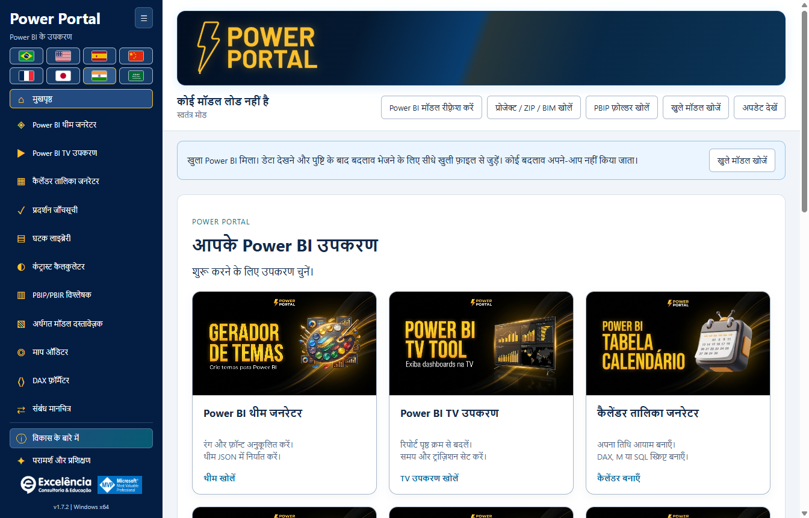

होम में दस आधिकारिक टूल कवर और नया केवल-Desktop relationship-map कवर, संक्षिप्त विवरण सहित दिखते हैं। समर्थित विंडो आकारों में साइडबार सभी ग्यारह टूल **बिना नेविगेशन स्क्रॉल किए** दिखाता है। स्वामित्व लोगो के नीचे **Consulting and training**, **About the development** के बाद है। भाषा झंडे दो पंक्तियों में रहते हैं।

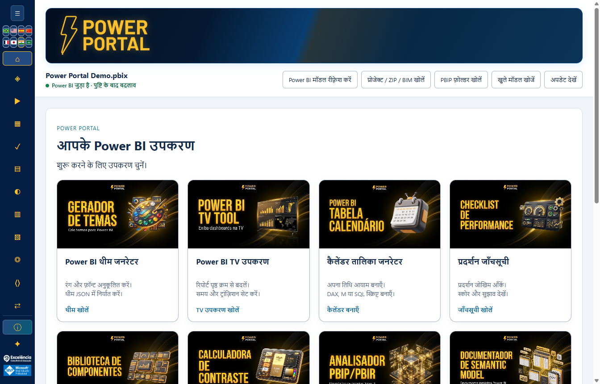

अधिक कार्यस्थान के लिए साइडबार समेटें; यह पसंद सहेजी जाती है। आइकन के सुलभ नाम और टूलटिप बने रहते हैं। मुख्य कार्यक्षेत्र और अलग-अलग टूल फ़ॉर्म स्क्रॉल हो सकते हैं; स्क्रॉल-रहित बदलाव केवल साइडबार सूची पर लागू है।

## Power BI में पहले से खुली फ़ाइल से कनेक्ट करें

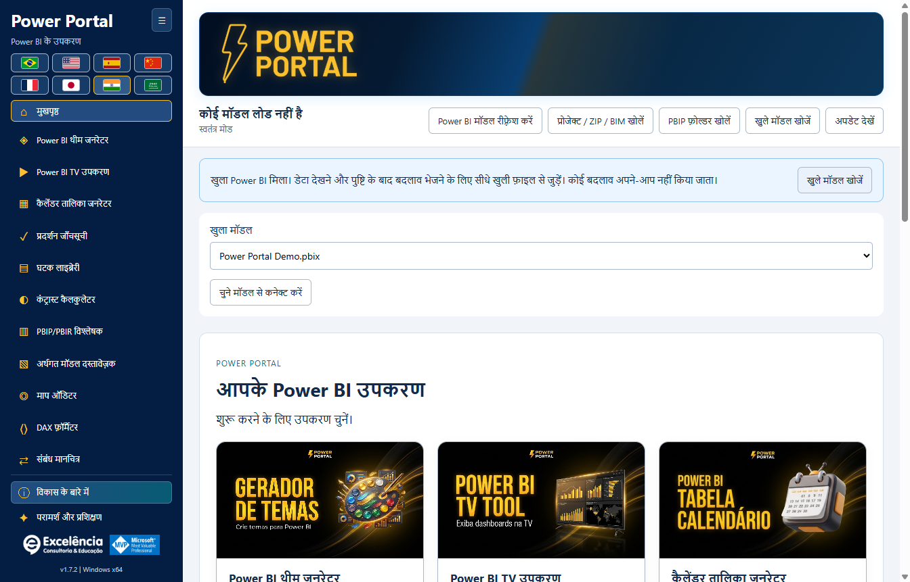

Windows शॉर्टकट से शुरू करने पर ऐप उपलब्ध स्थानीय Power BI मॉडल पहचानता है और बताता है कि खुली फ़ाइल से सीधे कनेक्ट किया जा सकता है। **Find open models** चुनें, फ़ाइल नाम जाँचें और **Connect to selected model** क्लिक करें। कई फ़ाइलें खुली हों तो इच्छित फ़ाइल चुनें।

इसके बजाय External Tools रिबन से लॉन्च करने पर वही Desktop इंस्टेंस का कनेक्शन अपने-आप मिलता है और मेटाडेटा पढ़ा जाता है। **कनेक्ट करने से कोई बदलाव नहीं लिखा जाता।**

## नए संस्करण की सूचना

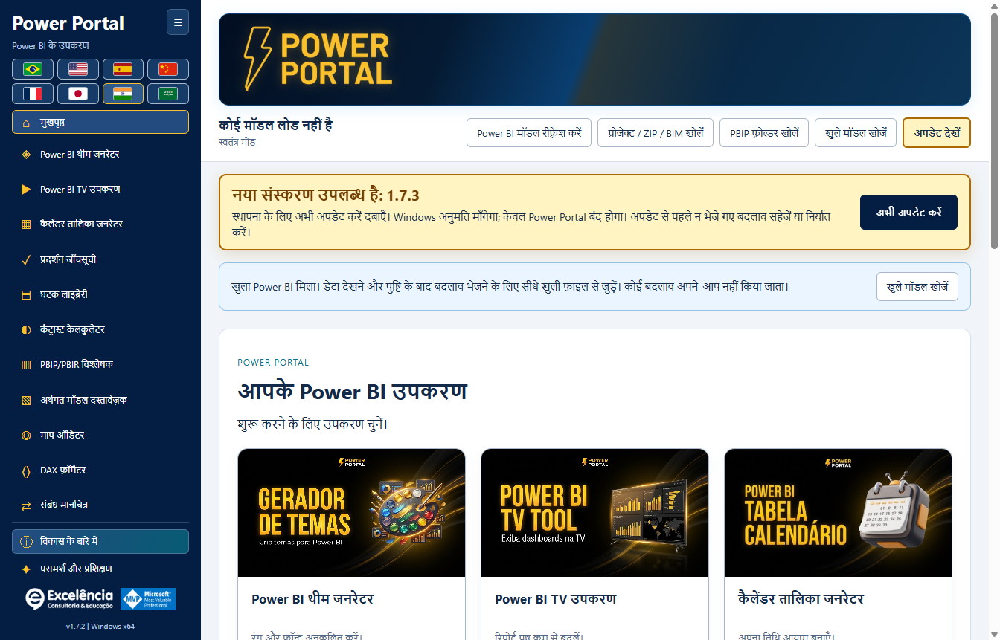

स्क्रीनशॉट में संस्करण 1.7.2 में सूचना दिखाने हेतु **काल्पनिक भविष्य के 1.7.3 परिणाम का सिमुलेशन** है। यह 1.7.3 के प्रकाशित होने का दावा नहीं है। 1.6.2 या नया संस्करण उपयोग करने वाले अब वास्तविक 1.7.2 सूचना पा सकते हैं।

1.6.4 में एम्बर बैनर स्क्रॉल करते समय दिखता है और कम गति बंद न होने तक हल्का एनिमेट होता है। लगातार "अप टू डेट" बैनर जगह नहीं घेरता।

इंस्टॉल किया गया अनुप्रयोग स्टार्टअप पर नवीनतम आधिकारिक स्थिर Release जाँचता है। इंस्टॉलर डाउनलोड और सत्यापित करने के लिए **Update now** क्लिक करें, फिर Windows व्यवस्थापक अनुरोध को अनुमति दें। यह मौजूदा स्थापना फ़ोल्डर अपडेट करता है और केवल Power Portal बंद करता है। **केवल कनेक्ट या जाँच करने से कुछ इंस्टॉल नहीं होता।** न भेजे टूल संपादन पहले सहेजें/निर्यात करें और स्थापना के बाद ऐप फिर खोलें।

**Check for updates** कभी भी जाँच दोहराता है। ऑफ़लाइन/दर-सीमा/चेकसम/UAC विफलताएँ स्पष्ट दिखाई जाती हैं और स्थानीय टूल अक्षम नहीं होते। [अपडेट की पूरी मार्गदर्शिका](UPDATES.md)।

## खुली Power BI फ़ाइल से सीधे इंटरैक्शन

ये कार्रवाइयाँ केवल पाठ या JSON डाउनलोड तक सीमित नहीं हैं:

| स्क्रीन/कार्रवाई | Power BI से पढ़ती या उसमें बदलाव करती है? | सुरक्षा उपाय |
|---|---|---|
| Power BI मॉडल रीफ़्रेश करें | चुनी फ़ाइल के semantic model से तालिकाएँ, कॉलम, माप और संबंध पढ़ता है। | मॉडल में लेखन नहीं। |
| लाइव डेटा/तारीख़ सीमा/नमूने क्वेरी करें | स्थानीय इंजन से वास्तविक मॉडल मान पढ़ता है। | संरचित और सीमित क्वेरी; सक्रिय पृष्ठ के फ़िल्टर नहीं। |
| Theme सीधे Power BI को भेजें | बनाए JSON को चुनी रिपोर्ट विंडो पर लागू करता है। | पुष्टि, दृश्य UI आयात और निर्यात theme सत्यापन। |
| Power BI में कैलेंडर बनाएँ | semantic model में नई गणना की गई तारीख़ तालिका बनाता है। | पुष्टि और मेटाडेटा बैकअप; बाद में Desktop में रीफ़्रेश करें। |
| Power BI में HTML माप बनाएँ | चुनी मॉडल तालिका में नया माप बनाता है। | पुष्टि और मेटाडेटा बैकअप; HTML विज़ुअल स्वयं जोड़ें। |
| Power BI में माप अपडेट करें | मौजूदा चुने माप में फ़ॉर्मैट किया DAX लिखता है। | पुष्टि, मेटाडेटा बैकअप और समवर्ती बदलाव सुरक्षा। |
| Power BI में संबंध लागू/हटाएँ | चुने कॉलम संबंध बनाता, संपादित करता, सक्रिय/निष्क्रिय करता या हटाता है। | मूल पुष्टि, मेटाडेटा बैकअप, पुरानी स्थिति जाँच और इंजन सत्यापन; RLS/इंटेग्रिटी सेटिंग सुरक्षित। |

**बदलाव लागू करने से पहले PBIX की अलग प्रति सहेजें।** लक्षित फ़ाइल और अभिव्यक्ति की पुष्टि करें, फिर बाद में Desktop में PBIX सहेजें। ऐप कभी PBIX चुपचाप नहीं सहेजता।

### लाइव मॉडल डेटा

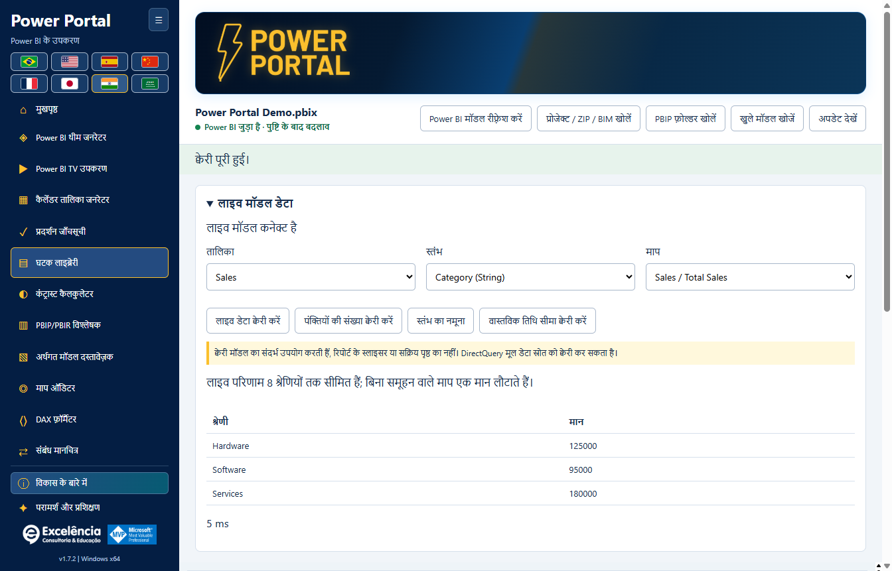

तालिका/कॉलम/माप चुनें और मान, पंक्ति गणना, कॉलम नमूना या तारीख़ सीमा क्वेरी करें। कनेक्शन स्थिति हेडर के हरे पाठ में संक्षिप्त है; टूलटिप PBIX प्रति सहेजने का स्मरण कराता है। डेटा पैनल केवल उपयोगी जगहों, जैसे कैलेंडर और घटकों, में आता है।

### थीम जनरेटर (Theme generator)

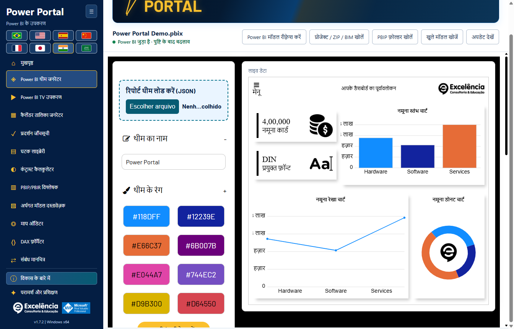

प्रमुख **Load report theme (JSON)** क्षेत्र उपयोग करें, रंग/फ़ॉन्ट संपादित करें और लाइव पूर्वावलोकन देखें। JSON निर्यात करें, या फ़ॉर्म और पूर्वावलोकन के नीचे पृष्ठ के अंत तक स्क्रॉल करके **Send theme directly to Power BI** उपयोग करें।

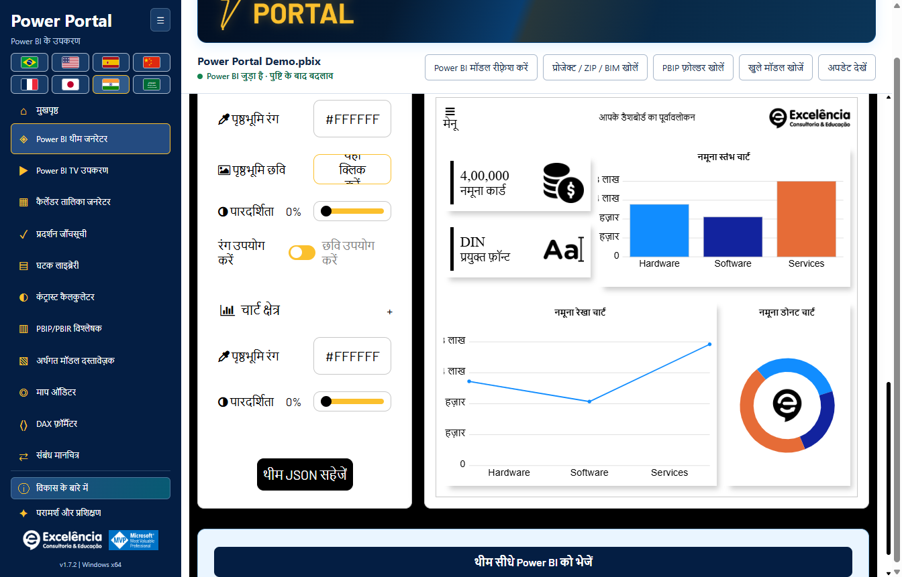

मौजूदा रिपोर्ट theme से शुरू करने के लिए Desktop में उसका JSON सहेजकर यहाँ लोड करें। semantic-model कनेक्शन रिपोर्ट theme नहीं पढ़ता। सीधे भेजने के लिए अब भी **दृश्य आयात डायलॉग** उपयोग होता है: कोई समर्थित सामान्य Desktop theme API इसे हटाती नहीं। स्वचालन चलते समय Power BI से इंटरैक्ट न करें।

### कैलेंडर जनरेटर (Calendar generator)

मौजूदा कैलेंडर अभिव्यक्ति/तारीख़ सीमा/नमूना पढ़ें, DAX या नमूना JSON निर्यात करें और नया कैलेंडर बनाएँ। **Create calendar in Power BI** बैकअप/पुष्टि सहित नई गणना तालिका बनाता है, चुना मौजूदा कैलेंडर प्रतिस्थापित नहीं करता।

बनाने के बाद Desktop में रीफ़्रेश करें। संरक्षित कैलेंडर वापसी केवल तब उपलब्ध है जब बनी तालिका अब भी मेल खाती हो और उसकी निर्भरता न हो।

### घटक लाइब्रेरी (Component library)

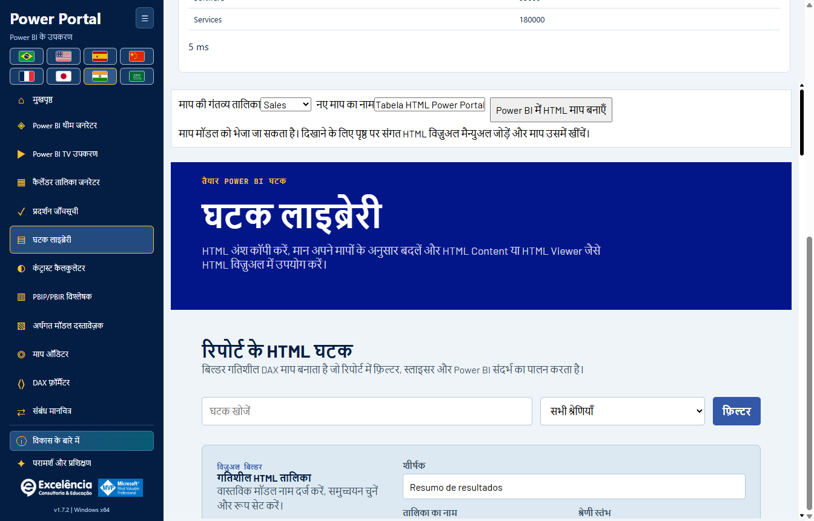

गंतव्य तालिका और नए माप का नाम चुनें। Builder मॉडल फ़ील्ड/माप नाम उपयोग करता है और **Create HTML measure in Power BI** समर्थित है। पुष्टि के बाद माप मॉडल में लिखा जाता है।

रिपोर्ट में संगत HTML विज़ुअल स्वयं जोड़ें और माप असाइन करें; यह बटन पृष्ठ पर विज़ुअल नहीं रखता।

### DAX फ़ॉर्मैटर

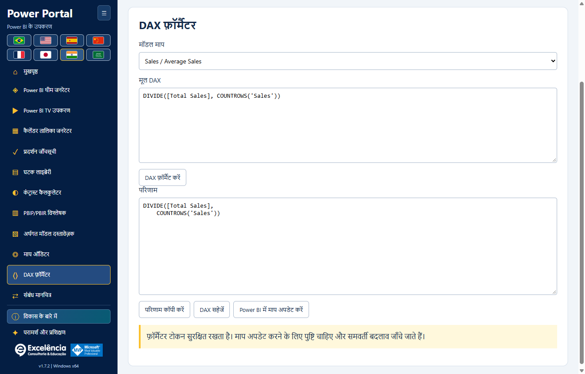

मौजूदा मॉडल माप चुनें, उसकी अभिव्यक्ति फ़ॉर्मैट करें और DAX उसी माप पर भेजने के लिए **Update measure in Power BI** चुनें। कॉपी/निर्यात कार्रवाइयाँ अलग हैं। अपडेट समवर्ती अभिव्यक्ति बदलाव अस्वीकार करता है और पुष्टि माँगता है।

## शेष टूल

### संबंध मानचित्र (Relationship map)

नया केवल-Desktop टूल वास्तविक तालिका लिंक, कार्डिनैलिटी, फ़िल्टर तीर और निष्क्रिय बिंदीदार रेखाएँ दिखाता है। बॉक्स/समूह स्वतंत्र रूप से खिसकाएँ, ज़ूम/पैन करें, सुगम नाम/आइकन दें और समूह/रेखा रंग अनुकूलित करें। दृश्य लेआउट प्रति मॉडल अपने-आप सहेजे जाते हैं और मॉडल लेखन के बिना JSON आयात/निर्यात हो सकते हैं।

रेखा चुनकर उसके सटीक कॉलम, कार्डिनैलिटी, फ़िल्टर दिशा और सक्रिय स्थिति देखें। **Apply relationship to Power BI** या **Delete relationship in Power BI** हर बदलाव मूल पुष्टि और बैकअप के बाद commit करता है। आयातित प्रोजेक्ट केवल-पठन रहते हैं। शैली तालिका नाम या Power BI मूल आरेख नहीं बदलती। [पूरी प्रक्रिया और सुरक्षा सीमाएँ](RELATIONSHIPS.md)।

1.7.2 में कॉलम पर क्लिक या खींचकर टूटी रेखा वाला ड्राफ़्ट तैयार करें, फिर जाँचकर लागू करें। रेखा पर राइट-क्लिक से रंग, संपादन और हटाना उपलब्ध हैं। समूह सेटिंग में स्थानीय PNG/JPEG छवियाँ और अधिक आइकन हैं; समूह पृष्ठभूमि या शीर्षक खिसकाएँ। स्वचालित तारीख़/समय तालिकाएँ डिफ़ॉल्ट रूप से छिपी रहती हैं। **Refresh diagram from Power BI** बाहरी बदलाव फिर पढ़ता है, लेकिन मूल layout coordinates कॉपी नहीं करता। **Autodetect relationships** पुष्टि/बैकअप के बाद Desktop की मूल पहचान शुरू करता है; **Finish detection and refresh diagram** चुनने से पहले परिणाम जाँचें और उसके संवाद बंद करें।

### Power BI TV टूल (TV Tool)

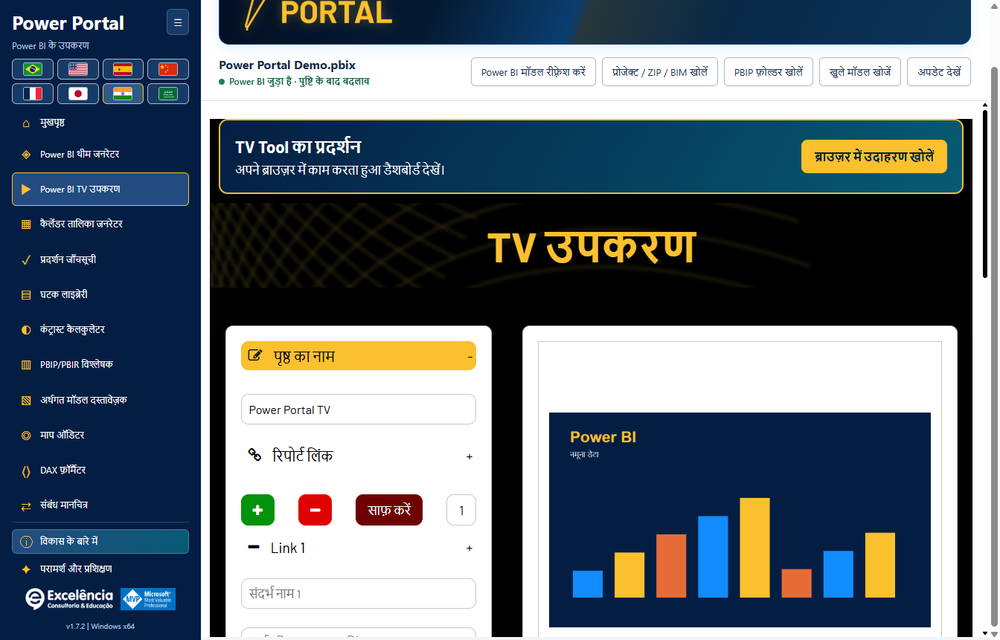

सबसे ऊपर **TV Tool in action** बैनर डिफ़ॉल्ट ब्राउज़र में [आधिकारिक कार्यशील उदाहरण](https://www.powerportal.com.br/tv_tool/painel_exemplo_power_bi_tv_tool.html) खोलता है; इंटरनेट चाहिए, पर स्थानीय मॉडल डेटा नहीं भेजता। फ़ॉर्म की स्थानीय उदाहरण प्रस्तुति भी उपलब्ध है।

प्रकाशित रिपोर्ट पृष्ठ या स्थानीय चित्र घुमाएँ, अवधि/ट्रांज़िशन सेट करें, पूर्वावलोकन करें और HTML निर्यात करें। TV खुले स्थानीय PBIX के पृष्ठ नहीं घुमाता। निजी प्रकाशित रिपोर्टों के लिए उचित Microsoft लॉगिन/लाइसेंस/अनुमतियाँ आवश्यक हैं।

### प्रदर्शन जाँचसूची (Performance checklist)

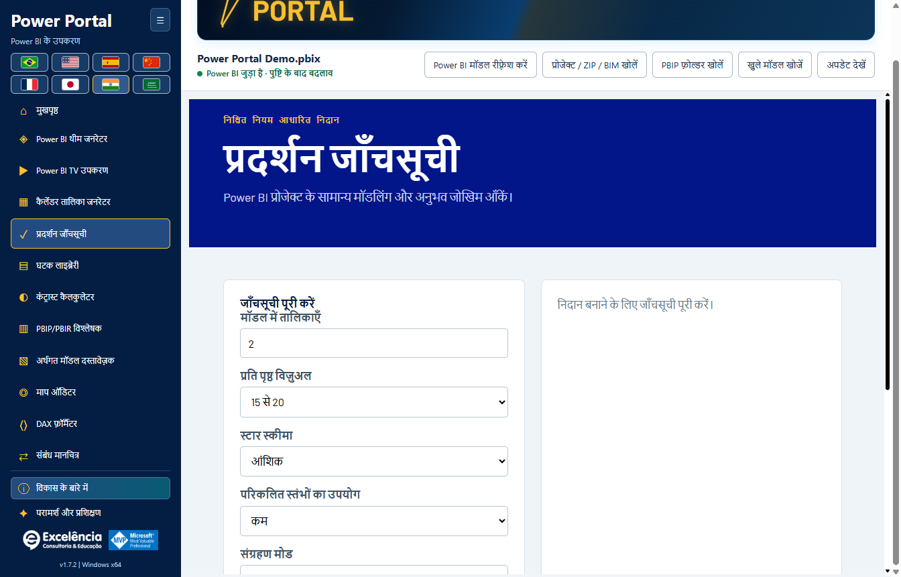

मॉडल से सूचित चेकलिस्ट मदें और रिपोर्ट के मैन्युअल गुण देखें। स्कोर केवल अनुमानित मार्गदर्शन हैं, मापा दृश्य समय नहीं।

### कंट्रास्ट कैलकुलेटर

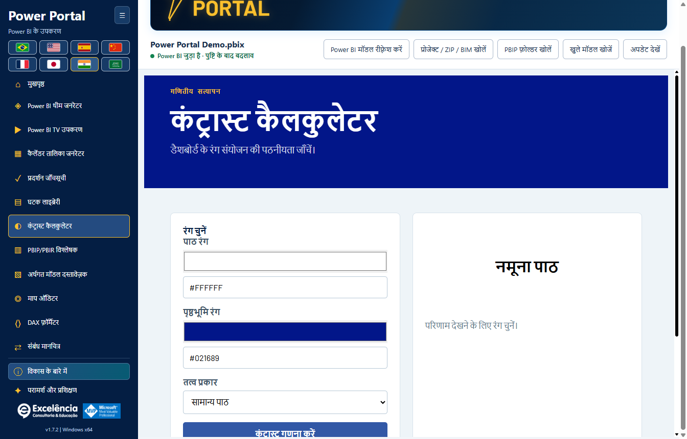

WCAG सीमाओं के अनुसार पठनीयता/कंट्रास्ट जाँचें। यह स्थानीय विश्लेषण टूल है और रिपोर्ट फ़ॉर्मैट अपने-आप नहीं बदलता।

### PBIP/PBIR विश्लेषक

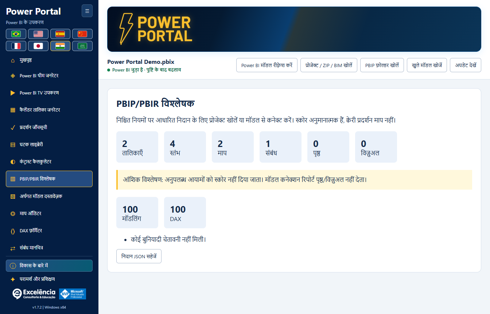

लोडेड प्रोजेक्ट की उपलब्ध संरचना का विश्लेषण करें। लाइव semantic-model कनेक्शन रिपोर्ट पृष्ठ/विज़ुअल मेटाडेटा नहीं देता, इसलिए अनुपलब्ध आयाम आंशिक बताए जाते हैं। आयातित PBIR प्रोजेक्ट मेटाडेटा अतिरिक्त गणना दे सकता है।

### Semantic model दस्तावेज़क

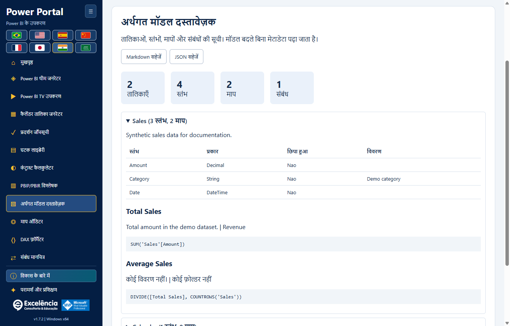

Markdown या JSON में तालिका/कॉलम/माप/संबंध दस्तावेज़ पढ़ें और निर्यात करें। यह टूल मॉडल नहीं बदलता। निर्यात में गोपनीय नाम और DAX हो सकते हैं; उन्हें सुरक्षित रखें।

### माप ऑडिटर

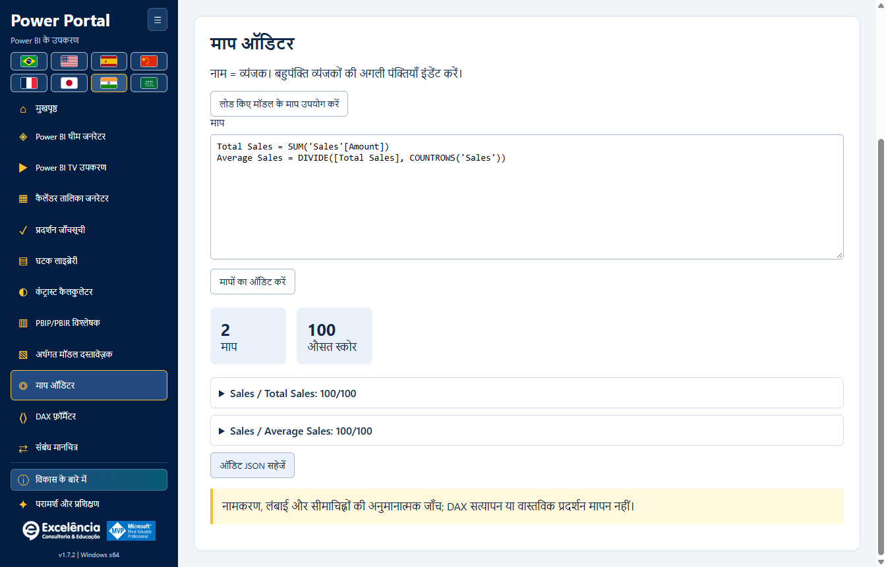

मॉडल माप या दिए DAX की अनुमान-आधारित नामकरण/आकार/विभाजक जाँच करें। यह DAX अर्थ सत्यापित या वास्तविक रिपोर्ट प्रदर्शन मापता नहीं है।

## परामर्श और प्रशिक्षण

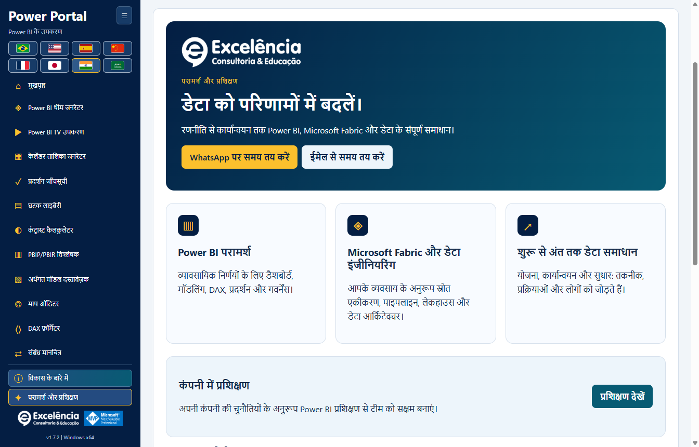

Power BI परामर्श, Microsoft Fabric, डेटा इंजीनियरिंग और संपूर्ण समाधान देखें। In Company प्रशिक्षण, विशेष वीडियो और संपर्क कार्रवाइयाँ शामिल हैं। WhatsApp/ईमेल ड्राफ़्ट या ब्राउज़र पृष्ठ खोलते हैं; कोई संदेश या बैठक अपने-आप नहीं भेजी जाती।

[रिलीज़ नोट्स](../../CHANGELOG.hi.md) · [समस्या निवारण](TROUBLESHOOTING.md)
