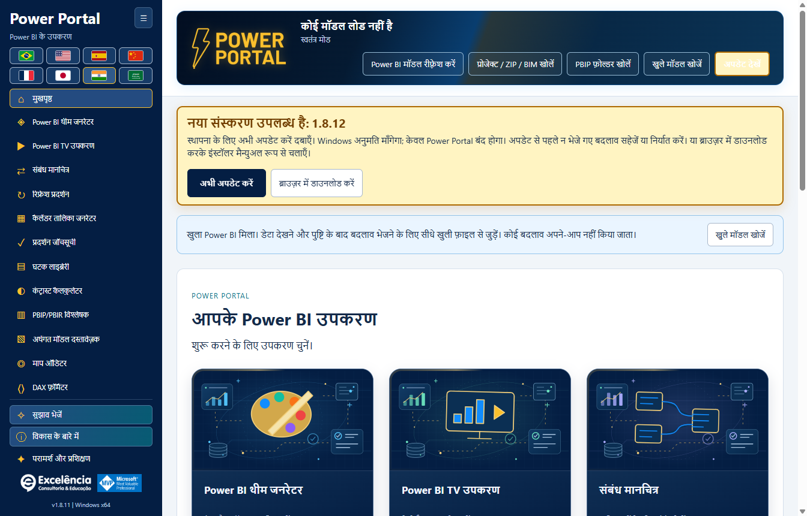

# अपडेट जाँच और स्वचालित स्थापना

<!-- language-selector -->
[🇺🇸 English](../UPDATES.md) · [🇧🇷 Português](../pt-BR/UPDATES.md) · [🇪🇸 Español](../es/UPDATES.md) · [🇨🇳 简体中文](../zh-CN/UPDATES.md) · [🇫🇷 Français](../fr/UPDATES.md) · [🇯🇵 日本語](../ja/UPDATES.md) · [🇮🇳 हिन्दी](UPDATES.md) · [🇸🇦 العربية](../ar/UPDATES.md)
<!-- /language-selector -->

**1.8.11 — मेनू में भीड़ बढ़ाए बिना सुधार के सुझाव भेजें**

सुझाव भेजें बटन अब विकास के बारे में के ठीक ऊपर है। सुलभ फ़ॉर्म में शीर्षक (अधिकतम 120 अक्षर) और विवरण (अधिकतम 1000) भरें। सुझाव वाला ईमेल खोलें डिफ़ॉल्ट ईमेल ऐप में निश्चित प्राप्तकर्ता contato@consultoriaexcelencia.com.br, विषय और संदेश भरकर खोलने का अनुरोध करता है। वहीं समीक्षा करके भेजें: Power Portal अपने-आप नहीं भेजता या डिलीवरी की पुष्टि नहीं करता। ऐप न खुले तो डिफ़ॉल्ट क्लाइंट सेट करें या स्वयं भेजें। मॉडल डेटा, फ़ाइलें या क्रेडेंशियल संलग्न नहीं होते और ड्राफ़्ट डिस्क पर सहेजे नहीं जाते। गोपनीय जानकारी न भरें। त्रुटियाँ स्पष्ट हैं और पुनः प्रयास या कॉपी के लिए पाठ बचा रहता है। फ़ॉर्म ऑफलाइन चलता है; भेजना खाते और नेटवर्क पर निर्भर है।

छोटी ऊँचाई वाली विंडो में बटन और अंतर अधिक कॉम्पैक्ट हैं, बिना नियंत्रण छिपाए या मेनू स्क्रॉल जोड़े। पैकेज परीक्षणों ने आठ भाषाओं में 680/768/900 पिक्सेल ऊँचाई पर खुले/संकुचित मेनू, कम से कम 24 पिक्सेल बटन, कीबोर्ड, आवश्यक फ़ील्ड, निश्चित प्राप्तकर्ता और एन्कोडिंग, ईमेल ऐप त्रुटि और सुरक्षित सामग्री जाँची। परीक्षणों ने ईमेल खोलना इंटरसेप्ट किया: कोई ईमेल नहीं भेजा गया। स्क्रीनशॉट कृत्रिम डेटा का उपयोग करते हैं।

**1.8.10 — एनिमेटेड अग्रभूमि चित्र और समृद्ध होवर**

होम के सभी बारह कवर अब केवल पृष्ठभूमि नहीं, मुख्य टूल चित्र को भी हल्के तैरने और घूमने के साथ चलाते हैं; सामने सत्यापन बैज स्पंदित होता है। माउस होवर या कीबोर्ड फोकस पर अतिरिक्त बार पैनल, षट्कोणीय स्थिति संकेतक, बिंदीदार कक्षा और कण एनिमेट होते हैं। अतिरिक्त एनिमेशन होवर/फोकस के बाहर रुके रहते हैं। सजावटी परतें क्लिक नहीं रोकतीं और एक्सेसिबिलिटी ट्री में नहीं आतीं। Windows/ब्राउज़र की कम गति वरीयता एनिमेशन रोककर स्थिर विवरण, कंट्रास्ट और फोकस बनाए रखती है। स्थानीय मूल टेक्स्ट-रहित चित्र, आठ भाषाएँ और नेविगेशन सुरक्षित हैं। पैकेज परीक्षणों ने अग्रभूमि और पैनल ट्रांसफॉर्म में वास्तविक बदलाव, कीबोर्ड फोकस, कम गति, बारह अलग कवर और आठ भाषाओं में लेआउट जाँचा। स्क्रीनशॉट सामान्य/होवर अवस्थाओं के स्थिर चित्र हैं, वीडियो नहीं; डेटा कृत्रिम है।

**1.8.9 — कैलेंडर नमूना और मूल रिफ़्रेश शॉर्टकट**

कैलेंडर तालिका जनरेटर में वास्तविक नमूना (अधिकतम 50 पंक्तियाँ) अब स्क्रिप्ट बनाएँ बटन के नीचे है। पास का Power BI में रिफ़्रेश करें बटन सक्रिय कनेक्शन पर रिफ़्रेश प्रदर्शन खोलकर वही पुष्टि वाला मूल डेटा रिफ़्रेश शुरू करता है। वहाँ तालिका की स्थिति, समय और पंक्ति संख्या देखें। यह पूरे मॉडल को रिफ़्रेश करता है; बनाई गई स्क्रिप्ट लागू नहीं करता, कैलेंडर बनाता या बदलता नहीं और PBIX सहेजता नहीं है। Power BI में कैलेंडर बनाना अलग कार्रवाई है। ऑफलाइन बटन अक्षम रहता है, कीबोर्ड से चलता है और आठों भाषाओं में उपलब्ध है। रद्द करना और त्रुटियाँ मौजूदा प्रवाह का उपयोग करते हैं। नमूना अंतिम अनुरोधित रीड ही रहता है; रिफ़्रेश के बाद चयनित कैलेंडर फिर पढ़ें। पैकेज ऐप परीक्षणों ने स्थान, आठ अनुवाद, ऑफलाइन रोक, सटीक कनेक्शन, रद्द करना, स्पष्ट त्रुटियाँ, पुनः प्रयास और पुरानी कैलेंडर निर्माण सुविधा जाँची। परीक्षणों में वास्तविक मॉडल रिफ़्रेश शुरू नहीं हुआ; स्क्रीनशॉट कृत्रिम डेटा का उपयोग करते हैं।

**1.8.8 — डायनेमिक संबंध रेखाएँ और सत्यापित थीम भेजना**

संबंध मानचित्र में रेखा शैली से वक्र या केवल 90 डिग्री के मोड़ वाली सीधी रेखाएँ चुनें। तालिकाओं की स्थिति और कार्ड के वास्तविक आकार के अनुसार सिरे आमने-सामने के ऊपर/नीचे या बाएँ/दाएँ किनारों से जुड़ते हैं। पार्श्व कनेक्शन संबंधित कॉलम की ऊँचाई बनाए रखते हैं। सफेद किनारे वाले काले तीर सीधे खंड पर रहते हैं और कोनों पर तिरछे नहीं होते। शैली अपने आप सहेजी जाती है और निर्यात किए गए JSON में शामिल होती है; पुराने लेआउट वक्र ही रहते हैं। इससे Power BI का मूल लेआउट नहीं बदलता और वैश्विक बाधा-परिहार नहीं होता।

सीधे Power BI में थीम भेजने पर मूल आयात के बाद और निर्यात सत्यापन के दौरान केवल Power BI के सामने होने पर फोकस Power Portal को लौटता है। लागू थीम सत्यापित होने पर Power BI दिखता है; त्रुटि होने पर भी चयनित विंडो समीक्षा के लिए दिखाई जाती है। मूल संवाद थोड़ी देर दिख सकते हैं और छिपाए नहीं जाते: Desktop में संवाद-रहित थीम के लिए समर्थित API नहीं है। पुष्टि से पहले आयात के बाद असिंक्रोनस टैब परिवर्तन संभाले जाते हैं। पैकेज किए गए ऐप के अधिकृत वास्तविक परीक्षण ने आयात/निर्यात, Portal पर फोकस वापसी और अंत में Power BI सक्रियण सत्यापित किया, फिर PBIX सहेजे बिना मूल डिफ़ॉल्ट थीम बहाल की। दस्तावेज़ के स्क्रीनशॉट कृत्रिम डेटा का उपयोग करते हैं।

**1.8.6 — Power Portal में ही अपडेट की प्रगति देखें**

Power Portal से अपडेट विश्लेषण शुरू करें और हर तालिका, देखी गई स्थिति, इंजन चरण, गतिविधि समय तथा Power BI का अंतिम उपलब्ध मूल प्रगति संदेश लाइव कार्ड में देखें। शुरू होने के बाद Power Portal का फ़ोकस लौटता है; यदि Power BI फिर सामने आता है तो मूल अपडेट पूरा होने पर एक बार फिर लौटता है। दूसरे ऐप का फ़ोकस बार-बार नहीं छीना जाता। Power BI में देखें चुनी हुई फ़ाइल खोलता है, नया अपडेट शुरू नहीं करता और इस कैप्चर का स्वचालित फ़ोकस लौटना बंद कर देता है।

अपडेट इंजन Power BI ही रहता है। उसकी विंडो थोड़ी देर दिख सकती है; यह बिना विंडो वाला समर्थित PBIX प्रोसेसिंग API नहीं है। क्रेडेंशियल, त्रुटियाँ और रद्द करना Power BI में ही रहते हैं; संवाद अपने-आप छिपाए या बंद नहीं किए जाते। मूल संदेश Power BI की भाषा और अंतिम पढ़ने के समय के साथ दिखते हैं। संदेश न मिलने की सूचना स्पष्ट है; UI रीडर विफल होने पर भी इंजन ट्रेस चलता है। चरण समाप्त होना तालिका पूर्ण होने का प्रमाण नहीं है, प्रतिशत बनाए नहीं जाते और अंतिम पंक्तियाँ कैप्चर के बाद गिनी जाती हैं। इतिहास और JSON में मूल स्थितियाँ होती हैं, साझा करने से पहले निर्यात जाँचें। अधिकृत वास्तविक अपडेट से पैकेज की जाँच हुई: 4/4 तालिकाओं का समय, 4/4 पंक्ति गणना, लाइव संदेश, फ़ोकस वापसी, Power BI खोलने का बटन और पुनः लोड के बाद इतिहास। PBIX अपने-आप सेव नहीं हुआ; चित्रों में कृत्रिम डेटा है।

**1.8.5 — ब्राउज़र में अपडेट डाउनलोड करें**

नया संस्करण मिलने पर अपडेट सूचना में अभी अपडेट करें के साथ ब्राउज़र में डाउनलोड करें विकल्प मिलता है। यह डिफ़ॉल्ट ब्राउज़र में पहचाने गए आधिकारिक GitHub इंस्टॉलर का पता खोलता है, Power Portal बंद नहीं करता और स्थापना शुरू नहीं करता। तैयार होने पर डाउनलोड किया गया इंस्टॉलर मैन्युअल रूप से चलाएँ। स्वचालित अपडेट में त्रुटि के बाद भी यह विकल्प उपलब्ध रहता है। ब्राउज़र न खुलने की त्रुटियाँ स्पष्ट दिखाई जाती हैं। अभी अपडेट करें ऐप में डाउनलोड करके SHA-256 और आकार सत्यापित करता है, फिर Windows अनुमति माँगता है। ब्राउज़र डाउनलोड ऐप के स्वचालित सत्यापन से नहीं गुजरते: इंस्टॉलर चलाने से पहले प्रकाशित SHA-256 की तुलना करें। दोनों बटन और निर्देश आठों भाषाओं में उपलब्ध हैं।

[होम पर लौटें](../../README.hi.md) · [स्थापना](INSTALLATION.md)

<a name="available-from-version-162"></a>
## संस्करण 1.6.2 से उपलब्ध

यदि आपके पास 1.6.1 या पुराना संस्करण है, तो **1.6.2 एक बार मैन्युअल इंस्टॉल करें**। पुराने अनुप्रयोग updater वाली रिलीज़ इंस्टॉल किए बिना नया updater प्राप्त नहीं कर सकते।

**इंस्टॉल किया गया** अनुप्रयोग खुलने पर `luisgnserra/powerportaldesktop` में नवीनतम सार्वजनिक स्थिर Release जाँचता है। यह तीन भाग वाले संख्यात्मक संस्करणों की तुलना करता है, डाउनग्रेड/मौजूदा संस्करण अनदेखा करता है और draft या prerelease प्रस्तुत नहीं करता।

Development/source रन अपडेट डाउनलोड या इंस्टॉल नहीं करता।

<a name="update-flow"></a>
## अपडेट प्रक्रिया

1. Power Portal खोलें। इंटरनेट उपलब्ध हो तो यह नए संस्करण की जाँच करता है।
2. उपलब्ध होने पर प्रमुख एम्बर सूचना संस्करण और **Update now** दिखाती है। स्क्रॉल करते समय यह दिखाई देती रहती है और हल्की चमकती है; कम-गति प्राथमिकता एनीमेशन बंद करती है। जाँच बटन भी प्रमुख है।
3. आगे बढ़ने से पहले **न भेजे गए टूल संपादन सहेजें/निर्यात करें**। चल रहे मॉडल लेखन/theme अपडेट रोकते हैं।
4. **Update now** क्लिक करें। ऐप खोलने या अपडेट जाँचने मात्र से स्थापना नहीं होती।
5. मुख्य प्रक्रिया HTTPS से आधिकारिक x64 इंस्टॉलर डाउनलोड करती है और प्रकाशित GitHub Release asset मेटाडेटा के सटीक आकार/SHA-256 से जाँचती है।
6. Windows व्यवस्थापक अनुमति माँगता है। इस वितरण पर भरोसा हो तभी अनुमति दें।
7. अनुमति/इंस्टॉलर शुरू होने के बाद Power Portal बंद होता है और इंस्टॉलर **मौजूदा स्थापना फ़ोल्डर** में साइलेंट चलता है। **Power BI Desktop बंद नहीं होता।**
8. स्थापना पूरी होने पर Power Portal फिर खोलें। रिबन/पंजीकरण पुनः लोड करने की ज़रूरत हो तो Desktop फिर शुरू करें।



स्क्रीनशॉट में 1.8.12 के भीतर **काल्पनिक भविष्य के 1.8.11 नोटिफिकेशन का सिमुलेशन** है, केवल UI दिखाने के लिए। यह 1.8.12 की घोषणा नहीं है।

<a name="receive-version-1811-from-an-earlier-updater-enabled-version"></a>
### पहले के updater-सक्षम संस्करण से 1.8.11 प्राप्त करें

**1.6.2, 1.6.3 या 1.6.4** इंस्टॉल हो तो ऐप फिर खोलें या **Check for updates** क्लिक करें। प्रकाशित स्थिर **1.8.11** में **Update now** दिखना चाहिए। यदि यह सूचना देखना चाहते हैं तो पहले 1.8.11 मैन्युअल इंस्टॉल न करें। 1.6.4 से पुराने संस्करण मूल बैनर उपयोग करते हैं; प्रमुख दृश्य शैली 1.8.11 में बरकरार है। तैयार होने पर अपडेट बटन क्लिक करें और Windows अनुमति दें।

ऐप इंस्टॉलर शुरू होने की सूचना देता है, स्थापना पूरी होने की पुष्टि नहीं: पुराना ऐप बंद होने पर स्थापना पूरी होती है। दोबारा खोलने पर दिखाया अनुप्रयोग संस्करण जाँचें। Windows बिना हस्ताक्षर वाले इंस्टॉलर को रोक सकता है या IT की अनुमति माँग सकता है।

<a name="checks-retries-and-failures"></a>
## जाँच, पुनः प्रयास और विफलताएँ

ऊपरी कार्रवाइयों में **Check for updates** मैन्युअल रूप से जाँच दोहराता है। पृष्ठभूमि में लगातार जाँच या बाध्य स्थापना नहीं होती।

1.6.4 में, सफल जाँच को नया संस्करण न मिलने पर स्क्रीन पर जगह लेने वाला "अप टू डेट" बैनर नहीं दिखता। त्रुटियाँ और उपलब्ध अपडेट फिर भी दिखते हैं।

- ऑफ़लाइन, firewall/proxy या GitHub API दर-सीमा त्रुटियाँ अपडेट सूचना में दिखाई जाती हैं; स्थानीय टूल उपयोग योग्य रहते हैं।
- अमान्य रिलीज़ मेटाडेटा, अनुपस्थित asset digest, चेकसम असंगति, अप्रत्याशित redirect host, बहुत बड़ा डाउनलोड या timeout होने पर चलाना रोक दिया जाता है।
- Windows अनुमति रद्द करने पर ऐप उपलब्ध रहता है और त्रुटि दिखाता है। तैयार होने पर फिर प्रयास करें।
- असफल जाँच पुराना उपलब्ध-अपडेट प्रस्ताव मिटा देती है ताकि पुराना डेटा चुपचाप उपयोग न हो।
- डाउनलोड/स्थापना के दौरान updater नया मॉडल लेखन रोकता है और सक्रिय लेखन/theme कार्य के बीच शुरू होने से मना करता है।
- वे टूल फ़ॉर्म संपादन जो भेजे/निर्यात नहीं किए गए, अनुप्रयोग बदलने पर अपने-आप सुरक्षित नहीं रहते। पहले निर्यात/सहेजें।

<a name="privacy-network-and-integrity"></a>
## गोपनीयता, नेटवर्क और अखंडता

अपडेट अनुरोध GitHub को केवल सामान्य HTTPS अनुरोध मेटाडेटा भेजते हैं; स्थानीय मॉडल नाम, DAX, डेटा, PBIX सामग्री या क्रेडेंशियल नहीं। सार्वजनिक रिलीज़ के लिए GitHub लॉगिन/टोकन आवश्यक नहीं।

रिलीज़ मेटाडेटा यहाँ से आता है:

```text
https://api.github.com/repos/luisgnserra/powerportaldesktop/releases/latest
```

इंस्टॉलर URL को इस रिपॉज़िटरी की रिलीज़ की सटीक संस्करणयुक्त asset से मेल खाना चाहिए। HTTPS redirect केवल GitHub और उसके आधिकारिक release-asset host तक सीमित हैं। ऐप उस डाउनलोड के लिए मेटाडेटा का हैश/आकार रखता है।

जाँच का कुल timeout 30 सेकंड और मेटाडेटा सीमा 1 MB है। डाउनलोड की कुल सीमा 20 मिनट, socket निष्क्रियता timeout 30 सेकंड और अधिकतम स्वीकार्य इंस्टॉलर आकार 1 GB है। ये सीमाएँ हैं, सामान्य पैकेज का आकार नहीं।

डाउनलोड `%APPDATA%\powerportal-desktop\updates` में रखे जाते हैं। संभाली गई विफलताओं पर अधूरी फ़ाइलें हटाई जाती हैं; सत्यापित EXE स्थापना के बाद रह सकती है। अनुप्रयोग स्रोत डाउनलोड या बिल्ड नहीं होता।

**SHA-256 अखंडता जाँच है, डिजिटल प्रकाशक हस्ताक्षर नहीं।** वर्तमान रिलीज़ पर हस्ताक्षर नहीं है। Updater UAC, SmartScreen या उद्यम नीतियों को दरकिनार नहीं करता। यदि नेटवर्क ऐसा proxy माँगता है जिसे updater उपयोग नहीं कर सकता, IT से पूछें या सत्यापित Release EXE मैन्युअल इंस्टॉल करें।

<a name="manual-fallback"></a>
## मैन्युअल विकल्प

[नवीनतम Release](https://github.com/luisgnserra/powerportaldesktop/releases/latest) या [संस्करणयुक्त PowerShell सहायक](INSTALLATION.md#command-line-installation) उपयोग करें। मौजूदा संस्करण-पिन सहायक आदेश जानबूझकर अपना पिन किया संस्करण इंस्टॉल करते हैं, भविष्य की नवीनतम रिलीज़ नहीं।
