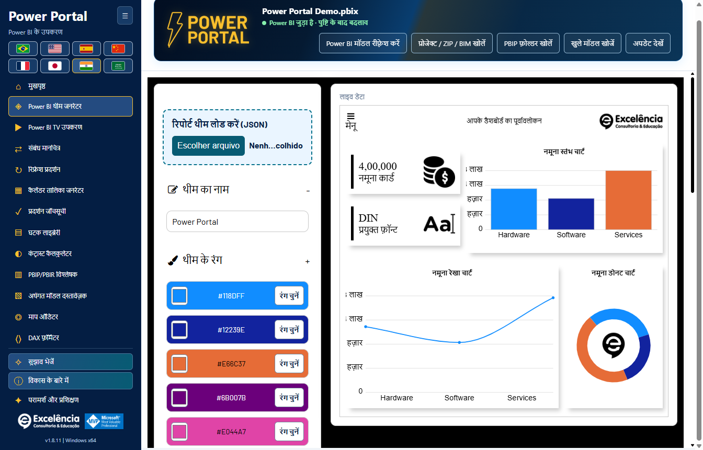
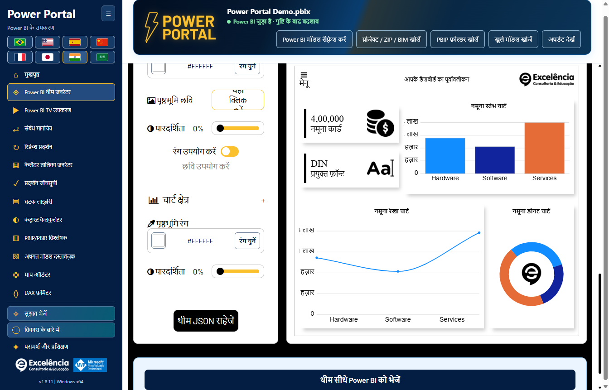
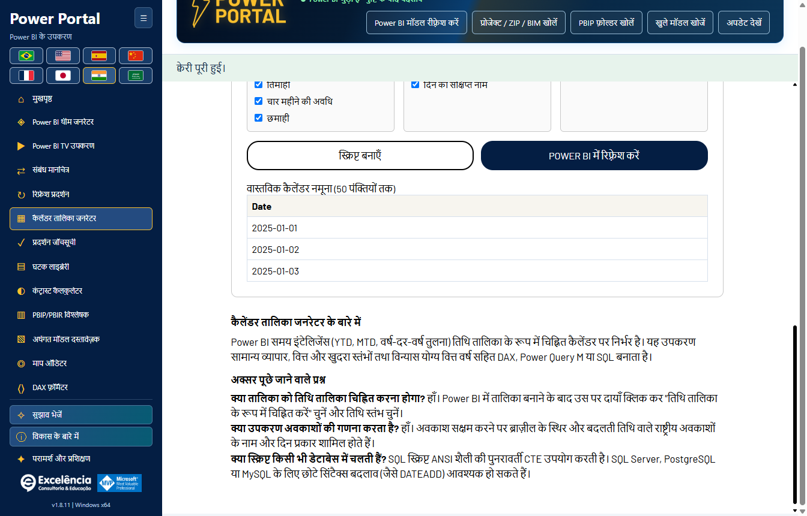
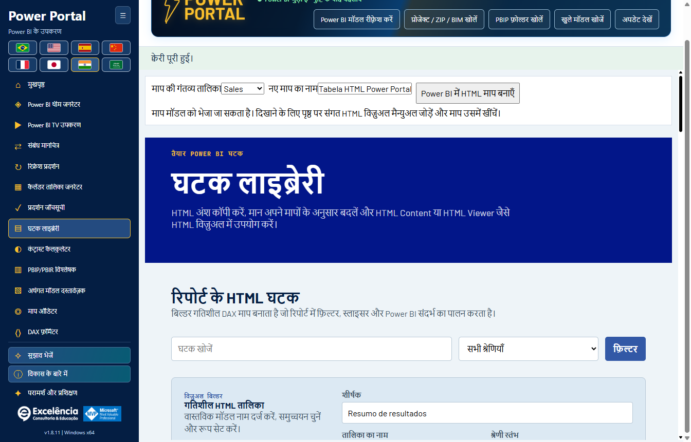
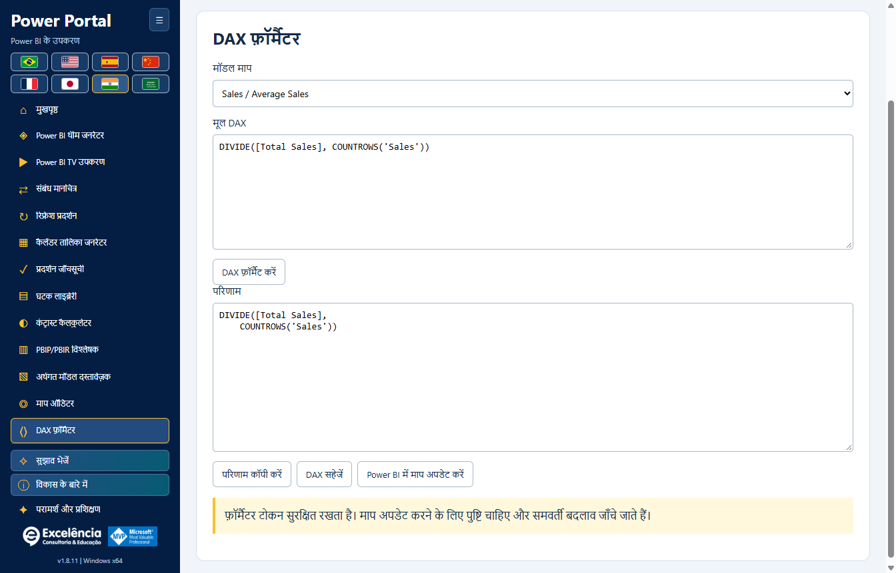
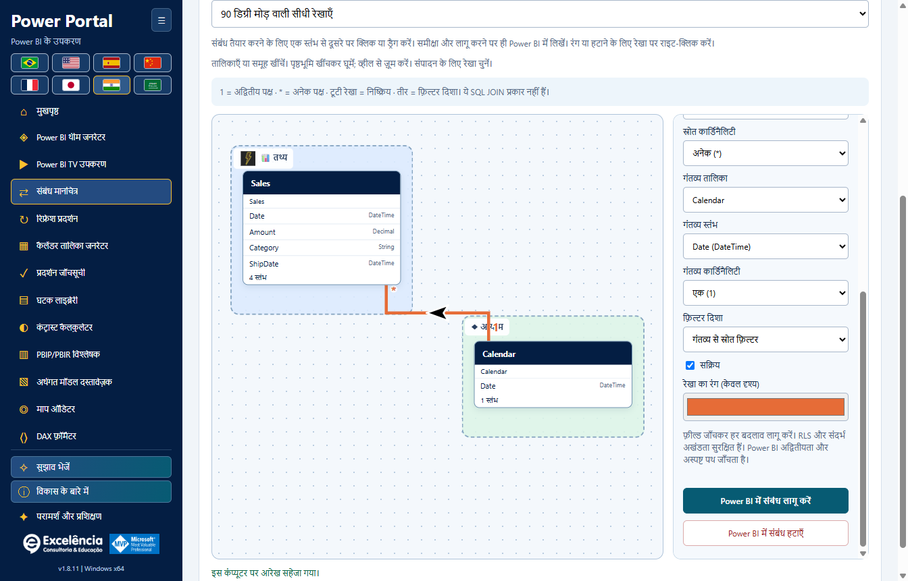
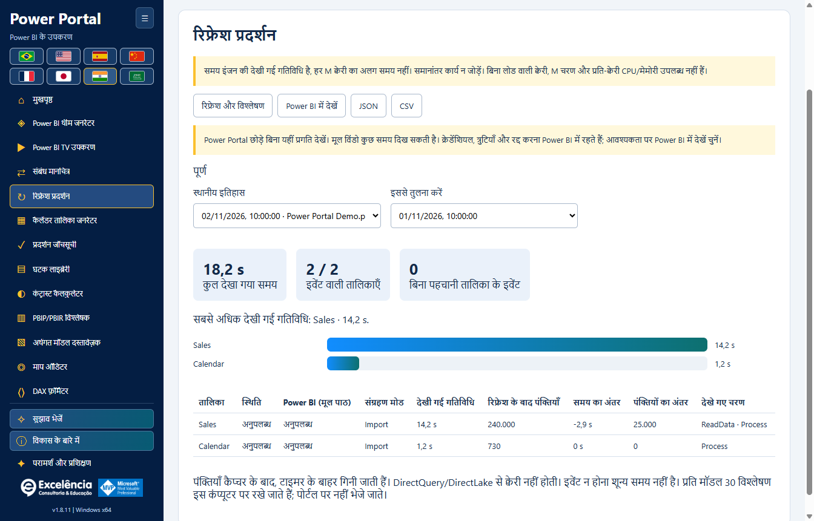

# उपयोग और मॉडल सुरक्षा

<!-- language-selector -->
[🇺🇸 English](../USAGE.md) · [🇧🇷 Português](../pt-BR/USAGE.md) · [🇪🇸 Español](../es/USAGE.md) · [🇨🇳 简体中文](../zh-CN/USAGE.md) · [🇫🇷 Français](../fr/USAGE.md) · [🇯🇵 日本語](../ja/USAGE.md) · [🇮🇳 हिन्दी](USAGE.md) · [🇸🇦 العربية](../ar/USAGE.md)
<!-- /language-selector -->

**1.8.11 — मेनू में भीड़ बढ़ाए बिना सुधार के सुझाव भेजें**

सुझाव भेजें बटन अब विकास के बारे में के ठीक ऊपर है। सुलभ फ़ॉर्म में शीर्षक (अधिकतम 120 अक्षर) और विवरण (अधिकतम 1000) भरें। सुझाव वाला ईमेल खोलें डिफ़ॉल्ट ईमेल ऐप में निश्चित प्राप्तकर्ता contato@consultoriaexcelencia.com.br, विषय और संदेश भरकर खोलने का अनुरोध करता है। वहीं समीक्षा करके भेजें: Power Portal अपने-आप नहीं भेजता या डिलीवरी की पुष्टि नहीं करता। ऐप न खुले तो डिफ़ॉल्ट क्लाइंट सेट करें या स्वयं भेजें। मॉडल डेटा, फ़ाइलें या क्रेडेंशियल संलग्न नहीं होते और ड्राफ़्ट डिस्क पर सहेजे नहीं जाते। गोपनीय जानकारी न भरें। त्रुटियाँ स्पष्ट हैं और पुनः प्रयास या कॉपी के लिए पाठ बचा रहता है। फ़ॉर्म ऑफलाइन चलता है; भेजना खाते और नेटवर्क पर निर्भर है।

छोटी ऊँचाई वाली विंडो में बटन और अंतर अधिक कॉम्पैक्ट हैं, बिना नियंत्रण छिपाए या मेनू स्क्रॉल जोड़े। पैकेज परीक्षणों ने आठ भाषाओं में 680/768/900 पिक्सेल ऊँचाई पर खुले/संकुचित मेनू, कम से कम 24 पिक्सेल बटन, कीबोर्ड, आवश्यक फ़ील्ड, निश्चित प्राप्तकर्ता और एन्कोडिंग, ईमेल ऐप त्रुटि और सुरक्षित सामग्री जाँची। परीक्षणों ने ईमेल खोलना इंटरसेप्ट किया: कोई ईमेल नहीं भेजा गया। स्क्रीनशॉट कृत्रिम डेटा का उपयोग करते हैं।

**1.8.10 — एनिमेटेड अग्रभूमि चित्र और समृद्ध होवर**

होम के सभी बारह कवर अब केवल पृष्ठभूमि नहीं, मुख्य टूल चित्र को भी हल्के तैरने और घूमने के साथ चलाते हैं; सामने सत्यापन बैज स्पंदित होता है। माउस होवर या कीबोर्ड फोकस पर अतिरिक्त बार पैनल, षट्कोणीय स्थिति संकेतक, बिंदीदार कक्षा और कण एनिमेट होते हैं। अतिरिक्त एनिमेशन होवर/फोकस के बाहर रुके रहते हैं। सजावटी परतें क्लिक नहीं रोकतीं और एक्सेसिबिलिटी ट्री में नहीं आतीं। Windows/ब्राउज़र की कम गति वरीयता एनिमेशन रोककर स्थिर विवरण, कंट्रास्ट और फोकस बनाए रखती है। स्थानीय मूल टेक्स्ट-रहित चित्र, आठ भाषाएँ और नेविगेशन सुरक्षित हैं। पैकेज परीक्षणों ने अग्रभूमि और पैनल ट्रांसफॉर्म में वास्तविक बदलाव, कीबोर्ड फोकस, कम गति, बारह अलग कवर और आठ भाषाओं में लेआउट जाँचा। स्क्रीनशॉट सामान्य/होवर अवस्थाओं के स्थिर चित्र हैं, वीडियो नहीं; डेटा कृत्रिम है।

**1.8.9 — कैलेंडर नमूना और मूल रिफ़्रेश शॉर्टकट**

कैलेंडर तालिका जनरेटर में वास्तविक नमूना (अधिकतम 50 पंक्तियाँ) अब स्क्रिप्ट बनाएँ बटन के नीचे है। पास का Power BI में रिफ़्रेश करें बटन सक्रिय कनेक्शन पर रिफ़्रेश प्रदर्शन खोलकर वही पुष्टि वाला मूल डेटा रिफ़्रेश शुरू करता है। वहाँ तालिका की स्थिति, समय और पंक्ति संख्या देखें। यह पूरे मॉडल को रिफ़्रेश करता है; बनाई गई स्क्रिप्ट लागू नहीं करता, कैलेंडर बनाता या बदलता नहीं और PBIX सहेजता नहीं है। Power BI में कैलेंडर बनाना अलग कार्रवाई है। ऑफलाइन बटन अक्षम रहता है, कीबोर्ड से चलता है और आठों भाषाओं में उपलब्ध है। रद्द करना और त्रुटियाँ मौजूदा प्रवाह का उपयोग करते हैं। नमूना अंतिम अनुरोधित रीड ही रहता है; रिफ़्रेश के बाद चयनित कैलेंडर फिर पढ़ें। पैकेज ऐप परीक्षणों ने स्थान, आठ अनुवाद, ऑफलाइन रोक, सटीक कनेक्शन, रद्द करना, स्पष्ट त्रुटियाँ, पुनः प्रयास और पुरानी कैलेंडर निर्माण सुविधा जाँची। परीक्षणों में वास्तविक मॉडल रिफ़्रेश शुरू नहीं हुआ; स्क्रीनशॉट कृत्रिम डेटा का उपयोग करते हैं।

**1.8.8 — डायनेमिक संबंध रेखाएँ और सत्यापित थीम भेजना**

संबंध मानचित्र में रेखा शैली से वक्र या केवल 90 डिग्री के मोड़ वाली सीधी रेखाएँ चुनें। तालिकाओं की स्थिति और कार्ड के वास्तविक आकार के अनुसार सिरे आमने-सामने के ऊपर/नीचे या बाएँ/दाएँ किनारों से जुड़ते हैं। पार्श्व कनेक्शन संबंधित कॉलम की ऊँचाई बनाए रखते हैं। सफेद किनारे वाले काले तीर सीधे खंड पर रहते हैं और कोनों पर तिरछे नहीं होते। शैली अपने आप सहेजी जाती है और निर्यात किए गए JSON में शामिल होती है; पुराने लेआउट वक्र ही रहते हैं। इससे Power BI का मूल लेआउट नहीं बदलता और वैश्विक बाधा-परिहार नहीं होता।

सीधे Power BI में थीम भेजने पर मूल आयात के बाद और निर्यात सत्यापन के दौरान केवल Power BI के सामने होने पर फोकस Power Portal को लौटता है। लागू थीम सत्यापित होने पर Power BI दिखता है; त्रुटि होने पर भी चयनित विंडो समीक्षा के लिए दिखाई जाती है। मूल संवाद थोड़ी देर दिख सकते हैं और छिपाए नहीं जाते: Desktop में संवाद-रहित थीम के लिए समर्थित API नहीं है। पुष्टि से पहले आयात के बाद असिंक्रोनस टैब परिवर्तन संभाले जाते हैं। पैकेज किए गए ऐप के अधिकृत वास्तविक परीक्षण ने आयात/निर्यात, Portal पर फोकस वापसी और अंत में Power BI सक्रियण सत्यापित किया, फिर PBIX सहेजे बिना मूल डिफ़ॉल्ट थीम बहाल की। दस्तावेज़ के स्क्रीनशॉट कृत्रिम डेटा का उपयोग करते हैं।

**1.8.7 — थीम रंग चुनना अधिक स्पष्ट और विश्वसनीय**

थीम के सभी ग्यारह रंगों में अब दिखने वाला मूल रंग नमूना और संपादन योग्य HEX के बगल में रंग चुनें बटन है। नमूने या बटन पर क्लिक करें, या बटन पर फ़ोकस करके Enter/Space दबाएँ। चयनकर्ता अदृश्य शून्य आकार वाले इनपुट या HEX पर डबल-क्लिक पर निर्भर नहीं है। मैनुअल HEX, आयात, लाइव पूर्वावलोकन और JSON निर्यात बने रहते हैं। खुलने की त्रुटियाँ स्पष्ट दिखाई जाती हैं। Windows में मूल चयनकर्ता को कई बार खोलना, ग्यारह बटन का माउस/कीबोर्ड संचालन और आठ भाषाएँ सत्यापित हुई हैं।

मेनू, होम, शीर्षक और आठ भाषाओं में रिफ्रेश विश्लेषण का नाम अब रिफ्रेश प्रदर्शन है। केवल नाम बदला है: मूल अपडेट, लाइव प्रगति, समय, पंक्तियाँ, स्थानीय इतिहास और JSON/CSV संगतता यथावत हैं। पुराने विश्लेषण बिना माइग्रेशन या दोबारा अपडेट के उपलब्ध हैं। चित्रों में कृत्रिम डेटा है।

**1.8.6 — Power Portal में ही अपडेट की प्रगति देखें**

Power Portal से अपडेट विश्लेषण शुरू करें और हर तालिका, देखी गई स्थिति, इंजन चरण, गतिविधि समय तथा Power BI का अंतिम उपलब्ध मूल प्रगति संदेश लाइव कार्ड में देखें। शुरू होने के बाद Power Portal का फ़ोकस लौटता है; यदि Power BI फिर सामने आता है तो मूल अपडेट पूरा होने पर एक बार फिर लौटता है। दूसरे ऐप का फ़ोकस बार-बार नहीं छीना जाता। Power BI में देखें चुनी हुई फ़ाइल खोलता है, नया अपडेट शुरू नहीं करता और इस कैप्चर का स्वचालित फ़ोकस लौटना बंद कर देता है।

अपडेट इंजन Power BI ही रहता है। उसकी विंडो थोड़ी देर दिख सकती है; यह बिना विंडो वाला समर्थित PBIX प्रोसेसिंग API नहीं है। क्रेडेंशियल, त्रुटियाँ और रद्द करना Power BI में ही रहते हैं; संवाद अपने-आप छिपाए या बंद नहीं किए जाते। मूल संदेश Power BI की भाषा और अंतिम पढ़ने के समय के साथ दिखते हैं। संदेश न मिलने की सूचना स्पष्ट है; UI रीडर विफल होने पर भी इंजन ट्रेस चलता है। चरण समाप्त होना तालिका पूर्ण होने का प्रमाण नहीं है, प्रतिशत बनाए नहीं जाते और अंतिम पंक्तियाँ कैप्चर के बाद गिनी जाती हैं। इतिहास और JSON में मूल स्थितियाँ होती हैं, साझा करने से पहले निर्यात जाँचें। अधिकृत वास्तविक अपडेट से पैकेज की जाँच हुई: 4/4 तालिकाओं का समय, 4/4 पंक्ति गणना, लाइव संदेश, फ़ोकस वापसी, Power BI खोलने का बटन और पुनः लोड के बाद इतिहास। PBIX अपने-आप सेव नहीं हुआ; चित्रों में कृत्रिम डेटा है।

**1.8.5 — थीम पूर्वावलोकन में सहज रेखाएँ**

थीम जनरेटर का लाइन चार्ट अब सीधे खंडों के बजाय सहज घन वक्रों का उपयोग करता है, उदाहरण और जुड़े मॉडल के डेटा दोनों के साथ। वक्र मूल बिंदुओं से गुजरते हैं और मानों के बीच अतिरिक्त शिखर नहीं बनाते; रंग, मार्कर और टूलटिप बने रहते हैं। यह बदलाव केवल पूर्वावलोकन में है: निर्यात किया गया थीम JSON और मौजूदा Power BI विज़ुअल की रेखा फ़ॉर्मेटिंग नहीं बदलती।

[होम पर लौटें](../../README.hi.md)

Power Portal के एनिमेटेड हेडर में अब फ़ाइल का नाम, कनेक्शन स्थिति और पढ़ने, आयात, खोज तथा अपडेट के पाँच बटन शामिल हैं। जगह बचाने के लिए बैनर के नीचे की अलग टूलबार हटाई गई है। छोटी विंडो और अरबी सहित सभी आठ भाषाओं में सामग्री हेडर के अंदर समायोजित होती है। पुष्टिकरण, सूचनाएँ और अपडेट का व्यवहार यथावत है।

संबंध मानचित्र अब साइडबार और होम गैलरी में TV Tool के ठीक बाद है। कैलेंडर जनरेटर और घटक लाइब्रेरी से सामान्य वास्तविक मॉडल डेटा ब्लॉक हटा दिया गया है। उनके अपने पढ़ने और भेजने के नियंत्रण बने हैं; वास्तविक अवधि बटन टूल के अंदर चुने कैलेंडर का उपयोग करता है। होम कवर स्थानीय वेक्टर चित्रों के रूप में फिर बनाए गए हैं, जिनमें कोई पाठ नहीं है। शीर्षक, विवरण और क्रियाएँ चित्रों के बाहर हैं और चुनी गई भाषा में दिखती हैं। स्रोत स्तंभ को दूसरी तालिका पर खींचने से वास्तविक संबंध का संवाद खुलता है, जहाँ लक्ष्य स्तंभ चुन सकते हैं। स्तंभ पर छोड़ने से वह पहले चुना होता है। कार्डिनैलिटी, फ़िल्टर और सक्रिय स्थिति की समीक्षा करें, फिर सत्यापित करके लागू करें। लेखन के लिए मूल पुष्टि और BIM बैकअप ज़रूरी है।

सत्यापन प्रकार, दोहराए गए जोड़े, सक्रिय सीधे संबंध और दोनों स्तंभों की वास्तविक पंक्ति तथा अलग मानों की गिनती जाँचता है, नमूना नहीं। एक वाले पक्ष के डुप्लिकेट अस्वीकार होते हैं। क्वेरी की सीमा 20 सेकंड है और त्रुटियाँ स्पष्ट दिखती हैं। सत्यापन कभी नहीं लिखता। लागू करने पर दोबारा सत्यापन होता है, फिर इंजन सहेजते समय कुंजी और अस्पष्ट फ़िल्टर पथ जाँचता है। टूटी रेखा वाला मसौदा सहेजा संबंध नहीं है; सफल पुष्ट लेखन ही उसे बनाता है। बाद में PBIX सहेजें। परीक्षण और चित्र कृत्रिम डेटा का उपयोग करते हैं; ग्राहक का PBIX नहीं बदला गया।

## पहली बार चलाना

स्थानीय मॉडल से अपने-आप कनेक्ट होने के लिए Power BI के External Tools रिबन से शुरू करें, या ऑफ़लाइन टूल/प्रोजेक्ट आयात के लिए Windows शॉर्टकट खोलें। होम पृष्ठ पर सभी बारह टूल दिखते हैं। **Home** लोडेड मॉडल हटाए बिना गैलरी पर लौटाता है।

ज़रूरत के अनुसार साइडबार समेटने वाला बटन और झंडे उपयोग करें। कनेक्शन हेडर में उपलब्ध होने पर फ़ाइल नाम दिखता है, आंतरिक डेटाबेस GUID नहीं।

कनेक्ट होने के बाद बड़ा कनेक्टेड बैनर हटकर हेडर में संक्षिप्त हरी स्थिति आती है। उसका टूलटिप अलग PBIX प्रति सहेजने का स्मरण कराता है। समर्थित बदलावों के लिए अब भी पुष्टि आवश्यक है।

[सभी स्क्रीन और Power BI इंटरैक्शन का चित्रित परिचय](SCREENSHOTS.md)।

## केवल-पठन कार्य

लेखन भेजे बिना मॉडल मेटाडेटा पढ़ें, छोटे डेटा नमूने क्वेरी करें, मापों की जाँच करें, कंट्रास्ट देखें, DAX फ़ॉर्मैट करें या दस्तावेज़ निर्यात करें। मॉडल डेटा semantic model को दर्शाता है, **सक्रिय पृष्ठ के रिपोर्ट फ़िल्टर या slicer को नहीं**।

नमूने अभी भी 50 पंक्तियों और क्वेरी 20 सेकंड तक सीमित हैं। कैलेंडर डेटा अपने चयनकर्ता और पूर्वावलोकन से पढ़ा जाता है; कैलेंडर जनरेटर या घटक लाइब्रेरी में सामान्य डेटा ब्लॉक नहीं दिखता। कनेक्शन स्थिति हेडर में रहती है।

स्थानीय प्रोजेक्ट आयात BIM, समर्थित TMDL/PBIP/PBIR फ़ोल्डर और ZIP स्वीकार करता है। वे केवल-पठन हैं। आयातक raw PBIX नहीं पढ़ सकता: उसे Power BI Desktop में खोलें और इसके बजाय स्थानीय रूप से कनेक्ट करें।

ZIP सीमाएँ: 50 MB संपीड़ित, 500 MB निकाले गए, 10,000 फ़ाइलें और प्रति entry 64 MB। symlink तथा `.git`, `.pbi` और `node_modules` जैसे फ़ोल्डर नहीं देखे जाते। एक बार में एक semantic model आयात करें।

## थीम

1. यदि मौजूदा theme संपादित करना चाहते हैं, तो Power BI Desktop में Themes मेनू से मौजूदा theme JSON सहेजें।
2. Power Portal theme generator में प्रमुख **Load report theme (JSON)** क्षेत्र उपयोग करें। TOM मॉडल कनेक्शन रिपोर्ट theme प्राप्त नहीं कर सकता।
3. स्थानीय लाइव पूर्वावलोकन देखते हुए रंग/फ़ॉन्ट/पृष्ठभूमि संपादित करें।
4. JSON निर्यात करें, या सेटिंग और पूर्वावलोकन के नीचे पृष्ठ के अंत तक स्क्रॉल करके **Send theme directly to Power BI** चुनें।
5. पुष्टि में फ़ाइल नाम जाँचें, स्वीकृति दें और आयात के दौरान Power BI से इंटरैक्ट न करें।
6. संतुष्ट होने पर Power BI में PBIX सहेजें।

सीधे भेजने में Desktop का फ़ाइल डायलॉग सहित **दृश्य UI Automation** होता है। ऐप theme निर्यात कर परिणाम सत्यापित करता है और भेजे गुणों की तुलना करता है। स्वचालन विफल होने पर बनाया गया JSON उपलब्ध रहता है। Desktop संस्करण, भाषा या UI बदलाव स्वचालन रोक सकते हैं।

किसी खुले PBIX पर डायलॉग के बिना theme लागू करने के लिए सामान्य समर्थित Desktop API उपलब्ध नहीं है। एम्बेडेड रिपोर्ट `applyTheme` अलग API है और Desktop के उपाय के रूप में उपयोग नहीं होती।

लाइव पूर्वावलोकन वेबसाइट की theme स्क्रीन का स्थानीय कार्यान्वयन है, हर Power BI विज़ुअल का पिक्सेल-समान चित्रण नहीं।

## लेखन कार्रवाइयाँ

समर्थित semantic-model लेखन: माप बनाना, चुने माप का DAX अपडेट करना, नई गणना की गई कैलेंडर तालिका बनाना और संबंध बनाना/संपादित करना/हटाना।

हर लेखन से पहले:

1. **PBIX की अलग प्रति सहेजें।**
2. चुनी फ़ाइल/मॉडल और प्रस्तावित DAX जाँचें।
3. मूल पुष्टि स्वीकार करें (डिफ़ॉल्ट **Cancel** है)।
4. दिखाया बैकअप पथ रखें और Power BI में परिणाम जाँचें।
5. PBIX स्वयं सहेजें; ऐप अपने-आप नहीं सहेजता।

लेखन लागू होने से पहले मेटाडेटा BIM बैकअप सफल होना आवश्यक है। दोहराए नाम अस्वीकार होते हैं। अपडेट समवर्ती बदलाव मिटाने से बचने के लिए पुरानी अभिव्यक्ति जाँचता है। Commit के बाद विफलता को रद्दीकरण नहीं, पहले से लिखा हुआ बदलाव बताया जाता है।

### कैलेंडर तालिकाएँ

मौजूदा कैलेंडर की गणना की गई अभिव्यक्ति, तारीख़ सीमा और नमूना पढ़ें। मौजूदा सामग्री निर्यात करें या नया DAX/M/SQL script बनाएँ। सीधे भेजने पर **नई** गणना की गई तालिका बनती है; मौजूदा कैलेंडर अधिलेखित नहीं होता।

बनाने के बाद Power BI Desktop में रीफ़्रेश करें; Power Portal Desktop मॉडल प्रोसेस नहीं करता। सत्र की **Revert created calendar** कार्रवाई सुरक्षा-जाँच वाली है और संरचना/अभिव्यक्ति बदलने या माप, संबंध अथवा DAX निर्भरता आने पर तालिका हटाने से मना करती है।

BIM बैकअप मॉडल मेटाडेटा सुरक्षित करता है, **रिपोर्ट पृष्ठ, विज़ुअल, सभी डेटा पंक्तियाँ या पूरा PBIX नहीं**। पूर्ण मॉडल स्वचालित रूप से पुनर्स्थापित करने की सुविधा नहीं है।

### HTML घटक

घटक भेजने से HTML माप बनता है। रिपोर्ट में संगत HTML विज़ुअल स्वयं जोड़ें और माप असाइन करें। TOM रिपोर्ट कैनवास पर विज़ुअल अपने-आप नहीं रख सकता।

### माप का DAX अपडेट करें

DAX formatter में मॉडल माप चुनें, उसकी अभिव्यक्ति फ़ॉर्मैट करें और **Update measure in Power BI** उपयोग करें। यह कार्रवाई पुष्टि के बाद उसी चुने माप को अपडेट करती है और समवर्ती रूप से पुरानी अभिव्यक्ति बदलने की जाँच करती है। यह केवल स्थानीय पाठ निर्यात नहीं है।

## टीवी टूल (TV Tool)

सबसे ऊपर प्रमुख **TV Tool in action** क्षेत्र डिफ़ॉल्ट ब्राउज़र में [आधिकारिक कार्यशील डैशबोर्ड उदाहरण](https://www.powerportal.com.br/tv_tool/painel_exemplo_power_bi_tv_tool.html) खोलता है। इसके लिए इंटरनेट चाहिए और यह स्थानीय मॉडल नहीं भेजता। फ़ॉर्म का उदाहरण स्थानीय नमूना स्लाइड अब भी लोड करता है।

प्रकाशित रिपोर्ट लिंक या स्थानीय चित्र उपयोग करें, अवधि/ट्रांज़िशन समायोजित करें और HTML निर्यात करें। Service लिंक समर्थित पृष्ठ पहचानकर्ता बनाए रखते हैं। यह टूल खुले स्थानीय PBIX के पृष्ठ नहीं घुमाता।

निजी रिपोर्टों के लिए उचित Power BI लाइसेंस, Microsoft प्रमाणीकरण, अनुमतियाँ और एम्बेडिंग नीति आवश्यक हैं। रिपोर्ट फिर लोड करना semantic-model डेटा रीफ़्रेश नहीं है। स्थानीय चित्र स्लाइड ऑफ़लाइन प्रस्तुति का विकल्प हैं।

## संबंध मानचित्र (Relationship map)

मॉडल की तालिका कड़ियाँ खिसकाए जा सकने वाले कैनवास पर समझें: कार्डिनैलिटी, फ़िल्टर तीर, निष्क्रिय बिंदीदार रेखाएँ, कस्टम समूह, रंग, सुगम नाम और आइकन।

दृश्य व्यवस्था प्रति मॉडल अपने-आप सहेजी जाती है और JSON के रूप में निर्यात/आयात की जा सकती है। इससे मॉडल ऑब्जेक्ट का नाम नहीं बदलता, Power BI का मूल लेआउट नहीं बदलता और संबंध लेखन नहीं होता।

लाइव कनेक्शन के लिए **Apply relationship to Power BI** और **Delete relationship in Power BI** हर बदलाव मूल पुष्टि और मेटाडेटा बैकअप के बाद भेजते हैं। एंडपॉइंट, कार्डिनैलिटी, फ़िल्टर दिशा और सक्रिय स्थिति बदली जा सकती है; मौजूदा सुरक्षा/इंटेग्रिटी सेटिंग सुरक्षित रहती हैं। पुराना मेटाडेटा, दोहराए लिंक, असंगत कॉलम प्रकार और इंजन सत्यापन त्रुटियाँ स्पष्ट रूप से अस्वीकार होती हैं।

**संबंध रिपोर्ट के परिणाम और फ़िल्टर बदलते हैं। पहले PBIX की प्रति सहेजें, फिर Desktop में PBIX दोबारा सहेजें।** पूरा मॉडल अपने-आप वापस नहीं किया जा सकता। [संबंधों की पूरी मार्गदर्शिका, स्थायित्व और सीमाएँ](RELATIONSHIPS.md)।

## निदान और गोपनीयता

ऑडिट/विश्लेषक स्कोर अनुमान हैं। सक्रिय मॉडल कनेक्शन रिपोर्ट पृष्ठ या विज़ुअल स्थान नहीं देता; अनुपलब्ध आयाम गढ़े नहीं जाते। PBIR प्रोजेक्ट मेटाडेटा उपलब्ध होने पर पृष्ठ/विज़ुअल गणना दे सकता है।

ऐप मॉडल फ़ाइलें, मेटाडेटा, पंक्तियाँ या स्रोत क्रेडेंशियल पोर्टल को नहीं भेजता। फिर भी निर्यात, बैकअप और स्थानीय लॉग में गोपनीय जानकारी हो सकती है। सहायता को केवल साफ़ की हुई त्रुटि जानकारी साझा करें।

[कॉन्फ़िगरेशन](CONFIGURATION.md) · [समस्या निवारण](TROUBLESHOOTING.md)

1.8.11 में संबंध बनाना केवल ड्राफ़्ट तैयार करता है: सटीक कॉलम जोड़े पर क्लिक/खींचें और लागू करने से पहले जाँचें। राइट-क्लिक से हटाने में वही पुष्टि और बैकअप आवश्यक हैं। मूल स्वचालित पहचान अलग है और कई लिंक बना सकती है: Power BI में समीक्षा करें, उसके संवाद बंद करें और अन्य लेखन या अपडेट से पहले Power Portal में प्रक्रिया पूरी करें। समूह छवियाँ और दृश्यता प्राथमिकताएँ केवल आरेख में सहेजी जाती हैं। [नई संबंध प्रक्रिया](RELATIONSHIPS.md#native-automatic-relationship-detection)।

## रिफ्रेश प्रदर्शन

मूल रिफ्रेश मापें। समय और पंक्तियों की तुलना करें। [रिफ्रेश प्रदर्शन](REFRESH-ANALYSIS.md).

देखी गई गतिविधि हर तालिका से ठीक जुड़े इंजन अंतरालों का संघ है, जिससे नेस्टेड चरण दो बार नहीं गिने जाते। यह केवल स्रोत क्वेरी समय या सिद्ध क्रिटिकल पाथ नहीं है। कुल समय शुरू होने से समापन पता लगने तक है, जिसमें UI/जाँच का अतिरिक्त समय है लेकिन बाद की पंक्ति गणना नहीं। बिना पहचानी तालिका के इवेंट अलग दिखते हैं।

स्वतः समापन के लिए रिफ्रेश कमांड का अंत दिखना और Power BI विंडो तैयार होना ज़रूरी है। परिणाम डायलॉग बंद करें। मैनुअल कैप्चर समापन हमेशा अधूरा है, सफलता का प्रमाण नहीं और रिफ्रेश रद्द नहीं करता। इंजन/ट्रेस त्रुटियाँ साफ दिखाई जाती हैं। बाधित कैप्चर पूर्ण नहीं बताया जाता।
