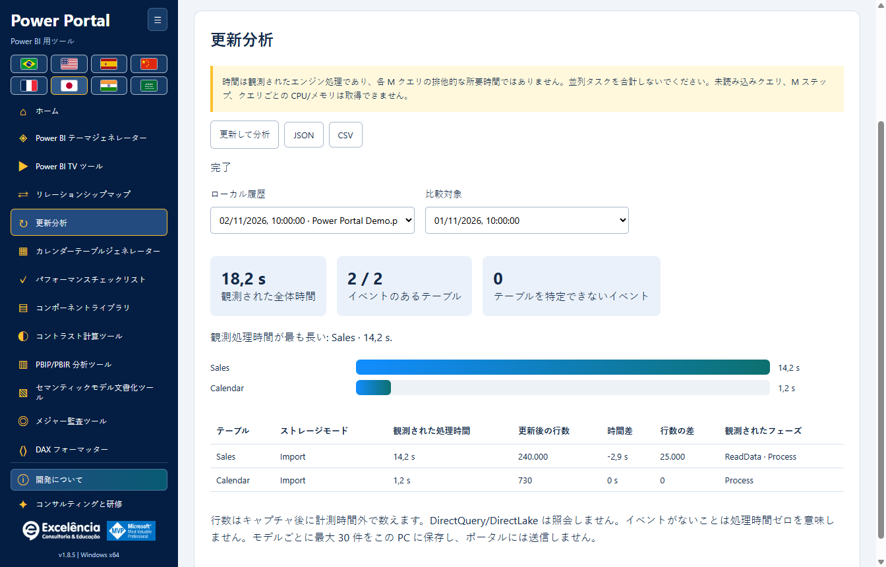

# 更新分析

<!-- language-selector -->
[🇺🇸 English](../REFRESH-ANALYSIS.md) · [🇧🇷 Português](../pt-BR/REFRESH-ANALYSIS.md) · [🇪🇸 Español](../es/REFRESH-ANALYSIS.md) · [🇨🇳 简体中文](../zh-CN/REFRESH-ANALYSIS.md) · [🇫🇷 Français](../fr/REFRESH-ANALYSIS.md) · [🇯🇵 日本語](REFRESH-ANALYSIS.md) · [🇮🇳 हिन्दी](../hi/REFRESH-ANALYSIS.md) · [🇸🇦 العربية](../ar/REFRESH-ANALYSIS.md)
<!-- /language-selector -->

**1.8.5 — ネイティブ更新の計測を修正**

更新分析は、Power BI Desktop のネイティブ XML Refresh コマンドと Batch 内の Refresh を認識し、XMLA Process と TMSL refresh にも引き続き対応します。従来は更新が実行されても進行イベントが除外され、計測テーブル数が 0、行数が利用不可、refreshCompletionNotProven となる場合がありました。任意の Error フィールドがなくても明示的な成功結果を受け付けます。非ゼロのエラーコードと XMLA エラーは引き続き優先されます。無関係なビジュアルクエリを除くため、進行イベントは要求またはアクティビティとの厳密な関連付けが必要です。

最初の更新コマンドを認識するまでは、Power BI の更新イベントを待機中と表示します。完了を確認できない場合は技術コードだけでなく翻訳された案内を表示します。アプリを更新し、正しい PBIX に接続して更新と分析を再実行してください。以前の不完全なレポートは成功に書き換えず保持します。ユーザーが許可した実際の更新で、テーブルの活動、行数、自動完了、再読み込み後の履歴を含むパッケージ版の一連の動作を確認しました。文書の画像は引き続き合成例であり、ユーザーのデータやモデル名は含みません。

## 開始と安全性

正しい PBIX に接続し、更新分析で更新して分析を選び、ファイル名を確認します。ネイティブのホーム > 更新を呼び出す前に追跡を開始し、TOM でテーブルを順番に更新しません。Power BI を開いたままにし、資格情報、エラー、キャンセルはそこで処理してください。BIM バックアップでは更新データを復元できません。

ネイティブ更新はソースを照会し、インポートデータを置き換えます。PBIX のコピーを保存してください。資格情報とエラーは Power BI で処理してください。追跡は更新をキャンセルせず、すべての Power Query 補助クエリを含むものではありません。

## 計測結果の解釈

観測処理時間は正確にテーブルへ対応付けられたエンジン区間の和集合で、入れ子の処理を重複計上しません。データソースの照会時間だけではなく、クリティカルパスを証明するものでもありません。全体時間は起動から終了検出までで、UI と確認の負荷を含み、後続の行数計測を含みません。テーブル不明のイベントは別途表示します。

時間は観測されたエンジン処理であり、各 M クエリの排他的な所要時間ではありません。並列タスクを合計しないでください。未読み込みクエリ、M ステップ、クエリごとの CPU/メモリは取得できません。

自動終了には更新コマンドの終了検出と Power BI ウィンドウの準備完了が必要です。結果ダイアログを閉じてください。手動でキャプチャを終了した場合は常に不完全で、成功の証明でも更新のキャンセルでもありません。エンジンや追跡のエラーを明示し、中断した計測を完了とは表示しません。

## 履歴とエクスポート

行数はキャプチャ後に計測時間外で数えます。DirectQuery/DirectLake は照会しません。イベントがないことは処理時間ゼロを意味しません。モデルごとに最大 30 件をこの PC に保存し、ポータルには送信しません。

保存した実行と比較対象を選び、同じテーブル名の時間と行数の差を確認します。キャッシュ、ソース負荷、データ量、並列度が影響するため、差だけで原因は断定できません。JSON は取得不可を null、CSV は空欄で表し、数式の実行を防ぎます。履歴は関係図と同じ識別情報でローカル保存し、PBIX には保存しません。同じ識別情報のファイルは履歴を共有する場合があるためモデルを確認してください。エクスポートは名称と行数を含むため共有前に確認してください。

<!-- refresh-correlation -->
アクティブな更新コマンドと正確な RequestID/ActivityID で関連付けられたエンジン処理のみ計測し、無関係なビジュアルの照会は除外します。一部の Power BI バージョンでは識別子が提供されず、更新が実行されてもテーブルの時間を取得できない場合があります。

## ネイティブ起動と復旧

更新分析をサイドメニューとホームギャラリーのリレーションシップマップの直下に移動しました。ネイティブボタンの検索では DAX クエリビューと TMDL ビューの重複する Home タブを除外し、「Ambiguous Power BI control: home」を防ぎます。コントロールが見つからない場合は Power BI のレポート、データ、モデルビューを選択してください。

確認、検証、トレースの準備中は更新ボタンを無効にし、捕捉の準備ができるまで捕捉終了ボタンを非表示にします。これにより、重複起動で「Finish the active Power BI operation before refreshing」が誤表示されることを防ぎます。ネイティブ呼び出し前と確認できる失敗では、トレースを停止し、クリーンアップを確認して再試行できます。呼び出しが実行された可能性がある場合はエラーを表示したまま捕捉を保留します。Power BI を確認し、更新を終えてダイアログを閉じてから捕捉を終了してください。重複要求は既存の捕捉を再開し、別の更新は開始しません。実際に進行中の操作は先に完了する必要があります。
