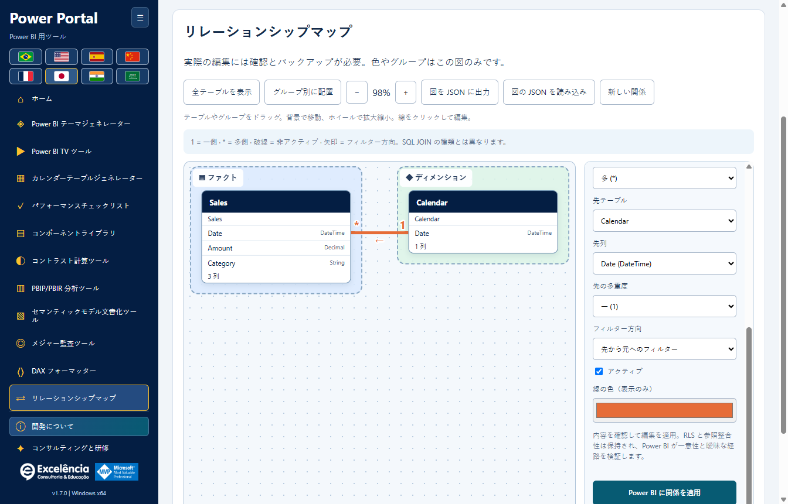
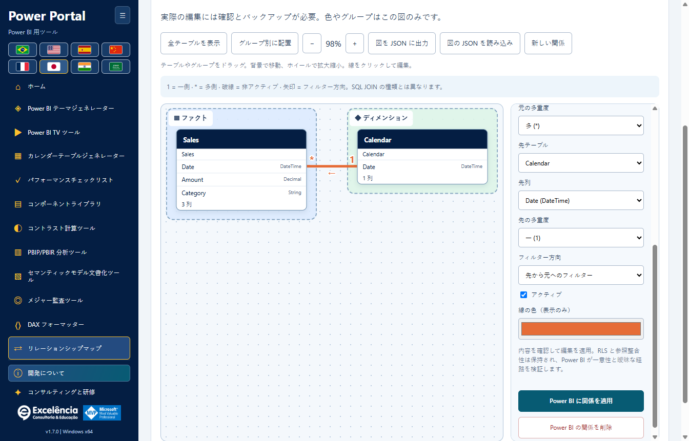

# リレーションシップマップ

<!-- language-selector -->
[🇺🇸 English](../RELATIONSHIPS.md) · [🇧🇷 Português](../pt-BR/RELATIONSHIPS.md) · [🇪🇸 Español](../es/RELATIONSHIPS.md) · [🇨🇳 简体中文](../zh-CN/RELATIONSHIPS.md) · [🇫🇷 Français](../fr/RELATIONSHIPS.md) · [🇯🇵 日本語](RELATIONSHIPS.md) · [🇮🇳 हिन्दी](../hi/RELATIONSHIPS.md) · [🇸🇦 العربية](../ar/RELATIONSHIPS.md)
<!-- /language-selector -->

[ホームに戻る](../../README.ja.md) · [スクリーンショット](SCREENSHOTS.md) · [モデルの安全性](USAGE.md)

**Power Portal Desktop 1.7.0** で利用できます。Power BI 自身のモデルビューとは別の、Desktop 専用の新しいツールです。実際のテーブル/列間のリレーションシップを読み取り、確認した変更を接続中のローカルセマンティックモデルに適用できます。



<a name="open-your-model"></a>
## モデルを開く

1. PBIX の別のコピーを保存します。
2. Power BI Desktop から**外部ツール > Power Portal** を起動するか、開いているファイルを明示的に検索/選択します。
3. サイドバーまたはホームギャラリーで**リレーションシップマップ**を開きます。

インポートした BIM/PBIP/TMDL プロジェクトでは図と表示のカスタマイズを使用できますが、**リレーションシップの書き込みにはライブのローカル Power BI 接続が必要です**。他の場所で変更した後はモデルを再読み取りしてください。

<a name="understand-the-links"></a>
## つながりの読み方

- 各枠は実際のテーブルを表します。元のテーブル名は、わかりやすい見出しの下に表示されます。
- リレーションシップに関わる列を優先して枠に表示します。データ型とともに最大 8 列を表示し、エディターではすべての列を選択できます。
- **1** は一意側、**\*** は多側を示します。
- 実線は有効なリレーションシップ、破線は無効なリレーションシップです。
- 矢印はフィルター伝播を示します。単方向 TOM は**宛先テーブルからソーステーブルへ**フィルターし、列を選んだ順序ではありません。双方向では両方向を表示します。**?** はエンジンが決める Automatic を表します。
- 線をクリックするかリレーションシップのドロップダウンを使い、正確な両端、カーディナリティ、フィルター設定を確認します。
- 未対応の単一列ではないリレーションシップは、モデルメタデータで明示的に数え、UI に警告します。捏造や編集はしません。

**これらはセマンティックモデルのリレーションシップであり、SQL INNER/LEFT/RIGHT JOIN の選択ではありません。**カーディナリティとフィルター方向は、レポート計算とフィルター伝播に影響します。

<a name="arrange-a-teaching-friendly-diagram"></a>
## 説明しやすい図に整理する

- テーブル見出しを縦横に自由にドラッグします。
- グループ見出しをドラッグして、所属テーブルを一緒に動かします。
- 背景のドラッグでパンします。スクロールまたは **+ / -** でズームします。
- **テーブルを表示範囲に合わせる**で現在のモデルを収めます。新しい図は初期表示時に自動調整します。
- **グループごとに配置**は、所属グループに従ってテーブルを配置します。変更するのは図のみで、モデルではありません。
- テーブル見出しにフォーカスし、矢印キーで 10 単位動かせます。Shift + 矢印で 50 単位動かします。
- テーブルを選び、表示名、アイコン、背景色、グループを設定します。
- **Facts** と **Dimensions** は任意の初期グループであり、テーブルの役割を自動分類するものではありません。
- 独自グループを作成し、名前、アイコン、背景色を編集します。グループ削除は所属テーブルを削除しません。
- 既存のリレーションシップを選び、線の色を設定します。

**色、位置、グループ、アイコン、表示名は Power BI オブジェクト名や標準モデルビューの配置を変更しません。**この補助図に属する情報です。

<a name="save-and-share-the-organization"></a>
## 整理したレイアウトの保存と共有

表示の変更は現在の Windows ユーザーのプロファイルに自動保存します。

```text
%APPDATA%\powerportal-desktop\relationship-diagrams\<model-key>.json
```

書き込みは中間ファイルとアトミックな置換を使用します。失敗を明示し、**保存を再試行**を表示します。保存できていないレイアウトを保存済みとは扱いません。

**図の JSON をエクスポート**は、持ち運び可能な表示レイアウトファイルを作成します。**図の JSON をインポート**は形式を検証し、テーブル名が現在のモデルに存在することを確認します。復元するのは表示の整理だけです。**図のインポートはモデルのリレーションシップを作成、変更、削除しません**。

JSON はテーブル名、表示名、グループ設定、線の色、ビューポートを含みます。データ行、DAX、ソース接続資格情報は含みません。ただしテーブル/グループ名から業務情報がわかる場合があります。機密情報を除去したファイルのみ共有してください。

ライブモデルのプロファイルは Power BI のウィンドウ/ファイル名とテーブルの系列タグで識別し、なければテーブル名を使います。インポートしたプロジェクトは選択したローカルパスも使用します。Power BI の検出では完全な PBIX パスを確実に取得できません。ファイル名の変更やテーブル識別子の置換で新しいプロファイルが作られる場合があります。同じ名前と系列タグのコピーはプロファイルを共有することがあります。必要ならエクスポートした JSON で別々のレイアウトを維持してください。

メタデータ更新時に古いテーブル/線の項目を削除します。削除したテーブルの旧位置を架空のテーブルとして保持しません。レイアウトは他のユーザー設定とともにアンインストール後も保持します。

<a name="apply-each-relationship-edit-to-power-bi"></a>
## 各リレーションシップ編集を Power BI に適用する



<a name="create"></a>
### 作成

1. **新しいリレーションシップ**を選びます。
2. ソース/宛先のテーブルと列を選びます。
3. カーディナリティ、フィルター方向、有効/無効状態を設定します。
4. **リレーションシップを Power BI に適用**を選びます。

<a name="edit-activate-or-deactivate"></a>
### 編集、有効化、無効化

1. 既存の線をクリックするか、ドロップダウンで選びます。
2. 両端、カーディナリティ、フィルター方向、**有効**を変更します。
3. この編集に対して**リレーションシップを Power BI に適用**を選びます。

<a name="delete"></a>
### 削除

既存のリレーションシップを選び、**Power BI のリレーションシップを削除**を選びます。

実際の編集は毎回同じ安全な順序で行います。

1. ネイティブ確認に選択した Power BI ファイルと、変更前後のリレーションシップ状態を表示します。**既定はキャンセルです**。
2. 承認後、モデル変更の前に完全なメタデータ BIM バックアップとローカルの試行記録を書き込む必要があります。
3. コネクターがモデルを再度開き、既存のリレーションシップがエディターの読み取ったスナップショットと一致することを確認します。古い/削除済み/名前変更済みの関係は上書きせず拒否します。
4. 列はデータ型が一致し、異なるテーブルに属する必要があります。重複した列ペアや同じテーブルペア間の 2 つ目の直接的な有効関係は拒否します。先に既存の有効なつながりを無効化してください。
5. TOM は `SaveChanges` でコミットします。一意性、有効なカーディナリティ、曖昧なフィルターパスの検証はエンジンが担当します。エンジンエラーは表示し、回避しません。
6. コミット成功後にモデルメタデータを再読み込みします。再読み込み失敗はキャンセルではなく書き込み済みの変更として報告します。
7. **Power BI Desktop で PBIX を保存**して、変更モデルをファイルに保持します。

既存のリレーションシップの行レベルセキュリティのフィルター動作、**参照整合性を仮定（Assume Referential Integrity）**、その他公開していない設定は保持します。このエディターは RLS の変更や Assume Referential Integrity の有効化を提供しません。新しいつながりは既定のセキュリティ/整合性設定を使用します。

プロパティを保持することは、有効化、削除、両端変更がセキュリティフィルター伝播に影響しないことを意味しません。変更を確認する前に、RLS が使用するリレーションシップをモデル管理者と確認してください。

更新/テーマ/モデル書き込みはリレーションシップ書き込みと同時実行できません。書き込み中の接続モデル切り替えはブロックし、別の選択接続からの要求は拒否します。

<a name="backup-and-limits"></a>
## バックアップと制限

- BIM バックアップはモデルメタデータを含み、完全な PBIX、レポートキャンバス、全データ行ではありません。成功した書き込みやコネクター失敗後にパスを報告します。
- **リレーションシップの自動ロールバック/モデル全体の復元ボタンはありません。**別の PBIX コピーを保持し、必要に応じて報告されたバックアップをモデル管理者と確認してください。
- 図の JSON インポートは 5 MB、2,000 テーブル項目、200 グループ、10,000 線スタイル項目までです。ズームは 15% から 200% です。
- SQL 結合の計算、クエリのマージ、ファクト/ディメンションの自動分類、任意スクリプトの実行は行いません。
- ライブ Desktop 書き込みはモデルモード、Desktop バージョン、権限、企業ポリシーで制限される場合があります。制限を回避しないでください。

[設定と保持データ](CONFIGURATION.md#data-locations) · [トラブルシューティング](TROUBLESHOOTING.md)
