# スクリーンショットと Power BI 操作

<!-- language-selector -->
[🇺🇸 English](../SCREENSHOTS.md) · [🇧🇷 Português](../pt-BR/SCREENSHOTS.md) · [🇪🇸 Español](../es/SCREENSHOTS.md) · [🇨🇳 简体中文](../zh-CN/SCREENSHOTS.md) · [🇫🇷 Français](../fr/SCREENSHOTS.md) · [🇯🇵 日本語](SCREENSHOTS.md) · [🇮🇳 हिन्दी](../hi/SCREENSHOTS.md) · [🇸🇦 العربية](../ar/SCREENSHOTS.md)
<!-- /language-selector -->

**1.8.2 — 更新開始の修正**

更新分析をサイドメニューとホームギャラリーのリレーションシップマップの直下に移動しました。ネイティブボタンの検索では DAX クエリビューと TMDL ビューの重複する Home タブを除外し、「Ambiguous Power BI control: home」を防ぎます。コントロールが見つからない場合は Power BI のレポート、データ、モデルビューを選択してください。

[ホームに戻る](../../README.ja.md) · [インストール](INSTALLATION.md) · [安全性ガイド](USAGE.md)

**アプリ画像：Power Portal Desktop 1.8.2、選択した UI 言語は日本語です。**
画像は**合成のデモ用メタデータとクエリ値**を使用し、顧客の PBIX ではありません。接続状態は対応する UI 操作を示すもので、画像作成のために顧客モデルを変更していません。ネイティブのファイル選択ラベルは Windows の言語に従う場合があります。実際の Power BI リボン画像は所有者が提供したポルトガル語の原版で、非公開ファイルのタイトルを切り取っています。

リレーションシップの矢印を曲線上に配置し、斜めや逆向きの接続でも曲線の局所的な方向に合わせて回転します。 SVG 矢印を 36 × 26 単位に拡大しました。線の色に関係なく、常に黒色で 3 単位の白い輪郭を付けています。 単方向のフィルターは引き続き移動先から移動元へ伝播します。双方向は逆向きの矢印を二つ表示し、自動フィルターは疑問符を維持します。表示のみの変更です。

Power Portal のアニメーション付きヘッダーに、ファイル名、接続状態、読み取り・インポート・検索・更新の五つのボタンを統合しました。バナー下の独立したツールバーを削除して作業領域を広げています。小さなウィンドウやアラビア語を含む八言語でヘッダー内の内容が折り返されます。確認、通知、更新の動作は変わりません。

## Power BI に実際の関係を作成

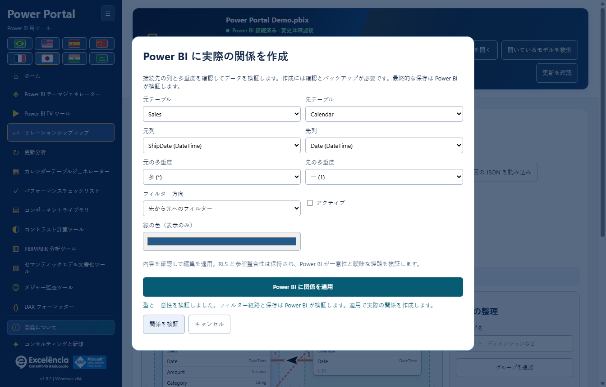

リレーションシップ マップを、サイドバーとホームギャラリーの TV Tool の直後に移動しました。 カレンダー生成とコンポーネントライブラリから汎用の実モデルデータブロックを削除しました。各ツールの読み取りと送信操作は引き続き利用でき、実際の期間ボタンはツール内で選択したカレンダーを使用します。 ホームのカバーを、文字を含まないローカルのベクターイラストとして描き直しました。タイトル、説明、操作は画像外にあり、選択言語に従います。 元の列を別のテーブルへドラッグすると、実際の関係を作成するダイアログで接続先の列を選択できます。列上にドロップするとその列が選択されます。多重度、フィルター、有効状態を確認し、検証して適用してください。保存にはネイティブ確認と BIM バックアップが必要です。

検証では型、列ペアの重複、既存の有効な接続、両列の実際の行数と一意値数を確認します。サンプルは使用せず、1 側の重複は拒否します。クエリの制限時間は 20 秒で、失敗は明示されます。検証は書き込みません。適用で再検証した後、エンジンが保存時にキーとフィルター経路の曖昧さを確認します。破線の下書きは保存済みの関係ではなく、確認済みの書き込み成功後に作成されます。最後に PBIX を保存してください。テストと画像は合成データを使用し、顧客の PBIX は変更していません。

## グループで整理する方法

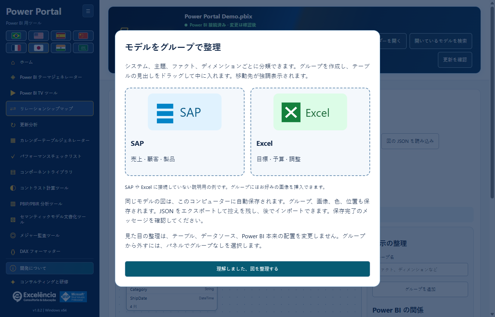

各アプリセッションで最初に図を開くと紹介が表示されます。**グループで整理する方法**で再表示できます。SAP と Excel は説明用のシステム例であり、新しいコネクターや公式ロゴではありません。空のグループも移動先として表示されます。強調表示されたグループにドロップすると所属が変わり、外で離すと元の所属を保ちます。

システム、主題、ファクト、ディメンションごとに分類できます。グループを作成し、テーブルの見出しをドラッグして中に入れます。移動先が強調表示されます。

同じモデルの図は、このコンピューターに自動保存されます。グループ、画像、色、位置も保存されます。JSON をエクスポートして控えを残し、後でインポートできます。保存完了のメッセージを確認してください。

見た目の整理は、テーブル、データソース、Power BI 本来の配置を変更しません。グループから外すには、パネルでグループなしを選択します。

## 外部ツールから Power Portal を開く

インストール後、Power BI Desktop を再起動し、PBIX を開いて**外部ツール > Power Portal** をクリックします。

ポルトガル語のタブ **Ferramentas externas** は英語の **External Tools**（外部ツール）に対応します。インストーラーはこのリボンにアイコンを登録します。クリックすると**開いているファイルのモデルに接続した、独立した Power Portal ウィンドウ**が起動します。外部の補助アプリであり、レポートビジュアル、埋め込みペイン、Microsoft の内部拡張ではありません。

## ホームとナビゲーション

リレーションシップ マップを、サイドバーとホームギャラリーの TV Tool の直後に移動しました。 ホームのカバーを、文字を含まないローカルのベクターイラストとして描き直しました。タイトル、説明、操作は画像外にあり、選択言語に従います。

サイドバーを折りたたむと作業領域が広がり、設定は保存されます。アイコンにはアクセシブル名とツールチップがあります。メイン作業領域と各ツールのフォームは引き続きスクロールでき、スクロール不要の変更はサイドバー一覧にのみ適用します。

## すでに Power BI で開いているファイルに接続

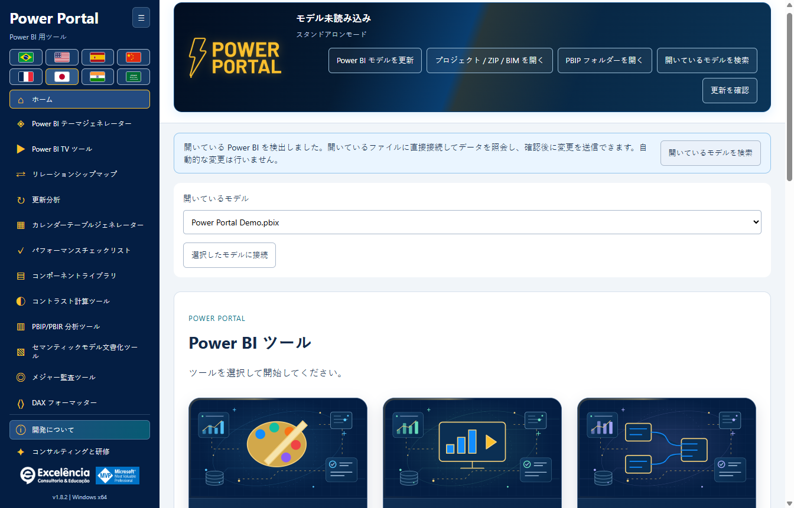

Windows ショートカットから起動すると、利用可能なローカル Power BI モデルを検出し、開いているファイルへ直接接続できることを説明します。**開いているモデルを検索**を選び、ファイル名を確認し、**選択したモデルに接続**をクリックしてください。複数のファイルが開いている場合は、目的のものを明示的に選びます。

外部ツールリボンからの起動では、その Desktop インスタンスの接続を自動的に受け取り、メタデータを読み取ります。**接続は変更を書き込みません。**

## 新バージョンの通知

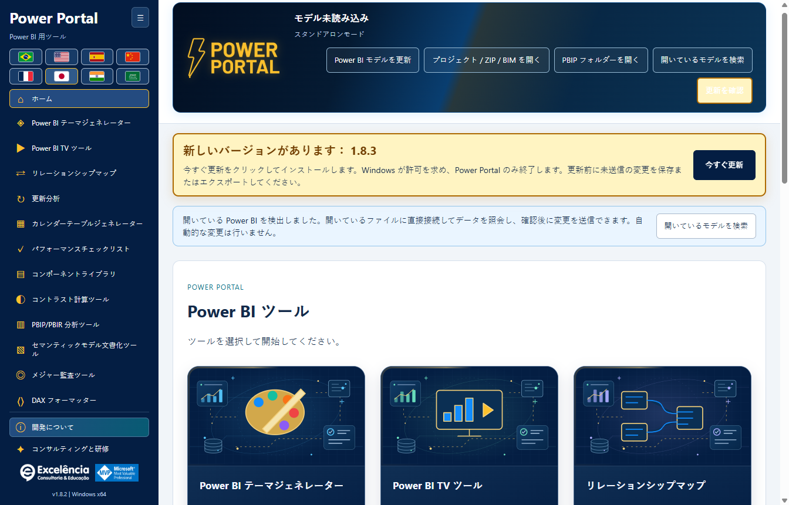

画像はバージョン 1.8.2 での通知を示すため、**合成の将来の 1.8.2 結果**を使用しています。1.8.2 が公開されたという主張ではありません。1.6.2 以降のユーザーは、現在、実際の 1.8.2 通知を受け取れます。

1.6.4 では琥珀色のバナーがスクロール中も表示され、動きを減らす設定がなければ控えめにアニメーションします。「最新です」というバナーが常時スペースを占有することはありません。

インストール済みアプリは起動時に最新の安定した公式 Release を確認します。**今すぐ更新**でインストーラーをダウンロード/検証し、Windows の管理者要求を承認してください。既存のインストール先を更新し、閉じるのは Power Portal のみです。**接続やチェックだけでインストールすることはありません。**先に未送信編集を保存/エクスポートし、完了後にアプリを開き直してください。

**更新を確認**でいつでも再試行できます。オフライン/レート制限/チェックサム/UAC 失敗を明示し、ローカルツールを無効にしません。[更新の詳細ガイド](UPDATES.md)。

## 開いている Power BI ファイルへの直接操作

これらはテキストや JSON のダウンロードだけではありません。

| 画面/操作 | Power BI の読み取りまたは変更 | 保護 |
|---|---|---|
| Power BI モデルを更新 | 選択ファイルのセマンティックモデルからテーブル、列、メジャー、リレーションシップを読む。 | モデル書き込みなし。 |
| ライブデータ/日付範囲/サンプルのクエリ | ローカルエンジンで実際のモデル値を読む。 | 構造化した上限付きクエリ。アクティブページのフィルターではない。 |
| テーマを Power BI に直接送信 | 生成 JSON を選択レポートウィンドウに適用。 | 確認、可視の UI インポート、エクスポートしたテーマの検証。 |
| Power BI にカレンダーを作成 | セマンティックモデルに新規計算日付テーブルを作成。 | 確認とメタデータバックアップ。後で Desktop で更新。 |
| Power BI に HTML メジャーを作成 | 選択モデルテーブルに新メジャーを作成。 | 確認とメタデータバックアップ。HTML ビジュアルは手動追加。 |
| Power BI のメジャーを更新 | 整形した DAX を選択した既存メジャーに書く。 | 確認、メタデータバックアップ、同時変更の保護。 |
| Power BI のリレーションシップを適用/削除 | 選択列間のリレーションシップを作成、編集、有効化/無効化、削除。 | ネイティブ確認、メタデータバックアップ、古い状態の検査、エンジン検証。RLS/整合性設定を保持。 |

**変更を適用する前に別の PBIX コピーを保存してください。**対象ファイルと式を確認し、後で Desktop で PBIX を保存します。アプリが無断で PBIX を保存することはありません。

### ライブモデルデータ

サンプルは引き続き最大 50 行、クエリは 20 秒です。カレンダーはツール自身の選択とプレビューで読み取ります。カレンダー生成とコンポーネントライブラリには汎用データブロックを表示しません。接続状態はヘッダーに表示します。

### テーマジェネレーター

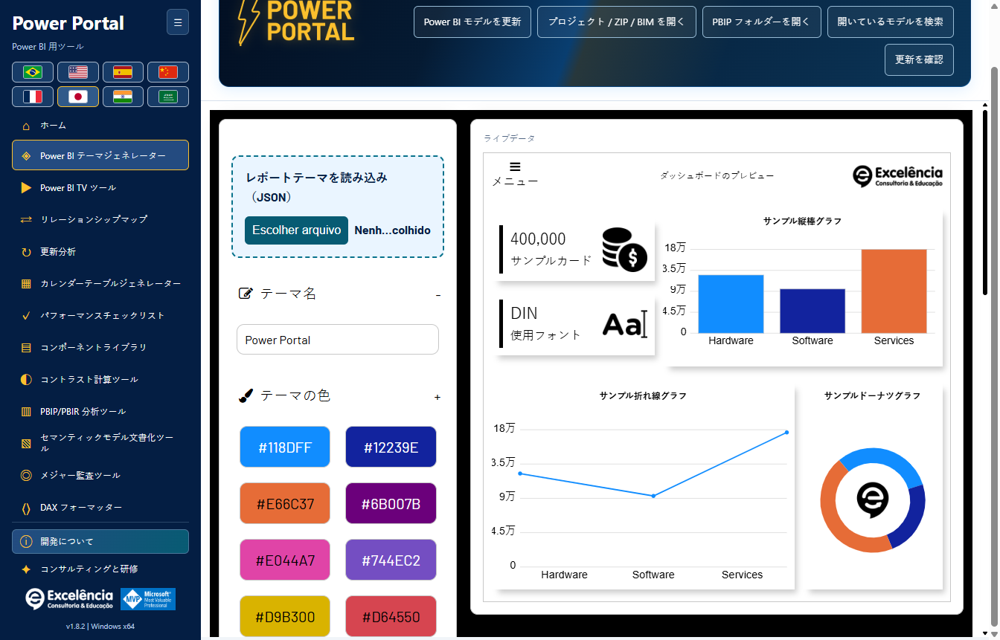

強調表示の**レポートテーマを読み込む（JSON）**を使用し、色/フォントを編集してライブプレビューを確認します。JSON をエクスポートするか、フォームとプレビューより下のページ末尾までスクロールして**テーマを Power BI に直接送信**を使用します。

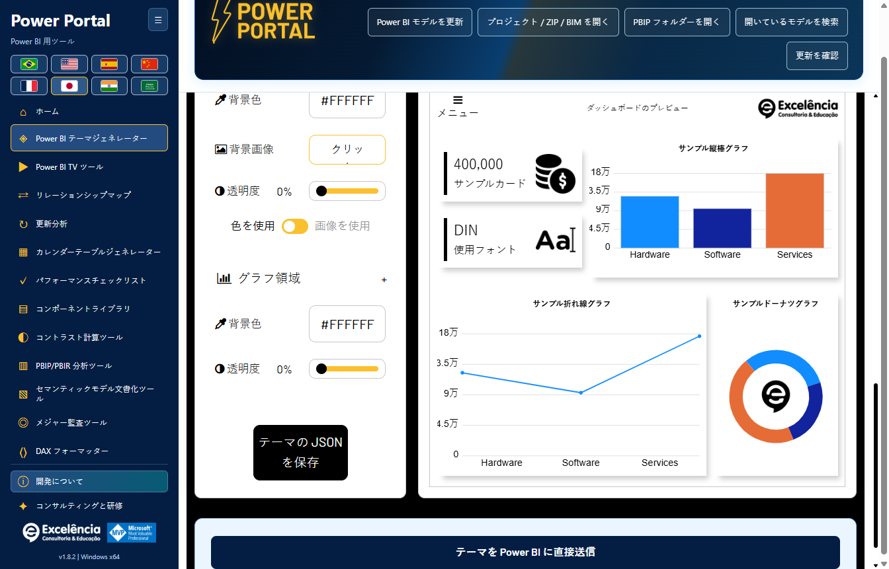

既存のレポートテーマから始めるには、Desktop で JSON を保存してここに読み込みます。セマンティックモデル接続ではテーマを読めません。直接送信は引き続き**可視のインポートダイアログ**を使用します。それをなくすサポート済み汎用 Desktop テーマ API はありません。自動化中は Power BI を操作しないでください。

### カレンダージェネレーター

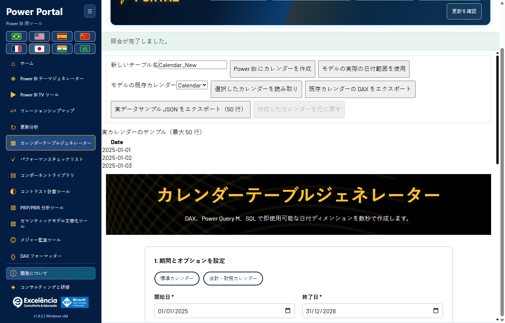

既存カレンダーの式/日付範囲/サンプルを読み、DAX やサンプル JSON をエクスポートして新しいカレンダーを生成します。**Power BI にカレンダーを作成**は、バックアップと確認を伴う新規計算テーブルを作り、選択した既存カレンダーを置換しません。

作成後は Desktop で更新してください。保護付きのカレンダー取り消しは、作成テーブルが一致したままで依存関係がない場合にのみ利用できます。

### コンポーネントライブラリ

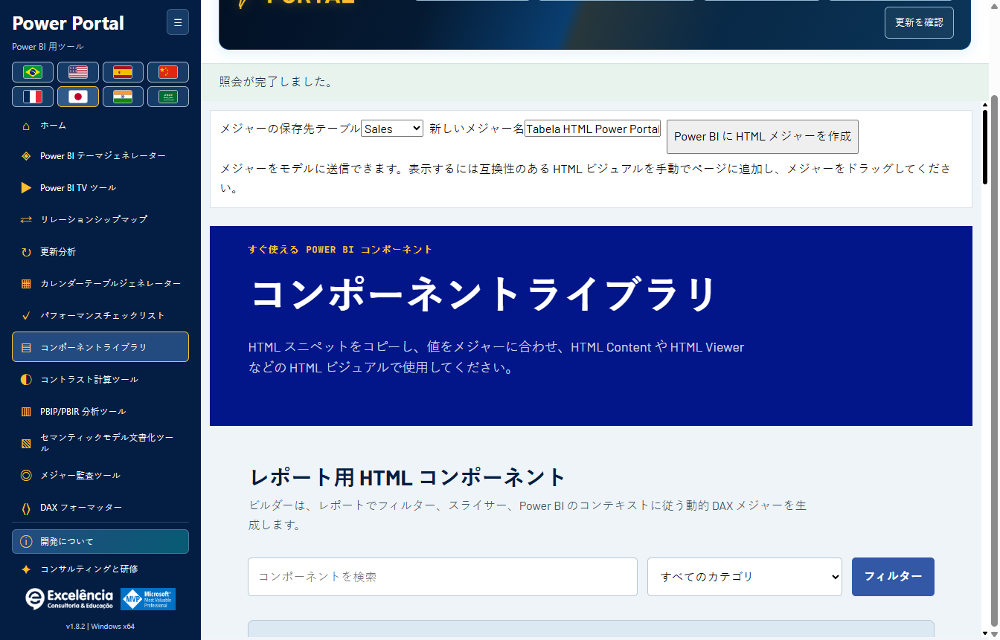

作成先テーブルと新メジャー名を選びます。ビルダーはモデルのフィールド/メジャー名を使い、**Power BI に HTML メジャーを作成**に対応します。確認後にメジャーをモデルへ書き込みます。

対応する HTML ビジュアルをレポートに手動追加し、そのメジャーを割り当てる必要があります。このボタンはページにビジュアルを配置しません。

### DAX フォーマッター

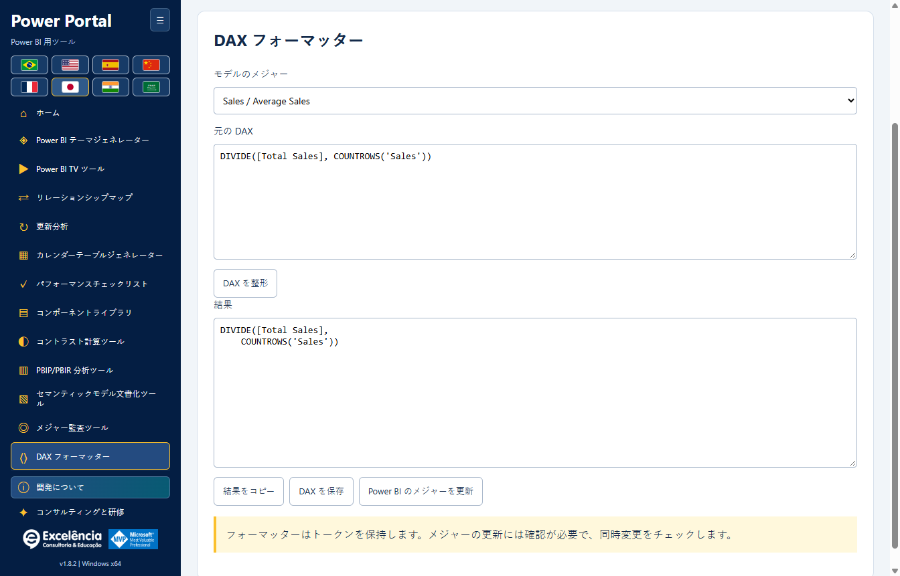

既存のモデルメジャーを選び、式を整形して、**Power BI のメジャーを更新**で DAX をそのメジャーに送り返します。コピー/エクスポートは別の操作です。更新には確認が必要で、式の同時変更を拒否します。

## その他のツール

### リレーションシップマップ

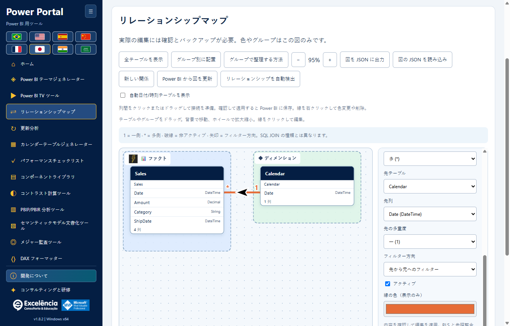

新しい Desktop 専用ツールは実際のテーブル間のつながり、カーディナリティ、フィルター矢印、無効な破線を表示します。枠/グループを自由にドラッグし、ズーム/パン、表示名/アイコンの指定、グループと線の色の変更ができます。表示レイアウトはモデルごとに自動保存し、モデル書き込みなしで JSON のエクスポート/インポートが可能です。

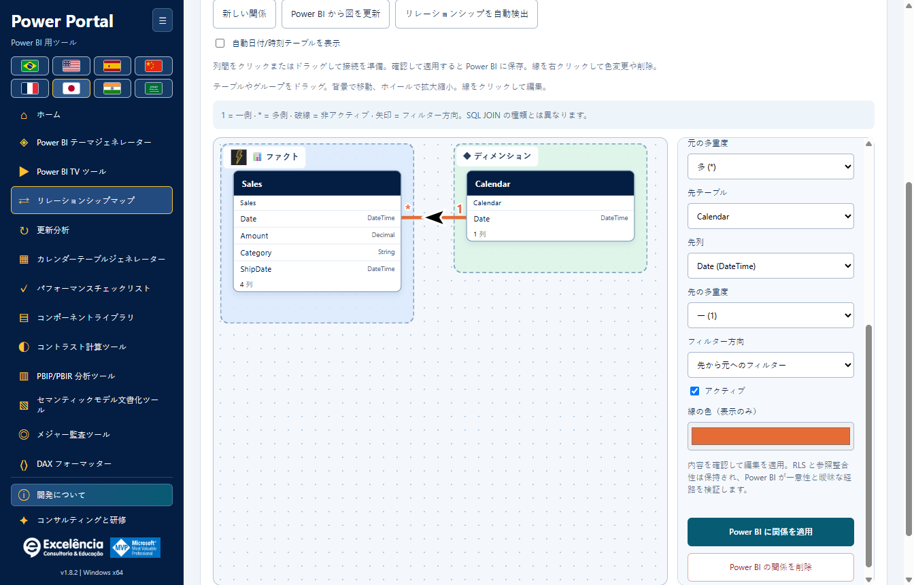

線を選んで正確な列、カーディナリティ、フィルター方向、有効状態を確認します。**リレーションシップを Power BI に適用**または**Power BI のリレーションシップを削除**は、ネイティブ確認とバックアップ後に編集をコミットします。インポートしたプロジェクトは読み取り専用です。装飾はテーブル名や Power BI の標準図を変更しません。[詳細手順と安全上の制限](RELATIONSHIPS.md)。

1.8.2 では、列をクリックまたはドラッグして破線の下書きを準備し、確認して適用します。線を右クリックすると色の設定、編集、削除ができます。グループ設定にはローカル PNG/JPEG 画像と追加アイコンがあり、グループの背景や見出しをドラッグできます。自動日付/時刻テーブルは既定で非表示です。**Power BI から図を更新**すると外部での変更を再読み込みしますが、標準レイアウトの座標はコピーしません。**リレーションシップを自動検出**は確認/バックアップ後に Desktop のネイティブ検出を開始します。結果を確認してダイアログを閉じてから、**検出を完了して図を更新**を選びます。

### Power BI TV Tool

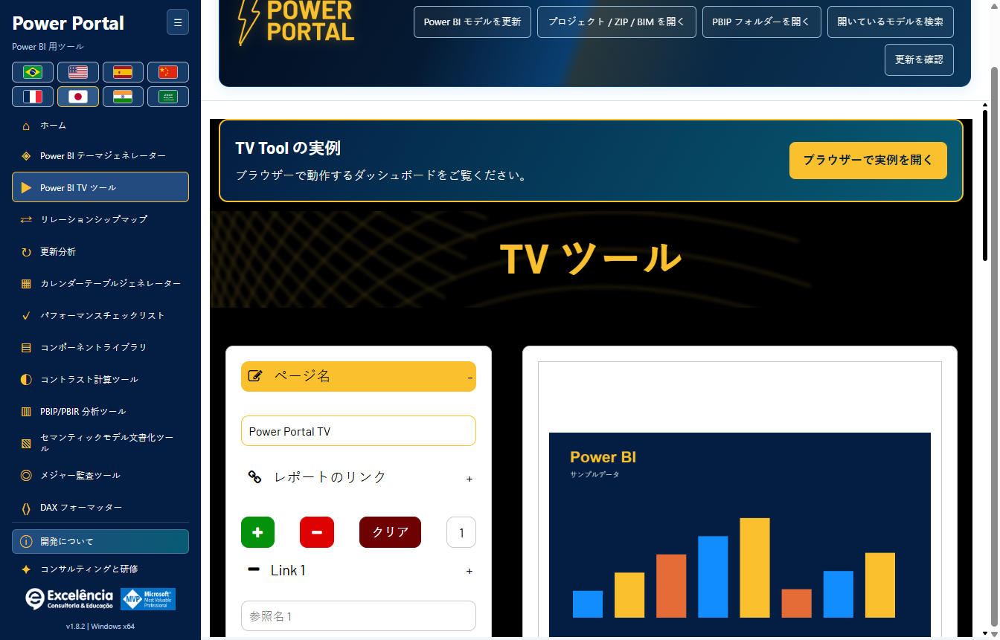

上部の **TV Tool の実演**バナーは、[動作する公式サンプル](https://www.powerportal.com.br/tv_tool/painel_exemplo_power_bi_tv_tool.html)を既定のブラウザーで開きます。インターネットは必要ですが、ローカルモデルデータを送信しません。フォームのローカル説明用プレゼンテーションも引き続き利用できます。

公開レポートページやローカル画像を切り替え、時間/トランジションを設定してプレビューし、HTML をエクスポートします。TV は開いているローカル PBIX のページを**切り替えません**。非公開の公開済みレポートには適切な Microsoft サインイン/ライセンス/権限が必要です。

### パフォーマンスチェックリスト

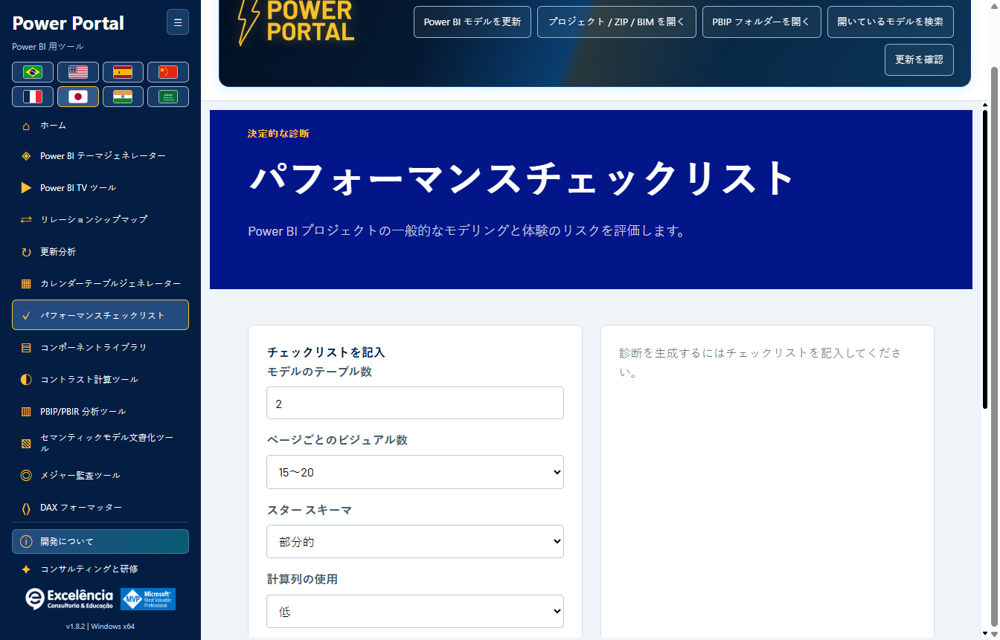

モデル情報に基づくチェック項目と手動のレポート特性を確認します。スコアはヒューリスティックな指針で、ビジュアルの実測時間ではありません。

### コントラスト計算ツール

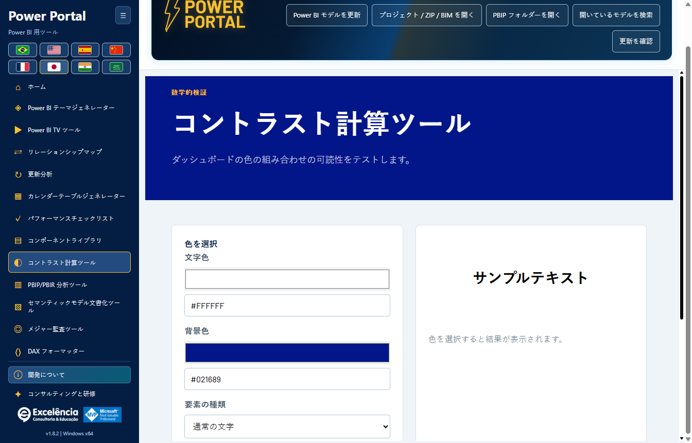

WCAG の基準値に対して読みやすさ/コントラストを確認します。ローカル分析ツールであり、レポート書式を自動変更しません。

### PBIP/PBIR アナライザー

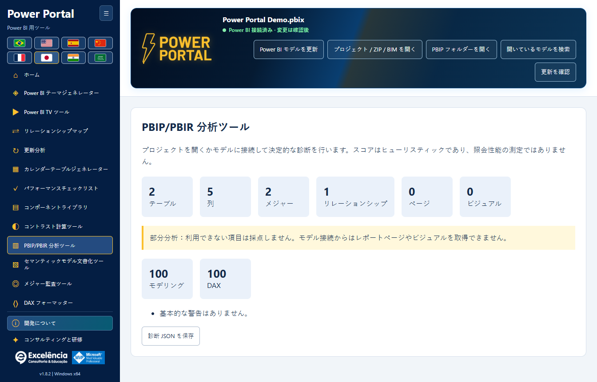

読み込んだプロジェクトで取得できる構造を分析します。ライブのセマンティックモデル接続にはレポートページ/ビジュアルのメタデータがないため、取得できない項目は不完全として報告します。インポートした PBIR プロジェクトメタデータからは追加の数を得られます。

### セマンティックモデルのドキュメント生成ツール

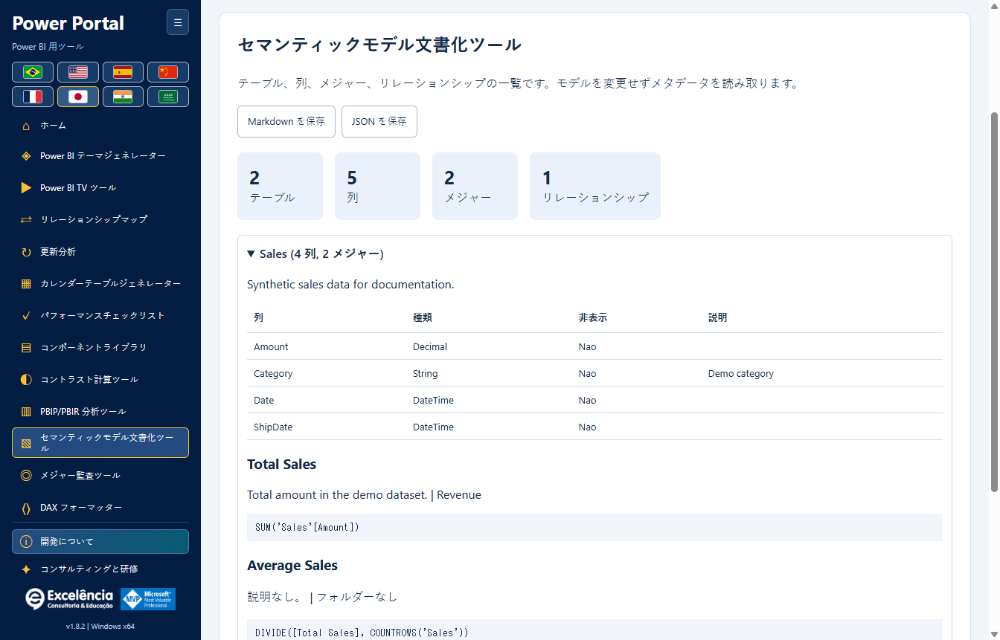

テーブル/列/メジャー/リレーションシップの文書を読み取り、Markdown または JSON にエクスポートします。モデルは変更しません。出力には機密の名前や DAX が含まれる場合があるため、適切に保存してください。

### メジャー監査ツール

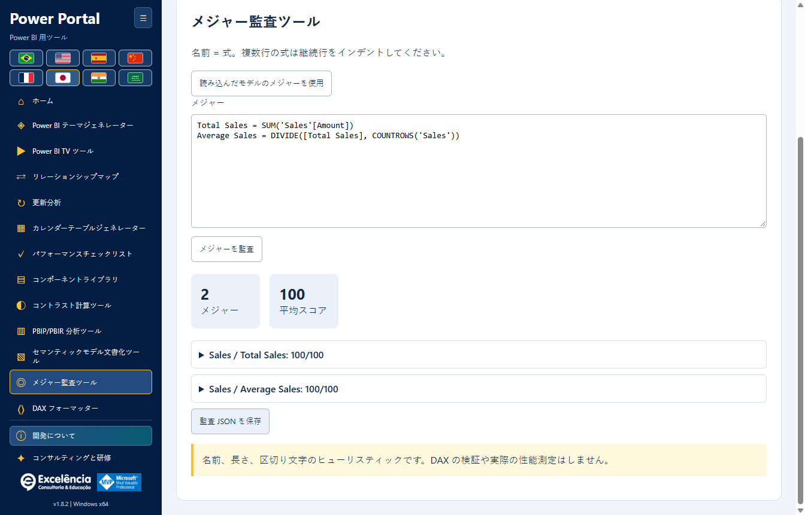

ヒューリスティックな命名/サイズ/区切り文字の検査で、モデルメジャーや入力 DAX を監査します。DAX の意味の検証や実際のレポート性能測定は行いません。

## コンサルティングと研修

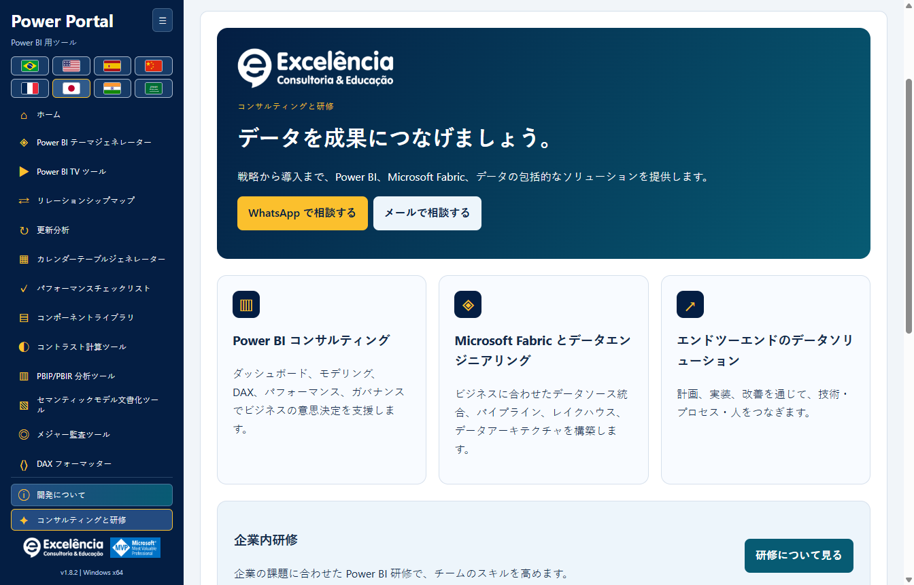

Power BI コンサルティング、Microsoft Fabric、データエンジニアリング、包括的なソリューションを紹介します。企業内研修、注目動画、連絡操作もあります。WhatsApp/メールは下書きまたはブラウザーページを開くだけで、メッセージ送信や予約を自動では行いません。

[リリースノート](../../CHANGELOG.ja.md) · [トラブルシューティング](TROUBLESHOOTING.md)

## 更新分析

ネイティブ更新を測定。 所要時間と行数を比較。 [更新分析](REFRESH-ANALYSIS.md).

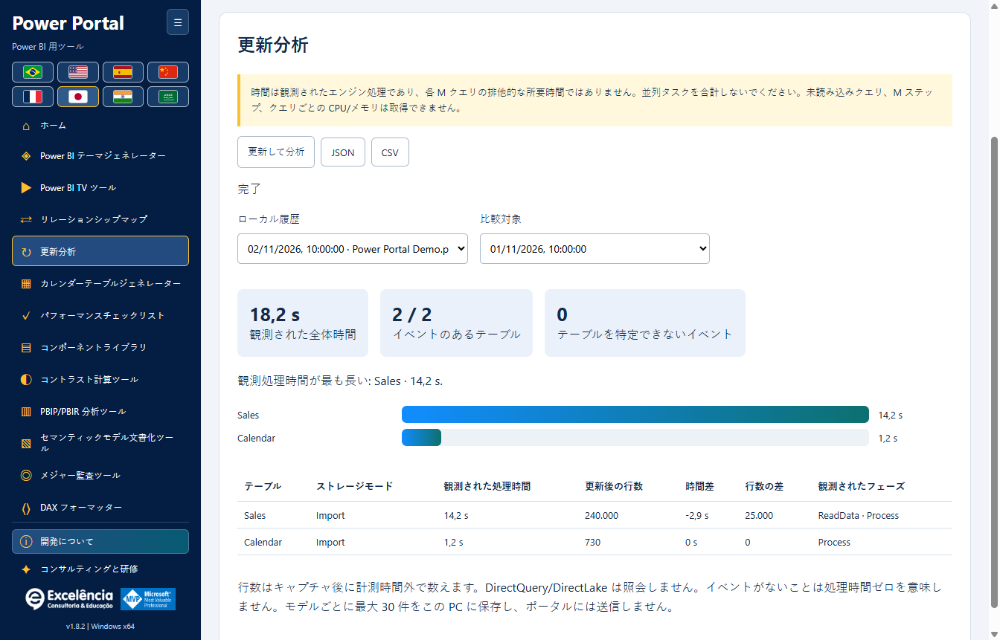

観測処理時間は正確にテーブルへ対応付けられたエンジン区間の和集合で、入れ子の処理を重複計上しません。データソースの照会時間だけではなく、クリティカルパスを証明するものでもありません。全体時間は起動から終了検出までで、UI と確認の負荷を含み、後続の行数計測を含みません。テーブル不明のイベントは別途表示します。

自動終了には更新コマンドの終了検出と Power BI ウィンドウの準備完了が必要です。結果ダイアログを閉じてください。手動でキャプチャを終了した場合は常に不完全で、成功の証明でも更新のキャンセルでもありません。エンジンや追跡のエラーを明示し、中断した計測を完了とは表示しません。

## アニメーション付きホームカード

12 枚のホームカードはメニューと同じ濃紺（#041e43）を基調にした、文字を含まないオリジナルのベクターイラストです。各ツール固有の中央イラストに、データパネル、グラフ、データベース、軌道、グリッド、浮遊パネルを追加しました。信号線が穏やかに流れます。外部画像、スクリプト、サービスは読み込みません。

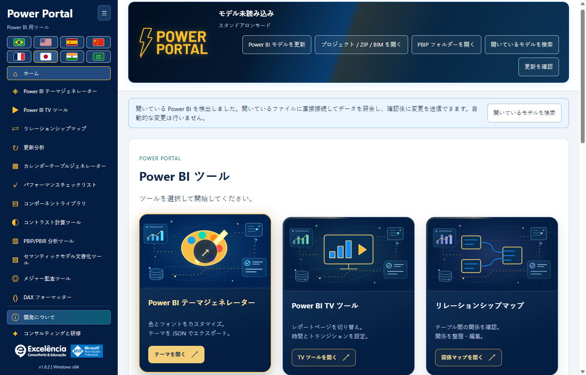

マウスを重ねるかキーボードでフォーカスすると、金色の枠と光彩、光の反射、明るいイラスト、円形の起動矢印、金色の操作表示が現れます。押した瞬間に反応し、画面遷移は遅延しません。Enter/スペースでも同じツールを開けます。OS/ブラウザーの視差効果を減らす設定では動きを止め、静的な強調とフォーカスは維持します。タイトルと操作文字は画像の外にあり、選択言語に従います。スクリーンショットは通常とホバーの静止状態で、動画ではありません。

