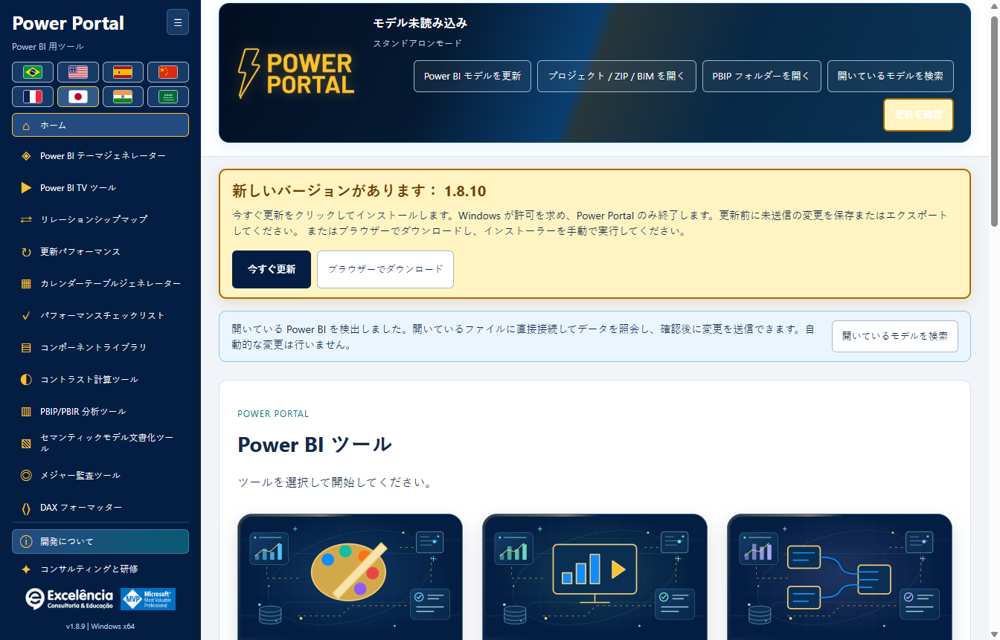

# 更新チェックと自動インストール

<!-- language-selector -->
[🇺🇸 English](../UPDATES.md) · [🇧🇷 Português](../pt-BR/UPDATES.md) · [🇪🇸 Español](../es/UPDATES.md) · [🇨🇳 简体中文](../zh-CN/UPDATES.md) · [🇫🇷 Français](../fr/UPDATES.md) · [🇯🇵 日本語](UPDATES.md) · [🇮🇳 हिन्दी](../hi/UPDATES.md) · [🇸🇦 العربية](../ar/UPDATES.md)
<!-- /language-selector -->

**1.8.9 — カレンダーサンプルとネイティブ更新のショートカット**

カレンダーテーブル生成では、実データサンプル（最大 50 行）をスクリプト生成ボタンの下に移動しました。隣の「Power BI で更新」は、接続中に更新パフォーマンスを開き、既存の確認付きネイティブ更新フローを開始します。表の状態、所要時間、行数を確認できます。モデル全体のデータを更新する操作であり、生成スクリプトの適用、カレンダーの作成・置換、PBIX の保存は行いません。Power BI にカレンダーを作成する操作は別のままです。オフラインでは無効になり、キーボード操作と全 8 言語に対応しています。キャンセルとエラーは既存フローを使用します。サンプルは最後に読み取った値のままなので、更新後は選択したカレンダーを再度読み取ってください。パッケージ版テストでは配置、8 言語、オフライン制御、対象接続、キャンセル、エラー表示、再試行、既存の作成機能を確認しました。実モデルの更新は開始しておらず、文書の画面には合成データを使用しています。

**1.8.8 — 動的なリレーションシップ線と検証付きテーマ送信**

リレーションシップマップの「線のスタイル」で、曲線と 90 度の角で曲がる直線を切り替えられます。表の位置と実際のカードサイズに応じて、端点は向かい合う上下または左右の辺に動的に接続されます。左右の接続は関連列の高さを維持します。白い縁取りの黒い矢印は直線部分に配置され、角で斜めになりません。スタイルは自動保存され、エクスポートする JSON にも含まれます。既存のレイアウトは曲線のままです。Power BI のネイティブ配置の変更や全体的な障害物回避は行いません。

テーマを Power BI に直接送信すると、ネイティブインポート後とエクスポート検証中に、Power BI が前面にある場合のみ Power Portal にフォーカスが戻ります。テーマ検証後は Power BI を表示し、エラー時も対象ウィンドウを表示します。ネイティブダイアログは一時的に表示される場合があり、非表示にはしません。Desktop にはダイアログなしでテーマを適用するサポート対象 API がありません。インポート後の非同期タブ変更に対応してからテーマを確認します。許可された実機テストでは、パッケージ版でインポート/エクスポート、Portal へのフォーカス復帰、最後の Power BI 表示を確認し、PBIX を保存せず元の既定テーマに戻しました。文書の画面は合成データです。

**1.8.6 — Power Portal 内で更新の進行状況を確認**

Power Portal で更新パフォーマンスを開始すると、各テーブル、観測状態、エンジンのフェーズ、活動時間、最後に取得した Power BI の進行状況をライブカードで確認できます。開始後に Power Portal へフォーカスが戻り、Power BI が再び前面に出た場合は更新完了後にもう一度戻ります。他のアプリから繰り返しフォーカスを奪いません。「Power BI で表示」は再更新せず選択したファイルを開き、このキャプチャの自動フォーカス復帰を無効にします。

更新処理は引き続き Power BI が実行します。ウィンドウが一時的に表示される場合があり、サポートされたヘッドレス PBIX 処理 API ではありません。資格情報、エラー、キャンセルは Power BI 側で扱い、ダイアログを自動的に隠したり閉じたりしません。ネイティブ文字列は Power BI の言語のまま、最終取得時刻付きで表示します。取得不能は明示し、エンジントレースは継続します。フェーズ終了はテーブル完了を証明せず、割合を推測せず、最終行数はキャプチャ後に数えます。履歴と JSON にネイティブ状態が含まれるため共有前に確認してください。許可された実際の更新でパッケージ版を検証済み：4/4 テーブルの時間、4/4 行数、ライブ状態、フォーカス復帰、表示ボタン、再読み込み後の履歴保存。PBIX は自動保存せず、文書画像は合成データを使用しています。

**1.8.5 — ブラウザーで更新をダウンロード**

新しいバージョンがある場合、更新通知に今すぐ更新とブラウザーでダウンロードが表示されます。検出された公式 GitHub インストーラーのアドレスを既定のブラウザーで開きます。Power Portal を終了せず、インストールも開始しません。準備ができたらダウンロードしたインストーラーを手動で実行してください。自動更新でエラーが発生した後も利用でき、ブラウザーの起動失敗は明示されます。今すぐ更新は引き続きアプリ内でダウンロードし、SHA-256 とサイズを検証して Windows の許可を求めます。ブラウザーダウンロードにはアプリの自動検証がないため、実行前に公開された SHA-256 と比較してください。両方のボタンと説明は八言語に対応しています。

[ホームに戻る](../../README.ja.md) · [インストール](INSTALLATION.md)

<a name="available-from-version-162"></a>
## バージョン 1.6.2 から利用可能

1.6.1 以前の場合は、**1.6.2 を一度手動でインストール**してください。旧アプリは新しい更新プログラムを含むリリースを先にインストールしないと、その機能を取得できません。

**インストール済み**アプリは起動時に `luisgnserra/powerportaldesktop` の最新の公開安定版 Release を確認します。3 部分の数値バージョンを比較し、ダウングレード/現在のバージョンを無視し、ドラフトやプレリリースは提示しません。

開発/ソースからの実行は更新をダウンロード/インストールしません。

<a name="update-flow"></a>
## 更新の流れ

1. Power Portal を開きます。インターネットが使える場合は新しいリリースを確認します。
2. 更新があれば、目立つ琥珀色の通知にバージョンと**今すぐ更新**を表示します。スクロール中も表示され、控えめに光るアニメーションを備えます。動きを減らす設定でアニメーションは無効になります。チェックボタンも強調します。
3. 続行前に**未送信のツール編集を保存/エクスポート**してください。実行中のモデル書き込み/テーマ操作は更新をブロックします。
4. **今すぐ更新**をクリックします。アプリを開いたり更新チェックしたりしただけではインストールしません。
5. メインプロセスが公式 x64 インストーラーを HTTPS で取得し、公開 GitHub Release 添付ファイルのメタデータに対して正確なサイズと SHA-256 を検証します。
6. Windows が管理者の承認を要求します。この配布元を信頼できる場合にのみ承認してください。
7. 承認/インストーラー起動後に Power Portal が閉じ、**既存のインストール先フォルダー**でサイレントインストールが実行されます。**Power BI Desktop は閉じません。**
8. インストール完了後に Power Portal を開き直します。リボン/登録の再読み込みが必要な場合は Desktop を再起動します。



画像は 1.8.10 内での**将来の 1.8.9 通知のシミュレーション**です。UI を示すだけで、1.8.10 の発表ではありません。

<a name="receive-version-189-from-an-earlier-updater-enabled-version"></a>
### 更新機能のある旧バージョンから 1.8.9 を受け取る

**1.6.2、1.6.3、1.6.4** をインストールしている場合、アプリを開き直すか**更新を確認**をクリックしてください。公開済み安定版 **1.8.9** と**今すぐ更新**が表示されるはずです。通知を観察したい場合は先に 1.8.9 を手動インストールしないでください。1.6.4 より前のバージョンは元のバナーを使用します。1.8.9 には目立つ表示スタイルが引き継がれています。準備ができたら更新ボタンをクリックして Windows の承認を行ってください。

アプリが報告するのはインストーラーの起動であり、検証済みのインストール完了ではありません。旧アプリ終了後にインストールが完了します。開き直して表示されるアプリバージョンを確認してください。Windows は未署名インストーラーをブロックしたり IT の承認を求めたりすることがあります。

<a name="checks-retries-and-failures"></a>
## チェック、再試行、失敗

上部の操作にある**更新を確認**で手動再試行できます。バックグラウンドのポーリングループや強制インストールはありません。

1.6.4 では、チェックが成功し新しいバージョンがない場合、「最新です」のバナーが 1 行を占有して残ることはありません。エラーと利用可能な更新は引き続き表示します。

- オフライン、ファイアウォール/プロキシ、GitHub API レート制限のエラーを更新通知に表示します。ローカルツールは使えます。
- 無効なリリースメタデータ、欠落したアセットダイジェスト、チェックサム不一致、想定外のリダイレクト先、過大なダウンロード、タイムアウトは実行を防ぎます。
- Windows の承認をキャンセルするとアプリは利用可能なままで、エラーを表示します。準備ができたら再試行してください。
- チェックが失敗すると古い更新の提示を消去し、古い情報を無断で使用しません。
- 更新プログラムはダウンロード/インストール中の新しいモデル書き込みをブロックし、書き込み/テーマ操作中は開始を拒否します。
- 未送信/未エクスポートのツールフォーム編集は、アプリ置換をまたいで自動保持されません。先にエクスポート/保存してください。

<a name="privacy-network-and-integrity"></a>
## プライバシー、ネットワーク、整合性

更新要求は GitHub への標準 HTTPS 要求メタデータのみを含み、ローカルモデル名、DAX、データ、PBIX 内容、資格情報は含みません。公開リリースには GitHub ログイン/トークンは不要です。

リリースメタデータの取得先：

```text
https://api.github.com/repos/luisgnserra/powerportaldesktop/releases/latest
```

インストーラー URL は、このリポジトリのリリースの正確なバージョン付き添付ファイルに一致する必要があります。HTTPS リダイレクトは GitHub とその公式リリースアセットホストに制限します。アプリはそのダウンロード用にメタデータのハッシュ/サイズを保持します。

チェックの合計タイムアウトは 30 秒、メタデータの上限は 1 MB です。ダウンロードの合計上限時間は 20 分、ソケット無通信タイムアウトは 30 秒、受け付けるインストーラーサイズの上限は 1 GB です。これらは上限であり通常のパッケージサイズではありません。

ダウンロードは `%APPDATA%\powerportal-desktop\updates` に保存します。処理された失敗では部分ファイルを削除し、検証済み EXE はインストール後に残る場合があります。アプリソースのダウンロードやビルドは行いません。

**SHA-256 は整合性検査であり、発行元のデジタル署名ではありません。**現在のリリースは未署名です。更新プログラムは UAC、SmartScreen、企業ポリシーを回避しません。ネットワークに必要なプロキシを更新プログラムが使えない場合は、IT 部門に相談するか、検証済み Release EXE を手動でインストールしてください。

<a name="manual-fallback"></a>
## 手動での代替方法

[最新 Release](https://github.com/luisgnserra/powerportaldesktop/releases/latest) または[バージョン付き PowerShell 補助スクリプト](INSTALLATION.md#command-line-installation)を使用してください。既存のバージョン固定コマンドは、その固定バージョンを意図的にインストールし、将来の最新リリースを選ぶわけではありません。
