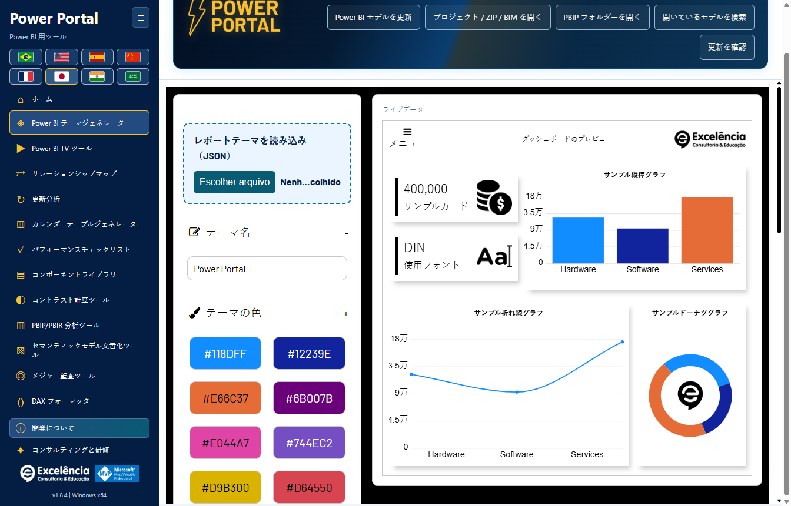
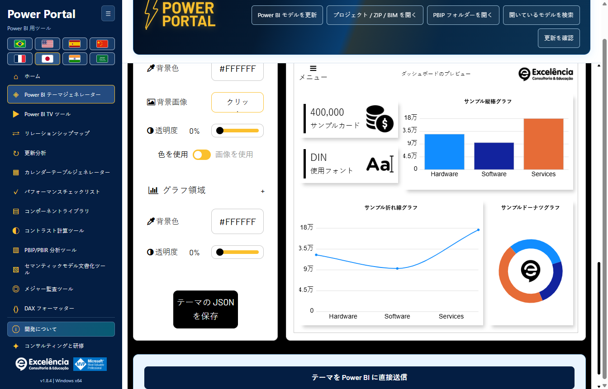
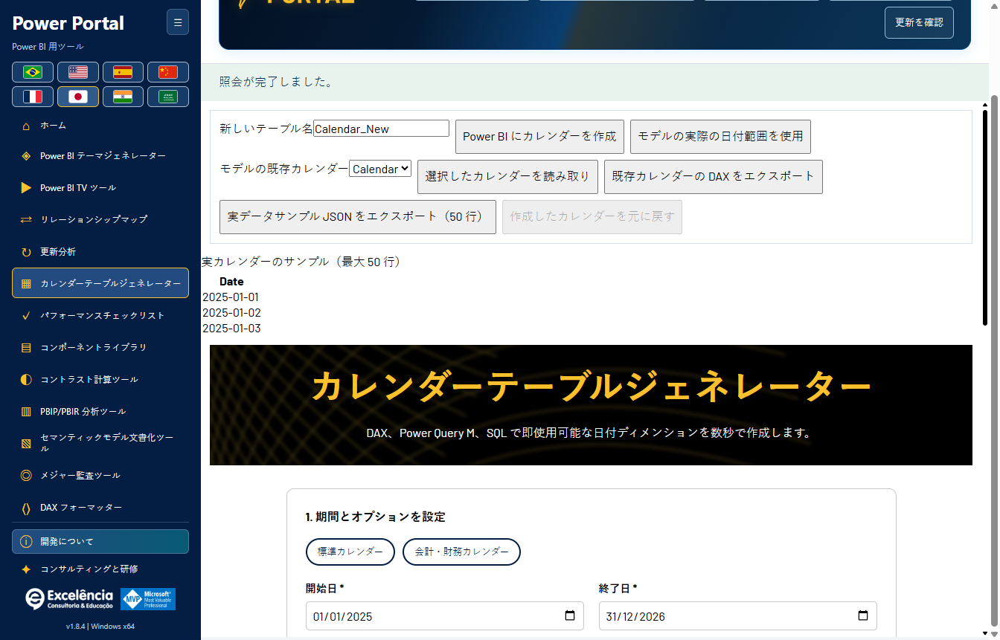
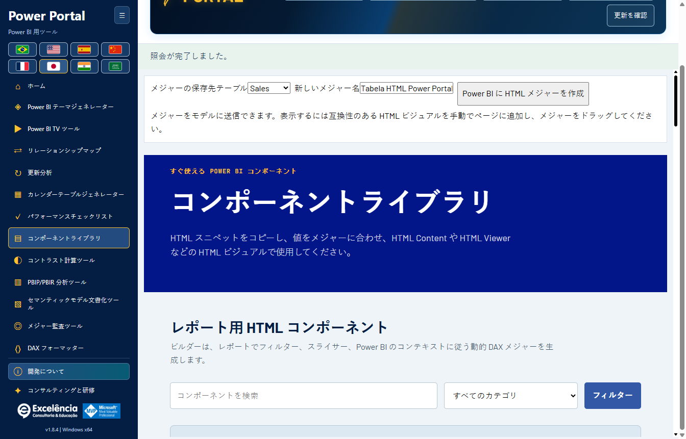
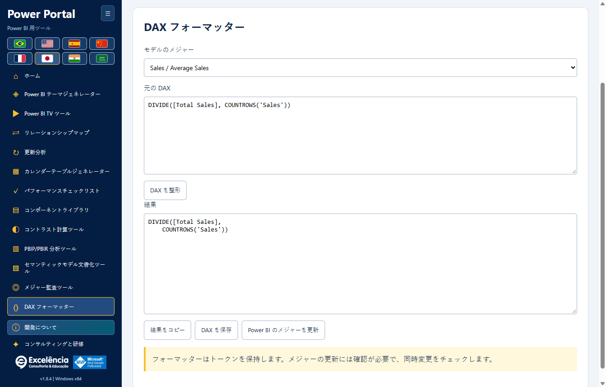
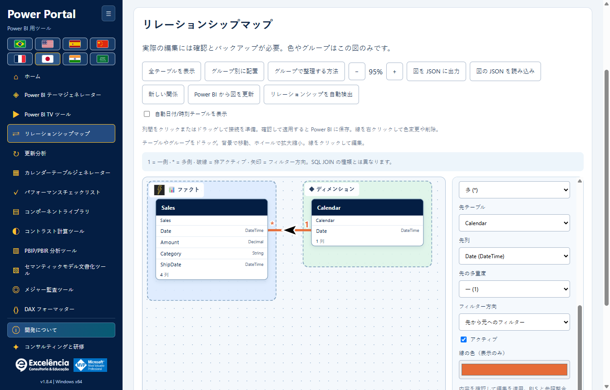
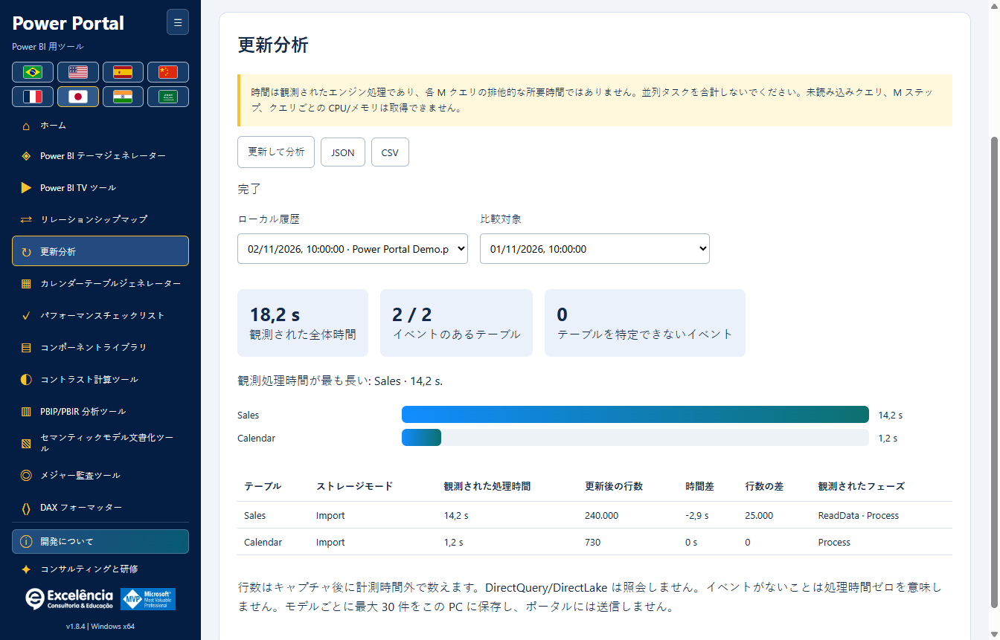

# 使用方法とモデルの安全性

<!-- language-selector -->
[🇺🇸 English](../USAGE.md) · [🇧🇷 Português](../pt-BR/USAGE.md) · [🇪🇸 Español](../es/USAGE.md) · [🇨🇳 简体中文](../zh-CN/USAGE.md) · [🇫🇷 Français](../fr/USAGE.md) · [🇯🇵 日本語](USAGE.md) · [🇮🇳 हिन्दी](../hi/USAGE.md) · [🇸🇦 العربية](../ar/USAGE.md)
<!-- /language-selector -->

**1.8.4 — 滑らかなテーマプレビュー**

テーマジェネレーターの折れ線グラフは、サンプルデータと接続モデルのデータの両方で、直線の代わりに滑らかな三次曲線を使います。曲線は元の点を通り、値の間に余分なピークを作りません。色、マーカー、ツールチップも維持されます。変更はプレビューのみで、エクスポートされるテーマ JSON と既存の Power BI ビジュアルの線の書式は変わりません。

[ホームに戻る](../../README.ja.md)

Power Portal のアニメーション付きヘッダーに、ファイル名、接続状態、読み取り・インポート・検索・更新の五つのボタンを統合しました。バナー下の独立したツールバーを削除して作業領域を広げています。小さなウィンドウやアラビア語を含む八言語でヘッダー内の内容が折り返されます。確認、通知、更新の動作は変わりません。

リレーションシップ マップを、サイドバーとホームギャラリーの TV Tool の直後に移動しました。 カレンダー生成とコンポーネントライブラリから汎用の実モデルデータブロックを削除しました。各ツールの読み取りと送信操作は引き続き利用でき、実際の期間ボタンはツール内で選択したカレンダーを使用します。 ホームのカバーを、文字を含まないローカルのベクターイラストとして描き直しました。タイトル、説明、操作は画像外にあり、選択言語に従います。 元の列を別のテーブルへドラッグすると、実際の関係を作成するダイアログで接続先の列を選択できます。列上にドロップするとその列が選択されます。多重度、フィルター、有効状態を確認し、検証して適用してください。保存にはネイティブ確認と BIM バックアップが必要です。

検証では型、列ペアの重複、既存の有効な接続、両列の実際の行数と一意値数を確認します。サンプルは使用せず、1 側の重複は拒否します。クエリの制限時間は 20 秒で、失敗は明示されます。検証は書き込みません。適用で再検証した後、エンジンが保存時にキーとフィルター経路の曖昧さを確認します。破線の下書きは保存済みの関係ではなく、確認済みの書き込み成功後に作成されます。最後に PBIX を保存してください。テストと画像は合成データを使用し、顧客の PBIX は変更していません。

## 初回起動

Power BI の外部ツールリボンから起動するとローカルモデルに自動接続します。Windows ショートカットを開き、オフラインツールを使ったりプロジェクトをインポートしたりすることもできます。ホームページは 11 個すべてのツールを表示します。**ホーム**は読み込んだモデルを破棄せずにギャラリーへ戻ります。

必要に応じてサイドバーの折りたたみボタンと国旗を使用してください。接続ヘッダーは取得できる場合にファイル名を表示し、内部データベース GUID は表示しません。

接続後はヘッダーのコンパクトな緑色の状態が、大きな接続済みバナーに代わります。ツールチップは別の PBIX コピーを保存するよう促します。対応する変更にも引き続き確認が必要です。

[すべての画面と Power BI 操作の図解ガイド](SCREENSHOTS.md)。

## 読み取り専用の作業

書き込みを送信せずに、モデルメタデータの読み取り、少量のデータサンプルのクエリ、メジャー監査、コントラスト確認、DAX 整形、ドキュメントのエクスポートができます。モデルデータは、**アクティブページのレポートフィルターやスライサーを適用しない**セマンティックモデルを表します。

サンプルは引き続き最大 50 行、クエリは 20 秒です。カレンダーはツール自身の選択とプレビューで読み取ります。カレンダー生成とコンポーネントライブラリには汎用データブロックを表示しません。接続状態はヘッダーに表示します。

ローカルプロジェクトのインポートは BIM、対応する TMDL/PBIP/PBIR フォルダー、ZIP を受け付け、読み取り専用です。生の PBIX をインポーターで解析することはできません。Power BI Desktop で開き、ローカル接続してください。

ZIP の上限は圧縮時 50 MB、展開時 500 MB、10,000 ファイル、1 エントリ 64 MB です。シンボリックリンクや `.git`、`.pbi`、`node_modules` などのフォルダーはたどりません。一度に 1 つのセマンティックモデルをインポートしてください。

## テーマ

1. 現在のテーマを編集したい場合は、Power BI Desktop のテーマメニューからテーマ JSON を保存します。
2. Power Portal のテーマジェネレーターで、強調表示された**レポートテーマを読み込む（JSON）**を使用します。TOM のモデル接続ではレポートテーマを取得できません。
3. ローカルのライブプレビューを見ながら色/フォント/背景を編集します。
4. JSON をエクスポートするか、設定とプレビューより下のページ末尾までスクロールして**テーマを Power BI に直接送信**を選びます。
5. 確認にあるファイル名を確認して承認し、インポート中は Power BI を操作しないでください。
6. 問題なければ Power BI で PBIX を保存します。

直接送信は、Desktop のファイルダイアログを含む**可視の UI Automation** を使用します。アプリは結果のテーマをエクスポートし、送信したプロパティを比較して検証します。自動化が失敗しても生成した JSON は利用できます。Desktop のバージョン、ローカライズ、UI の変更によって自動化できなくなる場合があります。

ダイアログなしで任意の開いている PBIX にテーマを適用する、サポートされた汎用 Desktop API はありません。埋め込みレポートの `applyTheme` は別の API で、Desktop の回避策として使用しません。

ライブプレビューはサイトのテーマ画面をローカルで実装したもので、すべての Power BI ビジュアルとピクセル単位で一致するものではありません。

## 書き込み操作

対応するセマンティックモデルの書き込みは、メジャー作成、選択メジャーの DAX 更新、新しい計算カレンダーテーブル作成、リレーションシップの作成/編集/削除です。

書き込み前には毎回：

1. **別の PBIX コピーを保存してください。**
2. 選択したファイル/モデルと提案される DAX を確認します。
3. ネイティブの確認を承認します（既定はキャンセル）。
4. 表示されたバックアップパスを保管し、Power BI で結果を確認します。
5. 自分で PBIX を保存します。アプリは自動保存しません。

書き込みのコミット前に、メタデータの BIM バックアップが成功する必要があります。重複名は拒否します。更新は前の式を確認し、同時変更の上書きを防ぎます。コミット後の失敗はキャンセルではなく、書き込み済みの変更として報告します。

### カレンダーテーブル

既存カレンダーの計算式、日付範囲、サンプルを読み取ります。既存内容をエクスポートするか、新しい DAX/M/SQL スクリプトを生成できます。直接送信は**新しい**計算テーブルを作成し、既存カレンダーを上書きしません。

作成後は Power BI Desktop で更新してください。Power Portal は Desktop モデルの処理を行いません。セッションの**作成したカレンダーを元に戻す**操作には保護があり、構造/式が変わったり、メジャー、リレーションシップ、DAX 依存関係が加わったりしたテーブルは削除しません。

BIM バックアップが保護するのはモデルメタデータであり、**レポートページ、ビジュアル、全データ行、完全な PBIX ではありません**。モデル全体の自動復元は提供しません。

### HTML コンポーネント

コンポーネントを送信すると HTML メジャーを作成します。対応する HTML ビジュアルをレポートに手動追加し、メジャーを割り当ててください。TOM はレポートキャンバスにビジュアルを自動配置できません。

### メジャーの DAX を更新

DAX フォーマッターでモデルのメジャーを選び、式を整形して**Power BI のメジャーを更新**を使用します。確認後にその選択メジャーを更新し、以前の式が同時に変更されていないことを検査します。単なるローカルテキストのエクスポートではありません。

## TV Tool

上部の強調された **TV Tool の実演**エリアは、[動作する公式ダッシュボードサンプル](https://www.powerportal.com.br/tv_tool/painel_exemplo_power_bi_tv_tool.html)を既定のブラウザーで開きます。インターネットは必要ですが、ローカルモデルは送信しません。フォームの説明用サンプルは引き続きローカルのサンプルスライドを読み込みます。

公開レポートのリンクやローカル画像を使い、時間/切り替えを調整して HTML をエクスポートします。Service のリンクは対応するページ識別子を保持します。ツールはローカルで開いている PBIX のページを**切り替えません**。

非公開レポートには適切な Power BI ライセンス、Microsoft 認証、権限、埋め込みポリシーが必要です。レポートの再読み込みはセマンティックモデルのデータ更新ではありません。ローカル画像スライドはオフラインのプレゼンテーション用です。

## リレーションシップマップ

新しいツールを開くと、ドラッグできるキャンバスでモデルのテーブル間のつながりを確認できます。カーディナリティ、フィルター矢印、無効な破線、独自グループ、色、わかりやすい名前/アイコンを備えます。

表示上の整理はモデルごとに自動保存し、JSON でエクスポート/インポートできます。モデルオブジェクトの名前、Power BI の標準レイアウトは変更せず、リレーションシップ編集を送信しません。

ライブ接続では、**リレーションシップを Power BI に適用**と**Power BI のリレーションシップを削除**が、ネイティブ確認とメタデータバックアップ後に各編集を送信します。両端、カーディナリティ、フィルター方向、有効状態を変更でき、既存のセキュリティ/整合性設定は保持します。古いメタデータ、重複したつながり、不一致の列型、エンジン検証エラーは明示的に拒否します。

**リレーションシップはレポート結果とフィルターに影響します。先に PBIX コピーを保存し、操作後に Desktop で PBIX を保存してください。**モデル全体の自動ロールバックはありません。[リレーションシップの詳細、保存と制限](RELATIONSHIPS.md)。

## 診断とプライバシー

監査/分析のスコアはヒューリスティックです。モデル接続からレポートページやビジュアル配置は得られず、取得できない項目を捏造しません。PBIR プロジェクトメタデータが存在する場合はページ/ビジュアル数を取得できます。

アプリはモデルファイル、メタデータ、行、ソース資格情報をポータルへ送信しません。ただし、エクスポート、バックアップ、ローカルログには機密情報が含まれる場合があります。サポートには機密情報を除去したエラー情報のみを共有してください。

[設定](CONFIGURATION.md) · [トラブルシューティング](TROUBLESHOOTING.md)

1.8.4 では、リレーションシップの描画は下書きの準備のみです。正確な列ペアをクリック/ドラッグし、適用前に確認してください。右クリックでの削除にも同じ確認とバックアップが必要です。ネイティブ自動検出は別の機能で、複数のつながりを作成する場合があります。Power BI で確認してダイアログを閉じ、他の書き込みや更新を行う前に Power Portal で完了してください。グループ画像と表示設定は図にのみ保存されます。[新しいリレーションシップの手順](RELATIONSHIPS.md#native-automatic-relationship-detection)。

## 更新分析

ネイティブ更新を測定。 所要時間と行数を比較。 [更新分析](REFRESH-ANALYSIS.md).

観測処理時間は正確にテーブルへ対応付けられたエンジン区間の和集合で、入れ子の処理を重複計上しません。データソースの照会時間だけではなく、クリティカルパスを証明するものでもありません。全体時間は起動から終了検出までで、UI と確認の負荷を含み、後続の行数計測を含みません。テーブル不明のイベントは別途表示します。

自動終了には更新コマンドの終了検出と Power BI ウィンドウの準備完了が必要です。結果ダイアログを閉じてください。手動でキャプチャを終了した場合は常に不完全で、成功の証明でも更新のキャンセルでもありません。エンジンや追跡のエラーを明示し、中断した計測を完了とは表示しません。
