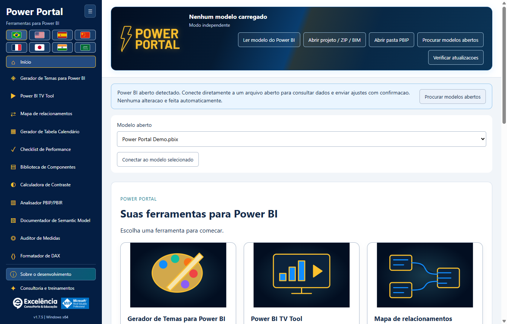

# Guia de instalação

<!-- language-selector -->
[🇺🇸 English](../INSTALLATION.md) · [🇧🇷 Português](INSTALLATION.md) · [🇪🇸 Español](../es/INSTALLATION.md) · [🇨🇳 简体中文](../zh-CN/INSTALLATION.md) · [🇫🇷 Français](../fr/INSTALLATION.md) · [🇯🇵 日本語](../ja/INSTALLATION.md) · [🇮🇳 हिन्दी](../hi/INSTALLATION.md) · [🇸🇦 العربية](../ar/INSTALLATION.md)
<!-- /language-selector -->

[Voltar ao início](../../README.pt-BR.md)

<a name="requirements"></a>
## Requisitos

Windows 10/11 x64, permissão de administrador para instalação e uma edição do Power BI Desktop compatível com Ferramentas externas. O aplicativo é distribuído como instalador Windows autossuficiente. Usuários finais não precisam de PHP, Node.js, SDK do .NET, Git ou conta GitHub.

Reserve aproximadamente 1 GB de espaço livre para o download e os componentes de execução instalados, além de espaço para suas exportações e backups.

<a name="simple-installation"></a>
## Instalação simples

1. Abra a [Release mais recente](https://github.com/luisgnserra/powerportaldesktop/releases/latest).
2. Em **Assets**, baixe `PowerPortal-Setup-1.7.5-x64.exe` para esta versão. Não baixe os arquivos automáticos de código-fonte como instalador.
3. Opcionalmente, [verifique o SHA-256](#verify-the-installer).
4. Execute o arquivo e aprove o Controle de Conta de Usuário.
5. Aceite os termos das dependências exibidos, escolha uma pasta e selecione o idioma padrão pelas bandeiras. O idioma do Windows é sugerido; idiomas não suportados usam inglês.
6. Conclua o assistente.
7. Feche e abra novamente o Power BI Desktop. Abra um PBIX e selecione **Ferramentas externas > Power Portal**.

A instalação atende todos os usuários da máquina e inclui atalhos na área de trabalho/menu Iniciar e o registro da ferramenta externa. O aplicativo não exige elevação no uso normal.


Clique em **Ferramentas externas > Power Portal** com o PBIX aberto. O rótulo **Ferramentas externas** do print original está em português. O ícone abre uma **janela complementar separada** e transmite a conexão do modelo local do arquivo aberto; não é um visual incorporado ou painel interno do relatório.



Ao iniciar pelo atalho do Windows, aparece um aviso se houver modelos abertos. Selecione **Localizar modelos abertos**, confira o nome do arquivo e conecte. Detectar ou conectar não faz alterações. [Veja o passo a passo ilustrado](SCREENSHOTS.md).

**Versão sem assinatura:** o Windows pode mostrar SmartScreen ou aviso de editor desconhecido. O SHA-256 verifica se você tem o arquivo publicado; não é uma assinatura digital do editor. Não contorne restrições empresariais. Consulte a TI se precisar de aprovação.

<a name="command-line-installation"></a>
## Instalação por linha de comando

<a name="download-the-helper-and-review-it"></a>
### Baixar e revisar o auxiliar

```powershell
$script = Join-Path $env:TEMP 'Install-PowerPortal.ps1'
[Net.ServicePointManager]::SecurityProtocol = [Net.ServicePointManager]::SecurityProtocol -bor [Net.SecurityProtocolType]::Tls12
Invoke-WebRequest -UseBasicParsing 'https://raw.githubusercontent.com/luisgnserra/powerportaldesktop/v1.7.5/install.ps1' -OutFile $script
Get-Content -LiteralPath $script
& $script
```

Essa URL versionada fixa o auxiliar na Release 1.7.5. Não acompanha silenciosamente versões futuras. O auxiliar também fixa o nome do instalador e seu SHA-256, baixa por HTTPS, verifica o executável antes de executá-lo e confere o registro da instalação após a saída bem-sucedida do instalador.

A linha TLS habilita HTTPS TLS 1.2 neste processo do PowerShell para padrões antigos do Windows PowerShell. Não modifica a segurança nem as políticas de execução do Windows.

<a name="unattended-installation"></a>
### Instalação sem interação

Abra o PowerShell **como administrador** e execute:

```powershell
& "$env:TEMP\Install-PowerPortal.ps1" -Silent
```

O auxiliar baixa e verifica o mesmo instalador e aciona a opção NSIS `/S`. Não aparece uma página de idioma no modo silencioso: o instalador usa o idioma do Windows, com inglês como alternativa. A preferência salva pelo usuário continua tendo prioridade. Nenhum PBIX é aberto ou alterado pelo auxiliar.

O modo silencioso exige uma sessão do PowerShell já elevada. Não contorna UAC, controles de segurança do Windows, políticas de execução de scripts ou restrições do aplicativo. Feche o Power Portal antes da distribuição; veja [atualizações](#updates-and-downgrades).

<a name="download-only-or-choose-a-download-folder"></a>
### Somente baixar ou escolher a pasta do download

```powershell
& "$env:TEMP\Install-PowerPortal.ps1" -DownloadOnly -DownloadDirectory "$env:USERPROFILE\Downloads\PowerPortal"
```

`-DownloadOnly` verifica o checksum, mas nunca executa o instalador e não exige privilégios de administrador. Um arquivo já baixado só é reutilizado se o checksum coincidir. Um arquivo existente inválido causa erro explícito, em vez de ser executado ou substituído silenciosamente.

Parâmetros do auxiliar:

| Parâmetro | Padrão | Finalidade |
|---|---|---|
| `-Silent` | Desativado | Usa a opção de instalação sem interação do NSIS; exige PowerShell administrador, exceto quando somente baixa. |
| `-DownloadOnly` | Desativado | Baixa/armazena e verifica o executável sem instalar. |
| `-DownloadDirectory` | `%TEMP%\PowerPortalDownloads` | Pasta do instalador verificado. Não é o diretório de instalação do aplicativo. |

Não cole um script não revisado em `Invoke-Expression`. Se a política de execução bloquear um script baixado, consulte a TI ou use o assistente executável. O auxiliar deliberadamente não altera políticas de execução.

<a name="use-the-verified-executable-directly"></a>
### Usar diretamente o executável verificado

Depois de verificar o checksum, um administrador pode executar:

```powershell
$setup = "$env:USERPROFILE\Downloads\PowerPortal-Setup-1.7.5-x64.exe"
$process = Start-Process -FilePath $setup -ArgumentList '/S' -Wait -PassThru
if ($process.ExitCode -ne 0) { throw "Installer failed: $($process.ExitCode)" }
```

Recomenda-se o auxiliar PowerShell porque ele verifica tanto o download quanto o registro resultante da ferramenta externa.

<a name="verify-the-installer"></a>
## Verificar o instalador

SHA-256 esperado para **1.7.5 x64**:

```text
0AD5CFA882611A8B24BAD6A093F3FBF6C68EF0C18232B5EC2BCACA110F81EBD7
```

```powershell
$file = "$env:USERPROFILE\Downloads\PowerPortal-Setup-1.7.5-x64.exe"
$expected = '0AD5CFA882611A8B24BAD6A093F3FBF6C68EF0C18232B5EC2BCACA110F81EBD7'
if ((Get-FileHash -LiteralPath $file -Algorithm SHA256).Hash -ne $expected) {
    throw 'Checksum mismatch. Do not run this installer.'
}
```

O checksum também está publicado em [SHA256SUMS.txt](../../SHA256SUMS.txt) e anexado à Release. Ele é uma verificação de integridade, não um substituto para confiar no editor.

<a name="updates-and-downgrades"></a>
## Atualizações e retorno a versões anteriores

Baixe um instalador oficial mais novo e execute sobre a instalação existente. O instalador tenta fechar somente o Power Portal no caminho exato do executável de destino antes de substituir arquivos. Não fecha Power BI Desktop nem outras ferramentas externas. Se não conseguir fechar, a instalação é interrompida.

Feche o Power Portal manualmente antes de uma atualização sem interação. Reinicie o Power BI Desktop depois para recarregar o registro de Ferramentas externas. Preferências de idioma/menu e backups locais de cada usuário são mantidos.

A partir da **1.6.2**, verificações ao iniciar e **Verificar atualizações** avisam sobre novas Releases oficiais. **Atualizar agora** baixa/verifica o instalador e inicia uma atualização silenciosa elevada na pasta atual de instalação, somente após seu clique. O Power BI não fecha. Reabra o Power Portal após a instalação. [Detalhes da atualização](UPDATES.md).

Versões **1.6.1 e anteriores exigem uma atualização manual única para a 1.6.2**. O retorno a versões anteriores não é certificado; salve seu trabalho e contate o suporte antes de usar um instalador antigo.

<a name="uninstall"></a>
## Desinstalar

Use **Configurações do Windows > Aplicativos > Aplicativos instalados > Power Portal > Desinstalar** (no Windows 10, use **Aplicativos e recursos**).

A desinstalação remove o aplicativo e seu registro `PowerPortal.pbitool.json`. Outras ferramentas não são alteradas. Configurações, temas, backups e logs de cada usuário são mantidos intencionalmente. Consulte os [locais dos dados](CONFIGURATION.md#data-locations) antes de removê-los manualmente.

<a name="offline-and-enterprise-deployment"></a>
## Distribuição offline e empresarial

A TI pode baixar e verificar o instalador da Release uma vez, distribuir esse arquivo exato pelo sistema de software aprovado e executar `/S` com direitos de administrador. Downloads públicos do GitHub exigem internet; instalar um executável já baixado não exige autenticação GitHub.

Este repositório não oferece pacote Microsoft Store, MSI, entrada no catálogo winget ou pacote Chocolatey. A distribuição suportada é o EXE NSIS e seu auxiliar PowerShell.

[Configuração](CONFIGURATION.md) · [Solução de problemas](TROUBLESHOOTING.md)
