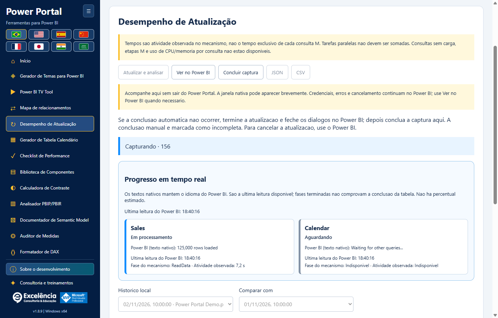
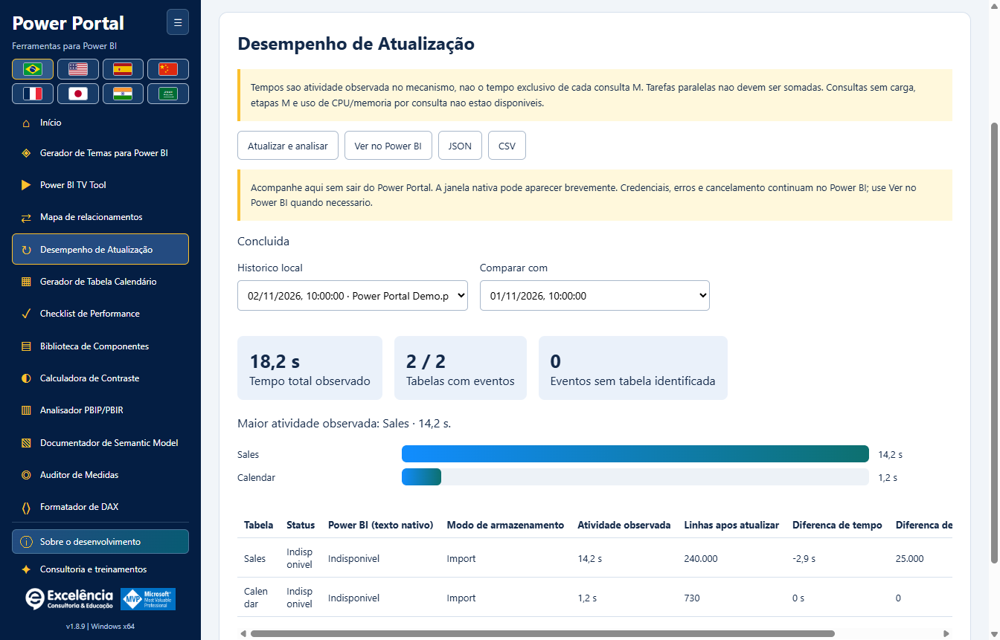

# Desempenho de Atualização

<!-- language-selector -->
[🇺🇸 English](../REFRESH-ANALYSIS.md) · [🇧🇷 Português](REFRESH-ANALYSIS.md) · [🇪🇸 Español](../es/REFRESH-ANALYSIS.md) · [🇨🇳 简体中文](../zh-CN/REFRESH-ANALYSIS.md) · [🇫🇷 Français](../fr/REFRESH-ANALYSIS.md) · [🇯🇵 日本語](../ja/REFRESH-ANALYSIS.md) · [🇮🇳 हिन्दी](../hi/REFRESH-ANALYSIS.md) · [🇸🇦 العربية](../ar/REFRESH-ANALYSIS.md)
<!-- /language-selector -->

**1.8.9 — Amostra do calendário e atalho para atualização nativa**

No Gerador de Tabela Calendário, a amostra real (até 50 linhas) agora fica abaixo de Gerar script. Atualizar no Power BI fica ao lado desse botão e, com conexão ativa, abre Desempenho de Atualização e inicia o mesmo fluxo nativo de atualização dos dados com confirmação. Acompanhe ali estados das tabelas, tempos e contagens de linhas. Isso atualiza o modelo inteiro; não aplica o script gerado, não cria nem substitui a tabela calendário e não salva o PBIX. Criar calendário no Power BI continua sendo uma ação separada. O botão fica desabilitado sem conexão, funciona pelo teclado e está traduzido nos oito idiomas. Cancelamento e erros usam o fluxo de atualização existente. A amostra continua sendo a última leitura solicitada: use Ler calendário selecionado para consultá-la novamente após atualizar. Testes no aplicativo empacotado verificaram posição, oito traduções, bloqueio offline, conexão exata, cancelamento, erros visíveis, nova tentativa e criação de calendário preservada. Nenhuma atualização real foi iniciada nesses testes; os prints usam dados sintéticos.

**1.8.7 — Seleção de cores mais clara e confiável**

As onze cores do tema agora possuem uma amostra nativa visível e um botão Selecionar cor ao lado do campo HEX editável. Clique na amostra ou no botão, ou use Enter/Espaço com o botão em foco. O seletor não depende mais de um campo invisível sem tamanho nem de clique duplo no HEX. A edição manual, importação de temas, prévia em tempo real e exportação JSON continuam disponíveis. Falhas ao abrir são mostradas explicitamente. A abertura nativa foi verificada repetidamente no aplicativo Windows, além dos onze botões por mouse/teclado e dos textos nos oito idiomas.

Análise Atualização agora se chama Desempenho de Atualização no menu, na página inicial, no título da ferramenta e nos oito idiomas. A alteração é apenas de nome: atualização nativa, progresso ao vivo, tempos, linhas, histórico local e compatibilidade JSON/CSV permanecem iguais. As análises salvas continuam disponíveis, sem migração ou necessidade de atualizar os dados. As imagens usam dados sintéticos.

**1.8.6 — Acompanhe a atualização dentro do Power Portal**

Inicie Atualizar e analisar no Power Portal e acompanhe cartões ao vivo com cada tabela, estado observado, fase do mecanismo, tempo de atividade e o último texto de progresso nativo disponível do Power BI. O Power Portal recupera o foco após iniciar e, se o Power BI reaparecer em primeiro plano, após a conclusão nativa. Não toma repetidamente o foco de outros aplicativos. Ver no Power BI abre o arquivo selecionado sem iniciar outra atualização; essa escolha desativa o retorno automático do foco nessa captura.

O Power BI continua sendo o mecanismo de atualização. Sua janela pode aparecer brevemente: não se trata de uma API suportada de processamento de PBIX sem janela. Credenciais, erros e cancelamento permanecem no Power BI; nenhum diálogo é ocultado ou dispensado automaticamente. O texto nativo mantém o idioma do Power BI e informa o horário da última leitura. A ausência de texto é explícita; o rastreamento do mecanismo continua se a leitura da janela falhar. Fases encerradas não comprovam a conclusão da tabela, não há percentuais inventados e as linhas finais são contadas apenas após a captura. Histórico e JSON incluem os estados nativos observados; revise as exportações antes de compartilhar. O aplicativo empacotado foi testado com atualização real autorizada: 4/4 tabelas medidas, 4/4 contagens de linhas, estados nativos ao vivo, foco devolvido ao Portal, botão Ver no Power BI funcional e histórico preservado após recarregar. Nenhum PBIX foi salvo automaticamente; as imagens usam dados sintéticos.

**1.8.5 — Correção das medições da atualização nativa**

Desempenho de Atualização agora reconhece o comando XML Refresh nativo usado pelo Power BI Desktop, inclusive dentro de Batch, além de XMLA Process e TMSL refresh. Antes, a atualização podia executar, mas seu progresso era descartado como não relacionado, deixando 0 tabelas medidas, contagens indisponíveis e refreshCompletionNotProven. Um resultado explícito de sucesso do mecanismo agora é aceito quando o campo opcional Error está ausente; códigos de erro diferentes de zero e erros XMLA continuam prevalecendo. O progresso ainda exige correlação exata de requisição/atividade, excluindo consultas dos visuais não relacionadas.

Antes do primeiro comando reconhecido, a interface informa que aguarda eventos de atualização do Power BI. Conclusão não confirmada agora mostra orientação traduzida em vez de somente um código técnico. Atualize o aplicativo, conecte ao PBIX correto e execute Atualizar e analisar novamente; relatórios antigos incompletos são preservados e não são reclassificados como sucesso. O aplicativo empacotado foi validado de ponta a ponta numa atualização real autorizada, com atividade por tabela, contagens, conclusão automática e histórico preservado após recarregar. Os prints não contêm dados nem nomes de modelos do usuário; os exemplos da documentação continuam sintéticos.

## Inicio e seguranca

Conecte ao PBIX correto, abra Desempenho de Atualização e clique em Atualizar e analisar. Confira o nome do arquivo e confirme. O rastreamento inicia antes de acionar Página Inicial > Atualizar nativo; nao atualiza tabelas sequencialmente via TOM. Mantenha o Power BI aberto e resolva credenciais, erros ou cancelamento nele. Um backup BIM nao restaura dados atualizados.

A atualizacao nativa consulta as fontes e substitui os dados importados. Salve uma copia do PBIX. Resolva credenciais e erros no Power BI; o rastreamento nao cancela a atualizacao nem inclui todas as consultas auxiliares do Power Query.

## Interpretacao das medidas

A atividade observada e a uniao dos intervalos do mecanismo identificados exatamente por tabela, sem somar fases aninhadas duas vezes. Nao representa apenas consulta a fonte nem um caminho critico comprovado. O total observado vai do acionamento ate a deteccao da conclusao, inclui sobrecarga de interface/verificacao e exclui a contagem posterior de linhas. Eventos sem tabela identificada aparecem separadamente.

Tempos sao atividade observada no mecanismo, nao o tempo exclusivo de cada consulta M. Tarefas paralelas nao devem ser somadas. Consultas sem carga, etapas M e uso de CPU/memoria por consulta nao estao disponiveis.

A conclusao automatica exige termino observado dos comandos de atualizacao e janela do Power BI pronta. Feche os dialogos nativos de resultado. Concluir captura manualmente sempre indica analise incompleta, nao comprova sucesso nem cancela a atualizacao. Erros do mecanismo/rastreamento sao explicitos. Uma captura interrompida nao e apresentada como concluida.

## Historico e exportacao

Linhas sao contadas depois da captura, fora do cronometro. DirectQuery/DirectLake nao sao consultados. Falta de evento nao significa tempo zero. Guarde ate 30 analises por modelo neste computador; nenhuma e enviada ao portal.

Selecione uma execucao salva e outra para comparar tempos e linhas pelos nomes correspondentes das tabelas. Cache, carga da fonte, volume e paralelismo afetam a comparacao; diferencas nao comprovam uma causa. JSON preserva indisponiveis como null; CSV deixa vazio e protege formulas de planilha. O historico e local, usa a mesma identidade do modelo que o diagrama e nao fica no PBIX. Arquivos com identidades expostas identicas podem compartilhar historico: confira o nome do modelo. Exportacoes contem nomes do modelo/tabelas e contagens: revise antes de compartilhar.

<!-- refresh-correlation -->
Somente progresso do mecanismo correlacionado por RequestID/ActivityID a um comando ativo de atualizacao e medido. Consultas dos visuais nao relacionadas sao excluidas. Algumas versoes do Power BI omitem esses identificadores: o tempo de uma tabela pode ficar indisponivel mesmo quando a atualizacao e executada.

## Acionamento nativo e recuperação

Desempenho de Atualização fica imediatamente abaixo de Mapa de relacionamentos no menu lateral e na galeria inicial. A identificação do botão nativo ignora as abas Home duplicadas das visualizações de consultas DAX e TMDL, evitando “Ambiguous Power BI control: home”. Se o controle não estiver disponível, selecione Relatório, Dados ou Modelo no Power BI.

Atualizar permanece bloqueado enquanto a confirmação, validação e preparação do rastreamento estão pendentes; Concluir captura fica oculto até a captura estar pronta. Isso impede um segundo acionamento com o erro indevido “Finish the active Power BI operation before refreshing”. Uma falha comprovadamente anterior ao acionamento nativo encerra o rastreamento, verifica a limpeza e permite nova tentativa. Se o acionamento já puder ter ocorrido, o erro fica visível e a captura permanece pendente: confira o Power BI, termine a atualização e feche os diálogos antes de Concluir captura. Solicitações repetidas retomam a captura existente, sem iniciar outra atualização. Operações realmente em andamento ainda precisam terminar primeiro.
