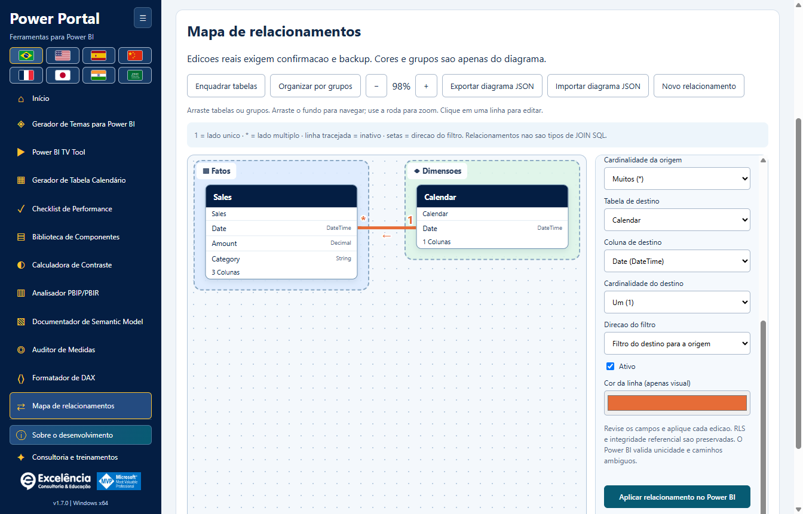
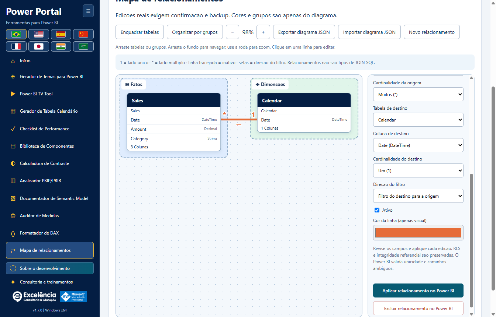

# Mapa de relacionamentos

<!-- language-selector -->
[🇺🇸 English](../RELATIONSHIPS.md) · [🇧🇷 Português](RELATIONSHIPS.md) · [🇪🇸 Español](../es/RELATIONSHIPS.md) · [🇨🇳 简体中文](../zh-CN/RELATIONSHIPS.md) · [🇫🇷 Français](../fr/RELATIONSHIPS.md) · [🇯🇵 日本語](../ja/RELATIONSHIPS.md) · [🇮🇳 हिन्दी](../hi/RELATIONSHIPS.md) · [🇸🇦 العربية](../ar/RELATIONSHIPS.md)
<!-- /language-selector -->

[Voltar ao início](../../README.pt-BR.md) · [Prints](SCREENSHOTS.md) · [Segurança do modelo](USAGE.md)

Disponível no **Power Portal Desktop 1.7.0**. É uma ferramenta nova exclusiva do Desktop, separada da exibição Modelo do Power BI. Lê os relacionamentos reais entre tabelas/colunas e aplica alterações confirmadas no modelo semântico local conectado.



<a name="open-your-model"></a>
## Abrir seu modelo

1. Salve uma cópia separada do PBIX.
2. Inicie por **Ferramentas externas > Power Portal** no Power BI Desktop ou localize e selecione explicitamente o arquivo aberto.
3. Abra **Mapa de relacionamentos** no menu lateral ou na galeria inicial.

Projetos BIM/PBIP/TMDL importados permitem o diagrama e a personalização visual, mas **gravar relacionamentos exige conexão local ao vivo com o Power BI**. Leia o modelo novamente após mudanças feitas em outro lugar.

<a name="understand-the-links"></a>
## Entender as ligações

- Cada caixa representa uma tabela real. O nome original permanece visível abaixo do título amigável.
- Colunas usadas em relacionamentos são priorizadas na caixa. Até oito aparecem, com seus tipos; todas continuam disponíveis no editor.
- **1** identifica o lado único; **\*** identifica o lado muitos.
- Linhas contínuas são relacionamentos ativos; tracejadas são inativos.
- Setas indicam propagação de filtros: uma direção única TOM filtra **da tabela de destino para a tabela de origem**, não na ordem em que você escolheu as colunas. Ligações bidirecionais mostram ambas as direções. **?** representa Automatic, quando o mecanismo decide.
- Clique na linha ou use a lista de relacionamentos para inspecionar suas pontas, cardinalidade e filtros exatos.
- Relacionamentos não suportados que não são de coluna única são contados nos metadados e geram aviso na interface. Não são inventados nem editados.

**São relacionamentos de modelo semântico, não opções de SQL INNER/LEFT/RIGHT JOIN.** Cardinalidade e direção dos filtros influenciam cálculos e propagação de filtros do relatório.

<a name="arrange-a-teaching-friendly-diagram"></a>
## Organizar um diagrama didático

- Arraste livremente os títulos das tabelas nas duas direções.
- Arraste o título de um grupo para mover as tabelas integrantes juntas.
- Arraste o fundo para deslocar a área. Role ou use **+ / -** para zoom.
- **Enquadrar tabelas** enquadra o modelo atual; um diagrama novo é enquadrado automaticamente.
- **Organizar por grupos** distribui as tabelas pelos grupos atribuídos. Isso reorganiza somente o diagrama, não o modelo.
- Com o foco no título de uma tabela, use as setas do teclado para mover 10 unidades; Shift + seta move 50.
- Selecione uma tabela para escolher nome amigável, ícone, cor de fundo e grupo.
- **Fatos** e **Dimensões** são grupos iniciais opcionais, não classificação automática das funções das tabelas.
- Crie grupos personalizados e edite nome, ícone e cor de fundo. Remover um grupo não exclui suas tabelas.
- Selecione um relacionamento existente para escolher a cor da linha.

**Cores, posições, grupos, ícones e nomes amigáveis não renomeiam objetos do Power BI nem alteram seu layout nativo da exibição Modelo.** Pertencem a este diagrama complementar.

<a name="save-and-share-the-organization"></a>
## Salvar e compartilhar a organização

Mudanças visuais são salvas automaticamente no perfil do usuário Windows atual:

```text
%APPDATA%\powerportal-desktop\relationship-diagrams\<model-key>.json
```

A gravação usa arquivo intermediário e substituição atômica. Falhas aparecem explicitamente com **Tentar salvar novamente**; o aplicativo não finge que o layout foi salvo.

**Exportar diagrama JSON** cria um arquivo portátil de layout visual. **Importar diagrama JSON** valida o formato e confere se suas tabelas existem no modelo carregado. Restaura somente a organização: **importar um diagrama nunca cria, muda ou exclui relacionamentos do modelo**.

O JSON inclui nomes de tabelas, nomes amigáveis, configurações dos grupos, cores de linhas e área de visualização. Não contém linhas de dados, DAX nem credenciais das fontes. Nomes de tabelas/grupos ainda podem revelar o contexto do negócio: compartilhe somente arquivos sem informações sensíveis.

Perfis de modelos ao vivo são identificados pelo nome da janela/arquivo do Power BI e tags de linhagem das tabelas, usando nomes de tabelas como alternativa. Perfis de projetos importados também usam o caminho local escolhido. A descoberta do Power BI não mostra de forma confiável o caminho completo do PBIX. Renomear um arquivo ou substituir identidades de tabelas pode criar um perfil novo; cópias com mesmo nome e linhagem podem compartilhar perfil. Use JSON exportado para manter layouts separados quando necessário.

Entradas antigas de tabelas/linhas são removidas ao atualizar metadados. A posição antiga de uma tabela excluída não fica como uma tabela fictícia. Layouts são mantidos ao desinstalar, junto às demais preferências.

<a name="apply-each-relationship-edit-to-power-bi"></a>
## Aplicar cada edição de relacionamento no Power BI



<a name="create"></a>
### Criar

1. Escolha **Novo relacionamento**.
2. Selecione tabelas e colunas de origem/destino.
3. Defina cardinalidade, direção dos filtros e estado ativo/inativo.
4. Escolha **Aplicar relacionamento no Power BI**.

<a name="edit-activate-or-deactivate"></a>
### Editar, ativar ou desativar

1. Clique em uma linha existente ou selecione na lista.
2. Altere pontas, cardinalidades, direção dos filtros ou **Ativo**.
3. Escolha **Aplicar relacionamento no Power BI** para esta edição.

<a name="delete"></a>
### Excluir

Selecione o relacionamento existente e escolha **Excluir relacionamento no Power BI**.

Toda edição real segue a mesma sequência segura:

1. Uma confirmação nativa identifica o arquivo selecionado e mostra os estados anterior/novo. **Cancelar é o padrão**.
2. Após aprovação, um backup BIM completo dos metadados e um registro local da tentativa precisam ser gravados antes da mudança no modelo.
3. O conector abre o modelo novamente e confere se o relacionamento ainda coincide com a captura lida pelo editor. Relacionamentos desatualizados/excluídos/renomeados são rejeitados, não substituídos.
4. Colunas precisam ter tipos iguais e pertencer a tabelas diferentes. Pares duplicados e uma segunda ligação ativa direta entre o mesmo par de tabelas são rejeitados. Desative primeiro a ligação ativa existente.
5. O TOM grava por `SaveChanges`; o mecanismo continua responsável por unicidade, cardinalidade válida e validação de caminhos de filtros ambíguos. Erros são mostrados, não contornados.
6. Após sucesso, o aplicativo recarrega os metadados. Falha ao recarregar é informada como alteração já gravada, não cancelamento.
7. **Salve o PBIX no Power BI Desktop** para persistir o modelo alterado no arquivo.

O comportamento de filtros da segurança em nível de linha, **Assume Referential Integrity** e outras configurações não expostas dos relacionamentos existentes são preservados. Este editor não permite alterar RLS nem habilitar Assume Referential Integrity. Novas ligações usam os padrões de segurança/integridade.

Preservar essas propriedades não significa que ativação, exclusão ou mudança das pontas não afete a propagação dos filtros de segurança. Revise relacionamentos usados por RLS com o administrador do modelo antes de confirmar.

Atualizações/temas/gravações não podem ocorrer simultaneamente com a gravação de um relacionamento. Trocar o modelo conectado durante uma gravação é bloqueado; solicitações de outra conexão selecionada são rejeitadas.

<a name="backup-and-limits"></a>
## Backup e limites

- O backup BIM contém metadados, não um PBIX completo, canvas do relatório ou todas as linhas dos dados. Seu caminho é informado após gravações bem-sucedidas ou falhas do conector.
- **Não há botão de reversão automática de relacionamentos/restauração do modelo completo.** Mantenha a cópia separada do PBIX e revise o backup informado com o administrador se necessário.
- JSON do diagrama tem limite de 5 MB na importação, 2.000 tabelas, 200 grupos e 10.000 entradas de estilo de linha. Zoom de 15% a 200%.
- A ferramenta não calcula junções SQL, mescla consultas, altera relacionamentos multicoluna, configura RLS nem posiciona visuais do relatório.
- Gravações no Desktop ao vivo podem ser restritas pelo modo do modelo, versão do Desktop, permissões ou política empresarial. Não contorne essas restrições.

[Configuração e dados mantidos](CONFIGURATION.md#data-locations) · [Solução de problemas](TROUBLESHOOTING.md)
