# Prints e interações com o Power BI

<!-- language-selector -->
[🇺🇸 English](../SCREENSHOTS.md) · [🇧🇷 Português](SCREENSHOTS.md) · [🇪🇸 Español](../es/SCREENSHOTS.md) · [🇨🇳 简体中文](../zh-CN/SCREENSHOTS.md) · [🇫🇷 Français](../fr/SCREENSHOTS.md) · [🇯🇵 日本語](../ja/SCREENSHOTS.md) · [🇮🇳 हिन्दी](../hi/SCREENSHOTS.md) · [🇸🇦 العربية](../ar/SCREENSHOTS.md)
<!-- /language-selector -->

**1.8.6 — Acompanhe a atualização dentro do Power Portal**

Inicie Atualizar e analisar no Power Portal e acompanhe cartões ao vivo com cada tabela, estado observado, fase do mecanismo, tempo de atividade e o último texto de progresso nativo disponível do Power BI. O Power Portal recupera o foco após iniciar e, se o Power BI reaparecer em primeiro plano, após a conclusão nativa. Não toma repetidamente o foco de outros aplicativos. Ver no Power BI abre o arquivo selecionado sem iniciar outra atualização; essa escolha desativa o retorno automático do foco nessa captura.

O Power BI continua sendo o mecanismo de atualização. Sua janela pode aparecer brevemente: não se trata de uma API suportada de processamento de PBIX sem janela. Credenciais, erros e cancelamento permanecem no Power BI; nenhum diálogo é ocultado ou dispensado automaticamente. O texto nativo mantém o idioma do Power BI e informa o horário da última leitura. A ausência de texto é explícita; o rastreamento do mecanismo continua se a leitura da janela falhar. Fases encerradas não comprovam a conclusão da tabela, não há percentuais inventados e as linhas finais são contadas apenas após a captura. Histórico e JSON incluem os estados nativos observados; revise as exportações antes de compartilhar. O aplicativo empacotado foi testado com atualização real autorizada: 4/4 tabelas medidas, 4/4 contagens de linhas, estados nativos ao vivo, foco devolvido ao Portal, botão Ver no Power BI funcional e histórico preservado após recarregar. Nenhum PBIX foi salvo automaticamente; as imagens usam dados sintéticos.

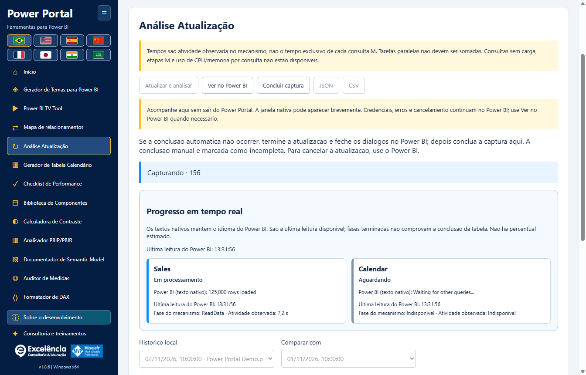

**1.8.5 — Correção das medições da atualização nativa**

Análise Atualização agora reconhece o comando XML Refresh nativo usado pelo Power BI Desktop, inclusive dentro de Batch, além de XMLA Process e TMSL refresh. Antes, a atualização podia executar, mas seu progresso era descartado como não relacionado, deixando 0 tabelas medidas, contagens indisponíveis e refreshCompletionNotProven. Um resultado explícito de sucesso do mecanismo agora é aceito quando o campo opcional Error está ausente; códigos de erro diferentes de zero e erros XMLA continuam prevalecendo. O progresso ainda exige correlação exata de requisição/atividade, excluindo consultas dos visuais não relacionadas.

Antes do primeiro comando reconhecido, a interface informa que aguarda eventos de atualização do Power BI. Conclusão não confirmada agora mostra orientação traduzida em vez de somente um código técnico. Atualize o aplicativo, conecte ao PBIX correto e execute Atualizar e analisar novamente; relatórios antigos incompletos são preservados e não são reclassificados como sucesso. O aplicativo empacotado foi validado de ponta a ponta numa atualização real autorizada, com atividade por tabela, contagens, conclusão automática e histórico preservado após recarregar. Os prints não contêm dados nem nomes de modelos do usuário; os exemplos da documentação continuam sintéticos.

**1.8.5 — Baixar atualizações pelo navegador**

Quando houver uma versão nova, o aviso de atualização agora oferece Baixar pelo navegador ao lado de Atualizar agora. O botão abre no navegador padrão o endereço oficial do instalador detectado no GitHub, sem fechar o Power Portal nem iniciar a instalação. Execute o instalador baixado manualmente quando desejar. A opção continua disponível após um erro na atualização automática. Falhas ao abrir o navegador são exibidas. Atualizar agora continua baixando pelo app, verificando SHA-256 e tamanho e solicitando autorização do Windows. Downloads pelo navegador não passam pela verificação automática do app: compare o SHA-256 publicado antes de executar o instalador. Os dois botões e a orientação estão traduzidos nos oito idiomas.

**1.8.5 — Prévia do tema com linhas suaves**

O gráfico de linhas do gerador de temas agora usa curvas cúbicas suaves em vez de segmentos retos, tanto com dados de exemplo como com dados do modelo conectado. As curvas passam pelos pontos originais sem criar picos entre os valores; cores, marcadores e dicas são preservados. A mudança afeta somente a prévia: o JSON exportado e a formatação das linhas dos visuais existentes no Power BI não são alterados.

**1.8.5 — Correções no início da atualização**

Análise Atualização fica imediatamente abaixo de Mapa de relacionamentos no menu lateral e na galeria inicial. A identificação do botão nativo ignora as abas Home duplicadas das visualizações de consultas DAX e TMDL, evitando “Ambiguous Power BI control: home”. Se o controle não estiver disponível, selecione Relatório, Dados ou Modelo no Power BI.

[Voltar ao início](../../README.pt-BR.md) · [Instalar](INSTALLATION.md) · [Guia de segurança](USAGE.md)

**Prints do aplicativo: Power Portal Desktop 1.8.6, interface em português.**
Os prints usam **metadados e valores de consulta sintéticos de demonstração**, não um PBIX de cliente. Estados conectados ilustram ações suportadas; nenhum modelo de cliente foi alterado para produzir as imagens. Rótulos nativos do seletor de arquivos podem seguir o idioma do Windows. O print verdadeiro da guia do Power BI foi fornecido pelo proprietário e recortado para remover o título privado do arquivo.

As setas dos relacionamentos agora ficam sobre a curva e giram conforme sua direcao local, inclusive em ligacoes diagonais ou invertidas. Setas SVG maiores, de 36 × 26 unidades, sempre pretas com contorno branco de 3 unidades, independentemente da cor da linha. O filtro unidirecional continua do destino para a origem; o bidirecional mostra duas setas opostas. O filtro automatico conserva o indicador de interrogacao. Esta alteracao e apenas visual.

O cabecalho animado do Power Portal agora incorpora o nome do arquivo, o status da conexao e os cinco botoes de leitura/importacao/busca/atualizacao. A faixa separada abaixo do banner foi removida para liberar espaco. O conteudo se reorganiza dentro do cabecalho em janelas menores e nos oito idiomas, incluindo arabe. Confirmacoes, avisos e comportamento das atualizacoes foram preservados.

## Criar relacionamento real no Power BI

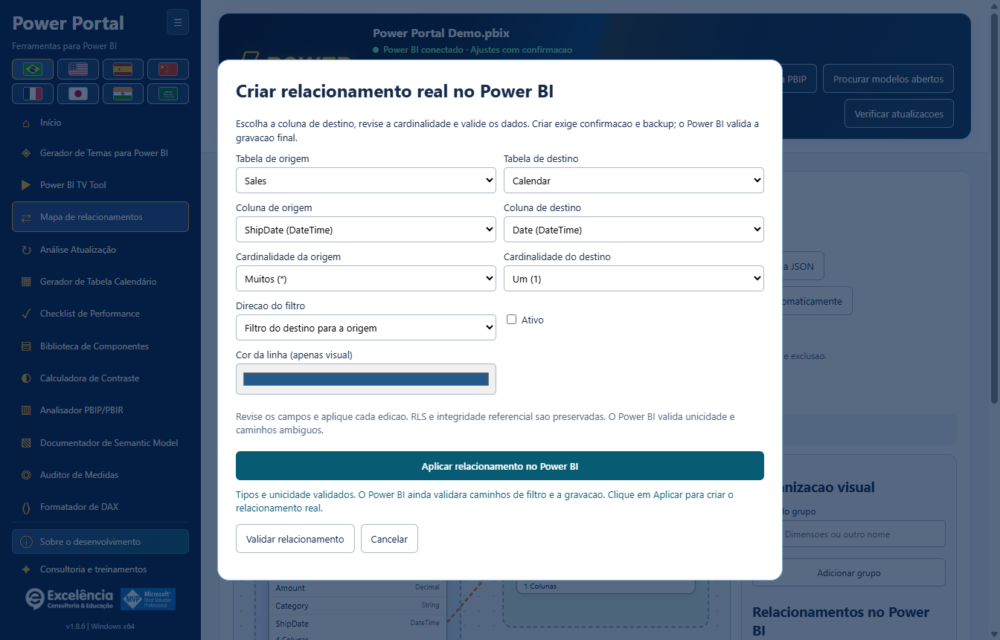

O Mapa de relacionamentos agora fica imediatamente depois do TV Tool no menu lateral e na galeria inicial. O bloco generico Dados reais do modelo foi removido do Gerador de Tabela Calendario e da Biblioteca de Componentes. Os controles proprios de leitura e envio continuam; o botao de periodo real usa o calendario selecionado dentro da ferramenta. As capas da pagina inicial foram redesenhadas como ilustracoes vetoriais locais sem texto embutido. Titulos, descricoes e acoes ficam fora das imagens e acompanham o idioma selecionado. Arraste uma coluna de origem para outra tabela para abrir o dialogo de relacionamento real e escolher a coluna de destino. Soltar em uma coluna ja a preseleciona. Revise cardinalidade, filtro e estado ativo; depois valide e aplique com confirmacao nativa e backup BIM.

A validacao verifica tipos, pares duplicados, ligacoes diretas ativas e contagens reais de linhas e valores distintos nas duas colunas, sem amostragem. Duplicatas no lado Um sao rejeitadas. As consultas tem limite de 20 segundos e falhas explicitas. Validar nunca grava. Aplicar repete a validacao, e o engine verifica chaves e ambiguidades de filtro ao confirmar. O rascunho tracejado nao e um relacionamento salvo; apenas a gravacao confirmada com sucesso o cria. Salve o PBIX depois. Testes e prints usam dados sinteticos, sem alterar PBIX de clientes.

## Como organizar com grupos

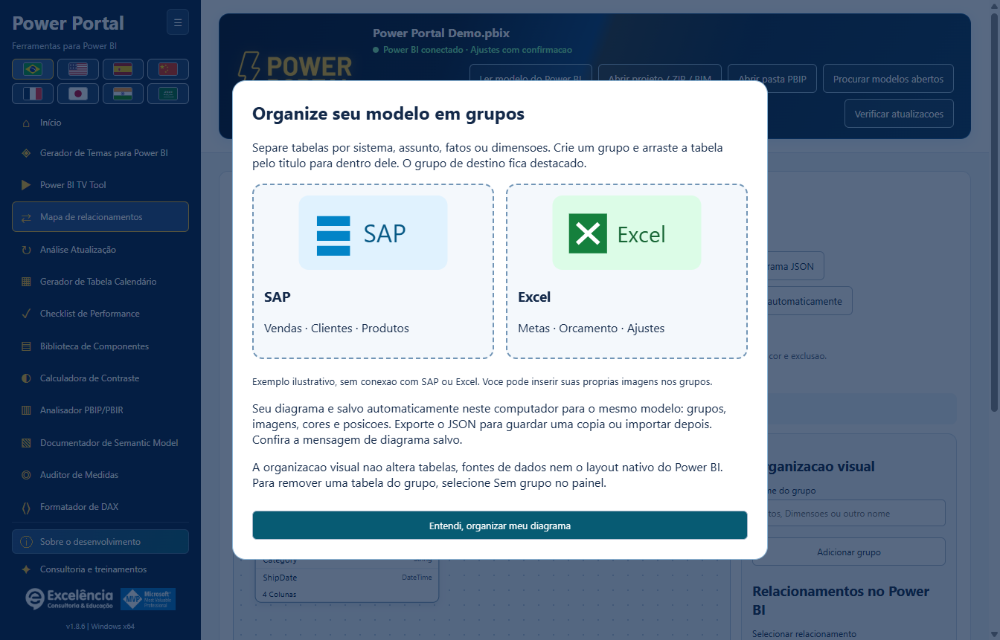

A introducao aparece na primeira visita ao mapa em cada execucao do aplicativo. Reabra em **Como organizar com grupos**. SAP e Excel sao exemplos ilustrativos de sistemas, nao novos conectores nem logos oficiais. Grupos vazios aparecem como areas de destino. Soltar no grupo destacado associa a tabela; soltar fora conserva o grupo atual.

Separe tabelas por sistema, assunto, fatos ou dimensoes. Crie um grupo e arraste a tabela pelo titulo para dentro dele. O grupo de destino fica destacado.

Seu diagrama e salvo automaticamente neste computador para o mesmo modelo: grupos, imagens, cores e posicoes. Exporte o JSON para guardar uma copia ou importar depois. Confira a mensagem de diagrama salvo.

A organizacao visual nao altera tabelas, fontes de dados nem o layout nativo do Power BI. Para remover uma tabela do grupo, selecione Sem grupo no painel.

## Abrir o Power Portal em Ferramentas externas

Após instalar, reinicie o Power BI Desktop, abra um PBIX e clique em **Ferramentas externas > Power Portal**.

A guia em português **Ferramentas externas** corresponde a **External Tools** em inglês. O instalador registra o ícone nessa guia. Clicar abre **uma janela separada do Power Portal conectada ao modelo do arquivo aberto**. É um aplicativo complementar externo, não visual do relatório, painel incorporado ou extensão interna da Microsoft.

## Início e navegação

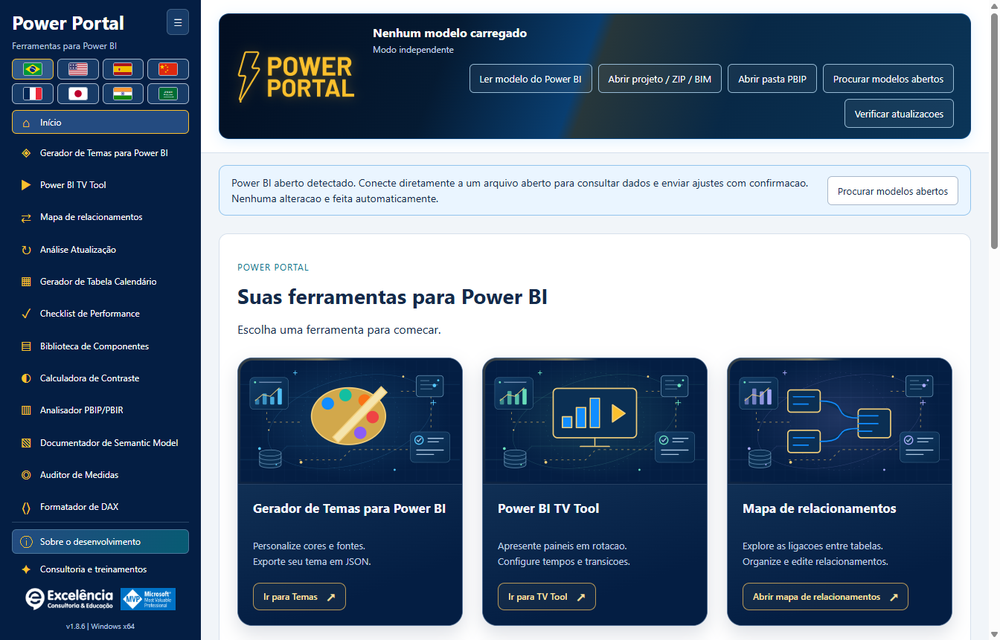

O Mapa de relacionamentos agora fica imediatamente depois do TV Tool no menu lateral e na galeria inicial. As capas da pagina inicial foram redesenhadas como ilustracoes vetoriais locais sem texto embutido. Titulos, descricoes e acoes ficam fora das imagens e acompanham o idioma selecionado.

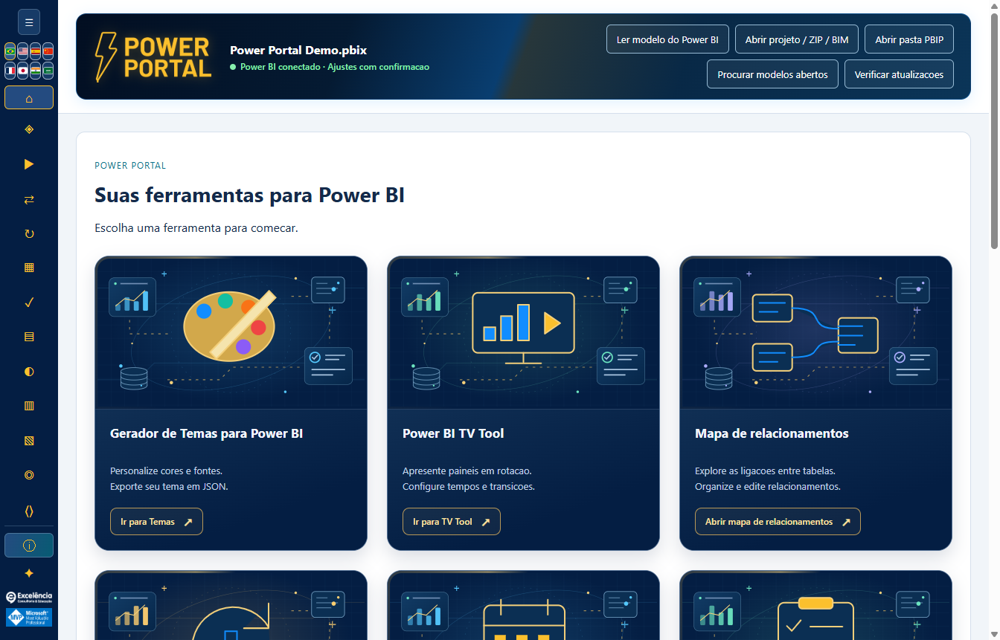

Recolha o menu para ampliar a área de trabalho; a preferência persiste. Ícones mantêm nomes acessíveis e dicas. A área principal e os formulários das ferramentas ainda podem rolar; a mudança sem rolagem se aplica ao catálogo do menu.

## Conectar a um arquivo já aberto no Power BI

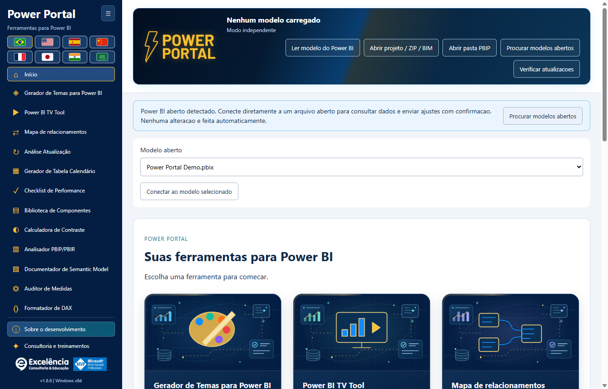

Ao iniciar por um atalho Windows, o aplicativo detecta os modelos locais disponíveis e explica que pode conectar diretamente ao arquivo aberto. Escolha **Localizar modelos abertos**, confira o nome e clique em **Conectar ao modelo selecionado**. Com vários arquivos, escolha explicitamente o desejado.

Iniciar pela guia Ferramentas externas transmite automaticamente a conexão daquela instância do Desktop e lê seus metadados. **Conectar não grava alterações.**

## Aviso de nova versão

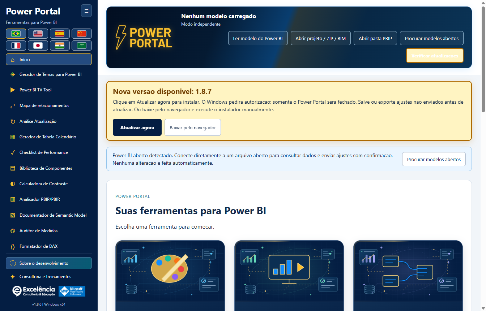

O print usa um **resultado futuro sintético da 1.8.6** para mostrar o aviso na 1.8.6. Não afirma que a 1.8.6 foi publicada. Usuários da 1.6.2 ou superior podem receber agora o aviso real da 1.8.6.

Na 1.6.4, a faixa âmbar fica visível durante a rolagem e anima suavemente, exceto quando movimento reduzido está habilitado. Não há faixa permanente “aplicativo atualizado” ocupando espaço.

O aplicativo instalado verifica a Release estável oficial mais recente ao iniciar. Clique em **Atualizar agora** para baixar/verificar o instalador e aprove a solicitação de administrador Windows. Ele atualiza a pasta existente e fecha somente o Power Portal. **Conectar ou verificar não instala nada.** Salve/exporte primeiro edições não enviadas e reabra o aplicativo quando a instalação terminar.

**Verificar atualizações** repete a checagem a qualquer momento. Falhas de internet/limites/checksum/UAC aparecem explicitamente sem desabilitar ferramentas locais. [Guia completo](UPDATES.md).

## Interações diretas com o arquivo aberto no Power BI

Estas ações não se limitam a baixar texto ou JSON:

| Tela/ação | Lê ou altera o Power BI? | Proteção |
|---|---|---|
| Atualizar modelo do Power BI | Lê tabelas, colunas, medidas e relacionamentos do modelo semântico selecionado. | Sem gravação. |
| Consultar dados/intervalos de datas/amostras | Lê valores reais pelo mecanismo local. | Consultas estruturadas e limitadas; não usa filtros da página ativa. |
| Enviar tema diretamente para o Power BI | Aplica o JSON gerado à janela selecionada do relatório. | Confirmação, importação visível e verificação do tema exportado. |
| Criar calendário no Power BI | Cria nova tabela de datas calculada no modelo. | Confirmação e backup dos metadados; atualizar depois no Desktop. |
| Criar medida HTML no Power BI | Cria nova medida na tabela escolhida. | Confirmação e backup; adicionar visual HTML manualmente. |
| Atualizar medida no Power BI | Grava o DAX formatado na medida existente selecionada. | Confirmação, backup e proteção contra mudanças concorrentes. |
| Aplicar/excluir relacionamento no Power BI | Cria, edita, ativa/desativa ou exclui o relacionamento entre colunas escolhido. | Confirmação nativa, backup, checagem de estado antigo e validação do mecanismo; propriedades RLS/integridade preservadas. |

**Salve uma cópia separada do PBIX antes de aplicar mudanças.** Confirme arquivo e expressão e depois salve o PBIX no Desktop. O aplicativo nunca salva o PBIX silenciosamente.

### Dados reais do modelo

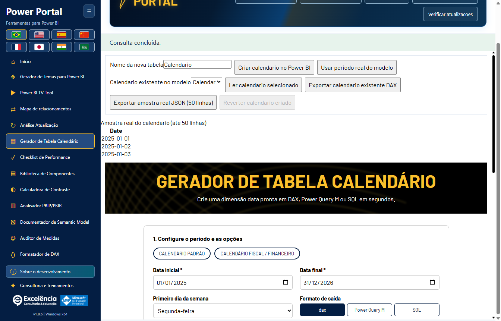

Amostras continuam limitadas a 50 linhas e consultas a 20 segundos. Os dados do calendario sao lidos pelo seletor e pela previa da propria ferramenta; o bloco generico nao aparece mais no Gerador de Calendario nem na Biblioteca de Componentes. O status da conexao fica no cabecalho.

### Gerador de temas

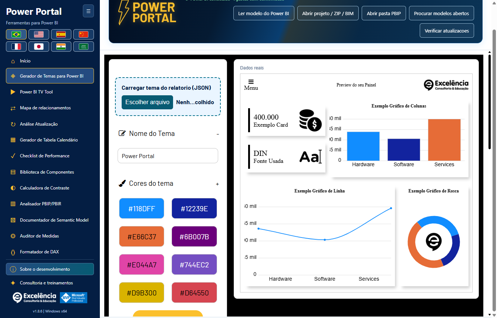

Use **Carregar tema do relatório (JSON)** em destaque, edite cores/fontes e veja a prévia. Exporte JSON ou role ao fim da página, abaixo do formulário e prévia, para **Enviar tema diretamente para o Power BI**.

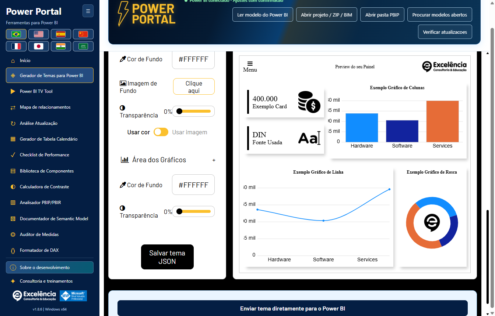

Para começar pelo tema existente, salve seu JSON no Desktop e carregue aqui. Conectar ao modelo semântico não lê temas. O envio direto continua usando o **diálogo visível de importação**: não existe uma API genérica suportada do Desktop que o elimine. Não interaja com o Power BI durante a automação.

### Gerador de calendário

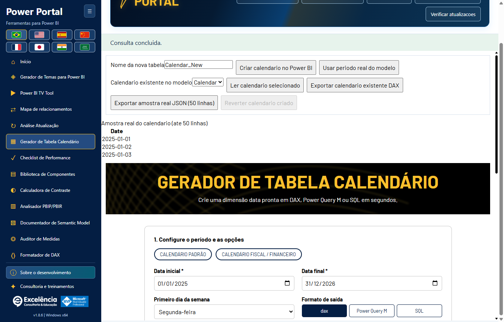

Leia expressão/intervalo de datas/amostra do calendário, exporte DAX ou JSON amostrado e gere um novo calendário. **Criar calendário no Power BI** cria uma nova tabela calculada com backup e confirmação, não substitui a existente selecionada.

Atualize no Desktop após criar. A reversão protegida só fica disponível se a tabela criada ainda coincidir e não tiver dependências.

### Biblioteca de componentes

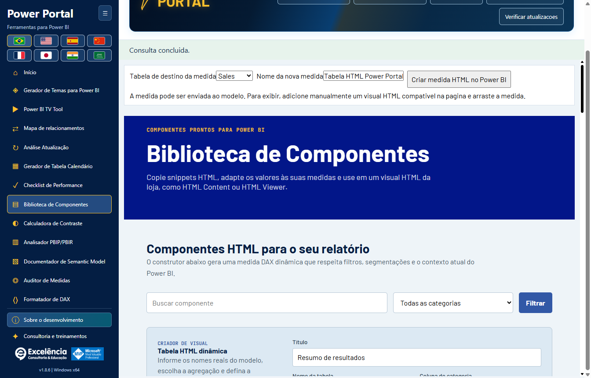

Escolha a tabela de destino e nome novo para a medida. O construtor usa nomes de campos/medidas e permite **Criar medida HTML no Power BI**. A medida é gravada depois de confirmar.

Um visual HTML compatível deve ser adicionado manualmente e receber a medida; esse botão não coloca um visual na página.

### Formatador DAX

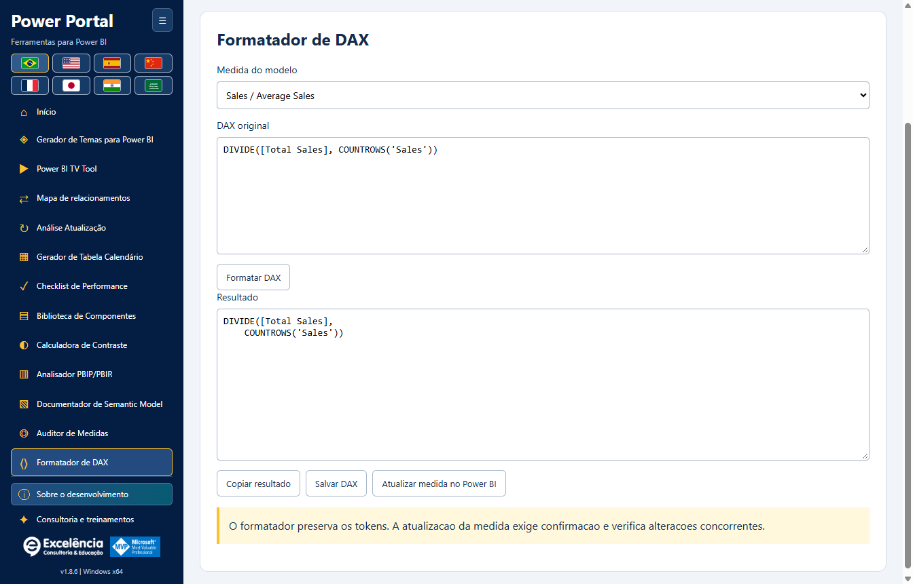

Selecione a medida existente, formate e escolha **Atualizar medida no Power BI** para enviar o DAX a ela. Copiar/exportar são ações separadas. A atualização recusa mudanças concorrentes da expressão e exige confirmação.

## Demais ferramentas

### Mapa de relacionamentos

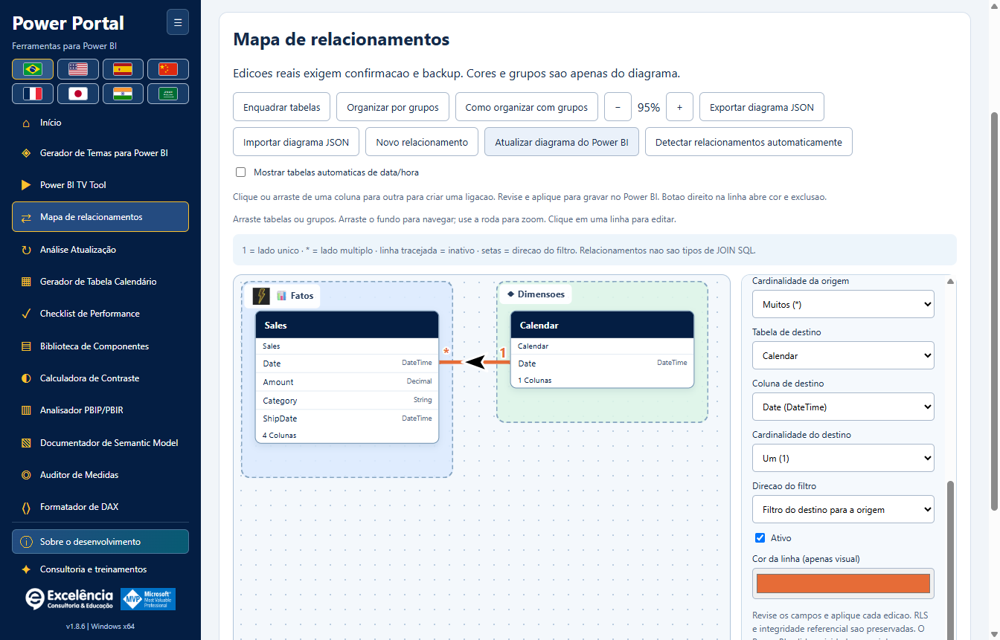

A nova ferramenta exclusiva do Desktop mostra ligações reais, cardinalidades, setas de filtros e linhas inativas tracejadas. Arraste caixas/grupos livremente, use zoom/deslocamento, escolha nomes amigáveis/ícones e personalize cores de grupos/linhas. Layouts salvam automaticamente por modelo e exportam/importam JSON sem enviar gravações.

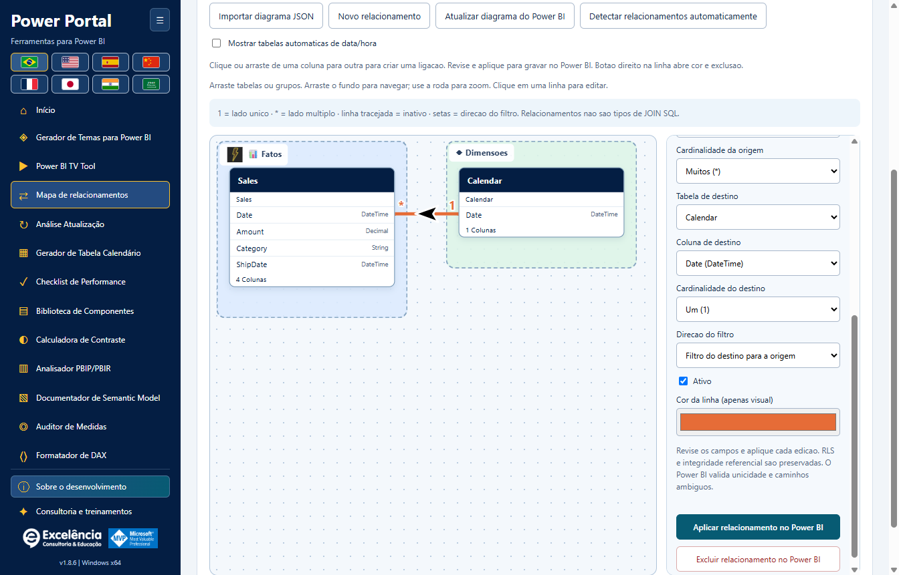

Selecione uma linha para inspecionar colunas, cardinalidade, filtros e estado ativo. **Aplicar relacionamento no Power BI** ou **Excluir relacionamento no Power BI** grava cada edição após confirmação nativa e backup. Projetos importados são somente leitura. Estilos não renomeiam tabelas nem mudam o diagrama nativo. [Passo a passo completo e limites de segurança](RELATIONSHIPS.md).

Na 1.8.6, clique ou arraste entre colunas para preparar um rascunho tracejado e revise/aplique. Botão direito na linha abre cor/editar/excluir. Grupos oferecem PNG/JPEG local e mais ícones; arraste pelo fundo ou título. Tabelas automáticas de data/hora ficam ocultas por padrão. **Atualizar diagrama do Power BI** relê mudanças externas sem copiar coordenadas nativas. **Detectar relacionamentos automaticamente** inicia a detecção nativa após confirmação/backup; revise e feche seus diálogos antes de **Concluir detecção e atualizar diagrama**.

### Power BI TV Tool

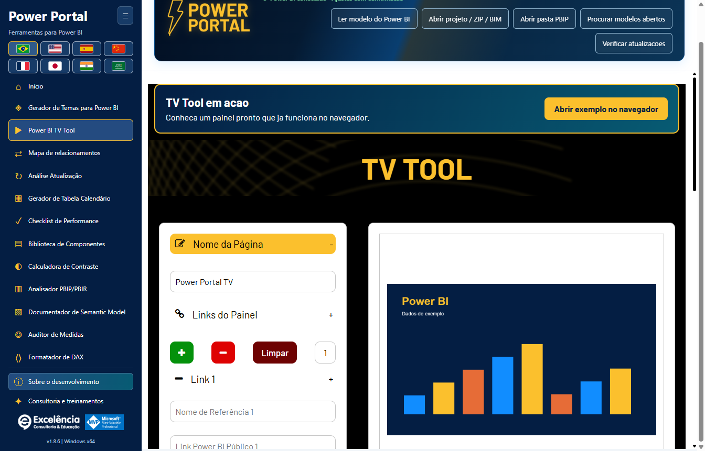

A faixa **TV Tool em ação** abre um [exemplo oficial funcional](https://www.powerportal.com.br/tv_tool/painel_exemplo_power_bi_tv_tool.html) no navegador padrão, exigindo internet, mas sem enviar dados locais do modelo. A apresentação ilustrativa local do formulário continua disponível.

Alterne páginas publicadas ou imagens locais, ajuste tempos/transições, visualize e exporte HTML. O TV **não** alterna páginas do PBIX local aberto. Relatórios privados publicados exigem login Microsoft/licenças/permissões adequados.

### Checklist de performance

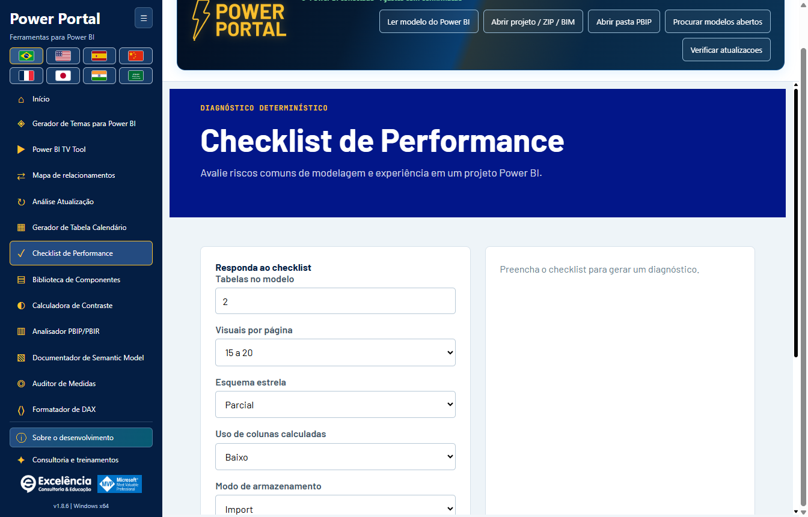

Revise itens apoiados no modelo e características manuais do relatório. Pontuações são orientação heurística, não medições de tempo dos visuais.

### Calculadora de contraste

Verifique legibilidade/contraste nos limites WCAG. É análise local e não muda automaticamente a formatação do relatório.

### Analisador PBIP/PBIR

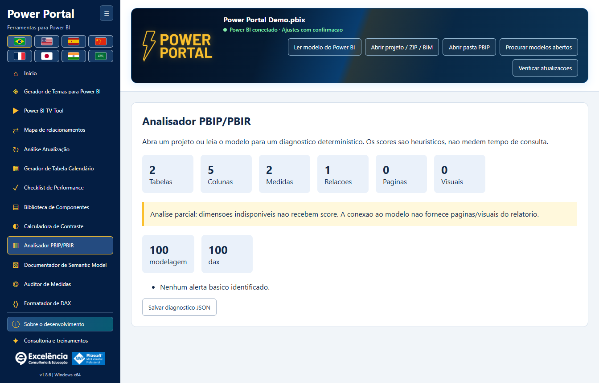

Analise a estrutura disponível do projeto carregado. Uma conexão semântica ao vivo não fornece páginas/visuais, por isso dimensões indisponíveis são informadas como parciais. Metadados de projetos PBIR importados podem acrescentar contagens.

### Documentador do modelo semântico

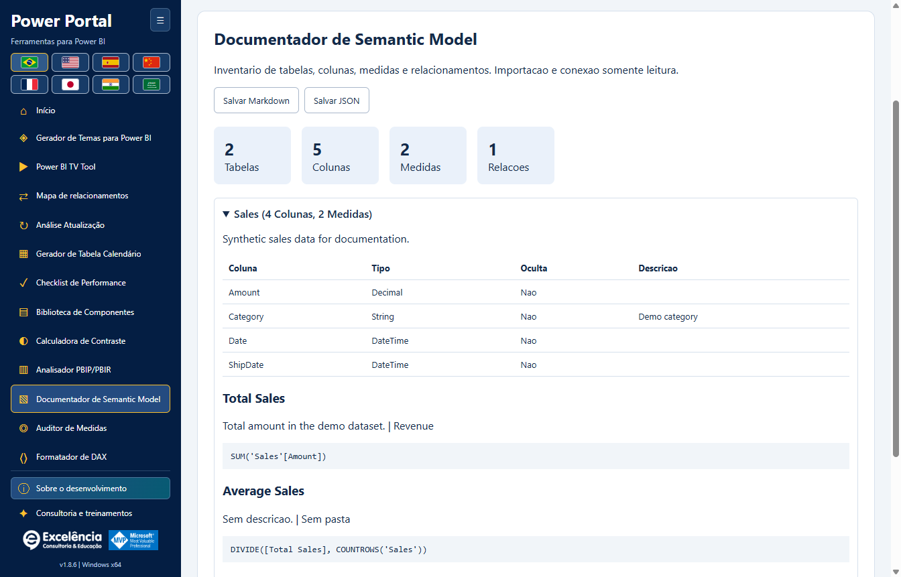

Leia/exporte documentação de tabelas/colunas/medidas/relacionamentos em Markdown ou JSON. Não modifica o modelo. Exportações podem conter nomes e DAX confidenciais; armazene adequadamente.

### Auditor de medidas

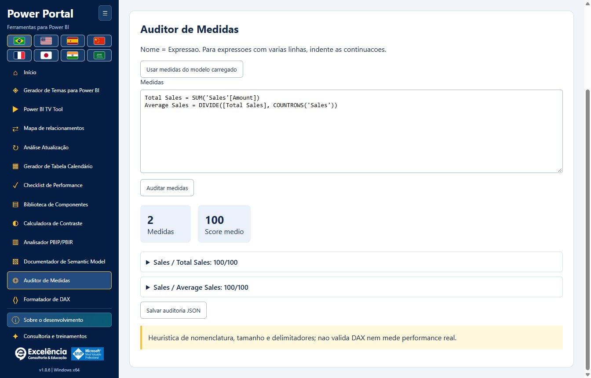

Audite medidas do modelo ou DAX fornecido com verificações heurísticas de nomes/tamanho/delimitadores. Não valida a semântica DAX nem mede desempenho real do relatório.

## Consultoria e treinamentos

Conheça consultoria Power BI, Microsoft Fabric, engenharia de dados e soluções completas. Inclui treinamentos In Company, vídeos e contato. WhatsApp/e-mail abrem um rascunho ou página no navegador; nenhuma mensagem ou reunião é enviada automaticamente.

[Notas de versão](../../CHANGELOG.pt-BR.md) · [Solução de problemas](TROUBLESHOOTING.md)

## Análise Atualização

Meça a atualizacao nativa. Compare tempos e linhas. [Análise Atualização](REFRESH-ANALYSIS.md).

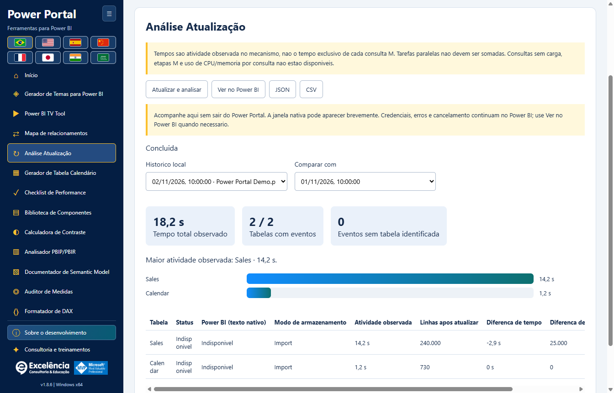

A atividade observada e a uniao dos intervalos do mecanismo identificados exatamente por tabela, sem somar fases aninhadas duas vezes. Nao representa apenas consulta a fonte nem um caminho critico comprovado. O total observado vai do acionamento ate a deteccao da conclusao, inclui sobrecarga de interface/verificacao e exclui a contagem posterior de linhas. Eventos sem tabela identificada aparecem separadamente.

A conclusao automatica exige termino observado dos comandos de atualizacao e janela do Power BI pronta. Feche os dialogos nativos de resultado. Concluir captura manualmente sempre indica analise incompleta, nao comprova sucesso nem cancela a atualizacao. Erros do mecanismo/rastreamento sao explicitos. Uma captura interrompida nao e apresentada como concluida.

## Cards animados na pagina inicial

Os doze cards iniciais agora usam o mesmo azul-marinho do menu (#041e43), com cenas vetoriais originais sem texto. Cada ferramenta mantem sua ilustracao central, enriquecida com paineis de dados, graficos, banco de dados, orbitas, grade e satelites flutuantes. Linhas de sinal se movem suavemente. As capas nao carregam imagens, scripts ou servicos externos.

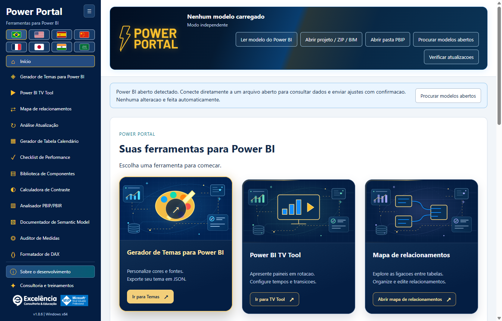

Passe o mouse ou foque um card pelo teclado para ver moldura e brilho dourados, reflexo de luz, cena realcada, seta circular de abertura e acao dourada. Pressionar gera feedback imediato sem atrasar a navegacao. Enter/Espaco continuam abrindo a mesma ferramenta. A preferencia de reduzir movimentos do Windows/navegador interrompe animacoes, preservando realce estatico e foco visivel. Titulos e acoes ficam fora da imagem e seguem o idioma selecionado. Os prints mostram estados estaticos normal/hover, nao videos.

