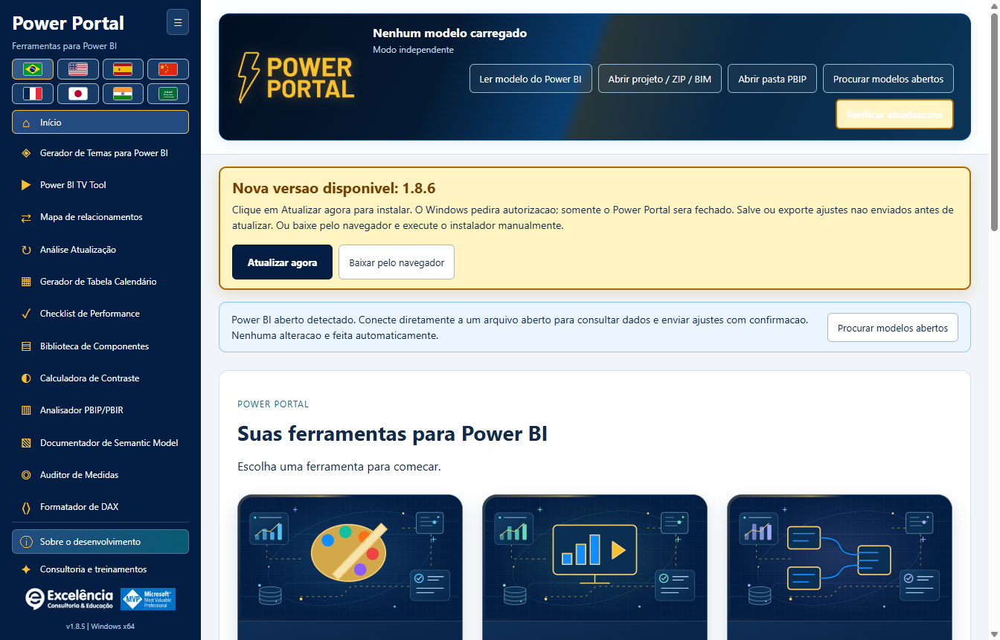

# Verificação de atualizações e instalação automática

<!-- language-selector -->
[🇺🇸 English](../UPDATES.md) · [🇧🇷 Português](UPDATES.md) · [🇪🇸 Español](../es/UPDATES.md) · [🇨🇳 简体中文](../zh-CN/UPDATES.md) · [🇫🇷 Français](../fr/UPDATES.md) · [🇯🇵 日本語](../ja/UPDATES.md) · [🇮🇳 हिन्दी](../hi/UPDATES.md) · [🇸🇦 العربية](../ar/UPDATES.md)
<!-- /language-selector -->

**1.8.5 — Baixar atualizações pelo navegador**

Quando houver uma versão nova, o aviso de atualização agora oferece Baixar pelo navegador ao lado de Atualizar agora. O botão abre no navegador padrão o endereço oficial do instalador detectado no GitHub, sem fechar o Power Portal nem iniciar a instalação. Execute o instalador baixado manualmente quando desejar. A opção continua disponível após um erro na atualização automática. Falhas ao abrir o navegador são exibidas. Atualizar agora continua baixando pelo app, verificando SHA-256 e tamanho e solicitando autorização do Windows. Downloads pelo navegador não passam pela verificação automática do app: compare o SHA-256 publicado antes de executar o instalador. Os dois botões e a orientação estão traduzidos nos oito idiomas.

[Voltar ao início](../../README.pt-BR.md) · [Instalação](INSTALLATION.md)

<a name="available-from-version-162"></a>
## Disponível a partir da versão 1.6.2

Instale a **1.6.2 manualmente uma vez** se estiver na 1.6.1 ou anterior. Aplicativos antigos não recebem um atualizador novo sem antes instalar a versão que o contém.

O aplicativo **instalado** verifica a Release pública estável mais recente em `luisgnserra/powerportaldesktop` ao abrir. Compara versões numéricas de três partes, ignora versões atuais/anteriores e não oferece rascunhos ou pré-lançamentos.

A execução de desenvolvimento/código-fonte não baixa nem instala atualizações.

<a name="update-flow"></a>
## Fluxo da atualização

1. Abra o Power Portal. Com internet disponível, ele verifica se há uma Release mais nova.
2. Se houver, um aviso âmbar destacado exibe a versão e **Atualizar agora**. Fica visível durante a rolagem, com animação suave de brilho; preferências de movimento reduzido desativam a animação. O botão de verificação também ganha destaque.
3. **Salve/exporte edições ainda não enviadas** antes de continuar. Gravações/temas em andamento bloqueiam a atualização.
4. Clique em **Atualizar agora**. Abrir o aplicativo ou verificar atualizações não instala nada.
5. O processo principal baixa o instalador x64 oficial por HTTPS e confere o tamanho exato e SHA-256 com os metadados do Asset publicado na Release do GitHub.
6. O Windows solicita autorização de administrador. Aprove somente se confiar nesta distribuição.
7. Após autorização/início do instalador, o Power Portal fecha e a instalação roda silenciosamente na **pasta existente**. **O Power BI Desktop não é fechado.**
8. Reabra o Power Portal após concluir. Reinicie o Desktop se a guia/registro precisar recarregar.



O print mostra um **aviso futuro simulado da 1.8.5** dentro da 1.8.5, apenas para demonstrar a interface. Não anuncia a 1.8.5.

<a name="receive-version-185-from-an-earlier-updater-enabled-version"></a>
### Receber a versão 1.8.5 de uma versão anterior com atualizador

Com **1.6.2, 1.6.3 ou 1.6.4** instalada, reabra ou clique em **Verificar atualizações**. A versão estável publicada **1.8.5** deve aparecer com **Atualizar agora**. Não instale manualmente a 1.8.5 primeiro se quiser observar o aviso. Versões anteriores à 1.6.4 usam o aviso original; o destaque visual é mantido na 1.8.5. Clique quando estiver pronto e aprove a autorização do Windows.

O aplicativo informa o início do instalador, não uma instalação concluída e verificada: ela termina após o aplicativo antigo fechar. Confira a versão ao reabrir. O Windows ainda pode bloquear o instalador sem assinatura ou exigir aprovação da TI.

<a name="checks-retries-and-failures"></a>
## Verificações, novas tentativas e falhas

**Verificar atualizações**, nas ações superiores, repete manualmente a checagem. Não há um ciclo de consultas em segundo plano nem instalação forçada.

Na 1.6.4, uma checagem bem-sucedida sem versão nova não deixa uma faixa “aplicativo atualizado” ocupando uma linha. Erros e atualizações disponíveis continuam visíveis.

- Falta de internet, firewall/proxy ou limites da API GitHub são exibidos no aviso; ferramentas locais continuam utilizáveis.
- Metadados inválidos, digest ausente, checksum incompatível, redirecionamento inesperado, download excessivo ou timeout impedem execução.
- Cancelar a autorização Windows mantém o aplicativo disponível e mostra erro. Tente novamente quando estiver pronto.
- Falha de checagem limpa a oferta anterior para não usar dados antigos silenciosamente.
- O atualizador bloqueia novas gravações durante download/instalação e recusa iniciar durante gravação/tema ativo.
- Edições não enviadas/exportadas nos formulários não são preservadas automaticamente na substituição do aplicativo. Exporte/salve primeiro.

<a name="privacy-network-and-integrity"></a>
## Privacidade, rede e integridade

Solicitações de atualização contêm somente metadados normais de requisições HTTPS ao GitHub, não nomes de modelos, DAX, dados, conteúdo PBIX nem credenciais. Releases públicas não exigem login/token GitHub.

Metadados da Release vêm de:

```text
https://api.github.com/repos/luisgnserra/powerportaldesktop/releases/latest
```

URLs do instalador devem coincidir com o Asset versionado exato deste repositório. Redirecionamentos HTTPS são limitados ao GitHub e seus hosts oficiais de Assets. O aplicativo mantém o hash/tamanho dos metadados para o download.

Checagens têm limite total de 30 segundos e 1 MB de metadados. Downloads têm limite total de 20 minutos, 30 segundos sem atividade de socket e tamanho máximo aceito de 1 GB. São limites, não o tamanho normal do pacote.

Downloads ficam em `%APPDATA%\powerportal-desktop\updates`. Arquivos parciais são removidos em falhas tratadas; um EXE verificado pode permanecer após instalar. Nenhum código-fonte é baixado ou compilado.

**SHA-256 verifica integridade, não é assinatura digital do editor.** A versão atual não é assinada. O atualizador não contorna UAC, SmartScreen nem políticas empresariais. Se sua rede exigir proxy não compatível com o atualizador, procure a TI ou instale manualmente o EXE verificado da Release.

<a name="manual-fallback"></a>
## Alternativa manual

Use a [Release mais recente](https://github.com/luisgnserra/powerportaldesktop/releases/latest) ou o [auxiliar PowerShell versionado](INSTALLATION.md#command-line-installation). Comandos com versões fixadas instalam intencionalmente aquela versão, não qualquer Release futura mais recente.
